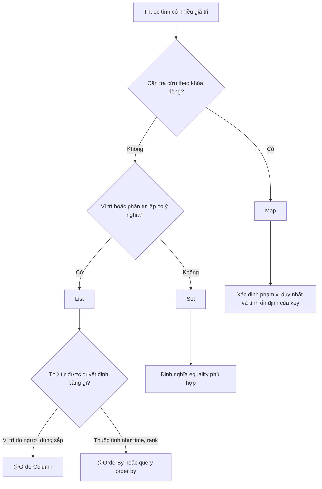

# Chọn Set, List hoặc Map theo ý nghĩa nghiệp vụ trong quan hệ đa trị Hibernate

Khi một entity có nhiều giá trị hoặc liên kết tới nhiều entity khác, Java cho phép biểu diễn bằng `Set`, `List` hoặc `Map`. Trong Hibernate, lựa chọn này còn ảnh hưởng đến cách ORM quản lý bộ sưu tập (*persistent collection*), ánh xạ bảng quan hệ, phát hiện thay đổi và sinh SQL.

Điều quan trọng nhất là **chọn kiểu collection theo ý nghĩa nghiệp vụ trước, rồi mới xác định annotation và cách tối ưu**:

- **`Set<E>`:** một phần tử không được xuất hiện lặp lại theo quy tắc bằng nhau của Java.
- **`List<E>`:** các phần tử có thứ tự và có thể lặp; cần xác định thứ tự ấy có phải dữ liệu nghiệp vụ cần lưu hay không.
- **`Map<K,V>`:** mỗi giá trị được tìm bằng một khóa; khóa `K` chỉ xuất hiện một lần trong map.

Chẳng hạn, một khóa học có danh sách sinh viên ghi danh không trùng; một playlist có bài hát ở vị trí 1, 2, 3 và có thể phát lại bài hát cũ; một sản phẩm có bản dịch tên theo ngôn ngữ. Ba ví dụ này tương ứng khá tự nhiên với `Set<Student>`, `List<Track>` và `Map<Locale, Translation>`.

Bài học trình bày cách chọn kiểu, cách Hibernate lưu trữ chúng qua `@ElementCollection`, `@OneToMany`, `@ManyToMany`, `@OrderColumn`, `@OrderBy` và các annotation khóa của `Map`, cùng các giới hạn về equality, thứ tự và hiệu năng.

## 1. Câu hỏi đầu tiên: một tập hợp thể hiện quy tắc nào?

Khi thiết kế thuộc tính đa trị, hãy trả lời ba câu:

1. **Có cho phép cùng một phần tử xuất hiện nhiều lần không?** Nếu không, `Set` thường thể hiện bất biến rõ nhất.
2. **Vị trí phần tử có ý nghĩa nghiệp vụ không?** Nếu người dùng được kéo thả, đánh số bước, thay đổi thứ tự ưu tiên thủ công hoặc một giá trị có thể xuất hiện ở nhiều vị trí, `List` thường phù hợp.
3. **Người dùng tra cứu giá trị bằng một khóa riêng không?** Nếu có đúng một giá trị cho mỗi mã ngôn ngữ, loại tiền, ngày hoặc mã thuộc tính, `Map` thường diễn đạt mô hình tốt hơn.

| Tình huống nghiệp vụ | Kiểu gợi ý | Vì sao? |
| --- | --- | --- |
| Quyền của một tài khoản | `Set<Permission>` | Một quyền không cần thêm hai lần |
| Nhãn gắn vào một bài viết | `Set<Tag>` | Trùng nhãn không đem lại ý nghĩa |
| Bài hát trong playlist | `List<PlaylistItem>` | Thứ tự phát quan trọng; một bài có thể lặp |
| Các bước trong quy trình | `List<Step>` | Chuyển vị trí làm thay đổi quy trình |
| Các sự kiện theo thời gian | `List<Event>` với cách sắp xếp rõ ràng | Cần một trật tự xem nhất quán |
| Bản dịch của tên sản phẩm | `Map<String, String>` | Mỗi mã locale có một bản dịch |
| Giá theo loại tiền | `Map<CurrencyCode, Price>` | Tra cứu theo khóa loại tiền |
| Thành viên nhóm không trùng | `Set<Member>` | Membership là một quan hệ duy nhất |
| Dòng hàng trong giỏ | Tùy nghiệp vụ: `List<CartLine>` hoặc `Map<Sku, CartLine>` | Cần quyết định có cho một SKU nhiều dòng khác cấu hình không |
| Ghi chú có nhiều đoạn lặp | `List<String>` | Không được tự loại các đoạn giống nhau |

**Không có quy tắc “quan hệ một-nhiều thì luôn dùng List” hoặc “nhiều-nhiều thì luôn dùng Set”.** Cardinality trong cơ sở dữ liệu là một chuyện; ý nghĩa thứ tự, trùng lặp và tra cứu khóa trong domain là chuyện khác.



Sơ đồ chỉ giúp lựa chọn ban đầu. Chẳng hạn, một tập hợp không trùng nhưng cần hiển thị theo bảng chữ cái vẫn có thể là `Set` ở tầng domain và được truy vấn/sắp xếp rõ ràng khi đọc; không nhất thiết biến nó thành `List` chỉ vì UI có thứ tự.

## 2. Ba kiểu có ngữ nghĩa khác nhau trong Java

### `Set<E>`

`Set` bảo đảm không chứa hai phần tử được coi là bằng nhau theo quy tắc của collection (thường là `equals()` và `hashCode()`).

```java
Set<String> tags = new HashSet<>();
tags.add("java");
tags.add("hibernate");
tags.add("java");

System.out.println(tags.size()); // 2
```

Thứ tự duyệt của `HashSet` không được bảo đảm. `LinkedHashSet` giữ thứ tự thêm trong bộ nhớ Java, nhưng **điều đó không tự bảo đảm Hibernate sẽ lưu thứ tự ấy vào database**.

### `List<E>`

`List` cho phép truy cập theo vị trí, thay đổi thứ tự và giữ giá trị trùng.

```java
List<String> playlist = new ArrayList<>();
playlist.add("intro");
playlist.add("chapter");
playlist.add("intro");

System.out.println(playlist.size()); // 3
System.out.println(playlist.get(2)); // intro

Collections.swap(playlist, 0, 1);
```

Một `List` ở Java có thứ tự tại thời điểm chạy. Nhưng muốn sau khi đóng và mở lại `EntityManager`, Hibernate nạp đúng thứ tự đó, phải định nghĩa **cơ chế lưu/sắp thứ tự**. Chỉ khai báo field `List` chưa đủ để hứa thứ tự lâu dài.

### `Map<K,V>`

`Map` lưu một giá trị ứng với mỗi khóa. `put` lần hai với cùng khóa thường **thay thế** giá trị cũ.

```java
Map<String, String> titles = new HashMap<>();
titles.put("vi", "Hướng dẫn");
titles.put("en", "Guide");
titles.put("vi", "Sổ tay");

System.out.println(titles.get("vi")); // Sổ tay
System.out.println(titles.size());     // 2
```

Một `HashMap` cũng không bảo đảm thứ tự duyệt. `LinkedHashMap` có thứ tự trong bộ nhớ, còn `TreeMap` sắp theo key; khi dùng Hibernate phải hiểu cách mapping và cơ chế truy vấn/sắp xếp cụ thể thay vì suy ra thứ tự lưu từ tên implementation.

| Thuộc tính Java | `Set` | `List` | `Map` |
| --- | --- | --- | --- |
| Quy tắc không trùng | Theo phần tử `E` | Không có mặc định | Theo khóa `K` |
| Có vị trí số nguyên | Không | Có | Không |
| Tra cứu theo khóa riêng | Không | Không | Có |
| Có thể lưu giá trị bằng nhau nhiều lần | Không theo equality của `E` | Có | Có, ở các key khác nhau |
| Thứ tự duyệt `Hash...` mặc định | Không cam kết | Có thứ tự phần tử | Không cam kết |
| Vấn đề khi ánh xạ ORM | Equality và unique constraints | Order persistence, cập nhật vị trí, bag semantics | Mapping key, unique constraints, key thay đổi |

## 3. Collection trong Hibernate không chỉ là một field Java

JPA/Hibernate quản lý hai nhóm đa trị phổ biến:

- **Collection của giá trị**: `Set<String>`, `List<String>`, `Map<String, String>`, hoặc tập hợp `@Embeddable`, thường dùng `@ElementCollection`.
- **Collection của entity**: `Set<Tag>`, `List<Task>` hoặc `Map<String, Translation>`, thường dùng `@OneToMany` hoặc `@ManyToMany` theo quan hệ.

Ví dụ:

```java
@ElementCollection
private Set<String> keywords = new HashSet<>();
```

khác về vòng đời với:

```java
@OneToMany(mappedBy = "article")
private Set<Comment> comments = new HashSet<>();
```

`String` hoặc một embeddable trong `@ElementCollection` không có định danh entity độc lập để quản lý riêng. `Comment` là một entity có `@Id`, có thể tồn tại hoặc được tham chiếu trong quy tắc vòng đời của chính nó.

Hibernate thường thay field collection bằng các wrapper quản lý như persistent set/list/bag/map để theo dõi thay đổi, lazy loading và flush. Code nghiệp vụ nên khai báo theo **interface** `Set`, `List` hoặc `Map` và khởi tạo collection ở entity mới:

```java
private Set<Tag> tags = new HashSet<>();
private List<Step> steps = new ArrayList<>();
private Map<String, String> translations = new HashMap<>();
```

Không nên ép rằng getter luôn trả đúng `HashSet.class`, hoặc thay thẳng một collection managed bằng một instance mới mà không hiểu cascade và `orphanRemoval`. Hibernate có thể cần duy trì wrapper đang được theo dõi để xác định thay đổi.

### Không được chọn chỉ theo dạng bảng

Cùng một bảng quan hệ hai cột có thể biểu diễn nhiều ý nghĩa khác nhau:

```text
article_tags(article_id, tag_id)       -> tập hợp không trùng
playlist_items(playlist_id, position, track_id)
                                       -> danh sách có thứ tự, có thể lặp track
product_titles(product_id, locale, title)
                                       -> map theo locale
```

Tập trung vào bất biến domain giúp thiết kế constraint và annotation nhất quán với hành vi mà người dùng mong đợi.

## 4. Ví dụ hoàn chỉnh: một entity dùng cả Set, List và Map

Giả sử một `Document` có:

1. Các **tag không trùng**.
2. Các **bước hướng dẫn được sắp theo vị trí**.
3. Các **bản dịch tiêu đề theo mã ngôn ngữ**.

Ta có thể biểu diễn trực tiếp bằng `@ElementCollection`.

```java
import jakarta.persistence.CollectionTable;
import jakarta.persistence.Column;
import jakarta.persistence.ElementCollection;
import jakarta.persistence.Entity;
import jakarta.persistence.GeneratedValue;
import jakarta.persistence.GenerationType;
import jakarta.persistence.Id;
import jakarta.persistence.JoinColumn;
import jakarta.persistence.MapKeyColumn;
import jakarta.persistence.OrderColumn;
import jakarta.persistence.Table;
import jakarta.persistence.UniqueConstraint;

import java.util.ArrayList;
import java.util.Collections;
import java.util.HashMap;
import java.util.HashSet;
import java.util.List;
import java.util.Map;
import java.util.Set;

@Entity
@Table(name = "documents")
public class Document {

    @Id
    @GeneratedValue(strategy = GenerationType.IDENTITY)
    private Long id;

    @Column(nullable = false)
    private String title;

    @ElementCollection
    @CollectionTable(
        name = "document_tags",
        joinColumns = @JoinColumn(name = "document_id"),
        uniqueConstraints = @UniqueConstraint(
            columnNames = {"document_id", "tag"}
        )
    )
    @Column(name = "tag", nullable = false)
    private Set<String> tags = new HashSet<>();

    @ElementCollection
    @CollectionTable(
        name = "document_steps",
        joinColumns = @JoinColumn(name = "document_id")
    )
    @OrderColumn(name = "step_position")
    @Column(name = "step_text", nullable = false)
    private List<String> steps = new ArrayList<>();

    @ElementCollection
    @CollectionTable(
        name = "document_titles",
        joinColumns = @JoinColumn(name = "document_id"),
        uniqueConstraints = @UniqueConstraint(
            columnNames = {"document_id", "locale"}
        )
    )
    @MapKeyColumn(name = "locale", nullable = false, length = 16)
    @Column(name = "translated_title", nullable = false)
    private Map<String, String> translatedTitles = new HashMap<>();

    protected Document() {
    }

    public Document(String title) {
        this.title = title;
    }

    public Long getId() {
        return id;
    }

    public Set<String> getTags() {
        return tags;
    }

    public List<String> getSteps() {
        return steps;
    }

    public Map<String, String> getTranslatedTitles() {
        return translatedTitles;
    }

    public void addTag(String tag) {
        tags.add(tag);
    }

    public void addStep(String text) {
        steps.add(text);
    }

    public void moveStep(int fromIndex, int toIndex) {
        if (fromIndex == toIndex) {
            return;
        }
        String step = steps.remove(fromIndex);
        steps.add(toIndex, step);
    }

    public void putTranslation(String locale, String translatedTitle) {
        translatedTitles.put(locale, translatedTitle);
    }

    public void removeTranslation(String locale) {
        translatedTitles.remove(locale);
    }
}
```

Trong service có transaction:

```java
import jakarta.persistence.EntityManager;
import jakarta.persistence.PersistenceContext;
import org.springframework.stereotype.Service;
import org.springframework.transaction.annotation.Transactional;

@Service
public class DocumentService {

    @PersistenceContext
    private EntityManager em;

    @Transactional
    public Long createGuide() {
        Document doc = new Document("Hibernate Collections");

        doc.addTag("hibernate");
        doc.addTag("java");
        doc.addTag("hibernate"); // Set giữ lại một giá trị "hibernate".

        doc.addStep("Chuẩn bị dự án");
        doc.addStep("Tạo entity");
        doc.addStep("Chạy migration");

        doc.putTranslation("vi", "Bộ sưu tập Hibernate");
        doc.putTranslation("en", "Hibernate Collections");

        em.persist(doc);
        return doc.getId();
    }

    @Transactional
    public void reviseGuide(Long id) {
        Document doc = em.find(Document.class, id);
        if (doc == null) {
            throw new IllegalArgumentException("Không tìm thấy tài liệu");
        }

        doc.addTag("orm");
        doc.moveStep(2, 0);
        doc.putTranslation("vi", "Ánh xạ bộ sưu tập Hibernate");
        // Hibernate theo dõi thay đổi của các collection managed.
    }
}
```

Ba collection sinh ra ba kiểu cấu trúc quan hệ khác nhau.

### Bảng lưu Set

```sql
CREATE TABLE document_tags (
    document_id BIGINT NOT NULL,
    tag VARCHAR(150) NOT NULL,
    CONSTRAINT fk_document_tags_document
        FOREIGN KEY (document_id) REFERENCES documents(id),
    CONSTRAINT uk_document_tag
        UNIQUE (document_id, tag)
);
```

Một document không có hai dòng trùng cùng tag. Ràng buộc này bổ sung cho tính không trùng của `Set` tại Java.

### Bảng lưu List có vị trí

```sql
CREATE TABLE document_steps (
    document_id BIGINT NOT NULL,
    step_position INTEGER NOT NULL,
    step_text VARCHAR(500) NOT NULL,
    FOREIGN KEY (document_id) REFERENCES documents(id)
);
```

`@OrderColumn(name = "step_position")` giúp Hibernate lưu vị trí của phần tử trong danh sách. Khi nạp lại document, thứ tự được tái tạo từ cột này. Hệ thống có thể bổ sung constraint/index phù hợp, nhưng cần xét cách ORM cập nhật thứ tự khi kéo thả hoặc đổi chỗ.

### Bảng lưu Map

```sql
CREATE TABLE document_titles (
    document_id BIGINT NOT NULL,
    locale VARCHAR(16) NOT NULL,
    translated_title VARCHAR(300) NOT NULL,
    FOREIGN KEY (document_id) REFERENCES documents(id),
    CONSTRAINT uk_document_title_locale
        UNIQUE (document_id, locale)
);
```

`locale` là **key của Map**, `translated_title` là value. Hai document khác nhau đều được phép có bản dịch `vi`; mỗi document chỉ có tối đa một bản dịch ứng với key đó.

DDL trên chỉ minh họa hình dạng bảng và constraint. Trong dự án thực, kiểu cột, độ dài, khả năng nullable, tên constraint và cách migration phải đồng nhất với mapping/dialect. Nếu database production quản lý schema bằng Flyway hoặc Liquibase, annotation không tự sửa DDL đã có.

## 5. Chọn Set khi nghiệp vụ coi phần tử là duy nhất

`Set` phù hợp với những quan hệ mang ý nghĩa **membership**: một người tham gia một nhóm một lần; một vai trò được gán một lần; một bài viết gắn một tag một lần.

Ví dụ `Article` và `Tag`:

```java
import jakarta.persistence.Entity;
import jakarta.persistence.GeneratedValue;
import jakarta.persistence.GenerationType;
import jakarta.persistence.Id;
import jakarta.persistence.JoinColumn;
import jakarta.persistence.JoinTable;
import jakarta.persistence.ManyToMany;
import jakarta.persistence.Table;
import jakarta.persistence.UniqueConstraint;
import java.util.HashSet;
import java.util.Set;

@Entity
@Table(name = "articles")
public class Article {

    @Id
    @GeneratedValue(strategy = GenerationType.IDENTITY)
    private Long id;

    @ManyToMany
    @JoinTable(
        name = "article_tags",
        joinColumns = @JoinColumn(name = "article_id"),
        inverseJoinColumns = @JoinColumn(name = "tag_code"),
        uniqueConstraints = @UniqueConstraint(
            columnNames = {"article_id", "tag_code"}
        )
    )
    private Set<Tag> tags = new HashSet<>();

    protected Article() {}

    public void addTag(Tag tag) {
        tags.add(tag);
    }

    public void removeTag(Tag tag) {
        tags.remove(tag);
    }

    public Set<Tag> getTags() {
        return tags;
    }
}
```

`Tag` có một định danh ổn định do ứng dụng cung cấp:

```java
import jakarta.persistence.Entity;
import jakarta.persistence.Id;
import jakarta.persistence.Table;
import java.util.Objects;

@Entity
@Table(name = "tags")
public class Tag {

    @Id
    private String code;

    protected Tag() {}

    public Tag(String code) {
        this.code = Objects.requireNonNull(code);
    }

    public String getCode() {
        return code;
    }

    @Override
    public boolean equals(Object other) {
        if (this == other) return true;
        if (!(other instanceof Tag)) return false;
        Tag that = (Tag) other;
        return Objects.equals(getCode(), that.getCode());
    }

    @Override
    public int hashCode() {
        return Objects.hashCode(getCode());
    }
}
```

Cách dùng:

```java
Tag javaTag = em.find(Tag.class, "java");
Article article = em.find(Article.class, articleId);

article.addTag(javaTag);
article.addTag(javaTag); // Set không thêm một mục trùng.
```

Mẫu này giả định tag `java` đã tồn tại, entity được nạp managed trong transaction phù hợp và `articleId` hợp lệ. Quan hệ many-to-many dùng tag có thể được nhiều article chia sẻ; thường **không cascade REMOVE** từ article sang tag, vì xóa một article không có nghĩa phải xóa tag khỏi toàn hệ thống.

### Set loại trùng theo Java equality, không theo suy đoán ORM

Nếu hai `Tag` cùng `code` nhưng `equals()` giữ mặc định theo tham chiếu, Java `HashSet` có thể coi chúng là hai phần tử khác nhau. Khi đó việc “chọn Set” chưa đủ để bảo đảm uniqueness đúng với domain.

Ngược lại, với `equals()`/`hashCode()` dựa trên `code` ổn định như trên, Set có thể loại trùng theo mã.

Với entity có ID do database sinh sau `persist`, không nên tự động dùng `hashCode()` phụ thuộc một ID chuyển từ `null` sang giá trị, đặc biệt nếu đã thêm entity vào `HashSet`. Cần thiết kế equality phù hợp với vòng đời entity, proxy Hibernate và những giá trị thực sự bất biến.

### Ràng buộc database vẫn cần thiết

Ngay cả khi Java dùng `Set`, hai transaction hoặc hai service có thể cố tạo cùng quan hệ. Một bảng nối có khóa chính hoặc unique constraint trên `(article_id, tag_code)` bảo đảm tính duy nhất ở database.

`Set` diễn đạt quy tắc ở mô hình đối tượng; **unique constraint** bảo vệ dữ liệu lưu trữ dưới concurrency và các đường ghi không đi qua cùng Java object.

### Set không mặc định bảo đảm thứ tự

`HashSet` không có trật tự nghiệp vụ. Người dùng muốn hiển thị các tag theo bảng chữ cái thì có thể sắp khi truy vấn, dùng `@OrderBy` thích hợp hoặc chuyển tập hợp sang danh sách hiển thị đã sắp, tùy thiết kế. Đừng chọn `List` chỉ để “cho nó có thứ tự” nếu việc trùng tag vẫn bị cấm và thứ tự đó không phải dữ liệu cần persist.

Hibernate cũng có các khả năng sắp xếp collection như `@SortNatural`, `@SortComparator` cho `SortedSet`/`SortedMap` trong ngữ cảnh được hỗ trợ. Đây là cách sắp theo comparator của Java, khác với việc lưu thứ tự kéo thả bằng `@OrderColumn`.

## 6. Chọn List khi vị trí hoặc sự lặp lại có nghĩa

`List` hợp lý khi thứ tự **là một phần dữ liệu**: các bước trong hướng dẫn, chương trong khóa học, phần tử playlist, các mục trong lịch trình.

Một playlist có thể chứa cùng bài hát hai lần:

```text
Playlist "Focus":
    [0] Intro
    [1] Deep Work
    [2] Intro
```

Nếu dùng `Set<Track>`, vị trí thứ hai của `Intro` có thể bị loại bỏ. Trong trường hợp cần cùng track ở nhiều vị trí với metadata khác nhau (thời điểm thêm, người thêm, ghi chú), một entity liên kết như `PlaylistItem` có ID riêng thường là mô hình giàu ý nghĩa hơn `List<Track>` đơn giản.

### `@OrderColumn`: lưu thứ tự do người dùng quyết định

`@OrderColumn` ghi **vị trí của phần tử trong collection** vào một cột quan hệ.

Ví dụ danh sách công việc trên một bảng Kanban:

```java
import jakarta.persistence.CascadeType;
import jakarta.persistence.Entity;
import jakarta.persistence.GeneratedValue;
import jakarta.persistence.GenerationType;
import jakarta.persistence.Id;
import jakarta.persistence.JoinColumn;
import jakarta.persistence.OneToMany;
import jakarta.persistence.OrderColumn;
import java.util.ArrayList;
import java.util.List;

@Entity
public class TaskBoard {

    @Id
    @GeneratedValue(strategy = GenerationType.IDENTITY)
    private Long id;

    @OneToMany(cascade = CascadeType.ALL, orphanRemoval = true)
    @JoinColumn(name = "board_id")
    @OrderColumn(name = "position")
    private List<BoardTask> tasks = new ArrayList<>();

    protected TaskBoard() {}

    public void addTask(BoardTask task) {
        tasks.add(task);
    }

    public void moveTask(int from, int to) {
        BoardTask task = tasks.remove(from);
        tasks.add(to, task);
    }

    public List<BoardTask> getTasks() {
        return tasks;
    }
}
```

Entity phần tử:

```java
import jakarta.persistence.Entity;
import jakarta.persistence.GeneratedValue;
import jakarta.persistence.GenerationType;
import jakarta.persistence.Id;

@Entity
public class BoardTask {

    @Id
    @GeneratedValue(strategy = GenerationType.IDENTITY)
    private Long id;

    private String title;

    protected BoardTask() {}

    public BoardTask(String title) {
        this.title = title;
    }

    public Long getId() {
        return id;
    }

    public String getTitle() {
        return title;
    }
}
```

Ví dụ này là một quan hệ `@OneToMany` **một chiều** có khóa ngoại `board_id` ở bảng task và cột `position` để lưu thứ tự. Nó được chọn để minh họa dễ đọc; ứng dụng thực có thể dùng quan hệ hai chiều và thiết kế sở hữu quan hệ khác.

Khi gọi:

```java
TaskBoard board = em.find(TaskBoard.class, boardId);
board.moveTask(3, 0);
```

Hibernate có thể phát `UPDATE` cho nhiều dòng để cập nhật cột vị trí. Cách SQL cụ thể tùy mapping, phiên bản, số lượng phần tử và cách flush.

**Đánh đổi:** `@OrderColumn` rất phù hợp với kéo thả thủ công, nhưng chèn/xóa ở đầu danh sách hoặc thay đổi vị trí của nhiều phần tử có thể tạo nhiều thao tác cập nhật. Nếu danh sách rất dài và phải sắp xếp liên tục, có thể cần một mô hình rank/position riêng và chiến lược cập nhật phù hợp.

### `@OrderBy`: sắp xếp theo thuộc tính đã lưu

Nếu muốn các sự kiện hiển thị theo thời điểm tạo, ý nghĩa thường là:

> Mỗi sự kiện có thời gian tạo riêng; khi đọc, hệ thống sắp theo thời gian đó.

Khi ấy có thể dùng `@OrderBy`:

```java
@OneToMany(mappedBy = "timeline")
@OrderBy("createdAt ASC, id ASC")
private List<TimelineEvent> events = new ArrayList<>();
```

Ví dụ `TimelineEvent` cần có các thuộc tính entity `createdAt` và `id`. `@OrderBy` dùng **tên thuộc tính entity**, không phải tên cột SQL; thứ tự được xác định bởi các giá trị lưu trên phần tử.

Khác biệt:

| Nhu cầu | `@OrderColumn` | `@OrderBy` |
| --- | --- | --- |
| Người dùng kéo mục từ vị trí 5 lên vị trí 1 | Phù hợp | Chỉ thay đổi thứ tự nếu thuộc tính sắp xếp thay đổi |
| Muốn hiển thị theo `createdAt` | Không cần thiết nếu chỉ là sắp thời gian | Phù hợp |
| Có cột vị trí do ORM quản lý | Có | Không bắt buộc |
| Thứ tự phụ thuộc dữ liệu của phần tử | Không phải yêu cầu chính | Có |
| Đảo `Collections.swap(...)` rồi flush | Có thể ghi thứ tự mới | Không làm đổi tiêu chí sắp xếp |
| Cần biết vị trí như dữ liệu nghiệp vụ | Có thể dùng cột order | Có thể cần một property `rank` riêng |

Nếu dùng `@OrderBy("priority ASC")` rồi gọi `Collections.swap(list, 0, 1)`, thao tác ấy không làm tăng/giảm `priority` của entity. Sau khi nạp lại từ database, danh sách sẽ được sắp lại dựa trên `priority` như cũ.

Khi nhiều phần tử có cùng `createdAt`, nên bổ sung một tiêu chí ổn định như `id` để tránh thứ tự không xác định giữa các dòng đồng hạng.

### Chỉ khai báo `List` chưa đồng nghĩa thứ tự bền vững

```java
@OneToMany(mappedBy = "order")
private List<OrderLine> lines = new ArrayList<>();
```

Nếu không có mapping vị trí và không khai báo thứ tự truy vấn, không được hứa rằng phần tử sẽ được tải đúng thứ tự lần trước thêm vào collection.

Hibernate thường biểu diễn `List` không có index lưu trữ như **bag** trong các cấu hình/mapping nhất định; chi tiết còn phụ thuộc quan hệ sở hữu và cấu hình như `hibernate.mapping.default_list_semantics` của những phiên bản Hibernate hỗ trợ. Một bag có thể cho phép lặp nhưng **không ghi nhận vị trí riêng của mỗi occurrence**.

Vì thế câu hỏi phải là: “Thứ tự có giá trị nghiệp vụ hay không?” Nếu có, chọn cách lưu/khôi phục thứ tự rõ ràng, chứ không chỉ thay `Set` thành `List`.

## 7. Chọn Map khi mỗi phần tử có một khóa tra cứu

`Map<K,V>` phù hợp với các quan hệ dạng “**một khóa -> một giá trị**”, chẳng hạn:

- Ngôn ngữ `vi` -> bản dịch tiếng Việt.
- Mã tiền tệ `USD` -> đơn giá USD.
- Loại cấu hình `timeout` -> giá trị timeout.
- Mã môi trường `staging` -> cấu hình cho staging.
- Tháng `2026-11` -> báo cáo tóm tắt tháng.

Nếu business thường hỏi “lấy bản dịch theo locale này” thay vì “phần tử ở vị trí thứ mấy”, `Map` diễn đạt đúng ý hơn `List`.

### `@MapKeyColumn` với `@ElementCollection`

Mapping đã minh họa trong `Document`:

```java
@ElementCollection
@CollectionTable(
    name = "document_titles",
    joinColumns = @JoinColumn(name = "document_id")
)
@MapKeyColumn(name = "locale")
@Column(name = "translated_title")
private Map<String, String> translatedTitles = new HashMap<>();
```

Trong collection table:

| document_id | locale | translated_title |
| ---: | --- | --- |
| 8 | `vi` | Hướng dẫn |
| 8 | `en` | Guide |
| 8 | `ja` | ガイド |

Mỗi entry của Map tương ứng một cặp `(locale, translated_title)` thuộc document.

`translatedTitles.put("vi", "Sổ tay")` thay value theo key `vi`, không tạo thêm entry `vi` thứ hai trong Java Map. Ở database, nên có `UNIQUE(document_id, locale)` hoặc khóa chính thích hợp để bảo vệ uniqueness dưới đồng thời.

### `@MapKey(name = "...")` khi value là entity

Nếu Map chứa entity `ProjectTranslation`, có thể muốn khóa map chính là thuộc tính `locale` của entity con.

```java
@Entity
public class Project {

    @Id
    @GeneratedValue(strategy = GenerationType.IDENTITY)
    private Long id;

    @OneToMany(mappedBy = "project")
    @MapKey(name = "locale")
    private Map<String, ProjectTranslation> translations =
        new HashMap<>();
}
```

và entity con:

```java
@Entity
@Table(
    name = "project_translations",
    uniqueConstraints = @UniqueConstraint(
        columnNames = {"project_id", "locale"}
    )
)
public class ProjectTranslation {

    @Id
    @GeneratedValue(strategy = GenerationType.IDENTITY)
    private Long id;

    @ManyToOne(fetch = FetchType.LAZY)
    @JoinColumn(name = "project_id", nullable = false)
    private Project project;

    @Column(nullable = false)
    private String locale;

    @Column(nullable = false)
    private String text;
}
```

Đoạn này tập trung vào mapping của Map; ứng dụng cần bổ sung constructor, getter và phương thức quản lý hai phía của quan hệ để tạo/cập nhật entity đúng cách.

Khác biệt giữa hai annotation:

- `@MapKeyColumn(name = "locale")`: key được lưu như một **cột dành cho key của map**, thường thích hợp khi mapping không dùng property của value entity làm key.
- `@MapKey(name = "locale")`: key lấy từ **thuộc tính đã ánh xạ của entity value**; `locale` là tên property của `ProjectTranslation` chứ không phải tên cột tùy tiện.

Trong ví dụ `@MapKey(name = "locale")`, tránh thay đổi `translation.locale` của một entity sau khi nó đã nằm trong Map rồi mong Java Map tự chuyển key. Map có thể vẫn giữ khóa cũ trong bộ nhớ; hãy thiết kế key ổn định hoặc có thao tác remove/reinsert và đồng bộ constraint rõ ràng.

### Map với khóa entity

Nếu key thực sự là một entity, JPA có `@MapKeyJoinColumn` và các quy tắc ánh xạ liên quan. Với key kiểu enum hoặc temporal, có thể cần `@MapKeyEnumerated` hay annotation tương ứng. Khi key chứa nhiều thuộc tính hoặc cấu trúc quan hệ phức tạp, một entity trung gian có khóa riêng đôi khi dễ quản lý hơn Map trực tiếp.

### Map không lưu thứ tự key

`HashMap` không cam kết thứ tự. Nếu UI cần hiển thị các bản dịch theo tên ngôn ngữ, hãy sắp khi đọc, chọn cấu trúc phù hợp hoặc thêm một thuộc tính thứ tự riêng. Không coi thứ tự hash table là tính năng nghiệp vụ.

## 8. SQL quan hệ đằng sau mỗi collection

Một cách nhìn thực tế là xem mỗi loại cần ràng buộc nào trong bảng dữ liệu.

```text
Set:
    article_tags(article_id, tag_id)
    UNIQUE(article_id, tag_id)

List có thứ tự:
    document_steps(document_id, step_position, step_text)
    Thứ tự phục hồi nhờ step_position

Map:
    document_titles(document_id, locale, translated_title)
    UNIQUE(document_id, locale)
```

| Dạng collection | Cột phân biệt phần tử/entry | Constraint cần cân nhắc |
| --- | --- | --- |
| `Set<Tag>` many-to-many | `(article_id, tag_id)` | PK/UNIQUE trên cặp |
| `Set<String>` element collection | `(document_id, tag)` | UNIQUE trên cặp |
| `List<String>` có `@OrderColumn` | `(document_id, step_position)` | Ràng buộc vị trí phù hợp nếu do database quản lý; xét thứ tự UPDATE |
| `Map<Locale, Title>` | `(document_id, locale)` | UNIQUE trên cặp |
| `List<Event>` có `@OrderBy` | ID độc lập và trường `created_at` | PK trên event, index theo truy vấn; không cần unique trên timestamp nếu có thể trùng |

Từ bảng quan hệ, có thể kiểm tra liệu mô hình Java và database cùng bảo vệ một quy tắc:

- Domain nói “không lặp” thì bảng có chặn lặp không?
- Domain nói “có vị trí” thì database có lưu được vị trí không?
- Domain nói “mỗi locale một tên” thì bảng có chặn hai title cùng locale trong một document không?

Nếu câu trả lời khác nhau, collection có thể vận hành đúng trong một Session đơn lẻ nhưng sai dưới concurrency, khi import dữ liệu hoặc khi dịch vụ khác ghi trực tiếp SQL.

## 9. Entity equality ảnh hưởng trực tiếp đến Set và Map key

Java `HashSet` dùng `equals()` và `hashCode()` để xác định phần tử trùng. `HashMap` dùng hai phương thức này cho key. Với Hibernate, entity có vòng đời transient, managed và detached; điều đó khiến việc chọn equality đáng cân nhắc.

### Entity dùng ID phát sinh muộn

```java
@Entity
public class Label {

    @Id
    @GeneratedValue(strategy = GenerationType.IDENTITY)
    private Long id;

    private String name;
}
```

Khi `new Label()`, ID thường chưa có. Sau `persist`, ID được database sinh. Nếu `hashCode()` tính trực tiếp từ ID, một object đã thêm vào `HashSet` trước `persist` có thể đổi hash khi ID được gán; phép `contains` hoặc `remove` có thể không tìm thấy object đúng bucket.

```java
Set<Label> labels = new HashSet<>();
Label label = new Label();

labels.add(label);
// Persist có thể gán ID mới cho label.
entityManager.persist(label);

// Nếu hashCode phụ thuộc ID thay đổi, các thao tác Set có thể lỗi.
```

Có những chiến lược equality an toàn hơn, ví dụ dựa trên business key thực sự bất biến, hoặc so ID chỉ khi đã có giá trị và giữ hash code ổn định. Cần xét proxy và kế thừa entity trong Hibernate; đừng dùng mẫu `equals/hashCode` bất kỳ chỉ vì IDE tự sinh.

### Natural/business key ổn định

Nếu entity có `code` duy nhất, không đổi theo vòng đời, có thể dùng nó để xác định equality và tránh hiện tượng hash đổi khi database phát ID. Nhưng nếu `code` có thể đổi hoặc chỉ duy nhất trong một tenant, equality phải phản ánh đầy đủ phạm vi đó.

Ví dụ tag có key `(tenantId, code)` thì so sánh chỉ `code` có thể loại nhầm hai tag thuộc hai tenant khác nhau. Định nghĩa equality và unique constraint phải nhất quán với **thế nào là cùng phần tử trong domain**.

### Map key có thể thay đổi không?

Khi `Map` dùng một object làm key, việc thay đổi những field tham gia `equals()`/`hashCode()` sau khi đưa key vào map có thể khiến lookup hỏng. Với Map được key theo entity property bằng `@MapKey`, đổi property ấy cũng có thể làm map và entity state lệch nhau.

Nếu key phải thay đổi, cân nhắc:

1. Quy trình rõ ràng: xóa entry cũ, sửa key, thêm lại entry.
2. Dùng key bất biến ổn định và đặt tên hiển thị trong value.
3. Dùng entity liên kết có ID riêng khi thao tác đổi key là nghiệp vụ quan trọng.

## 10. Cập nhật collection managed và dirty checking

Trong transaction, Hibernate theo dõi collection đang được quản lý. Khi thêm, xóa hoặc chuyển vị trí, thay đổi có thể được đồng bộ khi flush.

Ví dụ:

```java
@Transactional
public void updateDocument(Long id) {
    Document doc = em.find(Document.class, id);
    if (doc == null) {
        throw new IllegalArgumentException("Document không tồn tại");
    }

    doc.getTags().add("orm");
    doc.getSteps().add("Kiểm tra kết quả");
    doc.getTranslatedTitles().put("fr", "Guide Hibernate");
    // Không cần gọi persist(doc) lần nữa vì doc đang managed.
}
```

Kết quả SQL có thể là thêm dòng vào bảng tag, insert và/hoặc update các vị trí trong bảng list, và thêm/thay value trong bảng Map. **Số câu SQL cụ thể không cố định**: phụ thuộc collection type, bảng, khóa, Hibernate version, batching và tối ưu của provider.

### Không cần thay nguyên object collection để cập nhật

Với entity đang managed, cách rõ ràng thường là thay đổi nội dung collection hiện có:

```java
doc.getTags().clear();
doc.getTags().addAll(updatedTags);
```

Tuy nhiên, thao tác `clear/addAll` có thể làm Hibernate phát nhiều SQL, không nhất thiết hiệu quả như xác định tập hợp phần tử cần thêm/xóa thực sự.

Một setter gán instance mới:

```java
// Cần thận trọng nếu Hibernate đang quản lý wrapper cũ:
this.steps = new ArrayList<>(newSteps);
```

có thể đặc biệt rắc rối khi collection có `orphanRemoval = true`; trong các mapping nhất định Hibernate phát hiện tham chiếu tới collection từng được theo dõi không còn được owner giữ. Thiết kế API domain thay đổi phần tử trên collection hiện hành giúp hành vi dễ hiểu hơn.

### `orphanRemoval` và `cascade`

Với `@OneToMany(orphanRemoval = true)`, xóa entity con khỏi collection có thể đánh dấu entity ấy để xóa khỏi database. Điều này khác hoàn toàn với xóa một entry trong bảng trung gian many-to-many.

- Xóa phần tử khỏi `Set<Tag>` many-to-many thường chỉ xóa **liên kết** giữa Article và Tag.
- Xóa `BoardTask` khỏi `TaskBoard.tasks` với `orphanRemoval = true` có thể xóa **chính entity task**, vì task được xem là thành phần thuộc sở hữu board.
- Xóa một giá trị khỏi `@ElementCollection` loại bỏ row lưu giá trị, vì value không có vòng đời entity riêng.

Phải chọn cascade/orphanRemoval theo quyền sở hữu nghiệp vụ, không theo việc field là `Set` hay `List`.

## 11. Hai phía quan hệ và người sở hữu mapping

Ví dụ quan hệ hai chiều `Project` có nhiều `Task`:

```java
@Entity
public class Project {

    @Id
    private Long id;

    @OneToMany(mappedBy = "project")
    private Set<Task> tasks = new HashSet<>();

    public void addTask(Task task) {
        tasks.add(task);
        task.setProject(this);
    }

    public void removeTask(Task task) {
        tasks.remove(task);
        task.setProject(null);
    }
}
```

và:

```java
@Entity
public class Task {

    @Id
    private Long id;

    @ManyToOne(fetch = FetchType.LAZY)
    @JoinColumn(name = "project_id")
    private Project project;

    public void setProject(Project project) {
        this.project = project;
    }
}
```

Đây là mẫu minh họa helper giữ hai phía đồng nhất; entity thực tế còn cần constructor, lifecycle và ID/equality phù hợp.

Trong quan hệ `@OneToMany(mappedBy = "project")`, phía `Task.project` sở hữu foreign key. Chỉ `project.getTasks().add(task)` mà không cập nhật `task.project` có thể dẫn đến mapping không được đồng bộ như mong muốn.

Quy tắc **giữ hai phía quan hệ nhất quán** áp dụng cho cả `Set`, `List` và `Map`. Kiểu collection không thay thế `mappedBy`, `@JoinColumn` và trách nhiệm cập nhật owner.

Với quan hệ many-to-many hai chiều, cũng cần phân biệt bên sở hữu `@JoinTable` và bên dùng `mappedBy`. Khi thao tác đồng bộ hai phía, không nên để code thêm liên kết nhiều lần hoặc vô tình cascade remove tới entity được chia sẻ.

## 12. List, bag và việc tải nhiều collection trong Hibernate

Một điểm quan trọng với Hibernate là thuật ngữ **bag**. Bag là bộ sưu tập có thể chứa phần tử trùng, nhưng không duy trì **vị trí riêng có ý nghĩa được lưu** như indexed list.

Trong các mapping Hibernate thông thường, `List` không có `@OrderColumn` có thể được xử lý theo bag semantics; Hibernate hỗ trợ cấu hình khác ở một số phiên bản và loại quan hệ. Vì vậy, một field `List` **không chứng minh** đang có indexed list.

### Tại sao bag ảnh hưởng đến fetch?

Ví dụ query cố fetch đồng thời hai bag collection:

```java
select p
from Project p
left join fetch p.comments
left join fetch p.attachments
where p.id = :id
```

Trong Hibernate, một số trường hợp có thể phát sinh lỗi `MultipleBagFetchException` khi fetch join nhiều bag cùng lúc. Nguyên nhân liên quan đến việc kết quả JOIN nhân số dòng và Hibernate không có đủ thông tin để tái dựng các bag một cách không mơ hồ.

**Đổi tất cả List thành Set chỉ để tránh lỗi thường không phải giải pháp kiến trúc đúng.** Set có thể giúp Hibernate loại trùng trong mô hình đối tượng, nhưng câu SQL vẫn có thể tạo ra tích Descartes và truyền rất nhiều dòng khi fetch join nhiều collection.

Các cách xử lý cần xét dựa trên use case:

- Chỉ fetch collection thực sự cần trong một truy vấn.
- Tải các collection riêng bằng truy vấn khác trong cùng unit of work.
- Dùng batch fetching hoặc subselect fetching khi phù hợp với Hibernate version.
- Dùng DTO/projection cho màn hình cần dữ liệu dạng bảng hoặc summary.
- Đo SQL thực tế và số hàng được trả về trước khi tối ưu.

### N+1 không được giải quyết bằng kiểu Java

`Set`, `List` hay `Map` đều có thể là lazy collection. Nếu tải 100 project rồi truy cập collection của mỗi project trong vòng lặp, có thể gây nhiều `SELECT` (N+1). Cách chọn fetch plan, entity graph, join fetch, batch size hoặc projection mới quyết định đáng kể số round-trip.

Chọn collection theo ngữ nghĩa domain, sau đó thiết kế truy vấn theo nhu cầu đọc.

## 13. Thứ tự, tính duy nhất và hiệu năng ghi

Các quyết định mapping có chi phí khác nhau khi ghi dữ liệu.

### Set và phép thay đổi membership

Khi một Set được ánh xạ với bảng nối có khóa phù hợp, Hibernate có thể xác định dòng liên kết cần thêm/xóa. Cấu trúc cụ thể của collection, tính ổn định của equality và mapping quyết định khả năng theo dõi thay đổi hiệu quả.

`Set` không mặc nhiên nhanh hơn `List` trong mọi tình huống. Một số mapping bag hoặc collection thiếu khóa phần tử có thể khiến Hibernate phải xóa rồi tạo lại nhiều row; các ví dụ thực tế phụ thuộc phiên bản và hình dạng bảng.

### List có `@OrderColumn` và chi phí reorder

Với danh sách:

```text
[ A, B, C, D ]
```

chuyển `D` lên đầu thành:

```text
[ D, A, B, C ]
```

có thể làm thay đổi vị trí của nhiều hàng. ORM cần đồng bộ các giá trị `position`. Với hàng nghìn phần tử và thao tác kéo thả thường xuyên, cần cân nhắc thiết kế lưu một `rank` riêng thay vì cập nhật nhiều index liên tiếp, tùy yêu cầu UI và consistency.

### Map và phép cập nhật theo key

`map.put("vi", title)` diễn đạt rõ việc thay bản dịch tiếng Việt. Nếu một document có một key `vi` duy nhất, Hibernate có thể phản ánh thay đổi vào entry tương ứng. Tuy nhiên, database cần unique constraint để đảm bảo hai giao dịch không tạo hai row cùng key.

Khi map key là thuộc tính của entity value, thay key có thể đòi thao tác cập nhật quan hệ, không phải một phép `put` đơn giản. Đó là lý do nên chọn key ổn định.

### Collection rất lớn

Nếu entity có hàng trăm nghìn phần tử:

- Tải nguyên collection để thêm một phần tử có thể quá tốn bộ nhớ.
- Reorder `List` lớn có thể sinh nhiều `UPDATE`.
- Ánh xạ quan hệ một-nhiều thành một aggregate khổng lồ có thể không phù hợp với transactional boundaries.
- Các thao tác trực tiếp bằng repository/query theo child entity hoặc batch operation có thể phù hợp hơn việc luôn thao tác toàn bộ collection.

Đừng vì thấy cấu trúc `Set/List/Map` thuận tiện mà bắt Hibernate tải mọi phần tử trong mỗi yêu cầu.

## 14. Map và List không thay thế một mô hình entity liên kết

Một quan hệ có thông tin riêng như `addedAt`, `addedBy`, `quantity`, `position` hoặc `status` có thể cần **association entity**.

Ví dụ một playlist:

```text
Playlist
  -> PlaylistItem(position=0, track=Track#10, addedAt=...)
  -> PlaylistItem(position=1, track=Track#15, addedAt=...)
  -> PlaylistItem(position=2, track=Track#10, addedAt=...)
```

Nếu dùng `Set<Track>`, bài hát `Track#10` xuất hiện hai lần sẽ bị loại trùng. Nếu dùng `List<Track>`, có thể biểu diễn phần tử lặp và thứ tự, nhưng không có nơi tự nhiên lưu thông tin `addedAt`/`addedBy` riêng cho **mỗi occurrence**.

Một entity `PlaylistItem` có `@Id` riêng, `@ManyToOne` tới `Playlist` và `Track` cùng cột vị trí có thể thể hiện những yêu cầu đó rõ hơn.

```java
@Entity
@Table(name = "playlist_items")
public class PlaylistItem {

    @Id
    @GeneratedValue(strategy = GenerationType.IDENTITY)
    private Long id;

    @ManyToOne(fetch = FetchType.LAZY, optional = false)
    @JoinColumn(name = "playlist_id")
    private Playlist playlist;

    @ManyToOne(fetch = FetchType.LAZY, optional = false)
    @JoinColumn(name = "track_id")
    private Track track;

    @Column(name = "position", nullable = false)
    private Integer position;

    @Column(name = "added_at", nullable = false)
    private Instant addedAt;

    protected PlaylistItem() {}
}
```

Trong mô hình này, có thể tải `List<PlaylistItem>` bằng `@OrderBy("position ASC")` hoặc query `order by i.position`. Ứng dụng chủ động thay đổi `position` khi người dùng reorder và dùng constraint phù hợp nếu cần mỗi position duy nhất trong playlist.

**Nguyên tắc:** nếu một mục trong collection có vòng đời, metadata hoặc quyền sở hữu riêng, hãy cân nhắc biến nó thành entity thay vì cố nhét tất cả logic vào kiểu container.

## 15. Tránh nhầm lẫn giữa thứ tự của UI và thứ tự lưu trữ

Một số màn hình luôn hiển thị danh sách theo tên:

```text
Tags: Hibernate, Java, ORM
```

Điều này chỉ là **cách trình bày**, chưa chắc user có khả năng sắp xếp thủ công. Domain vẫn có thể là `Set<Tag>` và view tạo danh sách đã sort:

```java
List<Tag> sortedTags = article.getTags().stream()
    .sorted(Comparator.comparing(Tag::getCode))
    .toList();
```

Trong Java cũ không có `Stream.toList()`, có thể dùng `collect(Collectors.toList())`. Phép sort này tạo dữ liệu phục vụ hiển thị và không đổi quy tắc membership của entity.

Ngược lại, với một chuỗi bước công việc, hoán đổi hai bước làm thay đổi thứ tự thực thi. Khi đó thứ tự **là dữ liệu domain**, nên phải có một cột vị trí hoặc một property thể hiện thứ tự được persist.

Đặt câu hỏi: “Nếu người dùng mở lại trang vào ngày mai, việc hai phần tử đổi chỗ có làm kết quả nghiệp vụ sai không?” Nếu có, cần mô hình hóa order persistence rõ ràng.

## 16. Kiểu collection và API domain

Nên để entity cung cấp những phương thức diễn đạt quy tắc nghiệp vụ thay vì buộc code bên ngoài tự do sửa collection.

Với Set:

```java
public boolean addMember(Member member) {
    return members.add(member);
}
```

Giá trị boolean cho biết việc thêm có thực sự làm Set thay đổi hay không.

Với List:

```java
public void moveTask(int fromIndex, int toIndex) {
    Task task = tasks.remove(fromIndex);
    tasks.add(toIndex, task);
}
```

Mỗi lần gọi có ý nghĩa thay đổi vị trí.

Với Map:

```java
public void setTranslation(String locale, String text) {
    if (locale == null || locale.isBlank()) {
        throw new IllegalArgumentException("Locale bắt buộc");
    }
    translations.put(locale, text);
}
```

Đây là một phép gán theo key, không phải thêm mục tùy ý vào cuối.

Các helper thực tế còn có thể xác thực quyền, giới hạn số phần tử, đảm bảo hai phía association và ngăn key thay đổi. Những kiểm tra này thuộc domain; Hibernate chịu trách nhiệm ánh xạ và theo dõi trạng thái.

### Có nên trả về collection trực tiếp không?

`getTags()` trả về collection mutable là cách minh họa đơn giản. Với domain phức tạp, có thể muốn chỉ expose view đọc và buộc thay đổi qua helper. Cần tránh phá việc Hibernate quản lý wrapper nếu chỉnh sửa cấu trúc collection bằng cách thay hẳn field.

Ví dụ có thể cân nhắc:

```java
public Set<Tag> viewTags() {
    return Collections.unmodifiableSet(tags);
}
```

Code đọc được membership mà không tự ý thêm/xóa; entity vẫn có `addTag`/`removeTag` kiểm soát thay đổi. Lưu ý các cách tạo bản copy/view, lazy loading và serialization đều cần thiết kế phù hợp với transaction boundary.

## 17. Truy vấn JPQL với Set, List và Map

Trong JPQL, collection field là một path của entity. Có thể join để truy cập phần tử; với Map có các biểu thức để lấy key/value.

### Set: join theo phần tử

```java
List<Article> articles = em.createQuery(
        "select distinct a from Article a " +
        "join a.tags t where t.code = :tagCode",
        Article.class)
    .setParameter("tagCode", "hibernate")
    .getResultList();
```

Truy vấn không phụ thuộc `tags` là `HashSet` hay wrapper cụ thể, mà phụ thuộc mapping association tới entity `Tag`.

### List có order column: lấy vị trí

Với `Document.steps` dùng `@OrderColumn`, JPQL hỗ trợ `INDEX` cho list join variable trong ngữ cảnh phù hợp:

```java
List<Object[]> rows = em.createQuery(
        "select index(s), s from Document d " +
        "join d.steps s where d.id = :id " +
        "order by index(s)",
        Object[].class)
    .setParameter("id", documentId)
    .getResultList();
```

Ở đây `INDEX(s)` mô tả vị trí trong mapped list, không phải cú pháp SQL của tên bảng vật lý. Cách provider thực thi truy vấn phụ thuộc mapping list thật sự có index.

### Map: lấy key và value

```java
List<Object[]> rows = em.createQuery(
        "select key(t), value(t) from Document d " +
        "join d.translatedTitles t where d.id = :id",
        Object[].class)
    .setParameter("id", documentId)
    .getResultList();
```

Mỗi hàng gồm mã locale và tiêu đề tương ứng. `KEY(t)` và `VALUE(t)` thuộc cách truy cập map trong JPQL; chúng không yêu cầu tên cột SQL phải trùng với tên biến Java.

### Không ngộ nhận `JOIN FETCH` là luôn tốt

Fetch join nhiều collection có thể nhân số dòng. Khi cần hiển thị một trang danh sách document với tag và translation, DTO/projection, phân trang phù hợp hoặc truy vấn riêng thường dễ kiểm soát hơn việc fetch toàn bộ cây entity.

## 18. Quy tắc riêng cho Map theo key có phạm vi tenant

Trong ứng dụng multi-tenant, key của Map có thể chỉ duy nhất trong từng tenant.

Ví dụ `Map<String, Price>` keyed by `sku` chỉ đúng nếu một sản phẩm có đúng một giá cho mỗi SKU trong phạm vi owner đã xác định. Nếu các giá được chia sẻ toàn hệ thống, key có thể cần thêm currency, market hoặc tenant.

```text
Map key = sku                  -> đúng nếu sku đủ duy nhất.
Map key = (tenantId, sku)      -> khi key xuyên nhiều tenant.
Map key = (sku, currency)      -> khi giá phân biệt theo loại tiền.
```

Một Map có key chưa đủ thông tin có thể **thay mất entry hợp lệ**: `put("SKU-01", priceUsd)` rồi `put("SKU-01", priceVnd)` chỉ còn một value. Vấn đề không nằm ở Hibernate; đó là chọn sai khóa nghiệp vụ.

Tương tự, `Set<Member>` cần một quy tắc equality đủ phân biệt hai membership ở hai tổ chức. Đảm bảo phạm vi duy nhất trong Java phù hợp với primary/unique key của database.

## 19. Những lỗi thường gặp và cách sửa

### Lỗi A: dùng Set để lưu một playlist có bài hát lặp

`Set<Track>` loại trùng theo equality. Nếu người dùng muốn cùng bài xuất hiện hai lần, dùng `List<PlaylistItem>` hoặc một mô hình occurrence có ID riêng.

### Lỗi B: dùng List nhưng không lưu thứ tự

Chỉ khai báo `List<Step>` và sau đó giả định vị trí được giữ sau reload. Sửa bằng `@OrderColumn` nếu user tự thay thứ tự, hoặc `@OrderBy`/query sorting khi thứ tự dựa trên thuộc tính đã lưu.

### Lỗi C: dùng `@OrderBy` để lưu thao tác kéo thả

`@OrderBy("createdAt ASC")` chỉ sắp theo thời gian; `Collections.swap` không cập nhật `createdAt`. Nếu thứ tự kéo thả là dữ liệu, dùng order column hoặc một field `rank` được cập nhật chủ động.

### Lỗi D: Set vẫn có phần tử trùng về nghiệp vụ

Hai entity có cùng mã nhưng `equals` mặc định theo tham chiếu. Set có thể giữ cả hai. Định nghĩa equality ổn định hoặc dùng khóa nghiệp vụ, kết hợp unique constraint tương ứng ở DB.

### Lỗi E: hash code đổi sau persist

Entity được gán `@GeneratedValue` và `hashCode` phụ thuộc ID lúc còn null. Khi ID thay đổi, phần tử trong HashSet/HashMap có thể không còn tra cứu được đúng. Thiết kế equality/hash code cho toàn vòng đời entity.

### Lỗi F: Map key thay đổi nhưng không rekey

Map keyed by `Translation.locale` chứa entry `"vi" -> translation`. Đổi property `locale` sang `"en"` không nhất thiết tự đổi khóa trong Java Map. Dùng key bất biến hoặc thao tác chuyển key rõ ràng.

### Lỗi G: lấy Map thay cho danh sách có nhiều giá trị cùng key

Mỗi key của Map chỉ có một value. Nếu một sản phẩm có ba giá theo cùng currency vì ba khu vực hoặc ba thời kỳ, `Map<Currency, Price>` không mô tả đủ. Dùng khóa tổng hợp, danh sách giá có metadata hoặc entity riêng.

### Lỗi H: tưởng `LinkedHashSet` tự lưu thứ tự vào database

Thứ tự thêm phần tử của LinkedHashSet là đặc tính bộ nhớ Java, chưa phải mapping order. Muốn hiển thị có thứ tự ổn định, cần explicit sorting; muốn user reorder và persist, xem lại kiểu domain và order persistence.

### Lỗi I: chỉ tin vào Set/Map để chặn trùng trong database

Hai transaction độc lập có thể ghi cùng cặp khóa qua các phiên khác nhau. Database vẫn cần primary/unique constraints đúng với phạm vi.

### Lỗi J: dùng `cascade = ALL` ở many-to-many rồi xóa entity được chia sẻ

Tag/Role có thể được nhiều owner dùng chung. Cascade REMOVE từ owner sang Tag có nguy cơ xóa dữ liệu còn được bên khác tham chiếu. Thường chỉ xóa liên kết, còn xóa entity shared là use case riêng.

### Lỗi K: thay collection managed trong khi có orphanRemoval

Gán field collection bằng một object mới có thể làm Hibernate mất tham chiếu tới wrapper quản lý, gây flush ngoài ý muốn hoặc lỗi. Cập nhật nội dung collection đúng semantics và kiểm soát vòng đời entity con.

### Lỗi L: đổi tất cả List thành Set để né MultipleBagFetchException

Set có thể giúp một vấn đề khôi phục kết quả truy vấn, nhưng không làm JOIN của nhiều collection hết sinh nhiều dòng. Giữ kiểu theo domain và điều chỉnh fetch strategy.

### Lỗi M: đọc collection lazy sau khi Session đã đóng

`Set`, `List` và `Map` có thể được lazy load. Nếu collection chưa khởi tạo và entity đã detached, việc truy cập có thể gây `LazyInitializationException`. Fetch đúng dữ liệu trong transaction hoặc dùng DTO/projection phù hợp.

### Lỗi N: chuyển object entity giữa Session rồi coi collection vẫn managed

Một entity và các collection lấy từ Session đã đóng trở thành detached trong ngữ cảnh đó. Thay collection detached không tự được flush ở transaction khác; cần tải managed entity và áp dụng thay đổi hoặc dùng merge một cách hiểu biết về state, cascade, collection và concurrency.

## 20. Một tình huống tổng hợp: thiết kế quan hệ cho nền tảng học trực tuyến

Một khóa học trực tuyến có:

- Nhiều giảng viên phụ trách nhưng không muốn gán lặp cùng một giảng viên.
- Nhiều chương với thứ tự học do biên tập viên quyết định.
- Tiêu đề khóa học theo nhiều ngôn ngữ.
- Nhiều lần phát lại cùng một video trong lịch học.

Các kiểu phù hợp:

| Thuộc tính | Mô hình gợi ý | Ràng buộc cốt lõi |
| --- | --- | --- |
| `instructors` | `Set<Instructor>` | Một instructor không gán hai lần vào cùng course |
| `chapters` | `List<Chapter>` + `@OrderColumn` hoặc field `position` | Thứ tự chương được lưu |
| `localizedTitles` | `Map<String, String>` | Mỗi course có một tiêu đề cho mỗi locale |
| `playbackSchedule` | `List<PlaybackItem>` | Có thể xuất hiện nhiều occurrence của cùng video |

Trong DB, có thể có:

```text
course_instructors(course_id, instructor_id)
    UNIQUE(course_id, instructor_id)

course_chapters(course_id, position, chapter_id)
    vị trí chương được bảo vệ và duy trì phù hợp

course_titles(course_id, locale, title)
    UNIQUE(course_id, locale)

playback_items(id, course_id, video_id, position, start_time)
    id nhận diện từng occurrence; video_id được phép lặp
```

Nếu người dùng xóa một instructor khỏi `course.instructors`, thường xóa **liên kết**; không xóa tài khoản instructor khỏi hệ thống. Nếu xóa một chương thuộc sở hữu khóa học, policy orphan removal có thể phù hợp tùy mô hình. Nếu sửa tiêu đề tiếng Việt, gọi `localizedTitles.put("vi", ...)`. Nếu phát lại cùng video ở hai vị trí, tạo hai `PlaybackItem` khác nhau.

Một kiểu collection đúng tạo ra API có nghĩa và giúp tránh trường hợp phải “sửa dữ liệu” sau khi lưu vì mô hình cho phép hoặc cấm sai hành vi.

## 21. Câu hỏi tự kiểm tra

**1. Một user chỉ được có mỗi quyền một lần, nhưng UI luôn hiện quyền theo thứ tự chữ cái. Dùng Set hay List?**

Thường dùng `Set<Permission>` để diễn đạt không trùng, sau đó sắp xếp khi hiển thị hoặc qua query phù hợp. Thứ tự chữ cái là quy tắc trình bày chứ không nhất thiết là vị trí user lưu.

**2. Danh sách bước hướng dẫn có thể kéo thả và phải giữ thứ tự sau reload. Dùng gì?**

`List<Step>` với `@OrderColumn` hoặc một thuộc tính vị trí/rank được quản lý rõ ràng. Chỉ dùng `ArrayList` trong Java chưa đủ.

**3. `@OrderBy("createdAt ASC")` có lưu thứ tự do `Collections.swap` tạo ra không?**

Không. `@OrderBy` sắp theo thuộc tính `createdAt`. Muốn lưu reorder thủ công, phải thay đổi dữ liệu dùng để sắp hoặc có cột vị trí.

**4. Một tài liệu có đúng một tiêu đề cho mỗi locale. Dùng kiểu gì?**

`Map<String, String>` là lựa chọn tự nhiên. Ràng buộc `UNIQUE(document_id, locale)` bảo vệ dữ liệu database.

**5. Vì sao một Set<Tag> có thể vẫn chứa hai tag cùng tên?**

Vì `Set` dùng equality của `Tag`; nếu entity không định nghĩa equality theo quy tắc domain hoặc mã tên không duy nhất, Java có thể coi chúng là hai phần tử khác.

**6. Có nên luôn dùng Set để tránh MultipleBagFetchException?**

Không. Hãy giữ collection type theo nghiệp vụ và thiết kế cách fetch; nhiều collection fetch join vẫn có thể tạo lượng dòng SQL rất lớn.

**7. `@MapKey(name = "locale")` khác `@MapKeyColumn(name = "locale")` như thế nào?**

`@MapKey` dùng thuộc tính của value entity làm key; `@MapKeyColumn` ánh xạ cột key độc lập của map trong bảng lưu collection/quan hệ theo cấu hình.

**8. Một playlist được phép có cùng bài hát ở vị trí 2 và 5, mỗi lần phát có ghi chú khác nhau. Mô hình nào?**

`List<PlaylistItem>` với một entity `PlaylistItem` mang ID và metadata riêng cho từng occurrence. `Set<Track>` sẽ làm mất trùng lặp có ý nghĩa.

**9. Vì sao database vẫn cần unique constraint khi Java đã dùng Set?**

Java Set chỉ bảo vệ một collection trong bộ nhớ và theo một quy tắc equality. Database cần bảo vệ uniqueness dưới nhiều transaction, nhiều instance và các đường ghi khác.

**10. Có được dùng HashMap nếu thứ tự hiển thị cần ổn định không?**

Có thể dùng Map cho ngữ nghĩa tra cứu theo key, nhưng `HashMap` không bảo đảm thứ tự; cần sắp xếp riêng hoặc lưu metadata thứ tự nếu đó là yêu cầu nghiệp vụ.

## 22. Nguyên tắc cuối cùng khi chọn kiểu

| Câu hỏi thiết kế | Nếu câu trả lời là “có” | Hướng chọn |
| --- | --- | --- |
| Mỗi phần tử chỉ được có một lần? | Không trùng membership | `Set<E>` |
| Cùng giá trị được phép xuất hiện nhiều lần? | Lặp lại có ý nghĩa | `List<E>` hoặc entity occurrence |
| Vị trí trong tập hợp là dữ liệu? | Kéo thả, thứ tự quy trình | `List<E>` và mapping order |
| Thứ tự do trường như ngày tạo quyết định? | Sắp theo thuộc tính | `@OrderBy`/query sorting |
| Có đúng một value cho mỗi key? | Tra cứu theo mã ngôn ngữ, currency... | `Map<K,V>` |
| Quan hệ có metadata riêng? | Trạng thái, vị trí, thời điểm, người tạo | Entity liên kết |
| Tính không trùng cần bảo đảm dưới concurrency? | Có | Constraint DB phù hợp |
| Collection lớn hoặc tải thường xuyên? | Có | Thiết kế fetch/query và transaction phù hợp |

**Ghi nhớ:** `Set` biểu đạt **tính duy nhất của phần tử**, `List` biểu đạt **danh sách có vị trí và có thể lặp**, còn `Map` biểu đạt **giá trị theo khóa**. Hibernate không tự suy ra toàn bộ quy tắc nghiệp vụ chỉ từ kiểu Java: bạn còn phải chọn mapping thứ tự, mapping key, equality, cascade và constraint database đúng với domain. Khi những thành phần này thống nhất, mô hình đa trị vừa dễ dùng trong Java, vừa giữ được ý nghĩa khi lưu và đọc lại qua Hibernate.
