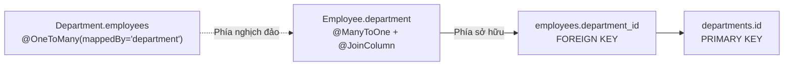

# Đồng bộ hai phía mà không tạo vòng gọi hoặc cập nhật thừa trong Hibernate

## 1. Vấn đề của liên kết hai chiều

Trong Hibernate, quan hệ hai chiều (*bidirectional association*) cho phép đi từ entity A sang entity B và ngược lại. Ví dụ, một `Department` chứa nhiều `Employee`; mỗi `Employee` lại trỏ về `Department` của mình.

```java
class Department {
    List<Employee> employees;
}

class Employee {
    Department department;
}
```

Hai field này là **hai biểu diễn Java của cùng một liên kết nghiệp vụ**. Một thay đổi hợp lệ phải giữ chúng nhất quán:

```text
employee.getDepartment() == department

                ⇕ tương ứng

department.getEmployees().contains(employee)
```

Nếu chỉ sửa một phía, object graph trong bộ nhớ có thể mâu thuẫn: nhân viên trỏ tới phòng ban A trong khi collection của phòng ban B vẫn chứa nhân viên đó. Trong một số trường hợp, thay đổi phía sai còn **không làm Hibernate cập nhật khóa ngoại** trong database.

Một sai lầm khác là viết hai phương thức cùng gọi lại nhau:

```java
// MINH HỌA SAI: hai phương thức gọi qua lại vô hạn.
class Department {
    void addEmployee(Employee employee) {
        employees.add(employee);
        employee.setDepartment(this);
    }
}

class Employee {
    void setDepartment(Department newDepartment) {
        this.department = newDepartment;
        newDepartment.addEmployee(this);
    }
}
```

Lời gọi `department.addEmployee(employee)` đi vào `employee.setDepartment(department)` rồi quay lại `department.addEmployee(employee)` không có điều kiện dừng. Kết quả có thể là `StackOverflowError`; nếu chèn nhiều lần trước khi hết stack, collection còn bị trùng phần tử.

Bài học này giải quyết đồng thời hai mục tiêu:

1. **Đúng mô hình:** hai phía Java đồng bộ với nhau; thay đổi được thực hiện trên phía quản lý liên kết (*owning side*).
2. **Gọn thao tác:** helper method không đệ quy vô hạn, không sửa lại trạng thái đã đúng, không sinh thêm association hay thao tác SQL không cần thiết do mapping và vòng đời không phù hợp.

Không nên hiểu “đồng bộ hai phía” là “ghi hai lần vào database”. Với mapping hai chiều chuẩn, Hibernate chỉ cần **một phía quản lý dữ liệu quan hệ**, trong khi phía còn lại giúp điều hướng object graph.

## 2. Phân biệt phía sở hữu và phía nghịch đảo

Với quan hệ một-nhiều/ nhiều-một thông thường:



`Employee.department` là **owning side** vì nó quản lý cột `employees.department_id`. `Department.employees` có `mappedBy = "department"` là **inverse side**; nó phản ánh liên kết từ chiều ngược lại và không sở hữu khóa ngoại.

Ví dụ:

```java
// Employee.java
@ManyToOne(fetch = FetchType.LAZY)
@JoinColumn(name = "department_id")
private Department department;

// Department.java
@OneToMany(mappedBy = "department")
private List<Employee> employees = new ArrayList<>();
```

`mappedBy` nhận **tên thuộc tính Java** `department` trên `Employee`, không phải tên cột SQL `department_id`.

| Loại quan hệ | Phía ghi liên kết | Phía đối ứng | Nơi lưu thông tin quan hệ |
|---|---|---|---|
| `@OneToMany(mappedBy = "department")` / `@ManyToOne` | `Employee.department` với `@ManyToOne` | `Department.employees` | FK `employees.department_id` |
| `@ManyToMany` hai chiều | Phía khai báo `@JoinTable`, chẳng hạn `Student.courses` | Phía có `mappedBy`, chẳng hạn `Course.students` | Bảng nối `student_course` |
| `@OneToMany` một chiều | Collection được mapping là phía quản lý liên kết | Không có phía Java đối ứng | Tùy mapping: bảng nối hoặc FK |
| `@OneToOne` hai chiều | Thường phía có `@JoinColumn` | Phía có `mappedBy` | FK có ràng buộc unique hoặc schema tương ứng |

Ở ví dụ một-nhiều, muốn chuyển nhân viên sang phòng ban khác thì thay đổi **`Employee.department`**. Nếu chỉ thêm employee vào `Department.employees` mà không đổi field này, database có thể vẫn giữ FK cũ.

**Lưu ý:** “Owning side” là khái niệm quản lý mapping ORM; nó không tự định nghĩa chủ sở hữu nghiệp vụ, quyền truy cập, cascade hoặc vòng đời xóa của entity.

## 3. Thiết kế helper method: một lối vào, thao tác nội bộ không gọi ngược

Cách thực hành dễ kiểm soát là phân biệt:

- **Phương thức công khai** thực hiện thay đổi quan hệ hoàn chỉnh.
- **Phương thức nội bộ** chỉ cập nhật một collection hoặc một field, **không gọi ngược** public helper.
- **Điều kiện không đổi** (*no-op guard*) để lần gọi lặp với cùng liên kết không làm gì thêm.

Trong ví dụ Department–Employee, ta cho `Employee.changeDepartment(...)` chịu trách nhiệm chuyển liên kết, còn `Department.addEmployee(...)` chỉ ủy quyền vào phương thức đó.

### 3.1. Entity `Department`

```java
package com.example.company;

import java.util.ArrayList;
import java.util.Collections;
import java.util.Iterator;
import java.util.List;
import java.util.Objects;

import jakarta.persistence.Column;
import jakarta.persistence.Entity;
import jakarta.persistence.GeneratedValue;
import jakarta.persistence.GenerationType;
import jakarta.persistence.Id;
import jakarta.persistence.OneToMany;
import jakarta.persistence.Table;

@Entity
@Table(name = "departments")
public class Department {

    @Id
    @GeneratedValue(strategy = GenerationType.IDENTITY)
    private Long id;

    @Column(nullable = false, length = 120)
    private String name;

    @OneToMany(mappedBy = "department")
    private List<Employee> employees = new ArrayList<>();

    protected Department() {
        // Constructor dành cho JPA.
    }

    public Department(String name) {
        this.name = Objects.requireNonNull(name);
    }

    public Long getId() {
        return id;
    }

    public String getName() {
        return name;
    }

    public List<Employee> getEmployees() {
        // Không cho caller tự ý add/remove ngoài helper.
        return Collections.unmodifiableList(employees);
    }

    public void addEmployee(Employee employee) {
        Objects.requireNonNull(employee, "employee");
        employee.changeDepartment(this);
    }

    public void removeEmployee(Employee employee) {
        if (employee != null && employee.getDepartment() == this) {
            employee.changeDepartment(null);
        }
    }

    // Chỉ cập nhật collection; KHÔNG gọi employee.changeDepartment().
    void attachLocal(Employee employee) {
        for (Employee current : employees) {
            if (current == employee) {
                return;
            }
        }
        employees.add(employee);
    }

    // Chỉ cập nhật collection; KHÔNG gọi employee.changeDepartment().
    void detachLocal(Employee employee) {
        Iterator<Employee> iterator = employees.iterator();

        while (iterator.hasNext()) {
            if (iterator.next() == employee) {
                iterator.remove();
                return;
            }
        }
    }
}
```

Điểm đáng chú ý:

- `addEmployee` và `removeEmployee` là các thao tác nghiệp vụ công khai.
- `attachLocal`/`detachLocal` là các hàm nội bộ trong cùng package; chúng **không gọi ngược** `addEmployee`/`removeEmployee` hoặc `Employee.changeDepartment`.
- Ví dụ kiểm tra cùng **tham chiếu Java** bằng `==` để tránh phụ thuộc vào implementation của `equals/hashCode` ở bước đồng bộ object graph. Với hai entity managed trong cùng persistence context, một identity entity thường ứng với cùng một managed instance.
- `Collections.unmodifiableList` ngăn code bên ngoài sửa trực tiếp cấu trúc collection qua getter, nhưng không làm các `Employee` bên trong trở thành immutable.
- Cách duyệt collection này dễ hiểu, song có thể khởi tạo collection lazy lớn và tốn chi phí; phần hiệu năng được phân tích ở mục 10.

### 3.2. Entity `Employee`: phía sở hữu thực sự đổi FK

```java
package com.example.company;

import java.util.Objects;

import jakarta.persistence.Column;
import jakarta.persistence.Entity;
import jakarta.persistence.FetchType;
import jakarta.persistence.GeneratedValue;
import jakarta.persistence.GenerationType;
import jakarta.persistence.Id;
import jakarta.persistence.JoinColumn;
import jakarta.persistence.ManyToOne;
import jakarta.persistence.Table;

@Entity
@Table(name = "employees")
public class Employee {

    @Id
    @GeneratedValue(strategy = GenerationType.IDENTITY)
    private Long id;

    @Column(name = "full_name", nullable = false, length = 120)
    private String fullName;

    // Quan hệ optional trong ví dụ để có thể unassign.
    @ManyToOne(fetch = FetchType.LAZY)
    @JoinColumn(name = "department_id", nullable = true)
    private Department department;

    protected Employee() {
    }

    public Employee(String fullName) {
        this.fullName = Objects.requireNonNull(fullName);
    }

    public Long getId() {
        return id;
    }

    public String getFullName() {
        return fullName;
    }

    public Department getDepartment() {
        return department;
    }

    public void changeDepartment(Department next) {
        // Trạng thái đã đúng: không thay đổi object graph.
        if (department == next) {
            return;
        }

        Department previous = department;

        // Gỡ tham chiếu phía inverse cũ.
        if (previous != null) {
            previous.detachLocal(this);
        }

        // Đổi owning side: Hibernate lấy FK từ field này.
        department = next;

        // Bổ sung tham chiếu phía inverse mới.
        if (next != null) {
            next.attachLocal(this);
        }
    }
}
```

Đây là một mẫu “**thay đổi trên owning side, phản ánh sang inverse side**”:

```text
Employee.changeDepartment(next)
    |
    +-- nếu current == next: return
    |
    +-- previous.detachLocal(employee)
    |       (chỉ sửa collection cũ)
    |
    +-- employee.department = next
    |       (sửa owning side / khóa ngoại)
    |
    +-- next.attachLocal(employee)
            (chỉ sửa collection mới)
```

Không có lời gọi `Department.addEmployee` từ bên trong `Employee.changeDepartment`. Cả hai phương thức `attachLocal` và `detachLocal` cũng không gọi lại `changeDepartment`, nên chuỗi gọi có điểm kết thúc rõ ràng.

### 3.3. Ba thao tác quan hệ

**Thêm một nhân viên mới vào phòng ban:**

```java
Department department = new Department("Engineering");
Employee employee = new Employee("Lan");

department.addEmployee(employee);

// Hai phía Java đã đồng bộ:
assert employee.getDepartment() == department;
assert department.getEmployees().contains(employee);
```

**Chuyển sang phòng ban khác:**

```java
Department engineering = new Department("Engineering");
Department sales = new Department("Sales");
Employee employee = new Employee("Lan");

engineering.addEmployee(employee);
sales.addEmployee(employee);

// Kết quả mong muốn:
assert employee.getDepartment() == sales;
assert !engineering.getEmployees().contains(employee);
assert sales.getEmployees().contains(employee);
```

**Rời phòng ban trong mô hình cho phép FK null:**

```java
sales.removeEmployee(employee);

// Kết quả:
assert employee.getDepartment() == null;
assert !sales.getEmployees().contains(employee);
```

Ở ví dụ này, `department_id` được phép null. Nếu nghiệp vụ bắt buộc mọi nhân viên phải thuộc một phòng ban, không cho `changeDepartment(null)`; thay bằng thao tác chuyển đến department hợp lệ hoặc xóa employee theo quy tắc riêng. Không sử dụng một helper gán null khi mapping đặt `optional = false` và cột FK là `NOT NULL`.

### 3.4. Vì sao không thể chỉ chặn đệ quy bằng cờ `boolean`?

Một cách vá dễ gặp là:

```java
boolean updatingAssociation;
```

rồi bỏ qua các lời gọi khi `updatingAssociation == true`. Cờ như vậy khiến hành vi khó theo dõi và có thể bỏ qua những cập nhật cần thiết nếu code gặp exception hoặc tái nhập. Cách rõ ràng hơn là định nghĩa **một public operation** và các local methods **không gọi ngược**; lúc đó không cần cờ chống đệ quy.

## 4. Không gọi setter của cả hai phía một cách độc lập

Một lỗi khác là service tự làm cả hai việc nhưng không có quy ước nhất quán:

```java
// KHÔNG NÊN: business code tự sửa collection lẫn owning field.
oldDepartment.getEmployees().remove(employee);
employee.setDepartment(newDepartment);
newDepartment.getEmployees().add(employee);
```

Có nhiều vấn đề:

- Getter có thể trả collection Hibernate đang được theo dõi; sửa trực tiếp vượt qua invariant của domain.
- Các thao tác diễn ra rời rạc; nếu một thao tác bị bỏ sót, object graph bị lệch.
- Một setter có logic callback có thể lại sửa collection lần thứ hai.
- Nếu collection là `Set` mà `equals/hashCode` không ổn định, thao tác `remove` có thể thất bại.
- Nếu association có `orphanRemoval`, việc gỡ khỏi collection có thể mang nghĩa xóa entity, không đơn giản là chuyển phòng ban.

Nên chỉ gọi một lệnh thể hiện ý định nghiệp vụ:

```java
newDepartment.addEmployee(employee);
```

Hoặc:

```java
employee.changeDepartment(newDepartment);
```

**Không cần gọi cả hai**, vì helper được thiết kế để bảo đảm invariant.

## 5. Tác động tới SQL: tại sao đồng bộ hai phía không phải ghi hai lần?

Giả sử schema:

```sql
CREATE TABLE departments (
    id BIGINT PRIMARY KEY,
    name VARCHAR(120) NOT NULL
);

CREATE TABLE employees (
    id BIGINT PRIMARY KEY,
    full_name VARCHAR(120) NOT NULL,
    department_id BIGINT,
    CONSTRAINT fk_employee_department
        FOREIGN KEY (department_id)
        REFERENCES departments(id)
);
```

Với `@OneToMany(mappedBy = "department")` và `@ManyToOne`, **chỉ một cột FK** biểu diễn liên kết. Khi chuyển employee từ phòng ban 10 sang phòng ban 20, về mặt quan hệ chỉ cần:

```sql
UPDATE employees
SET department_id = 20
WHERE id = 42;
```

Trong Java, helper có thể làm ba thao tác trên object graph (gỡ collection cũ, đổi field, thêm collection mới), nhưng Hibernate nhận biết thay đổi FK qua **`Employee.department`**.

Không nên diễn giải rằng Hibernate bắt buộc tạo **hai** lệnh SQL UPDATE vì helper đã cập nhật cả hai phía. Số SQL thực tế còn phụ thuộc state tracking, thời điểm `flush`, các collection đã tải, versioning, fetch strategy và mapping cụ thể.

### 5.1. Thay đổi trước `persist` để tránh cập nhật dư

Với employee mới, nên gán department **trước khi persist**:

```java
Department department = em.find(Department.class, departmentId);
Employee employee = new Employee("Lan");

department.addEmployee(employee);
em.persist(employee);

// Insert thường có thể chứa department_id ngay từ đầu.
```

Nếu persist employee khi chưa gắn department rồi mới gán, tùy chiến lược sinh ID và thời điểm Hibernate phát SQL, ORM có thể phải insert dòng trước rồi update FK sau. Khi quan hệ bắt buộc và FK `NOT NULL`, việc tạo entity ở trạng thái thiếu liên kết còn có thể gây lỗi.

### 5.2. Guard tránh thao tác lặp khi giá trị không đổi

```java
employee.changeDepartment(department);
employee.changeDepartment(department);
employee.changeDepartment(department);
```

Điều kiện:

```java
if (this.department == next) {
    return;
}
```

giúp các lần sau không sửa trạng thái Java hoặc collection. Đây là một biện pháp giảm công việc thừa; **không hứa** số SQL bằng một con số cố định trong mọi trường hợp vì Hibernate còn có các field khác và chiến lược flush riêng.

### 5.3. Thay đổi nhiều lần trong cùng transaction

```java
employee.changeDepartment(deptA);
employee.changeDepartment(deptB);
employee.changeDepartment(deptC);
```

Nếu entity vẫn managed và chưa flush, Hibernate thường căn cứ vào trạng thái cuối cùng để quyết định đồng bộ FK. Tuy vậy, nếu giữa các thao tác có query gây auto-flush hoặc code chủ động gọi `em.flush()`, database có thể nhận các UPDATE trung gian.

Khi nghiệp vụ biết đích cuối cùng, tốt hơn là **xác định deptC trước rồi cập nhật một lần**. Đó là tối ưu ở cấp ứng dụng, độc lập với khả năng gom thay đổi của Hibernate.

## 6. Ví dụ transaction thực tế

Giả sử `EntityManagerFactory` đã được khởi tạo và persistence unit sử dụng `RESOURCE_LOCAL`:

```java
import jakarta.persistence.EntityManager;
import jakarta.persistence.EntityManagerFactory;
import jakarta.persistence.EntityTransaction;

public final class DepartmentService {

    private final EntityManagerFactory emf;

    public DepartmentService(EntityManagerFactory emf) {
        this.emf = emf;
    }

    public void transferEmployee(
            Long employeeId, Long targetDepartmentId) {

        EntityManager em = emf.createEntityManager();

        try {
            EntityTransaction tx = em.getTransaction();

            try {
                tx.begin();

                Employee employee =
                        em.find(Employee.class, employeeId);

                Department target =
                        em.find(Department.class, targetDepartmentId);

                if (employee == null || target == null) {
                    throw new IllegalArgumentException(
                            "Employee or department not found"
                    );
                }

                // Cập nhật owning side + inverse side qua một helper.
                target.addEmployee(employee);

                // Employee đã managed; dirty checking ghi thay đổi.
                tx.commit();
            } catch (RuntimeException ex) {
                if (tx.isActive()) {
                    tx.rollback();
                }
                throw ex;
            }
        } finally {
            em.close();
        }
    }
}
```

Những điểm cần hiểu:

1. `em.find(...)` trả entity managed trong persistence context hiện tại nếu tìm thấy.
2. `target.addEmployee(employee)` gọi `employee.changeDepartment(target)` và đồng bộ hai phía trong bộ nhớ.
3. Không cần gọi `em.persist(employee)` khi employee đã managed.
4. Không cần tự `em.merge(employee)` khi employee vừa được `find` trong cùng context.
5. Hibernate thực hiện dirty checking và đồng bộ FK ở thời điểm flush/commit thích hợp.
6. Đóng entity manager của transaction sau khi hoàn thành; không giữ entity managed để tự ý sửa ở thread khác.

Trong Spring, transaction có thể do `@Transactional` quản lý; mẫu helper không thay đổi:

```java
@Service
public class DepartmentAssignmentService {

    @PersistenceContext
    private EntityManager em;

    @Transactional
    public void transfer(Long employeeId, Long departmentId) {
        Employee employee = em.find(Employee.class, employeeId);
        Department department = em.find(Department.class, departmentId);

        if (employee == null || department == null) {
            throw new IllegalArgumentException("Not found");
        }

        department.addEmployee(employee);
    }
}
```

Ví dụ Spring này giả định các import tương ứng từ `jakarta.persistence` và `org.springframework`. `EntityManager` được inject do framework quản lý nên service không tự đóng nó.

## 7. Phân biệt đồng bộ quan hệ và cascade

`mappedBy` xác định phía quản lý FK; `cascade` quyết định thao tác vòng đời nào được truyền giữa các entity.

Ví dụ:

```java
@OneToMany(
    mappedBy = "department",
    cascade = CascadeType.PERSIST
)
private List<Employee> employees = new ArrayList<>();
```

`CascadeType.PERSIST` có thể giúp persist các employee mới khi persist department, nhưng **không chuyển sở hữu FK** từ `Employee.department` sang collection.

Mẫu sai:

```java
department.getEmployees().add(employee);
em.persist(department);

// Nếu employee.department không được gán đúng,
// cascade persist không tự biến inverse collection thành owning side.
```

Mẫu đúng:

```java
department.addEmployee(employee); // Cập nhật cả hai phía.
em.persist(department);           // PERSIST cascade nếu được cấu hình.
```

Không nên bật `CascadeType.ALL` chỉ để “đỡ gọi persist”. Nó bao gồm `REMOVE`, có thể lan thao tác xóa ngoài ý muốn khi các entity có vòng đời độc lập. Cascade cần phản ánh đúng sở hữu vòng đời trong domain.

### 7.1. Khi nào dùng `orphanRemoval = true`?

Một ví dụ khác là `Order` và `OrderLine`: mỗi dòng chi tiết thuộc vòng đời của một đơn hàng và phải bị xóa nếu không còn thuộc đơn đó.

```java
@OneToMany(
    mappedBy = "order",
    cascade = CascadeType.ALL,
    orphanRemoval = true
)
private List<OrderLine> lines = new ArrayList<>();
```

Ở mô hình này, xóa `OrderLine` khỏi collection có thể khiến Hibernate lên lịch **DELETE dòng order_line**. Khác hẳn trường hợp employee rời phòng ban nhưng vẫn phải tồn tại.

Nếu muốn **di chuyển** một child giữa hai parent trong cùng transaction, `orphanRemoval = true` có thể biến việc gỡ ở parent cũ thành thao tác xóa; không nên áp dụng cơ chế “remove ở parent cũ rồi add vào parent mới” một cách máy móc. Cần xác định entity con có được tái gán parent không; với orphan removal, thông thường nên coi vòng đời child bị sở hữu bởi parent và không hỗ trợ reparent tùy tiện.

### 7.2. Mẫu helper cho child thuộc vòng đời của parent

```java
public void addLine(OrderLine line) {
    Objects.requireNonNull(line);
    if (!lines.contains(line)) {
        lines.add(line);
        line.setOrderInternal(this); // Chỉ cập nhật owning field.
    }
}

public void removeLine(OrderLine line) {
    if (lines.remove(line)) {
        line.setOrderInternal(null); // Child được coi là orphan để xóa.
    }
}
```

Đoạn code giả định `OrderLine.setOrderInternal` không gọi ngược `Order.addLine`/`removeLine`, và mapping `OrderLine.order` là `@ManyToOne`. Đây là logic lifecycle riêng cho composition; không dùng nguyên xi cho liên kết nhân viên/phòng ban.

## 8. Đồng bộ hai phía của `@ManyToMany`

Với quan hệ nhiều-nhiều, hai phía đều giữ collection. Khác với `@OneToMany`/`@ManyToOne`, owning side thường được lựa chọn rõ qua `@JoinTable`.

Ví dụ sinh viên đăng ký nhiều khóa học, một khóa học có nhiều sinh viên:

```text
students             student_courses             courses
+----+               +------------+-----------+   +----+
| id |<--------------| student_id | course_id |-->| id |
+----+               +------------+-----------+   +----+
```

Giả sử ta chọn **`Student.courses` là owning side**.

### 8.1. Mapping và helper ở owning side

```java
package com.example.school;

import java.util.Collections;
import java.util.HashSet;
import java.util.Objects;
import java.util.Set;

import jakarta.persistence.Entity;
import jakarta.persistence.GeneratedValue;
import jakarta.persistence.GenerationType;
import jakarta.persistence.Id;
import jakarta.persistence.JoinColumn;
import jakarta.persistence.JoinTable;
import jakarta.persistence.ManyToMany;
import jakarta.persistence.Table;
import jakarta.persistence.UniqueConstraint;

@Entity
@Table(name = "students")
public class Student {

    @Id
    @GeneratedValue(strategy = GenerationType.IDENTITY)
    private Long id;

    @ManyToMany
    @JoinTable(
        name = "student_courses",
        joinColumns = @JoinColumn(name = "student_id"),
        inverseJoinColumns = @JoinColumn(name = "course_id"),
        uniqueConstraints = @UniqueConstraint(
            name = "uk_student_course_pair",
            columnNames = {"student_id", "course_id"}
        )
    )
    private Set<Course> courses = new HashSet<>();

    protected Student() {
    }

    public Long getId() {
        return id;
    }

    public Set<Course> getCourses() {
        return Collections.unmodifiableSet(courses);
    }

    public void enroll(Course course) {
        Objects.requireNonNull(course);

        if (courses.add(course)) {
            // Chỉ sửa phía inverse ở bộ nhớ.
            course.attachStudentLocal(this);
        }
    }

    public void leave(Course course) {
        if (course != null && courses.remove(course)) {
            course.detachStudentLocal(this);
        }
    }
}
```

### 8.2. Phía inverse chỉ cập nhật collection cục bộ

```java
package com.example.school;

import java.util.Collections;
import java.util.HashSet;
import java.util.Objects;
import java.util.Set;

import jakarta.persistence.Entity;
import jakarta.persistence.GeneratedValue;
import jakarta.persistence.GenerationType;
import jakarta.persistence.Id;
import jakarta.persistence.ManyToMany;
import jakarta.persistence.Table;

@Entity
@Table(name = "courses")
public class Course {

    @Id
    @GeneratedValue(strategy = GenerationType.IDENTITY)
    private Long id;

    @ManyToMany(mappedBy = "courses")
    private Set<Student> students = new HashSet<>();

    protected Course() {
    }

    public Long getId() {
        return id;
    }

    public Set<Student> getStudents() {
        return Collections.unmodifiableSet(students);
    }

    // Entry point tiện dụng ở chiều Course -> Student:
    public void enrollStudent(Student student) {
        Objects.requireNonNull(student).enroll(this);
    }

    public void removeStudent(Student student) {
        if (student != null) {
            student.leave(this);
        }
    }

    // Chỉ thay đổi inverse collection, không gọi student.enroll().
    void attachStudentLocal(Student student) {
        students.add(student);
    }

    void detachStudentLocal(Student student) {
        students.remove(student);
    }
}
```

Cách sử dụng:

```java
Student student = em.find(Student.class, studentId);
Course course = em.find(Course.class, courseId);

student.enroll(course);
// Hoặc course.enrollStudent(student), không gọi cả hai.

student.leave(course);
// Hoặc course.removeStudent(student).
```

Mẫu này có tính chất:

- `Student.enroll`/`leave` quyết định thay đổi trên **owning collection**.
- `Course.enrollStudent`/`removeStudent` ủy quyền về owning side.
- `Course.attachStudentLocal`/`detachStudentLocal` chỉ cập nhật object graph, không gọi ngược.
- `Set.add`/`Set.remove` trả về trạng thái thay đổi; helper không tiếp tục thao tác khi quan hệ đã tồn tại hoặc đã không tồn tại.
- Unique constraint trên cặp FK giúp database từ chối liên kết trùng do các transaction hoặc writer khác nhau.

**Điều kiện của ví dụ:** `Set` yêu cầu `equals/hashCode` ổn định. Khi hai entity đã được tải trong cùng persistence context và không override equality, so sánh theo tham chiếu mặc định hoạt động cho ví dụ đơn giản này. Trong ứng dụng thực tế, entity có thể detached/merged, proxy hoặc được xử lý qua nhiều context; cần thiết kế `equals/hashCode` riêng phù hợp lifecycle. Không thể trông chờ `Set` tự xử lý mọi trường hợp trùng theo database ID.

### 8.3. Thay đổi inverse side đơn lẻ không bảo đảm join table cập nhật

```java
Course course = em.find(Course.class, courseId);
Student student = em.find(Student.class, studentId);

// Sai về ý định: chỉ chạm inverse collection.
course.getStudents().add(student);
```

Nếu getter trả collection mutable, lời gọi này có thể thay đổi object graph nhưng không tác động sở hữu join table. Trong ví dụ trên getter trả unmodifiable view nên lệnh sẽ bị từ chối; đây là chủ đích khuyến khích dùng helper.

Cách đúng:

```java
course.enrollStudent(student);
```

Thao tác đi về `student.enroll(course)`, sửa owning collection và đồng bộ inverse collection một lần.

### 8.4. Tránh cascade remove trong nhiều-nhiều

Một `Course` có nhiều `Student` và một sinh viên học nhiều khóa. Xóa quan hệ đăng ký chỉ nên xóa **dòng liên kết ở `student_courses`**, không xóa sinh viên hay khóa học.

Không nên khai báo tùy tiện:

```java
@ManyToMany(cascade = CascadeType.ALL)
private Set<Course> courses;
```

`ALL` bao gồm `REMOVE`; khi xóa student, cascade remove có thể tìm cách xóa các course đang được sinh viên khác dùng chung. Thường chỉ cần quản lý liên kết trong join table, còn lifecycle của `Student` và `Course` là độc lập.

Nếu quan hệ nhiều-nhiều có thuộc tính riêng như `enrolledAt`, `status` hoặc `grade`, cân nhắc **biến bảng nối thành entity `Enrollment`** với hai liên kết `@ManyToOne`; khi đó lifecycle, unique constraint và metadata của liên kết dễ biểu diễn hơn.

## 9. Hai loại “vòng lặp” cần phân biệt

### 9.1. Vòng gọi do helper method

```text
Department.addEmployee(...)
    -> Employee.setDepartment(...)
        -> Department.addEmployee(...)
            -> ...
```

Đây là **đệ quy phương thức**, có thể tạo `StackOverflowError`. Chặn bằng cách phân biệt API nghiệp vụ và thao tác cập nhật field/collection nội bộ, cùng guard khi quan hệ không đổi.

### 9.2. Vòng duyệt object graph

Ngay cả khi helper đã đúng, các entity hai chiều vẫn có thể gây vòng lặp khi gọi:

- `toString()`, nhất là nếu `Department.toString()` in toàn bộ employees và `Employee.toString()` in lại department.
- `equals()`/`hashCode()` nếu tính toàn bộ association ở cả hai phía.
- JSON serialization khi thư viện cố đi qua `department.employees[].department.employees[]...`.
- Các mapper chuyển entity thành DTO theo cách đệ quy không có giới hạn.

Ví dụ:

```java
@Override
public String toString() {
    return "Department{employees=" + employees + "}";
}
```

Nếu `Employee.toString()` cũng in `department`, việc ghi log có thể lặp vô hạn hoặc tạo truy vấn lazy bất ngờ.

Với Lombok, không áp dụng `@Data` máy móc cho entity có association hai chiều. Nên cân nhắc `@ToString.Exclude`, `@EqualsAndHashCode.Exclude` đối với field quan hệ, hoặc tự triển khai equality/toString theo định danh thích hợp.

Với REST API, ưu tiên **DTO** chỉ chứa cấu trúc cần trả về. Khi thật sự cần serialize entity trực tiếp với Jackson, có các lựa chọn như `@JsonManagedReference`/`@JsonBackReference` hoặc `@JsonIdentityInfo`, nhưng chúng giải quyết **JSON object graph**, không thay đổi owning side của Hibernate hay bảo đảm tính nhất quán quan hệ.

## 10. Tránh cập nhật thừa do lựa chọn cấu trúc và cách thao tác

### 10.1. Tránh mapping hai quan hệ sở hữu độc lập

Sai thường gặp:

```java
// Employee: một quan hệ sở hữu FK.
@ManyToOne
@JoinColumn(name = "department_id")
private Department department;

// Department: một mapping OneToMany độc lập,
// không có mappedBy liên hệ với Employee.department.
@OneToMany
private List<Employee> employees;
```

Nếu không có `mappedBy`, Hibernate có thể diễn giải `Department.employees` thành **một association riêng**, thường cần bảng nối tùy mapping. Kết quả là hai biểu diễn quan hệ không đồng nhất, nhiều DDL hoặc DML ngoài ý định.

Dùng:

```java
@OneToMany(mappedBy = "department")
private List<Employee> employees;
```

để cho biết hai phía cùng biểu diễn một quan hệ và `Employee.department` là nguồn điều khiển FK.

Không sử dụng `insertable = false, updatable = false` một cách tùy tiện để vá việc hai mapping cùng ghi một cột. Những cờ đó có mục đích riêng trong mapping read-only/đặc biệt; với hai chiều `@OneToMany`/`@ManyToOne` thông thường, `mappedBy` là cách khai báo đúng.

### 10.2. Không `clear()` rồi `addAll()` khi chỉ thay một phần nhỏ

```java
// Mẫu dễ gây thao tác collection không cần thiết:
department.getEmployees().clear();
department.getEmployees().addAll(newEmployees);
```

Ngay cả khi phần lớn membership không thay đổi, cách thay toàn bộ collection có thể làm ORM xem nhiều phần tử bị xóa/thêm, sinh DML lớn hoặc kích hoạt orphan removal ngoài ý muốn. Với `@ManyToMany`, kiểu collection và mapping còn ảnh hưởng cách Hibernate xóa và chèn các dòng trong join table.

Nên tính **tập thay đổi thực tế** và chỉ thêm/gỡ những liên kết cần thay đổi. Chẳng hạn để enroll một khóa học, gọi `student.enroll(course)`; để leave, gọi `student.leave(course)`. Đừng rebuild cả tập hợp courses từ đầu nếu chỉ đổi một phần tử.

### 10.3. `List`, `Set` và thứ tự trong database

- `Set` thể hiện membership không trùng ở cấp object collection, nhưng yêu cầu `equals/hashCode` phù hợp.
- `List` cho phép thứ tự và có thể chứa cùng phần tử nhiều lần nếu helper không kiểm soát.
- `@OrderBy` yêu cầu sắp xếp khi đọc theo giá trị cột, không nhất thiết lưu vị trí thứ tự.
- `@OrderColumn` lưu vị trí phần tử; thao tác chèn/xóa/đổi vị trí có thể khiến Hibernate cập nhật thêm các chỉ số thứ tự trong bảng.

Nếu nghiệp vụ không cần lưu thứ tự vật lý, không tự động thêm `@OrderColumn` chỉ vì dùng `List`.

Với `@ManyToMany`, một `Set` được mapping đúng và có equality ổn định thường thuận tiện cho việc thêm/xóa từng cặp liên kết; cần kiểm chứng SQL thực tế theo Hibernate version/dialect và mô hình dữ liệu trước khi kết luận hiệu năng.

### 10.4. Helper có thể kích hoạt tải collection lazy

Ở ví dụ Department–Employee:

```java
previous.detachLocal(employee);
next.attachLocal(employee);
```

Nếu `previous.employees` hoặc `next.employees` chưa được khởi tạo, việc duyệt collection để kiểm tra/remove/add có thể khiến Hibernate tải các phần tử từ database. Với phòng ban có hàng trăm nghìn nhân viên, đây có thể là chi phí rất lớn, dù câu SQL UPDATE FK chỉ cần một dòng.

Có ba hướng thiết kế tùy yêu cầu:

1. **Object graph nhỏ, cần điều hướng hai chiều trong cùng transaction:** dùng helper đồng bộ đầy đủ như ví dụ.
2. **Collection rất lớn, chủ yếu tra cứu bằng query:** cân nhắc model một chiều `Employee.department`; khi cần danh sách nhân viên, dùng truy vấn có phân trang thay vì giữ `Department.employees`.
3. **Cần tối ưu khi một phía chưa tải:** thiết kế phương án chỉ điều chỉnh trạng thái đã biết với quy tắc nhất quán rõ, tránh thao tác lên inverse collection rất lớn; cần nắm rõ hành vi collection của Hibernate và thời điểm truy vấn/flush. Không đơn giản bỏ qua việc đồng bộ trong memory khi code cùng transaction vẫn phụ thuộc collection đó.

Việc gọi `Hibernate.isInitialized(...)` rồi bỏ qua cập nhật inverse collection mà không có chính sách rõ có thể khiến object graph bị lệch theo quan sát của code nghiệp vụ. Nếu cần tối ưu loại này, nên xem xét lại API/domain model thay vì đặt một điều kiện ngẫu hứng.

### 10.5. Tránh fetch toàn bộ collection để kiểm tra một phần tử

Ví dụ logic “sinh viên đã đăng ký khóa học X chưa?” không nhất thiết phải khởi tạo toàn bộ `student.courses`. Với collection rất lớn, có thể truy vấn trực tiếp:

```java
boolean enrolled = !em.createQuery(
        """
        select s.id
        from Student s
        join s.courses c
        where s.id = :studentId and c.id = :courseId
        """,
        Long.class
    )
    .setParameter("studentId", studentId)
    .setParameter("courseId", courseId)
    .setMaxResults(1)
    .getResultList()
    .isEmpty();
```

Truy vấn kiểm tra trạng thái ở database không thay thế việc bảo vệ concurrency: hai request vẫn có thể cùng thấy chưa đăng ký rồi đều insert. Ràng buộc unique cho cặp (`student_id`, `course_id`) và xử lý exception là lớp bảo vệ cuối.

## 11. `equals()/hashCode()` và entity trong `Set`

Dùng `Set` không tự động loại bỏ mọi duplicate logic. Java dựa vào `equals` và `hashCode` của phần tử; Hibernate entity còn có vòng đời **transient → managed → detached** và có thể được biểu diễn qua proxy.

Một mẫu nguy hiểm là tạo hash từ ID tự sinh:

```java
@Override
public int hashCode() {
    return Objects.hash(id);
}
```

Nếu entity được đưa vào `HashSet` lúc `id == null`, sau `persist` Hibernate cấp ID, hash có thể đổi. Lúc này `set.contains(entity)` hoặc `set.remove(entity)` có thể không tìm thấy phần tử ở bucket ban đầu.

Tương tự, không dùng collection hai chiều làm thành phần của `equals/hashCode` vì có thể tạo đệ quy và tải lazy association.

Các hướng cần cân nhắc:

- Dùng natural key **bất biến, thực sự unique và có sẵn từ lúc tạo object** nếu domain có khóa phù hợp.
- Với surrogate ID tự sinh, thiết kế equality sao cho không gây vấn đề khi ID chưa có hoặc khi hash thay đổi; cách triển khai phải xét proxy và inheritance.
- Nếu object graph chỉ thao tác các instance managed trong một context, có thể dùng guard theo **tham chiếu** cho các helper như ví dụ `Department`.
- Không phụ thuộc vào việc entity từ hai session khác nhau luôn là cùng Java object.

Không có một công thức `equals/hashCode` duy nhất đúng cho mọi entity; cần chọn theo model và lifecycle.

## 12. Giao dịch, persistence context và sự nhất quán

Cả hai phía của association nên được sửa trong **cùng đơn vị công việc** và trên các entity thuộc một persistence context phù hợp.

Đối với một employee managed:

```java
Employee employee = em.find(Employee.class, employeeId);
Department target = em.find(Department.class, departmentId);

target.addEmployee(employee);
```

Hibernate theo dõi thay đổi trong context, rồi đồng bộ lúc `flush` hoặc `commit`. Vì vậy:

- Không cần gọi `em.merge(employee)` khi employee đã managed trong cùng context.
- Không cần gọi `em.persist(employee)` để lưu thay đổi FK của một employee đã tồn tại và managed.
- Không nên gọi `em.flush()` nhiều lần sau mỗi thao tác helper nếu transaction có thể kết thúc bằng một commit thích hợp.
- Nếu transaction rollback, thay đổi database bị rollback; nhưng object Java trong bộ nhớ có thể vẫn chứa giá trị đã gán. Không tiếp tục dùng object graph đó như trạng thái database chắc chắn sau rollback.

### 12.1. Entity từ hai persistence context khác nhau

Ví dụ `Department` được đọc ở `EntityManager A`, `Employee` được đọc ở `EntityManager B` rồi được ghép trực tiếp:

```java
Department fromA = emA.find(Department.class, departmentId);
Employee fromB = emB.find(Employee.class, employeeId);

// Không nên tùy tiện kết hợp entity managed của hai context.
fromA.addEmployee(fromB);
```

Hai entity do hai context khác nhau quản lý. Cách đưa một object graph qua nhiều context như vậy làm trạng thái quản lý và lifecycle khó dự đoán; việc sửa collection ở `emA` không đồng nghĩa `emB` được đồng bộ đúng theo cách ứng dụng mong muốn.

Nên truyền **ID** sang đơn vị công việc, sau đó tải các entity cần thiết trong cùng entity manager/transaction để thay đổi quan hệ. Nếu phải xử lý detached entity, cần có quy tắc `merge` rõ ràng và nhớ rằng `merge` trả về **managed instance mới hoặc hiện có trong context đích**; entity detached ban đầu không tự trở thành managed.

### 12.2. Không chia sẻ Session/EntityManager qua các thread

`EntityManager`/`Session` không được thiết kế để dùng đồng thời từ nhiều thread. Dù helper kiểm soát đệ quy tốt, object graph managed vẫn gắn với context ban đầu. Một worker bất đồng bộ nên nhận ID hoặc DTO, tạo/lấy transaction và context riêng, rồi tải lại entity.

### 12.3. Concurrent updates cần chính sách riêng

Hai transaction có thể cùng chuyển một employee tới hai department khác nhau. Helper duy trì đồng bộ **trong từng context**, nhưng không ngăn xung đột liên transaction:

```text
Transaction A            Transaction B
  load Employee #7         load Employee #7
  assign Department 10     assign Department 20
  commit                   commit
```

Có thể dùng `@Version` trên `Employee` để phát hiện một số cập nhật cạnh tranh:

```java
@Version
private Long version;
```

Khi Hibernate kiểm tra version trong UPDATE, transaction thua cuộc có thể gặp optimistic locking exception. Ứng dụng phải định nghĩa chính sách lỗi hoặc retry. Không dựa vào việc cập nhật collection `Department.employees` tự động tăng version của Department theo cách đủ bảo vệ mọi invariant về membership; các quy tắc concurrency quan trọng phải được thiết kế và kiểm chứng riêng.

## 13. Các anti-pattern và cách sửa

| Anti-pattern | Vì sao có vấn đề | Cách thiết kế phù hợp |
|---|---|---|
| `addChild()` gọi `setParent()`, còn `setParent()` lại gọi `addChild()` | Gây đệ quy vô hạn hoặc chèn lặp. | Một public operation; các phương thức local không callback. |
| Chỉ sửa `parent.children` khi `mappedBy` trỏ tới `child.parent` | Inverse side không sở hữu FK. | Đổi field `child.parent` và đồng bộ collection nếu cần. |
| Chỉ sửa `child.parent` trong model hai chiều rồi lập tức đọc lại `parent.children` đã loaded | Object graph Java có thể chưa nhất quán. | Dùng helper cập nhật cả hai phía hoặc mô hình hóa một chiều phù hợp. |
| Gọi cả `parent.addChild(child)` lẫn `child.setParent(parent)` | Dễ thao tác lặp và phụ thuộc callback. | Chỉ gọi một entry point có guard. |
| Thiếu `mappedBy` cho `@OneToMany` hai chiều | ORM có thể tạo association thứ hai, join table hoặc DML khác ý định. | Map inverse side bằng đúng tên field Java ở owning side. |
| `clear()` toàn bộ collection rồi `addAll()` | Có thể tạo nhiều DELETE/INSERT hoặc orphan removal thừa. | Thêm/gỡ theo phần thay đổi thực sự. |
| Dùng `@OrderColumn` dù không cần thứ tự lưu | Reorder có thể phát thêm UPDATE position. | Chỉ dùng khi thứ tự là dữ liệu nghiệp vụ. |
| Dùng `Set` với hash dựa vào ID sinh sau khi persist | Hash thay đổi làm `remove/contains` thất bại. | Thiết kế equality ổn định theo lifecycle. |
| Dùng `@Data` cho entity có cả hai association | `toString`/`equals`/`hashCode` có thể đệ quy hoặc chạm lazy proxy. | Loại association khỏi object methods, dùng DTO cho JSON. |
| Gắn `CascadeType.REMOVE` cho `@ManyToMany` | Xóa liên kết có nguy cơ xóa entity dùng chung. | Xóa dòng join; giữ lifecycle của hai entity riêng. |
| Dùng `orphanRemoval = true` rồi chuyển child sang parent khác tùy tiện | Child có thể bị schedule DELETE. | Chỉ dùng orphan removal khi parent thực sự sở hữu vòng đời child. |
| Persist entity con trước khi gán FK bắt buộc | Có thể INSERT thiếu FK rồi UPDATE hoặc vi phạm NOT NULL. | Thiết lập quan hệ trước khi persist. |
| Gọi `merge`/`persist` sau mọi setter trên managed entity | Thừa thao tác và làm khó hiểu persistence context. | Dựa vào dirty checking trong transaction hợp lệ. |

## 14. Một quy trình thiết kế liên kết hai chiều

Khi xây dựng một association đa trị mới, có thể đi theo các bước sau:

1. **Xác định cardinality và vòng đời**: một-nhiều hay nhiều-nhiều, child có thể tồn tại độc lập không, có được đổi parent không.
2. **Xác định owning side**: FK nằm ở đâu hoặc bên nào sở hữu join table. Khai báo `mappedBy` ở phía inverse đúng tên thuộc tính Java.
3. **Xác định invariant của object graph**: khi thêm, chuyển, gỡ một liên kết, cả hai phía phải phản ánh trạng thái nào.
4. **Chọn một public entry point cho mỗi thao tác**: như `changeDepartment`, `enroll`, `leave`. Các helper nội bộ chỉ thay field/collection, không callback.
5. **Thêm điều kiện no-op và xử lý trạng thái cũ**: nếu quan hệ đã đúng thì dừng; nếu chuyển parent, gỡ inverse cũ, đổi owning field và thêm inverse mới.
6. **Chọn collection và equality thích hợp**: `List`, `Set`, yêu cầu thứ tự, tính ổn định của `equals/hashCode`.
7. **Chọn cascade/orphanRemoval theo lifecycle**: không dùng chúng để chữa lỗi thiếu đồng bộ owning side.
8. **Giữ ranh giới transaction hợp lý**: các entity cần thay đổi nên thuộc cùng persistence context; concurrency được giải quyết bằng khóa/constraint/versioning theo nghiệp vụ.
9. **Lưu ý hiệu năng của collection lớn**: helper có thể khởi tạo lazy collection; nếu chỉ cần cập nhật một FK, model một chiều hoặc truy vấn có phân trang đôi khi phù hợp hơn.

## 15. Bài tập áp dụng

**Bài 1 — Nhận diện đệ quy.** Viết hai method `Department.addEmployee` và `Employee.setDepartment` gọi lại nhau, phân tích chuỗi call, sau đó chuyển thành mẫu một public entry point với các helper local.

**Bài 2 — Owning side.** Tạo một Department và hai Employee, map `@OneToMany(mappedBy = "department")` cùng `@ManyToOne`. Thực hiện chuyển nhân viên; giải thích vì sao `Employee.department` quyết định `employees.department_id`.

**Bài 3 — No-op.** Gọi `employee.changeDepartment(sameDepartment)` nhiều lần. Xác định phần logic nào phải dừng ngay và vì sao.

**Bài 4 — Quan hệ bắt buộc.** Đổi `Employee.department` thành `optional = false` và FK `nullable = false`. Thiết kế lại API để chỉ cho chuyển department hoặc xóa employee, không có thao tác unassign.

**Bài 5 — Nhiều-nhiều.** Tạo hai entity `Student` và `Course` với join table. Triển khai `enroll/leave` ở owning side và các phương thức delegate phía inverse, tránh callback vô hạn. Giải thích vì sao ràng buộc unique trên cặp FK vẫn cần thiết.

**Bài 6 — Orphan removal.** Định nghĩa `Order`/`OrderLine`, làm rõ vì sao xóa một order line khỏi collection khác với chuyển employee sang phòng ban mới.

**Bài 7 — Collection lớn.** Giả sử một Department có 200.000 Employee. Cân nhắc chi phí của `previous.detachLocal(employee)` và `next.attachLocal(employee)`, rồi đề xuất API truy vấn hoặc model một chiều phục vụ việc chỉ đổi FK.

**Bài 8 — Xung đột cập nhật.** Thêm `@Version` vào Employee, mô tả hai transaction cùng chuyển một nhân viên và cách xử lý lỗi optimistic locking.

## 16. Kết luận

**Đồng bộ hai phía** có nghĩa là giữ object graph Java phản ánh đúng một association trong database; nó **không yêu cầu hai phía cùng phát lệnh ghi SQL**. Với `@OneToMany(mappedBy = "...")`/`@ManyToOne`, phía `@ManyToOne` quản lý khóa ngoại. Với `@ManyToMany`, phía khai báo join table quản lý các dòng liên kết.

Một helper tốt có **một lối vào rõ ràng**, **không gọi ngược qua lại**, **kiểm tra trước khi thay đổi**, **gỡ liên kết cũ khi chuyển**, và **chỉ thao tác trên owning side để quyết định persistence**. Khi kết hợp với mapping đúng, transaction hợp lệ, collection phù hợp và cascade/orphanRemoval đúng vòng đời, cách này giúp code dễ dự đoán, giảm sai lệch trong bộ nhớ và hạn chế các thay đổi database không cần thiết.

### Tài liệu tham khảo

- [Jakarta Persistence Specification — Relationship mappings, owning side và mappedBy](https://jakarta.ee/specifications/persistence/3.1/jakarta-persistence-spec-3.1)
- [Jakarta Persistence API — `OneToMany`](https://jakarta.ee/specifications/persistence/3.1/apidocs/jakarta.persistence/jakarta/persistence/OneToMany.html)
- [Jakarta Persistence API — `ManyToMany`](https://jakarta.ee/specifications/persistence/3.1/apidocs/jakarta.persistence/jakarta/persistence/ManyToMany.html)
- [Hibernate ORM User Guide — Bidirectional associations](https://docs.jboss.org/hibernate/orm/6.6/userguide/html_single/Hibernate_User_Guide.html#associations)

