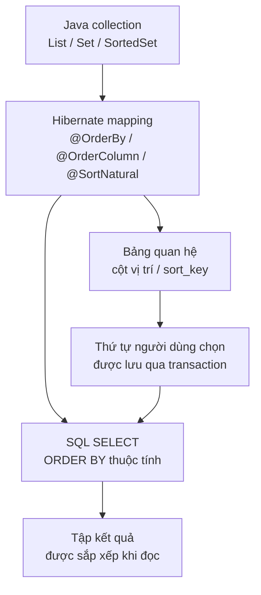

# Sắp xếp, thứ tự lưu và chi phí cập nhật vị trí

## 1. Câu hỏi quan trọng: muốn hiển thị theo quy tắc hay lưu thứ tự do người dùng chọn?

Trong Hibernate ORM, quan hệ đa trị (*to-many association*) có thể xuất hiện dưới dạng `List`, `Set`, `Collection` hoặc `Map`. Ví dụ, một dự án có nhiều công việc, một album có nhiều bài hát, một đơn hàng có nhiều dòng hàng. Khi hiển thị tập hợp, ứng dụng thường cần một thứ tự nhất định.

Tuy nhiên, hai yêu cầu dưới đây khác nhau:

1. **Sắp xếp theo thuộc tính:** luôn hiển thị công việc theo `priority DESC` rồi `createdAt ASC`. Khi một công việc đổi độ ưu tiên, vị trí hiển thị tự thay đổi.
2. **Lưu thứ tự thủ công:** người dùng kéo công việc từ vị trí 8 lên vị trí 2. Lần sau mở lại bảng công việc, thứ tự mới vẫn được giữ dù tiêu đề, ngày tạo và độ ưu tiên không thay đổi.

Trường hợp thứ nhất thường dùng **`@OrderBy` hoặc câu truy vấn có `ORDER BY`**. Trường hợp thứ hai thường dùng **`@OrderColumn`**, hoặc một **thuộc tính vị trí/sort key** được quản lý có chủ đích.

Điểm mấu chốt là **sắp xếp kết quả khi đọc** và **lưu vị trí trong cơ sở dữ liệu** không phải một thao tác. Trộn lẫn hai mục tiêu sẽ khiến ứng dụng hiển thị sai thứ tự, phát nhiều câu lệnh SQL khi kéo thả hoặc gặp lỗi constraint khi đổi vị trí.

## 2. Ba nơi có thể mang thông tin thứ tự



| Cơ chế | Thứ tự nằm ở đâu? | Thao tác điển hình | Có lưu vị trí riêng? |
|---|---|---|---|
| `@OrderBy` | Quy tắc sắp xếp của truy vấn khi tải association | `ORDER BY name ASC`, `ORDER BY createdAt DESC` | **Không** |
| `@OrderColumn` | Cột chỉ số trong bảng collection hoặc bảng quan hệ | `position = 0, 1, 2, ...` | **Có** |
| `@SortNatural` / `@SortComparator` | Bộ so sánh của sorted collection trong Java/Hibernate | `TreeSet` hoặc `TreeMap` theo comparator | **Không tự lưu vị trí** |
| JPQL/HQL `ORDER BY` | Từng câu truy vấn cụ thể | `select t ... order by t.priority desc` | **Không** |
| Thuộc tính nghiệp vụ `sortKey` | Cột của entity do ứng dụng quản lý | `sortKey = 1000, 2000, 3000` | **Có, dưới dạng dữ liệu nghiệp vụ** |

Một **`List` trong Java có thứ tự**, nhưng không có nghĩa các phần tử sẽ tự được lưu cùng thứ tự đó trong database. Ngược lại, một bảng SQL có thể chứa cột `position`, nhưng kết quả `SELECT` vẫn **không có thứ tự xác định** nếu truy vấn không yêu cầu `ORDER BY` hoặc không được Hibernate tải qua mapping có quy tắc sắp xếp.

> **Nguyên tắc SQL:** bảng quan hệ là tập/bag các hàng. Không thể dựa vào thứ tự INSERT, khóa chính, thứ tự vật lý trong index hay lần truy vấn trước để khẳng định thứ tự các hàng của một `SELECT` không có `ORDER BY`.

## 3. @OrderBy: sắp xếp theo giá trị thuộc tính khi tải collection

`@OrderBy` là annotation chuẩn Jakarta Persistence. Nó khai báo thứ tự dùng khi Hibernate tải một association hoặc collection giá trị từ database. Cú pháp thường là danh sách tên **thuộc tính của entity đích** cùng hướng sắp xếp.

Giả sử một `Project` có nhiều `Task`; mỗi task có `priority` và `createdAt`:

```java
package com.example.kanban;

import jakarta.persistence.Entity;
import jakarta.persistence.FetchType;
import jakarta.persistence.GeneratedValue;
import jakarta.persistence.Id;
import jakarta.persistence.OneToMany;
import jakarta.persistence.OrderBy;
import java.util.ArrayList;
import java.util.List;

@Entity
public class Project {
    @Id
    @GeneratedValue
    private Long id;

    @OneToMany(mappedBy = "project", fetch = FetchType.LAZY)
    @OrderBy("priority DESC, createdAt ASC")
    private List<Task> tasks = new ArrayList<>();

    protected Project() {}

    public List<Task> getTasks() {
        return tasks;
    }
}
```

Entity đích:

```java
package com.example.kanban;

import jakarta.persistence.Entity;
import jakarta.persistence.FetchType;
import jakarta.persistence.GeneratedValue;
import jakarta.persistence.Id;
import jakarta.persistence.ManyToOne;
import java.time.Instant;

@Entity
public class Task {
    @Id
    @GeneratedValue
    private Long id;

    private int priority;
    private Instant createdAt;

    @ManyToOne(fetch = FetchType.LAZY)
    private Project project;

    protected Task() {}
}
```

Trong ví dụ, `Task.project` là phía sở hữu khóa ngoại của quan hệ hai chiều; `Project.tasks` dùng `mappedBy`. `@OrderBy` ở collection yêu cầu sắp xếp theo giá trị `priority` giảm dần, rồi `createdAt` tăng dần.

Một câu SQL tải collection có thể mang ý nghĩa tương đương:

```sql
SELECT t.id, t.priority, t.created_at, t.project_id
FROM task t
WHERE t.project_id = ?
ORDER BY t.priority DESC, t.created_at ASC;
```

Tên bảng/cột và hình thức truy vấn thật phụ thuộc naming strategy, dialect và fetch plan. `@OrderBy` dùng **tên thuộc tính persistent của entity trong biểu thức mapping**, không mặc định dùng trực tiếp tên cột SQL `created_at`.

### @OrderBy thay đổi điều gì?

- Khi tải collection từ database, Hibernate yêu cầu kết quả được sắp theo tiêu chí đã khai báo.
- Khi `priority` thay đổi rồi transaction commit, lần nạp lại collection ở persistence context mới có thể cho thứ tự mới theo quy tắc.
- Hibernate **không cần tạo cột `position`** chỉ vì có `@OrderBy`.
- Lời gọi `project.getTasks().add(index, task)` hay `Collections.swap(...)` trên `List` không tạo ra một quy tắc thứ tự thủ công được lưu nhờ `@OrderBy`. Khi tải lại, thứ tự sẽ được quyết định bởi các thuộc tính sắp xếp.

### Chú ý về dữ liệu đang có trong Session

`@OrderBy` điều khiển **việc tải từ database**, không phải một thuật toán tự động sắp xếp lại `ArrayList` sau mọi lần thay đổi trong Java. Nếu entity đã được tải cùng collection và code gọi `task.setPriority(...)`, không được giả định `project.getTasks()` tự chuyển task sang vị trí mới ngay lập tức.

Nếu cần hiển thị tức thời trong cùng transaction, ứng dụng có thể sắp xếp bản sao, tải lại dữ liệu theo truy vấn hoặc dùng một collection có ngữ nghĩa sorted phù hợp.

### Thứ tự khi các khóa sắp xếp bằng nhau

`@OrderBy("priority DESC, createdAt ASC")` chưa định nghĩa thứ tự giữa hai task có cùng `priority` và `createdAt`. Nếu hệ thống cần thứ tự hoàn toàn ổn định, thêm khóa tie-breaker như ID:

```java
@OrderBy("priority DESC, createdAt ASC, id ASC")
private List<Task> tasks = new ArrayList<>();
```

Hãy chọn tie-breaker theo ngữ nghĩa thực tế. Thứ tự không xác định giữa các hàng đồng hạng có thể làm pagination, snapshot hoặc giao diện “nhảy vị trí” sau mỗi lần tải.

## 4. @OrderColumn: lưu vị trí từng phần tử trong database

`@OrderColumn` là annotation Jakarta Persistence dùng để duy trì **thứ tự bền vững của một `List`** trong bảng quan hệ. Hibernate quản lý giá trị vị trí khi collection thay đổi.

Ví dụ danh sách nhãn hiển thị trong một dự án:

```java
package com.example.kanban;

import jakarta.persistence.CollectionTable;
import jakarta.persistence.Column;
import jakarta.persistence.ElementCollection;
import jakarta.persistence.Entity;
import jakarta.persistence.GeneratedValue;
import jakarta.persistence.Id;
import jakarta.persistence.JoinColumn;
import jakarta.persistence.OrderColumn;
import java.util.ArrayList;
import java.util.List;

@Entity
public class Project {
    @Id
    @GeneratedValue
    private Long id;

    @ElementCollection
    @CollectionTable(
        name = "project_labels",
        joinColumns = @JoinColumn(name = "project_id")
    )
    @OrderColumn(name = "display_position")
    @Column(name = "label", nullable = false, length = 80)
    private List<String> labels = new ArrayList<>();

    protected Project() {}

    public List<String> getLabels() {
        return labels;
    }
}
```

**Sơ đồ bảng tập hợp:**

```text
project
  id
  ...
         │
         │ project_labels.project_id -> project.id
         ▼
project_labels
┌────────────┬──────────────────┬────────────────┐
│ project_id │ display_position │ label          │
├────────────┼──────────────────┼────────────────┤
│ 42         │ 0                │ Backend        │
│ 42         │ 1                │ Urgent         │
│ 42         │ 2                │ Customer       │
└────────────┴──────────────────┴────────────────┘
```

Một DDL có thể dùng với PostgreSQL:

```sql
CREATE TABLE project_labels (
    project_id BIGINT NOT NULL,
    display_position INTEGER NOT NULL,
    label VARCHAR(80) NOT NULL,
    CONSTRAINT fk_project_labels_owner
        FOREIGN KEY (project_id) REFERENCES project(id)
);
```

Schema minh họa giả định bảng `project(id BIGINT PRIMARY KEY)` đã tồn tại. Việc đặt thêm unique constraint trên `(project_id, display_position)` cần cân nhắc riêng vì Hibernate có thể thực hiện nhiều lệnh cập nhật trung gian khi reorder.

### Đặc điểm của @OrderColumn

- `List` lưu thứ tự bằng một cột số nguyên trong collection table, join table hoặc bảng chứa quan hệ, tùy mapping.
- Giá trị vị trí thông thường là **0, 1, 2, ...** theo thứ tự liên tiếp khi collection ở trạng thái ổn định.
- Vị trí là **thông tin do ORM quản lý**; không phải một thuộc tính nghiệp vụ của phần tử được truy cập trực tiếp trong mô hình Java cơ bản.
- Khi gọi `add(index, element)`, `remove(index)`, `set(index, element)` hoặc reorder, Hibernate phải điều chỉnh trạng thái vị trí của collection khi flush.
- `@OrderColumn` có thể đặt trên một `@OneToMany`, `@ManyToMany` hoặc `@ElementCollection` được ánh xạ thích hợp. Vị trí cột khác nhau tùy kiểu association và phía sở hữu.

### Hibernate @ListIndexBase

Hibernate có annotation riêng `@ListIndexBase` để thay đổi chỉ số cột lưu thay vì giá trị mặc định bắt đầu từ 0, nếu phiên bản đang sử dụng hỗ trợ:

```java
import org.hibernate.annotations.ListIndexBase;

@ElementCollection
@CollectionTable(
    name = "project_labels",
    joinColumns = @JoinColumn(name = "project_id")
)
@OrderColumn(name = "display_position")
@ListIndexBase(1)
@Column(name = "label")
private List<String> labels = new ArrayList<>();
```

Trong trường hợp này, thứ tự Java vẫn bắt đầu từ chỉ số `0` nhưng giá trị cột trong database có thể là `1, 2, 3, ...`. Đây là tùy chỉnh Hibernate-specific, không phải thuộc tính tiêu chuẩn của `@OrderColumn`. Nếu không có yêu cầu tương thích schema cũ, sử dụng mặc định giúp mô hình dễ hiểu hơn.

## 5. Ví dụ thao tác với List và chi phí cập nhật vị trí

Giả sử dự án số 42 đang có:

```text
Index Java    DB display_position    Label
0             0                      Backend
1             1                      Urgent
2             2                      Customer
3             3                      Documentation
4             4                      Research
```

Các ví dụ sau giả định entity đã được tải trong `Session` đang mở và transaction đang chạy. Trong Hibernate, thao tác thay đổi collection sẽ được đồng bộ ở flush/commit, với SQL thực tế tùy mapping, phiên bản và trạng thái collection.

### 5.1. Thêm phần tử vào cuối

```java
project.getLabels().add("Testing");
```

Thứ tự mong muốn:

```text
0 Backend
1 Urgent
2 Customer
3 Documentation
4 Research
5 Testing        <-- mới
```

Nếu Hibernate có thể xác định hàng mới ở cuối, thao tác này thường chỉ cần **thêm phần tử và giá trị vị trí mới**, ít phải dịch chuyển phần tử cũ. Đây thường là trường hợp rẻ nhất khi làm việc với `@OrderColumn`.

### 5.2. Chèn ở giữa

```java
project.getLabels().add(1, "Testing");
```

Thứ tự sau cùng:

```text
0 Backend
1 Testing        <-- chèn
2 Urgent         <-- từ 1 lên 2
3 Customer       <-- từ 2 lên 3
4 Documentation  <-- từ 3 lên 4
5 Research       <-- từ 4 lên 5
```

Về mặt dữ liệu, những vị trí từ chỉ số 1 trở đi phải được diễn giải lại. Hibernate có thể phát nhiều câu `UPDATE`, `DELETE` hoặc `INSERT` tùy loại collection và cách nhận dạng hàng. Tổng chi phí thường **tăng theo số phần tử bị ảnh hưởng**, chứ không chỉ theo một phần tử mới.

### 5.3. Xóa một phần tử ở giữa

```java
project.getLabels().remove(1);
```

Sau khi xóa phần tử tại index 1, các phần tử phía sau cần được đánh chỉ số lại để danh sách vẫn liên tiếp:

```text
Trước: 0 Backend | 1 Urgent | 2 Customer | 3 Documentation | 4 Research
Sau:   0 Backend | 1 Customer | 2 Documentation | 3 Research
```

Trong trường hợp này, số phần tử bị dồn lên phụ thuộc vị trí xóa. Một thao tác xóa đầu danh sách dài có thể đắt hơn xóa cuối danh sách.

### 5.4. Kéo thả, hoán đổi và di chuyển phần tử

```java
List<String> labels = project.getLabels();
String moved = labels.remove(4);
labels.add(1, moved);
```

Để di chuyển phần tử từ 4 về 1, các phần tử ở dải 1–4 đổi vị trí tương đối. Trong ORM, việc này có thể kéo theo cập nhật nhiều hàng.

```text
Ban đầu:    A  B  C  D  E
Di chuyển:  A  E  B  C  D
Index:      0  1  2  3  4
              ^^^^^^^^^^^
              4 phần tử có vị trí bị ảnh hưởng
```

**Không mặc định một lần kéo thả tương đương một câu `UPDATE ... SET position = ?`.** Khi dùng `@OrderColumn`, Hibernate phải duy trì tính liên tiếp và nhất quán của chỉ số; với một số mapping, đặc biệt bag/collection table không có khóa ổn định cho từng hàng, nó còn có thể xóa rồi chèn lại nhiều hàng.

### 5.5. Bảng so sánh chi phí tương đối

Với danh sách có `n` phần tử và cơ chế chỉ số liên tiếp:

| Thao tác | Phần tử có thể bị ảnh hưởng về vị trí | Xu hướng chi phí |
|---|---|---|
| Append cuối | 1 phần tử mới | Thường thấp |
| Xóa cuối | 1 phần tử | Thường thấp |
| Chèn tại index `i` | Khoảng `n - i` phần tử cũ + phần tử mới | Tăng khi chèn gần đầu |
| Xóa tại index `i` | Phần tử bị xóa và các phần tử từ `i + 1` trở đi | Tăng khi xóa gần đầu |
| Di chuyển từ `a` đến `b` | Khoảng `|a - b| + 1` phần tử trong đoạn di chuyển | Phụ thuộc khoảng cách |
| Đảo toàn bộ danh sách | Phần lớn phần tử | Có thể cao |
| Đổi giá trị `name` của một phần tử không ảnh hưởng thứ tự | Không cần đổi cột vị trí | Thường thấp nếu không thay mapping |

Đây là **ước lượng về tác động logic**, không phải số statement cố định. Hibernate có thể chọn chiến lược SQL khác nhau; JDBC batching có thể giảm round-trip nhưng không xóa bỏ lượng công việc cập nhật các hàng.

## 6. @OrderColumn trên quan hệ entity: bảng trung gian nằm ở đâu?

`@OrderColumn` không chỉ dành cho `@ElementCollection`. Với quan hệ nhiều entity, vị trí có thể nằm ở **join table**.

Ví dụ một `Playlist` chứa danh sách `Track` có thứ tự do người dùng quyết định. `Track` có identity riêng, có thể xuất hiện trong nhiều playlist:

```java
import jakarta.persistence.Entity;
import jakarta.persistence.GeneratedValue;
import jakarta.persistence.Id;
import jakarta.persistence.JoinColumn;
import jakarta.persistence.JoinTable;
import jakarta.persistence.ManyToMany;
import jakarta.persistence.OrderColumn;
import java.util.ArrayList;
import java.util.List;

@Entity
public class Playlist {
    @Id
    @GeneratedValue
    private Long id;

    @ManyToMany
    @JoinTable(
        name = "playlist_tracks",
        joinColumns = @JoinColumn(name = "playlist_id"),
        inverseJoinColumns = @JoinColumn(name = "track_id")
    )
    @OrderColumn(name = "play_position")
    private List<Track> tracks = new ArrayList<>();

    protected Playlist() {}

    public List<Track> getTracks() {
        return tracks;
    }
}
```

`Track` là một `@Entity` riêng có `@Id` được khai báo đầy đủ trong dự án.

Schema có thể trông như:

```sql
CREATE TABLE playlist_tracks (
    playlist_id BIGINT NOT NULL REFERENCES playlist(id),
    track_id BIGINT NOT NULL REFERENCES track(id),
    play_position INTEGER NOT NULL
);
```

Trong thiết kế này:

- `playlist_id` xác định owner của danh sách.
- `track_id` xác định entity bài hát được tham chiếu.
- `play_position` xác định vị trí bài hát **trong từng playlist**, không phải vị trí toàn cục của entity `Track`.

Một bài hát có thể ở vị trí 0 trong playlist A và vị trí 9 trong playlist B. **Không nên đặt `play_position` lên bảng `track`** khi thứ tự là đặc tính riêng của quan hệ với playlist.

Với `@ManyToMany`, không dùng `CascadeType.REMOVE` một cách tùy tiện: xóa một bài hát khỏi danh sách phát thường có nghĩa xóa **hàng liên kết**, không xóa entity `Track` khỏi toàn bộ hệ thống.

### Nếu thứ tự thuộc về entity con thì sao?

Trong mô hình `@OneToMany`, nếu mỗi task chỉ thuộc một board, có thể lưu một thuộc tính `sortKey` ngay trên entity con:

```text
task
  id
  board_id
  title
  sort_key
```

Khi đó thứ tự được quản lý như **dữ liệu nghiệp vụ** của `Task`, khác với cột chỉ số được Hibernate duy trì bằng `@OrderColumn`. Cách này đặc biệt hữu ích nếu cần kéo thả nhiều và muốn điều khiển chính xác số hàng được cập nhật.

## 7. @OrderBy và @OrderColumn: không nên dùng lẫn mục đích

| Tiêu chí | `@OrderBy` | `@OrderColumn` |
|---|---|---|
| Sắp xếp theo thuộc tính entity? | Có, theo biểu thức order | Không phải mục đích chính |
| Lưu vị trí do người dùng chọn? | Không | Có |
| Tạo cột vị trí riêng? | Không | Có |
| Thay đổi `priority` có đổi thứ tự khi tải lại? | Có thể, nếu đang order theo priority | Không tự đổi vị trí |
| Kéo thả trực tiếp trong `List` được lưu bền vững? | Không, nếu không cập nhật thuộc tính order | Có, theo khả năng mapping và flush |
| Thêm ở giữa làm nhiều vị trí bị cập nhật? | Không do cơ chế order metadata | Có thể |
| Dễ dùng cho danh sách lớn, chỉ đọc? | Thường phù hợp khi có index/truy vấn hiệu quả | Cần tính chi phí reordering |
| Dễ dùng cho danh sách do người dùng sắp tay? | Chỉ khi có `sortKey` nghiệp vụ | Phù hợp với list nhỏ/vừa |

Một nhầm lẫn là sử dụng:

```java
@OneToMany(mappedBy = "project")
@OrderBy("priority ASC")
private List<Task> tasks;
```

rồi gọi:

```java
Collections.swap(project.getTasks(), 0, 1);
```

và kỳ vọng sau khi tải lại task vẫn được hoán đổi. `@OrderBy` luôn dựa vào `priority`, nên nếu không đổi `priority` hoặc một sort key tương ứng, thứ tự tự chọn không được lưu.

Ngược lại, với:

```java
@ElementCollection
@OrderColumn(name = "position")
private List<String> labels;
```

đổi tên một label không nhất thiết đổi vị trí của nó. **`@OrderColumn` định nghĩa vị trí, không định nghĩa thứ tự từ điển theo label.**

### Có nên đặt cả hai lên cùng collection?

Nên chọn một mô hình thứ tự làm **nguồn sự thật chính**. Nếu vừa muốn sắp theo thuộc tính vừa muốn lưu thứ tự thủ công, yêu cầu có thể mâu thuẫn: khi thuộc tính sắp xếp thay đổi, thứ tự nào cần thắng? Tốt hơn là thiết kế rõ chế độ xem (sort theo thuộc tính) và thứ tự người dùng lưu (sort key/position), rồi truy vấn theo chế độ phù hợp. Cũng cần kiểm tra giới hạn và quy tắc sử dụng annotation của Jakarta Persistence và phiên bản Hibernate cụ thể, thay vì trông chờ việc ghép hai annotation cho một kết quả trực quan.

## 8. Danh sách không có @OrderColumn có đảm bảo thứ tự không?

**Không thể kết luận từ kiểu `List` ở Java rằng database sẽ nhớ vị trí.** Một collection Hibernate có thể được xem là *bag* (cho phép phần tử trùng, không có cột vị trí), *list có index*, *set* hoặc loại collection khác, tùy mapping và phiên bản.

Ví dụ:

```java
@OneToMany(mappedBy = "project")
private List<Task> tasks = new ArrayList<>();
```

Nếu không có `@OrderColumn`, `@OrderBy` hay cơ chế sort khác, đừng viết code nghiệp vụ dựa trên thứ tự tự nhiên của những hàng Hibernate tải từ database. Một số phiên bản/cấu hình Hibernate có quy tắc mặc định về semantics của `List`, nhưng **không nên xem đó là hợp đồng lưu vị trí được áp dụng giống nhau trong mọi mapping**.

Trong Hibernate ORM 6.x tồn tại setting chuyên biệt liên quan cách diễn giải `List` mặc định, chẳng hạn `hibernate.mapping.default_list_semantics` ở các phiên bản hỗ trợ. Giá trị và điều kiện áp dụng, đặc biệt với collection có `mappedBy`, phải được tra theo phiên bản thực tế. Hãy khai báo rõ yêu cầu bằng `@OrderColumn` hoặc `@OrderBy` khi thứ tự là một phần quan trọng của hệ thống.

Tương tự, dùng `LinkedHashSet` có thể giữ thứ tự chèn trong **đối tượng Java đang tồn tại**, nhưng không có nghĩa Hibernate sẽ lưu bền vững thứ tự đó dưới database nếu không có mapping tương ứng.

## 9. @SortNatural và @SortComparator: sắp xếp trong bộ nhớ

Hibernate có các annotation chuyên biệt phục vụ **sorted collections**, khác với `@OrderBy` và `@OrderColumn`.

### 9.1. @SortNatural

Nếu phần tử có trật tự tự nhiên (ví dụ `String` triển khai `Comparable`), có thể yêu cầu một `SortedSet`:

```java
import jakarta.persistence.CollectionTable;
import jakarta.persistence.ElementCollection;
import jakarta.persistence.JoinColumn;
import org.hibernate.annotations.SortNatural;

import java.util.SortedSet;
import java.util.TreeSet;

@ElementCollection
@CollectionTable(
    name = "project_keywords",
    joinColumns = @JoinColumn(name = "project_id")
)
@SortNatural
private SortedSet<String> keywords = new TreeSet<>();
```

Khi sử dụng `SortedSet`, phần tử được sắp theo `compareTo(...)` hoặc comparator được cấu hình. Thứ tự sắp xếp là **ngữ nghĩa của collection ở Java/Hibernate**, không tự đồng nghĩa với có cột `position`.

### 9.2. @SortComparator

Khi muốn quy tắc khác, khai báo comparator:

```java
import java.io.Serializable;
import java.util.Comparator;

public class CaseInsensitiveKeywordComparator
        implements Comparator<String>, Serializable {
    @Override
    public int compare(String left, String right) {
        return String.CASE_INSENSITIVE_ORDER.compare(left, right);
    }
}
```

Và mapping:

```java
import org.hibernate.annotations.SortComparator;

@ElementCollection
@CollectionTable(
    name = "project_keywords",
    joinColumns = @JoinColumn(name = "project_id")
)
@SortComparator(CaseInsensitiveKeywordComparator.class)
private SortedSet<String> keywords = new TreeSet<>(
    new CaseInsensitiveKeywordComparator()
);
```

**Lưu ý:** comparator không phân biệt chữ hoa/thường sẽ xem `"Java"` và `"java"` bằng nhau trong `SortedSet`, dù `String.equals(...)` cho kết quả khác. Các bộ so sánh dùng với sorted set/map phải ổn định và nhất quán với ngữ nghĩa định danh/trùng lặp mà nghiệp vụ mong muốn; nếu không có thể mất phần tử một cách khó hiểu.

### 9.3. Khác với ORDER BY trong SQL

| Khía cạnh | `@OrderBy` | `@SortNatural` / `@SortComparator` |
|---|---|---|
| Cách sắp | SQL/database khi tải collection | Comparator của sorted collection ở phía Java |
| Kiểu collection điển hình | `List` hoặc collection được hỗ trợ | `SortedSet`, `SortedMap` |
| Lưu chỉ số vị trí? | Không | Không |
| Chi phí với nhiều phần tử | Có thể dùng index và sort của database | Phải quản lý/so sánh các phần tử đã được nạp vào collection |
| Có giữ cả hai phần tử mà comparator so sánh bằng nhau? | Phụ thuộc loại collection | `SortedSet` không giữ cả hai |

Nếu muốn sort/pagination một danh sách hàng chục nghìn phần tử, thường nên đưa điều kiện sort và giới hạn số lượng vào **query ở database** thay vì nạp toàn bộ rồi sắp trong bộ nhớ.

## 10. OrderBy với ElementCollection và embeddable

`@OrderBy` không chỉ dùng với entity target. Nó cũng có thể dùng cho element collection theo quy tắc Jakarta Persistence.

### Collection giá trị cơ bản

Với collection các chuỗi:

```java
@ElementCollection
@CollectionTable(
    name = "project_keywords",
    joinColumns = @JoinColumn(name = "project_id")
)
@OrderBy("ASC")
private List<String> keywords = new ArrayList<>();
```

Ở đây, Hibernate sắp xếp **giá trị phần tử** tăng dần khi tải. Nó không thêm cột vị trí và không lưu thứ tự kéo thả tùy ý.

### Collection của @Embeddable

Giả sử một value object chứa nhãn và điểm ưu tiên:

```java
@Embeddable
public class LabelValue {
    private String caption;
    private int weight;

    protected LabelValue() {}
}
```

Collection:

```java
@ElementCollection
@CollectionTable(
    name = "project_label_values",
    joinColumns = @JoinColumn(name = "project_id")
)
@OrderBy("weight DESC, caption ASC")
private List<LabelValue> labels = new ArrayList<>();
```

Hibernate sử dụng thuộc tính `weight` và `caption` của embeddable để sắp xếp. Ở đây thứ tự do **dữ liệu bản thân từng phần tử** quyết định. Nếu người dùng kéo thả phần tử mà không đổi `weight`, không có lý do để thứ tự thủ công được khôi phục sau lần tải khác.

## 11. Truy vấn có ORDER BY: giải pháp cho từng màn hình

Nếu cùng một collection cần nhiều cách sắp xếp, không nhất thiết đóng đinh tất cả vào `@OrderBy` trên entity.

Ví dụ:

```java
List<Task> tasks = session.createQuery(
    "select t from Task t " +
    "where t.project.id = :projectId " +
    "order by t.priority desc, t.createdAt asc, t.id asc",
    Task.class
).setParameter("projectId", projectId)
 .setMaxResults(50)
 .getResultList();
```

Ưu điểm:

- Mỗi use case có thể chọn tiêu chí sắp xếp phù hợp.
- Database có thể dùng index và cơ chế phân trang; không cần nạp toàn bộ association.
- Dễ bổ sung các filter như `status`, khoảng ngày, người phụ trách.
- Có thể thêm ID làm tie-breaker để kết quả ổn định.

Nếu người dùng được chọn trường sort từ HTTP request, **không nối trực tiếp tên trường SQL/HQL từ chuỗi tùy ý**. Tạo danh sách cho phép như `priority`, `createdAt`, `title` rồi ánh xạ đầu vào sang các biểu thức query hợp lệ. Giá trị filter nên được bind qua parameter.

### Phân trang cần thứ tự ổn định

Truy vấn:

```sql
SELECT *
FROM task
WHERE project_id = ?
ORDER BY created_at DESC, id DESC
LIMIT 50;
```

ổn định hơn `ORDER BY created_at DESC` nếu nhiều task cùng timestamp. Dù vậy, dữ liệu được chèn/xóa giữa hai lần lấy trang vẫn có thể khiến offset pagination thấy lặp hoặc thiếu bản ghi. Với bảng rất lớn và sắp xếp ổn định, có thể cân nhắc **keyset pagination** dùng bộ khóa sort như `(created_at, id)`.

### @OrderBy và sorting ở cấp query cùng tồn tại thế nào?

`@OrderBy` là quy tắc áp dụng khi **Hibernate tải collection qua association mapping**. Một truy vấn `select t from Task t order by ...` là một query độc lập, có `ORDER BY` riêng. Không nên cho rằng `@OrderBy` trên `Project.tasks` tự thêm sort vào mọi truy vấn độc lập lấy `Task`.

## 12. Chi phí SQL và index khi dùng thứ tự

### 12.1. @OrderBy có thể phát sinh sort ở database

Với:

```sql
SELECT *
FROM task
WHERE project_id = ?
ORDER BY priority DESC, created_at ASC, id ASC;
```

database có thể cần sort nhiều hàng nếu không có index phù hợp. Một index hỗn hợp có thể hữu ích tùy query planner:

```sql
CREATE INDEX idx_task_project_order
    ON task(project_id, priority DESC, created_at ASC, id ASC);
```

Index không phải lúc nào cũng loại bỏ hoàn toàn sort. Khả năng sử dụng index còn phụ thuộc filter, thứ tự cột, chiều sắp xếp, số dòng, phân bố giá trị và cơ chế của hệ quản trị.

### 12.2. @OrderColumn làm tăng chi phí ghi

`@OrderColumn` có thể khiến thao tác chèn/xóa giữa danh sách hoặc reorder phải:

- Update vị trí cho nhiều hàng đã có.
- Delete/insert các hàng khi mapping không nhận dạng được phần tử ở mức hàng riêng lẻ.
- Duy trì index/unique constraint trên cột vị trí.
- Giữ khóa lâu hơn trên các hàng bị ảnh hưởng khi transaction có cạnh tranh.

Với playlist chỉ vài chục bài, chi phí có thể nhỏ. Với danh sách hàng chục nghìn phần tử thường xuyên kéo thả, thiết kế cột vị trí liên tiếp có thể trở thành điểm nghẽn.

### 12.3. JDBC batching giảm round-trip, không đổi độ phức tạp

Hibernate có thể gom một số `UPDATE` hoặc `INSERT` qua JDBC batching:

```properties
hibernate.jdbc.batch_size=50
hibernate.order_updates=true
```

Khi driver và mapping cho phép, batching giảm số lượt giao tiếp tới database. Nhưng nếu reorder cần cập nhật 4.000 vị trí, batching **không biến 4.000 thay đổi logic thành một thay đổi duy nhất**. Database vẫn phải thực hiện công việc trên các hàng và index tương ứng.

## 13. Unique constraint cho vị trí: đúng invariant nhưng phải coi chừng trạng thái trung gian

Ứng dụng thường muốn mỗi vị trí chỉ có một phần tử trong cùng owner:

```sql
ALTER TABLE project_labels
ADD CONSTRAINT uq_project_label_position
UNIQUE (project_id, display_position);
```

Về dữ liệu cuối cùng, constraint này hợp lý. Tuy nhiên, một lần hoán đổi vị trí:

```text
Trước: A=0, B=1
Sau:   A=1, B=0
```

có thể thất bại nếu Hibernate/SQL thực hiện:

```sql
UPDATE project_labels SET display_position = 1
WHERE project_id = 42 AND display_position = 0;
```

khi B vẫn đang giữ vị trí 1. **Unique constraint có thể được kiểm tra tại từng statement**, và Hibernate không nhất thiết phát SQL theo thứ tự an toàn cho constraint trong mọi mapping.

Một số hệ quản trị hỗ trợ **deferrable unique constraint** có thể trì hoãn kiểm tra đến cuối transaction khi được cấu hình. Một số ứng dụng dùng **vị trí tạm** hoặc **renumber trong nhiều bước**. Tuy nhiên, đây đều là quyết định schema và thuật toán cụ thể, cần kiểm tra khả năng của DB, Hibernate version và concurrency.

Vì vậy, **đừng tự thêm unique constraint vị trí rồi mặc định mọi phương thức `Collections.swap(...)` sẽ hoạt động**. Hãy xác định strategy bảo toàn invariant, và thử reorder trên database đích trong bước kiểm thử tích hợp của dự án.

## 14. Đồng thời thay đổi thứ tự: tránh ghi đè lẫn nhau

Một trường hợp phổ biến:

```text
Ban đầu: A B C D

User 1 đọc: A B C D
User 2 đọc: A B C D

User 1 đổi: B A C D
User 2 đổi: A C B D

Cả hai cùng lưu.
```

Nếu hệ thống không kiểm soát đồng thời, lần ghi sau có thể ghi đè một phần hoặc toàn bộ quyết định thứ tự của lần ghi trước. Khó khăn nằm ở **collection ordering** chứ không chỉ ở việc có `@OrderColumn`.

Các lựa chọn:

1. **Optimistic locking** qua một trường version của owner hoặc một aggregate quản lý thứ tự. Trước khi lưu reorder, kiểm tra phiên bản danh sách đã đọc; nếu thay đổi thì báo conflict hoặc yêu cầu tải lại.
2. **Pessimistic locking/serialize reorder** đối với owner hoặc tài nguyên dùng để điều phối cập nhật, khi yêu cầu nhất quán rất chặt và lưu lượng cho phép.
3. **API reorder nhận expectedVersion và danh sách ID có thứ tự**, sau đó transaction kiểm tra các ID đều thuộc owner và không trùng.
4. **Sort key và chiến lược giải quyết xung đột**, phù hợp hơn khi giao diện có nhiều người cùng chỉnh sửa thường xuyên.

`@Version` trên owner có thể tham gia optimistic locking cho những thay đổi collection thuộc owner trong nhiều mapping, nhưng **không được giả định mọi thay đổi quan hệ inverse, bulk SQL hoặc native query đều tự tăng version owner**. Khi thứ tự là invariant cần bảo vệ, hãy xác minh cơ chế locking của đúng mapping và thao tác ghi, hoặc chủ động kiểm tra version tại service/database.

### Một API reorder rõ ràng

Ví dụ payload:

```json
{
  "projectId": 42,
  "expectedVersion": 12,
  "taskIds": [15, 31, 22, 17]
}
```

Service nên:

- Kiểm tra người dùng có quyền chỉnh dự án.
- Kiểm tra danh sách không trùng ID và các ID thực sự thuộc dự án.
- Kiểm tra `expectedVersion` trước khi áp thứ tự mới.
- Cập nhật thứ tự trong transaction và tăng version quản lý order.
- Trả conflict nếu có phiên bản mới hơn thay vì âm thầm ghi đè.

Phương án này giảm rủi ro từ việc nhận các vị trí rời rạc hoặc cập nhật từng hàng ngoài transaction.

## 15. Giải pháp thay thế: lưu sort key thưa để giảm cập nhật hàng loạt

Nếu danh sách có hàng nghìn phần tử và người dùng kéo thả thường xuyên, có thể tự quản lý một cột **`sort_key`** (hoặc `rank`) ở entity con:

```java
@Entity
public class Task {
    @Id
    @GeneratedValue
    private Long id;

    @ManyToOne(fetch = FetchType.LAZY, optional = false)
    @JoinColumn(name = "project_id", nullable = false)
    private Project project;

    @Column(name = "sort_key", nullable = false)
    private long sortKey;

    protected Task() {}
}
```

Trong `Project`:

```java
@OneToMany(mappedBy = "project")
@OrderBy("sortKey ASC, id ASC")
private List<Task> tasks = new ArrayList<>();
```

Giả sử sort key ban đầu là:

```text
Task A   sort_key=1000
Task B   sort_key=2000
Task C   sort_key=3000
Task D   sort_key=4000
```

Để đưa D vào giữa A và B, có thể cấp `sort_key=1500` cho D:

```text
Task A   sort_key=1000
Task D   sort_key=1500
Task B   sort_key=2000
Task C   sort_key=3000
```

Như vậy có thể chỉ cần **cập nhật sort key của D** thay vì dịch chuyển mọi phần tử. Đây là một lựa chọn đáng cân nhắc khi tần suất reorder cao.

### Chi phí và giới hạn của sort key thưa

Không có phương án nào hoàn toàn miễn phí:

- Khoảng trống giữa hai key có thể cạn sau nhiều lần chèn; khi đó phải **renumber/rebalance** một vùng hoặc toàn bộ danh sách.
- Hai người chỉnh sửa đồng thời có thể chọn cùng một key. Cần versioning, khóa hoặc cơ chế tạo key an toàn với concurrency.
- Nếu dùng số thập phân/fractional indexing, cần định nghĩa độ chính xác, giới hạn tràn và quy tắc chuẩn hóa.
- Cần index trên `(project_id, sort_key, id)` nếu truy vấn theo thứ tự này thường xuyên.
- `sortKey` trở thành dữ liệu nghiệp vụ mà ứng dụng phải giữ nhất quán; Hibernate không tự cập nhật giá trị đó khi gọi `list.add(index, ...)`.

Với hệ thống cộng tác nhiều người, có thể sử dụng chiến lược **fractional indexing** hoặc mã vị trí có khả năng chèn giữa hai khóa, nhưng thuật toán phải xử lý xung đột và tái cân bằng. Bắt đầu bằng một số nguyên tăng cách đều và renumber có kiểm soát thường đủ cho nhiều ứng dụng CRUD.

## 16. Thứ tự lưu và pagination: ưu tiên query thay vì tải toàn collection

Giả sử danh sách task của một project có 50.000 phần tử. Trả `project.getTasks()` rồi tự lấy 20 phần tử đầu sẽ buộc ứng dụng tải nhiều dữ liệu không cần thiết nếu collection được khởi tạo toàn bộ.

Khi dùng sort key nghiệp vụ:

```java
List<Task> firstPage = session.createQuery(
    "select t from Task t " +
    "where t.project.id = :projectId " +
    "order by t.sortKey asc, t.id asc",
    Task.class
).setParameter("projectId", projectId)
 .setMaxResults(20)
 .getResultList();
```

Đối với `@OrderColumn` thuần túy, nếu ứng dụng cần query trực tiếp theo vị trí, cần xác định cách truy cập vị trí index trong JPQL/HQL theo mapping và phiên bản. Không mặc định một field `position` hiện diện trên entity con chỉ vì collection có `@OrderColumn`; có những mapping đặt cột vị trí ở join table.

Nếu thứ tự quan trọng cho nhiều endpoint và phải hỗ trợ filter/pagination lớn, lưu một `sortKey` rõ nghĩa trên entity con đôi khi giúp query API đơn giản hơn. Đổi lại, ứng dụng nhận trách nhiệm cập nhật khóa sắp xếp.

## 17. Chọn chiến lược theo tình huống

| Tình huống | Lựa chọn phù hợp | Lý do |
|---|---|---|
| Hiển thị đơn hàng theo ngày tạo giảm dần | Query `ORDER BY createdAt DESC, id DESC` | Không cần lưu vị trí tùy ý |
| Project có vài nhãn do người dùng kéo thả | `@ElementCollection` + `@OrderColumn` | Lưu thứ tự trực tiếp, model đơn giản |
| Playlist có các Track dùng chung, thứ tự riêng từng playlist | `@ManyToMany` + `@OrderColumn` trên join table, nếu phù hợp phiên bản/mapping | Vị trí thuộc quan hệ, Track vẫn độc lập |
| Danh sách task lớn, kéo thả nhiều lần mỗi phút | Entity `sortKey` + query `@OrderBy`/`ORDER BY` | Có thể giảm số hàng cần UPDATE |
| Tập hợp keyword luôn muốn sắp alphabet trong Java | `SortedSet` + `@SortNatural` | Không cần vị trí thủ công |
| Cần sắp theo nhiều trường do UI lựa chọn | JPQL/HQL Criteria `ORDER BY` | Cho phép query theo từng màn hình |
| Danh sách có filter và phân trang lớn | Query phân trang với sort ổn định và index phù hợp | Tránh tải toàn bộ collection |
| Có nhiều người cùng reorder | Versioning và transaction/locking cho thứ tự | Tránh ghi đè thứ tự lẫn nhau |

### Câu hỏi giúp chọn nhanh

1. **Thứ tự là hàm của dữ liệu phần tử hay là quyết định độc lập của người dùng?** Nếu là hàm, dùng `ORDER BY`. Nếu là quyết định độc lập, cần lưu vị trí hoặc sort key.
2. **Thứ tự thuộc về entity hay quan hệ?** Một task có thể có vị trí riêng trong board, còn một track có thể ở nhiều vị trí trên những playlist khác nhau.
3. **Danh sách dài bao nhiêu và reorder diễn ra thường xuyên đến mức nào?** Cột index liên tiếp thường dễ dùng với list nhỏ; dữ liệu lớn có thể cần sort key thưa.
4. **Có nhiều người chỉnh sửa đồng thời không?** Nếu có, phải xác định chính sách xung đột và version.
5. **Màn hình cần nạp toàn bộ collection hay chỉ một trang?** Query phân trang có thể tốt hơn.

## 18. Một bài thực hành tổng hợp

Giả sử xây dựng ứng dụng quản lý lịch học với ba yêu cầu:

- **Tài liệu tham khảo:** luôn hiển thị theo tên tăng dần.
- **Danh sách mục tiêu học tập:** người học kéo thả ít hơn 20 mục và cần lưu thứ tự thủ công.
- **Danh sách bài học của khóa:** có thể lên tới 100.000 bài, biên tập viên đổi vị trí thường xuyên, giao diện chỉ đọc một trang mỗi lần.

### Phần A — Sắp tài liệu theo tên

```java
@OneToMany(mappedBy = "course")
@OrderBy("title ASC, id ASC")
private List<ReferenceDocument> references = new ArrayList<>();
```

Không cần `position` vì thứ tự được tính từ `title` và `id`.

### Phần B — Lưu mục tiêu học tập theo List position

```java
@ElementCollection
@CollectionTable(
    name = "course_objectives",
    joinColumns = @JoinColumn(name = "course_id")
)
@OrderColumn(name = "position")
@Column(name = "objective_text", nullable = false, length = 400)
private List<String> objectives = new ArrayList<>();
```

Ví dụ học viên hoặc biên tập viên đổi mục tiêu từ index 6 lên index 1:

```java
String moved = course.getObjectives().remove(6);
course.getObjectives().add(1, moved);
```

Thao tác được thực hiện trong Session/transaction quản lý `Course`. Khi flush/commit, Hibernate đồng bộ danh sách theo mapping vị trí. Chi phí cập nhật có thể ảnh hưởng nhiều hàng, nhưng với danh sách nhỏ thường dễ chấp nhận.

### Phần C — Bài học quy mô lớn

Giả định `Lesson` là entity có `courseId`/association, `sortKey` và ID riêng. Truy vấn:

```java
List<Lesson> page = session.createQuery(
    "from Lesson l " +
    "where l.course.id = :courseId " +
    "order by l.sortKey asc, l.id asc",
    Lesson.class
).setParameter("courseId", courseId)
 .setMaxResults(50)
 .getResultList();
```

Khi chèn một bài giữa hai bài đã có key 1000 và 2000, ứng dụng có thể chọn key 1500 nếu chưa bị chiếm và hệ thống điều phối concurrency phù hợp. Khi không còn khoảng trống, service renumber một vùng trong transaction.

### Tự kiểm tra

1. Vì sao `@OrderBy("title ASC")` không lưu một lần kéo thả tự do?
2. Với danh sách 10.000 phần tử, chèn vào vị trí 0 trên mapping `@OrderColumn` có thể tốn kém ở đâu?
3. Khi `Playlist` và `Album` cùng chứa một `Track`, vì sao thứ tự thường thuộc join table chứ không phải `Track.position`?
4. Unique `(owner_id, position)` có thể gây lỗi nào khi hoán đổi hai vị trí?
5. Vì sao hai người cùng thay đổi thứ tự cần kiểm tra version hoặc một cơ chế khóa?

Gợi ý: (1) vì `@OrderBy` dựa trên thuộc tính, không lưu index; (2) vì nhiều hàng phải thay đổi vị trí và index; (3) vì vị trí phụ thuộc collection sở hữu; (4) xung đột unique tại một statement trung gian; (5) vì một bản cập nhật có thể ghi đè quyết định của người khác.

## 19. Các nguyên tắc kỹ thuật cần ghi nhớ

1. **Không có `ORDER BY`, SQL không cam kết thứ tự kết quả.** Đừng suy ra thứ tự từ khóa chính hoặc thứ tự chèn.
2. **`@OrderBy` sắp theo thuộc tính khi tải dữ liệu; không lưu vị trí thủ công.** Thay đổi thuộc tính sort có thể làm thay đổi thứ tự ở lần tải sau.
3. **`@OrderColumn` lưu vị trí cho `List` trong cơ sở dữ liệu.** Đổi vị trí trong List có thể kéo theo nhiều lệnh cập nhật, nhất là khi thay đổi gần đầu.
4. **`@SortNatural` và `@SortComparator` sắp theo comparator của collection Java/Hibernate.** Chúng không thay thế một cột vị trí do người dùng chọn.
5. **Thứ tự thuộc đúng phạm vi:** nếu một phần tử có thể ở nhiều collection, vị trí thường là dữ liệu của quan hệ; nếu luôn thuộc một owner, có thể là thuộc tính của entity con.
6. **Chi phí đọc và chi phí ghi khác nhau:** sắp khi query cần index/sort ở DB, còn lưu index liên tiếp phát sinh cập nhật khi reorder.
7. **Đừng bỏ qua constraint và concurrency:** unique vị trí cần strategy cập nhật an toàn; nhiều người cùng reorder cần version/locking.
8. **Với tập hợp lớn, cân nhắc sort key thưa và query phân trang.** Không nên nạp hàng chục nghìn entity chỉ để sắp trong Java rồi lấy vài phần tử.
9. **Đo SQL và query plan trên database thực tế.** Số lệnh Hibernate phát, vị trí lưu ở join table hay bảng entity và hiệu năng thay đổi theo mapping, dialect, phiên bản, index và workload.

Khi thiết kế quan hệ đa trị, hãy xác định **thứ tự được tính từ thuộc tính hay được người dùng đặt ra**, sau đó quyết định **có cần lưu vị trí không** và **cách cập nhật vị trí có chấp nhận được ở quy mô dữ liệu dự kiến không**. Đây là ranh giới quan trọng nhất giữa `@OrderBy`, `@OrderColumn` và các chiến lược sort key.

### Tài liệu tham khảo chính thức

- [Hibernate ORM User Guide — Collections](https://docs.jboss.org/hibernate/orm/current/userguide/html_single/Hibernate_User_Guide.html#collections)
- [Hibernate ORM User Guide — Ordered collections](https://docs.jboss.org/hibernate/orm/current/userguide/html_single/Hibernate_User_Guide.html#collections-ordered)
- [Hibernate ORM User Guide — Sorted collections](https://docs.jboss.org/hibernate/orm/current/userguide/html_single/Hibernate_User_Guide.html#collections-sorted)
- [Hibernate ORM User Guide — Associations](https://docs.jboss.org/hibernate/orm/current/userguide/html_single/Hibernate_User_Guide.html#associations)
- [Jakarta Persistence Specification](https://jakarta.ee/specifications/persistence/)
- [Hibernate ORM Javadocs — ListIndexBase](https://docs.jboss.org/hibernate/orm/current/javadocs/org/hibernate/annotations/ListIndexBase.html)
