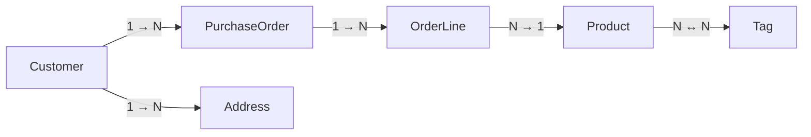

# Giới hạn đồ thị đối tượng và tránh tải toàn bộ tập hợp không cần thiết trong Hibernate

Trong ứng dụng dùng Hibernate, một entity thường liên kết đến nhiều entity khác. Khi một quan hệ có cardinality **một-nhiều** (`@OneToMany`), **nhiều-nhiều** (`@ManyToMany`) hoặc tập hợp giá trị (`@ElementCollection`), một thao tác tưởng như đơn giản có thể kéo theo hàng nghìn, thậm chí hàng triệu phần tử nếu ứng dụng không chủ động giới hạn dữ liệu cần tải.

Ví dụ: màn hình danh sách khách hàng chỉ cần tên và số lượng đơn hàng. Nếu tải cả `Customer` cùng toàn bộ `orders`, rồi với mỗi `Order` lại tải `lines` và `products`, ứng dụng đã truy xuất một đồ thị đối tượng lớn hơn nhiều so với thông tin mà màn hình thực sự sử dụng.

Mục tiêu của bài học là biết **xác định ranh giới đồ thị đối tượng** cho từng use case, phân biệt tập hợp chưa tải với tập hợp đã tải, và chọn truy vấn, pagination, projection hoặc chiến lược fetch phù hợp. Cần giảm số query không cần thiết **và** giới hạn số hàng SQL, số object được materialize, thời gian giữ kết nối và dung lượng bộ nhớ.

## 1. Đồ thị đối tượng có thể phình ra như thế nào?

Giả sử domain bán hàng có quan hệ:



Nếu một khách hàng có trung bình 80 đơn hàng, mỗi đơn có 12 dòng và mỗi sản phẩm có 5 tag, việc duyệt mọi liên kết có thể đụng tới:

| Cấp | Số phần tử minh họa |
|---|---:|
| Khách hàng gốc | 1 |
| Đơn hàng | 80 |
| Dòng đơn hàng | 80 × 12 = 960 |
| Lần đi từ dòng đơn hàng tới sản phẩm | Tối đa 960; sản phẩm trùng có thể được chia sẻ trong persistence context |
| Lần đi từ sản phẩm tới tag | Có thể tới 960 × 5 = 4.800 trước khi tính sự trùng lặp |

Các con số chỉ minh họa **số phần tử hoặc lần liên kết có thể duyệt**, không phải số SQL cố định. Hibernate có cache cấp một, batching, lazy loading và các cơ chế tải khác, nên số query thực tế tùy mapping và cách sử dụng.

Vấn đề cốt lõi: một root entity rất nhỏ **không giới hạn kích thước của đồ thị có thể truy cập**.

### 1.1. Ba dạng chi phí cần phân biệt

- **Số truy vấn:** vòng lặp lazy loading có thể tạo `N+1` câu SQL.
- **Số hàng và dữ liệu truyền:** một `JOIN FETCH` lớn có thể tạo rất nhiều hàng SQL lặp lại thông tin của root.
- **Số object trong bộ nhớ:** Hibernate phải tạo hoặc lấy lại entity/collection và theo dõi chúng trong persistence context, tốn bộ nhớ và thời gian xử lý.

Tối ưu một mặt có thể làm mặt khác xấu đi. Ví dụ, thay 101 query bằng một query join khổng lồ không chắc nhanh hơn nếu query mới trả hàng trăm nghìn dòng.

## 2. Thiết lập mô hình minh họa

Xét các bảng:

```sql
CREATE TABLE customer (
    id BIGINT PRIMARY KEY,
    full_name VARCHAR(150) NOT NULL
);

CREATE TABLE purchase_order (
    id BIGINT PRIMARY KEY,
    customer_id BIGINT NOT NULL REFERENCES customer(id),
    created_at TIMESTAMP NOT NULL,
    status VARCHAR(30) NOT NULL
);

CREATE TABLE order_line (
    id BIGINT PRIMARY KEY,
    order_id BIGINT NOT NULL REFERENCES purchase_order(id),
    product_id BIGINT NOT NULL,
    quantity INTEGER NOT NULL
);
```

Ánh xạ rút gọn với Jakarta Persistence:

```java
import jakarta.persistence.*;
import java.time.LocalDateTime;
import java.util.ArrayList;
import java.util.List;

@Entity
@Table(name = "customer")
public class Customer {

    @Id
    private Long id;

    @Column(name = "full_name", nullable = false)
    private String fullName;

    @OneToMany(mappedBy = "customer", fetch = FetchType.LAZY)
    private List<PurchaseOrder> orders = new ArrayList<>();

    protected Customer() {}

    public Long getId() { return id; }
    public String getFullName() { return fullName; }
    public List<PurchaseOrder> getOrders() { return orders; }
}

@Entity
@Table(name = "purchase_order")
public class PurchaseOrder {

    @Id
    private Long id;

    @ManyToOne(fetch = FetchType.LAZY, optional = false)
    @JoinColumn(name = "customer_id", nullable = false)
    private Customer customer;

    @Column(name = "created_at", nullable = false)
    private LocalDateTime createdAt;

    @Column(name = "status", nullable = false)
    private String status;

    @OneToMany(mappedBy = "order", fetch = FetchType.LAZY)
    private List<OrderLine> lines = new ArrayList<>();

    protected PurchaseOrder() {}

    public Long getId() { return id; }
    public Customer getCustomer() { return customer; }
    public LocalDateTime getCreatedAt() { return createdAt; }
    public String getStatus() { return status; }
    public List<OrderLine> getLines() { return lines; }
}

@Entity
@Table(name = "order_line")
public class OrderLine {

    @Id
    private Long id;

    @ManyToOne(fetch = FetchType.LAZY, optional = false)
    @JoinColumn(name = "order_id", nullable = false)
    private PurchaseOrder order;

    @Column(name = "product_id", nullable = false)
    private Long productId;

    @Column(name = "quantity", nullable = false)
    private int quantity;

    protected OrderLine() {}

    public Long getId() { return id; }
    public Long getProductId() { return productId; }
    public int getQuantity() { return quantity; }
}
```

Ở mô hình này:

- `Customer.orders` và `PurchaseOrder.lines` là hai collection; cả hai được đặt `LAZY`.
- `PurchaseOrder.customer` và `OrderLine.order` là tham chiếu đơn trị; ví dụ cũng chủ động chọn `LAZY`.
- `mappedBy = "customer"` và `mappedBy = "order"` chỉ ra phía quan hệ có khóa ngoại. Chúng không có nghĩa collection được tải toàn bộ ngay khi đọc entity.
- `Product` không được ánh xạ thành entity trong ví dụ để tập trung vào cách tải tập hợp; việc hiển thị thông tin sản phẩm có thể được xử lý bằng projection hoặc quan hệ bổ sung nếu ứng dụng cần.

Đây là các lớp minh họa metadata và truy cập dữ liệu; mã ứng dụng thực tế cần bổ sung constructor, lệnh ghi và logic nghiệp vụ tương ứng.

## 3. `LAZY` là công cụ giữ đồ thị ở trạng thái chưa tải

Với quan hệ đa trị, `FetchType.LAZY` là mặc định theo JPA và thường là lựa chọn nên giữ.

```java
@OneToMany(mappedBy = "customer", fetch = FetchType.LAZY)
private List<PurchaseOrder> orders;
```

Khi chạy:

```java
Customer customer = entityManager.find(Customer.class, 42L);
String name = customer.getFullName();
```

Hibernate có thể chỉ cần đọc hàng `customer`. Collection `orders` được đại diện bằng một wrapper có khả năng trì hoãn tải, nên **chưa nhất thiết có một query lấy đơn hàng**.

Khi code yêu cầu dữ liệu trong collection:

```java
for (PurchaseOrder order : customer.getOrders()) {
    System.out.println(order.getStatus());
}
```

Hibernate thường phải khởi tạo collection bằng SQL lấy các order thuộc customer, nếu collection chưa được khởi tạo. Thời điểm chính xác chịu ảnh hưởng của fetch plan, cache và cơ chế truy cập.

### 3.1. `LAZY` không có nghĩa “không bao giờ tải”

`LAZY` mô tả chiến lược trì hoãn. Nếu chương trình duyệt collection hoặc serializer gọi getter, dữ liệu vẫn có thể được tải và đồ thị vẫn có thể phình ra.

```java
Customer customer = entityManager.find(Customer.class, 42L);

// Dù collection là LAZY, câu lệnh này có thể buộc tải cả tập hợp:
int count = customer.getOrders().size();
```

Với một collection lazy thông thường, `size()` có thể kích hoạt khởi tạo toàn bộ tập hợp, tùy mapping và cấu hình Hibernate. Đừng dùng `size()` thay cho truy vấn `COUNT` khi chỉ muốn biết số phần tử của một tập hợp lớn.

### 3.2. `EAGER` không có nghĩa “chỉ thêm một JOIN”

```java
@OneToMany(mappedBy = "customer", fetch = FetchType.EAGER)
private List<PurchaseOrder> orders;
```

`EAGER` yêu cầu association được tải theo fetch plan, nhưng Hibernate có thể dùng join hoặc select bổ sung. Cấu hình EAGER làm giảm khả năng giới hạn dữ liệu cho các use case chỉ cần customer, và có thể gây query phụ, bảng kết quả lớn hoặc tải collection ngoài ý muốn.

Vì vậy, với quan hệ đa trị có khả năng lớn, nên ưu tiên để mapping mặc định **LAZY** và quyết định tải thêm dữ liệu **ở từng truy vấn**.

Lưu ý: theo JPA, `@ManyToOne` và `@OneToOne` có mặc định `EAGER`; ở ứng dụng có nhiều quan hệ, thường cần cân nhắc khai báo `fetch = FetchType.LAZY` tường minh cho to-one association. Đây vẫn là một *hint* ở mức JPA và behavior chi tiết phụ thuộc provider.

## 4. Các thao tác vô tình làm collection bị tải

Không chỉ vòng `for` mới kích hoạt khởi tạo collection. Các thao tác sau cũng có thể dẫn đến việc tải dữ liệu:

| Thao tác | Nguy cơ |
|---|---|
| `customer.getOrders().iterator()` | Duyệt collection thường đòi dữ liệu phần tử |
| `customer.getOrders().size()` | Có thể tải cả collection để đếm |
| `customer.getOrders().contains(x)` | Có thể phải truy xuất collection, tùy cấu hình |
| `customer.getOrders().stream().map(...).toList()` | Duyệt và materialize các phần tử |
| `customer.toString()` có in `orders` | Logging có thể kích hoạt lazy loading |
| `equals()/hashCode()` so sánh collection | Có thể tải dữ liệu ngoài ý muốn, thậm chí đệ quy |
| JSON serializer gọi `getOrders()` | Có thể serialize toàn bộ quan hệ, rồi tiếp tục duyệt quan hệ sâu hơn |
| Template/view truy cập `customer.orders` | Có thể tạo query ở giai đoạn render |

Đặc biệt cần cảnh giác khi dùng công cụ sinh mã tự động:

```java
// Minh họa anti-pattern:
// @Data trên entity có orders có thể sinh
// toString/equals/hashCode chạm tới collection.
```

Với entity Hibernate, nên viết `toString` chỉ hiển thị các thuộc tính cơ bản cần thiết, và thiết kế `equals/hashCode` tránh duyệt association. Không để logging hoặc serializer quyết định graph dữ liệu phải tải.

### 4.1. `LazyInitializationException` không phải lý do để bật `EAGER` cho mọi collection

Nếu entity đã rời persistence context và ứng dụng đụng đến một collection lazy chưa được khởi tạo, Hibernate có thể ném `LazyInitializationException`.

```java
Customer customer = service.loadCustomer(42L);

// Nếu transaction/Session kết thúc và orders chưa tải:
customer.getOrders().size(); // Có thể ném LazyInitializationException.
```

Một cách sửa hấp tấp là đổi `orders` sang EAGER hoặc mở Session xuyên suốt mọi tầng. Điều này làm ẩn câu hỏi quan trọng: **use case thực sự cần những dòng order nào?**

Cách tổ chức tốt hơn là chọn dữ liệu trong service/repository khi transaction còn hoạt động, rồi trả DTO có đúng thông tin cần cho giao diện.

## 5. Vấn đề `N+1` khi duyệt các collection lazy

Giả sử một màn hình lấy 50 khách hàng:

```java
List<Customer> customers = entityManager.createQuery(
    "select c from Customer c order by c.id",
    Customer.class
).setMaxResults(50)
 .getResultList();

for (Customer customer : customers) {
    System.out.println(customer.getOrders().size());
}
```

Trong một cấu hình lazy collection thông thường, Hibernate có thể thực hiện:

```text
1 query:  SELECT ... FROM customer ORDER BY id LIMIT 50

50 query: SELECT ... FROM purchase_order WHERE customer_id = ?
          (mỗi customer thêm một query)
---------------------------------------------
Tổng có thể là 51 query.
```

Đây là **`N+1`**: một query lấy tập root và N query để lấy các association cho mỗi root.

Nếu bên trong vòng lặp còn duyệt từng `order.getLines()`, số query có thể tăng thêm theo số order, tạo nhiều tầng `N+1`.

Điều đáng chú ý là `N+1` và tải quá nhiều dữ liệu là **hai vấn đề liên quan nhưng khác nhau**:

- Batch fetching có thể giảm số query nhưng vẫn tải toàn bộ collection của các root đó.
- Query projection có thể tránh tải collection hoàn toàn khi chỉ cần số lượng hoặc tổng.
- Một join fetch có thể giảm query nhưng lại nhân số hàng SQL.

Do đó, trước khi chọn kỹ thuật, phải xác định **đầu ra cần dữ liệu chi tiết hay chỉ số tổng hợp**.

## 6. Bắt đầu từ nhu cầu dữ liệu của từng use case

Không nên dùng một entity graph “đầy đủ” chung cho mọi màn hình. Xác định rõ thông tin cần lấy:

| Use case | Dữ liệu cần | Hướng truy cập phù hợp |
|---|---|---|
| Danh sách khách hàng | ID, tên, số đơn hàng | Projection/aggregate; phân trang customer |
| Chi tiết khách hàng | Tên, địa chỉ, 10 đơn gần nhất | Customer + query riêng lấy 10 order |
| Danh sách đơn hàng | ID, thời gian, trạng thái, tên khách | DTO hoặc join đến to-one; phân trang order |
| Chi tiết một đơn hàng | Order và các dòng của chính đơn đó | Fetch collection của một root có giới hạn tự nhiên |
| Đếm số dòng đơn hàng | Một số nguyên | `COUNT` query, không gọi `lines.size()` |
| Kiểm tra đơn có dòng hỏng | Có/không | `EXISTS`/query giới hạn, không tải mọi dòng |
| Báo cáo số đơn theo trạng thái | Nhóm + count | `GROUP BY`/aggregate |
| Xuất hàng triệu bản ghi | Dữ liệu tuần tự có kiểm soát | Query có chọn cột, chunk/keyset/stream theo chính sách |

Một câu hỏi định hướng hữu ích: **người dùng hoặc nghiệp vụ có thực sự cần tất cả phần tử, hay chỉ cần một tập con, một số đếm hoặc kết quả tồn tại?**

Nếu chỉ cần một tập con, query nên áp dụng điều kiện và giới hạn ở **database** trước khi Hibernate materialize object.

## 7. Chỉ đếm hoặc kiểm tra tồn tại: dùng truy vấn tổng hợp

### 7.1. Đếm mà không tải collection

Không nên:

```java
Customer customer = entityManager.find(Customer.class, 42L);
long count = customer.getOrders().size();
```

Nếu collection chưa khởi tạo, Hibernate có thể phải tải danh sách order chỉ để trả `count`.

Thay bằng query:

```java
Long orderCount = entityManager.createQuery(
    "select count(o) from PurchaseOrder o " +
    "where o.customer.id = :customerId",
    Long.class
).setParameter("customerId", 42L)
 .getSingleResult();
```

Ở tầng SQL, query tương đương về mục đích:

```sql
SELECT COUNT(*)
FROM purchase_order
WHERE customer_id = 42;
```

Database trả một giá trị số; Hibernate không cần tạo `PurchaseOrder` entity cho từng hàng.

Với Spring Data JPA:

```java
public interface PurchaseOrderRepository
        extends JpaRepository<PurchaseOrder, Long> {

    long countByCustomerId(Long customerId);

    boolean existsByCustomerIdAndStatus(Long customerId, String status);
}
```

Các derived query này phù hợp với mapping `PurchaseOrder.customer` và `PurchaseOrder.status` trong ví dụ. Với yêu cầu hiệu năng cụ thể, cần xem SQL được sinh ra vì `exists` có thể được triển khai khác nhau giữa framework/phiên bản.

### 7.2. Kiểm tra tồn tại

Ví dụ kiểm tra khách hàng có đơn đã thanh toán:

```java
List<Long> ids = entityManager.createQuery(
    "select o.id from PurchaseOrder o " +
    "where o.customer.id = :customerId " +
    "and o.status = :status",
    Long.class
).setParameter("customerId", 42L)
 .setParameter("status", "PAID")
 .setMaxResults(1)
 .getResultList();

boolean hasPaidOrder = !ids.isEmpty();
```

Query lấy **tối đa một ID**; không cần tải danh sách `orders` của customer. Tương tự có thể dùng query `EXISTS` phù hợp với JPA/HQL và DBMS.

Với số lượng lớn, dùng index trên `purchase_order(customer_id, status)` có thể giúp truy vấn lọc nhanh hơn; hiệu quả cụ thể cần kiểm tra execution plan.

## 8. Dùng DTO projection cho màn hình danh sách

Một màn hình danh sách thường không cần entity được quản lý đầy đủ. Hãy chọn đúng các cột cần trả.

Định nghĩa DTO:

```java
package com.example.api;

public record CustomerOrderCount(
        Long customerId,
        String fullName,
        long orderCount) {
}
```

JPQL constructor expression:

```java
List<CustomerOrderCount> rows = entityManager.createQuery(
    "select new com.example.api.CustomerOrderCount(" +
    "  c.id, c.fullName, count(o.id)) " +
    "from Customer c " +
    "left join c.orders o " +
    "group by c.id, c.fullName " +
    "order by c.id",
    CustomerOrderCount.class
)
.setMaxResults(50)
.getResultList();
```

Kết quả mong đợi:

| customerId | fullName | orderCount |
|---:|---|---:|
| 1 | Lan | 12 |
| 2 | Minh | 0 |
| 3 | Hoa | 7 |

`left join` giữ cả khách hàng chưa có đơn; `count(o.id)` sẽ bằng 0 cho khách hàng đó. Phép nối dùng cho **aggregate query**, không biến `c.orders` thành một collection đã khởi tạo trong persistence context.

Lưu ý: nếu join thêm một collection khác, chẳng hạn `c.addresses`, số hàng kết hợp có thể nhân lên và làm `count(o.id)` bị đếm thừa. Khi đó cần xem `count(distinct o.id)`, subquery hoặc tách các phép tổng hợp để bảo đảm semantics.

### 8.1. Projection và entity graph phục vụ các mục tiêu khác nhau

- **Projection** hỏi database đúng các cột/giá trị cần để trả kết quả.
- **Entity graph/fetch join** tải các entity và association để sử dụng như object graph được Hibernate quản lý.

Nếu UI chỉ cần ba trường và một số đếm, DTO projection thường phù hợp hơn việc tải `Customer` và tất cả `orders`.

Không bắt buộc biến mọi màn hình thành entity đầy đủ rồi chuyển thành DTO bằng cách duyệt các association; làm như vậy có thể gây tải dữ liệu trước khi DTO được tạo.

## 9. Truy vấn riêng tập con thay vì gọi getter collection

Một trang chi tiết khách hàng chỉ hiển thị **10 đơn mới nhất**. Không nên:

```java
Customer customer = entityManager.find(Customer.class, 42L);

List<PurchaseOrder> latest = customer.getOrders().stream()
    .sorted(Comparator.comparing(
        PurchaseOrder::getCreatedAt).reversed())
    .limit(10)
    .toList();
```

Với collection lazy thông thường, `stream()` phải duyệt toàn bộ danh sách trong Java trước khi sắp xếp. `limit(10)` trong stream **không làm database chỉ trả 10 hàng** khi collection đã bị khởi tạo.

Đúng hướng:

```java
List<PurchaseOrder> latest = entityManager.createQuery(
    "select o from PurchaseOrder o " +
    "where o.customer.id = :customerId " +
    "order by o.createdAt desc, o.id desc",
    PurchaseOrder.class
)
.setParameter("customerId", 42L)
.setMaxResults(10)
.getResultList();
```

Ở đây giới hạn được đặt trên truy vấn đến database. `id` là tie-breaker để có thứ tự ổn định nếu nhiều order cùng thời điểm.

Với Spring Data JPA, có thể dùng các method được đặt tên theo quy ước hoặc `Pageable`:

```java
List<PurchaseOrder> findTop10ByCustomerIdOrderByCreatedAtDescIdDesc(
    Long customerId);
```

Không cần tải `Customer.orders` chỉ để lấy phần tử mới nhất. Một collection là cách mô hình hóa quan hệ; nó không nhất thiết là API tối ưu cho mọi truy vấn lên tập con của quan hệ đó.

## 10. Pagination phải áp dụng trước khi khởi tạo collection

### 10.1. Phân trang root entity

Ví dụ danh sách đơn hàng:

```java
List<PurchaseOrder> page = entityManager.createQuery(
    "select o from PurchaseOrder o " +
    "where o.status = :status " +
    "order by o.createdAt desc, o.id desc",
    PurchaseOrder.class
)
.setParameter("status", "PAID")
.setFirstResult(0)
.setMaxResults(25)
.getResultList();
```

Query chỉ cần lấy 25 order ở trang đầu. Nếu UI chỉ cần thông tin order, không truy cập `o.getLines()` khi dựng response. Nếu cần tên khách hàng, có thể dùng DTO projection join to-one `o.customer` mà không tải toàn bộ order lines.

### 10.2. Offset pagination và keyset pagination

`setFirstResult` + `setMaxResults` thường tương ứng pagination dựa trên offset. Cách này thuận tiện nhưng offset lớn có thể khiến database phải đọc/bỏ qua nhiều hàng, đồng thời dữ liệu chèn mới giữa các request có thể làm các trang biến động.

Với dòng dữ liệu lớn hoặc feed theo thời gian, có thể dùng *keyset pagination* theo cặp khóa sắp xếp:

```java
List<PurchaseOrder> next = entityManager.createQuery(
    "select o from PurchaseOrder o " +
    "where o.status = :status " +
    "  and (o.createdAt < :lastCreatedAt " +
    "       or (o.createdAt = :lastCreatedAt and o.id < :lastId)) " +
    "order by o.createdAt desc, o.id desc",
    PurchaseOrder.class
)
.setParameter("status", "PAID")
.setParameter("lastCreatedAt", cursorCreatedAt)
.setParameter("lastId", cursorId)
.setMaxResults(25)
.getResultList();
```

Query trên giả định `createdAt` khác null và cả hai trường được sắp xếp giảm dần. Cursor `(lastCreatedAt, lastId)` lấy từ phần tử cuối cùng của trang trước. Cần xác định chính sách cho dữ liệu mới, bị xóa hoặc cập nhật giữa các lần lấy trang.

Keyset pagination giúp giới hạn **số root** truy xuất. Nó không tự giới hạn kích thước collection của từng root nếu sau đó mã lại duyệt các association đa trị.

### 10.3. Phân trang collection riêng theo khóa cha

Nếu muốn 20 dòng của một đơn hàng, truy vấn trực tiếp bảng/entity con:

```java
List<OrderLine> lines = entityManager.createQuery(
    "select l from OrderLine l " +
    "where l.order.id = :orderId " +
    "order by l.id",
    OrderLine.class
)
.setParameter("orderId", 9001L)
.setFirstResult(0)
.setMaxResults(20)
.getResultList();
```

Đừng gọi `order.getLines()` rồi dùng `subList(0, 20)`. `subList` chỉ tác động lên collection đã có trong bộ nhớ; nó không thay thế limit tại database.

## 11. `JOIN FETCH` phù hợp khi thật sự cần collection

Có những use case cần dữ liệu chi tiết: ví dụ hiển thị **một đơn hàng cùng tất cả dòng của chính đơn đó**. Với số dòng dự kiến nhỏ hoặc được giới hạn bởi nghiệp vụ, `JOIN FETCH` có thể hữu ích.

```java
List<PurchaseOrder> results = entityManager.createQuery(
    "select distinct o from PurchaseOrder o " +
    "left join fetch o.lines " +
    "where o.id = :orderId",
    PurchaseOrder.class
)
.setParameter("orderId", 9001L)
.getResultList();

PurchaseOrder order = results.isEmpty() ? null : results.get(0);
```

`left join fetch` yêu cầu Hibernate tải `lines` cùng order trong fetch plan. Trong SQL, một order có 10 dòng có thể tạo 10 hàng kết quả, vì các cột order được lặp lại cho từng line.

`distinct` trong JPQL thường được dùng để nhấn mạnh kết quả root duy nhất; với Hibernate 6, Hibernate đã có cơ chế loại bỏ các root entity trùng khi materialize kết quả từ join fetch collection, nên `distinct` không phải công cụ giới hạn số hàng SQL. Nó cũng không làm collection “chỉ tải vài phần tử”.

Chỉ fetch khi **thực sự cần toàn bộ collection trong phạm vi use case đó**. Một đơn hàng hiếm khi có hơn 20 dòng khác với một tài khoản có hàng triệu giao dịch; không nên áp dụng cùng một kế hoạch fetch cho cả hai.

### 11.1. `JOIN FETCH` không thay thế pagination cho to-many

Đoạn sau nguy hiểm:

```java
List<Customer> page = entityManager.createQuery(
    "select c from Customer c " +
    "left join fetch c.orders " +
    "order by c.id",
    Customer.class
)
.setMaxResults(20)
.getResultList();
```

Với một-to-many join, một customer có nhiều dòng SQL. Nếu áp dụng SQL `LIMIT 20` trực tiếp lên các hàng đã join, có thể chỉ nhận được một phần collection hoặc không đúng 20 customer.

Vì thế Hibernate có thể phải lấy kết quả join rộng rồi **áp dụng pagination trong bộ nhớ**, hoặc phát cảnh báo/lỗi tùy cấu hình. Điều này không phù hợp khi `orders` có kích thước lớn.

Hibernate cung cấp cấu hình nhằm biến trường hợp phân trang trên collection fetch thành lỗi để phát hiện sớm, ví dụ property:

```properties
hibernate.query.fail_on_pagination_over_collection_fetch=true
```

Đây là property Hibernate; tên và mức hỗ trợ cần đối chiếu phiên bản thực tế. Việc bật nó giúp ngăn một số truy vấn tiềm ẩn tải số hàng quá lớn, nhưng không thay cho thiết kế truy vấn đúng.

### 11.2. Lọc child trên cùng một fetch join có thể tạo collection chưa đầy đủ

Giả sử chỉ muốn những order đã thanh toán của mỗi customer. Không nên cố dùng fetch join collection rồi lọc trong `WHERE` để diễn đạt một collection bị cắt:

```java
// Tránh xem đây là cách tải “orders chỉ gồm PAID”
// rồi sử dụng collection đã quản lý như danh sách đầy đủ.
"select c from Customer c " +
"join fetch c.orders o " +
"where o.status = 'PAID'"
```

Trong một số phiên bản/cách viết, Hibernate giới hạn việc gán alias cho fetched association; kể cả khi có cách tạo SQL phù hợp, việc lọc các hàng con có thể khiến collection được coi là đã khởi tạo nhưng thực ra thiếu phần tử. Điều này nguy hiểm khi persistence context được dùng tiếp để thay đổi dữ liệu.

Khi cần **tập con có điều kiện**, nên truy vấn trực tiếp `PurchaseOrder` với `where o.customer.id ... and o.status ...`, có giới hạn nếu cần. Với yêu cầu xây dựng DTO, có thể dùng join thông thường (không fetch) và projection.

## 12. Chiến lược hai bước: phân trang root rồi tải quan hệ theo tập ID

Khi một màn hình thực sự cần **một trang các order và các dòng của đúng các order đó**, có thể chia làm hai truy vấn.

**Bước 1 — Lấy trang ID của order**, không fetch collection:

```java
List<Long> orderIds = entityManager.createQuery(
    "select o.id from PurchaseOrder o " +
    "where o.status = :status " +
    "order by o.createdAt desc, o.id desc",
    Long.class
)
.setParameter("status", "PAID")
.setFirstResult(0)
.setMaxResults(20)
.getResultList();
```

**Bước 2 — Lấy order cùng lines chỉ cho 20 ID đó:**

```java
List<PurchaseOrder> orders;

if (orderIds.isEmpty()) {
    orders = List.of();
} else {
    orders = entityManager.createQuery(
        "select distinct o from PurchaseOrder o " +
        "left join fetch o.lines " +
        "where o.id in :ids",
        PurchaseOrder.class
    )
    .setParameter("ids", orderIds)
    .getResultList();
}
```

Hai bước này giới hạn **số root** sẽ fetch. Nó vẫn có thể tải rất nhiều `OrderLine` nếu một root có collection cực lớn; khi đó cần phân trang chính `OrderLine` hoặc thiết kế DTO tách riêng.

### 12.1. Thứ tự kết quả cần được giữ riêng

SQL `IN (:ids)` không bảo đảm trả các hàng theo thứ tự của `orderIds`. Nếu giao diện cần giữ thứ tự phân trang, có thể sắp lại ở Java theo danh sách ID của bước 1:

```java
Map<Long, PurchaseOrder> byId = orders.stream()
    .collect(Collectors.toMap(PurchaseOrder::getId, o -> o));

List<PurchaseOrder> ordered = orderIds.stream()
    .map(byId::get)
    .filter(Objects::nonNull)
    .toList();
```

Đoạn trên cần các import `java.util.Map`, `java.util.Objects` và `java.util.stream.Collectors`, cùng Java phiên bản hỗ trợ `Stream.toList()`.

Trong ứng dụng chạy đồng thời, bản ghi có thể thay đổi giữa hai query. Nếu yêu cầu một ảnh chụp nhất quán, cần chính sách transaction/isolation hoặc thiết kế truy vấn thích hợp. Hai bước cũng cần giới hạn kích thước danh sách ID theo khả năng của DBMS/driver đối với tham số `IN`.

## 13. Batch fetching: giảm `N+1` mà không fetch mọi collection bằng một join lớn

Nếu use case thực sự cần đọc collection của **nhiều root đang được quản lý**, batch fetching giúp Hibernate nhóm việc khởi tạo lazy association.

Hibernate có thể được cấu hình:

```properties
hibernate.default_batch_fetch_size=16
```

Hoặc trên association cụ thể:

```java
import org.hibernate.annotations.BatchSize;

@OneToMany(mappedBy = "customer", fetch = FetchType.LAZY)
@BatchSize(size = 16)
private List<PurchaseOrder> orders = new ArrayList<>();
```

Thay vì tải 50 customer và thực hiện riêng 50 query lấy order, Hibernate có thể nhóm các customer ID vào những lần truy vấn với điều kiện tương tự:

```sql
SELECT ...
FROM purchase_order
WHERE customer_id IN (?, ?, ?, ?, ...);
```

Số câu SQL và hình dạng query thực tế phụ thuộc phiên bản Hibernate, loại association và số root có trong persistence context.

**Batch fetching giải quyết chi phí nhiều lượt round-trip, không giới hạn tổng số phần tử được tải.** Nếu 50 khách hàng có tổng 100.000 order, batching vẫn có thể materialize 100.000 order khi ứng dụng duyệt hết collection.

Vì thế:

- Nếu chỉ cần `count`: dùng aggregate query.
- Nếu chỉ cần 10 order gần nhất cho một customer: query trực tiếp có limit.
- Nếu cần toàn bộ order của 20 customer và kích thước đã được kiểm soát: batch fetch là một ứng viên phù hợp.
- Nếu một tập hợp là cực lớn: phải có cách query con và pagination riêng, không trông chờ batch size để giảm dữ liệu.

Batch size cũng không phải “càng lớn càng tốt”: danh sách ID dài làm tăng tham số, khối lượng dữ liệu trả về và tài nguyên query.

## 14. `SUBSELECT` fetching và giới hạn của nó

Hibernate còn có chiến lược nạp collection bằng truy vấn con, ví dụ:

```java
import org.hibernate.annotations.Fetch;
import org.hibernate.annotations.FetchMode;

@OneToMany(mappedBy = "customer", fetch = FetchType.LAZY)
@Fetch(FetchMode.SUBSELECT)
private List<PurchaseOrder> orders;
```

Khi ứng dụng khởi tạo collection của một customer trong tập root đã được tải theo ngữ cảnh nhất định, Hibernate có thể dùng một subselect dựa trên truy vấn root để nạp collection cho **nhiều customer liên quan**.

Ý tưởng SQL:

```sql
SELECT o.*
FROM purchase_order o
WHERE o.customer_id IN (
    SELECT c.id
    FROM customer c
    WHERE /* điều kiện query root */
);
```

Hình dạng chính xác khác nhau tùy Hibernate và query gốc.

Ưu điểm là có thể giảm `N+1` cho một nhóm root. Đánh đổi là một lần truy cập collection có thể dẫn đến tải collection của nhiều root trong persistence context. Nếu root query lớn, subselect fetching cũng có thể lấy quá nhiều dòng.

**`@Fetch(FetchMode.SUBSELECT)` là tính năng riêng của Hibernate, không phải annotation JPA tiêu chuẩn.** Chọn nó khi đã hiểu tập root được xử lý cùng lúc và đo được lợi ích thực tế.

## 15. Tránh fetch đồng thời nhiều collection lớn

Giả sử một `Customer` có:

```java
@OneToMany(mappedBy = "customer")
private List<PurchaseOrder> orders;

@OneToMany(mappedBy = "customer")
private List<AddressRecord> addresses;
```

Một query fetch cả hai:

```java
// Không nên áp dụng tùy tiện:
"select c from Customer c " +
"left join fetch c.orders " +
"left join fetch c.addresses"
```

Nếu một customer có 100 order và 8 address, phép join có thể tạo **100 × 8 = 800 hàng** cho chỉ một customer. Các hàng trùng được lặp ở SQL trước khi Hibernate dựng entity/collection.

Với các association kiểu bag (ví dụ một số `List` không có index lưu trữ, cho phép phần tử trùng), Hibernate còn có thể ném `MultipleBagFetchException` khi cố fetch nhiều bag cùng lúc.

Đổi mọi `List` thành `Set` chỉ để tránh exception **không giải quyết được chi phí tích Descartes**. Kiểu collection cần phản ánh semantics nghiệp vụ, còn fetch plan phải được thiết kế theo khối lượng dữ liệu.

Hướng thay thế:

1. Truy vấn root có giới hạn.
2. Fetch hoặc batch collection thiết yếu thứ nhất.
3. Truy vấn riêng collection thứ hai khi thực sự cần.
4. Với màn hình tổng quan, dùng DTO projection thay vì lắp ghép toàn bộ graph.

Khi có nhiều collection, thường dễ kiểm soát hơn nếu hiển thị chúng ở những phần UI tách biệt và mỗi phần có query/limit riêng.

## 16. `@EntityGraph` và fetch plan theo use case

JPA `EntityGraph` cho phép yêu cầu fetch một số association khi thực thi query, thay vì hard-code `EAGER` trên mapping cho mọi trường hợp.

Ví dụ muốn tải customer của order trong trang danh sách:

```java
EntityGraph<PurchaseOrder> graph =
    entityManager.createEntityGraph(PurchaseOrder.class);

graph.addAttributeNodes("customer");

List<PurchaseOrder> orders = entityManager.createQuery(
    "select o from PurchaseOrder o " +
    "order by o.createdAt desc, o.id desc",
    PurchaseOrder.class
)
.setHint("jakarta.persistence.fetchgraph", graph)
.setMaxResults(25)
.getResultList();
```

Ở đây `customer` là **to-one association**. Fetch một to-one thường không nhân số hàng root như fetch một collection đa trị. Tuy nhiên, chỉ định graph vẫn cần xét SQL được sinh, vì provider có thể chọn chiến lược join/select khác nhau.

Nếu graph bao gồm `lines` là to-many collection, cùng rủi ro pagination và nhân số hàng vẫn tồn tại như với collection fetch join. **Entity graph không tự động biến việc fetch collection thành phân trang an toàn**.

Phân biệt hai cách:

- `jakarta.persistence.fetchgraph` yêu cầu graph làm nền cho những association được coi là eager trong truy vấn; ngữ nghĩa cụ thể của lazy/eager còn phụ thuộc JPA/provider.
- `jakarta.persistence.loadgraph` mở rộng các yêu cầu fetch mặc định bằng những association được thêm vào graph.

Khi lập trình với Hibernate, nên kiểm tra query thực tế và dùng fetch plan riêng cho mỗi endpoint thay vì một graph “đầy đủ” tái sử dụng khắp ứng dụng.

### 16.1. Spring Data JPA `@EntityGraph`

Ví dụ trên repository:

```java
public interface PurchaseOrderRepository
        extends JpaRepository<PurchaseOrder, Long> {

    @EntityGraph(attributePaths = "customer")
    List<PurchaseOrder> findTop25ByOrderByCreatedAtDescIdDesc();
}
```

Đây là ví dụ về fetch một to-one có phạm vi root giới hạn. Không chuyển thành `attributePaths = {"customer", "lines", "lines.product"}` trên mọi method khi chưa xác định kích thước và nhu cầu của các collection.

## 17. Serialization và API: không trả thẳng entity graph ngoài ý muốn

Một controller trả trực tiếp entity có thể gây ra các vấn đề:

```java
@GetMapping("/customers/{id}")
public Customer getCustomer(@PathVariable Long id) {
    return customerRepository.findById(id).orElseThrow();
}
```

Tùy cấu hình serializer và thời điểm đóng persistence context, hệ thống có thể:

- Gọi `getOrders()` rồi tải tất cả order.
- Đi từ order sang customer và gây vòng tham chiếu khi serialize.
- Tiếp tục đi tới `lines`, `product`, `tags` và mở rộng graph.
- Ném `LazyInitializationException` nếu collection chưa tải mà Session đã đóng.
- Tạo nhiều query sau khi tầng service tưởng như đã hoàn tất.

Giải pháp phù hợp là **định nghĩa hợp đồng phản hồi bằng DTO**:

```java
public record CustomerSummaryResponse(
        Long id,
        String fullName,
        long orderCount) {
}
```

Controller hoặc service lấy DTO bằng projection/aggregate query như ở mục 8. Nếu endpoint yêu cầu danh sách order mới nhất, response có thể chứa danh sách DTO nhỏ được lấy bằng query có `setMaxResults(10)`.

`@JsonIgnore` trên collection có thể tránh một nhánh khi serialize, nhưng đây chỉ là điều khiển biểu diễn JSON; nó không thay thế truy vấn có giới hạn hoặc thiết kế fetch plan đúng cho nghiệp vụ.

Không dùng `Hibernate.initialize(customer.getOrders())` ở cuối mọi request như một bước “chuẩn bị JSON”, vì lời gọi đó chủ động tải toàn bộ collection.

## 18. Transaction boundary, Open Session in View và lazy loading

Hibernate chỉ có thể khởi tạo lazy association thông qua persistence context/Session phù hợp khi cần truy cập database. Có hai anti-pattern trái chiều:

1. Đóng Session rồi để controller/serializer tùy ý chạm collection chưa tải, dẫn đến `LazyInitializationException`.
2. Để Session mở suốt web request và cho template/serializer quyết định query bổ sung, dẫn đến tải dữ liệu không chủ đích.

Trong ứng dụng Spring, tính năng *Open Session in View* (OSIV) có thể kéo dài phạm vi persistence context qua giai đoạn render HTTP. OSIV có thể khiến lazy loading “chạy được” ở controller/view, nhưng đồng thời che khuất những query phát sinh ngoài service và gây khó dự đoán tải.

Một tổ chức rõ ràng hơn:

```text
HTTP request
  -> Service @Transactional(readOnly = true)
      -> Repository: query có predicate + limit/projection
      -> Tạo DTO trong phạm vi đọc dữ liệu rõ ràng
  -> Transaction hoàn tất
  -> Controller trả DTO đã đủ thông tin
```

Ví dụ service:

```java
@Service
public class CustomerQueryService {

    private final CustomerRepository customers;
    private final PurchaseOrderRepository orders;

    public CustomerQueryService(
            CustomerRepository customers,
            PurchaseOrderRepository orders) {
        this.customers = customers;
        this.orders = orders;
    }

    @Transactional(readOnly = true)
    public CustomerDetailResponse getDetail(Long customerId) {
        Customer customer = customers.findById(customerId)
            .orElseThrow();

        List<PurchaseOrderPreview> latest =
            orders.findRecentPreviews(customerId, PageRequest.of(0, 10));

        return new CustomerDetailResponse(
            customer.getId(),
            customer.getFullName(),
            latest
        );
    }
}
```

Đây là đoạn mã mô tả cách phân tầng: `CustomerRepository`, `PurchaseOrderPreview`, `CustomerDetailResponse` và `findRecentPreviews` phải được khai báo theo dự án. Phương thức repository lấy preview cần sử dụng projection/query có limit ở database, **không nhận toàn bộ `customer.getOrders()` rồi tự cắt trong Java**.

### 18.1. `readOnly = true` không tự giới hạn dữ liệu

`@Transactional(readOnly = true)` là hướng dẫn để transaction manager/provider tối ưu xử lý đọc tùy cấu hình. Nó không có nghĩa query sẽ được thêm `LIMIT` hay collection tự bị cắt bớt. Giới hạn dữ liệu phải thể hiện trong truy vấn và mô hình phản hồi.

## 19. Khi cần xử lý dữ liệu số lượng rất lớn

Nếu yêu cầu nghiệp vụ thực sự cần xử lý hàng trăm nghìn bản ghi, không nên dùng:

```java
Customer customer = entityManager.find(Customer.class, id);

for (PurchaseOrder order : customer.getOrders()) {
    // Xử lý một lượng dữ liệu không giới hạn.
}
```

Một persistence context dài có thể tích tụ nhiều entity đang được quản lý, tăng bộ nhớ, dirty-checking và nguy cơ giữ transaction/connection quá lâu.

Một số hướng thiết kế:

- **Chunking:** xử lý từng trang ID với giới hạn rõ ràng.
- **Keyset pagination:** duyệt tiếp từ khóa cuối cùng thay vì offset rất lớn.
- **Projection:** chỉ đọc trường cần xử lý thay vì entity đầy đủ.
- **Transaction ngắn:** chia công việc thành các đơn vị có ranh giới commit phù hợp.
- **Bulk SQL/JPQL:** nếu chỉ cần cập nhật theo điều kiện mà không dùng logic lifecycle của từng entity, xem xét thao tác bulk.
- **Streaming/scrolling:** sử dụng khi driver, DBMS, transaction và fetch size hỗ trợ, đồng thời đóng tài nguyên đúng cách.

Ví dụ query chunk bằng ID:

```java
List<Long> ids = entityManager.createQuery(
    "select o.id from PurchaseOrder o " +
    "where o.id > :lastId " +
    "order by o.id",
    Long.class
)
.setParameter("lastId", lastId)
.setMaxResults(500)
.getResultList();
```

Ứng dụng xử lý mỗi chunk rồi cập nhật cursor. Nếu cần tải entity để xử lý, phải điều phối `flush`/`clear` và transaction hợp lý trong job thực tế; không tùy tiện `clear()` khi còn các entity cần dùng trong cùng đơn vị công việc.

### 19.1. Bulk update không đi qua từng collection

Giả sử cần chuyển trạng thái tất cả order quá hạn:

```java
int changed = entityManager.createQuery(
    "update PurchaseOrder o " +
    "set o.status = :newStatus " +
    "where o.status = :oldStatus " +
    "and o.createdAt < :deadline"
)
.setParameter("newStatus", "EXPIRED")
.setParameter("oldStatus", "PENDING")
.setParameter("deadline", deadline)
.executeUpdate();
```

Không cần tìm tất cả customer rồi duyệt `getOrders()` để cập nhật từng order.

Tuy nhiên, bulk JPQL thao tác trực tiếp ở database và có khác biệt với việc sửa từng managed entity: nó có thể không đồng bộ trạng thái đã có trong persistence context, không kích hoạt đầy đủ lifecycle callback của từng entity và cần xem xét version/audit/caching. Vì vậy, dùng khi nghiệp vụ chấp nhận semantics này và tổ chức transaction phù hợp.

## 20. Quan sát hiệu năng thực tế trước khi chọn cách fetch

Một kế hoạch fetch hiệu quả cần dựa trên số liệu thật, không chỉ dựa trên annotation. Những thứ cần quan sát:

| Chỉ số | Câu hỏi cần trả lời |
|---|---|
| Số truy vấn SQL/request | Có `N+1` hoặc các truy vấn trùng không? |
| Số hàng trả về/query | Join fetch có làm dữ liệu nhân lên không? |
| Thời gian query | Câu SQL nào chậm hoặc chờ khóa? |
| Dung lượng kết quả | Có lấy nhiều cột/entity hơn endpoint cần không? |
| Số object/collection được load | Persistence context có tăng theo dữ liệu ngoài nhu cầu không? |
| Bộ nhớ/GC | Có hiện tượng tăng heap khi xử lý list hoặc export không? |
| Connection pool active/waiting | Transaction kéo dài do xử lý đồ thị lớn không? |
| Tốc độ phản hồi theo phân vị | Endpoint có chậm đột biến với customer có collection cực lớn không? |

Hibernate hỗ trợ thống kê qua `Statistics` khi được bật, và ứng dụng có thể dùng SQL logging, APM, tracing, metric connection pool, execution plan ở DBMS để điều tra. Cần bật log trong phạm vi kiểm soát và tránh ghi dữ liệu nhạy cảm trong tham số SQL.

Một ví dụ cấu hình hỗ trợ thống kê trong môi trường kiểm thử:

```properties
hibernate.generate_statistics=true
```

Trong Spring Boot, có thể truyền qua thuộc tính `spring.jpa.properties.hibernate.generate_statistics=true`. Bật thống kê có chi phí nhất định; nên sử dụng theo nhu cầu quan sát thay vì coi đó là giải pháp tối ưu tự thân.

### 20.1. Những câu hỏi phải trả lời khi một query chậm

1. Query đang chọn **root entity** hay tự động materialize association?
2. Có `JOIN FETCH` đến collection với cardinality không giới hạn không?
3. Query có pagination ở **database** hay đang bị áp dụng trong bộ nhớ?
4. Có nhiều lazy collection bị khởi tạo trong vòng lặp không?
5. Query chỉ cần count/exists/aggregate mà vẫn trả entity không?
6. Mỗi root có thể có bao nhiêu child ở trường hợp lớn nhất, không chỉ mức trung bình?
7. Có filter theo tenant, quyền truy cập, trạng thái hoặc thời gian trước khi load không?
8. Các cột lọc và join có index phù hợp không?

Chỉ tăng cache, batch size hoặc số kết nối pool không giải quyết gốc rễ nếu endpoint vẫn yêu cầu toàn bộ đồ thị mà không cần dùng đến.

## 21. Một số sai lầm thiết kế cần tránh

### 21.1. “Dùng `EAGER` để khỏi `LazyInitializationException`”

`EAGER` có thể buộc tải tập hợp trong những use case không cần nó, tăng rủi ro `N+1` hoặc nhiều hàng join. Thay vào đó, xác định dữ liệu cần đọc khi transaction còn hoạt động và trả DTO hoặc fetch plan có chủ đích.

### 21.2. “`JOIN FETCH` mọi quan hệ để chỉ còn một SQL”

Một SQL với nhiều join collection có thể tạo tích Descartes. Số lượt query ít không đồng nghĩa tổng chi phí thấp. Dùng projection, fetch từng nhánh hoặc batching theo ngữ cảnh.

### 21.3. “Lấy collection rồi `limit` bằng Java Stream”

`limit` sau `customer.getOrders().stream()` có thể chỉ giới hạn kết quả **sau khi collection đã tải**. Phải áp dụng `WHERE`, `ORDER BY` và `setMaxResults` vào query lấy child.

### 21.4. “Đổi `List` thành `Set` là hết vấn đề”

`Set` có semantics không cho phần tử trùng, nhưng không làm query nhiều collection bớt nhân số hàng. Không sửa mô hình nghiệp vụ chỉ để né `MultipleBagFetchException`.

### 21.5. “`@BatchSize` đảm bảo ít dữ liệu”

Batch size chủ yếu điều khiển **số association được khởi tạo cùng đợt**, không giới hạn số child của mỗi association. Cần query con/pagination khi tập hợp có thể lớn.

### 21.6. “Cache sẽ sửa được mọi truy vấn”

Cache có thể giảm truy vấn ở một số tình huống, nhưng vẫn có chi phí lưu trữ, tính nhất quán và nguy cơ materialize đồ thị lớn. Việc cache collection lớn hoặc thường xuyên thay đổi có thể phản tác dụng.

### 21.7. “Một DTO trả từ entity là đủ”

Nếu DTO được tạo bằng cách duyệt toàn bộ lazy collection trước đó, việc chuyển sang DTO **không giảm dữ liệu đã truy xuất**. Ưu tiên projection/query có giới hạn từ repository, rồi xây dựng DTO từ đúng kết quả đó.

## 22. Bài thực hành: thiết kế endpoint danh sách đơn hàng

Bài toán: màn hình quản trị có các yêu cầu:

- Xem tối đa 25 đơn hàng mới nhất của một khách hàng.
- Mỗi dòng hiển thị mã đơn, ngày tạo, trạng thái và **số dòng hàng**.
- Khi bấm vào một đơn, mở trang chi tiết gồm tối đa 30 dòng hàng đầu tiên.
- Một đơn có thể chứa hàng chục nghìn dòng do tích hợp dữ liệu, nên không được tải tất cả chỉ để hiển thị trang đầu.
- Có thể xem trang tiếp theo của dòng hàng theo thứ tự ID.

### 22.1. Cách làm sai thường thấy

```java
Customer customer = entityManager.find(Customer.class, customerId);

List<OrderRow> rows = customer.getOrders().stream()
    .sorted(Comparator.comparing(
        PurchaseOrder::getCreatedAt).reversed())
    .limit(25)
    .map(order -> new OrderRow(
        order.getId(),
        order.getCreatedAt(),
        order.getStatus(),
        order.getLines().size()))
    .toList();
```

Vì sao sai?

1. `customer.getOrders()` có thể tải **toàn bộ** đơn hàng của khách.
2. `sorted` và `limit` chỉ chạy trong Java sau khi dữ liệu đã được tải.
3. `order.getLines().size()` có thể khởi tạo một collection lớn cho **mỗi** order trong 25 order đã chọn.
4. Kết quả UI nhỏ nhưng chi phí truy cập và bộ nhớ lớn, thậm chí gặp `N+1` nhiều tầng.

### 22.2. Thiết kế truy vấn cho màn hình danh sách

Định nghĩa projection:

```java
public record OrderRow(
        Long id,
        java.time.LocalDateTime createdAt,
        String status,
        long lineCount) {
}
```

Query tổng hợp:

```java
List<OrderRow> rows = entityManager.createQuery(
    "select new com.example.api.OrderRow(" +
    "  o.id, o.createdAt, o.status, count(l.id)) " +
    "from PurchaseOrder o " +
    "left join o.lines l " +
    "where o.customer.id = :customerId " +
    "group by o.id, o.createdAt, o.status " +
    "order by o.createdAt desc, o.id desc",
    OrderRow.class
)
.setParameter("customerId", customerId)
.setMaxResults(25)
.getResultList();
```

Đổi package của `OrderRow` theo dự án thực tế để khớp constructor expression. Query này chỉ tạo `OrderRow`, không yêu cầu Hibernate materialize collection `lines`. Database vẫn cần tính aggregate; với dữ liệu rất lớn, có thể cân nhắc query hai bước, index hoặc bảng tổng hợp/materialized count tùy nhu cầu.

### 22.3. Thiết kế query cho trang chi tiết dòng hàng

Lấy order metadata qua query đơn hoặc `find`:

```java
PurchaseOrder order = entityManager.find(
    PurchaseOrder.class, orderId);
```

Nếu cần bảo đảm order thuộc customer hiện tại, **kiểm tra quyền/tenant** trong query hoặc tầng bảo mật trước khi đọc child. Việc có ID hợp lệ chưa đủ để cấp quyền xem dữ liệu.

Sau đó lấy trang đầu của `OrderLine`:

```java
List<OrderLine> firstLines = entityManager.createQuery(
    "select l from OrderLine l " +
    "where l.order.id = :orderId " +
    "order by l.id",
    OrderLine.class
)
.setParameter("orderId", orderId)
.setMaxResults(30)
.getResultList();
```

Trang kế tiếp:

```java
List<OrderLine> nextLines = entityManager.createQuery(
    "select l from OrderLine l " +
    "where l.order.id = :orderId and l.id > :lastLineId " +
    "order by l.id",
    OrderLine.class
)
.setParameter("orderId", orderId)
.setParameter("lastLineId", lastLineId)
.setMaxResults(30)
.getResultList();
```

Không cần gọi `order.getLines()` trong cả hai query trên. Chỉ lấy dữ liệu con đúng trang người dùng đang xem.

### 22.4. Câu hỏi tự kiểm tra

1. Vì sao `@OneToMany(fetch = LAZY)` là cần thiết nhưng chưa đủ để tránh tải dữ liệu lớn?
2. Tại sao `customer.getOrders().stream().limit(25)` không tương đương với `setMaxResults(25)` trên query?
3. Nếu chỉ muốn số dòng hàng của mỗi order, nên dùng `lines.size()` hay `COUNT` projection?
4. Vì sao không nên thêm `left join fetch o.lines` vào query list có `setMaxResults(25)`?
5. Nếu màn hình thực sự cần 20 order cùng toàn bộ lines và mỗi order chỉ có tối đa 5 lines, giải pháp nào có thể hợp lý?
6. Khi xem trang tiếp theo của lines, vì sao nên dùng thứ tự ổn định có khóa phụ hoặc khóa chính?

**Đáp án gợi ý:**

1. Vì code khác, serializer, logging hoặc việc duyệt collection vẫn có thể khởi tạo nó. `LAZY` chỉ trì hoãn, không đặt giới hạn số hàng.
2. Stream thao tác trên các phần tử collection được tải vào Java; query limit yêu cầu database giới hạn tập kết quả trước khi materialize.
3. Dùng aggregate `COUNT` trong query, hoặc đếm qua repository, để không tải collection.
4. Fetch join collection nhân hàng SQL, và pagination theo root có thể bị Hibernate xử lý trong bộ nhớ hoặc báo lỗi.
5. Có thể thử chiến lược hai bước: page 20 root ID, sau đó fetch lines cho đúng 20 ID; cần đo số hàng thực tế.
6. Nếu order không ổn định hoặc có nhiều dòng cùng thuộc tính sắp xếp, cursor/offset có thể bỏ sót hoặc lặp phần tử; ID dùng làm tie-breaker giúp thứ tự xác định.

## 23. Nguyên tắc áp dụng vào dự án

- **Bắt đầu bằng dữ liệu đầu ra**, xác định màn hình hoặc nghiệp vụ cần root, tập con, số đếm, kiểm tra tồn tại hay toàn bộ collection.
- **Giữ quan hệ đa trị LAZY** trong mapping chung; dùng fetch plan theo truy vấn khi cần.
- **Không xem `LAZY` là giới hạn dữ liệu**: thao tác Java, serializer và logging vẫn có thể kích hoạt tải.
- **Dùng `COUNT`, `EXISTS` và DTO projection** khi không cần entity con.
- **Query trực tiếp entity con với filter và pagination** khi chỉ cần phần nhỏ của collection.
- **Cẩn trọng với fetch join collection và pagination**; cần có chiến lược hai bước hoặc tách query.
- **Không fetch đồng thời nhiều collection lớn** nếu không hiểu sự nhân hàng và giới hạn Hibernate với bag.
- **Batch/subselect fetching giúp giảm round-trip**, nhưng không làm giảm tổng số child khi toàn bộ collection được khởi tạo.
- **Giới hạn thời gian sống của persistence context và transaction**; tránh giữ một đồ thị rất lớn trong bộ nhớ.
- **Quan sát cả query count, row count và số object được load**, rồi chọn phương án phù hợp với dữ liệu thực tế.

Trong Hibernate, không cần và cũng không nên luôn tải trọn đồ thị đối tượng để thể hiện đúng quan hệ Java. **Quan hệ mô tả khả năng truy cập dữ liệu, còn truy vấn của từng use case quyết định phần dữ liệu thật sự phải tải.** Phân biệt hai vai trò đó giúp tránh `N+1`, tránh kết quả join khổng lồ và giữ mức sử dụng tài nguyên có thể dự đoán khi quy mô dữ liệu tăng.
