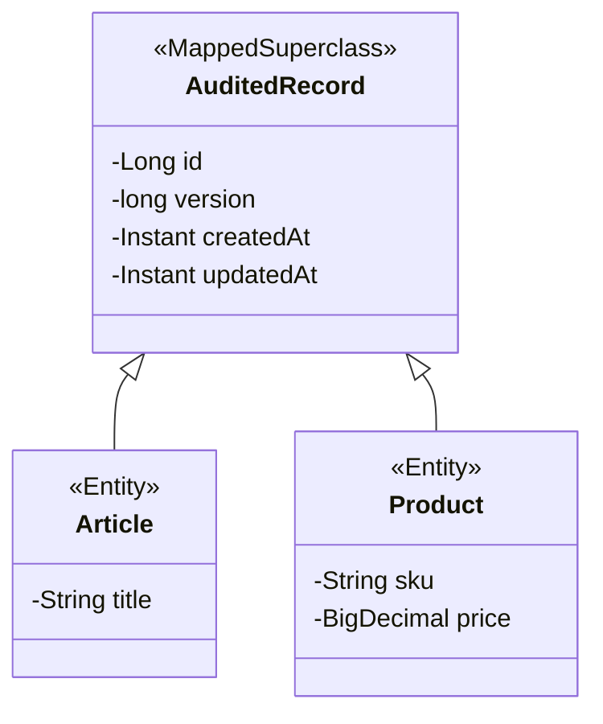
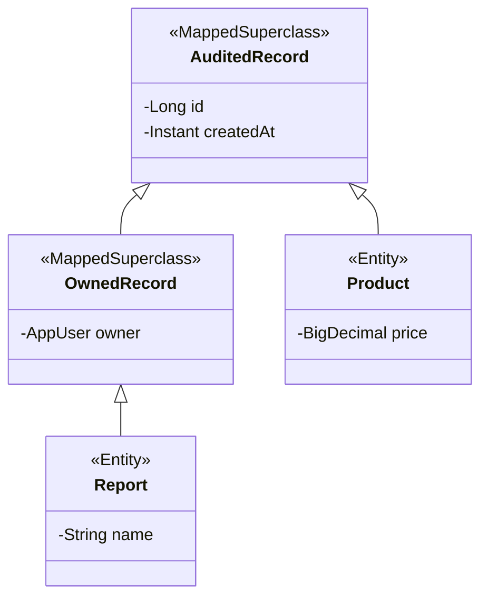

# @MappedSuperclass và phần ánh xạ dùng chung trong Hibernate

Trong một ứng dụng Java dùng Hibernate/Jakarta Persistence, nhiều entity có thể cùng cần những thuộc tính kỹ thuật như `id`, `version`, `createdAt` và `updatedAt`. Nếu lặp lại các annotation `@Id`, `@Column`, `@Version` hoặc logic cập nhật thời gian ở hàng chục entity, mỗi lần thay đổi quy ước ánh xạ đều khó kiểm soát.

**`@MappedSuperclass` cho phép định nghĩa phần ánh xạ chung ở một lớp cha Java rồi để các entity con kế thừa.** Hibernate xem các thuộc tính được ánh xạ của lớp cha như một phần của từng entity con. Bản thân lớp cha đó **không phải entity độc lập**, không có bảng riêng và không thể là đích truy vấn đa hình của JPQL/HQL.

Ví dụ, `Article` và `Product` cùng kế thừa `AuditedRecord`:



Ở database chỉ có các bảng thực tế dành cho `Article` và `Product`; các cột ánh xạ từ `AuditedRecord` được đưa vào **mỗi bảng con**. Không có một bảng `audited_record` tự động được tạo ra chỉ vì dùng `@MappedSuperclass`.

Bài học này làm rõ cách Hibernate kế thừa metadata ánh xạ, ranh giới của mapped superclass, cách dùng `@AttributeOverride`/`@AssociationOverride`, sự khác nhau với `@Entity` + `@Inheritance` và `@Embeddable`, cùng cách chọn thiết kế trong một dự án thực tế.

## 1. @MappedSuperclass giải quyết vấn đề gì?

Giả sử hệ thống có hai loại dữ liệu: bài viết và sản phẩm. Cả hai đều cần khóa chính, version để phát hiện ghi đè và thời điểm tạo/cập nhật.

Nếu không dùng một lớp chia sẻ, có thể phải lặp lại:

```java
@Entity
@Table(name = "articles")
public class Article {
    @Id
    @GeneratedValue(strategy = GenerationType.IDENTITY)
    private Long id;

    @Version
    @Column(name = "row_version")
    private long version;

    @Column(name = "created_at", nullable = false, updatable = false)
    private Instant createdAt;

    @Column(name = "updated_at", nullable = false)
    private Instant updatedAt;

    @Column(name = "title", nullable = false)
    private String title;

    // Constructor, getters và logic lifecycle...
}
```

`Product` lại có gần như những khai báo tương tự. Việc lặp này dễ gây sai khác: entity A dùng tên cột `created_at`, entity B lại dùng `creation_time`; một lớp có `@Version` còn lớp khác bị quên; callback đặt thời gian tạo không nhất quán.

Một lớp cha được ánh xạ giúp:

- **Tái sử dụng khai báo mapping**: `@Id`, `@GeneratedValue`, `@Version`, `@Column`, converter, callback và một số association phù hợp.
- **Thống nhất quy ước dữ liệu**: tên cột audit, kiểu dữ liệu Java, chiến lược ID, logic lifecycle.
- **Giảm lặp code Java**: getters và helper chung không phải viết lại ở từng entity.
- **Giữ entity con độc lập**: mỗi entity có bảng, khóa chính và truy vấn riêng theo miền nghiệp vụ.
- **Cho phép một số mapping được ghi đè ở entity con**: ví dụ đổi tên cột kế thừa bằng `@AttributeOverride`.

Đây là **kế thừa metadata ánh xạ** (*mapping inheritance*), không phải tự động tạo một mô hình kế thừa thực thể để truy vấn đa hình.

## 2. @MappedSuperclass hoạt động thế nào?

Jakarta Persistence cung cấp annotation:

```java
import jakarta.persistence.MappedSuperclass;

@MappedSuperclass
public abstract class AuditedRecord {
    // Các thuộc tính được ánh xạ chung.
}
```

Một lớp có `@MappedSuperclass`:

1. Là một **lớp Java thông thường** có thể chứa field, getter, method, constructor và logic dùng chung.
2. Có thể khai báo **persistent attributes** và annotation mapping được entity con kế thừa.
3. Có thể định nghĩa `@Id`, `@Version`, basic attributes, embeddables và các mapping quan hệ phù hợp.
4. **Không phải một managed entity type độc lập**: không có table riêng chỉ do annotation này.
5. Không được dùng làm entity root của JPQL/HQL, `EntityManager.find` hay quan hệ entity hướng tới một “bản ghi của lớp cha” như một entity.
6. Có thể là `abstract` hoặc concrete; dùng `abstract` thường làm rõ rằng nó không nên được khởi tạo trực tiếp.
7. Có thể được kế thừa bởi một entity, hoặc bởi một mapped superclass khác rồi cuối cùng đến entity.

Khi `Article extends AuditedRecord`, Hibernate xác định ánh xạ của `Article` từ **các khai báo trong Article cộng với khai báo được kế thừa từ AuditedRecord**.

```text
Java:
AuditedRecord   (@MappedSuperclass)
├── Article     (@Entity)
└── Product     (@Entity)

Database:
articles: id, row_version, created_at, updated_at, title
products: id, row_version, created_at, updated_at, sku, price

Không phát sinh bảng AuditedRecord.
```

### 2.1. Những gì được kế thừa và những gì không tồn tại

| Thành phần | Kết quả ở entity con |
|---|---|
| Field persistent khai trong mapped superclass | Được đưa vào mapping của entity con |
| `@Id` và chiến lược generated ID trong lớp cha | Có thể là ID mapping của từng entity con |
| `@Version` | Có thể được dùng để optimistic locking cho từng entity con |
| `@Column` và converter | Metadata mapping được kế thừa, có thể override ở phạm vi cho phép |
| Lifecycle callback được khai hợp lệ | Có thể được gọi khi entity con tham gia sự kiện lifecycle tương ứng |
| Phương thức Java thông thường | Được kế thừa theo quy tắc Java |
| Bảng cho mapped superclass | **Không tự có** |
| Entity name và JPQL root cho mapped superclass | **Không tự có** |
| Một định danh toàn cục chung cho mọi entity con | **Không tự có** |
| Một quan hệ đa hình tới mọi loại con qua mapped superclass | **Không có chỉ nhờ @MappedSuperclass** |

Một phương thức Java bình thường trên lớp cha vẫn có thể dùng với mọi đối tượng con. Nhưng việc Java hỗ trợ `List<AuditedRecord>` không đồng nghĩa Hibernate hỗ trợ `select r from AuditedRecord r`.

## 3. Ví dụ hoàn chỉnh: lớp cha dùng chung ID, version và audit

Ví dụ dùng Jakarta Persistence API trong các dự án Hibernate 6+, với database hỗ trợ identity columns. Các tên cột/bảng chỉ phục vụ minh họa và cần được tạo bằng migration tương ứng ở hệ thống thật.

### 3.1. Định nghĩa lớp cha @MappedSuperclass

```java
import jakarta.persistence.Column;
import jakarta.persistence.GeneratedValue;
import jakarta.persistence.GenerationType;
import jakarta.persistence.Id;
import jakarta.persistence.MappedSuperclass;
import jakarta.persistence.PrePersist;
import jakarta.persistence.PreUpdate;
import jakarta.persistence.Version;
import java.time.Instant;

@MappedSuperclass
public abstract class AuditedRecord {

    @Id
    @GeneratedValue(strategy = GenerationType.IDENTITY)
    private Long id;

    @Version
    @Column(name = "row_version", nullable = false)
    private long version;

    @Column(
        name = "created_at",
        nullable = false,
        updatable = false
    )
    private Instant createdAt;

    @Column(name = "updated_at", nullable = false)
    private Instant updatedAt;

    protected AuditedRecord() {
        // Cho constructor của các entity con sử dụng.
    }

    @PrePersist
    protected void beforeInsert() {
        Instant now = Instant.now();
        if (createdAt == null) {
            createdAt = now;
        }
        updatedAt = now;
    }

    @PreUpdate
    protected void beforeUpdate() {
        updatedAt = Instant.now();
    }

    public Long getId() {
        return id;
    }

    public long getVersion() {
        return version;
    }

    public Instant getCreatedAt() {
        return createdAt;
    }

    public Instant getUpdatedAt() {
        return updatedAt;
    }
}
```

Vai trò các thành phần:

- `@MappedSuperclass`: báo cho JPA/Hibernate rằng thuộc tính persistent trong lớp này được dùng khi ánh xạ các entity con.
- `@Id`: mỗi entity con kế thừa một thuộc tính ID. Đây là **ID của từng bảng entity**, không phải một bảng chung cho cả hệ phân cấp.
- `@GeneratedValue(strategy = IDENTITY)`: database sinh ID theo cơ chế identity. Đây chỉ là một lựa chọn; hệ thống dùng sequence có thể cân nhắc `SEQUENCE` theo khả năng DBMS.
- `@Version`: mỗi bản ghi entity con được quản lý version để hỗ trợ optimistic locking. Hai entity con không chia sẻ cùng một version toàn cục.
- `@Column`: khai báo tên cột và một số yêu cầu mapping; schema và database constraints thực tế vẫn cần được quản lý.
- `@PrePersist`/`@PreUpdate`: callback chạy trong lifecycle JPA/Hibernate tương ứng. Ở đây timestamp lấy từ **đồng hồ JVM**, không phải database default hoặc trigger.
- Getters chỉ đọc: tránh việc API bên ngoài tùy tiện ghi đè ID, version và thời điểm tạo.

Callback `@PreUpdate` không nhất thiết chạy nếu không có thao tác update entity qua ORM; nó cũng không tự chạy cho bulk JPQL/native SQL hoặc cho writer bên ngoài Hibernate. Nếu audit timestamp phải được đảm bảo cho mọi writer, hãy thiết kế cơ chế database hoặc auditing phù hợp thay vì phụ thuộc duy nhất vào callback.

Trong ví dụ, `id` và các field được đánh dấu mapping **trên field**. Đây là một lựa chọn *field access*: Hibernate đọc/ghi trực tiếp field theo cơ chế persistence, còn getter chủ yếu phục vụ domain API.

### 3.2. Entity Article kế thừa phần ánh xạ chung

```java
import jakarta.persistence.Column;
import jakarta.persistence.Entity;
import jakarta.persistence.Table;
import java.util.Objects;

@Entity
@Table(name = "articles")
public class Article extends AuditedRecord {

    @Column(name = "title", nullable = false, length = 180)
    private String title;

    protected Article() {
        // JPA constructor.
    }

    public Article(String title) {
        rename(title);
    }

    public String getTitle() {
        return title;
    }

    public void rename(String newTitle) {
        if (newTitle == null || newTitle.isBlank()) {
            throw new IllegalArgumentException(
                "Title must not be blank");
        }
        this.title = newTitle;
    }
}
```

`Article` không cần khai lại `id`, `version`, `createdAt` hay `updatedAt`. Hibernate kết hợp mapping kế thừa của lớp cha với `Article.title` để tạo mapping cho bảng `articles`.

### 3.3. Entity Product kế thừa cùng lớp cha

```java
import jakarta.persistence.Column;
import jakarta.persistence.Entity;
import jakarta.persistence.Table;
import java.math.BigDecimal;
import java.util.Objects;

@Entity
@Table(name = "products")
public class Product extends AuditedRecord {

    @Column(name = "sku", nullable = false, length = 40, unique = true)
    private String sku;

    @Column(
        name = "price",
        nullable = false,
        precision = 19,
        scale = 2
    )
    private BigDecimal price;

    protected Product() {
        // JPA constructor.
    }

    public Product(String sku, BigDecimal price) {
        this.sku = Objects.requireNonNull(sku);
        changePrice(price);
    }

    public String getSku() {
        return sku;
    }

    public BigDecimal getPrice() {
        return price;
    }

    public void changePrice(BigDecimal newPrice) {
        if (newPrice == null || newPrice.signum() < 0) {
            throw new IllegalArgumentException(
                "Price must be non-negative");
        }
        this.price = newPrice;
    }
}
```

`Product` có quy tắc nghiệp vụ giá không âm riêng, nhưng cùng dùng mapping ID/version/audit từ `AuditedRecord`. Một mapped superclass nên chứa những cơ chế có ý nghĩa chung thực sự; không đưa các quy tắc chỉ áp dụng cho `Product` vào lớp cha.

### 3.4. Bảng database tương ứng

Để hình dung ánh xạ, với một DBMS hỗ trợ cú pháp identity như PostgreSQL, schema có thể có dạng:

```sql
CREATE TABLE articles (
    id BIGINT GENERATED BY DEFAULT AS IDENTITY PRIMARY KEY,
    row_version BIGINT NOT NULL,
    created_at TIMESTAMP WITH TIME ZONE NOT NULL,
    updated_at TIMESTAMP WITH TIME ZONE NOT NULL,
    title VARCHAR(180) NOT NULL
);

CREATE TABLE products (
    id BIGINT GENERATED BY DEFAULT AS IDENTITY PRIMARY KEY,
    row_version BIGINT NOT NULL,
    created_at TIMESTAMP WITH TIME ZONE NOT NULL,
    updated_at TIMESTAMP WITH TIME ZONE NOT NULL,
    sku VARCHAR(40) NOT NULL UNIQUE,
    price NUMERIC(19, 2) NOT NULL
);
```

Cú pháp DDL là ví dụ PostgreSQL; kiểu SQL sinh bởi Hibernate hoặc migration có thể khác theo Dialect/phiên bản. Cần bảo đảm mapping `Instant` và chính sách timezone tương thích với database đang dùng.

**Không có** bảng `audited_records`. Các bảng `articles` và `products` tồn tại độc lập; việc cả hai có cột `id` không làm ID bằng nhau ở hai bảng biểu thị cùng một bản ghi.

### 3.5. Persist, update và truy vấn

Ví dụ một application service có transaction:

```java
import jakarta.persistence.EntityManager;
import jakarta.persistence.PersistenceContext;
import org.springframework.stereotype.Service;
import org.springframework.transaction.annotation.Transactional;
import java.math.BigDecimal;

@Service
public class CatalogService {

    @PersistenceContext
    private EntityManager entityManager;

    @Transactional
    public void createExamples() {
        Article article = new Article("Hibernate basics");

        Product product = new Product(
            "BOOK-001",
            new BigDecimal("199.00")
        );

        entityManager.persist(article);
        entityManager.persist(product);
    }

    @Transactional
    public void updateProduct(Long productId) {
        Product product =
            entityManager.find(Product.class, productId);

        if (product == null) {
            throw new IllegalArgumentException(
                "Product not found");
        }

        product.changePrice(new BigDecimal("179.00"));
        // Hibernate dirty checking và version ở lần flush.
    }
}
```

Khi persist `Article`, Hibernate dùng bảng `articles`; khi persist `Product`, dùng bảng `products`. `@PrePersist` ở mapped superclass có thể được gọi cho các entity con trong lifecycle tương ứng. `@Version` được sử dụng trong việc kiểm tra xung đột của **bản ghi thuộc chính entity đó**.

Truy vấn hợp lệ:

```java
List<Article> articles = entityManager.createQuery(
        "select a from Article a order by a.id",
        Article.class)
    .getResultList();

List<Product> products = entityManager.createQuery(
        "select p from Product p where p.price > :min",
        Product.class)
    .setParameter("min", new BigDecimal("100.00"))
    .getResultList();
```

Không được coi câu truy vấn sau là một truy vấn entity hợp lệ chỉ vì Java có lớp cha:

```java
// Sai đối với lớp cha chỉ có @MappedSuperclass:
entityManager.createQuery(
    "select r from AuditedRecord r",
    AuditedRecord.class
);
```

`AuditedRecord` không phải entity root có tên được quản lý trong mô hình query. Nếu nghiệp vụ cần “lấy tất cả bản ghi Article và Product trong một query đa hình”, có thể cần một entity inheritance root thật, một view/query phù hợp hoặc thiết kế truy vấn tổng hợp khác.

## 4. Phần ánh xạ nào nên đưa vào @MappedSuperclass?

Các ứng viên tốt là **quy ước bền vững và tương đương về ý nghĩa** giữa nhiều entity.

| Nhóm thông tin | Ví dụ | Có phù hợp để chia sẻ? |
|---|---|---|
| Khóa định danh | `@Id`, `@GeneratedValue` | Có, nếu các entity thực sự dùng chung một chiến lược ID |
| Optimistic lock | `@Version` | Có, nếu các entity cùng cần version ở mức bản ghi |
| Audit kỹ thuật | `createdAt`, `updatedAt`, callback | Có, nếu cùng nguồn thời gian và cùng semantics |
| Trạng thái xóa mềm | `deletedAt`, `isDeleted` | Chỉ khi tất cả entity dùng cùng quy tắc, truy vấn và retention |
| Tenant identifier | `tenantId` | Có thể chia sẻ field, nhưng phải thiết kế lọc và phân quyền riêng |
| Quy tắc truy cập dữ liệu | Kiểm tra quyền, chính sách bảo mật | Không tự được đảm bảo chỉ nhờ kế thừa một field |
| Field nghiệp vụ chuyên biệt | `price` cho Product, `title` cho Article | Thường đặt ở entity con |
| Quan hệ tới entity chung | `owner`, `createdBy` | Có thể dùng nếu cardinality, ownership và semantics giống nhau |
| Lifecycle khác nhau | Xóa cascade, tự động publish, điều kiện chuyển trạng thái | Tránh đưa vào lớp cha khi không áp dụng đồng nhất |

Một sai lầm là biến mapped superclass thành **“god base entity”** với quá nhiều cột mà mỗi entity con chỉ dùng một phần. Mỗi thuộc tính persistent ở superclass được đưa vào mapping của entity con, nên có thể ép những bảng không liên quan phải chứa các cột thừa.

Nếu chỉ cần dùng chung *logic Java* mà không muốn dùng chung cột, một lớp cha Java thuần hoặc interface có thể phù hợp hơn.

## 5. @AttributeOverride: đổi cột của thuộc tính kế thừa

Mặc định, metadata `@Column` ở mapped superclass được kế thừa. Nhưng các bảng legacy có thể sử dụng những tên cột khác nhau.

Ví dụ, hệ thống mới dùng `created_at`, còn một bảng lịch sử vẫn có tên `registered_at`. Không cần sao chép lại toàn bộ class base chỉ vì một tên cột khác.

### 5.1. Ghi đè tên cột trong entity con

```java
import jakarta.persistence.AttributeOverride;
import jakarta.persistence.Column;
import jakarta.persistence.Entity;
import jakarta.persistence.Table;

@Entity
@Table(name = "legacy_registrations")
@AttributeOverride(
    name = "createdAt",
    column = @Column(
        name = "registered_at",
        nullable = false,
        updatable = false
    )
)
public class LegacyRegistration extends AuditedRecord {

    @Column(name = "reference_code", nullable = false)
    private String referenceCode;

    protected LegacyRegistration() {}
}
```

Khi mapping `LegacyRegistration`, Hibernate ánh xạ thuộc tính Java `createdAt` kế thừa sang cột `registered_at` thay vì `created_at`. Các thuộc tính khác (`id`, `version`, `updatedAt`) vẫn dùng mapping đã khai trong lớp cha nếu không override.

Các điểm cần nhớ:

- `name = "createdAt"` là **tên Java attribute** kế thừa, không phải tên cột gốc.
- `column = @Column(...)` định nghĩa mapping cột thay thế. Nếu mapping gốc có ràng buộc quan trọng như `nullable`, `updatable`, `length` hoặc `precision`, cần khai lại các thiết lập thích hợp trong override.
- Schema thực tế phải có cột `registered_at` đúng kiểu; `@AttributeOverride` không thay thế migration.
- Không nên override tùy tiện ID hay version khi các entity không thật sự cùng semantics. Nếu chiến lược ID khác hẳn nhau, cân nhắc tách lớp cha.

### 5.2. Ghi đè nhiều thuộc tính

```java
@Entity
@Table(name = "external_events")
@AttributeOverrides({
    @AttributeOverride(
        name = "createdAt",
        column = @Column(
            name = "created_on",
            nullable = false,
            updatable = false
        )
    ),
    @AttributeOverride(
        name = "updatedAt",
        column = @Column(
            name = "modified_on",
            nullable = false
        )
    )
})
public class ExternalEvent extends AuditedRecord {
    // Thuộc tính riêng...
}
```

`@AttributeOverrides` nhóm nhiều quy tắc ghi đè. Trong những phiên bản Java/Jakarta Persistence hỗ trợ annotation repeatable, có thể có cách khai lặp `@AttributeOverride`; hãy chọn phong cách nhất quán với phiên bản dự án.

### 5.3. Override thuộc tính nằm sâu trong embeddable

Nếu một mapped superclass chứa thuộc tính `@Embedded` và entity con cần đổi tên cột thuộc tính lồng nhau, `@AttributeOverride` có thể dùng đường dẫn tên thuộc tính phù hợp, ví dụ dạng `"address.city"`. Tuy nhiên, cần hiểu mapping thực tế của `Address` và vị trí override; đường dẫn hợp lệ phụ thuộc cấu trúc embedded và version JPA. Không đoán tên cột bằng cách ghép chuỗi tùy ý.

## 6. @AssociationOverride: đổi join column của quan hệ kế thừa

Một mapped superclass cũng có thể cung cấp association được chia sẻ. Ví dụ nhiều loại bản ghi có một **người tạo**:

```java
import jakarta.persistence.FetchType;
import jakarta.persistence.JoinColumn;
import jakarta.persistence.ManyToOne;
import jakarta.persistence.MappedSuperclass;

@MappedSuperclass
public abstract class OwnedRecord extends AuditedRecord {

    @ManyToOne(fetch = FetchType.LAZY, optional = false)
    @JoinColumn(name = "owner_id", nullable = false)
    private AppUser owner;

    protected OwnedRecord() {}

    protected OwnedRecord(AppUser owner) {
        this.owner = java.util.Objects.requireNonNull(owner);
    }

    public AppUser getOwner() {
        return owner;
    }
}
```

Ở đây `AppUser` phải là **entity thật** có `@Id`, chứ không phải mapped superclass trừ khi mapping đích được xác định bằng một entity hợp lệ. Ví dụ:

```java
@Entity
@Table(name = "app_users")
public class AppUser {
    @Id
    private Long id;

    protected AppUser() {}

    public Long getId() {
        return id;
    }
}
```

Một entity con có bảng legacy sử dụng `created_by_user_id` thay vì `owner_id` có thể override association:

```java
import jakarta.persistence.AssociationOverride;
import jakarta.persistence.Entity;
import jakarta.persistence.JoinColumn;
import jakarta.persistence.Table;

@Entity
@Table(name = "reports")
@AssociationOverride(
    name = "owner",
    joinColumns = @JoinColumn(
        name = "created_by_user_id",
        nullable = false
    )
)
public class Report extends OwnedRecord {
    protected Report() {}

    public Report(AppUser owner) {
        super(owner);
    }
}
```

Giải thích:

- `name = "owner"` là tên **thuộc tính association kế thừa**.
- `joinColumns` ghi đè cột khóa ngoại ở bảng `reports`; trong ví dụ nó tham chiếu khóa chính `app_users.id` theo mapping mặc định.
- `@AssociationOverride` dùng cho **mapping quan hệ**; `@AttributeOverride` dùng cho **basic/embedded attributes**. Không hoán đổi hai loại tùy ý.
- Khi quan hệ có nhiều join columns hoặc join table, mapping override cần mô tả đầy đủ cấu trúc tương ứng.
- Nếu các entity con có ý nghĩa quan hệ khác nhau, ví dụ một bên là tác giả và bên kia là người phê duyệt, không nên ép chúng kế thừa cùng một association chỉ vì đều trỏ đến `AppUser`.

Với quan hệ hai chiều và collection inverse, cấu trúc `mappedBy`, owning side, vòng đời và tính portable có thể phức tạp khi đem mapping chung lên lớp cha. Nên giữ những association chia sẻ **rõ nghĩa và đủ đơn giản**, đồng thời đối chiếu yêu cầu của Jakarta Persistence và khả năng Hibernate release đang sử dụng. Không cho rằng một mapped superclass là đích entity đa hình có thể được sử dụng tự do trong `@ManyToOne`.

## 7. @MappedSuperclass khác @Entity + @Inheritance thế nào?

Cả hai đều dùng kế thừa Java, nhưng biểu diễn ý nghĩa **rất khác** trong mô hình quan hệ.

### 7.1. @MappedSuperclass chia sẻ mapping, không tạo entity root

```java
@MappedSuperclass
public abstract class BusinessRecord {
    @Id
    private Long id;
}

@Entity
public class Invoice extends BusinessRecord {
    private String number;
}

@Entity
public class Shipment extends BusinessRecord {
    private String trackingCode;
}
```

`Invoice` và `Shipment` là hai entity độc lập. Có thể truy vấn riêng từng entity, nhưng không thể dùng `BusinessRecord` làm root entity để query đa hình chỉ nhờ quan hệ kế thừa đó.

### 7.2. @Entity + @Inheritance tạo một hierarchy entity thật

Nếu domain có một khái niệm cha cần **lưu, định danh và truy vấn đa hình**, lớp cha có thể cần `@Entity` cùng một chiến lược kế thừa:

```java
import jakarta.persistence.DiscriminatorColumn;
import jakarta.persistence.Entity;
import jakarta.persistence.GeneratedValue;
import jakarta.persistence.Id;
import jakarta.persistence.Inheritance;
import jakarta.persistence.InheritanceType;

@Entity
@Inheritance(strategy = InheritanceType.SINGLE_TABLE)
@DiscriminatorColumn(name = "document_type")
public abstract class Document {
    @Id
    @GeneratedValue
    private Long id;
}

@Entity
public class InvoiceDocument extends Document {
    private String invoiceNumber;
}

@Entity
public class ShippingDocument extends Document {
    private String trackingCode;
}
```

Khi đó, `Document` là entity root thật. Với `SINGLE_TABLE`, các loại con được lưu trong cùng bảng hierarchy và phân biệt bằng discriminator; Hibernate có thể query đa hình:

```java
List<Document> documents = entityManager.createQuery(
    "select d from Document d",
    Document.class
).getResultList();
```

Ví dụ chỉ minh họa mapping; trong hệ thống thật cần xác định tên bảng, generated IDs, constraints và cột nào nullable giữa các subtype.

### 7.3. So sánh các mô hình

| Tiêu chí | `@MappedSuperclass` | `@Entity` + `@Inheritance` | `@Embeddable` |
|---|---|---|---|
| Bản thân kiểu cha có là entity được quản lý? | Không | Có, với entity root | Không |
| Có bảng riêng cho “kiểu cha”? | Không | Tùy `SINGLE_TABLE`, `JOINED`, `TABLE_PER_CLASS` | Không |
| Các entity con kế thừa cột chung? | Có | Có theo chiến lược inheritance | Không thông qua `extends`; dùng `@Embedded` |
| JPQL polymorphic root cho kiểu cha | Không | Có | Không |
| Có thể gọi `find(Base.class, id)` | Không | Có nếu Base là entity và có định danh | Không |
| Dùng chung mapping ID/version | Thuận tiện | Có trong entity hierarchy | Thường không phải mục đích của value embeddable |
| Phù hợp khi nào? | Các entity độc lập chia sẻ metadata | Các subtype cùng là một loại thực thể nghiệp vụ | Nhiều entity cùng chứa một nhóm thuộc tính giá trị |
| Quan hệ đến kiểu cha như entity | Không | Có, tới entity root hợp lệ | Không, vì embeddable không phải entity |

### 7.4. Các chiến lược inheritance của entity

Nếu đã chọn `@Entity` cho root và muốn truy vấn đa hình, Hibernate/JPA có những chiến lược thông dụng:

- **`SINGLE_TABLE`:** toàn bộ hierarchy chung một bảng và thường có discriminator. Truy vấn đa hình trực tiếp, nhưng có thể có nhiều cột nullable đặc thù subtype.
- **`JOINED`:** bảng root chứa cột chung, bảng subtype chứa cột riêng và liên kết qua khóa. Truy vấn subtype có thể cần join.
- **`TABLE_PER_CLASS`:** mỗi lớp concrete có bảng tương ứng chứa cả thuộc tính kế thừa. Query đa hình có thể cần union hoặc cơ chế tương tự và có những ràng buộc hiệu năng/ID riêng.

`@MappedSuperclass` khác cả ba chiến lược trên về mặt **entity hierarchy và khả năng query**. Dù `TABLE_PER_CLASS` có thể tạo nhiều bảng chứa cột chung, root của một entity inheritance hierarchy vẫn là entity được quản lý, trong khi mapped superclass thì không.

### 7.5. Khi nào nên chọn @MappedSuperclass?

Chọn `@MappedSuperclass` khi:

1. Các entity như `Article`, `Product`, `Shipment` có **vòng đời và truy vấn độc lập**.
2. Phần dùng chung chủ yếu là các thuộc tính kỹ thuật như ID/version/audit.
3. Không có nhu cầu query `select x from BaseType x` để lấy mọi subtype.
4. Không cần một association đa hình tới tất cả subtype qua lớp cha.
5. Muốn tái sử dụng metadata mà không ép các entity khác nghiệp vụ vào cùng một entity hierarchy.

Nếu các subclass thực sự là các biến thể của **cùng một loại đối tượng miền** và hệ thống cần thao tác chúng đa hình trong database, nên xem xét entity inheritance.

## 8. @MappedSuperclass khác @Embeddable thế nào?

Giả sử `Article` và `Product` cùng có **thông tin địa chỉ gửi hàng**. Địa chỉ là một giá trị có ý nghĩa độc lập trong mô hình dữ liệu, không nhất thiết là một lớp cha của Article hay Product.

Thay vì:

```java
@MappedSuperclass
public abstract class AddressFields {
    private String street;
    private String city;
}
```

rồi ép mọi entity `extends AddressFields`, có thể biểu diễn thành một **value object**:

```java
import jakarta.persistence.Column;
import jakarta.persistence.Embeddable;

@Embeddable
public class Address {

    @Column(name = "street")
    private String street;

    @Column(name = "city")
    private String city;

    protected Address() {}

    public Address(String street, String city) {
        this.street = street;
        this.city = city;
    }

    public String getStreet() { return street; }
    public String getCity() { return city; }
}
```

Entity sử dụng composition:

```java
@Entity
@Table(name = "warehouses")
public class Warehouse {

    @Id
    private Long id;

    @Embedded
    private Address address;

    protected Warehouse() {}
}
```

`@Embeddable` và `@Embedded` phù hợp khi nhiều entity **có một nhóm thuộc tính** (*has-a*), còn `@MappedSuperclass` phù hợp khi các entity **là những biến thể Java kế thừa cùng đặc điểm ánh xạ kỹ thuật** (*is-a* ở cấp code, nhưng không nhất thiết là is-a ở cấp entity database).

Một embeddable thường không có bảng/identity riêng; các cột của nó được đặt trong bảng của entity sở hữu theo mapping. Nó có thể được sử dụng nhiều lần trong cùng một entity thông qua `@AttributeOverride` để phân biệt tên cột, ví dụ `billingAddress` và `shippingAddress`.

### 8.1. Không lạm dụng extends chỉ để chia sẻ hai field

Java chỉ có **một superclass trực tiếp**, vì vậy nếu entity extends một base class chỉ để có `street`/`city`, nó có thể không còn quyền kế thừa một hierarchy domain khác. Composition qua `@Embeddable` linh hoạt hơn khi nhóm thuộc tính không thực sự là một phần danh tính của lớp cha.

Ngược lại, ID/version và một số lifecycle conventions là ứng viên tự nhiên cho mapped superclass, vì chúng gần như tạo ra một hợp đồng kỹ thuật chung cho các entity.

## 9. Field access, property access và phần mapping được kế thừa

JPA có hai kiểu truy cập cơ bản:

- **Field access:** annotation mapping như `@Id` đặt trên field; Hibernate làm việc trực tiếp với field persistent.
- **Property access:** annotation mapping đặt trên getter; Hibernate truy cập property theo cơ chế getter/setter và mapping hợp lệ.

Vị trí `@Id` trong hierarchy thường có vai trò quyết định access mặc định; vì vậy cần thống nhất chiến lược giữa mapped superclass và các entity con.

### 9.1. Ví dụ field access nhất quán

```java
@MappedSuperclass
public abstract class BaseEntity {
    @Id
    @GeneratedValue
    private Long id;

    public Long getId() {
        return id;
    }
}

@Entity
public class NewsItem extends BaseEntity {
    @Column(name = "headline")
    private String headline;
}
```

`@Id` và `@Column` đều ở field, tránh nhập nhằng.

### 9.2. Khi muốn property access

```java
@MappedSuperclass
@Access(AccessType.PROPERTY)
public abstract class PropertyAccessBase {

    private Long id;

    @Id
    @GeneratedValue
    public Long getId() {
        return id;
    }

    protected void setId(Long id) {
        this.id = id;
    }
}
```

Trong thực tế nên quyết định cách truy cập nhất quán cho toàn bộ hierarchy hoặc đánh dấu `@Access` tường minh ở phạm vi cần thiết khi trộn. Không đặt đồng thời `@Column` lên field và getter cùng tên rồi hy vọng Hibernate tự chọn đúng: điều này có thể dẫn tới mapping trùng hoặc hành vi phụ thuộc access strategy.

Với property access, các getter/setter phục vụ persistence phải phù hợp yêu cầu provider; với field access, hạn chế public setter của ID/version vẫn có thể hoạt động tốt vì Hibernate truy cập field trực tiếp.

## 10. Dùng chung @Id và chiến lược sinh khóa: điều kiện và giới hạn

Đặt `@Id` vào mapped superclass rất tiện, nhưng **chọn ID strategy là quyết định riêng cần nhất quán với database**.

### 10.1. IDENTITY

```java
@MappedSuperclass
public abstract class IdentityBase {
    @Id
    @GeneratedValue(strategy = GenerationType.IDENTITY)
    private Long id;
}
```

Khi mỗi bảng concrete entity có một identity column, việc kế thừa mapping trên có thể phù hợp. ID của `Article` và ID của `Product` có thể cùng bằng `1` nhưng chỉ định danh các bản ghi thuộc **hai bảng khác nhau**. Không coi ID đơn lẻ là global identity nếu không kèm loại entity.

Chiến lược `IDENTITY` thường cần insert để lấy ID, có thể ảnh hưởng đến insert batching. Nếu hệ quản trị tối ưu hơn với sequence, nên đánh giá giải pháp tương ứng.

### 10.2. SEQUENCE

```java
@MappedSuperclass
public abstract class SequenceBase {
    @Id
    @GeneratedValue(
        strategy = GenerationType.SEQUENCE,
        generator = "global_record_sequence"
    )
    @SequenceGenerator(
        name = "global_record_sequence",
        sequenceName = "global_record_sequence",
        allocationSize = 50
    )
    private Long id;
}
```

Ví dụ này dùng **một sequence chung** cho các entity con. Điều đó có thể phù hợp khi chủ đích cần cấp ID từ cùng nguồn; tuy nhiên các bảng vẫn độc lập và việc dùng chung sequence **không tự tạo** một entity root đa hình.

Việc đặt generator trong mapped superclass có thể tác động tới tên generator/sequence ở các subclass; phải xem phạm vi tên generator, cơ chế allocation/optimizer và schema tương ứng theo Hibernate/JPA version. Nếu từng bảng cần sequence riêng hoặc chiến lược ID khác, không nên ép mọi entity vào một base class dùng chung generator không phù hợp.

### 10.3. Không khai @Id hai lần

Nếu lớp cha đã có `@Id`, entity con thông thường **không khai một @Id độc lập khác** chỉ vì thích tên field khác. Điều này có thể làm ORM hiểu sai chiến lược ID hoặc vô tình tạo mapping khóa phức hợp. Nếu entity con có khóa tự nhiên/composite key đặc biệt, nên xem xét tách lớp cha chỉ chứa audit fields, để entity con tự định nghĩa ID.

## 11. Kế thừa @Version và optimistic locking

Một mapped superclass có thể chứa:

```java
@Version
@Column(name = "row_version")
private long version;
```

Mỗi entity con có cột version trong **bảng của nó**. Khi một entity managed bị sửa, Hibernate có thể dùng version để phát hiện cập nhật đồng thời. Một SQL update minh họa:

```sql
UPDATE products
SET price = ?, row_version = ?
WHERE id = ? AND row_version = ?;
```

Nếu hai transaction đều đọc cùng một version cũ rồi cùng thay đổi, một giao dịch có thể thất bại khi version đã không còn khớp. Ứng dụng phải quyết định xử lý xung đột (ví dụ trả lỗi cập nhật đồng thời hoặc yêu cầu người dùng tải lại).

**Kế thừa `@Version` không bảo đảm tất cả ràng buộc đồng thời**. Nó chủ yếu bảo vệ xung đột theo entity/version và những thao tác đi qua cơ chế locking tương ứng. Bulk update, native SQL hoặc quy tắc liên nhiều bảng có thể cần thiết kế riêng.

Không tự gán `version++` trong code nghiệp vụ. Version được ORM quản lý theo contract. Nếu một entity thực tế không cần optimistic locking hoặc dùng chiến lược khác, cân nhắc liệu nó có nên kế thừa đúng lớp cha này không.

## 12. Lifecycle callbacks trong @MappedSuperclass

Các callback JPA như `@PrePersist` và `@PreUpdate` có thể được khai ở mapped superclass, giúp entity con dùng chung hành vi liên quan persistence.

### 12.1. Timestamp từ JVM

Như ví dụ `AuditedRecord`:

```java
@PrePersist
protected void beforeInsert() {
    Instant now = Instant.now();
    createdAt = now;
    updatedAt = now;
}

@PreUpdate
protected void beforeUpdate() {
    updatedAt = Instant.now();
}
```

Đây là một lựa chọn triển khai. Các hệ thống cần thống nhất nguồn thời gian có thể dùng clock được quản lý ở tầng ứng dụng, giải pháp audit listener, timestamp do Hibernate sinh hoặc database default/trigger.

Các callback cần được thiết kế sao cho không phụ thuộc vào việc truy vấn dữ liệu khác hoặc gọi vào những API persistence gây hiệu ứng phức tạp trong lifecycle. Khi dùng nhiều callback trong hierarchy/entity listeners, phải nắm rõ thứ tự gọi và việc override/exclude theo spec.

### 12.2. Hibernate-specific timestamps

Hibernate cung cấp các annotation như:

```java
@CreationTimestamp
private Instant createdAt;

@UpdateTimestamp
private Instant updatedAt;
```

Các annotation này giúp Hibernate đặt timestamp khi insert/update; nguồn thời gian (VM hoặc DB) và cách lấy lại giá trị phụ thuộc phiên bản/configuration. **Đừng đồng thời dùng callback tự gán timestamp và annotation tự sinh trên cùng field mà không xác định rõ ai có trách nhiệm tạo giá trị**.

Đối với audit có yêu cầu bảo đảm mọi luồng ghi, JPA callbacks không bao phủ:

- Bulk JPQL/HQL update/delete hoạt động trực tiếp với DB.
- Native SQL không đi qua lifecycle của entity được quản lý.
- Writer bên ngoài Hibernate.
- Công việc bất đồng bộ sau transaction.

Vì vậy, nhu cầu audit tuân thủ quy định có thể cần audit table, database trigger, CDC, outbox hoặc cơ chế khác phù hợp với yêu cầu hệ thống.

### 12.3. Entity listeners và kế thừa

Một lớp cha cũng có thể tham gia cấu hình entity listeners phù hợp thông qua `@EntityListeners`. Trước khi dùng chung listener, cần quyết định callback nào áp dụng cho mọi entity và khi nào một subtype cần loại trừ callback từ superclass theo cơ chế Jakarta Persistence như `@ExcludeSuperclassListeners`.

Không giấu logic nghiệp vụ khác nhau của nhiều entity trong callback chung chỉ để giảm code. Callback nên làm công việc lifecycle có trách nhiệm rõ ràng.

## 13. Quan hệ ánh xạ trong @MappedSuperclass: dùng có chọn lọc

Một mapped superclass có thể chia sẻ association như `@ManyToOne` tới một entity chung. Nhưng trước khi đặt association vào lớp cha, hãy cân nhắc:

1. **Cardinality** có giống nhau không? Ví dụ tất cả entity con đều có đúng một owner.
2. **Ý nghĩa nghiệp vụ** có giống nhau không? `owner`, `creator`, `approver` có thể là ba khái niệm khác nhau dù cùng trỏ tới `AppUser`.
3. **Foreign key location** có đúng không? Mỗi bảng entity con sẽ có FK theo mapping, trừ khi override.
4. **Cascade** có nguy hiểm không? Dùng `CascadeType.REMOVE` từ một loại bản ghi tới người dùng chung có thể dẫn đến xóa dữ liệu không mong muốn.
5. **Fetching** có phù hợp không? Một association được kế thừa trong hàng trăm entity sẽ ảnh hưởng tới cách chúng được tải.
6. **Bidirectional mapping** có thực sự cần không? Mapped superclass không phải entity root để dùng làm target đa hình; một phía inverse với `mappedBy` gắn chặt với subtype cụ thể có thể khó dùng chung một cách portable.

Nếu association chỉ được một nhóm entity dùng, có thể tạo **một mapped superclass trung gian riêng** thay vì đưa lên base chung nhất.



`Report` có thể kế thừa ID/audit và owner; `Product` chỉ kế thừa ID/audit. Cách này giảm số cột và quan hệ không cần thiết trong bảng product.

## 14. @MappedSuperclass và kiến trúc repository

Một điểm dễ gây nhầm lẫn: `AuditedRecord` có thể làm **generic bound trong Java**, nhưng không phải một entity có repository query root.

Một abstraction Java hợp lệ:

```java
public interface Identified {
    Long getId();
}

@MappedSuperclass
public abstract class IdentifiedRecord implements Identified {

    @Id
    @GeneratedValue(strategy = GenerationType.IDENTITY)
    private Long id;

    @Override
    public Long getId() {
        return id;
    }
}
```

Code tiện ích có thể nhận nhiều entity con:

```java
public static boolean hasDatabaseId(Identified record) {
    return record.getId() != null;
}
```

Nhưng muốn truy vấn, phải làm việc với entity type thực, ví dụ:

```java
Article article =
    entityManager.find(Article.class, articleId);

Product product =
    entityManager.find(Product.class, productId);
```

Không nên giả định một Spring Data repository khai trực tiếp trên `AuditedRecord` như thể `AuditedRecord` là entity cụ thể có thể quản lý:

```java
// Không phải repository entity hợp lệ nếu AuditedRecord
// chỉ được đánh dấu @MappedSuperclass.
interface BaseRecordRepository
    extends JpaRepository<AuditedRecord, Long> {
}
```

Trong Spring Data JPA, có thể dùng một interface repository chung chỉ để **kế thừa khai báo phương thức**:

```java
@NoRepositoryBean
public interface BaseRepository<T extends AuditedRecord>
        extends JpaRepository<T, Long> {
}

public interface ArticleRepository
        extends BaseRepository<Article> {
}

public interface ProductRepository
        extends BaseRepository<Product> {
}
```

Ý nghĩa là `BaseRepository` **không được tạo thành repository cho AuditedRecord**; các repository concrete mới gắn với entity type thật. `@NoRepositoryBean` là annotation của Spring Data, không thuộc Jakarta Persistence. Cách đặt generic base repository chỉ là một lựa chọn tổ chức code, không bắt buộc phải có mỗi khi dùng `@MappedSuperclass`.

## 15. Tên bảng, schema và migration

`@MappedSuperclass` chia sẻ **mapping metadata**, không tự quản lý migration và không tạo một bảng cha. Nếu một field mới được thêm vào mapped superclass đang được 15 entity kế thừa, các bảng tương ứng có thể đều cần thêm cột.

Ví dụ thêm:

```java
@Column(name = "last_modified_by", length = 64)
private String lastModifiedBy;
```

Nếu tất cả 15 entity con đều kế thừa field đó mà không có override hay quy tắc loại trừ, Hibernate sẽ mong thấy cột `last_modified_by` trong mapping của mỗi entity. Một migration chỉ sửa bảng `articles` sẽ chưa đủ nếu `products` cũng cần field này.

Quy trình thay đổi schema nên bao gồm:

1. Xác định **tập entity con** đang kế thừa mapped superclass.
2. Xác định bảng tương ứng và tên cột sau khi áp dụng override.
3. Thiết kế migration cho các bảng thực sự chịu tác động.
4. Cân nhắc dữ liệu cũ khi thêm cột `NOT NULL` hoặc đổi kiểu.
5. Kiểm tra tính tương thích khi triển khai từng phần/rolling deployment.
6. Đối chiếu mapping và schema thực tế theo quy trình kiểm thử dự án.

Hibernate có thể hỗ trợ schema generation/validation, nhưng dùng `ddl-auto=update` tùy tiện trong production không thay thế được chiến lược migration. Đặc biệt, đổi mapping trong lớp cha có **phạm vi ảnh hưởng lớn hơn một entity đơn lẻ**.

### 15.1. Không đặt @Table trên mapped superclass để kỳ vọng có bảng chung

`@Table` gắn với entity table mapping, còn bản thân mapped superclass không có table riêng. Mục đích của lớp cha là cung cấp cột/association mapping cho các entity con. Nếu thật sự cần bảng root chung, phải thiết kế entity inheritance thay vì dựa vào `@MappedSuperclass`.

### 15.2. Kiểu dữ liệu và Dialect có thể tạo khác biệt

Một cột `Instant`, `UUID`, enum hoặc JSON được chia sẻ có thể được ánh xạ khác nhau giữa PostgreSQL, MySQL, Oracle hay SQL Server. Cùng một `@MappedSuperclass` không bảo đảm DDL và JDBC behavior tương đương trên mọi DBMS.

Lựa chọn Dialect, driver, phiên bản DB và integration tests vẫn cần đánh giá độc lập. Trong hệ thống dùng nhiều DBMS, một base mapping quá đặc thù vendor có thể làm giảm tính di động.

## 16. Những lỗi thiết kế thường gặp

### 16.1. Nhầm @MappedSuperclass với @Entity

```java
@MappedSuperclass
public abstract class PaymentRecord {
    @Id
    private Long id;
}
```

Nếu viết JPQL:

```sql
select p from PaymentRecord p
```

Hibernate không có entity root `PaymentRecord` để query theo mapping này. Cách sửa phụ thuộc mục tiêu: nếu chỉ muốn tái sử dụng thuộc tính, query concrete entity; nếu cần polymorphic query qua mọi subtype, thiết kế `@Entity` root có chiến lược inheritance.

### 16.2. Tạo lớp cha quá rộng

Nếu cả `User`, `Order`, `Country`, `AuditEvent` đều extends một base chứa `tenantId`, `ownerId`, `deletedAt`, `approvedBy`, `publishedAt` và `priceCurrency`, nhiều bảng sẽ bị kéo theo cột không có ý nghĩa.

Nên chia sẻ những thành phần thật sự chung và tách các phần khác thành mapped superclass trung gian, embeddable hoặc service/library phù hợp.

### 16.3. Hiểu nhầm inheritance Java là quan hệ khóa ngoại

`Article extends AuditedRecord` không tạo khóa ngoại từ `articles` sang một bảng `audited_records`. Đây là kế thừa code/mapping, không phải association giữa hai bảng.

### 16.4. Mong ID kế thừa là ID toàn cục

Nếu hai bảng dùng identity riêng, `Article(id=1)` và `Product(id=1)` cùng tồn tại bình thường. Khi lưu reference ngoài hệ thống hay tạo event, cần xác định rõ entity type hoặc business identifier; không chỉ dùng một số ID thiếu ngữ cảnh.

### 16.5. Override sai tên thuộc tính

`@AttributeOverride(name = "created_at", ...)` thường sai nếu tên Java property là `createdAt`. `name` dùng **tên thuộc tính trong mô hình Java**, không phải tên cột SQL. Với association cũng tương tự: `@AssociationOverride(name = "owner", ...)` dùng property `owner`.

### 16.6. Lặp @Id hoặc dùng nhiều chiến lược ID mâu thuẫn

Một entity con khai lại ID khi lớp cha đã có `@Id` có thể dẫn tới mapping sai hoặc khó bảo trì. Nếu hệ thống có entity dùng sequence, entity khác dùng composite key, không ép tất cả chia sẻ một base class định nghĩa IDENTITY.

### 16.7. Chia sẻ @Version nhưng quên concurrency semantics

`@Version` hỗ trợ optimistic locking cho từng entity. Nó không tự khóa những row ở bảng khác, không tự giải quyết các thao tác tổng hợp và không bắt mọi native/bulk update. Ứng dụng vẫn phải thiết kế transaction và xử lý xung đột.

### 16.8. Nghĩ callback tạo audit ở mọi đường ghi

`@PrePersist`/`@PreUpdate` chỉ áp dụng trong lifecycle entity thích hợp qua ORM. Một migration, stored procedure hoặc update từ dịch vụ khác không chạy các callback Java đó. Nếu cần audit ở mọi nguồn, phải thiết kế ở mức dữ liệu/hạ tầng tương ứng.

### 16.9. Trộn field/property access không nhất quán

Lớp cha đặt `@Id` trên field, entity con lại đặt `@Column` trên getter mà không có `@Access` rõ ràng có thể tạo hành vi khó đoán hoặc mapping trùng. Hãy chọn một access strategy xuyên hierarchy, hoặc ghi rõ ngoại lệ.

### 16.10. Dùng mapped superclass làm association target đa hình

Một thuộc tính `@ManyToOne AuditedRecord record` không trở thành quan hệ đa hình hợp lệ chỉ vì `Article` và `Product` cùng extends `AuditedRecord`. Association entity cần trỏ tới entity target hợp lệ có định danh/mapping được quản lý. Nếu cần một FK tới nhiều loại target, phải thiết kế mô hình domain/DB khác, hoặc một entity inheritance root nếu thích hợp.

### 16.11. Đánh đồng reuse mapping với reuse nghiệp vụ

`@MappedSuperclass` là cơ chế mapping reuse; một lớp cha chứa hàng loạt phương thức nghiệp vụ khác nhau có thể vi phạm ranh giới của các aggregate. Chỉ kế thừa hành vi khi quy tắc đó thật sự đúng cho mọi subclass.

## 17. Phương pháp quyết định: @MappedSuperclass, @Embeddable, @Entity hay interface?

Bắt đầu từ **mục đích dùng chung**:

| Câu hỏi | Gợi ý |
|---|---|
| Chỉ muốn các entity độc lập có cùng `id/version/audit`? | `@MappedSuperclass` |
| Muốn nhiều entity chứa một nhóm trường giá trị như địa chỉ, tiền tệ hay khoảng thời gian? | `@Embeddable` + `@Embedded` |
| Muốn truy vấn đa hình, quan hệ tới root và mô hình subtype cùng một loại entity? | `@Entity` + `@Inheritance` |
| Chỉ muốn các class có cùng API Java, không cần chia sẻ persistence mapping? | Interface hoặc superclass Java thuần |
| Các entity chỉ chia sẻ một association ở một nhóm nhỏ? | Mapped superclass trung gian hoặc cấu trúc composition thích hợp |
| Một subtype có ID hoàn toàn khác những subtype khác? | Có thể tách base chỉ chứa audit, để từng entity khai `@Id` riêng |
| Các bảng không có cùng lifecycle/cột? | Tránh một mapped superclass quá rộng |
| Các hệ DB có schema khác nhau đáng kể? | Override có thể giúp, nhưng quá nhiều override là dấu hiệu cần xem lại abstraction |

### 17.1. Quy trình thiết kế từng bước

1. **Liệt kê những thuộc tính thực sự chung** theo tên, kiểu dữ liệu và ý nghĩa nghiệp vụ.
2. **Xác định các entity có độc lập về lifecycle/truy vấn không.** Nếu cần một root đa hình, xem entity inheritance thay vì mapped superclass.
3. **Chọn kiểu chia sẻ:** superclass cho mapping kỹ thuật; embeddable cho value component; interface cho API Java.
4. **Quyết định ID/version strategy** phù hợp tất cả entity dự kiến kế thừa.
5. **Kiểm tra tên cột/schema hiện có.** Nếu khác nhau ít, `@AttributeOverride`/`@AssociationOverride` có thể giúp; nếu khác nhau quá nhiều, không nên cưỡng ép.
6. **Thiết kế constructor/access/lifecycle callbacks** nhất quán với JPA.
7. **Xem phạm vi thay đổi schema:** thêm field ở base sẽ tác động tới những bảng nào?
8. **Giữ các nghiệp vụ chuyên biệt ở entity con hoặc service phù hợp**, không biến base thành nơi chứa mọi logic.
9. **Chỉ dùng repository/query của entity thật**, ghi rõ khi nào muốn polymorphism ở database.

## 18. Ví dụ thiết kế nhiều tầng nhưng vừa đủ

Một dự án có thể chia base thành hai cấp:

```java
@MappedSuperclass
public abstract class IdentifiedRecord {
    @Id
    @GeneratedValue(strategy = GenerationType.IDENTITY)
    private Long id;

    public Long getId() {
        return id;
    }
}

@MappedSuperclass
public abstract class VersionedRecord
        extends IdentifiedRecord {

    @Version
    @Column(name = "row_version")
    private long version;

    public long getVersion() {
        return version;
    }
}

@Entity
@Table(name = "inventory_items")
public class InventoryItem extends VersionedRecord {

    @Column(name = "sku", nullable = false)
    private String sku;

    protected InventoryItem() {}
}

@Entity
@Table(name = "import_runs")
public class ImportRun extends IdentifiedRecord {

    @Column(name = "source_file", nullable = false)
    private String sourceFile;

    protected ImportRun() {}
}
```

`InventoryItem` có ID và optimistic version; `ImportRun` chỉ có ID vì ví dụ này chưa cần version. Không phải mọi entity đều phải kế thừa một base chứa tất cả cơ chế kỹ thuật.

Tuy vậy, hierarchy quá sâu cũng khiến mapping khó hiểu. Hãy ưu tiên một hoặc vài lớp với mục đích rõ ràng hơn là tạo nhiều tầng trừu tượng cho những khác biệt nhỏ.

## 19. Kết luận

**`@MappedSuperclass` là công cụ kế thừa ánh xạ, không phải một kiểu entity root.** Các thuộc tính persistent và metadata chung được áp dụng vào từng entity con; mỗi entity con có bảng riêng, ID riêng theo bảng và có thể được truy vấn/persist như một entity thật. Bản thân mapped superclass không có bảng và không phải đích của JPQL/HQL hoặc association đa hình chỉ nhờ kế thừa Java.

Thiết kế hiệu quả là dùng mapped superclass cho **ID, version, audit và những mapping thực sự giống nhau**, dùng `@AttributeOverride`/`@AssociationOverride` khi một số cột hoặc join column cần khác, và giữ các quyết định domain chuyên biệt ở entity con. Khi cần một value component dùng lại, chọn `@Embeddable`; khi cần truy vấn đa hình qua root thực thể, chọn `@Entity` cùng một chiến lược `@Inheritance` phù hợp.

Với mọi thay đổi ở lớp cha, hãy nhớ rằng đó là thay đổi mapping ở **tất cả entity con đang kế thừa**. Cần quản lý schema, transaction, locking và quy tắc truy cập dữ liệu tương ứng để việc tái sử dụng code không tạo ra những giả định sai về database.

### Tài liệu tham khảo

- [Jakarta Persistence Specification](https://jakarta.ee/specifications/persistence/) — các mục mapped superclass, entity inheritance, attribute/association override, access type và lifecycle callbacks.
- [Hibernate ORM User Guide](https://docs.jboss.org/hibernate/orm/current/userguide/html_single/Hibernate_User_Guide.html) — các phần inheritance, mapped superclass, identifiers, optimistic locking và embeddable.
- [Hibernate ORM Javadocs](https://docs.jboss.org/hibernate/orm/current/javadocs/) — tham chiếu annotation `@MappedSuperclass`, `@AttributeOverride`, `@AssociationOverride` và những API Hibernate-specific.

Các liên kết trên phục vụ tra cứu kỹ thuật. Khi triển khai vào dự án, hãy đối chiếu **đúng phiên bản Hibernate/Jakarta Persistence** cùng database mà ứng dụng thực sự đang sử dụng.
