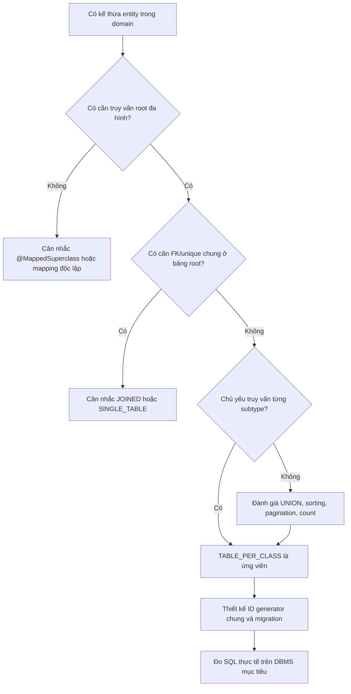

# Kế thừa thực thể với TABLE_PER_CLASS trong Hibernate

Khi một hệ thống Java có nhiều lớp entity cùng kế thừa một lớp cha, Hibernate phải quyết định cách ánh xạ **một cây kế thừa trong bộ nhớ** xuống **các bảng quan hệ**. JPA cung cấp chiến lược `InheritanceType.TABLE_PER_CLASS`: **mỗi entity class cụ thể có bảng riêng, và bảng đó chứa cả các cột kế thừa từ lớp cha**.

Chiến lược này hợp lý khi các loại thực thể có phần dữ liệu chung nhưng vẫn cần bảng độc lập cho từng loại. Đổi lại, khi truy vấn qua kiểu cha, Hibernate thường phải hợp nhất dữ liệu từ nhiều bảng bằng SQL `UNION ALL` (hoặc dạng SQL tương đương). Điều đó ảnh hưởng đến cách sinh ID, khả năng tạo foreign key chung, hiệu năng truy vấn đa hình và việc thay đổi schema.

Bài học phân tích đầy đủ các khía cạnh ấy với một mô hình thanh toán gồm hai loại: thanh toán bằng thẻ và chuyển khoản ngân hàng.

## 1. Từ kế thừa Java đến kế thừa entity

Giả sử hai loại thanh toán có các thuộc tính chung:

- ID của lần thanh toán.
- Mã tham chiếu nghiệp vụ.
- Số tiền.
- Thời điểm tạo.
- Trạng thái thanh toán.

Mỗi loại lại có dữ liệu riêng:

- **CardPayment**: mã chấp thuận giao dịch, bốn chữ số cuối của thẻ.
- **BankTransferPayment**: mã giao dịch ngân hàng, mã ngân hàng.

Trong Java, có thể mô hình hóa:

```text
                   Payment (abstract)
                  /                   \
         CardPayment             BankTransferPayment
       authorizationCode          bankReference
       cardLastFour               bankCode
```

Kế thừa giúp dùng chung thuộc tính và hành vi Java. Nhưng quan hệ cha–con của Java không có biểu diễn trực tiếp trong mô hình quan hệ. Hibernate phải chọn một **inheritance mapping strategy**.

Ba chiến lược JPA phổ biến:

| Chiến lược | Cấu trúc bảng | Đặc điểm nổi bật |
|---|---|---|
| `SINGLE_TABLE` | Một bảng chứa mọi loại, thường có discriminator | Truy vấn đa hình thuận tiện, nhiều cột riêng của subtype có thể NULL |
| `JOINED` | Bảng cha cho thuộc tính chung, bảng con cho thuộc tính riêng | Chuẩn hóa dữ liệu, tải subtype thường cần JOIN |
| `TABLE_PER_CLASS` | Mỗi lớp entity cụ thể có bảng chứa cả thuộc tính chung lẫn riêng | Truy vấn một subtype đơn giản, truy vấn kiểu cha thường cần UNION |

Bài này tập trung vào hàng thứ ba. Một điểm dễ nhầm: `TABLE_PER_CLASS` **không có nghĩa mỗi lớp trong hierarchy chắc chắn có bảng**, mà mỗi **concrete entity class** cần bảng lưu những instance của nó. Nếu lớp cha `Payment` là abstract, không có instance trực tiếp của lớp cha cần lưu trong bảng `payments`. Nếu lớp cha là concrete entity, nó cũng có thể có bảng riêng để lưu các bản ghi thuộc chính lớp ấy.

## 2. Cú pháp khai báo `@Inheritance(strategy = TABLE_PER_CLASS)`

Annotation `@Inheritance` được khai báo trên **entity gốc của hierarchy**:

```java
import jakarta.persistence.Entity;
import jakarta.persistence.Inheritance;
import jakarta.persistence.InheritanceType;

@Entity
@Inheritance(strategy = InheritanceType.TABLE_PER_CLASS)
public abstract class Payment {
    // Các thuộc tính chung của hierarchy
}
```

Các subtype đánh dấu `@Entity` và kế thừa `Payment`:

```java
@Entity
@Table(name = "card_payments")
public class CardPayment extends Payment {
    // Thuộc tính riêng của thanh toán thẻ
}

@Entity
@Table(name = "bank_transfer_payments")
public class BankTransferPayment extends Payment {
    // Thuộc tính riêng của chuyển khoản
}
```

Hibernate nhận ra đây là cùng một **entity inheritance hierarchy**. Vì thế `Payment` có thể là kiểu đầu vào của HQL, API truy vấn và association ở mức ORM, dù mỗi subtype có bảng vật lý riêng.

**Không cần lặp `@Inheritance` ở từng subclass.** Chiến lược được quyết định ở root entity của hierarchy.

### Có cần `@DiscriminatorColumn` không?

Với `SINGLE_TABLE`, discriminator có vai trò phân biệt loại entity trong **một bảng chung**. Với `TABLE_PER_CLASS`, loại entity được nhận diện trước hết từ **bảng cụ thể** chứa hàng. Khi chạy truy vấn đa hình dạng UNION, Hibernate có thể tạo thêm cột phân biệt loại **trong kết quả SQL tổng hợp** để biết một dòng thuộc subclass nào.

Cột phân biệt đó có thể là biểu thức hay giá trị tổng hợp trong SQL, **không nên mặc định là một discriminator vật lý được lưu trong từng bảng** như thiết kế `SINGLE_TABLE`. Vì vậy thông thường không cần đặt `@DiscriminatorColumn` cho mô hình `TABLE_PER_CLASS`.

## 3. Ví dụ entity hoàn chỉnh

Chúng ta sẽ dùng một root entity `Payment` có ID được sinh từ **sequence chung cho toàn hierarchy**. Cách chọn sequence sẽ được giải thích kỹ ở phần định danh.

### 3.1. Abstract root `Payment`

```java
package com.example.billing;

import jakarta.persistence.Column;
import jakarta.persistence.Entity;
import jakarta.persistence.EnumType;
import jakarta.persistence.Enumerated;
import jakarta.persistence.GeneratedValue;
import jakarta.persistence.GenerationType;
import jakarta.persistence.Id;
import jakarta.persistence.Inheritance;
import jakarta.persistence.InheritanceType;
import jakarta.persistence.SequenceGenerator;
import jakarta.persistence.Version;
import java.math.BigDecimal;
import java.time.Instant;
import java.util.Objects;

@Entity
@Inheritance(strategy = InheritanceType.TABLE_PER_CLASS)
@SequenceGenerator(
    name = "payment_ids",
    sequenceName = "payment_hierarchy_seq",
    allocationSize = 1
)
public abstract class Payment {

    @Id
    @GeneratedValue(
        strategy = GenerationType.SEQUENCE,
        generator = "payment_ids"
    )
    private Long id;

    @Column(name = "reference_code", nullable = false, length = 64)
    private String referenceCode;

    @Column(name = "amount", nullable = false, precision = 15, scale = 2)
    private BigDecimal amount;

    @Column(name = "created_at", nullable = false)
    private Instant createdAt;

    @Enumerated(EnumType.STRING)
    @Column(name = "status", nullable = false, length = 24)
    private PaymentStatus status;

    @Version
    private long version;

    protected Payment() {}

    protected Payment(String referenceCode, BigDecimal amount) {
        this.referenceCode = Objects.requireNonNull(referenceCode);
        this.amount = Objects.requireNonNull(amount);
        this.createdAt = Instant.now();
        this.status = PaymentStatus.PENDING;
    }

    public Long getId() { return id; }
    public String getReferenceCode() { return referenceCode; }
    public BigDecimal getAmount() { return amount; }
    public Instant getCreatedAt() { return createdAt; }
    public PaymentStatus getStatus() { return status; }

    public void markCompleted() {
        this.status = PaymentStatus.COMPLETED;
    }
}

enum PaymentStatus {
    PENDING, COMPLETED, FAILED
}
```

Các điểm cần chú ý:

- `@Entity` trên `Payment` giúp Hibernate coi nó là **entity type** và hỗ trợ truy vấn đa hình theo `Payment`.
- `abstract` có nghĩa ứng dụng không tạo trực tiếp `new Payment(...)`. Chỉ các subtype cụ thể được khởi tạo.
- Các thuộc tính `id`, `referenceCode`, `amount`, `createdAt`, `status` và `version` là **thuộc tính kế thừa** được đưa vào mapping của bảng mỗi subtype.
- `@Version` cho phép optimistic locking cho từng entity cụ thể khi thay đổi.
- `@SequenceGenerator` được khai báo ở root để các subtype dùng **một nguồn sinh ID chung**.

Tên bảng và cột thực tế được quyết định bởi mapping cùng naming strategy; các câu SQL minh họa trong bài cố ý dùng tên đã nêu tường minh.

### 3.2. Subtype thanh toán thẻ

```java
package com.example.billing;

import jakarta.persistence.Column;
import jakarta.persistence.Entity;
import jakarta.persistence.Table;
import java.math.BigDecimal;
import java.util.Objects;

@Entity
@Table(name = "card_payments")
public class CardPayment extends Payment {

    @Column(name = "authorization_code", nullable = false, length = 80)
    private String authorizationCode;

    @Column(name = "card_last_four", nullable = false, length = 4)
    private String cardLastFour;

    protected CardPayment() {}

    public CardPayment(
        String referenceCode,
        BigDecimal amount,
        String authorizationCode,
        String cardLastFour
    ) {
        super(referenceCode, amount);
        this.authorizationCode =
            Objects.requireNonNull(authorizationCode);
        this.cardLastFour = Objects.requireNonNull(cardLastFour);
    }

    public String getAuthorizationCode() {
        return authorizationCode;
    }

    public String getCardLastFour() {
        return cardLastFour;
    }
}
```

Bảng `card_payments` có cả các cột chung kế thừa từ `Payment` và các cột riêng `authorization_code`, `card_last_four`.

### 3.3. Subtype chuyển khoản ngân hàng

```java
package com.example.billing;

import jakarta.persistence.Column;
import jakarta.persistence.Entity;
import jakarta.persistence.Table;
import java.math.BigDecimal;
import java.util.Objects;

@Entity
@Table(name = "bank_transfer_payments")
public class BankTransferPayment extends Payment {

    @Column(name = "bank_reference", nullable = false, length = 100)
    private String bankReference;

    @Column(name = "bank_code", nullable = false, length = 24)
    private String bankCode;

    protected BankTransferPayment() {}

    public BankTransferPayment(
        String referenceCode,
        BigDecimal amount,
        String bankReference,
        String bankCode
    ) {
        super(referenceCode, amount);
        this.bankReference =
            Objects.requireNonNull(bankReference);
        this.bankCode = Objects.requireNonNull(bankCode);
    }

    public String getBankReference() {
        return bankReference;
    }

    public String getBankCode() {
        return bankCode;
    }
}
```

Bảng `bank_transfer_payments` cũng chứa các cột chung cùng các cột riêng `bank_reference` và `bank_code`. **Không có bảng `payments` bắt buộc để lưu phần chung** trong ví dụ root abstract này.

## 4. Lược đồ quan hệ được tạo ra

Có thể hình dung Hibernate/DDL migration tạo ra:

```sql
-- DDL minh họa theo cú pháp gần PostgreSQL.
create sequence payment_hierarchy_seq
start with 1
increment by 1;

create table card_payments (
    id bigint primary key,
    reference_code varchar(64) not null,
    amount numeric(15, 2) not null,
    created_at timestamp not null,
    status varchar(24) not null,
    version bigint not null,
    authorization_code varchar(80) not null,
    card_last_four varchar(4) not null
);

create table bank_transfer_payments (
    id bigint primary key,
    reference_code varchar(64) not null,
    amount numeric(15, 2) not null,
    created_at timestamp not null,
    status varchar(24) not null,
    version bigint not null,
    bank_reference varchar(100) not null,
    bank_code varchar(24) not null
);
```

SQL trên chỉ giải thích **hình dạng schema**; Hibernate có thể sinh SQL khác tùy dialect, naming strategy, JDBC type mapping, timezone configuration và phiên bản. Ví dụ `Instant` có thể được ánh xạ tới kiểu timestamp với mức hỗ trợ timezone khác nhau.

Hai bảng độc lập:

| Cột | `card_payments` | `bank_transfer_payments` |
|---|---|---|
| `id` | PK | PK |
| `reference_code` | Có | Có |
| `amount` | Có | Có |
| `created_at` | Có | Có |
| `status` | Có | Có |
| `version` | Có | Có |
| `authorization_code` | Có | Không |
| `card_last_four` | Có | Không |
| `bank_reference` | Không | Có |
| `bank_code` | Không | Có |

**Các cột chung bị lặp lại ở mỗi bảng con.** Đây là bản chất của `TABLE_PER_CLASS`, không phải lỗi chuẩn hóa do code generator.

### Ví dụ dữ liệu

`card_payments`:

| id | reference_code | amount | status | authorization_code |
|---:|---|---:|---|---|
| 101 | `PAY-CARD-001` | 129000 | `COMPLETED` | `AUTH-111` |
| 103 | `PAY-CARD-002` | 259000 | `PENDING` | `AUTH-222` |

`bank_transfer_payments`:

| id | reference_code | amount | status | bank_reference |
|---:|---|---:|---|---|
| 102 | `PAY-BANK-001` | 99000 | `COMPLETED` | `BANK-TXN-1` |
| 104 | `PAY-BANK-002` | 499000 | `PENDING` | `BANK-TXN-2` |

Giá trị ID **101, 102, 103, 104 không trùng nhau giữa các bảng**. Điều này không phải do DB có một `PRIMARY KEY` chung xuyên hai bảng; nó là một invariant thiết kế cần được hỗ trợ bởi **cơ chế sinh identifier toàn hierarchy**.

## 5. Vì sao `TABLE_PER_CLASS` cần ID duy nhất toàn hierarchy?

Trong thiết kế `SINGLE_TABLE`, chỉ một bảng có primary key. Với `JOINED`, bảng root có primary key và các bảng con chia sẻ giá trị FK/PK tương ứng. Nhưng trong `TABLE_PER_CLASS`, **mỗi bảng cụ thể có primary key riêng**.

Vấn đề nảy sinh nếu cả hai bảng đều có ID = 10:

```text
card_payments.id = 10
bank_transfer_payments.id = 10
```

Khi truy vấn `Payment` theo ID, Hibernate phải biết dòng đó thuộc subtype nào. Một hierarchy có **ID trùng giữa các concrete tables** sẽ tạo ra sự mơ hồ cho định danh đa hình, dù từng bảng riêng vẫn thỏa mãn primary key của nó. Vì vậy, các entity trong hierarchy cần dùng hệ thống giá trị identifier **không trùng giữa các concrete types**.

### 5.1. Dùng một database sequence chung

Với mapping `@SequenceGenerator` trên root:

```java
@SequenceGenerator(
    name = "payment_ids",
    sequenceName = "payment_hierarchy_seq",
    allocationSize = 1
)

@Id
@GeneratedValue(
    strategy = GenerationType.SEQUENCE,
    generator = "payment_ids"
)
private Long id;
```

mỗi lần cấp ID, các subtype sử dụng cùng nguồn:

```text
payment_hierarchy_seq
        |
        +-- 101 → CardPayment
        +-- 102 → BankTransferPayment
        +-- 103 → CardPayment
        +-- 104 → BankTransferPayment
```

`allocationSize = 1` được chọn để ví dụ dễ theo dõi. Trong production, Hibernate có thể cấp phát trước các dải ID bằng pooled optimizer với `allocationSize` lớn hơn nhằm giảm round trip, nhưng cấu hình sequence thực tại DB phải tương thích với cách Hibernate cấp phát ID. Không được tự chỉnh increment hoặc optimizer mà không hiểu chiến lược generator.

### 5.2. Vì sao `GenerationType.IDENTITY` không phù hợp?

Giả sử mỗi bảng có cột auto-increment:

```sql
card_payments.id bigint generated always as identity
bank_transfer_payments.id bigint generated always as identity
```

Hai bảng có thể độc lập sinh ID = 1, ID = 2, v.v. Vì thế **không có bảo đảm duy nhất trên cả hierarchy**. Trong ánh xạ `TABLE_PER_CLASS` của Hibernate, identity-column generation nhìn chung không được hỗ trợ cho định danh chung của hierarchy (thường gặp lỗi liên quan union-subclass/identity generator nếu cố dùng).

Nên dùng một **sequence chung** trên DBMS hỗ trợ, hoặc một **table-based identifier generator chung** khi môi trường đòi hỏi, với đánh đổi hiệu năng và mức độ tranh chấp.

`GenerationType.AUTO` có thể cho phép Hibernate chọn generator tùy dialect và cấu hình, nhưng nếu cần kiểm soát chắc chắn thiết kế này, việc khai báo rõ generator chung sẽ dễ vận hành hơn.

### 5.3. PK riêng không bảo vệ uniqueness xuyên bảng

Ngay cả khi mỗi bảng có:

```sql
primary key (id)
```

database **không tự có một unique constraint xuyên nhiều bảng**. Một hệ thống ETL hoặc lệnh SQL trực tiếp có thể ghi duplicate ID giữa các bảng nếu không sử dụng generator hoặc quy tắc cấp ID chung.

Đây là lý do `TABLE_PER_CLASS` đòi hỏi kỷ luật dữ liệu: Hibernate generator có thể đảm bảo các lần insert qua ORM dùng nguồn chung, nhưng tất cả đường ghi khác cũng phải tuân thủ invariant này.

## 6. Persist các subtype: Hibernate chọn bảng theo kiểu thực thể cụ thể

Lưu hai loại entity trong một transaction:

```java
import java.math.BigDecimal;
import org.hibernate.Session;
import org.hibernate.Transaction;

try (Session session = sessionFactory.openSession()) {
    Transaction tx = session.beginTransaction();

    try {
        CardPayment card = new CardPayment(
            "PAY-CARD-001",
            new BigDecimal("129000.00"),
            "AUTH-111",
            "1234"
        );

        BankTransferPayment transfer = new BankTransferPayment(
            "PAY-BANK-001",
            new BigDecimal("99000.00"),
            "BANK-TXN-1",
            "VCB"
        );

        session.persist(card);
        session.persist(transfer);

        tx.commit();
    } catch (RuntimeException ex) {
        if (tx.isActive()) {
            tx.rollback();
        }
        throw ex;
    }
}
```

Về mặt câu SQL, Hibernate có thể thực hiện các bước tương tự:

```sql
-- Tạo hai ID khác nhau từ cùng sequence.
select nextval('payment_hierarchy_seq');
select nextval('payment_hierarchy_seq');

-- Mỗi subtype được INSERT vào bảng tương ứng.
insert into card_payments (
    id, reference_code, amount, created_at, status, version,
    authorization_code, card_last_four
) values (?, ?, ?, ?, ?, ?, ?, ?);

insert into bank_transfer_payments (
    id, reference_code, amount, created_at, status, version,
    bank_reference, bank_code
) values (?, ?, ?, ?, ?, ?, ?, ?);
```

SQL trên chỉ minh họa. Hibernate có thể dùng cú pháp lấy sequence khác theo dialect, có thể cấp phát trước ID hoặc gom lệnh insert thành batch phù hợp. Điều ổn định về mặt ý nghĩa là: **CardPayment vào `card_payments`, BankTransferPayment vào `bank_transfer_payments`, không cần insert thêm một row `payments` chung.**

### Update và delete

Khi đã có ID và kiểu entity:

```java
CardPayment payment =
    session.find(CardPayment.class, cardPaymentId);

payment.markCompleted();
```

Lệnh UPDATE phát sinh khi flush thường nhắm tới **chỉ bảng `card_payments`**. Tương tự, xóa một `BankTransferPayment` cụ thể thường DELETE từ `bank_transfer_payments`.

Đối với một entity managed:

- Hibernate theo dõi state theo cơ chế persistence context.
- `@Version` giúp optimistic locking trong bảng subtype tương ứng.
- Rollback/commit do transaction điều phối; không có transaction vật lý riêng cho mỗi bảng chỉ vì dùng inheritance.
- Cascade với association của subtype tuân theo mapping và thứ tự SQL cụ thể, không phải do `TABLE_PER_CLASS` tự quyết định.

## 7. Truy vấn một subtype cụ thể

Khi HQL truy vấn subtype:

```java
List<CardPayment> cards = session.createSelectionQuery("""
        select c
        from CardPayment c
        where c.status = :status
        order by c.createdAt desc
        """, CardPayment.class)
    .setParameter("status", PaymentStatus.COMPLETED)
    .getResultList();
```

Hibernate biết chỉ cần bảng `card_payments`. SQL minh họa:

```sql
select
    c.id, c.reference_code, c.amount, c.created_at,
    c.status, c.version, c.authorization_code, c.card_last_four
from card_payments c
where c.status = ?
order by c.created_at desc;
```

Các thuộc tính kế thừa như `status` và `createdAt` vẫn có thể được tham chiếu trong HQL của subtype, vì chúng là thành phần mapping của `CardPayment`.

Đây là trường hợp `TABLE_PER_CLASS` có thể thuận lợi: truy vấn tập trung vào một subtype thường chỉ cần **một bảng chứa toàn bộ thuộc tính của entity**, không có JOIN qua bảng cha như `JOINED`.

### Tải bằng ID và kiểu subtype

```java
CardPayment card = session.find(CardPayment.class, 101L);
```

Nếu biết cụ thể `CardPayment.class`, Hibernate có thể truy cập bảng subtype trực tiếp. Điều này cũng giải thích tại sao API và repository tách theo subtype có thể đơn giản và dễ tối ưu.

## 8. Truy vấn đa hình qua root `Payment`

Điểm khác biệt lớn của `TABLE_PER_CLASS` xuất hiện khi ứng dụng không biết trước một thanh toán thuộc subtype nào.

HQL:

```java
List<Payment> payments = session.createSelectionQuery("""
        select p
        from Payment p
        where p.status = :status
        order by p.createdAt desc
        """, Payment.class)
    .setParameter("status", PaymentStatus.COMPLETED)
    .getResultList();
```

Vì `Payment` là entity root abstract, Hibernate hiểu rằng câu này cần lấy **các concrete subtype** phù hợp. Nhưng không có bảng `payments` chung để SELECT. Một cách triển khai phổ biến là dùng **UNION ALL**:

```sql
-- SQL mô phỏng cấu trúc để giải thích, không phải output cố định.
select p.*
from (
    select
        c.id,
        c.reference_code,
        c.amount,
        c.created_at,
        c.status,
        c.version,
        c.authorization_code,
        c.card_last_four,
        cast(null as varchar(100)) as bank_reference,
        cast(null as varchar(24))  as bank_code,
        1 as entity_type
    from card_payments c

    union all

    select
        b.id,
        b.reference_code,
        b.amount,
        b.created_at,
        b.status,
        b.version,
        cast(null as varchar(80)) as authorization_code,
        cast(null as varchar(4))  as card_last_four,
        b.bank_reference,
        b.bank_code,
        2 as entity_type
    from bank_transfer_payments b
) p
where p.status = ?
order by p.created_at desc;
```

Các ý nghĩa cần rút ra:

1. **Mỗi nhánh SELECT đọc một bảng subtype.**
2. **Các cột chung xuất hiện ở cả hai nhánh**, do đã được sao chép vật lý trong từng bảng.
3. **Cột chỉ có ở subtype A** được thay bằng biểu thức `NULL` có kiểu tương thích ở nhánh subtype B, và ngược lại.
4. Một biểu thức phân biệt subtype (ví dụ `entity_type`) giúp Hibernate biết cần dựng loại đối tượng nào từ từng dòng.
5. `UNION ALL` ghép các dòng của các nhánh mà không thực hiện thao tác loại trùng theo toàn bộ cột như `UNION` thông thường.
6. `where`, `order by` và phân trang có thể được dịch/đẩy xuống theo nhiều cấu trúc SQL khác nhau; database optimizer quyết định phương án thực thi.

Hibernate có thể render SQL khác về alias, ép kiểu `NULL`, vị trí predicate, alias của cột phân biệt loại và cú pháp pagination. Ví dụ trên giúp hình dung **bản chất hợp nhất nhiều bảng**, không dùng để kiểm thử snapshot SQL byte-for-byte.

### Đối tượng Java sau khi truy vấn đa hình

```java
for (Payment payment : payments) {
    System.out.println(payment.getReferenceCode());

    if (payment instanceof CardPayment card) {
        System.out.println(card.getCardLastFour());
    } else if (payment instanceof BankTransferPayment transfer) {
        System.out.println(transfer.getBankReference());
    }
}
```

Mỗi dòng SQL được Hibernate diễn giải thành **đúng concrete entity type** dựa trên metadata subtype. Không tạo một instance trực tiếp của lớp `Payment` abstract.

### Root entity không abstract thì sao?

Nếu `Payment` là concrete entity (có constructor và có thể được persist), hierarchy `TABLE_PER_CLASS` có thể có **một bảng cho chính `Payment`** ngoài các bảng subtype. Khi chạy query đa hình, Hibernate phải xét cả những row thuộc root concrete. Trong bài, root abstract giúp tách hai loại thanh toán rõ và tránh một bảng root độc lập không cần thiết.

## 9. `UNION ALL` và tác động đến hiệu năng

Một truy vấn `select p from Payment p` trên hai bảng nhỏ có thể chạy rất nhanh. Nhưng khi hierarchy có 12 subtype và mỗi bảng chứa hàng triệu row, query đa hình phải đối mặt với nhiều nguồn dữ liệu hơn.

Các yếu tố ảnh hưởng:

| Tình huống | Tác động có thể xảy ra |
|---|---|
| Đọc tất cả Payment | Phải xét nhiều concrete tables |
| Filter trên thuộc tính chung như `status` | Mỗi bảng cần xử lý điều kiện tương ứng |
| `ORDER BY createdAt` toàn hierarchy | Có thể cần hợp nhất và sắp xếp dữ liệu từ nhiều nhánh |
| Phân trang toàn bộ thanh toán | Database có thể phải đánh giá nhiều nhánh trước khi chọn page cuối |
| `COUNT` tất cả Payment | Cần tổng hợp dữ liệu từ nhiều bảng, tùy SQL translator và optimizer |
| Thêm subtype mới | Query đa hình có thể có thêm nhánh, schema/migration tăng |
| Chỉ truy vấn CardPayment | Có thể đọc trực tiếp một bảng, không cần UNION các subtype khác |

### 9.1. Chỉ mục cho thuộc tính chung cần có trên nhiều bảng

Giả sử màn hình thường tìm thanh toán đã hoàn tất theo thời gian:

```hql
select p
from Payment p
where p.status = :status
order by p.createdAt desc
```

Với `TABLE_PER_CLASS`, các cột `status` và `created_at` nằm ở **mọi bảng subtype**. Nếu workload cần index, thường phải xem xét index tương ứng trên từng concrete table:

```sql
-- SQL minh họa; tối ưu index phải đo theo DBMS và dữ liệu.
create index idx_card_status_created
on card_payments (status, created_at);

create index idx_bank_status_created
on bank_transfer_payments (status, created_at);
```

Không có một index chung trải xuyên hai bảng độc lập mà optimizer luôn dùng như một index của bảng `payments` đơn. Một index thích hợp cho từng bảng vẫn chưa bảo đảm query UNION có global sort rẻ; hãy phân tích execution plan.

### 9.2. Phân trang trên root cần thứ tự ổn định

```java
List<Payment> page = session.createSelectionQuery("""
        select p
        from Payment p
        order by p.createdAt desc, p.id desc
        """, Payment.class)
    .setFirstResult(0)
    .setMaxResults(20)
    .getResultList();
```

Thứ tự gồm `createdAt` và `id` giúp phân biệt các thanh toán có cùng thời gian. Điều này thuận tiện vì ID được thiết kế unique trong toàn hierarchy.

Tuy nhiên, database có thể phải xét nhiều nhánh trước khi lấy 20 dòng mới nhất. Offset pagination sâu càng có thể tốn kém. Đối với feed lớn, cân nhắc keyset pagination hoặc bảng index/registry chung nếu nghiệp vụ cần truy vấn đa hình thường xuyên; mọi lựa chọn phải được đo trên DB thật.

### 9.3. Tổng hợp thống kê

HQL:

```hql
select count(p)
from Payment p
where p.status = :status
```

có thể được chuyển thành một truy vấn trên UNION hoặc phương thức tổng hợp tương đương do SQL translator tạo ra. Vì thông tin nằm ở nhiều bảng, database thường phải đọc hoặc truy cập chỉ mục liên quan tới từng subtype. Đừng giả định `COUNT` đa hình có cùng chi phí với một `COUNT(*)` trên bảng duy nhất.

Nếu một báo cáo chỉ cần tổng doanh thu và trạng thái thanh toán theo ngày, có thể cân nhắc thiết kế projection, reporting table hoặc vật liệu hóa dữ liệu phù hợp, thay vì luôn hydrate đầy đủ entity.

## 10. HQL `TYPE` và `TREAT` với hierarchy TABLE_PER_CLASS

Hibernate hỗ trợ các biểu thức đa hình trong HQL/JPQL.

### 10.1. Lọc subtype bằng `TYPE`

Có thể diễn đạt:

```hql
select p
from Payment p
where type(p) = CardPayment
```

`type(p)` biểu diễn **kiểu entity** của biểu thức entity, không phải một cột `status` do ứng dụng định nghĩa. Hibernate có thể dùng kiến thức về hierarchy để giới hạn nhánh cần truy vấn hoặc tạo predicate tương ứng.

Nếu biết chắc kiểu cần truy vấn là `CardPayment`, thường đơn giản hơn khi viết trực tiếp:

```hql
select c from CardPayment c
```

Lúc đó kiểu trả về rõ và Hibernate thường không cần xây query đa hình qua root.

### 10.2. Truy cập thuộc tính riêng bằng `TREAT`

`Payment` không có thuộc tính `authorizationCode`. Chỉ `CardPayment` mới có. Khi cần biểu diễn logic subtype trong một truy vấn đa hình, HQL hỗ trợ `treat(...)` trong những dạng expression/join được phiên bản Hibernate hỗ trợ.

Ví dụ ý tưởng:

```hql
select p
from Payment p
where type(p) = CardPayment
```

Sau đó ứng dụng có thể làm việc với kết quả subtype. Với truy vấn phức tạp muốn truy cập trực tiếp `authorizationCode`, có thể dùng `TREAT` theo cú pháp được phiên bản Hibernate hiện tại hỗ trợ. Tránh ép kiểu tên property bằng cách viết `p.authorizationCode` trên root `Payment` khi root không định nghĩa field đó; semantic query parser có thể báo lỗi.

Các dạng `TYPE/TREAT` nên được kiểm thử trên version/dialect thực tế, vì cách dịch subtype restriction và SQL AST có thể thay đổi theo cấu trúc hierarchy và loại truy vấn.

## 11. `@MappedSuperclass` có thay thế root `@Entity` không?

Một lớp cha Java có thuộc tính chung có thể được ánh xạ bằng `@MappedSuperclass`:

```java
@MappedSuperclass
public abstract class BasePaymentFields {
    @Id
    private Long id;

    @Column(nullable = false)
    private BigDecimal amount;
}
```

Khi hai `@Entity` kế thừa một mapped superclass, các thuộc tính chung cũng có thể được đưa vào bảng cụ thể. **Nhưng `@MappedSuperclass` không phải entity type có identity/polymorphic query riêng.**

Nghĩa là:

- Có thể ánh xạ các field chung từ mapped superclass.
- Không thể dùng HQL `from BasePaymentFields` như truy vấn entity root đa hình chuẩn.
- Không thể dùng `Session.find(BasePaymentFields.class, id)` như với một entity.
- Associations target một mapped superclass không hoạt động như target một entity root.

Ngược lại, ở `TABLE_PER_CLASS`, `Payment` là **`@Entity` root**. Đây là lý do `select p from Payment p` có ngữ nghĩa đa hình và Hibernate có thể xây UNION các concrete entity tables.

### So sánh nhanh

| Cách khai báo lớp cha | Có entity metadata? | Truy vấn đa hình theo lớp cha? | Thuộc tính chung xuất hiện ở bảng con? |
|---|---|---|---|
| `@MappedSuperclass` | Không phải entity | Không | Có |
| `@Entity + @Inheritance(TABLE_PER_CLASS)` | Có | Có | Có |
| Interface Java thuần | Không tự có ORM metadata | Không tự động | Phải ánh xạ ở entity cụ thể |

`@MappedSuperclass` phù hợp khi chỉ muốn **tái sử dụng mapping**, không cần bản thân lớp cha đóng vai trò entity đa hình. Nếu cần truy vấn và quản lý `Payment` như một family entity, `TABLE_PER_CLASS` là một lựa chọn hợp lệ nhưng có trade-off đã nêu.

## 12. `TABLE_PER_CLASS` và tính toàn vẹn của khóa nghiệp vụ

Một cột chung như `reference_code` xuất hiện trong mọi bảng subtype. Nếu đánh dấu:

```java
@Column(name = "reference_code", unique = true)
private String referenceCode;
```

Hibernate có thể sinh unique constraint trên cột của **mỗi concrete table**. Nhưng unique riêng ở `card_payments.reference_code` và unique riêng ở `bank_transfer_payments.reference_code` **không cấm** cùng một mã xuất hiện ở cả hai bảng.

Ví dụ:

```text
card_payments.reference_code          = PAY-001
bank_transfer_payments.reference_code = PAY-001
```

Cả hai unique constraints từng bảng vẫn có thể được thỏa mãn.

Nếu domain đòi hỏi `referenceCode` **duy nhất trên mọi loại Payment**, cần một cơ chế chung thực sự, chẳng hạn:

- Bảng registry chung quản lý reference code và id bằng constraint unique, với transaction thiết kế đúng.
- Cơ chế cấp mã toàn cục không lặp, được bảo vệ trước các đường ghi đồng thời.
- Một inheritance strategy có bảng root chung nếu global uniqueness và referential integrity xuyên hierarchy là yêu cầu trung tâm.

**Kiểm tra trùng bằng SELECT trước khi INSERT** không thay thế unique constraint trong môi trường concurrent requests. Nếu cần unique tuyệt đối, phải thiết kế bảo vệ ở tầng dữ liệu.

## 13. Association trỏ tới root entity gặp khó khăn gì?

Giả sử một hóa đơn cần tham chiếu một thanh toán bất kể subtype:

```java
@ManyToOne(fetch = FetchType.LAZY)
private Payment payment;
```

Đây là mô hình **polymorphic association**. Về phía Java, Hibernate biết `Payment` là entity root, nhưng ở database không có bảng `payments` chung để làm **một mục tiêu foreign key vật lý**.

Một foreign key thông thường có dạng:

```sql
foreign key (payment_id) references some_table(id)
```

Nhưng dữ liệu Payment có thể nằm ở `card_payments` **hoặc** `bank_transfer_payments`. Database không thể đặt một FK tiêu chuẩn tới “UNION của hai bảng” như một bảng duy nhất.

Vì vậy, nếu hệ thống cần nhiều bảng khác tham chiếu chung tới `Payment` bằng FK có thể được DBMS kiểm tra, `TABLE_PER_CLASS` có bất lợi lớn:

- Không có parent table duy nhất để làm FK target.
- Phần join/fetch đa hình có thể cần SQL phức tạp hoặc gặp giới hạn mapping tùy phiên bản.
- Việc bảo vệ referential integrity xuyên subtype đòi hỏi cách thiết kế bổ sung.

Không nên cứ viết `@ManyToOne Payment` rồi mặc định có một FK chuẩn được tạo. Hãy xác minh Hibernate mapping hỗ trợ đường association đang dùng và kiểm tra DDL thực. Nếu polymorphic FK thực sự quan trọng, `JOINED` hoặc `SINGLE_TABLE` thường dễ bảo vệ bằng constraint quan hệ hơn vì có bảng root chung.

### Khi association chỉ hướng tới một subtype

Nếu một bảng chỉ tham chiếu `CardPayment`:

```java
@ManyToOne(fetch = FetchType.LAZY)
@JoinColumn(name = "card_payment_id")
private CardPayment cardPayment;
```

database có một bảng `card_payments` cụ thể để làm FK target. Điều này dễ mô hình hóa hơn so với một tham chiếu đa hình tới root `Payment`.

## 14. Kế thừa và constraint ở từng bảng con

Một lợi ích của `TABLE_PER_CLASS` là mỗi bảng chứa tất cả cột cần thiết của subtype, nên các ràng buộc bắt buộc của subtype có thể nằm trực tiếp trong bảng đó.

Ví dụ:

```java
@Entity
@Table(name = "card_payments")
public class CardPayment extends Payment {

    @Column(name = "authorization_code", nullable = false)
    private String authorizationCode;
}
```

Ở `SINGLE_TABLE`, cột `authorization_code` nằm trong bảng chung với cả những BankTransferPayment vốn không có authorization code, nên `NOT NULL` toàn cột có thể không phù hợp. Với `TABLE_PER_CLASS`, `authorization_code` chỉ tồn tại ở `card_payments` nên có thể dùng `NOT NULL` bình thường.

Tương tự, các check constraints dành riêng cho subtype có thể đặt ở bảng tương ứng:

```sql
alter table card_payments
add constraint chk_card_last_four
check (char_length(card_last_four) = 4);
```

Đây chỉ là ví dụ ràng buộc schema; cú pháp và hàm `char_length` phụ thuộc DBMS. Phải cân nhắc business validation ở Java và migration cho DB.

### Constraint chung bị lặp giữa các bảng

Nếu muốn mọi Payment có `amount >= 0`, mỗi concrete table phải được bảo vệ:

```sql
alter table card_payments
add constraint chk_card_amount_nonnegative
check (amount >= 0);

alter table bank_transfer_payments
add constraint chk_bank_amount_nonnegative
check (amount >= 0);
```

Một constraint trên bảng `card_payments` **không thể bảo vệ** dữ liệu trong `bank_transfer_payments`. Mỗi khi thêm subtype, migration cần tạo lại các bất biến chung thích hợp cho bảng mới.

## 15. Thêm thuộc tính ở lớp cha có thể thay đổi nhiều bảng

Giả sử đội phát triển thêm vào `Payment`:

```java
@Column(name = "currency_code", nullable = false, length = 3)
private String currencyCode;
```

Trong `TABLE_PER_CLASS`, **mọi concrete table** cần cột `currency_code`:

```sql
alter table card_payments
add column currency_code varchar(3);

alter table bank_transfer_payments
add column currency_code varchar(3);
```

Nếu đã có dữ liệu lịch sử, quy trình migration có thể cần:

1. Thêm cột tạm nullable.
2. Backfill giá trị cho các hàng cũ ở **từng bảng**.
3. Kiểm tra không còn dữ liệu thiếu.
4. Đổi cột sang `NOT NULL`.
5. Cập nhật index/constraints hoặc biểu thức SQL liên quan.

Không thể chỉ thêm field Java rồi mặc định production đã đồng bộ schema. `hibernate.hbm2ddl.auto=update` cũng không thay thế quy trình migration có kiểm soát đối với thay đổi dữ liệu, constraint và nghiệp vụ.

Việc lặp cấu trúc giữa nhiều bảng là một **chi phí bảo trì dài hạn** của `TABLE_PER_CLASS`. Nếu thuộc tính chung thay đổi thường xuyên hoặc có nhiều subtype, chi phí này đáng được cân nhắc ngay khi chọn chiến lược.

## 16. Optimistic locking và transaction

`@Version` đặt ở root `Payment` được ánh xạ vào từng concrete table. Một `CardPayment` có `version` lưu tại `card_payments.version`, còn `BankTransferPayment` có `version` ở bảng chuyển khoản.

Ví dụ:

```java
CardPayment card =
    session.find(CardPayment.class, paymentId);

card.markCompleted();
```

Hibernate có thể tạo SQL UPDATE minh họa:

```sql
update card_payments
set status = ?, version = ?
where id = ? and version = ?;
```

Tác dụng: phát hiện concurrent updates tranh chấp cùng hàng CardPayment theo version. **Không có một hàng root chung chứa version của toàn Payment hierarchy**.

Transaction vẫn cần được mở/commit/rollback đúng cách:

```java
try (Session session = sessionFactory.openSession()) {
    Transaction tx = session.beginTransaction();

    try {
        CardPayment card =
            session.find(CardPayment.class, paymentId);

        card.markCompleted();
        tx.commit();
    } catch (RuntimeException ex) {
        if (tx.isActive()) {
            tx.rollback();
        }
        throw ex;
    }
}
```

Nếu câu query của bạn sửa nhiều loại Payment bằng bulk HQL, hãy nhớ bulk mutation có semantics khác entity dirty checking và có thể ảnh hưởng persistence context. Không coi bulk update đa hình là một UPDATE duy nhất lên bảng root vì root abstract không có bảng chung.

## 17. Bulk update/delete trên hierarchy cần được hiểu riêng

Xét một tác vụ thay đổi trạng thái nhiều Payment:

```hql
update Payment p
set p.status = :status
where p.createdAt < :cutoff
```

Đây là HQL bulk mutation nhắm tới một root đa hình. Với `TABLE_PER_CLASS`, dữ liệu nằm ở nhiều bảng cụ thể, nên Hibernate có thể cần thực hiện **nhiều statement** hoặc áp dụng một chiến lược bulk mutation phù hợp với hierarchy và dialect. Không thể mặc định nó là SQL:

```sql
update payments set status = ...
```

vì bảng `payments` chung có thể không tồn tại.

Tương tự:

```hql
delete from Payment p where p.status = :status
```

có thể liên quan nhiều concrete tables và các constraint/associations của từng loại. Kế hoạch thực thi phụ thuộc Hibernate version, temporary table strategy, dialect và query shape.

**Bulk HQL operations không duyệt qua từng managed entity như update bằng setter**, nên có thể bỏ qua entity lifecycle callbacks và không tự đồng bộ mọi managed instance đang giữ trong Session. Nếu dùng bulk update cùng entity đã được nạp, hãy quản lý `flush()/clear()`, transaction và cache invalidation phù hợp.

## 18. Đọc polymorphic query kết hợp pagination, grouping và projection

### 18.1. Projection chung

Nếu trang báo cáo chỉ cần một vài trường chung, có thể dùng constructor projection:

```java
public record PaymentRow(
    Long id,
    String referenceCode,
    BigDecimal amount,
    PaymentStatus status
) {}
```

```java
List<PaymentRow> rows = session.createSelectionQuery("""
    select new com.example.billing.PaymentRow(
        p.id, p.referenceCode, p.amount, p.status
    )
    from Payment p
    order by p.createdAt desc, p.id desc
    """, PaymentRow.class)
    .setMaxResults(50)
    .getResultList();
```

Projection có thể giảm số cột và chi phí hydrate entity, nhưng query vẫn phải hợp nhất các concrete tables khi lấy dữ liệu đa hình. Không nên suy luận DTO projection giúp tránh hoàn toàn UNION.

### 18.2. Grouping theo thuộc tính chung

HQL:

```hql
select p.status, count(p)
from Payment p
group by p.status
```

vẫn cần tổng hợp dữ liệu của mọi subtype, dù kết quả chỉ là một vài hàng. Database optimizer có thể đưa phép nhóm hoặc lọc vào các nhánh khi hợp lệ, nhưng cấu trúc SQL và cost cần được quan sát.

### 18.3. Chỉ truy vấn subtype khi biết chính xác use case

Nếu màn hình chỉ hiển thị các giao dịch thẻ thất bại:

```hql
select c
from CardPayment c
where c.status = :failedStatus
```

việc hỏi trực tiếp subtype tránh công việc đa hình không cần thiết. Đây là một lựa chọn truy vấn có cơ sở nghiệp vụ, không phải tối ưu “đổi mọi root query sang subclass” theo phản xạ.

## 19. Khi nào nên chọn `TABLE_PER_CLASS`?

Chiến lược này phù hợp hơn khi:

- Các subtype **có vòng đời và tập truy vấn khá độc lập**.
- Ứng dụng thường biết loại entity khi đọc/ghi.
- Thuộc tính chung tương đối ổn định, số subtype không quá lớn.
- Mỗi subtype cần nhiều constraint riêng, schema riêng rõ ràng.
- Ít association khác cần foreign key đa hình tới root.
- Nhu cầu thống kê hoặc phân trang trên **toàn hierarchy** không phải hot path chính.
- Có cơ chế sinh ID chung và migrations tin cậy.

Ví dụ, hệ thống xử lý các loại tài liệu khác nhau mà mỗi loại được truy cập bởi module chuyên trách, có một tập field chung nhưng ít query tổng hợp, có thể cân nhắc `TABLE_PER_CLASS`.

### Khi nào nên cân nhắc chiến lược khác?

- Dashboard phải lấy toàn bộ Payment mới nhất liên tục, có phân trang sâu và lọc nhiều chiều.
- Có rất nhiều subtype, mỗi subtype thêm một bảng vào UNION.
- Hầu hết association đều muốn tham chiếu một `Payment` chung bằng FK.
- Các invariant như business key unique phải được bảo vệ xuyên mọi loại.
- Thuộc tính chung thường xuyên thay đổi, mỗi lần phải migrate nhiều bảng.
- Database optimizer gặp vấn đề với UNION lớn, SORT hoặc aggregate xuyên bảng.

Nếu những yêu cầu đó là trọng tâm, `SINGLE_TABLE` hoặc `JOINED` có thể đơn giản hơn ở mức dữ liệu và truy vấn, mặc dù chúng có trade-off riêng.

## 20. So sánh hiệu năng và thiết kế với `SINGLE_TABLE` và `JOINED`

| Câu hỏi | `SINGLE_TABLE` | `JOINED` | `TABLE_PER_CLASS` |
|---|---|---|---|
| Có bảng root chung? | Có, chứa mọi loại | Có, chứa thuộc tính chung | Không bắt buộc nếu root abstract |
| Truy vấn mọi subtype | Một bảng, dùng discriminator | JOIN/hoặc cách tải theo subclass | Thường UNION các bảng subtype |
| Truy vấn một subtype | Một bảng với filter type | JOIN root + subclass khi cần | Một bảng subtype |
| Field chung lưu ở đâu? | Một bảng | Một bảng root | Lặp ở từng bảng subtype |
| Field riêng subtype | Các cột có thể NULL trong bảng chung | Bảng subtype | Bảng subtype |
| DB foreign key tới root | Thuận tiện | Thuận tiện | Khó vì không có root table |
| PK duy nhất toàn hierarchy | Tự nhiên vì một PK bảng | Tự nhiên từ root PK | Cần generator/thiết kế chung |
| Index field chung | Một nơi | Bảng root | Thường từng bảng subtype |
| Thêm field chung | Thường một bảng | Thường một bảng | Mọi concrete table |
| Tách quyền quản lý/partition theo subtype | Ít độc lập hơn | Có phần chung buộc phụ thuộc | Mỗi bảng subtype độc lập hơn |

Bảng này mô tả cấu trúc thông thường. Hiệu năng không thể so sánh chỉ bằng số bảng; phải xét kiểu truy vấn, indexes, bộ nhớ đệm, cardinality, mức phân mảnh dữ liệu và hành vi optimizer của database thật.

## 21. Những nhầm lẫn thường gặp

| Nhận định | Cách hiểu đúng |
|---|---|
| “TABLE_PER_CLASS tạo một bảng cha và một bảng cho mỗi con.” | Đó gần với JOINED; TABLE_PER_CLASS lặp field chung vào bảng mỗi concrete subtype. |
| “Lớp cha abstract thì không thể viết HQL từ lớp cha.” | Root có `@Entity` nên có thể truy vấn đa hình dù abstract. |
| “Chỉ dùng `@MappedSuperclass` cũng có polymorphic query.” | `@MappedSuperclass` không phải entity root truy vấn được. |
| “Mọi subtype dùng IDENTITY độc lập cũng được.” | ID có thể trùng xuyên bảng và không phù hợp invariant của TABLE_PER_CLASS; Hibernate thường không hỗ trợ IDENTITY cho union-subclass mapping. |
| “PK mỗi bảng tự đảm bảo ID unique toàn hierarchy.” | PK chỉ có phạm vi bảng; cần cơ chế cấp ID chung xuyên subtype. |
| “Query `from Payment` chỉ đọc một bảng.” | Với root abstract TABLE_PER_CLASS, thường cần UNION các bảng subtype. |
| “UNION luôn có nghĩa loại các dòng trùng.” | Hibernate thường dùng UNION ALL để hợp nhất subtype; nó không thực hiện distinct như UNION thường. |
| “Subtype filter lúc nào cũng hiệu quả như truy vấn subclass trực tiếp.” | Query shape và translator quyết định; nên dùng subclass khi use case thực sự chỉ cần subclass. |
| “`@DiscriminatorColumn` bắt buộc ở TABLE_PER_CLASS.” | Loại entity thường được suy ra từ bảng/nhánh UNION, không cần một physical discriminator trong bảng chung. |
| “Một unique constraint trên field root bảo vệ toàn hierarchy.” | Constraint vật lý của mỗi bảng không tự bảo vệ các bảng khác. |
| “Có thể đặt FK tới Payment abstract như tới một bảng thường.” | Không có một physical root table để FK thông thường trỏ tới; polymorphic association gặp hạn chế relational integrity. |
| “Thêm field chung vào Payment chỉ cần một ALTER TABLE.” | Mọi concrete table cần cột tương ứng khi schema được duy trì theo TABLE_PER_CLASS. |
| “TABLE_PER_CLASS làm mọi truy vấn chậm.” | Truy vấn một subtype có thể rất đơn giản; chi phí lớn hơn thường nằm ở truy vấn đa hình rộng. |
| “Bulk update Payment là một UPDATE lên bảng payments.” | Không có bảng root chung; multi-table mutation cần chiến lược SQL phù hợp. |

## 22. Một bài thực hành suy luận

Giả sử có ba subtype:

```text
Payment (abstract)
├── CardPayment
├── BankTransferPayment
└── WalletPayment
```

Mỗi loại có khoảng một triệu bản ghi. Ứng dụng có ba use case:

1. **Đọc giao dịch thẻ theo authorization code.**
2. **Lấy 20 Payment mới nhất trên toàn hệ thống.**
3. **Cho entity `Invoice` chứa một FK tới Payment bất kỳ.**

### Use case 1

`CardPayment` có bảng riêng, có thể đặt unique/index trên `authorization_code`, rồi truy vấn trực tiếp `from CardPayment`. Đây là tình huống `TABLE_PER_CLASS` tương đối thuận lợi.

### Use case 2

`from Payment order by createdAt desc` phải xét ba bảng; nếu số subtype/dữ liệu tăng, global sorting, pagination và việc duy trì index ở mỗi bảng trở thành phần chi phí đáng kể. Cần xem SQL và `EXPLAIN` thực tế; nếu đây là hot path, cân nhắc chiến lược lưu trữ/index chung.

### Use case 3

Invoice cần tham chiếu một Payment bất kỳ bằng FK. Vì không có một bảng Payment chung, việc tạo foreign key quan hệ tiêu chuẩn trở nên khó. Nếu đây là yêu cầu cốt lõi, `JOINED` hoặc `SINGLE_TABLE` đáng xem xét hơn.

Kết luận cho bài tập: **quyết định chiến lược kế thừa cần dựa trên truy vấn và quan hệ dữ liệu thực tế**, không chỉ dựa trên sự giống nhau của mô hình lớp Java.

## 23. Cách quan sát và chẩn đoán trên ứng dụng

### 23.1. Bật logging SQL ở môi trường phù hợp

Với Hibernate ORM 6+ trong Spring Boot, có thể dùng:

```properties
logging.level.org.hibernate.SQL=DEBUG
logging.level.org.hibernate.orm.jdbc.bind=TRACE
```

Mức TRACE cho bind parameters có thể ghi dữ liệu nhạy cảm, nên chỉ bật trong phạm vi debug có kiểm soát. Ở phiên bản Hibernate cũ, tên logger bind có thể khác.

### 23.2. So sánh hai truy vấn

Truy vấn subtype:

```hql
select c from CardPayment c where c.amount > :min
```

Truy vấn root:

```hql
select p from Payment p where p.amount > :min
```

Quan sát SQL để hiểu query root có thêm `UNION ALL` và các typed NULL cho subtype columns như thế nào. Nếu cùng workload nhưng latency khác xa, hãy kiểm tra số row mỗi bảng, index trên `amount`, sort/scan và chi phí chuyển dữ liệu.

### 23.3. Đọc execution plan của DBMS

Ví dụ PostgreSQL cung cấp:

```sql
EXPLAIN (ANALYZE, BUFFERS)
select *
from (
    select id, amount, created_at from card_payments
    union all
    select id, amount, created_at from bank_transfer_payments
) p
where amount > 100000
order by created_at desc
limit 20;
```

Đây là một truy vấn mô phỏng workload; câu SQL Hibernate tạo thực tế có thể có nhiều cột/alias và điều kiện khác. `EXPLAIN ANALYZE` có thể **thực thi truy vấn** nên với câu ghi dữ liệu phải hết sức thận trọng về transaction và tác động. Đối với SELECT minh họa, hãy xem row estimates, scans, sort, buffers và thời gian thực tế.

### 23.4. Xác minh sequence và schema

Khi persist subtype thất bại do generator:

- Xác nhận `payment_hierarchy_seq` tồn tại trong database và ứng dụng có quyền sử dụng.
- Xác nhận mọi subclass dùng cùng generator từ root.
- Kiểm tra `allocationSize` và mức increment ở sequence thực.
- Kiểm tra không có job SQL bên ngoài tự sinh ID gây collision.
- Nếu migration dữ liệu từ hệ thống cũ, bảo đảm sequence đã được điều chỉnh vượt ID lớn nhất đang tồn tại ở tất cả concrete tables.

Khi query root sai:

- Xác nhận root `Payment` có `@Entity + @Inheritance(TABLE_PER_CLASS)`.
- Xác nhận các lớp con cụ thể có `@Entity` và thuộc cùng hierarchy.
- Kiểm tra cột chung và kiểu JDBC tương thích giữa bảng con.
- Xem toàn bộ SQL/causal exception từ Hibernate và DBMS, không chỉ stack trace ở service.

## 24. Dùng TABLE_PER_CLASS trong Spring Data JPA

Một repository có thể khai báo trên root entity:

```java
public interface PaymentRepository
        extends JpaRepository<Payment, Long> {
}
```

Giả định đã có Spring Data JPA và `Payment` root mapped đúng. Các thao tác truy vấn theo root có thể sinh SQL đa hình qua UNION. Ví dụ `findAll()` trên repository root không phải SELECT từ một bảng riêng tên `payments`.

Nếu ứng dụng cần truy vấn chuyên biệt giao dịch thẻ:

```java
public interface CardPaymentRepository
        extends JpaRepository<CardPayment, Long> {

    java.util.Optional<CardPayment>
        findByAuthorizationCode(String authorizationCode);
}
```

Repository subtype giúp diễn đạt use case chỉ liên quan một bảng và có thể tận dụng chỉ mục subtype.

Khi dùng `save`, phân biệt entity mới với detached entity và transaction. Repository không sửa được hạn chế identity generation hay uniqueness toàn hierarchy; các điều đó vẫn do mapping và database quyết định.

### Phân trang với root repository

`Page<Payment>` từ một truy vấn root có thể gây ít nhất hai loại công việc database: truy vấn page và truy vấn count (tùy API/framework). Với `TABLE_PER_CLASS`, cả hai có thể phải xét nhiều tables. Nếu dashboard phân trang lớn và gọi rất thường xuyên, cần đo cả count query, không chỉ content query.

## 25. Có nên tách mỗi subtype thành service riêng?

Một vài hệ thống chọn mỗi loại thanh toán có logic và bảng riêng. TABLE_PER_CLASS có thể phối hợp với cách chia module đó, nhưng **inheritance mapping không tự tạo ranh giới transaction, microservice hay bounded context**.

Nếu mỗi service độc lập triển khai, sở hữu database riêng hoặc dùng Hibernate version khác, việc cùng chia sẻ một `Payment` entity hierarchy qua một persistence unit không còn đơn giản. Khi đó interface domain, event contracts, registry và mô hình persistence riêng cho từng service có thể hợp lý hơn. Đừng dùng `TABLE_PER_CLASS` chỉ vì kiến trúc đang đặt tên các module theo subtype.

Ngược lại, trong một ứng dụng monolith với một `SessionFactory` và một database, hierarchy `Payment` có thể là mô hình hợp lệ nếu các giới hạn về SQL UNION và global constraints chấp nhận được.

## 26. Quy trình lựa chọn TABLE_PER_CLASS

Trước khi áp dụng chiến lược, tự trả lời:

**1. Root có cần là entity đa hình không?** Nếu không bao giờ query `Payment` hoặc target association tới `Payment`, `@MappedSuperclass` có thể đủ để tái sử dụng mapping.

**2. Tỷ lệ query subtype so với query root là bao nhiêu?** Nếu truy vấn toàn hierarchy chiếm phần lớn workload, chi phí UNION cần được cân nhắc sớm.

**3. Subtype có cần bảng và constraints độc lập không?** TABLE_PER_CLASS mang lại bảng tự chứa cho mỗi concrete entity, dễ ràng buộc field riêng.

**4. Có reference/FK chung tới Payment không?** Nếu có nhiều, thiếu bảng root là hạn chế cấu trúc đáng kể.

**5. ID có được cấp chung từ một nguồn không?** Tránh IDENTITY độc lập; chọn sequence/table generator chung và quản lý các đường ghi khác.

**6. Business constraints có cần unique toàn hierarchy không?** Unique riêng từng bảng không đủ.

**7. Cột chung có thường xuyên thay đổi không?** Mỗi thay đổi có thể kéo theo migration nhiều bảng.

**8. Đã quan sát SQL/dialect thật chưa?** Một ví dụ HQL có thể sinh SQL phức tạp hơn dự kiến; đọc `EXPLAIN` và đo throughput/latency với dữ liệu thực tế.



## 27. Ghi nhớ kiến trúc bằng hai truy vấn

Với mapping:

```java
@Entity
@Inheritance(strategy = InheritanceType.TABLE_PER_CLASS)
abstract class Payment { /* id, amount, status */ }

@Entity
@Table(name = "card_payments")
class CardPayment extends Payment { /* authorizationCode */ }

@Entity
@Table(name = "bank_transfer_payments")
class BankTransferPayment extends Payment { /* bankReference */ }
```

**Khi biết subtype:**

```hql
from CardPayment c where c.status = :status
```

Hibernate thường đọc **một concrete table**.

**Khi truy vấn đa hình:**

```hql
from Payment p where p.status = :status
```

Hibernate thường phải **hợp nhất các concrete tables** thành một result set đa hình, ví dụ bằng `UNION ALL`, rồi dựng đúng subclass cho từng hàng.

Các nguyên tắc nền tảng:

- **Mỗi concrete entity có bảng chứa cả field kế thừa lẫn field riêng.**
- **Root abstract có entity metadata để truy vấn đa hình nhưng không cần bảng root lưu instance riêng.**
- **Identifier phải được cấp duy nhất xuyên hierarchy; sequence chung là lựa chọn thông dụng.**
- **Unique, CHECK và index trên thuộc tính chung có thể cần được triển khai ở mỗi bảng.**
- **Foreign key đa hình đến root khó hơn vì không có một physical root table.**
- **Query subtype thường đơn giản; query root có thể chịu chi phí UNION, sort và pagination.**
- **Metadata trong Java không thay thế schema migration và đánh giá execution plan của database.**

`TABLE_PER_CLASS` là một lựa chọn ánh xạ hợp lý khi các subtype cần dữ liệu và bảng độc lập, trong khi nhu cầu tra cứu toàn hierarchy còn đủ nhỏ hoặc đã được tối ưu. Khi lựa chọn, hãy bắt đầu từ **mối quan hệ nghiệp vụ, các câu query thực tế và yêu cầu toàn vẹn của database**, rồi quyết định chiến lược kế thừa — thay vì chọn chỉ vì cây lớp Java có nhiều nhánh.
