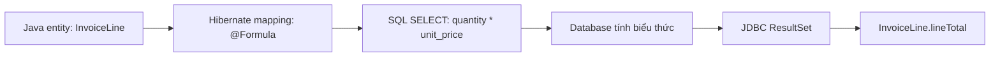

# Thuộc tính tính bằng biểu thức SQL với `@Formula` trong Hibernate

## 1. Vì sao cần một thuộc tính được tính bằng SQL?

Khi ánh xạ một bảng quan hệ thành entity Java, không phải mọi thuộc tính cần hiển thị hoặc truy vấn đều tồn tại dưới dạng một cột vật lý. Nhiều giá trị có thể được **suy ra từ những cột đã có**, chẳng hạn:

- Thành tiền của một dòng hóa đơn: `quantity * unit_price`.
- Nhóm số lượng: nếu `quantity >= 10` thì `BULK`, ngược lại là `REGULAR`.
- Tên đầy đủ: nối `first_name` và `last_name` theo cú pháp của database.
- Trạng thái được phân loại bằng biểu thức `CASE`.
- Số bản ghi liên quan, tính bằng một subquery tương quan (*correlated subquery*).

Một cách giải quyết là viết getter Java tự tính:

```java
public BigDecimal getLineTotal() {
    return unitPrice.multiply(BigDecimal.valueOf(quantity));
}
```

Cách này tốt khi giá trị chỉ cần trong Java, nhưng nếu muốn **lọc hoặc sắp xếp ngay tại database theo biểu thức**, ta có thể cần lặp lại công thức trong JPQL/SQL. Hibernate cung cấp **`@Formula`** cho trường hợp ánh xạ một thuộc tính chỉ đọc vào **biểu thức SQL**, để thuộc tính đó được tính khi Hibernate truy vấn entity.

```java
import org.hibernate.annotations.Formula;

@Formula("quantity * unit_price")
private BigDecimal lineTotal;
```

`lineTotal` không cần cột `line_total` trong bảng. Hibernate chèn biểu thức `quantity * unit_price` vào SQL đọc entity, lấy kết quả và gán cho thuộc tính Java. Thuộc tính này có thể được truy cập gần giống một basic attribute bình thường của entity.

**Điểm chính:** `@Formula` mô tả **biểu thức SQL dùng để đọc giá trị**. Nó không tạo một cột dữ liệu được lưu và không tự quản lý việc ghi ngược giá trị tính toán vào database.

## 2. `@Formula` hoạt động ở lớp nào?

`@Formula` thuộc Hibernate, với tên đầy đủ:

```java
org.hibernate.annotations.Formula
```

Đây là **extension của Hibernate ORM**, không phải annotation chuẩn `jakarta.persistence`. Ứng dụng dùng Hibernate có thể tiếp tục sử dụng các annotation Jakarta Persistence như `@Entity`, `@Id`, `@Column` và bổ sung `@Formula` tại thuộc tính cần tính bằng SQL.

Luồng đọc có thể hình dung như sau:



Ví dụ bảng `invoice_lines` có dữ liệu:

| id | description | quantity | unit_price |
|---:|---|---:|---:|
| 1 | Cáp USB-C | 3 | 89000.00 |
| 2 | Bàn phím | 12 | 750000.00 |

Không cần lưu thêm `line_total`. Khi Hibernate đọc một `InvoiceLine`, database có thể tính:

| id | quantity | unit_price | lineTotal (tính từ SQL) |
|---:|---:|---:|---:|
| 1 | 3 | 89000.00 | 267000.00 |
| 2 | 12 | 750000.00 | 9000000.00 |

Khác với một câu truy vấn trả về DTO thông thường, `@Formula` làm biểu thức trở thành **một thuộc tính trong mapping của entity**. Nhờ đó, mã đọc entity có thể gọi `getLineTotal()` mà không phải tự dựng công thức trong mọi chỗ sử dụng.

### 2.1. Thuộc tính tính toán không phải cột vật lý

Giả sử mapping:

```java
@Column(name = "unit_price")
private BigDecimal unitPrice;

@Column(name = "quantity")
private int quantity;

@Formula("unit_price * quantity")
private BigDecimal lineTotal;
```

Bảng chỉ cần `unit_price` và `quantity`; **không cần `line_total`**. Khi Hibernate sinh schema, `@Formula` không yêu cầu tạo cột theo tên field Java.

SQL Hibernate có thể phát ra tương đương:

```sql
SELECT
    il.id,
    il.unit_price,
    il.quantity,
    il.unit_price * il.quantity AS formula_value
FROM invoice_lines il
WHERE il.id = ?;
```

Đây là SQL minh họa. Alias, thứ tự các cột, cách thay thế table alias, cách cast kiểu và SQL chính xác phụ thuộc phiên bản Hibernate và dialect của database.

### 2.2. Giá trị tính ở đâu?

Giá trị được tính bởi **database khi thực thi SQL có biểu thức**. Đây không phải một công thức Java tự động tính lại mỗi lần gọi getter.

Ví dụ:

```java
InvoiceLine line = em.find(InvoiceLine.class, 1L);
BigDecimal total = line.getLineTotal();
```

Nếu Hibernate đã nạp thuộc tính formula vào entity, getter thường chỉ trả về giá trị Java đã được hydrate. Nó **không mặc nhiên gửi SQL mới mỗi lần đọc**.

Điểm khác biệt này ảnh hưởng trực tiếp đến tính mới của giá trị khi các cột đầu vào thay đổi; xem mục 7.

## 3. Ví dụ entity đầy đủ

Ta xây dựng một entity `InvoiceLine` có bốn thuộc tính lưu thật và hai thuộc tính được tính bằng `@Formula`.

### 3.1. Bảng database

Schema minh họa:

```sql
CREATE TABLE invoice_lines (
    id BIGINT GENERATED BY DEFAULT AS IDENTITY PRIMARY KEY,
    description VARCHAR(200) NOT NULL,
    quantity INTEGER NOT NULL,
    unit_price DECIMAL(19, 2) NOT NULL,
    CONSTRAINT ck_invoice_lines_quantity
        CHECK (quantity > 0),
    CONSTRAINT ck_invoice_lines_price
        CHECK (unit_price >= 0)
);
```

Cú pháp `GENERATED BY DEFAULT AS IDENTITY` và `CHECK` có thể khác giữa các hệ quản trị. Khi triển khai, sử dụng cú pháp DDL tương ứng với PostgreSQL, H2, Oracle, MySQL hoặc database thực tế.

### 3.2. Mapping bằng Hibernate

```java
package com.example.billing;

import java.math.BigDecimal;
import java.util.Objects;

import jakarta.persistence.Column;
import jakarta.persistence.Entity;
import jakarta.persistence.GeneratedValue;
import jakarta.persistence.GenerationType;
import jakarta.persistence.Id;
import jakarta.persistence.Table;

import org.hibernate.annotations.Formula;

@Entity
@Table(name = "invoice_lines")
public class InvoiceLine {

    @Id
    @GeneratedValue(strategy = GenerationType.IDENTITY)
    private Long id;

    @Column(
        name = "description",
        nullable = false,
        length = 200
    )
    private String description;

    @Column(name = "quantity", nullable = false)
    private int quantity;

    @Column(
        name = "unit_price",
        nullable = false,
        precision = 19,
        scale = 2
    )
    private BigDecimal unitPrice;

    // Không có cột "line_total" trong bảng.
    @Formula("quantity * unit_price")
    private BigDecimal lineTotal;

    // Phân loại theo biểu thức SQL.
    @Formula(
        "case when quantity >= 10 " +
        "then 'BULK' else 'REGULAR' end"
    )
    private String quantityCategory;

    protected InvoiceLine() {
        // Constructor dành cho JPA.
    }

    public InvoiceLine(
            String description,
            int quantity,
            BigDecimal unitPrice) {

        if (quantity <= 0) {
            throw new IllegalArgumentException(
                "quantity must be positive"
            );
        }
        if (unitPrice == null || unitPrice.signum() < 0) {
            throw new IllegalArgumentException(
                "unitPrice must be non-negative"
            );
        }

        this.description =
                Objects.requireNonNull(description);
        this.quantity = quantity;
        this.unitPrice = unitPrice;
    }

    public Long getId() {
        return id;
    }

    public String getDescription() {
        return description;
    }

    public int getQuantity() {
        return quantity;
    }

    public BigDecimal getUnitPrice() {
        return unitPrice;
    }

    public BigDecimal getLineTotal() {
        return lineTotal;
    }

    public String getQuantityCategory() {
        return quantityCategory;
    }

    public void changeQuantity(int nextQuantity) {
        if (nextQuantity <= 0) {
            throw new IllegalArgumentException(
                "quantity must be positive"
            );
        }
        quantity = nextQuantity;
    }

    public void changeUnitPrice(BigDecimal nextPrice) {
        if (nextPrice == null || nextPrice.signum() < 0) {
            throw new IllegalArgumentException(
                "unitPrice must be non-negative"
            );
        }
        unitPrice = nextPrice;
    }
}
```

Một số ý quan trọng:

1. `id`, `description`, `quantity` và `unitPrice` tương ứng với cột thật.
2. `lineTotal` lấy từ phép nhân hai cột ở database.
3. `quantityCategory` lấy từ biểu thức SQL `CASE`.
4. Hai thuộc tính formula **không có setter** để thể hiện rõ rằng ứng dụng không cập nhật chúng trực tiếp.
5. Entity vẫn có thể cập nhật `quantity`, `unitPrice` bằng transaction và dirty checking bình thường.
6. Kiểu Java của formula phải tương thích với kiểu giá trị do database/JDBC trả về. Với phép toán `DECIMAL`, `BigDecimal` thường là lựa chọn thích hợp.

### 3.3. Vì sao không đặt `@Column` cho `lineTotal`?

Nếu viết:

```java
@Column(name = "line_total")
private BigDecimal lineTotal;
```

đây là một mapping tới **cột vật lý** `line_total`. Trong khi đó:

```java
@Formula("quantity * unit_price")
private BigDecimal lineTotal;
```

là mapping tới **biểu thức đọc**. Đó là hai lựa chọn thiết kế khác nhau. Không cần thêm `@Column(name = "line_total")` trên field đang dùng `@Formula` để “đặt tên” cho kết quả công thức; alias đọc do Hibernate quản lý.

## 4. Persist và đọc giá trị formula

Trong ứng dụng Java SE có `EntityManagerFactory` và transaction `RESOURCE_LOCAL`, ta có thể tạo dòng hóa đơn như sau:

```java
package com.example.billing;

import java.math.BigDecimal;

import jakarta.persistence.EntityManager;
import jakarta.persistence.EntityManagerFactory;
import jakarta.persistence.EntityTransaction;

public final class InvoiceLineService {

    private final EntityManagerFactory emf;

    public InvoiceLineService(EntityManagerFactory emf) {
        this.emf = emf;
    }

    public Long createLine() {
        EntityManager em = emf.createEntityManager();

        try {
            EntityTransaction tx = em.getTransaction();

            try {
                tx.begin();

                InvoiceLine line = new InvoiceLine(
                    "Cáp USB-C",
                    3,
                    new BigDecimal("89000.00")
                );

                em.persist(line);
                em.flush();

                // Yêu cầu đọc lại từ DB để lấy cả giá trị formula.
                em.refresh(line);

                System.out.println(line.getLineTotal());
                // 267000.00, tùy scale database

                System.out.println(
                    line.getQuantityCategory()
                );
                // REGULAR

                tx.commit();
                return line.getId();
            } catch (RuntimeException ex) {
                if (tx.isActive()) {
                    tx.rollback();
                }
                throw ex;
            }
        } finally {
            em.close();
        }
    }
}
```

Ở đây `persist()` đưa entity mới vào persistence context; `flush()` đồng bộ thao tác insert cần thiết tới database; `refresh()` yêu cầu Hibernate đọc lại entity từ database để đồng bộ cả các giá trị tính bằng SQL.

**Không nên mặc định `line.getLineTotal()` đã có giá trị đúng ngay sau khi tạo object Java**, trước khi Hibernate thực hiện một lần đọc phù hợp. `@Formula` không phải getter tính toán tức thời bằng Java.

Khi đọc một bản ghi đã tồn tại trong một persistence context mới:

```java
EntityManager em = emf.createEntityManager();

try {
    InvoiceLine line =
            em.find(InvoiceLine.class, lineId);

    System.out.println(line.getLineTotal());
    System.out.println(line.getQuantityCategory());
} finally {
    em.close();
}
```

Hibernate có thể chọn biểu thức formula cùng các cột khác khi nạp entity. Câu SQL không cần lưu `line_total` thành cột vật lý.

### 4.1. `refresh()` không đồng nghĩa `commit()`

- `flush()`: đẩy những thay đổi đang chờ của persistence context xuống database trong transaction hiện tại.
- `refresh()`: nạp lại trạng thái của entity từ database; có thể ghi đè những thay đổi trong bộ nhớ chưa đồng bộ.
- `commit()`: hoàn tất transaction thành công.

Trong ví dụ, gọi `flush()` rồi `refresh()` là cách minh họa việc đọc lại formula sau khi insert. Trong nghiệp vụ thông thường, không cần tự động `refresh()` sau mọi lần persist/update; chỉ thực hiện khi ứng dụng **thực sự cần một giá trị formula mới** trong chính transaction đó.

## 5. Truy vấn theo thuộc tính `@Formula` bằng HQL/JPQL

Một lợi ích của việc đưa công thức vào Hibernate mapping là thuộc tính tính toán có thể được sử dụng trong truy vấn theo **tên thuộc tính Java**.

Ví dụ tìm các dòng hóa đơn có thành tiền tối thiểu 500.000:

```java
import java.math.BigDecimal;
import java.util.List;

List<InvoiceLine> expensiveLines = em.createQuery(
        """
        select line
        from InvoiceLine line
        where line.lineTotal >= :minimum
        order by line.lineTotal desc
        """,
        InvoiceLine.class
    )
    .setParameter("minimum", new BigDecimal("500000.00"))
    .getResultList();
```

Mã Java sử dụng `line.lineTotal`, **không viết lại `quantity * unit_price` trong câu HQL**.

Hibernate dịch việc tham chiếu thuộc tính formula thành biểu thức SQL phù hợp. Câu SQL có thể tương đương:

```sql
SELECT
    il.id,
    il.description,
    il.quantity,
    il.unit_price,
    il.quantity * il.unit_price AS formula_value
FROM invoice_lines il
WHERE il.quantity * il.unit_price >= ?
ORDER BY il.quantity * il.unit_price DESC;
```

SQL trên chỉ minh họa: Hibernate có thể thay alias, lặp công thức theo cách khác hoặc sử dụng các cấu trúc SQL tùy phiên bản/dialect.

### 5.1. Tìm theo phân loại từ `CASE`

```java
List<InvoiceLine> bulkLines = em.createQuery(
        """
        select line
        from InvoiceLine line
        where line.quantityCategory = :category
        """,
        InvoiceLine.class
    )
    .setParameter("category", "BULK")
    .getResultList();
```

Nếu `quantityCategory` được tính bằng `CASE WHEN quantity >= 10`, Hibernate có thể đưa biểu thức `CASE` vào điều kiện `WHERE`.

Có thể sử dụng thuộc tính formula trong Criteria API theo mapping Hibernate:

```java
var cb = em.getCriteriaBuilder();
var query = cb.createQuery(InvoiceLine.class);
var root = query.from(InvoiceLine.class);

query.select(root).where(
    cb.greaterThanOrEqualTo(
        root.get("lineTotal"),
        new BigDecimal("500000.00")
    )
);

List<InvoiceLine> lines =
        em.createQuery(query).getResultList();
```

Mặc dù cú pháp HQL/JPQL/Criteria tương đối quen thuộc, **mapping `@Formula` vẫn phụ thuộc Hibernate**. Khi đổi sang một Jakarta Persistence provider khác, annotation này không được chuẩn JPA bảo đảm hỗ trợ.

### 5.2. Truy vấn DTO thay cho tải entity khi phù hợp

Khi chỉ cần cột mô tả và thành tiền, ta có thể dùng projection:

```java
package com.example.billing;

import java.math.BigDecimal;

public record LineAmountView(
        Long id,
        String description,
        BigDecimal lineTotal
) {
}
```

```java
List<LineAmountView> views = em.createQuery(
        """
        select new com.example.billing.LineAmountView(
            line.id,
            line.description,
            line.lineTotal
        )
        from InvoiceLine line
        order by line.id
        """,
        LineAmountView.class
    )
    .getResultList();
```

Lúc này Hibernate có thể lấy các giá trị cần thiết cho DTO mà không nhất thiết dựng đầy đủ object graph của entity. Với dashboard hoặc báo cáo, projection thường rõ nhu cầu dữ liệu hơn nạp hàng loạt entity có nhiều association.

## 6. Biểu thức SQL có thể làm gì?

`@Formula` nhận một **SQL expression** dưới dạng chuỗi. Biểu thức được Hibernate đưa vào SQL đọc entity, nên có thể dùng những cấu trúc mà database hỗ trợ.

### 6.1. Phép toán số học

```java
@Formula("quantity * unit_price")
private BigDecimal lineTotal;
```

Có thể kết hợp phép cộng, trừ, nhân, chia hoặc hàm số học. Khi tính tiền, cần lưu ý kiểu `DECIMAL` và quy tắc làm tròn của database. Nếu công thức có phép chia, hãy kiểm tra numeric type, scale và trường hợp chia cho zero.

### 6.2. `CASE` để phân loại

```java
@Formula(
    "case " +
    "when quantity >= 100 then 'WHOLESALE' " +
    "when quantity >= 10 then 'BULK' " +
    "else 'REGULAR' end"
)
private String quantityCategory;
```

Công thức cho phép trả về nhãn phân loại theo quy tắc cố định. Nếu phân loại thay đổi theo thông tin người dùng, chính sách tenant hoặc tham số động của một request, đừng đóng cứng dữ liệu đó vào annotation; hãy cân nhắc truy vấn có tham số hoặc service tính toán theo ngữ cảnh.

### 6.3. `COALESCE` và dữ liệu null

Giả sử cột `discount_amount` có thể null, còn ứng dụng muốn coi null là zero:

```java
@Formula(
    "unit_price * quantity - coalesce(discount_amount, 0)"
)
private BigDecimal netAmount;
```

Nếu bất kỳ toán hạng nào có thể null, phép tính SQL thông thường có thể trả null. `COALESCE` giúp định nghĩa fallback phù hợp. Tuy nhiên, cần bảo đảm biểu thức không tạo giá trị âm ngoài quy tắc nghiệp vụ và kiểu kết quả tương thích với `BigDecimal`.

### 6.4. Hàm chuỗi và thời gian

Ví dụ SQL dùng hàm chuỗi hoặc ngày giờ:

```java
// Ví dụ phụ thuộc khả năng của SQL dialect:
@Formula("upper(product_code)")
private String normalizedCode;
```

Hàm `upper` tương đối phổ biến; các biểu thức nối chuỗi, ngày tháng, JSON, hàm window và cast có thể khác đáng kể giữa PostgreSQL, MySQL, Oracle, SQL Server và H2. `@Formula` chứa SQL native **không được Hibernate tự chuyển thành biểu thức chuẩn liên cơ sở dữ liệu trong mọi trường hợp**.

Khi cần hỗ trợ nhiều dialect, xem xét dùng các hàm đã được Hibernate đăng ký, `DialectOverride.Formula` ở phiên bản hỗ trợ, hoặc thiết kế các mapping/query riêng theo database. Cần kiểm tra SQL thật khi chuyển dialect.

## 7. Giá trị formula có thể cũ trong persistence context

Đây là khác biệt dễ gây lỗi nhất giữa `@Formula` và getter Java.

Giả sử một dòng hóa đơn đang được quản lý:

```java
InvoiceLine line = em.find(InvoiceLine.class, lineId);

BigDecimal before = line.getLineTotal();

line.changeQuantity(20);

// KHÔNG NÊN giả định giá trị formula đã được tính lại ngay.
BigDecimal afterChange = line.getLineTotal();
```

Ở đoạn này, `quantity` đã đổi trong Java, nhưng `lineTotal` là **kết quả của lần SQL đọc gần nhất**. Nó không nhất thiết đổi khi gọi `changeQuantity`. Hibernate không tự hiểu rằng cần chạy lại biểu thức SQL ngay sau mỗi setter.

### 7.1. Cập nhật và nạp lại có chủ đích

Nếu cần giá trị mới trong cùng transaction:

```java
EntityTransaction tx = em.getTransaction();
tx.begin();

try {
    InvoiceLine line = em.find(InvoiceLine.class, lineId);

    line.changeQuantity(20);
    em.flush();    // Đồng bộ quantity mới xuống database.
    em.refresh(line); // Nạp lại formula từ SQL SELECT.

    System.out.println(line.getLineTotal());

    tx.commit();
} catch (RuntimeException ex) {
    if (tx.isActive()) {
        tx.rollback();
    }
    throw ex;
}
```

Hành vi `refresh` phải được sử dụng cẩn trọng: nếu entity còn thay đổi chưa flush, việc refresh có thể ghi đè chúng bằng trạng thái database. Mẫu trên flush trước rồi mới refresh là một cách nêu rõ thứ tự trong ví dụ.

Một lựa chọn khác là kết thúc transaction, tạo persistence context mới rồi đọc lại. Việc mở context mới tránh một số trạng thái cũ trong first-level cache, nhưng vẫn phải cân nhắc second-level cache và dữ liệu bị cập nhật ngoài ORM.

### 7.2. `@Formula` có tham gia `INSERT` và `UPDATE` không?

Về nguyên tắc, giá trị formula **chỉ đọc** từ SQL expression:

```java
@Formula("quantity * unit_price")
private BigDecimal lineTotal;
```

Hibernate không đưa `lineTotal` thành cột ghi trong `INSERT` hay `UPDATE` thông thường.

Giả sử dòng có quantity 3, unit price 89.000, và code dùng reflection hoặc setter để thay `lineTotal` thành 1.000:

```text
quantity = 3
unit_price = 89000
lineTotal trong Java bị đặt thủ công thành 1000
```

Sự thay đổi `lineTotal` này **không cập nhật công thức hay database**. Khi entity được nạp lại từ SQL, biểu thức sẽ trả thành tiền theo các cột thực. Do đó, tốt nhất không cung cấp setter công khai cho field formula.

**Read-only ở đây là thuộc tính**, không phải toàn entity. Những field có `@Column` và cho phép cập nhật như `quantity` hoặc `unitPrice` vẫn có thể được lưu qua dirty checking.

### 7.3. Cập nhật từ bên ngoài Hibernate

Nếu một script SQL, trigger, service khác hoặc batch job thay đổi các cột dùng trong công thức, entity đã được tải trong một persistence context **không tự động được cập nhật**. Hibernate không quan sát mọi thay đổi từ bên ngoài.

Cần quyết định lúc nào làm mới entity, đóng/mở context hoặc vô hiệu hóa cache liên quan. Tránh dùng một giá trị formula đã hydrate làm nguồn sự thật tuyệt đối nếu dữ liệu bên dưới đang bị cập nhật liên tục từ nhiều hệ thống.

## 8. `@Formula` với subquery tương quan

Ngoài biểu thức tính từ các cột của cùng một bảng, `@Formula` còn có thể nhận một **subquery vô hướng** tính ra một giá trị.

Bài toán: mỗi khách hàng cần hiển thị số đơn hàng của họ.

Giả sử:

```sql
CREATE TABLE customers (
    customer_pk BIGINT PRIMARY KEY,
    display_name VARCHAR(200) NOT NULL
);

CREATE TABLE purchase_orders (
    id BIGINT PRIMARY KEY,
    customer_fk BIGINT NOT NULL,
    CONSTRAINT fk_order_customer
        FOREIGN KEY (customer_fk) REFERENCES customers(customer_pk)
);
```

Ta có thể ánh xạ một thuộc tính `orderCount` vào một subquery:

```java
package com.example.sales;

import jakarta.persistence.Column;
import jakarta.persistence.Entity;
import jakarta.persistence.Id;
import jakarta.persistence.Table;
import org.hibernate.annotations.Formula;

@Entity
@Table(name = "customers")
public class Customer {

    @Id
    @Column(name = "customer_pk")
    private Long id;

    @Column(name = "display_name", nullable = false)
    private String displayName;

    @Formula("""
        (select count(*)
           from purchase_orders po
          where po.customer_fk = customer_pk)
        """)
    private Long orderCount;

    protected Customer() {
    }

    public Long getId() {
        return id;
    }

    public String getDisplayName() {
        return displayName;
    }

    public Long getOrderCount() {
        return orderCount;
    }
}
```

Trong ví dụ, `customer_pk` là cột khóa chính của **hàng customer bên ngoài subquery**, còn `po.customer_fk` là FK của bảng đơn hàng. Đặt tên khác nhau giúp dễ nhận diện tương quan. Hibernate sẽ đưa formula vào SQL với cơ chế gắn table alias phù hợp cho mapping; SQL chính xác cần được kiểm tra trên dialect/version đang sử dụng.

Một ý tưởng SQL tương đương:

```sql
SELECT
    c.customer_pk,
    c.display_name,
    (
        SELECT COUNT(*)
        FROM purchase_orders po
        WHERE po.customer_fk = c.customer_pk
    ) AS order_count
FROM customers c
WHERE c.customer_pk = ?;
```

Đây là **subquery tương quan** (*correlated subquery*): nó tham chiếu hàng `customers` đang được SELECT.

### 8.1. Cẩn thận với tên cột và alias trong subquery

Khi viết:

```sql
WHERE po.customer_fk = id
```

nếu cả bảng trong subquery và bảng bên ngoài đều có cột `id`, việc phân giải tên `id` có thể không mang nghĩa như tác giả mong muốn. Một số cấu trúc SQL cho phép tên không qualified tham chiếu tới bảng trong cùng scope trước.

Vì vậy, khi dùng `@Formula` với subquery:

- Chọn tên cột rõ ràng và tránh các tham chiếu mơ hồ.
- Hiểu cách Hibernate xử lý table alias của formula đối với dialect đang dùng.
- Kiểm tra SQL phát ra và tính đúng đắn của điều kiện tương quan trong môi trường tích hợp.
- Không lấy ví dụ minh họa làm cam kết một biểu thức SQL chạy nguyên xi trên mọi database/Hibernate version.

### 8.2. Subquery tính tổng tiền

Cùng kỹ thuật có thể tính tổng các bản ghi liên quan:

```java
@Formula("""
    (select coalesce(sum(po.total_amount), 0)
       from purchase_orders po
      where po.customer_fk = customer_pk)
    """)
private BigDecimal lifetimeOrderTotal;
```

Đoạn này **giả định** bảng `purchase_orders` có cột `total_amount` kiểu số phù hợp; đây là một công thức mở rộng của schema minh họa, cần thêm cột tương ứng nếu triển khai.

Khi tổng hợp dữ liệu liên quan, đặc biệt nếu mỗi khách hàng có nhiều đơn hàng, cần đo chi phí của correlated subquery so với một truy vấn aggregate riêng hoặc giải pháp tổng hợp dữ liệu đã được vật hóa.

### 8.3. Cơ chế lọc tenant và soft delete

Một subquery SQL nằm trong `@Formula` không mặc nhiên thừa hưởng tất cả điều kiện bảo mật hoặc lọc nghiệp vụ mà ứng dụng áp dụng cho những truy vấn entity khác. Ví dụ nếu bảng `purchase_orders` có cột `deleted` hoặc `tenant_id`, phép `count(*)` trần có thể đếm cả dữ liệu đã xóa mềm hoặc thuộc phạm vi ngoài dự kiến.

Khi tính một giá trị có ý nghĩa với người dùng/tenant, cần **đưa quy tắc lọc vào biểu thức hoặc lựa chọn kiến trúc truy vấn khác**. Không coi `@Filter`/`@Where`/`@SQLRestriction` ở các entity khác là bằng chứng chắc chắn rằng một subquery SQL viết tay sẽ tự động được áp dụng cùng điều kiện.

Nếu số đếm phải phụ thuộc vào **người đang đăng nhập** hoặc tham số runtime của request, `@Formula` thường không phù hợp vì annotation chứa SQL cố định; nên dùng query có tham số, projection hoặc service phù hợp với ranh giới quyền truy cập.

## 9. Hiệu năng của công thức SQL

`@Formula` giúp mapping gọn nhưng không làm cho phép tính SQL trở nên miễn phí.

### 9.1. Biểu thức đơn giản trên cùng hàng

```java
@Formula("quantity * unit_price")
private BigDecimal lineTotal;
```

Phép nhân từ hai cột cùng hàng thường có chi phí thấp. Với số lượng bản ghi vừa phải, đây có thể là lựa chọn hợp lý để tránh lưu một cột bị dư thừa.

Tuy vậy, nếu truy vấn hàng triệu dòng và lọc/sắp xếp theo formula, database có thể cần tính biểu thức cho nhiều hàng. Đôi khi index thông thường trên từng cột không đủ để tối ưu điều kiện `quantity * unit_price >= ?`; một functional/expression index hoặc cột generated có index có thể phù hợp tùy database.

### 9.2. Subquery có thể tốn chi phí trên mỗi hàng

```java
@Formula("""
    (select count(*)
       from purchase_orders po
      where po.customer_fk = customer_pk)
    """)
private Long orderCount;
```

Khi đọc hàng nghìn khách hàng, SQL có thể yêu cầu database đánh giá subquery theo nhiều hàng của truy vấn ngoài. Có thể database tối ưu/rewrite được, nhưng không nên mặc định.

Điều này **không nhất thiết là lỗi N+1 JDBC query**: có thể chỉ một SQL statement chứa correlated subquery, nhưng database vẫn phải thực hiện lượng công việc lớn. Phân biệt:

- **N+1 ở tầng ORM/JDBC:** nhiều lần round-trip SQL khi truy cập association lazy.
- **Correlated subquery đắt:** một câu SQL chứa biểu thức có thể tốn nhiều lần tìm/đếm trong database.

Các biện pháp thường cân nhắc:

1. Tạo index ở cột tham chiếu, ví dụ `purchase_orders.customer_fk`.
2. Xem execution plan của truy vấn thực tế.
3. Giảm số hàng đọc hoặc phân trang.
4. Dùng một query aggregate chuyên biệt nếu chỉ cần báo cáo.
5. Vật hóa kết quả hoặc dùng bảng summary nếu phép tính quá tốn kém và yêu cầu về độ mới cho phép.

### 9.3. Công thức có thể xuất hiện nhiều lần trong SQL

Khi truy vấn `lineTotal` trong `SELECT`, `WHERE` và `ORDER BY`, Hibernate/database có thể đưa biểu thức tính toán vào nhiều phần của một SQL:

```sql
SELECT quantity * unit_price
FROM invoice_lines
WHERE quantity * unit_price > ?
ORDER BY quantity * unit_price DESC;
```

Không giả định rằng Hibernate luôn tái sử dụng alias trong mọi clause, hoặc database luôn cache kết quả của biểu thức. Nếu một formula chứa subquery rất nặng, dùng thuộc tính đó làm điều kiện sort/filter có thể tạo workload lớn hơn mong đợi.

### 9.4. Công thức thường được đọc cùng entity

Với basic formula mapping thông thường, Hibernate có thể thêm biểu thức vào lệnh SELECT khi nạp entity, kể cả khi code sau đó không gọi getter formula. Do đó, một formula đắt có thể ảnh hưởng cả những use case chỉ cần các cột cơ bản.

Các chiến lược lazy loading basic attribute cần cấu hình/bytecode enhancement và có giới hạn riêng theo phiên bản; không nên mặc định thêm `@Basic(fetch = LAZY)` là đủ để mọi formula trở thành tải muộn.

Nếu chỉ một vài màn hình cần số đếm phức tạp, nhiều khi nên đưa công thức vào **truy vấn báo cáo riêng** thay vì mapping trên entity được nạp ở khắp ứng dụng.

## 10. Tác động của first-level cache và second-level cache

### 10.1. First-level cache

Hibernate quản lý entity trong persistence context của `Session`/`EntityManager`. Khi entity đã được tải:

```java
InvoiceLine first = em.find(InvoiceLine.class, id);
InvoiceLine second = em.find(InvoiceLine.class, id);
```

Trong cùng persistence context, Hibernate thường trả cùng một managed instance cho cùng loại entity và ID. Vì vậy, lần `find` thứ hai không nhất thiết thực thi SELECT mới hay tính lại `@Formula`. Muốn cập nhật trạng thái đang giữ, dùng `refresh` trong tình huống phù hợp hoặc đọc lại ở context mới.

### 10.2. Second-level cache

Nếu bật cache cấp hai cho entity, ứng dụng cần cân nhắc vòng đời của **trạng thái derived** và dữ liệu bên dưới. Một formula có thể phụ thuộc vào:

- Cột của cùng hàng entity.
- Bảng khác qua correlated subquery.
- Hàm database hoặc trạng thái bên ngoài.
- Dữ liệu do service khác cập nhật.

Khi công thức phụ thuộc dữ liệu ở bảng khác, việc sửa bảng đó **không tự bảo đảm** cache entity chứa formula được làm mới theo nhu cầu. Tùy mapping, cache provider và chiến lược invalidation, một giá trị đã được hydrate có thể cũ. Cần xác định rõ yêu cầu về độ mới; nếu tính toán thay đổi thường xuyên, có thể chọn query riêng hoặc tránh cache entity có thuộc tính derived đắt/nhạy cảm.

### 10.3. Công thức dùng hàm thay đổi theo thời gian

Ví dụ một công thức liên quan `CURRENT_TIMESTAMP` hoặc ngày hiện tại có thể cho kết quả khác ở hai thời điểm, kể cả khi bản ghi không thay đổi. Nếu mapping entity/cache giữ kết quả đã đọc, giá trị trong Java không tự chạy theo đồng hồ thực.

Với “còn hạn ở thời điểm hiện tại?”, thường dễ hiểu hơn nếu lưu `expiresAt` và so sánh với `Clock.instant()` hoặc dùng truy vấn có tham số `:now`. Chỉ dùng `@Formula` với hàm thời gian động khi đã chấp nhận rõ mô hình tải/caching của giá trị.

## 11. So sánh `@Formula` với các lựa chọn khác

| Cách làm | Giá trị được tính ở đâu? | Có thể dùng trực tiếp trong WHERE/ORDER BY theo property? | Có cột vật lý? | Mức phụ thuộc Hibernate |
|---|---|---|---|---|
| Getter Java tính toán | Trong JVM, khi gọi method | Không tự động thành property SQL truy vấn được | Không | Không cần Hibernate |
| `@Transient` + tính giá trị ở service/getter | Trong JVM | Không thông qua mapping ORM của field transient | Không | Chuẩn JPA cho việc loại field khỏi mapping |
| `@Formula` | Database, tại thời điểm đọc SQL | Có, qua Hibernate mapping của property | Không cần | Hibernate-specific |
| `@Column(insertable=false, updatable=false)` | Đọc giá trị cột có sẵn | Có | **Có** | Annotation chuẩn JPA |
| `@ColumnTransformer` | Database, biến đổi khi đọc/ghi cột thực | Có thể theo mapping | **Có** | Hibernate-specific |
| Generated/computed column của database | Database quản lý biểu thức cột | Có nếu cột được mapping/truy vấn | **Có cột schema**, có thể virtual hoặc stored tùy DB | Phụ thuộc database/schema |
| DTO projection bằng JPQL/SQL | Database tính kết quả truy vấn riêng | Trong chính query đó | Không cần | Có thể viết portable bằng JPQL |
| View/materialized view | Database tính theo định nghĩa view | Truy vấn view như nguồn dữ liệu | View có thể không lưu; materialized view có lưu | Phụ thuộc thiết kế database |

### 11.1. `@Formula` và getter Java

Nếu chỉ cần hiển thị thành tiền sau khi code vừa đổi `quantity` trong bộ nhớ:

```java
public BigDecimal calculateLineTotal() {
    return unitPrice.multiply(
            BigDecimal.valueOf(quantity)
    );
}
```

Getter/biểu thức Java có thể phù hợp hơn, vì luôn dựa trên trạng thái Java hiện tại. Với `@Formula`, giá trị phản ánh lần SQL đọc gần nhất và không tự đổi ngay sau setter.

Ngược lại, nếu cần tìm các invoice line có tổng tiền lớn hơn một ngưỡng, `@Formula` giúp biểu thức xuất hiện trong câu SQL WHERE, không phải tải toàn bộ entity về JVM rồi lọc.

Có thể sử dụng **cả hai** khi thực sự cần hai ngữ nghĩa: một method Java tính giá trị hiện tại để kiểm tra nghiệp vụ và một formula read-only để tìm kiếm/truy vấn SQL. Tuy nhiên, nếu hai cách tính có thể chênh do làm tròn, null hoặc precision, phải định nghĩa quy tắc tính toán thống nhất.

### 11.2. `@Formula` và `@Transient`

`@Transient` có nghĩa một field không được persistence provider mapping:

```java
@Transient
private BigDecimal calculatedInJava;
```

Field này có thể được ứng dụng tự gán hoặc tính, nhưng Hibernate không chèn nó vào SELECT và không cho phép tham chiếu như một persistent path trong HQL. `@Formula` ngược lại vẫn là một mapped persistent attribute ở phía đọc.

### 11.3. `@Formula` và `@ColumnTransformer`

Hibernate `@ColumnTransformer` phục vụ việc biểu diễn một cột qua phép biến đổi đọc/ghi. Ví dụ cách đọc một giá trị đã biến đổi trong database:

```java
import org.hibernate.annotations.ColumnTransformer;

@Column(name = "amount_cents")
@ColumnTransformer(
    read = "amount_cents / 100.0",
    write = "? * 100"
)
private BigDecimal amountInCurrency;
```

Đây chỉ là **minh họa** cho cú pháp `read`/`write`. Biểu thức thực tế phải khớp kiểu SQL, precision, quy tắc làm tròn và dialect. `ColumnTransformer` là lựa chọn khi có **cột thật** cần chuyển đổi lúc đọc/ghi, trong khi `@Formula` dành cho **giá trị suy ra chỉ đọc** và không có phép ghi tương ứng.

### 11.4. `@Formula` và generated column

Database có thể cung cấp cột được tính từ các cột khác, ví dụ ở hệ quản trị có hỗ trợ:

```sql
-- Cú pháp chỉ mang tính minh họa và phụ thuộc database.
ALTER TABLE invoice_lines
ADD COLUMN line_total DECIMAL(21, 2)
GENERATED ALWAYS AS (quantity * unit_price) STORED;
```

Lúc này `line_total` là **cột được định nghĩa trong schema** và database quản lý cách tính. Ứng dụng có thể ánh xạ nó như cột chỉ đọc, và tùy nhu cầu có thể cần cấu hình để Hibernate nạp lại giá trị do database sinh.

Ưu điểm tiềm năng của generated column là hỗ trợ index hoặc tối ưu schema, nhưng khả năng `VIRTUAL`/`STORED`, ngôn ngữ biểu thức, ràng buộc và cách cập nhật khác theo database. `@Formula` không yêu cầu thay schema và linh hoạt hơn khi chỉ tính giá trị khi đọc; generated column có thể thích hợp nếu công thức là một phần chính thức của mô hình dữ liệu.

### 11.5. `@Formula` không thay cho `@JoinFormula`

Hibernate còn có `@JoinFormula` dùng trong một số mapping association đặc biệt, nơi điều kiện join được biểu diễn bằng SQL fragment. `@Formula` ở đây dùng để ánh xạ **một thuộc tính giá trị**, thường như `BigDecimal`, `String`, `Integer` hoặc kiểu cơ bản khác.

Nếu cần xây dựng liên kết entity qua một join expression thay vì cột FK thông thường, hãy nghiên cứu `@JoinFormula`/`@JoinColumnOrFormula` theo ngữ nghĩa association, thay vì cố coi một field entity reference là basic computed scalar.

## 12. Kiểu dữ liệu, null, precision và tính tương thích

### 12.1. SQL phải trả kiểu phù hợp với Java

Ví dụ:

```java
@Formula("quantity * unit_price")
private BigDecimal lineTotal;
```

Nếu `unit_price` có kiểu DECIMAL, phép toán thường có kết quả numeric phù hợp `BigDecimal`. Nhưng khi kết hợp phép chia, `CASE` hoặc `COALESCE` giữa các nhánh có kiểu khác nhau, database có thể suy ra kiểu JDBC khác với kỳ vọng.

Các tình huống nên lưu ý:

- `COUNT(*)` thường trả giá trị kiểu số nguyên lớn; `Long` là lựa chọn thường hợp lý.
- `SUM(...)` có thể trả `NULL` khi không có hàng phù hợp; cân nhắc `COALESCE`.
- Phép chia nguyên có thể làm mất phần thập phân; cần cast hoặc literal thập phân phù hợp.
- `CASE` nên trả các giá trị có kiểu tương thích ở mọi nhánh.
- String concatenation và boolean literal khác giữa nhiều SQL dialect.
- Khi cần số tiền, phải thống nhất scale, rounding và kiểu cột; đừng dùng `double` chỉ vì công thức có phép chia.

### 12.2. Ví dụ tránh `NULL` từ `SUM`

```java
@Formula("""
    (select coalesce(sum(po.total_amount), 0)
       from purchase_orders po
      where po.customer_fk = customer_pk)
    """)
private BigDecimal lifetimeOrderTotal;
```

Nếu không có đơn hàng, `SUM` của nhiều database trả `NULL`; `COALESCE` trả zero. Tuy vậy, zero có thể mang kiểu `INTEGER` trong một số ngữ cảnh và gây chuyện suy luận kiểu/precision. Nếu cần tương thích chặt chẽ, dùng cast/numeric literal phù hợp với dialect và kiểm tra kiểu JDBC.

### 12.3. Không mang công thức từ DB này sang DB khác bằng suy đoán

Một số hàm và cú pháp có thể khác:

- `concat(a, b)`, `a || b` hoặc operator `+` để nối chuỗi.
- Các hàm ngày giờ như `datediff`, `extract`, `date_part`.
- Cách cast `CAST(... AS DECIMAL(...))`.
- Cú pháp và khả năng hỗ trợ subquery, JSON expression hoặc window function.
- Cách xử lý boolean, null và precision.

Vì `@Formula` dùng SQL native của database, cần xem nó là một phần của **hợp đồng với dialect**. Nếu ứng dụng có khả năng chuyển DB, đưa các công thức vendor-specific vào vùng code dễ nhận diện và có kiểm thử integration cho từng DB được hỗ trợ.

## 13. Có thể thay đổi formula theo người dùng hoặc tham số request không?

Giá trị annotation là một chuỗi cấu hình cố định ở mapping:

```java
@Formula("quantity * unit_price")
private BigDecimal lineTotal;
```

Nó không có API trực tiếp nhận tham số `:exchangeRate`, `:currentUserId` hay `:asOfDate` mỗi lần nạp entity theo cách truy vấn JPQL có `setParameter(...)`.

Nếu muốn đổi công thức dựa vào một tham số request:

```java
BigDecimal exchangeRate = ...;
```

nên dùng query có bind parameter, DTO projection hoặc logic ứng dụng:

```java
List<BigDecimal> values = em.createQuery(
        """
        select line.unitPrice * line.quantity * :exchangeRate
        from InvoiceLine line
        """,
        BigDecimal.class
    )
    .setParameter("exchangeRate", exchangeRate)
    .getResultList();
```

Mẫu này giúp ứng dụng truyền tham số tường minh và tránh ghép chuỗi SQL từ input người dùng. Chỉ dùng expression nếu phép nhân/kiểu dữ liệu và tham số được provider hỗ trợ trong truy vấn tương ứng.

**Không xây dựng SQL annotation bằng cách ghép dữ liệu từ HTTP request**. Annotation được biên dịch trong code, và các giá trị động phải đi qua query parameters hoặc một cơ chế truy vấn được thiết kế an toàn.

## 14. Các lỗi thường gặp khi dùng `@Formula`

| Dấu hiệu | Nguyên nhân có thể | Hướng xử lý |
|---|---|---|
| `lineTotal` là null ngay sau `new InvoiceLine(...)` | Formula chưa được database tính vì object chưa được tải qua SQL. | Tính trong Java nếu cần ngay hoặc persist/flush/refresh khi có chủ đích. |
| Đổi `quantity` nhưng `getLineTotal()` vẫn trả số cũ | Giá trị formula là snapshot từ lần SELECT trước. | Flush rồi refresh, hoặc đọc trong context mới khi cần. |
| Khi persist/update không thấy cột formula trong SQL | `@Formula` là read-only expression. | Đây là hành vi dự kiến; sửa các cột nguồn. |
| Database báo syntax error khi đọc entity | SQL fragment dùng cú pháp/hàm không hợp dialect, thiếu dấu ngoặc hoặc sai tên cột. | Kiểm tra biểu thức SQL, schema, dialect và SQL có alias do Hibernate sinh. |
| Giá trị tính bị null hoặc sai kiểu | SQL null propagation, nhánh `CASE` khác kiểu, cast/precision không phù hợp. | Dùng `COALESCE`/`CAST` có chủ đích; thống nhất kiểu Java và SQL. |
| Subquery tính sai số đếm | Tương quan sai cột/alias hoặc thiếu điều kiện tenant, soft delete. | Rà soát điều kiện correlation, phạm vi dữ liệu và SQL thực tế. |
| Tải danh sách entity chậm hơn trước | Công thức đắt hoặc subquery được tính khi SELECT nhiều bản ghi. | Đo execution plan, thêm index, phân trang hoặc chuyển sang query báo cáo. |
| Đổi database gây lỗi công thức | `@Formula` chứa SQL native có syntax riêng. | Điều chỉnh expression theo dialect/version, chạy integration test. |
| Giá trị không cập nhật sau batch SQL khác | Context/cache vẫn giữ trạng thái cũ. | Refresh/clear phù hợp hoặc điều chỉnh chiến lược cache. |
| Không thể filter theo `@Transient` như `@Formula` | `@Transient` không tham gia ORM mapping. | Dùng `@Formula`, JPQL expression hoặc projection tùy mục đích. |
| Dùng `@Formula` cho số liệu phụ thuộc current user | Formula tĩnh không có per-request bind parameter theo cách thường dùng. | Dùng truy vấn có tham số và kiểm soát quyền dữ liệu. |
| Công thức tham chiếu hai bảng nhưng SQL lỗi | Correlated subquery hoặc alias/table scope không chính xác. | Chỉnh thành một biểu thức SQL vô hướng hợp lệ, kiểm tra Hibernate alias resolution và DB dialect. |

## 15. Thiết kế thực tế: lúc nào dùng và lúc nào tránh?

### 15.1. Trường hợp phù hợp

`@Formula` thường có giá trị khi:

- Giá trị là **hàm xác định từ cột có sẵn** và không cần lưu dư thừa.
- Công thức ngắn, ổn định và có thể thực thi hiệu quả trong SQL.
- Ứng dụng cần **lọc/sắp xếp** theo thuộc tính này bằng Hibernate query.
- Code đã sử dụng Hibernate như ORM provider và chấp nhận một annotation vendor-specific.
- Giá trị có thể được xem như snapshot ở thời điểm entity được nạp; không yêu cầu getter tự tính tức thời trong Java.

Ví dụ: `lineTotal`, mức số lượng, nhãn phân loại đơn giản hoặc một chỉ số được tính rẻ từ cột của cùng hàng.

### 15.2. Trường hợp cần cân nhắc lựa chọn khác

Không nên mặc định dùng `@Formula` cho mọi “giá trị tính”:

- **Giá trị thay đổi liên tục theo thời gian:** dễ bị cũ trong context/cache.
- **Công thức rất nặng:** có thể khiến mọi lần tải entity đều tốn chi phí.
- **Báo cáo aggregate trên nhiều bảng, nhiều bộ lọc:** truy vấn chuyên dụng/DTO thường rõ hơn.
- **Giá trị phụ thuộc người dùng đang đăng nhập hoặc tham số runtime:** dùng query có bind parameter.
- **Giá trị phải được lưu lịch sử theo thời điểm giao dịch:** một formula tính lại từ dữ liệu hiện tại không bảo toàn snapshot lịch sử.
- **Dữ liệu dùng cho đồng bộ liên hệ thống và có chuẩn tính chung:** cân nhắc lưu dữ liệu nguồn, chuẩn hóa logic và schema rõ.
- **Yêu cầu portability JPA đa provider:** cân nhắc JPQL/projection hoặc tính trong Java.
- **Biểu thức cần index mạnh trên DB:** generated column/materialized view/index biểu thức có thể tốt hơn tùy hệ quản trị.

Một ví dụ quan trọng là **tổng tiền đã thanh toán của hóa đơn**. Nếu giá sản phẩm có thể thay đổi sau khi bán, công thức dựa trên **giá hiện tại** sẽ làm thay đổi lịch sử hóa đơn. Nên lưu đơn giá đã chốt ở `InvoiceLine` và tính trên các giá trị lịch sử đó; với hệ thống tài chính, snapshot tổng tiền đã chốt và quy tắc làm tròn còn cần chính sách rõ ràng. `@Formula` chỉ là công cụ mapping, không thay thế thiết kế bất biến của dữ liệu nghiệp vụ.

## 16. Bài thực hành: nhìn cùng một dữ liệu qua Java và SQL

### Bài A — Thuộc tính tính đơn giản

Tạo bảng `invoice_lines` và entity `InvoiceLine` như mục 3. Persist hai dòng, tải trong một context mới và đọc `lineTotal`. So sánh với truy vấn SQL thủ công:

```sql
SELECT id, quantity, unit_price,
       quantity * unit_price AS line_total
FROM invoice_lines
ORDER BY id;
```

Giải thích vì sao không có cột `line_total` trong schema.

### Bài B — Công thức CASE

Thêm `quantityCategory` với `CASE WHEN quantity >= 10`. Truy vấn HQL chỉ lấy những dòng `quantityCategory = 'BULK'`. Quan sát cách Hibernate biểu diễn công thức trong SQL.

### Bài C — Giá trị sau khi cập nhật

Trong một transaction, tải `InvoiceLine`, thay `quantity`, đọc `getLineTotal()` trước `flush/refresh` rồi đọc lại sau `flush/refresh`. Phân biệt trạng thái thuộc tính Java và kết quả được tính từ database.

### Bài D — Null và precision

Thêm cột `discount_amount` nullable. Định nghĩa formula `unit_price * quantity - coalesce(discount_amount, 0)`. Sử dụng dữ liệu có và không có discount; kiểm tra kết quả khi dùng `DECIMAL(19,2)`.

### Bài E — Subquery đếm

Tạo bảng `customers` và `purchase_orders`, thêm `Customer.orderCount` bằng correlated subquery. Tạo index trên FK `purchase_orders.customer_fk`. Đọc nhiều customers và quan sát execution plan để hiểu chi phí.

### Bài F — Trạng thái cache

Trong một context, đọc entity formula hai lần; sau đó thay đổi cột bằng transaction khác, rồi thử đọc lại trong context cũ và context mới. Giải thích vì sao cache/persistence context ảnh hưởng độ mới, và khi nào cần `refresh`.

### Bài G — Chọn giải pháp khác

Với dữ liệu báo cáo mỗi khách hàng có hàng triệu đơn hàng, đề xuất một truy vấn aggregate với `GROUP BY`, DTO projection hoặc bảng tổng hợp. Nêu vì sao giải pháp đó có thể thích hợp hơn một formula tính subquery trên mọi lần nạp customer.

## 17. Câu hỏi tự kiểm tra

**Câu 1.** Có cần tạo cột `lineTotal` trong database để dùng `@Formula("quantity * unit_price")` không?

**Không.** Giá trị được tính bằng biểu thức SQL tại thời điểm đọc; mapping không yêu cầu cột `lineTotal`.

**Câu 2.** Có thể dùng `em.find(InvoiceLine.class, id)` rồi đọc `getLineTotal()` không?

**Có.** Hibernate nạp thuộc tính formula qua SQL theo mapping khi entity được tải.

**Câu 3.** Khi gọi `line.changeQuantity(20)`, `line.getLineTotal()` có tự tính lại ngay không?

**Không bảo đảm.** `@Formula` không phải getter Java; giá trị có thể là kết quả từ SELECT trước đó. Khi cần giá trị mới, đồng bộ thay đổi và đọc lại có chủ đích.

**Câu 4.** Có thể dùng `line.lineTotal` trong `WHERE` và `ORDER BY` của HQL không?

**Có**, khi thuộc tính được mapping bằng Hibernate `@Formula`; Hibernate sẽ triển khai expression tương ứng trong SQL.

**Câu 5.** `@Formula` có phải annotation Jakarta Persistence chuẩn không?

**Không.** Nó là extension thuộc `org.hibernate.annotations.Formula`.

**Câu 6.** Formula là correlated subquery có khiến Hibernate chạy một JDBC query riêng cho từng entity không?

**Không nhất thiết.** Hibernate có thể phát một SQL statement chứa correlated subquery; database vẫn có thể tốn nhiều công việc tính subquery cho từng hàng.

**Câu 7.** Nếu cần công thức có tham số `:currentUserId` thay đổi theo request, có nên đặt thẳng vào `@Formula` không?

**Không nên.** Formula mapping là SQL expression tĩnh; dùng query có bind parameter và cơ chế kiểm soát quyền phù hợp.

**Câu 8.** `@Formula` và `@ColumnTransformer` khác nhau thế nào?

`@Formula` ánh xạ giá trị suy ra chỉ đọc bằng SQL expression, không cần một cột lưu riêng. `@ColumnTransformer` biến đổi cách đọc/ghi **một cột vật lý**.

## 18. Kết luận

`@Formula` giúp Hibernate ánh xạ một thuộc tính Java thành **kết quả biểu thức SQL**, chẳng hạn phép nhân, `CASE`, hàm SQL hoặc scalar subquery. Thuộc tính đó được đọc khi Hibernate thực thi SQL và có thể xuất hiện trong HQL/Criteria, nhưng **không được ghi như cột bình thường**.

Khi dùng công thức, cần nhớ ba giới hạn: **giá trị có thể cũ trong persistence context**, **SQL phụ thuộc database/dialect**, và **biểu thức phức tạp có thể gây chi phí lớn khi tải nhiều entity**. Chọn `@Formula` cho giá trị suy ra ổn định, hiệu quả và có ích trong truy vấn; dùng getter Java, projection, generated column hoặc bảng tổng hợp khi chúng phù hợp hơn với vòng đời và yêu cầu dữ liệu.

### Tài liệu tham khảo

- [Hibernate ORM 6.6 User Guide — Basic values và formula mappings](https://docs.jboss.org/hibernate/orm/6.6/userguide/html_single/Hibernate_User_Guide.html)
- [Hibernate ORM 6.6 JavaDoc — `@Formula`](https://docs.jboss.org/hibernate/orm/6.6/javadocs/org/hibernate/annotations/Formula.html)
- [Hibernate ORM 6.6 JavaDoc — `@ColumnTransformer`](https://docs.jboss.org/hibernate/orm/6.6/javadocs/org/hibernate/annotations/ColumnTransformer.html)
- [Jakarta Persistence 3.1 Specification — Persistent attributes và queries](https://jakarta.ee/specifications/persistence/3.1/jakarta-persistence-spec-3.1)

