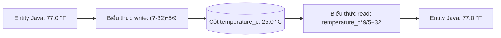

# Biểu thức đọc hoặc ghi cột với `@ColumnTransformer` trong Hibernate

Trong mô hình ORM thông thường, Hibernate ánh xạ một thuộc tính Java vào một cột SQL: khi đọc, nó lấy giá trị từ cột; khi ghi, nó truyền giá trị qua tham số JDBC vào lệnh `INSERT` hoặc `UPDATE`. Nhưng có những trường hợp **giá trị trong database và giá trị mà mã Java sử dụng được biểu diễn khác nhau**, và phép chuyển đổi thích hợp nhất là một **biểu thức SQL do database thực hiện**.

Hibernate cung cấp annotation **`org.hibernate.annotations.ColumnTransformer`** để khai báo biểu thức SQL khi **đọc** (`read`) hoặc **ghi** (`write`) cột được ánh xạ. Ví dụ: database lưu nhiệt độ theo độ C nhưng domain Java làm việc theo độ F; Hibernate có thể thêm công thức chuyển đổi trực tiếp vào SQL mà phần còn lại của ứng dụng vẫn sử dụng một thuộc tính `temperatureFahrenheit`.

Đây là một tính năng **đặc thù của Hibernate**, thuộc nhóm ánh xạ nâng cao. Nó hữu ích cho chuyển đổi đơn vị, giá trị được chuẩn hóa bằng hàm SQL, và một số cơ chế xử lý dữ liệu tại database. Để sử dụng đúng, cần hiểu hình dạng biểu thức, số lượng placeholder `?`, cách đồng bộ trạng thái entity, kiểu dữ liệu SQL và ranh giới của những truy vấn không đi qua mapping ORM.

## 1. Vị trí của ColumnTransformer trong quá trình ORM

Hãy phân biệt ba lớp giá trị:

1. **Giá trị Java:** giá trị mà entity và business logic đọc/ghi, ví dụ `77.0°F`.
2. **Biểu thức SQL:** phép tính mà Hibernate thêm vào câu lệnh, ví dụ `(? - 32.0) * 5.0 / 9.0`.
3. **Giá trị database:** giá trị nằm trong cột vật lý, ví dụ `25.0°C`.



Với phép đọc:

```text
Database column -> SQL read expression -> JDBC result -> Java property
```

Với phép ghi:

```text
Java property -> JDBC parameter ? -> SQL write expression -> Database column
```

Nếu phép đọc và phép ghi được thiết kế là hai phép biến đổi **nghịch đảo phù hợp**, phần lớn mã nghiệp vụ không cần biết cách database lưu giá trị.

### So với mapping cột thông thường

Không dùng transformer:

```java
@Column(name = "temperature_c")
private Double temperatureCelsius;
```

Một cách đọc/ghi khái quát:

```sql
SELECT temperature_c FROM sensor_readings WHERE id = ?;
UPDATE sensor_readings SET temperature_c = ? WHERE id = ?;
```

Dùng transformer:

```java
@Column(name = "temperature_c")
@ColumnTransformer(
    read = "temperature_c * 9.0 / 5.0 + 32.0",
    write = "(? - 32.0) * 5.0 / 9.0"
)
private Double temperatureFahrenheit;
```

SQL minh họa:

```sql
SELECT temperature_c * 9.0 / 5.0 + 32.0
FROM sensor_readings
WHERE id = ?;

UPDATE sensor_readings
SET temperature_c = (? - 32.0) * 5.0 / 9.0
WHERE id = ?;
```

Trong cả hai trường hợp, tên **cột vật lý** vẫn là `temperature_c`. Transformer chỉ thay cách Hibernate **đọc biểu thức** và **gán giá trị** ở SQL.

## 2. Cú pháp của `@ColumnTransformer`

Annotation nằm trong package:

```java
import org.hibernate.annotations.ColumnTransformer;
```

Dạng tổng quát:

```java
@Column(name = "physical_column")
@ColumnTransformer(
    read = "SQL expression returning Java-facing value",
    write = "SQL expression consuming ?"
)
private SomeType property;
```

Các thành phần quan trọng:

| Thành phần | Ý nghĩa |
| --- | --- |
| `@Column(name = "...")` | Xác định tên cột được ánh xạ |
| `@ColumnTransformer(read = "...")` | Biểu thức SQL được sử dụng để đọc giá trị từ cột |
| `@ColumnTransformer(write = "...")` | Biểu thức SQL được sử dụng khi ghi giá trị vào cột |
| `forColumn = "..."` | Xác định cột đích nếu một thuộc tính ánh xạ tới nhiều cột |
| `?` trong `write` | Vị trí cho **một** giá trị được Hibernate bind qua JDBC |

Có thể chỉ khai báo `read`, chỉ `write` hoặc cả hai. Nhưng lựa chọn này ảnh hưởng tính nhất quán giữa giá trị Java và database; cần xem xét trường hợp chỉ có phép ghi ở phần sau.

### Quy tắc bắt buộc với biểu thức `write`

**Biểu thức ghi phải chứa chính xác một JDBC parameter placeholder `?`.**

Ví dụ hợp lệ về hình dạng:

```java
@ColumnTransformer(write = "upper(?)")
@ColumnTransformer(write = "round(?, 2)")
@ColumnTransformer(write = "(? - 32.0) * 5.0 / 9.0")
```

Mỗi dòng trên chỉ là ví dụ một annotation thay thế nhau cho một property; không đặt đồng thời ba annotation lên cùng một cột như thể ba phép ghi được xếp nối tiếp.

Ví dụ không phù hợp:

```java
// Thiếu placeholder: Hibernate không có nơi bind property value.
@ColumnTransformer(write = "CURRENT_TIMESTAMP")

// Hai placeholder: không phù hợp giao kèo một giá trị property.
@ColumnTransformer(write = "coalesce(?, ?)")

// Không tự viết biểu thức SQL bằng cách nối dữ liệu người dùng.
@ColumnTransformer(write = "'some user value'")
```

Tính chính xác của `?` quan trọng vì Hibernate cần biết nó sẽ bind **một giá trị của property** vào đâu. Những tham số động bổ sung không thể được giả định sẽ truyền vào từ annotation như một câu SQL chuẩn bị độc lập.

### Quy tắc với biểu thức `read`

Biểu thức `read` phải tạo ra giá trị có thể được ánh xạ về kiểu Java của property và thường phải **tham chiếu tên cột tương ứng**.

Ví dụ:

```java
@Column(name = "temperature_c")
@ColumnTransformer(
    read = "temperature_c * 9.0 / 5.0 + 32.0"
)
private Double temperatureFahrenheit;
```

Đoạn `read` không dùng `?` như giá trị của property. Nó là biểu thức áp dụng vào cột database. Khi Hibernate sinh SQL, provider xử lý alias/định danh theo mapping; đừng tự chèn alias như `t.temperature_c` rồi giả định alias ấy luôn tồn tại trong mọi câu truy vấn mà Hibernate tạo.

### Không phải SQL SELECT/UPDATE hoàn chỉnh

`read` nên là **một biểu thức SQL** trả về giá trị, không phải chuỗi đầy đủ kiểu `SELECT ... FROM ...`. Tương tự `write` là **biểu thức ở vế phải phép gán**, không phải `UPDATE table SET ...` hoàn chỉnh.

Ví dụ:

```java
read  = "upper(display_name)"
write = "lower(?)"
```

Hibernate tự ghép biểu thức vào SQL được sinh theo mapping của entity.

## 3. Ví dụ thực tế: Java dùng Fahrenheit, database lưu Celsius

Ví dụ này là một phép chuyển đổi đơn vị hai chiều rõ ràng, thích hợp để hiểu đúng cơ chế `ColumnTransformer`.

Giả sử database có bảng:

```sql
CREATE TABLE sensor_readings (
    id BIGINT GENERATED BY DEFAULT AS IDENTITY PRIMARY KEY,
    sensor_code VARCHAR(80) NOT NULL,
    temperature_c DOUBLE PRECISION NOT NULL
);
```

Đây là DDL minh họa theo cú pháp SQL quen thuộc ở PostgreSQL; ở một database khác, cú pháp identity và kiểu dữ liệu có thể khác. Bảng lưu **độ C** trong cột `temperature_c`.

Entity Java lại muốn dùng **độ F**:

```java
import jakarta.persistence.Column;
import jakarta.persistence.Entity;
import jakarta.persistence.GeneratedValue;
import jakarta.persistence.GenerationType;
import jakarta.persistence.Id;
import jakarta.persistence.Table;
import org.hibernate.annotations.ColumnTransformer;

@Entity
@Table(name = "sensor_readings")
public class SensorReading {

    @Id
    @GeneratedValue(strategy = GenerationType.IDENTITY)
    private Long id;

    @Column(name = "sensor_code", nullable = false)
    private String sensorCode;

    @Column(name = "temperature_c", nullable = false)
    @ColumnTransformer(
        read = "temperature_c * 9.0 / 5.0 + 32.0",
        write = "(? - 32.0) * 5.0 / 9.0"
    )
    private Double temperatureFahrenheit;

    protected SensorReading() {
        // JPA yêu cầu constructor không tham số.
    }

    public SensorReading(String sensorCode, double temperatureFahrenheit) {
        this.sensorCode = sensorCode;
        this.temperatureFahrenheit = temperatureFahrenheit;
    }

    public Long getId() {
        return id;
    }

    public String getSensorCode() {
        return sensorCode;
    }

    public Double getTemperatureFahrenheit() {
        return temperatureFahrenheit;
    }

    public void setTemperatureFahrenheit(double fahrenheit) {
        this.temperatureFahrenheit = fahrenheit;
    }
}
```

Trong Java, giá trị `temperatureFahrenheit` có ý nghĩa là Fahrenheit. Trong database, cột `temperature_c` có ý nghĩa Celsius. Hai phép tính:

\[
C = (F - 32)\times \frac{5}{9},\qquad
F = C\times \frac{9}{5}+32
\]

Với `77°F`, giá trị được lưu về mặt toán học là `25°C`. Khi tải lại entity, `25°C` được biến đổi thành `77°F`.

### Ghi một entity mới

```java
SensorReading reading =
    new SensorReading("SENSOR-01", 77.0);

entityManager.persist(reading);
```

SQL có thể tương đương:

```sql
INSERT INTO sensor_readings (
    sensor_code,
    temperature_c
)
VALUES (
    ?,
    (? - 32.0) * 5.0 / 9.0
);
```

Hibernate bind `"SENSOR-01"` vào tham số chuỗi và `77.0` vào placeholder của transformer. Database tính giá trị độ C trước khi lưu vào `temperature_c`.

### Đọc entity từ database

```java
SensorReading reading =
    entityManager.find(SensorReading.class, readingId);

Double fahrenheit = reading.getTemperatureFahrenheit();
```

SQL đọc có thể được tạo với công thức:

```sql
SELECT
    id,
    sensor_code,
    temperature_c * 9.0 / 5.0 + 32.0
FROM sensor_readings
WHERE id = ?;
```

`getTemperatureFahrenheit()` nhận giá trị của biểu thức đọc chứ không phải trực tiếp số lưu trong `temperature_c`.

### Cập nhật một entity managed

```java
SensorReading reading =
    entityManager.find(SensorReading.class, readingId);

reading.setTemperatureFahrenheit(98.6);

// Khi flush, Hibernate cập nhật giá trị đã được biến đổi.
```

SQL minh họa:

```sql
UPDATE sensor_readings
SET temperature_c = (? - 32.0) * 5.0 / 9.0
WHERE id = ?;
```

Với `98.6°F`, database nhận giá trị độ C khoảng `37.0`. Nếu entity có `@Version`, Hibernate có thể bổ sung điều kiện version và cập nhật trường version theo cơ chế optimistic locking.

**Lưu ý:** các con số ở ví dụ dùng `Double`. Phép tính số thực có thể có sai số làm tròn. Nếu dữ liệu là tiền hoặc đại lượng cần độ chính xác cố định, cần dùng kiểu SQL/Java và quy tắc rounding tương ứng.

## 4. `read` và `write` có nhất thiết phải là phép nghịch đảo?

Đối với mapping muốn Java luôn nhìn thấy cùng ý nghĩa sau khi ghi và đọc lại, **nên xây dựng hai biểu thức sao cho kết quả đọc lại tương đương giá trị đã ghi**.

Ký hiệu:

- `W(v)` là phép biến đổi SQL khi ghi giá trị Java `v`.
- `R(c)` là phép biến đổi SQL khi đọc cột chứa giá trị `c`.

Mục tiêu thường là:

\[
R(W(v)) \approx v
\]

Dấu “gần bằng” là phù hợp khi phép biến đổi liên quan số thực, rounding hoặc chuyển đổi có mất thông tin.

Trong ví dụ nhiệt độ:

```text
W(77.0) = (77 - 32) * 5 / 9 = 25.0
R(25.0) = 25 * 9 / 5 + 32 = 77.0
```

Đây là mối quan hệ hai chiều mà Hibernate có thể dùng để coi giá trị Java đang được quản lý là đồng bộ với trạng thái đọc từ database theo ý nghĩa của mapping.

### Khi phép đọc không đảo ngược được phép ghi

Ví dụ:

```java
@Column(name = "search_code")
@ColumnTransformer(write = "lower(?)")
private String searchCode;
```

Giả sử Java gọi:

```java
entity.setSearchCode("AbC");
```

Database lưu `abc` nhưng object Java có thể vẫn giữ `AbC` trong cùng Persistence Context. Nếu tải lại ở một context khác (không khai báo `read`), nó sẽ nhận `abc`.

Kết quả:

```text
Giá trị Java trước ghi: "AbC"
Giá trị database sau ghi: "abc"
Giá trị Java sau tải lại: "abc"
```

Với một phép chuẩn hóa mất thông tin như `lower`, không có phép đọc nào khôi phục được chữ hoa ban đầu từ dữ liệu đã hạ chữ thường. Nếu domain định nghĩa `searchCode` luôn phải viết thường, nên chuẩn hóa ở Java trước khi gán hoặc thiết kế property API một cách nhất quán, thay vì trông chờ giá trị gốc vẫn giữ nguyên sau refresh.

### Vì sao trạng thái trong Persistence Context có thể lệch?

Hibernate theo dõi entity managed và có thể sử dụng giá trị đang ở Java để dirty checking. Khi SQL ghi biến đổi giá trị một chiều, **giá trị trong object và giá trị lưu dưới database có thể khác nhau**.

Hibernate có cơ chế nhận diện trường hợp phép ghi không có phép đọc nghịch đảo phù hợp, và trong một số cấu hình/phiên bản có thể cần làm mới trạng thái sau `INSERT` hoặc `UPDATE`. Annotation `@Generated` của Hibernate có thể được sử dụng để yêu cầu tái đọc một giá trị sau thao tác ghi trong những trường hợp được hỗ trợ; chi tiết phụ thuộc phiên bản và mapping.

Điều cần nhớ:

- **Không mặc định** object Java tự được đổi thành giá trị chuẩn hóa sau khi SQL chạy.
- Nếu yêu cầu giá trị chính xác ngay sau ghi, hãy thiết kế phép biến đổi nhất quán hoặc **refresh/reload** ở điểm thích hợp.
- Hibernate không thể chứng minh về mặt toán học rằng hai chuỗi SQL do bạn cung cấp là nghịch đảo hoàn hảo cho mọi đầu vào.
- Nếu phép biến đổi có mất thông tin, hãy coi giá trị được lưu và giá trị đầu vào có thể khác nhau theo thiết kế.

## 5. Chỉ dùng `read`: trình bày giá trị đã lưu qua SQL

Có những trường hợp database đã lưu một giá trị ổn định, nhưng ứng dụng muốn đọc qua một hàm SQL.

Ví dụ cho mục đích đọc, muốn không bao giờ nhận `NULL` ở Java:

```java
@Column(name = "discount_rate")
@ColumnTransformer(read = "coalesce(discount_rate, 0)")
private java.math.BigDecimal discountRate;
```

Nếu cột `discount_rate` là `NULL`, phép đọc sẽ trả về `0` theo biểu thức SQL. Đây là **quy tắc đọc**, không đồng nghĩa cột DB thực sự đổi từ `NULL` sang `0`.

Nếu code cập nhật `discountRate` và property có quyền ghi bình thường, khi không khai báo `write`, Hibernate dùng giá trị Java làm tham số gán cột theo mapping thông thường. Đừng đánh đồng `read = coalesce(...)` với một database default hoặc constraint.

Một tình huống khác là lấy phần số của một trường:

```java
@Column(name = "stored_amount")
@ColumnTransformer(read = "round(stored_amount, 2)")
private java.math.BigDecimal displayedAmount;
```

Việc đọc có thể làm tròn giá trị, nhưng nếu field vẫn có thể ghi thì nghiệp vụ phải hiểu đây là property có khả năng round-trip mất độ chính xác. Nếu chỉ cần một giá trị tính toán để hiển thị, `@Formula` hoặc projection có thể diễn đạt mục tiêu tốt hơn.

### `read` không thay đổi dữ liệu gốc

Nếu cần dữ liệu ở DB thực sự được chuẩn hóa, `read` không giải quyết điều đó. Nó chỉ thay biểu thức truy xuất. Tương tự, nếu một hệ thống khác đọc trực tiếp cột qua SQL thông thường, hệ thống đó vẫn thấy giá trị vật lý ban đầu.

## 6. Chỉ dùng `write`: chuẩn hóa giá trị ở database

Cách dùng này thích hợp khi muốn DB thực hiện một biểu thức vào lúc ghi, ví dụ:

```java
@Column(name = "normalized_email")
@ColumnTransformer(write = "lower(trim(?))")
private String normalizedEmail;
```

SQL có thể là:

```sql
INSERT INTO contacts (normalized_email)
VALUES (lower(trim(?)));
```

Tuy nhiên, nếu application gán:

```java
contact.setNormalizedEmail("  Hello@Example.COM  ");
```

thì database lưu `hello@example.com`; object Java chưa chắc được cập nhật ngay thành chuỗi chuẩn hóa. Nếu domain đặt tên property là `normalizedEmail`, cần bảo đảm getter phản ánh đúng khái niệm ấy.

Các cách tiếp cận:

1. Chuẩn hóa ở Java trước khi gán, rồi dùng constraint database bổ sung.
2. Có phép đọc và ghi nhất quán về mặt business semantics.
3. Làm mới entity khi cần trạng thái DB sau biến đổi.
4. Dùng database generated/default/trigger kết hợp cơ chế đồng bộ phù hợp nếu database thực sự là nơi sở hữu giá trị.

Không nên thêm `@ColumnTransformer(write = ...)` chỉ vì muốn tránh một dòng `value.toLowerCase()` trong Java; hãy chọn nó khi **xử lý ở database** có lý do rõ ràng, chẳng hạn tương thích dữ liệu cũ hoặc dùng hàm SQL chuyên biệt.

## 7. `@ColumnTransformer` và SQL sinh bởi Hibernate

Hibernate dùng metadata mapping khi sinh các thao tác ORM. Một số minh họa với entity `SensorReading`:

| Thao tác | Vai trò của transformer |
| --- | --- |
| `persist(new SensorReading(...))` | `write` xuất hiện ở giá trị cần INSERT |
| Sửa property managed rồi flush | `write` xuất hiện ở giá trị cần UPDATE |
| `find(SensorReading.class, id)` khi cần tải từ DB | `read` xuất hiện ở phần đọc property |
| JPQL `select r.temperatureFahrenheit` | Hibernate có thể dùng biểu thức đọc của property khi dựng SQL |
| JPQL `where r.temperatureFahrenheit > :x` | Biểu thức mapping có thể ảnh hưởng SQL predicate; phải xem SQL thực tế |
| Native SQL trực tiếp vào `sensor_readings.temperature_c` | Không tự áp dụng transformer của entity cho câu SQL do bạn tự viết |
| JDBC thuần hoặc ETL ghi bảng | Không đi qua annotation Hibernate |
| Trigger/default của DB | Hoạt động độc lập với transformer, trừ khi SQL/mapping phối hợp rõ ràng |

Đối với JPQL predicate, biểu thức đọc có thể làm thay đổi cách database thực thi điều kiện lọc. Ví dụ:

```java
List<SensorReading> hotReadings =
    entityManager.createQuery(
        "select r from SensorReading r " +
        "where r.temperatureFahrenheit > :limit",
        SensorReading.class)
    .setParameter("limit", 86.0)
    .getResultList();
```

Hibernate phải diễn đạt ý nghĩa property theo mapping khi biên dịch SQL, nhưng **không nên đoán nguyên văn SQL** hoặc hiệu năng chỉ từ JPQL; hãy xem query thực tế do provider và dialect tạo.

### Biểu thức SQL chỉ có ý nghĩa ở DB đang dùng

Các hàm như `upper`, `lower`, `round`, `coalesce` có độ phổ biến khá cao, nhưng phép cast, toán học, xử lý JSON, mã hóa và các hàm đặc biệt có thể khác giữa PostgreSQL, MySQL, SQL Server, Oracle hoặc H2.

`@ColumnTransformer` dùng **SQL fragment**, không phải JPQL expression được dịch tự động một cách portable. Nếu đổi database hoặc dialect, phải kiểm tra lại biểu thức.

## 8. Ví dụ tiền tệ: lưu đơn vị nhỏ nhất, trả về đơn vị hiển thị

Một ứng dụng có thể lưu tiền bằng **đơn vị nhỏ nhất** như cents trong database để tránh số thực nhị phân, trong khi Java sử dụng `BigDecimal` theo đơn vị tiền.

Giả sử cột `price_cents` là số nguyên:

```sql
CREATE TABLE catalog_prices (
    id BIGINT PRIMARY KEY,
    price_cents BIGINT NOT NULL
);
```

Về mặt công thức:

\[
\text{priceDecimal} = \frac{\text{priceCents}}{100}
\]

\[
\text{priceCents} = \operatorname{round}(\text{priceDecimal} \times 100)
\]

Một mapping transformer minh họa:

```java
@Entity
@Table(name = "catalog_prices")
public class CatalogPrice {

    @Id
    private Long id;

    @Column(name = "price_cents", nullable = false)
    @ColumnTransformer(
        read = "price_cents / 100.0",
        write = "round(? * 100)"
    )
    private BigDecimal price;

    protected CatalogPrice() {}

    public BigDecimal getPrice() {
        return price;
    }
}
```

Đây là ví dụ cho cơ chế biểu thức, **không phải lời bảo đảm mapping trên portable không cần điều chỉnh**. Một số database trả về kiểu số khác từ `price_cents / 100.0` hoặc từ `round(...)`; để lưu vào cột `BIGINT` có thể cần `CAST` rõ ràng. Hibernate cũng cần biết kiểu JDBC và có thể có khác biệt khi schema validation thấy kiểu Java `BigDecimal` nhưng cột vật lý là `BIGINT`.

Nếu yêu cầu chính là chuyển `BigDecimal` sang `Long` ở tầng ứng dụng, **`AttributeConverter`** thường là lựa chọn đơn giản và portable hơn. Transformer hợp lý hơn khi bắt buộc dùng hàm SQL, tương thích với dữ liệu cũ hoặc khai thác xử lý của database.

Với tiền, nhất định xác định currency, scale, rounding mode và giới hạn giá trị, không chỉ áp dụng một phép nhân chia. Ví dụ `USD` có hai chữ số phần lẻ thường gặp, nhưng không phải mọi loại tiền đều giống nhau.

## 9. Ví dụ hàm SQL chuyên biệt: dữ liệu được biến đổi ở database

Một trong các lý do cân nhắc `@ColumnTransformer` là database có hàm riêng mà Java không thực hiện trực tiếp.

### Mã hóa bằng hàm PostgreSQL: ví dụ khái niệm

Trong PostgreSQL có extension `pgcrypto`, các hàm như `pgp_sym_encrypt` và `pgp_sym_decrypt` có thể mã hóa/giải mã ở tầng SQL.

Biểu thức minh họa:

```java
@Column(name = "secret_bytes")
@ColumnTransformer(
    read = "pgp_sym_decrypt(secret_bytes, current_setting('app.crypto_key'))",
    write = "pgp_sym_encrypt(?, current_setting('app.crypto_key'))"
)
private String secret;
```

Nếu Hibernate sử dụng cặp biểu thức này trong SQL, ý tưởng là:

```sql
-- Biểu thức ghi cho cột BYTEA:
pgp_sym_encrypt(?, current_setting('app.crypto_key'))

-- Biểu thức đọc để lấy nội dung text:
pgp_sym_decrypt(secret_bytes, current_setting('app.crypto_key'))
```

Ví dụ này **chỉ mô tả ý tưởng**, chưa phải entity hoàn chỉnh có thể sao chép vào mọi dự án: `pgcrypto` cần được cài đặt, cột thường có kiểu `BYTEA`, kiểu JDBC/DDL mapping của Java `String` cần được xử lý phù hợp, cấu hình schema validation và dialect phải tương thích.

Một ứng dụng dùng encryption tại database còn cần quyết định:

- Ai có quyền truy cập khóa và cách cấp/luân chuyển khóa.
- Khóa có được đưa vào session DB bằng cơ chế an toàn hay không.
- Cách bảo đảm connection pool không rò rỉ cấu hình session giữa tenant/request.
- Cách ghi log/query tracing không làm lộ plaintext hoặc khóa.
- Việc tìm kiếm, indexing và unique constraint trên ciphertext có còn đạt yêu cầu không.
- Cơ chế rotation/backup/restore dữ liệu và khóa mã hóa.
- Ảnh hưởng của native SQL, ETL hoặc các công cụ đọc DB không qua Hibernate.

**Không hard-code secret vào annotation SQL**. Mọi chuỗi trong annotation thường nằm trong mã nguồn và metadata runtime; lấy khóa qua một cấu hình DB/session có chính sách bảo mật rõ ràng chỉ là một phần của giải pháp. Mã hóa không thay thế xác thực, phân quyền hay quản lý dữ liệu nhạy cảm.

### Trường hợp nào không nên dùng transformer?

Nếu mục tiêu chỉ là tránh một phép đổi kiểu đơn giản ở Java, hoặc database không cung cấp hàm đáng dùng, việc đẩy logic vào SQL có thể tăng chi phí vận hành và giảm khả năng di chuyển database. Trong trường hợp mã hóa, cân nhắc giải pháp chuẩn ở tầng ứng dụng hoặc dịch vụ quản lý khóa theo yêu cầu hệ thống, thay vì mặc định SQL transformer là phương pháp tốt nhất.

## 10. Phân biệt `@ColumnTransformer` với `@AttributeConverter`

`@AttributeConverter` thuộc **Jakarta Persistence** và chuyển đổi giá trị giữa kiểu Java của entity và kiểu dùng ở tầng JDBC/database **bằng mã Java**.

Ví dụ đơn giản, chuyển một trạng thái thành mã một ký tự:

```java
import jakarta.persistence.AttributeConverter;
import jakarta.persistence.Converter;

@Converter
public class StatusConverter
        implements AttributeConverter<OrderStatus, String> {

    @Override
    public String convertToDatabaseColumn(OrderStatus attribute) {
        if (attribute == null) {
            return null;
        }
        return attribute == OrderStatus.ACTIVE ? "A" : "I";
    }

    @Override
    public OrderStatus convertToEntityAttribute(String dbData) {
        if (dbData == null) {
            return null;
        }
        return "A".equals(dbData)
            ? OrderStatus.ACTIVE
            : OrderStatus.INACTIVE;
    }
}
```

Và trong entity:

```java
@Convert(converter = StatusConverter.class)
@Column(name = "status_code")
private OrderStatus status;
```

Trong ví dụ này:

- Java converter quyết định giá trị `"A"` hoặc `"I"`.
- SQL thường bind giá trị đã được converter xử lý, không cần thêm `upper(?)`, `round(?)` hay hàm database vào statement.
- Logic converter độc lập với SQL dialect hơn, nhưng bản thân cách lưu kiểu JDBC vẫn cần tương thích database.

So sánh:

| Tiêu chí | `@ColumnTransformer` | `@AttributeConverter` |
| --- | --- | --- |
| Định nghĩa ở đâu | Hibernate-specific annotation | Jakarta Persistence chuẩn |
| Xử lý ở đâu | **Database qua SQL expression** | **Java trước bind/sau read** |
| Có thể dùng hàm SQL riêng của DB | Có | Không trực tiếp trong converter |
| SQL có thay biểu thức cột | Có | Thường không |
| Tính portable | Phụ thuộc hàm SQL/dialect | Thường cao hơn |
| Dễ debug bằng Java debugger | Logic chính chạy tại DB | Logic chạy trong Java |
| Tác động index/truy vấn SQL | Có thể lớn nếu cột bị bọc hàm | Phụ thuộc kiểu dữ liệu được lưu |
| Ví dụ phù hợp | Đổi đơn vị bằng SQL, hàm DB riêng | Enum/mã, giá trị domain đổi sang kiểu JDBC |

Không nên kết hợp cả `@Convert` và `@ColumnTransformer` trên cùng property nếu chưa hiểu rõ thứ tự chuyển đổi, kiểu JDBC sau converter và kiểu dữ liệu SQL mà transformer mong đợi. Hai phép biến đổi có thể nhân nhau một cách khó phát hiện.

### Khi nào converter tốt hơn?

- Logic chuyển đổi viết được đơn giản trong Java.
- Muốn tránh phụ thuộc SQL dialect.
- Có một kiểu value object cần ánh xạ nhất quán ở nhiều entity.
- Cần test chuyển đổi độc lập với database.
- Không cần DB function tham gia vào expression đọc/ghi.

### Khi nào transformer tốt hơn?

- Phải dùng hàm SQL có sẵn trong database.
- Dữ liệu cũ đang lưu theo định dạng khác với domain Java và đã có quy ước chuyển đổi bằng SQL.
- Cần áp dụng phép biến đổi ngay ở bên trong thao tác SQL do Hibernate sinh.
- Có lý do kỹ thuật rõ để xử lý ở DB, và ứng dụng chấp nhận dependency vào dialect.

## 11. Phân biệt với `@Formula`, generated column và `@Generated`

### `@Formula`: thuộc tính tính toán khi đọc

Hibernate `@Formula` là cách ánh xạ **biểu thức SQL chỉ đọc** vào một property, thường để lấy giá trị tính toán không có cột ghi trực tiếp.

```java
import org.hibernate.annotations.Formula;

@Formula("subtotal + tax_amount")
private BigDecimal totalAmount;
```

Nếu `totalAmount` là giá trị được tính từ hai cột và không nên được cập nhật trực tiếp qua property ấy, `@Formula` thường diễn đạt mục đích rõ hơn `@ColumnTransformer`.

### `@ColumnTransformer`: vẫn là property gắn với cột

`@ColumnTransformer` gắn với **một hoặc nhiều cột được ánh xạ** và có thể định nghĩa cả cách ghi. Nó hữu ích khi một property tương ứng với dữ liệu vật lý mà lệnh `INSERT/UPDATE` cần xử lý.

So sánh:

| Nhu cầu | Công cụ cần cân nhắc |
| --- | --- |
| Property đọc từ một SQL expression, không ghi trực tiếp | `@Formula` |
| Ghi một cột bằng biểu thức như `lower(?)` | `@ColumnTransformer(write = ...)` |
| Đọc một cột qua hàm SQL | `@ColumnTransformer(read = ...)` |
| Java đổi value object thành kiểu JDBC | `@AttributeConverter` |
| Cột được DB sinh hoặc trigger sửa sau ghi | Mapping generated value, ví dụ `@Generated` theo Hibernate version |
| Cột chỉ được đọc, không ghi | `@Column(insertable = false, updatable = false)` nếu phù hợp |
| Dữ liệu chuẩn hóa ở DB | Constraint, generated column, trigger hoặc migration tùy mục tiêu |

### `@Generated` và việc đọc lại giá trị do DB quyết định

Nếu một cột bị database trigger, default hoặc SQL write expression biến đổi, Hibernate có thể cần lấy **giá trị thực** sau insert/update để đồng bộ entity.

Một số phiên bản Hibernate hỗ trợ annotation dạng:

```java
import org.hibernate.annotations.Generated;
import org.hibernate.generator.EventType;

@Generated(
    event = { EventType.INSERT, EventType.UPDATE },
    writable = true
)
```

Đây là minh họa cú pháp **tùy Hibernate version**, không phải annotation JPA chuẩn. Ý nghĩa chung là thông báo value có thể được DB tạo hoặc sửa sau thao tác ghi, và yêu cầu provider đồng bộ nó. Có nên dùng `writable = true` hay không phụ thuộc cột có được Hibernate bind khi ghi và cơ chế tạo giá trị cụ thể.

Không đặt `@Generated` một cách máy móc cho mọi `@ColumnTransformer`: nếu biểu thức đọc và ghi đã là cặp nghịch đảo ổn định và giá trị Java vẫn đúng theo domain, việc tái đọc có thể chỉ làm phát sinh round-trip không cần thiết.

## 12. Kiểu dữ liệu SQL và khả năng ánh xạ kết quả

Transformer không tự biến một `Double` thành `String`, một `BIGINT` thành `DECIMAL` hay `BYTEA` thành `VARCHAR` theo cách bất chấp SQL type system. Cần thiết kế **kiểu dữ liệu của biểu thức và kiểu JDBC** phù hợp với property.

Xét:

```java
@Column(name = "temperature_c")
@ColumnTransformer(
    read = "temperature_c * 9.0 / 5.0 + 32.0",
    write = "(? - 32.0) * 5.0 / 9.0"
)
private Double temperatureFahrenheit;
```

Nếu `temperature_c` là kiểu số thực tương thích, phép đọc cho kết quả số thường ánh xạ được về `Double`. Nếu cột vật lý là chuỗi chứa giá trị số, phép tính có thể cần cast; việc mapping field `Double` có thể khiến Hibernate schema validation phát hiện kiểu cột khác mong đợi.

### Ép kiểu ở nơi phù hợp

Ví dụ SQL (phụ thuộc dialect):

```sql
CAST(price_cents AS DECIMAL(18, 2)) / 100
```

hoặc:

```sql
CAST(round(? * 100) AS BIGINT)
```

Đừng giả định `CAST` có cú pháp hoàn toàn giống nhau trên mọi database; một số DBMS hỗ trợ `::type`, `CONVERT` hoặc quy tắc ép kiểu riêng.

### Độ chính xác

Với giá trị số:

- Chọn `BigDecimal`/`DECIMAL` nếu cần độ chính xác thập phân có kiểm soát.
- Định nghĩa quy tắc làm tròn ở đúng tầng.
- Xử lý overflow và giới hạn cột.
- Thử các giá trị âm, bằng 0, cực trị và số có nhiều chữ số thập phân.
- Kiểm tra thứ tự ép kiểu để tránh phép chia nguyên ngoài ý muốn.

Transformer là phép chuyển đổi ở SQL; nếu công thức sai, Hibernate vẫn có thể phát SQL hợp lệ nhưng lưu giá trị nghiệp vụ sai.

## 13. `NULL`, giá trị mặc định và các trường hợp đặc biệt

Các hàm SQL có quy tắc với `NULL`. Chẳng hạn biểu thức số học:

```sql
(? - 32.0) * 5.0 / 9.0
```

thường trả về `NULL` khi placeholder nhận `NULL`. Nếu cột `temperature_c` là `NOT NULL`, database sẽ từ chối insert/update đó.

Có thể dùng `coalesce`, nhưng phải xem đây có phải quy tắc nghiệp vụ thật sự:

```java
@ColumnTransformer(
    read = "coalesce(temperature_c, 0) * 9.0 / 5.0 + 32.0",
    write = "(? - 32.0) * 5.0 / 9.0"
)
```

Với `NULL`, phép đọc này trả về `32°F`; nó **đánh đồng giá trị chưa biết với 0°C**. Trong dữ liệu cảm biến, đó có thể là lỗi nghiêm trọng. Đôi khi cách đúng là giữ `null` ở Java và cho ứng dụng phân biệt “không có dữ liệu” với nhiệt độ thực.

### Database default và transformer

Nếu cột có default nhưng Hibernate gửi giá trị cụ thể qua `write`, default có thể không được áp dụng. Database default thường được dùng khi câu `INSERT` không gán cột hoặc theo quy tắc DEFAULT của DBMS, không phải khi gửi `NULL` qua công thức tùy ý.

Nếu cần database sở hữu giá trị default, hãy thiết kế `insertable=false`, generated value hoặc cách insert có chủ ý thay vì mong `@ColumnTransformer` tự sử dụng default.

## 14. Cột nằm trong embeddable hoặc property nhiều cột

Một thuộc tính Java không phải lúc nào cũng ánh xạ tới đúng một cột. Trong các kiểu mapping phức tạp hoặc custom type có nhiều selectable, Hibernate có thể cần biết **biểu thức áp dụng cho cột nào**.

`@ColumnTransformer` có thuộc tính `forColumn`:

```java
@ColumnTransformer(
    forColumn = "temperature_c",
    read = "temperature_c * 9.0 / 5.0 + 32.0",
    write = "(? - 32.0) * 5.0 / 9.0"
)
```

Với một property chỉ ánh xạ một cột, `forColumn` thường không cần thiết. Khi property ánh xạ nhiều cột, `forColumn` giúp chỉ định đúng tên cột.

Hibernate còn hỗ trợ dạng annotation lặp hoặc container tương ứng tùy phiên bản để khai báo nhiều transformer khi mapping phức tạp. Cần đọc mapping thực tế của embeddable/custom type và đối chiếu phiên bản Hibernate trước khi ghép nhiều biểu thức.

**Không dùng `forColumn` chỉ vì muốn transform một cột bất kỳ của bảng khác**. Transformer gắn với cột thuộc mapping của property hiện tại; truy cập tính toán nhiều bảng hoặc subquery có thể phù hợp hơn với projection, `@Formula` hoặc truy vấn riêng.

## 15. Tác động đến truy vấn và chỉ mục database

Biểu thức `read` có thể được dùng khi Hibernate dựng phép đọc property; khi điều kiện lọc/sắp xếp dựa trên property đó, database có thể phải tính toán biểu thức cho nhiều hàng.

Giả sử bảng có index bình thường trên `temperature_c`:

```sql
CREATE INDEX idx_sensor_temperature_c
ON sensor_readings (temperature_c);
```

Truy vấn SQL:

```sql
SELECT *
FROM sensor_readings
WHERE temperature_c > 30;
```

có thể tận dụng index theo một cách nào đó, tùy optimizer và thống kê.

Nhưng với điều kiện dùng biểu thức:

```sql
SELECT *
FROM sensor_readings
WHERE temperature_c * 9.0 / 5.0 + 32.0 > 86;
```

database có thể không dùng index theo cách tương tự vì cột bị đặt trong một biểu thức. Một số optimizer có thể biến đổi điều kiện; một số database hỗ trợ **expression/function-based index**. Không có kết luận chung rằng “có index là truy vấn chắc chắn nhanh” hoặc “dùng transformer luôn khiến index mất tác dụng”.

### Cách xem xét hiệu năng

1. Hiểu truy vấn nghiệp vụ tìm kiếm theo **giá trị Java** hay **giá trị lưu tại DB**.
2. Xem SQL Hibernate thực sự sinh.
3. Kiểm tra execution plan bằng công cụ của DBMS (`EXPLAIN` hoặc tương đương).
4. Nếu cần, cân nhắc expression index, cột generated/persisted hoặc thiết kế lưu dữ liệu khác.
5. Đo trên tập dữ liệu và mẫu truy vấn thực tế.

Nếu dữ liệu có tần suất tìm kiếm cao, một phép biến đổi đơn vị đơn giản đôi khi nên được thực hiện trên **giá trị điều kiện ở Java** để truy vấn trực tiếp cột có index, thay vì bọc cột trong hàm SQL cho mọi hàng. Nhưng điều này cần một thiết kế nhất quán giữa API/domain và truy vấn.

### Ảnh hưởng tới ORDER BY và GROUP BY

Nếu sắp xếp hoặc nhóm theo property đã transform, SQL có thể phải tính biểu thức. Biểu thức làm tròn hoặc chuẩn hóa có thể làm nhiều giá trị vật lý khác nhau trở thành cùng giá trị hiển thị, ảnh hưởng kết quả nhóm/sắp.

Ví dụ `round(amount, 0)` khiến `10.1` và `10.4` cùng thành `10`. Nếu nghiệp vụ cần uniqueness hoặc sorting theo giá trị gốc, phải chọn cột/biểu thức phù hợp, không trông đợi ORM tự suy ra quy tắc mong muốn.

## 16. Transformer không thay thế unique constraint và validation

Ví dụ dùng `lower(trim(?))` để chuẩn hóa mã:

```java
@Column(name = "normalized_code")
@ColumnTransformer(write = "lower(trim(?))")
private String normalizedCode;
```

Hai request đồng thời có thể gửi:

```text
Request A: "ABC"
Request B: " abc "
```

Sau phép biến đổi, cả hai đều thành `abc`. Nếu mã phải duy nhất, database cần có `UNIQUE` trên giá trị lưu hoặc một ràng buộc tương đương. Kiểm tra trùng trước insert ở Java không ngăn được race condition.

Tương tự, nếu dữ liệu có phạm vi theo tenant, constraint cần phản ánh đúng miền:

```sql
UNIQUE (tenant_id, normalized_code)
```

Transformer giúp thực thi phép chuẩn hóa, còn **unique constraint** bảo vệ tính duy nhất dưới concurrency và các đường ghi ngoài Hibernate.

### Bean Validation có kiểm tra sau SQL transform không?

Các constraint Bean Validation như `@NotBlank`, `@Size`, `@DecimalMin` thường áp dụng lên giá trị Java tại thời điểm validation, không mặc nhiên biết database sẽ làm gì với `lower`, `trim`, `round` hay hàm mã hóa.

Nếu giới hạn độ dài của cột lưu khác độ dài Java sau biến đổi, phải xác định validation/ràng buộc ở tầng phù hợp. Ví dụ chuẩn hóa/round có thể làm collision; mã hóa có thể tăng độ dài byte cần lưu; phép chuyển đơn vị có thể vượt precision SQL.

## 17. Tương tác với dirty checking, flush và refresh

Hibernate theo dõi entity managed trong Persistence Context, phát hiện thay đổi và đồng bộ bằng SQL khi flush.

```java
SensorReading reading =
    entityManager.find(SensorReading.class, id);

reading.setTemperatureFahrenheit(72.0);

entityManager.flush();
```

Với cặp biểu thức nhiệt độ, Hibernate phát `UPDATE` có transformer; object Java tiếp tục mang ý nghĩa Fahrenheit. SQL tại DB lưu Celsius.

### Flush không đồng nghĩa với làm mới entity

`entityManager.flush()` gửi thay đổi đang chờ tới database trong transaction, **không phải cam kết rằng Hibernate sẽ đọc lại mọi giá trị vừa ghi**.

Nếu SQL write expression có rounding, database trigger hoặc phép biến đổi một chiều, object Java có thể chưa chứa giá trị chuẩn hóa thực tế. Khi cần trạng thái database:

```java
entityManager.flush();
entityManager.refresh(reading);
```

`refresh` lấy lại trạng thái cho entity managed theo mapping của nó, có thể ghi đè những thay đổi chưa flush nếu dùng sai thời điểm. Vì vậy, chỉ gọi refresh khi có mục đích rõ, sau khi đã xử lý những thay đổi cần giữ.

### Tại sao phải thử đọc trong Persistence Context mới?

Cùng một Persistence Context, `find` lặp lại với cùng ID có thể trả về chính managed instance mà không gửi `SELECT`. Như vậy, code:

```java
SensorReading first = em.find(SensorReading.class, id);
SensorReading second = em.find(SensorReading.class, id);
```

không phải bằng chứng transformer `read` đã được thực thi lần thứ hai. Muốn quan sát giá trị database sau khi ghi, có thể:

- Dùng `em.flush()` rồi `em.clear()` và tải lại trong transaction phù hợp.
- Hoặc mở `EntityManager`/`Session` mới sau khi transaction ghi đã commit.
- Hoặc dùng native SQL đọc cột vật lý để so với property Java.

Trong trường hợp phép chuyển đổi chịu ảnh hưởng transaction isolation hoặc dữ liệu do transaction khác viết, kết quả nhìn thấy còn phụ thuộc isolation và thời điểm commit.

## 18. Native SQL, bulk operations và các đường truy cập ngoài ORM

`@ColumnTransformer` là metadata giúp Hibernate sinh SQL khi thao tác entity thông thường. Nó **không phải database trigger** và **không làm thay đổi mọi lệnh SQL tùy ý** gửi tới bảng.

Ví dụ trực tiếp ghi giá trị vật lý:

```sql
UPDATE sensor_readings
SET temperature_c = 25.0
WHERE id = 10;
```

Lệnh SQL này ghi **25°C** vào cột, không tự hiểu rằng ứng dụng Java đang biểu diễn Fahrenheit. Nếu một job ETL muốn nhập `77°F`, nó phải tự quy đổi sang `25°C` hoặc sử dụng công thức SQL tương đương.

### Native SQL trong EntityManager

```java
entityManager.createNativeQuery(
    "update sensor_readings " +
    "set temperature_c = :celsius where id = :id"
)
.setParameter("celsius", 25.0)
.setParameter("id", id)
.executeUpdate();
```

Câu native SQL do ứng dụng tự viết, nên giá trị truyền ở đây theo **đơn vị của cột vật lý**. Hibernate không tự thêm `write = "(? - 32) * 5 / 9"` vào SQL có sẵn.

Nếu entity đã được tải trong Persistence Context, native UPDATE có thể khiến object managed bị cũ. Cần cân nhắc `flush` trước thao tác và `refresh`/`clear` sau thao tác tùy luồng công việc.

### Bulk HQL/JPQL update

Bulk update/delete không hoạt động giống việc thay đổi từng managed entity và để dirty checking flush. Cách Hibernate áp dụng biểu thức transformer trong SQL bulk update có thể phụ thuộc cú pháp và phiên bản. Hãy xem SQL thực tế, đồng thời nhớ rằng bulk operations có thể làm Persistence Context không đồng bộ với database.

Không nên dùng bulk update như một cách né transformer mà không kiểm tra giá trị đang được hiểu theo đơn vị Java hay đơn vị vật lý.

### Truy vấn SQL ngoài Hibernate

Data migration, stored procedure, reporting tool và JDBC thuần không nhìn thấy mapping annotation. Cần tài liệu hóa ý nghĩa cột để mọi công cụ dùng đúng đơn vị/mã hóa/chuẩn hóa. Nếu quy tắc phải áp dụng **bất kể đường ghi nào**, database constraint, generated column hoặc trigger có thể phù hợp hơn một annotation chỉ áp dụng khi Hibernate sinh SQL.

## 19. Kiểm thử hành vi ánh xạ trong một cơ sở dữ liệu thật

Một transformer có thể “trông đúng” trong Java nhưng lại phụ thuộc kiểu dữ liệu SQL, toán tử, hàm và dialect. Với một chức năng quan trọng, việc thử **ghi giá trị Java, đọc cột vật lý và tải lại entity** giúp quan sát đúng hợp đồng chuyển đổi.

Ý tưởng kiểm tra trong một transaction dùng JPA:

```java
SensorReading r =
    new SensorReading("SENSOR-TEST", 77.0);

entityManager.persist(r);
entityManager.flush();

Long id = r.getId();

// Quan sát giá trị cột vật lý, không qua @ColumnTransformer.
Number storedCelsius = (Number) entityManager
    .createNativeQuery(
        "select temperature_c " +
        "from sensor_readings where id = :id"
    )
    .setParameter("id", id)
    .getSingleResult();

// Giá trị vật lý mong đợi khoảng 25°C.
double rawValue = storedCelsius.doubleValue();

entityManager.clear(); // Không lấy lại instance đã cached ở L1.

SensorReading loaded =
    entityManager.find(SensorReading.class, id);

// Giá trị property Java mong đợi khoảng 77°F.
double javaValue = loaded.getTemperatureFahrenheit();
```

Đây là đoạn minh họa quan sát, không phải bộ test đã được chạy. Nếu viết kiểm thử tự động, nên assert bằng **tolerance** cho số thực thay vì dùng so sánh chính xác bit giữa hai giá trị `double`:

```java
assertEquals(25.0, rawValue, 1e-9);
assertEquals(77.0, javaValue, 1e-9);
```

Bộ kiểm thử cần có cấu hình datasource, DDL/migration, entity registration và transaction thực tế. Nếu transformer dùng hàm PostgreSQL đặc thù, chạy trên PostgreSQL tương thích thay vì kỳ vọng H2 mô phỏng đúng mọi hàm.

### Những tình huống biên cần quan sát

| Trường hợp | Điều cần kiểm tra |
| --- | --- |
| Giá trị bình thường | Ghi rồi đọc trả về ý nghĩa Java đúng |
| Số âm và số 0 | Công thức xử lý đúng dấu và đơn vị |
| Giá trị gần giới hạn | Không overflow hoặc mất precision ngoài dự kiến |
| `NULL` | Cách SQL expression xử lý null phù hợp nghiệp vụ |
| `INSERT` mới | Transformer write có được áp dụng không |
| `UPDATE` managed | Giá trị sau flush và reload có đúng không |
| Cùng entity trong L1 | Không hiểu nhầm cache với truy vấn DB |
| Native SQL | Hệ thống ngoài ORM dùng đúng dữ liệu vật lý |
| JPQL filter/sort | SQL expression và execution plan phù hợp |
| Đổi dialect/DB | Hàm SQL và cast được hỗ trợ |
| Ràng buộc uniqueness | Collision sau chuẩn hóa được DB chặn |
| Giá trị do trigger sinh | Entity state được đồng bộ khi cần |

Trong quy trình phát triển, những kiểm thử này đặc biệt hữu ích khi áp dụng transformer lên dữ liệu tiền tệ, trạng thái kiểm soát, dữ liệu nhạy cảm hoặc dữ liệu liên quan migration.

## 20. Đọc SQL log để hiểu transformer đang hoạt động ra sao

Với Hibernate, có thể bật log SQL trong môi trường phát triển. Ví dụ Spring Boot dùng Hibernate 6:

```properties
logging.level.org.hibernate.SQL=DEBUG
logging.level.org.hibernate.orm.jdbc.bind=TRACE
```

`org.hibernate.SQL` cho thấy câu SQL, còn logger bind cho thấy tham số JDBC trong các phiên bản Hibernate phù hợp. Logger chi tiết có thể khác theo phiên bản.

Với entity nhiệt độ, khi thêm `77.0°F`, log có thể thể hiện:

```text
insert into sensor_readings (..., temperature_c)
values (..., (? - 32.0) * 5.0 / 9.0)
```

Khi tải entity, `SELECT` có thể chứa:

```text
temperature_c * 9.0 / 5.0 + 32.0
```

Đọc log cần phân biệt **giá trị bind** và **giá trị database tính toán**: log JDBC có thể hiển thị `77.0` vì đó là tham số Java, trong khi DB thực sự lưu `25.0` sau biểu thức ghi.

Nếu property chứa thông tin nhạy cảm, không bật log bind `TRACE` trên production hoặc môi trường log không được kiểm soát. Giá trị tham số có thể xuất hiện dưới dạng plaintext ngay cả khi DB lưu dạng mã hóa.

## 21. Những lỗi phổ biến khi dùng `@ColumnTransformer`

### Lỗi 1. Biểu thức `write` không có hoặc có nhiều `?`

Sai:

```java
@ColumnTransformer(write = "lower('ABC')")
```

Sai:

```java
@ColumnTransformer(write = "coalesce(?, ?)")
```

Cần một vị trí JDBC parameter duy nhất:

```java
@ColumnTransformer(write = "lower(?)")
```

Hibernate cần bind đúng **một** giá trị property vào biểu thức ghi.

### Lỗi 2. Dùng tên Java property thay vì tên cột SQL trong `read`

Với:

```java
@Column(name = "temperature_c")
private Double temperatureFahrenheit;
```

biểu thức đọc phải tham chiếu cột SQL `temperature_c`, không giả định database có cột `temperatureFahrenheit`.

### Lỗi 3. Viết cả câu SQL vào annotation

Không khai báo `read = "SELECT ... FROM sensor_readings"` hoặc `write = "UPDATE ... SET ..."` thay cho biểu thức. Hibernate tự tạo câu SELECT/INSERT/UPDATE và chèn fragment vào vị trí thích hợp.

### Lỗi 4. Chỉ khai báo `write` rồi tin object Java đã mang giá trị DB

Với `lower(?)`, Java có thể giữ `"ABC"` trong khi DB lưu `"abc"`. Thiết kế canonicalization rõ ràng hoặc refresh/reload khi cần.

### Lỗi 5. Ghép cặp read/write không tương ứng

Ví dụ ghi Fahrenheit thành Celsius nhưng đọc lại không đổi Celsius thành Fahrenheit. Dữ liệu trong entity sau reload sẽ sai đơn vị. Viết rõ công thức và round-trip expectation, nhất là phép toán có rounding.

### Lỗi 6. Hàm SQL không tồn tại trên database triển khai

`pgp_sym_encrypt` có thể có trên PostgreSQL sau khi cài extension phù hợp nhưng không có trên MySQL hoặc H2 mặc định. Transformer gắn trực tiếp SQL vào mapping nên phải kiểm tra dialect/DB và migrations.

### Lỗi 7. Kiểu JDBC không khớp kiểu cột hoặc kết quả hàm

Ví dụ hàm ghi trả `BYTEA`, cột là `VARCHAR` hoặc property `String` có JDBC mapping mặc định không khớp schema. Có thể gây lỗi SQL, lỗi schema validation hoặc lỗi trích xuất kết quả. Cần xác định cả kiểu property, kiểu cột vật lý và kiểu của biểu thức read/write.

### Lỗi 8. Cho rằng transformer áp dụng với native SQL

Native UPDATE ghi trực tiếp cột, không được tự động bọc bằng fragment `write` của property. ETL/JDBC/SQL migration cũng vậy. Tài liệu hóa đơn vị/định dạng lưu trên DB.

### Lỗi 9. Cho rằng transformer là database constraint

`@ColumnTransformer(write = "lower(?)")` không cấm mọi đường ghi chèn chữ hoa vào cột; một dịch vụ khác có thể chạy SQL trực tiếp. Nếu database phải luôn lưu chữ thường, có thể cần constraint hoặc cơ chế database phù hợp.

### Lỗi 10. Không xem ảnh hưởng đến index

Điều kiện `where function(column) = ?` có thể khác `where column = ?` về khả năng dùng index. Kiểm tra execution plan và phương án expression index hoặc thiết kế query tương đương.

### Lỗi 11. Dùng phép chuyển đổi có mất thông tin cho giá trị cần giữ nguyên tuyệt đối

Hàm `round`, `trim`, `lower` hoặc ép kiểu có thể không đảo ngược được. Trước khi chọn transformer, phải quyết định giá trị Java có cần giữ nguyên từng ký tự/chữ số hay không.

### Lỗi 12. Tưởng `flush()` tự cập nhật giá trị đã chuẩn hóa vào object

Flush là đồng bộ SQL, không phải refresh mọi property. Nếu DB biến đổi và giá trị Java khác, hãy dùng cơ chế generated value hoặc refresh theo nhu cầu.

### Lỗi 13. Đổi annotation mà không di chuyển dữ liệu

Ví dụ ban đầu cột lưu Fahrenheit; sau khi thêm transformer, code bắt đầu hiểu cột là Celsius. Các dòng cũ không tự chuyển đổi. Cần migration đổi giá trị lưu và metadata theo một kế hoạch nhất quán.

### Lỗi 14. Dùng transformer để che một mô hình domain khó hiểu

Nếu tên property là `amount` mà không rõ đơn vị, rồi sử dụng nhiều transformer cho các bảng khác nhau, lập trình viên có thể truyền giá trị sai. Hãy đặt tên/property hoặc value type rõ nghĩa, ví dụ `temperatureFahrenheit`, và ghi chú rằng cột vật lý lưu Celsius.

## 22. Quy trình quyết định có dùng ColumnTransformer hay không

Trước khi áp dụng, hãy trả lời theo thứ tự:

**1. Có cần chuyển đổi khi đọc/ghi cột không?**  
Nếu Java và DB lưu cùng kiểu/đơn vị, mapping thông thường là đủ.

**2. Phép chuyển đổi bắt buộc chạy trong SQL hay có thể làm ở Java?**  
Nếu chỉ đổi từ domain value thành JDBC value, cân nhắc `AttributeConverter`. Nếu cần database function, transformer đáng xem xét.

**3. Property là giá trị được tính chỉ đọc hay có cần ghi vào một cột?**  
Nếu chỉ đọc công thức từ nhiều cột, `@Formula` hoặc projection có thể phù hợp. Nếu cần ghi cột bằng SQL expression, `@ColumnTransformer` có vai trò rõ ràng.

**4. Read và write có cùng ngữ nghĩa không?**  
Xác định giá trị Java sẽ được lưu theo cách nào và đọc lại ra sao; quyết định precision/rounding/canonicalization và cách xử lý null.

**5. Database schema đã tương thích chưa?**  
Xác nhận cột vật lý, kiểu SQL, hàm, index, constraint và DDL migration.

**6. Có những đường ghi nào ngoài Hibernate?**  
Native SQL, job ETL, microservice khác, stored procedure, bulk operations cần biết đơn vị/biểu diễn vật lý.

**7. Cần đồng bộ trạng thái Java sau ghi không?**  
Nếu SQL biến đổi một chiều hoặc trigger xử lý thêm, quyết định dùng refresh/generated mapping và chi phí round-trip.

**8. Phạm vi độc lập database quan trọng đến đâu?**  
Nếu cần hỗ trợ nhiều DBMS, SQL-specific transformer tăng chi phí tương thích; converter hoặc xử lý tại Java có thể phù hợp hơn.

## 23. Tình huống tổng hợp: lưu dữ liệu Celsius nhưng API cung cấp Fahrenheit

Giả sử có một API phục vụ thiết bị đo nhiệt độ từ đối tác ở Hoa Kỳ:

```text
HTTP request:
    POST /readings
    { "sensorCode": "SENSOR-01", "temperatureFahrenheit": 77.0 }

Domain Java:
    SensorReading.temperatureFahrenheit = 77.0

Hibernate INSERT:
    temperature_c = (? - 32.0) * 5.0 / 9.0

Database:
    temperature_c = 25.0

Hibernate SELECT:
    temperature_c * 9.0 / 5.0 + 32.0

Domain Java / API response:
    temperatureFahrenheit ~ 77.0
```

Khi chọn thiết kế này, nhóm phát triển cần ghi rõ:

- Cột `temperature_c` **luôn** lưu Celsius.
- Thuộc tính `temperatureFahrenheit` **luôn** được hiểu là Fahrenheit.
- Mọi SQL trực tiếp ghi cột phải truyền Celsius.
- Khi dùng JPQL trên property, phải hiểu Hibernate có thể áp dụng biểu thức SQL theo mapping.
- Cần định nghĩa sai số chấp nhận được của phép đổi đơn vị.
- Nếu có dữ liệu lịch sử, phải xác định trước đây nó được lưu theo đơn vị nào.
- Tìm kiếm theo ngưỡng nhiệt độ và index cần được xem xét theo SQL thực tế.

Đối với hệ thống có nhiều đối tác dùng nhiều đơn vị, có thể chọn **một đơn vị chuẩn trong domain** (thường là đơn vị SI) và đổi đơn vị ở lớp API. Điều đó có thể làm mô hình đơn giản hơn. Nhưng nếu domain bắt buộc dùng Fahrenheit và DB hiện hữu lưu Celsius, `@ColumnTransformer` là một công cụ hợp lý để nối hai cách biểu diễn bằng SQL.

## 24. Câu hỏi tự kiểm tra

**1. `@ColumnTransformer` thuộc Jakarta Persistence hay Hibernate?**

Nó là annotation đặc thù Hibernate trong `org.hibernate.annotations.ColumnTransformer`. Khi dùng JPA provider khác, không thể mặc định annotation ấy được hỗ trợ.

**2. Biểu thức `write` cần bao nhiêu placeholder `?`?**

Chính xác **một** JDBC placeholder cho giá trị property sẽ ghi.

**3. Biểu thức `read` nên tham chiếu tên Java property hay tên cột SQL?**

Tên cột SQL được mapping, ví dụ `temperature_c`. Hibernate dùng fragment đó khi sinh SQL đọc property.

**4. `@ColumnTransformer(read = "...")` có tự làm thay đổi giá trị trong database không?**

Không. `read` chỉ quyết định biểu thức đọc. Muốn cập nhật dữ liệu lưu, cần thao tác ghi hoặc cơ chế database riêng.

**5. Ghi bằng `lower(?)` nhưng không có `read`, property Java có tự trở thành chữ thường ngay sau flush không?**

Không nên giả định như vậy. Object có thể giữ giá trị ban đầu; database đã lưu giá trị chuẩn hóa. Cần thiết kế cách đồng bộ phù hợp.

**6. `AttributeConverter` khác `ColumnTransformer` ở đâu?**

Converter xử lý chuyển đổi **trong Java** giữa kiểu entity và kiểu JDBC; transformer dùng **biểu thức SQL tại database**.

**7. Một giá trị chỉ được tính từ `subtotal + tax`, không cần ghi trực tiếp, nên cân nhắc annotation nào?**

`@Formula` hoặc projection là phương án thường rõ ý hơn.

**8. Native SQL `UPDATE sensor_readings SET temperature_c = 25` có dùng `write` transformer không?**

Không. Đó là SQL do ứng dụng tự viết. Nó ghi trực tiếp theo ý nghĩa cột vật lý.

**9. Vì sao đọc lại entity bằng `find` ngay trong Persistence Context chưa đủ để thử `read` transformer?**

Vì `find` có thể trả về managed object từ first-level cache mà không chạy SELECT mới. Cần refresh, clear/reload hoặc session khác ở thời điểm phù hợp.

**10. Dùng `round(? * 100)` để lưu tiền có vấn đề gì cần xét?**

Kiểu numeric của SQL, cast sang cột đích, rounding rule, currency scale, overflow, chênh lệch giá trị sau đọc lại và khả năng tương thích DB/dialect.

**11. Biểu thức `read = "upper(name)"` có đảm bảo index trên `name` được dùng như truy vấn bình thường không?**

Không. Điều kiện lọc/sắp xếp bằng hàm có thể ảnh hưởng execution plan; cần xem SQL thực tế và kiểm tra index/explain.

**12. Có thể dùng ColumnTransformer để bắt buộc mọi dịch vụ ghi dữ liệu mã hóa không?**

Không. Nó chỉ ảnh hưởng các thao tác Hibernate sử dụng mapping tương ứng; SQL/JDBC khác có thể bỏ qua. Yêu cầu bảo vệ ở mọi đường ghi cần cơ chế bổ sung tại database/hạ tầng.

## 25. Nguyên tắc cần ghi nhớ

1. **`@ColumnTransformer` khai báo SQL expression cho đọc/ghi cột**, thường qua `read` và `write`.
2. **`write` phải có đúng một `?`** để Hibernate bind giá trị Java vào SQL.
3. **`read` làm việc với cột SQL**, không phải tên Java property hoặc một câu `SELECT` hoàn chỉnh.
4. Nếu có cả hai hướng, nên thiết kế **`read(write(v))` giữ đúng ý nghĩa giá trị Java**, có xét làm tròn và mất thông tin.
5. `@ColumnTransformer` **không thay thế `@AttributeConverter`**: một công cụ chạy SQL tại database, một công cụ chuyển đổi trong Java.
6. Đối với thuộc tính tính toán chỉ đọc, **`@Formula`** thường thể hiện mục đích rõ hơn.
7. **Flush, refresh và Persistence Context** là ba cơ chế khác nhau; SQL write không bảo đảm object đã nhận lại giá trị DB.
8. **Native SQL, JDBC, ETL và migration không tự sử dụng transformer**; chúng phải hiểu định dạng cột vật lý.
9. Biểu thức SQL cần phù hợp **dialect, kiểu dữ liệu, precision, NULL, constraint và index**.
10. Nếu phép biến đổi ảnh hưởng dữ liệu nghiệp vụ hoặc dữ liệu nhạy cảm, cần xử lý **đồng bộ trạng thái, concurrency, bảo mật và vận hành** tại những tầng tương ứng.

Khi một property Java và một cột database có cách biểu diễn khác nhau, `@ColumnTransformer` cho phép Hibernate đặt quy tắc chuyển đổi ở đúng nơi sinh SQL. Giá trị của công cụ này nằm ở việc **làm rõ hợp đồng giữa Java và database**: Java nhìn thấy gì, SQL phải tính gì khi ghi, database lưu gì, và khi đọc lại có thu được ý nghĩa mà ứng dụng mong đợi hay không.
