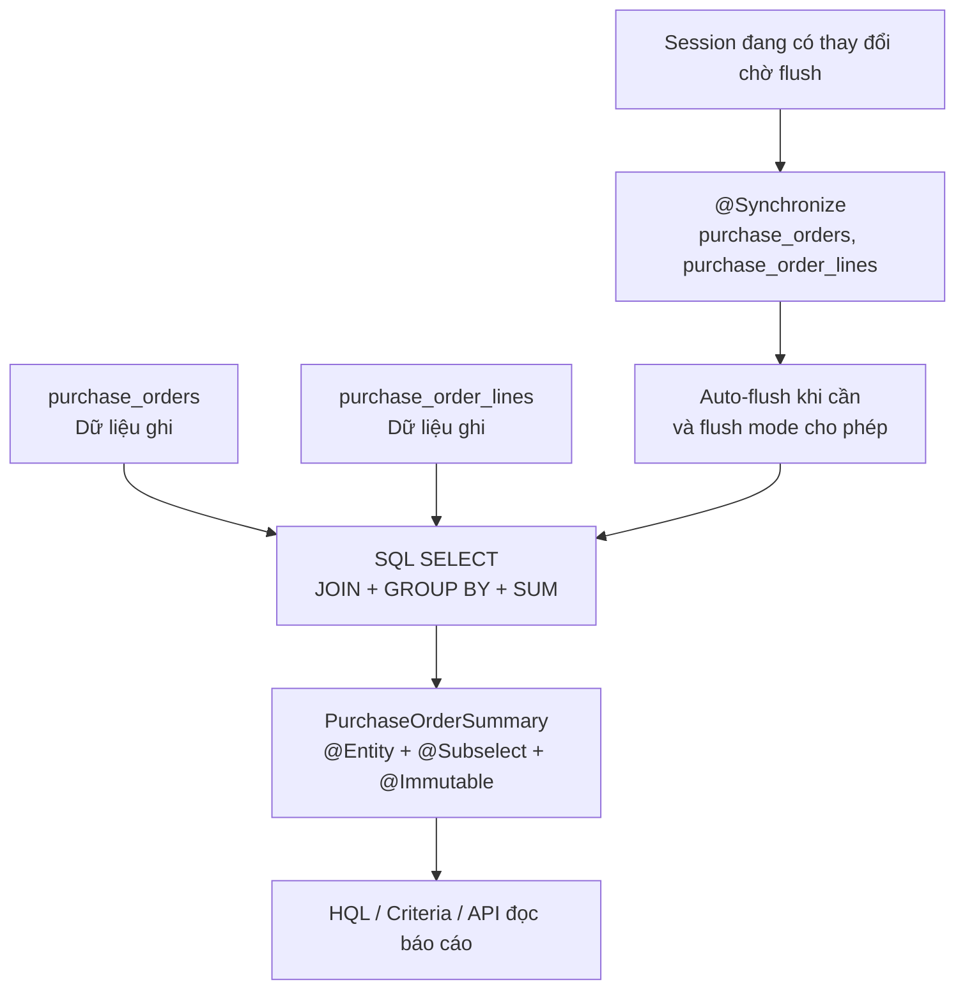
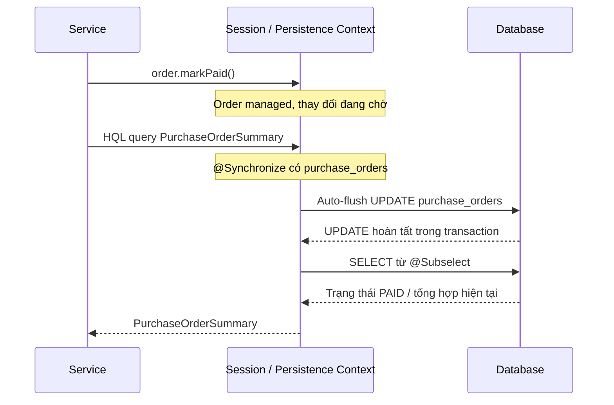

# Ánh xạ mô hình đọc qua @Subselect và khai báo đồng bộ bằng @Synchronize

## 1. Bài toán: dữ liệu cần đọc không phải lúc nào cũng là một bảng

Một entity Hibernate ORM thông thường được ánh xạ với một bảng:

```java
@Entity
@Table(name = "purchase_orders")
public class PurchaseOrder {
    @Id
    private Long id;
    // ...
}
```

Nhưng khi xây dashboard, báo cáo, trang quản trị hoặc API chỉ đọc, dữ liệu thường đến từ **nhiều bảng và phép tính tổng hợp**, chẳng hạn:

- Tổng tiền của mỗi đơn hàng = tổng của `quantity * unit_price` trên các dòng hàng.
- Số dòng hàng thuộc mỗi đơn.
- Trạng thái hiện tại của đơn, mã khách hàng và số tiền đã tính.
- Những chỉ số được kết hợp từ các bảng quan hệ mà không có một bảng riêng lưu sẵn kết quả.

Trong SQL, người lập trình có thể viết một câu `SELECT` với `JOIN`, `GROUP BY` và các hàm tổng hợp. Với Hibernate ORM, **`@Subselect`** cho phép ánh xạ **kết quả của câu SELECT ấy thành một entity chỉ đọc ở mức thiết kế**, thay vì bắt buộc entity được ánh xạ với bảng vật lý đơn lẻ.

Khi một `Session` vừa sửa các bảng nguồn, vừa đọc mô hình tổng hợp, lại phát sinh câu hỏi khác: **Hibernate có cần đẩy các thay đổi đang chờ xuống database trước khi truy vấn dữ liệu tổng hợp không?** Annotation **`@Synchronize`** giúp khai báo những bảng mà mô hình đọc phụ thuộc để Hibernate nhận diện nhu cầu *auto-flush* ở hoàn cảnh thích hợp.



Đây là một kỹ thuật của **Hibernate ORM**. `@Subselect`, `@Synchronize` và `@Immutable` thuộc API `org.hibernate.annotations`, không phải annotation tiêu chuẩn của Jakarta Persistence. Nếu dự án yêu cầu có thể chuyển đổi dễ dàng giữa các JPA provider, cần cân nhắc giải pháp tiêu chuẩn hơn như DTO projection hoặc ánh xạ một database view.

## 2. Phân biệt bảng ghi, mô hình đọc và database view

| Thành phần | Bản chất | Ai quản lý dữ liệu? | Dùng khi nào? |
|---|---|---|---|
| Entity có `@Table` | Ánh xạ bảng hoặc view theo tên | Entity có thể ghi nếu mapping và database cho phép | CRUD, dữ liệu nghiệp vụ |
| Entity có `@Subselect` | Ánh xạ kết quả của **SQL SELECT** được nhúng trong mapping | Các bảng nguồn được ghi bởi entity khác hoặc SQL; entity này nên chỉ đọc | Read model tổng hợp, báo cáo |
| Database `VIEW` | Câu truy vấn được định nghĩa trong database như một đối tượng schema | Database lưu định nghĩa view, thường không lưu trước từng hàng kết quả | Nhiều ứng dụng cùng truy vấn một read model ổn định |
| Materialized view | Kết quả truy vấn đã được materialize/lưu trong database | Database/ứng dụng quản lý việc refresh theo cơ chế DB | Báo cáo nặng, chấp nhận độ trễ cập nhật |
| DTO projection | Kết quả truy vấn trả thẳng về đối tượng không phải entity | Query/service quản lý | API chọn vài trường, không cần persistence identity |

**`@Subselect` không tự tạo bảng, không tạo database view và không tạo materialized view.** Hibernate dùng câu SQL đã khai báo làm nguồn dữ liệu khi truy vấn entity đó, thường bằng cách nhúng nó như một *derived table* trong câu SQL rộng hơn.

Ví dụ về ngữ nghĩa SQL mà Hibernate có thể phát ra:

```sql
SELECT s.order_id, s.total_amount
FROM (
    SELECT o.id AS order_id,
           COALESCE(SUM(l.quantity * l.unit_price), 0)
               AS total_amount
    FROM purchase_orders o
    LEFT JOIN purchase_order_lines l ON l.order_id = o.id
    GROUP BY o.id
) s
WHERE s.order_id = ?;
```

Tên alias, cột được chọn, cách bọc subquery và SQL cụ thể phụ thuộc phiên bản Hibernate, dialect và truy vấn ngoài. Điều quan trọng là mô hình đọc được xây từ **kết quả truy vấn**, chứ không trực tiếp từ một bảng tổng hợp được Hibernate duy trì.

## 3. Hai annotation giải quyết hai vấn đề khác nhau

### @Subselect: xác định nguồn hàng và cột

```java
import org.hibernate.annotations.Subselect;

@Subselect("""
    select ...
    from ...
    """)
```

Annotation này cung cấp SQL expression để Hibernate coi như nguồn dữ liệu cho entity. Các cột/alias của `SELECT` phải khớp với những thuộc tính entity được ánh xạ, và kết quả phải có **định danh ổn định**.

### @Synchronize: khai báo những bảng nguồn có ảnh hưởng tới kết quả

```java
import org.hibernate.annotations.Synchronize;

@Synchronize({
    "purchase_orders",
    "purchase_order_lines"
})
```

Annotation này giúp Hibernate biết rằng khi chuẩn bị truy vấn entity đọc, những thay đổi đang chờ đối với các bảng được liệt kê **có thể ảnh hưởng kết quả**. Dựa trên thông tin ấy và flush mode, Hibernate có thể tự động flush trước truy vấn để tránh đọc dữ liệu cũ trong cùng Session.

**Không được hiểu `@Synchronize` là cơ chế đồng bộ dữ liệu giữa database và ứng dụng theo thời gian thực.** Nó không tạo trigger, không đồng bộ đa máy chủ, không refresh materialized view và không tự cập nhật một entity đã được tải vào persistence context.

## 4. Cơ sở dữ liệu minh họa: đơn hàng và dòng hàng

Ta xây một mô hình đọc: mỗi đơn hàng có mã khách hàng, trạng thái, số dòng hàng và tổng tiền.

Schema PostgreSQL tham khảo:

```sql
CREATE TABLE purchase_orders (
    id BIGINT GENERATED BY DEFAULT AS IDENTITY PRIMARY KEY,
    customer_id BIGINT NOT NULL,
    status VARCHAR(20) NOT NULL
);

CREATE TABLE purchase_order_lines (
    id BIGINT GENERATED BY DEFAULT AS IDENTITY PRIMARY KEY,
    order_id BIGINT NOT NULL,
    quantity INTEGER NOT NULL,
    unit_price NUMERIC(14, 2) NOT NULL,
    CONSTRAINT fk_order_line_order
        FOREIGN KEY (order_id) REFERENCES purchase_orders(id),
    CONSTRAINT ck_order_line_quantity
        CHECK (quantity > 0),
    CONSTRAINT ck_order_line_unit_price
        CHECK (unit_price >= 0)
);

CREATE INDEX ix_order_line_order_id
    ON purchase_order_lines(order_id);
```

Trong ví dụ này, `customer_id` chỉ là mã khách hàng để đơn giản hóa mô hình; ứng dụng đầy đủ có thể dùng quan hệ tới `Customer` với khóa ngoại thích hợp.

Giả sử dữ liệu:

```text
purchase_orders
id   customer_id   status
101  7             NEW
102  9             NEW

purchase_order_lines
id   order_id   quantity   unit_price
1    101        2          15000.00
2    101        1           5000.00
```

Ta muốn kết quả:

| order_id | customer_id | status | line_count | total_amount |
|---|---|---|---:|---:|
| 101 | 7 | NEW | 2 | 35000.00 |
| 102 | 9 | NEW | 0 | 0.00 |

Lưu ý đơn `102` **không có dòng hàng**, nhưng vẫn phải xuất hiện với số lượng và tổng tiền bằng 0. Điều này tác động trực tiếp đến cách viết `LEFT JOIN`, `COUNT` và `COALESCE`.

## 5. Entity ghi dữ liệu: PurchaseOrder và PurchaseOrderLine

Ví dụ dùng Hibernate ORM 6.x, Jakarta Persistence và Java hỗ trợ text block (Java 15 trở lên; dùng Java 17+ là lựa chọn phổ biến). Các import dưới đây áp dụng cho entity ghi dữ liệu:

```java
package com.example.persistence;

import jakarta.persistence.Column;
import jakarta.persistence.Entity;
import jakarta.persistence.FetchType;
import jakarta.persistence.GeneratedValue;
import jakarta.persistence.GenerationType;
import jakarta.persistence.Id;
import jakarta.persistence.JoinColumn;
import jakarta.persistence.ManyToOne;
import jakarta.persistence.Table;

@Entity
@Table(name = "purchase_orders")
public class PurchaseOrder {

    @Id
    @GeneratedValue(strategy = GenerationType.IDENTITY)
    private Long id;

    @Column(name = "customer_id", nullable = false)
    private Long customerId;

    @Column(name = "status", nullable = false, length = 20)
    private String status;

    protected PurchaseOrder() {}

    public PurchaseOrder(Long customerId) {
        this.customerId = customerId;
        this.status = "NEW";
    }

    public Long getId() {
        return id;
    }

    public void markPaid() {
        this.status = "PAID";
    }
}
```

Entity dòng hàng:

```java
package com.example.persistence;

import jakarta.persistence.Column;
import jakarta.persistence.Entity;
import jakarta.persistence.FetchType;
import jakarta.persistence.GeneratedValue;
import jakarta.persistence.GenerationType;
import jakarta.persistence.Id;
import jakarta.persistence.JoinColumn;
import jakarta.persistence.ManyToOne;
import jakarta.persistence.Table;
import java.math.BigDecimal;

@Entity
@Table(name = "purchase_order_lines")
public class PurchaseOrderLine {

    @Id
    @GeneratedValue(strategy = GenerationType.IDENTITY)
    private Long id;

    @ManyToOne(fetch = FetchType.LAZY, optional = false)
    @JoinColumn(name = "order_id", nullable = false)
    private PurchaseOrder order;

    @Column(name = "quantity", nullable = false)
    private int quantity;

    @Column(
        name = "unit_price",
        nullable = false,
        precision = 14,
        scale = 2
    )
    private BigDecimal unitPrice;

    protected PurchaseOrderLine() {}

    public PurchaseOrderLine(
            PurchaseOrder order,
            int quantity,
            BigDecimal unitPrice) {
        if (order == null || quantity <= 0 || unitPrice == null) {
            throw new IllegalArgumentException(
                "Invalid order line"
            );
        }
        this.order = order;
        this.quantity = quantity;
        this.unitPrice = unitPrice;
    }
}
```

Hai class này ánh xạ các **bảng thật**, và Hibernate có thể thực hiện `INSERT`/`UPDATE` trên chúng theo transaction. Mô hình đọc ở phần tiếp theo có vai trò khác: cung cấp một **góc nhìn tổng hợp** từ hai bảng này.

## 6. Entity chỉ đọc với @Subselect, @Immutable và @Synchronize

Tạo class `PurchaseOrderSummary`:

```java
package com.example.persistence;

import jakarta.persistence.Column;
import jakarta.persistence.Entity;
import jakarta.persistence.Id;

import org.hibernate.annotations.Immutable;
import org.hibernate.annotations.Subselect;
import org.hibernate.annotations.Synchronize;

import java.math.BigDecimal;

@Entity
@Immutable
@Subselect("""
    SELECT
        o.id AS order_id,
        o.customer_id AS customer_id,
        o.status AS order_status,
        COUNT(l.id) AS line_count,
        COALESCE(
            SUM(l.quantity * l.unit_price),
            0
        ) AS total_amount
    FROM purchase_orders o
    LEFT JOIN purchase_order_lines l
        ON l.order_id = o.id
    GROUP BY o.id, o.customer_id, o.status
    """)
@Synchronize({
    "purchase_orders",
    "purchase_order_lines"
})
public class PurchaseOrderSummary {

    @Id
    @Column(name = "order_id")
    private Long orderId;

    @Column(name = "customer_id")
    private Long customerId;

    @Column(name = "order_status")
    private String status;

    @Column(name = "line_count")
    private Long lineCount;

    @Column(name = "total_amount")
    private BigDecimal totalAmount;

    protected PurchaseOrderSummary() {}

    public Long getOrderId() {
        return orderId;
    }

    public Long getCustomerId() {
        return customerId;
    }

    public String getStatus() {
        return status;
    }

    public Long getLineCount() {
        return lineCount;
    }

    public BigDecimal getTotalAmount() {
        return totalAmount;
    }
}
```

### Vai trò của từng annotation

| Annotation | Trong ví dụ này |
|---|---|
| `@Entity` | Cho phép Hibernate quản lý kết quả đọc như một entity có định danh và ánh xạ thuộc tính |
| `@Subselect` | Cung cấp câu SQL tổng hợp hai bảng làm nguồn dữ liệu |
| `@Id` | Chọn `order_id` là định danh duy nhất, ổn định của một hàng tổng hợp |
| `@Column` | Liên kết thuộc tính Java với **alias cột** được trả về từ câu SELECT |
| `@Immutable` | Đánh dấu entity không nên được sửa qua cơ chế dirty checking/update thông thường |
| `@Synchronize` | Khai báo hai bảng nguồn để Hibernate cân nhắc flush các thay đổi liên quan trước khi đọc |

Class này không cần `@Table(name = "...")` vì nguồn dữ liệu đã được cung cấp bởi `@Subselect`. Khai báo `@Immutable` làm rõ đây là **read model**; không dùng `persist(...)`, `merge(...)` hay `remove(...)` trên nó như một entity CRUD.

### Tại sao phải có @Id?

Hibernate ORM vẫn coi `PurchaseOrderSummary` là một **entity**. Entity phải có identifier để persistence context phân biệt các bản ghi.

Ở đây, mỗi đơn được gom thành **một hàng** nhờ `GROUP BY o.id, ...` và `order_id` là khóa đơn hàng, do đó `@Id` trên `orderId` có ý nghĩa.

Nếu đặt `@Id` trên một cột **không duy nhất** trong kết quả, chẳng hạn `status`, nhiều hàng tổng hợp có thể bị Hibernate hiểu là **cùng một entity**. Kết quả sẽ khó dự đoán và sai dữ liệu.

Một read model nhóm theo nhiều khóa, ví dụ `(customer_id, year, month)`, có thể cần **định danh ghép** bằng `@EmbeddedId` hoặc `@IdClass` nếu không có một khóa duy nhất ổn định. Không nên dùng `row_number()` làm ID nếu vị trí của hàng có thể thay đổi giữa hai lần truy vấn.

### Tại sao COUNT(l.id) chứ không dùng COUNT(*)?

Với `LEFT JOIN`, đơn hàng không có dòng hàng vẫn tạo một hàng SQL có các cột phía `l` bằng `NULL`. Vì vậy:

- `COUNT(*)` đếm hàng đó thành 1, dù không có dòng hàng thật.
- `COUNT(l.id)` chỉ đếm những dòng có `l.id` không-null, trả 0 đúng yêu cầu.
- `SUM(l.quantity * l.unit_price)` sẽ là `NULL` khi không có dòng; `COALESCE(..., 0)` chuyển thành 0.

Đây là vấn đề **ngữ nghĩa SQL**, không phải một hành vi đặc biệt của Hibernate.

## 7. Truy vấn mô hình đọc bằng HQL hoặc Session.find()

Sau khi đăng ký `PurchaseOrderSummary.class` vào metadata hoặc persistence unit, có thể dùng HQL:

```java
import org.hibernate.Session;
import org.hibernate.SessionFactory;
import org.hibernate.Transaction;

public PurchaseOrderSummary findSummary(
        SessionFactory sessionFactory,
        long orderId) {

    try (Session session = sessionFactory.openSession()) {
        Transaction tx = session.beginTransaction();
        try {
            PurchaseOrderSummary summary =
                session.createQuery(
                    "from PurchaseOrderSummary s " +
                    "where s.orderId = :orderId",
                    PurchaseOrderSummary.class
                )
                .setParameter("orderId", orderId)
                .uniqueResult();

            tx.commit();
            return summary;
        } catch (RuntimeException ex) {
            if (tx.isActive()) {
                tx.rollback();
            }
            throw ex;
        }
    }
}
```

Hoặc tải theo định danh:

```java
PurchaseOrderSummary summary =
    session.find(PurchaseOrderSummary.class, orderId);
```

`summary` có thể dùng để tạo DTO trả API hoặc hiển thị báo cáo. Khi Session đóng, đối tượng trả về trở thành **detached**, không tự làm mới khi những bảng nguồn thay đổi.

Với ứng dụng web, thường nên chuyển sang DTO trong transaction để kiểm soát dữ liệu đầu ra:

```java
public record OrderSummaryDto(
    Long orderId,
    String status,
    Long lineCount,
    BigDecimal totalAmount
) {}

OrderSummaryDto dto = new OrderSummaryDto(
    summary.getOrderId(),
    summary.getStatus(),
    summary.getLineCount(),
    summary.getTotalAmount()
);
```

Mô hình `@Subselect` cho phép bạn dùng cú pháp query và identity mapping quen thuộc của Hibernate, nhưng **không biến kết quả tổng hợp thành bảng có thể ghi**.

## 8. Vì sao @Synchronize quan trọng trong cùng một Session?

Hibernate thường **không phát SQL UPDATE ngay tại thời điểm bạn thay đổi một field** của entity đang managed. Nó có thể giữ thay đổi trong persistence context đến lúc flush, commit hoặc lúc cần thực hiện một query.

Ví dụ:

```java
PurchaseOrder order =
    session.find(PurchaseOrder.class, orderId);

order.markPaid(); // Chưa chắc đã có SQL UPDATE.

// Đọc read model cùng bảng nguồn.
PurchaseOrderSummary summary =
    session.createQuery(
        "from PurchaseOrderSummary s where s.orderId = :id",
        PurchaseOrderSummary.class
    )
    .setParameter("id", orderId)
    .uniqueResult();
```

Giả sử `status` trong database vẫn là `NEW`, còn đối tượng `order` trong Session đã là `PAID`. Nếu truy vấn tổng hợp được chạy **trước khi Hibernate flush UPDATE**, kết quả SQL có thể đọc trạng thái `NEW`. Đây là nguy cơ **không đồng bộ giữa thay đổi đang chờ và truy vấn read model**.

Hibernate có cơ chế *auto-flush* dựa trên những bảng (*query spaces*) mà câu truy vấn liên quan. Với entity ánh xạ bằng `@Table` thông thường, Hibernate có metadata để nhận diện bảng. Với câu SQL nằm trong `@Subselect`, việc xác định đầy đủ các bảng nền không nên phó mặc cho suy luận từ chuỗi SQL.

Khai báo:

```java
@Synchronize({
    "purchase_orders",
    "purchase_order_lines"
})
```

giúp Hibernate biết rằng **truy vấn `PurchaseOrderSummary` liên quan đến hai bảng này**.

### Diễn biến mong muốn khi dùng FlushMode.AUTO



Điều kiện là truy vấn được thực hiện trong phạm vi Session/transaction phù hợp, Hibernate nhận diện các thay đổi liên quan và **flush mode cho phép tự động flush**. Khi có thay đổi chưa flush ở bảng `purchase_order_lines`, khai báo tên bảng này cũng giúp Hibernate nhận diện phụ thuộc tương ứng.

### @Synchronize không có nghĩa query nào cũng flush

Nếu Session không có thay đổi liên quan, Hibernate có thể không cần flush. Nếu cấu hình `FlushMode.MANUAL`, hoặc môi trường dùng một chế độ flush khác với `AUTO`, hành vi auto-flush thay đổi theo hợp đồng của mode đó. `@Synchronize` **không ép buộc Hibernate bỏ qua flush mode do ứng dụng chọn**.

Khi một đơn vị công việc có yêu cầu đọc ngay trạng thái sau cập nhật, ứng dụng có thể gọi `session.flush()` trước truy vấn một cách tường minh. Tuy nhiên, việc thêm flush bằng tay không thay thế nhu cầu khai báo phụ thuộc đúng nếu hệ thống thường dựa vào auto-flush.

## 9. Query spaces: @Synchronize phải liệt kê những gì?

Với ví dụ:

```sql
FROM purchase_orders o
LEFT JOIN purchase_order_lines l ON l.order_id = o.id
```

read model phụ thuộc **cả `purchase_orders` và `purchase_order_lines`**. Nếu thay đổi status, tổng hợp có thể đổi; nếu thêm/xóa/sửa số lượng hoặc giá dòng hàng, `line_count` và `total_amount` có thể đổi.

Vì vậy:

```java
@Synchronize({"purchase_orders", "purchase_order_lines"})
```

Một số nguyên tắc:

1. Liệt kê **tên bảng mà SQL nguồn thực sự đọc**, không phải tên class `PurchaseOrder` hoặc `PurchaseOrderLine`.
2. Nếu subselect dùng thêm bảng `refunds` hoặc `discounts`, cần cân nhắc đưa các bảng ấy vào tập synchronized tables.
3. Khi thêm một `JOIN` mới hoặc thay đổi định nghĩa tính toán, cập nhật `@Synchronize` để phản ánh phụ thuộc mới.
4. Cẩn thận với naming strategy, schema/catalog và tên vật lý của bảng; dùng tên thực tế tương thích với mapping trong phiên bản và môi trường đang chạy.
5. Với view hoặc SQL phức tạp, không nên kỳ vọng Hibernate tự phân tích mọi dependency một cách hoàn hảo.

`@Synchronize` giúp Hibernate đưa ra quyết định auto-flush. Nó không tạo FK giữa read model và bảng nguồn, và cũng không làm cho bất kỳ thao tác ghi nào ở ngoài Hibernate được phát hiện theo thời gian thực.

## 10. Điểm rất dễ bỏ sót: data aliasing trong persistence context

Ngay cả khi đã khai báo `@Synchronize` chính xác, bạn **vẫn có thể đọc dữ liệu cũ nếu mô hình đọc đã được nạp trước đó trong cùng Session**.

Ví dụ:

```java
PurchaseOrderSummary before =
    session.find(PurchaseOrderSummary.class, orderId);

PurchaseOrder order =
    session.find(PurchaseOrder.class, orderId);
order.markPaid();

// Có thể auto-flush trước query nhờ @Synchronize.
PurchaseOrderSummary after =
    session.find(PurchaseOrderSummary.class, orderId);
```

Đây là tình huống hai entity mapping cùng biểu diễn những khía cạnh của **dữ liệu nền giống nhau**. `PurchaseOrderSummary` đã được Hibernate quản lý với cùng `@Id` trong persistence context, vì vậy `session.find(...)` lần hai có thể trả về **chính đối tượng `before` đang được giữ** mà không thực hiện SELECT mới. Nó không phải “ảnh chụp live” tự cập nhật khi một entity khác sửa bảng nguồn.

Đây là **data aliasing**: một Session có thể chứa cả entity ghi và entity read model cùng phản ánh một phần trạng thái database, nhưng Hibernate không có cách tổng quát để tự suy ra mọi cập nhật chéo.

### Vì sao @Synchronize không giải quyết hoàn toàn?

`@Synchronize` trả lời: **“Trước khi thực hiện query có liên quan, có cần flush thay đổi tới những bảng này không?”**

Nó không trả lời: **“Mọi entity `@Subselect` đang nằm trong first-level cache có phải được tính toán lại khi bất cứ entity nguồn nào thay đổi không?”**

Tương tự, `@Immutable` chỉ nói read model không được sửa theo cơ chế managed entity thông thường; nó **không biến instance trong Session thành kết quả reactive/live**.

### Các cách tổ chức an toàn hơn

- **Phân biệt đơn vị công việc ghi và đọc:** hoàn tất transaction ghi, rồi mở Session/persistence context mới để đọc read model.
- **Truy vấn sau khi flush và làm mới context khi cần:** có thể `session.flush()` rồi `session.clear()` trước khi đọc lại; chú ý `clear()` detach **toàn bộ entity** trong Session và loại bỏ thay đổi chưa flush.
- **Evict/detach đối tượng đã có trước khi query lại** nếu chỉ muốn làm mới một read model cụ thể, nhưng vẫn phải xử lý thay đổi đang chờ và transaction đúng cách.
- **Dùng DTO query** cho những luồng cần dữ liệu mới ngay mà không muốn chịu identity-map semantics của một read-only entity.

Ví dụ rõ ràng với hai Session:

```java
public PurchaseOrderSummary markPaidAndRead(
        SessionFactory factory,
        long orderId) {

    try (Session writeSession = factory.openSession()) {
        Transaction tx = writeSession.beginTransaction();
        try {
            PurchaseOrder order =
                writeSession.find(PurchaseOrder.class, orderId);
            if (order == null) {
                throw new IllegalArgumentException(
                    "Order not found: " + orderId
                );
            }
            order.markPaid();
            tx.commit();
        } catch (RuntimeException ex) {
            if (tx.isActive()) {
                tx.rollback();
            }
            throw ex;
        }
    }

    // Persistence context mới, không giữ summary cũ.
    try (Session readSession = factory.openSession()) {
        return readSession.find(PurchaseOrderSummary.class, orderId);
    }
}
```

Đây là ví dụ minh họa **hai đơn vị làm việc**, không phải công thức áp dụng cho mọi nghiệp vụ đòi tính nguyên tử. Nếu cần vừa ghi vừa đọc kết quả **bên trong cùng transaction**, có thể flush rồi quản lý trạng thái persistence context rõ ràng; không được commit sớm chỉ để tránh cache khi nghiệp vụ còn thao tác phải rollback cùng nhau.

## 11. @Immutable: đọc được nhưng không nên dùng để ghi

Trong Hibernate, `@Immutable` cho biết trạng thái entity không nên được thay đổi bằng dirty checking thông thường. Với một entity tổng hợp qua `@Subselect`, điều này phù hợp về ngữ nghĩa:

```java
@Entity
@Immutable
@Subselect("select ...")
public class PurchaseOrderSummary {
    // ...
}
```

### Những việc được kỳ vọng

- Truy vấn entity bằng `Session.find(...)`, HQL hoặc API phù hợp.
- Đọc các thuộc tính để tạo báo cáo, dashboard hay DTO.
- Dùng nó như một **mô hình truy vấn**, không làm nguồn ghi dữ liệu.

### Những việc không nên làm

```java
summary.setTotalAmount(new BigDecimal("999.00"));
session.persist(summary);
session.remove(summary);
```

Ví dụ trên là những thao tác **không có ý nghĩa nghiệp vụ** với mô hình tổng hợp. Tùy API và trạng thái của đối tượng, thao tác có thể bị bỏ qua, bị từ chối hoặc phát sinh lỗi; không nên dựa vào một hành vi ghi cụ thể để xây logic ứng dụng.

Tính bất biến của Hibernate **không phải constraint bảo mật ở database**. Nếu kết nối vẫn có quyền `UPDATE` các bảng nguồn, SQL native hoặc một ứng dụng khác vẫn có thể sửa chúng. Khi cần bảo vệ mô hình đọc ở mức hạ tầng, sử dụng database permissions, read-only connection/role và kiến trúc truy cập phù hợp.

### Có nên dùng setter?

Với read model, có thể chỉ công khai getter và giữ constructor `protected` cho Hibernate. Cách này giúp người đọc code thấy rõ entity là dữ liệu đọc, giảm nguy cơ service vô tình sửa các thuộc tính rồi mong Hibernate ghi xuống bảng nguồn.

## 12. Dữ liệu mới đến mức nào? Các loại “đồng bộ” khác nhau

Từ “đồng bộ” dễ gây hiểu nhầm. Trong kiến trúc này có ít nhất bốn lớp:

| Lớp | Câu hỏi | @Synchronize có giải quyết? |
|---|---|---|
| **Flush trong cùng Session** | Pending DML đã được gửi xuống DB trước query chưa? | **Có thể giúp** trong AUTO flush mode |
| **First-level cache** | Entity summary đã load có tự cập nhật theo entity nguồn không? | **Không** |
| **Thay đổi từ Session/ứng dụng khác** | Có nhận ngay mọi transaction đã commit ở nơi khác không? | **Không**; phụ thuộc transaction isolation/cache/đọc lại |
| **Materialized view hoặc cache ngoài** | Kết quả đã materialize có được refresh không? | **Không** |

### Flush không phải commit

`session.flush()` đồng bộ DML đang chờ xuống JDBC trong phạm vi transaction. Nó **không xác nhận transaction**. Nếu transaction rollback, những thay đổi đã flush có thể bị hủy theo ngữ nghĩa database.

### Transaction isolation vẫn có tác dụng

Ngay cả sau flush đúng, kết quả đọc vẫn tuân theo isolation level của transaction. Một transaction ở chế độ snapshot hoặc repeatable read có thể không thấy các commit từ transaction khác xảy ra sau snapshot của nó. Không thể dùng `@Synchronize` để bỏ qua isolation của database.

### Second-level cache và query cache cần cân nhắc riêng

Một read model tổng hợp thay đổi khi bất kỳ hàng nguồn nào thay đổi. Nếu bật caching không phù hợp, kết quả có thể cũ hơn mong đợi. Việc khai báo query spaces hỗ trợ một số cơ chế quản lý phụ thuộc của Hibernate, nhưng không đảm bảo mọi cache ngoài Hibernate hoặc mọi đường SQL native đều bị invalidation chính xác.

Với mô hình báo cáo cần dữ liệu mới, thường nên **bắt đầu không cache kết quả tổng hợp**, đo hiệu năng trước rồi mới quyết định TTL, invalidation và chính sách nhất quán.

## 13. SQL trong @Subselect: đặt alias và chọn khóa ổn định

Hibernate ánh xạ **tên cột trong kết quả SELECT** vào field qua `@Column`.

Ví dụ:

```sql
SELECT
    o.id AS order_id,
    COUNT(l.id) AS line_count,
    COALESCE(SUM(l.quantity * l.unit_price), 0) AS total_amount
...
```

Thì entity:

```java
@Id
@Column(name = "order_id")
private Long orderId;

@Column(name = "line_count")
private Long lineCount;

@Column(name = "total_amount")
private BigDecimal totalAmount;
```

Nếu một alias đổi từ `total_amount` thành `gross_total` nhưng entity vẫn dùng `@Column(name = "total_amount")`, Hibernate có thể gặp lỗi không tìm thấy cột trong SQL được phát sinh.

### Quy tắc định danh cho read model

Một entity ORM cần **một hàng logic tương ứng một ID ổn định**. Ví dụ:

| Cách nhóm dữ liệu | Có thể dùng @Id nào? | Nhận xét |
|---|---|---|
| Tổng tiền theo mỗi order | `order_id` | Duy nhất, ổn định |
| Doanh thu theo customer | `customer_id` | Chỉ phù hợp nếu một hàng/customer |
| Doanh thu theo customer và tháng | ID ghép gồm customer + năm + tháng | Cần mapping khóa ghép |
| Top sản phẩm với `row_number()` | Không nên dùng row number làm identity ổn định | Thứ hạng thay đổi khi dữ liệu thay đổi |
| SELECT chi tiết order JOIN nhiều line, nhưng chọn ID order | **Không phù hợp** nếu mỗi order xuất hiện nhiều hàng | Trùng ID dẫn tới data aliasing |

Nếu SQL tạo nhiều hàng cho một `@Id`, Hibernate không thể phân biệt các kết quả như các entity riêng biệt. Đừng gắn `@Id` tùy tiện chỉ để vượt qua yêu cầu entity ID.

## 14. Khả năng portable của SQL và phụ thuộc dialect

`@Subselect` nhận **SQL native**, không phải HQL/JPQL. Vì vậy:

- Tên bảng/cột trong câu `SELECT` là những tên mà database thực sự biết.
- Hàm như `STRING_AGG`, `DATE_TRUNC`, `JSONB_BUILD_OBJECT` hay cách cast có thể chỉ tồn tại trên một số database.
- Kiểu trả về của `COUNT`, `SUM`, `CASE`, `COALESCE` và cách làm tròn phụ thuộc hệ quản trị/driver.
- Cú pháp phân trang, alias, identifier quoting, schema và các hàm analytic/window cần được kiểm tra trên DB mục tiêu.

Ví dụ bài này dùng những phép SQL khá phổ biến (`LEFT JOIN`, `GROUP BY`, `SUM`, `COUNT`), nhưng **DDL PostgreSQL và lựa chọn kiểu Java vẫn cần được điều chỉnh** nếu chuyển sang MySQL, Oracle hoặc SQL Server.

### Không viết dấu chấm phẩy ở cuối SQL @Subselect

Hibernate thường bọc SQL subselect bên trong một câu SQL lớn hơn. Vì vậy:

```java
@Subselect("""
    SELECT id AS order_id FROM purchase_orders
    """)
```

phù hợp hơn việc thêm dấu `;` kết thúc như một script SQL độc lập. Dấu chấm phẩy trong chuỗi có thể làm derived-table SQL không hợp lệ trên một số database.

### Không đặt ORDER BY cố định nếu không cần

Thứ tự kết quả nên được quyết định bởi truy vấn ngoài:

```java
List<PurchaseOrderSummary> summaries =
    session.createQuery(
        "from PurchaseOrderSummary s " +
        "order by s.totalAmount desc, s.orderId asc",
        PurchaseOrderSummary.class
    ).setMaxResults(20)
     .getResultList();
```

Điều này giúp ứng dụng thay đổi sort và pagination mà không cần đưa `ORDER BY` vào mọi lần tính mô hình gốc.

## 15. @Subselect không nhận tham số động như một query thông thường

SQL của `@Subselect` được khai báo **cố định ở thời điểm mapping**, ví dụ:

```java
@Subselect("""
    SELECT o.id AS order_id, o.status AS order_status
    FROM purchase_orders o
    """)
```

Nó không phải một phương thức Java nhận `customerId` hay `fromDate` tại thời điểm gọi. Không nên viết SQL chứa placeholder tùy ý rồi kỳ vọng `setParameter(...)` của HQL tự bind tham số nằm **bên trong chuỗi annotation** như một native query động.

Nếu muốn lọc theo khách hàng từ mô hình đọc:

```java
List<PurchaseOrderSummary> summaries =
    session.createQuery(
        "from PurchaseOrderSummary s " +
        "where s.customerId = :customerId " +
        "order by s.orderId desc",
        PurchaseOrderSummary.class
    ).setParameter("customerId", customerId)
     .getResultList();
```

Hibernate sẽ áp điều kiện cho truy vấn ngoài. Tuy nhiên, **database có đẩy được điều kiện lọc xuống subquery trước khi tổng hợp hay không** là vấn đề optimizer; không phải mọi câu `SELECT` phức tạp đều được tối ưu giống nhau.

Với báo cáo mà người dùng tùy chọn nhiều điều kiện, phân vùng thời gian hoặc top-N động, cân nhắc **HQL/JPQL DTO projection**, Criteria API hoặc native SQL với `@SqlResultSetMapping`/DTO thay vì ép tất cả vào một `@Subselect` khổng lồ.

## 16. Hiệu năng: derived table có thể được tính lại khi truy vấn

`@Subselect` không lưu trước kết quả tổng hợp. Khi truy vấn, database có thể phải đọc bảng `purchase_order_lines`, join, group và aggregate.

Với dữ liệu lớn:

- Chỉ số trên `purchase_order_lines(order_id)` thường hữu ích cho join theo order.
- Điều kiện lọc và các index liên quan ở `purchase_orders` cần phù hợp với dashboard.
- `SUM`/`GROUP BY` có thể tốn CPU, RAM, disk spill hoặc thời gian đọc dữ liệu.
- Một read model có nhiều join đến bảng one-to-many có nguy cơ **nhân số dòng** trước aggregate, dẫn tới tổng sai nếu SQL không được thiết kế đúng.
- `fetch all` nhiều read model entities để tự lọc trong Java thường đắt hơn truy vấn có điều kiện và pagination.

Giả sử ngoài dòng hàng còn join trực tiếp bảng `order_discounts` có nhiều dòng trên mỗi order. Nếu một order có 3 lines và 2 discounts, phép join đơn giản có thể sinh 6 hàng, làm `SUM(line_amount)` bị nhân đôi. Khi đó cần tổng hợp trước từng tập, dùng subquery/CTE phù hợp hoặc một thiết kế SQL khác.

### Khi nào dùng database view hoặc materialized view?

Nếu logic tổng hợp dùng chung bởi nhiều ứng dụng, cần quản lý thay đổi bằng migration hoặc DBA muốn tối ưu/view permissions, **database view** có thể là lựa chọn tốt hơn. Nếu tổng hợp rất nặng và hệ thống chấp nhận dữ liệu cập nhật chậm, **materialized view hoặc bảng snapshot được job cập nhật** có thể giảm chi phí đọc.

Lưu ý: `@Synchronize` **không refresh materialized view**. Nếu một materialized view phải được refresh theo lịch hoặc sự kiện, cơ chế đó phải được triển khai ở database/ứng dụng riêng.

## 17. So sánh @Subselect, @Formula, VIEW và DTO projection

| Giải pháp | Trường hợp phù hợp | Ưu điểm | Đổi lại |
|---|---|---|---|
| **`@Subselect`** | Cả entity đọc được tạo từ kết quả SELECT phức tạp | Dùng `@Entity`, HQL, định danh ORM | Hibernate-specific, có data aliasing, SQL cố định |
| **`@Formula`** | Một thuộc tính được tính từ SQL expression | Bổ sung một field tính toán vào entity hiện tại | Không phải mô hình tổng hợp độc lập; SQL có thể tốn chi phí |
| **Database VIEW + `@Table`** | Mô hình đọc chia sẻ ở database | Quản lý DDL tập trung, nhiều client cùng dùng | Cần migration/view permissions; vẫn cần entity ID |
| **Materialized view** | Báo cáo nặng, chấp nhận trễ | Có thể đọc nhanh hơn nhờ dữ liệu lưu sẵn | Phải refresh; dữ liệu có thể cũ |
| **JPQL/HQL DTO projection** | API trả một tập trường theo filter động | Không có entity identity-map, portable hơn | Phải định nghĩa query/projection |
| **Native query -> DTO** | SQL phức tạp, phụ thuộc DB, filter động | Kiểm soát đầy đủ SQL và tham số | Mapping kết quả thủ công hoặc qua API mapping |

### @Formula khác thế nào?

`@Formula` thêm **một giá trị tính toán vào entity vốn đã ánh xạ với một bảng**, ví dụ:

```java
@Entity
@Table(name = "purchase_orders")
public class PurchaseOrder {
    @Id
    private Long id;

    @Formula("""
        (select coalesce(sum(l.quantity * l.unit_price), 0)
         from purchase_order_lines l
         where l.order_id = id)
        """)
    private BigDecimal calculatedTotal;
}
```

Ví dụ này mang tính minh họa về `@Formula`; việc tham chiếu cột outer query, trích dẫn identifier và SQL cụ thể phải phù hợp dialect và phiên bản Hibernate. Với `@Formula`, thuộc tính `calculatedTotal` gắn với **entity `PurchaseOrder`**, chứ không tạo một entity read model mới.

Đặc biệt, một giá trị `@Formula` đã được load vào entity cũng không tự thay đổi tức thì khi bảng dòng hàng thay đổi; cơ chế persistence context và làm mới dữ liệu vẫn cần được hiểu rõ.

### VIEW ánh xạ như bảng

Giả sử DBA tạo view:

```sql
CREATE VIEW v_purchase_order_summary AS
SELECT
    o.id AS order_id,
    o.customer_id,
    o.status AS order_status,
    COUNT(l.id) AS line_count,
    COALESCE(SUM(l.quantity * l.unit_price), 0) AS total_amount
FROM purchase_orders o
LEFT JOIN purchase_order_lines l ON l.order_id = o.id
GROUP BY o.id, o.customer_id, o.status;
```

ORM có thể ánh xạ:

```java
@Entity
@Immutable
@Table(name = "v_purchase_order_summary")
public class PurchaseOrderView {
    @Id
    @Column(name = "order_id")
    private Long orderId;
    // Các field đọc khác...
}
```

Đây là một lựa chọn tách rõ phần định nghĩa SQL (do database quản lý) và phần mapping (do ORM quản lý). Nếu ứng dụng cần đọc ngay sau thay đổi trong cùng Session, vẫn phải xem xét flush/query dependencies và trạng thái cache phù hợp.

## 18. Quy trình lựa chọn @Subselect cho một read model mới

**Bước 1 — Nêu rõ nhu cầu đọc.** Ví dụ “mỗi đơn hàng có số dòng và tổng tiền” là một read model hợp lý, vì kết quả có một hàng/đơn và nguồn dữ liệu xác định.

**Bước 2 — Viết SQL độc lập.** Kiểm tra `JOIN`, `GROUP BY`, `COUNT`, `SUM` và trường hợp không có dòng. Tách việc hiểu kết quả SQL khỏi việc ánh xạ bằng annotation.

**Bước 3 — Xác định khóa định danh.** Chọn các cột duy nhất, ổn định, không-null. Nếu không tìm được một `@Id` có ý nghĩa, xem lại mô hình hoặc dùng DTO projection.

**Bước 4 — Ánh xạ alias sang field Java.** Chọn kiểu `Long`, `BigDecimal`, `String` phù hợp JDBC result và tránh độ chính xác bị mất.

**Bước 5 — Đánh dấu read-only.** Dùng `@Immutable` và tránh tạo API CRUD đối với entity tổng hợp.

**Bước 6 — Liệt kê bảng nguồn trong `@Synchronize`.** Bao gồm mọi bảng có thay đổi cần flush trước khi đọc lại, không chỉ bảng chính.

**Bước 7 — Xác định transaction và cache boundaries.** Nếu vừa ghi vừa đọc, phân biệt auto-flush với entity đã load trong first-level cache; chọn cách đọc mới phù hợp.

**Bước 8 — Cân nhắc hiệu năng và độ portable.** Nếu query quá lớn, cần dữ liệu đã materialize hoặc chạy với nhiều DB, xem lại lựa chọn `@Subselect`, VIEW, DTO hay bảng snapshot.

## 19. Những lỗi thường gặp và hướng xử lý

### Lỗi 1 — Quên @Id hoặc chọn ID không duy nhất

Hibernate entity cần identifier. Dùng `status` làm `@Id` cho bảng tổng hợp nhiều đơn cùng trạng thái có thể khiến dữ liệu bị đồng nhất sai. Chọn khóa tự nhiên ổn định của từng hàng tổng hợp hoặc thiết kế composite ID.

### Lỗi 2 — Cho rằng @Subselect tự tạo bảng hay view

`@Subselect` chỉ cung cấp SQL làm nguồn mapping. Nó không thay thế migration cho các bảng nguồn, không tự tạo view, không đảm bảo thay đổi schema ở DB.

### Lỗi 3 — Sử dụng @Subselect như entity có thể ghi

Các cột tổng hợp như `SUM(...)` không có ánh xạ ngược hiển nhiên để `UPDATE` xuống các bảng nguồn. Thiết kế mô hình đọc bằng `@Immutable` và ghi dữ liệu qua `PurchaseOrder`, `PurchaseOrderLine` hoặc service nghiệp vụ.

### Lỗi 4 — Bỏ sót bảng trong @Synchronize

Nếu tổng tiền dựa trên `purchase_order_lines` nhưng chỉ liệt kê `purchase_orders`, Hibernate có thể không nhận diện pending DML ở dòng hàng là lý do để auto-flush trước query. Cập nhật danh sách theo phụ thuộc SQL thực tế.

### Lỗi 5 — Nghĩ @Synchronize luôn cho dữ liệu mới nhất

Nó hỗ trợ auto-flush trong cùng Session khi flush mode phù hợp, **không** làm mới entity summary đã load, không bỏ qua transaction isolation và không refresh cache/materialized view ngoài ORM.

### Lỗi 6 — Query sau update nhưng vẫn thấy status cũ

Kiểm tra:

1. Session có `FlushMode.AUTO` hay đang ở MANUAL/COMMIT?
2. `@Synchronize` có đúng tên bảng nguồn không?
3. Pending update đã flush/commit chưa?
4. `PurchaseOrderSummary` có **được load trước đó trong cùng Session** không?
5. Có second-level/query cache hoặc transaction isolation làm kết quả chưa thay đổi không?
6. Truy vấn thực tế có đang chạy trên đúng database và schema không?

Không chỉ nhìn `@Synchronize` để kết luận mọi lớp đã đồng bộ.

### Lỗi 7 — Sai alias hoặc kiểu dữ liệu cột tổng hợp

Nếu SQL dùng `AS amount_total` nhưng mapping dùng `@Column(name="total_amount")`, Hibernate không đọc được cột đúng tên. Với `SUM` hoặc `COUNT`, chọn Java type đủ rộng (`BigDecimal`, `Long`) và kiểm tra cách JDBC driver trả kiểu trên database đích.

### Lỗi 8 — SELECT làm nhân số dòng

Join nhiều bảng one-to-many có thể gây nhân kết quả trước khi tính tổng. Cần thiết kế SQL đúng, không mặc định `DISTINCT` trên kết quả cuối sẽ sửa được số tiền đã bị nhân trong phép `SUM`.

### Lỗi 9 — Dùng @Subselect cho báo cáo có tham số SQL động

Không nhúng placeholder tùy ý vào chuỗi annotation rồi trông chờ HQL parameter bind xuyên qua. Dùng filter bên ngoài hoặc chuyển sang query/DTO nếu phải thay đổi điều kiện bên trong phép tổng hợp.

### Lỗi 10 — Nhầm @Synchronize với đồng bộ đa hệ thống

Nó không gửi event, không cập nhật read replica và không hẹn giờ refresh. Với CQRS read store, cache phân tán hoặc materialized view, cần cơ chế cập nhật và mức nhất quán riêng.

## 20. Bài thực hành: doanh thu theo khách hàng

Một hệ thống cần dashboard có **một hàng trên mỗi khách hàng**, tổng số đơn và tổng doanh thu.

Yêu cầu:

1. Kết quả có `customer_id` làm định danh nếu một khách hàng chỉ tạo một hàng.
2. Bao gồm khách có đơn hàng nhưng không có dòng hàng; doanh thu phải là 0.
3. Khi đổi `status` đơn hoặc thêm dòng hàng trong cùng Session, Hibernate cần nhận biết những bảng nguồn để auto-flush trước query.
4. Không cho phép sửa `totalRevenue` thông qua dirty checking của read model.

Một SQL gợi ý (chỉ tính doanh thu trên các đơn `PAID`, và tính cả khách có đơn trạng thái khác với doanh thu bằng 0):

```sql
SELECT
    o.customer_id AS customer_id,
    COUNT(DISTINCT o.id) AS order_count,
    COALESCE(
        SUM(
            CASE WHEN o.status = 'PAID'
                THEN l.quantity * l.unit_price
                ELSE 0
            END
        ),
        0
    ) AS total_revenue
FROM purchase_orders o
LEFT JOIN purchase_order_lines l ON l.order_id = o.id
GROUP BY o.customer_id;
```

Trong query này, `COUNT(DISTINCT o.id)` tránh đếm một đơn nhiều lần do join nhiều dòng hàng. Nhưng nếu thêm nhiều bảng đa trị khác vào câu truy vấn, phép `SUM` vẫn có nguy cơ nhân tiền và cần thiết kế lại aggregate cho đúng.

Một mapping rút gọn:

```java
@Entity
@Immutable
@Subselect("""
    SELECT
        o.customer_id AS customer_id,
        COUNT(DISTINCT o.id) AS order_count,
        COALESCE(
            SUM(
                CASE WHEN o.status = 'PAID'
                    THEN l.quantity * l.unit_price
                    ELSE 0
                END
            ),
            0
        ) AS total_revenue
    FROM purchase_orders o
    LEFT JOIN purchase_order_lines l ON l.order_id = o.id
    GROUP BY o.customer_id
    """)
@Synchronize({"purchase_orders", "purchase_order_lines"})
public class CustomerRevenue {

    @Id
    @Column(name = "customer_id")
    private Long customerId;

    @Column(name = "order_count")
    private Long orderCount;

    @Column(name = "total_revenue")
    private BigDecimal totalRevenue;

    protected CustomerRevenue() {}
    // Getter...
}
```

Nhận xét:

- `customer_id` là định danh hợp lệ **cho tập khách hàng có ít nhất một đơn** trong query này; khách chưa có đơn không xuất hiện vì nguồn chính là `purchase_orders`.
- Nếu cần hiện cả khách **chưa có đơn**, SQL phải bắt đầu từ bảng `customers` rồi `LEFT JOIN` sang đơn và dòng hàng, và `@Synchronize` cần xét cả bảng `customers`.
- `@Immutable` diễn đạt mô hình chỉ đọc.
- `@Synchronize` giúp khai báo phụ thuộc bảng ghi; không tự làm mới entity đã có trong persistence context.

### Câu hỏi tự kiểm tra

1. Vì sao `@Subselect` vẫn cần `@Id` dù không ánh xạ một bảng vật lý?
2. Khi SQL phụ thuộc `orders` và `order_lines`, thiếu `order_lines` trong `@Synchronize` gây nguy cơ gì?
3. Vì sao đọc lại cùng entity ID bằng `Session.find()` trong cùng Session có thể cho giá trị cũ dù đã auto-flush?
4. `@Immutable` có làm database cấm SQL UPDATE vào bảng nguồn hay không?
5. Nếu cần báo cáo khách hàng chưa từng đặt đơn, cần đổi bảng gốc trong SQL thế nào?
6. Vì sao `COUNT(*)` sau `LEFT JOIN` có thể báo số dòng hàng là 1 cho đơn rỗng?

Gợi ý: (1) identity map vẫn cần khóa ổn định; (2) pending writes có thể chưa flush; (3) first-level cache trả instance đã quản lý; (4) không; (5) bắt đầu từ `customers` rồi left join; (6) `COUNT(*)` đếm cả hàng do left join tạo ra.

## 21. Tổng kết nguyên tắc kỹ thuật

1. **`@Subselect` ánh xạ một entity từ SQL SELECT**, phù hợp cho read model tổng hợp nhiều bảng mà không cần bảng kết quả riêng.
2. **Entity đọc vẫn cần `@Id` duy nhất, ổn định, không-null.** Một SELECT trả nhiều hàng cùng ID không tạo ra nhiều entity phân biệt.
3. **`@Immutable` thể hiện ý định chỉ đọc.** Ghi dữ liệu qua entity nguồn và transaction nghiệp vụ, không cố UPDATE một tổng hợp SQL.
4. **`@Synchronize` khai báo những bảng mà read model phụ thuộc**, giúp Hibernate cân nhắc auto-flush các thay đổi liên quan trước khi truy vấn trong chế độ flush phù hợp.
5. **Auto-flush không phải commit; @Synchronize không phải refresh.** Nó không đồng bộ entity đã load, cache ngoài, materialized view hay thay đổi từ nơi khác.
6. **Dữ liệu nguồn và read entity có thể bị aliasing trong cùng persistence context.** Khi cần snapshot mới, quản lý ranh giới Session/transaction hoặc refresh/detach và truy vấn lại có chủ đích.
7. **SQL trong `@Subselect` là native SQL cố định.** Alias, dialect, aggregate, join và kiểu JDBC cần được thiết kế đúng; filter động nhiều tham số có thể phù hợp hơn với DTO query.
8. **Kiểm soát chi phí đọc.** Index, điều kiện lọc, grouping và pagination quan trọng vì `@Subselect` không tự materialize kết quả.
9. **Chọn đúng công cụ:** `@Subselect` cho read entity ổn định trong Hibernate; `@Formula` cho thuộc tính tính toán; VIEW cho mô hình ở database; DTO/native query cho đầu ra linh hoạt; materialized view cho tổng hợp nặng chấp nhận độ trễ.

Khi thiết kế một mô hình đọc với Hibernate ORM, hãy hỏi tuần tự: **“SQL trả về đúng một hàng cho mỗi khóa nào?”, “những bảng nào góp phần tạo kết quả?”, “khi nào cần dữ liệu vừa ghi?”, và “mô hình đọc này có cần được quản lý như entity hay chỉ là DTO?”** Trả lời rõ các câu hỏi đó sẽ giúp sử dụng `@Subselect` và `@Synchronize` đúng mục đích mà không nhầm lẫn giữa đồng bộ transaction, cache và dữ liệu tổng hợp.

### Tài liệu tham khảo

- [Hibernate ORM — User Guide](https://docs.jboss.org/hibernate/orm/current/userguide/html_single/Hibernate_User_Guide.html)
- [Hibernate ORM — Javadocs: @Subselect](https://docs.jboss.org/hibernate/orm/current/javadocs/org/hibernate/annotations/Subselect.html)
- [Hibernate ORM — Javadocs: @Synchronize](https://docs.jboss.org/hibernate/orm/current/javadocs/org/hibernate/annotations/Synchronize.html)
- [Hibernate ORM — Javadocs: @Immutable](https://docs.jboss.org/hibernate/orm/current/javadocs/org/hibernate/annotations/Immutable.html)
- [Hibernate ORM — Javadocs: @Formula](https://docs.jboss.org/hibernate/orm/current/javadocs/org/hibernate/annotations/Formula.html)
- [Jakarta Persistence Specification](https://jakarta.ee/specifications/persistence/)
