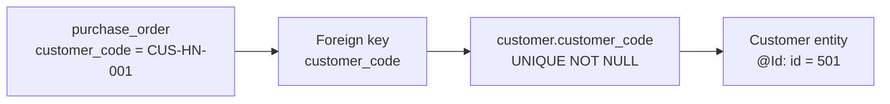

# Ánh xạ liên kết không theo khóa chính với điều kiện duy nhất rõ ràng trong Hibernate

Trong mô hình quan hệ, một hàng thường được tham chiếu qua **khóa chính** (`PRIMARY KEY`). Tuy nhiên, dữ liệu nghiệp vụ đôi khi đã có một cột hoặc một nhóm cột khác **duy nhất và có ý nghĩa ổn định**, chẳng hạn `customer_code`, `external_ref` hay cặp `(tenant_id, warehouse_code)`. Hibernate có thể ánh xạ một quan hệ đơn trị đến **khóa thay thế duy nhất** (*alternate unique key*) này thay vì đến cột primary key của entity đích.

Bài học tập trung vào ba câu hỏi:

1. Làm thế nào dùng `@JoinColumn(referencedColumnName = ...)` và `@JoinColumns` để chỉ rõ các cột được tham chiếu?
2. Làm thế nào bảo đảm các cột đó **thực sự xác định duy nhất một hàng**, chứ không chỉ “thường có giá trị khác nhau”?
3. Những đánh đổi nào xuất hiện khi khóa nghiệp vụ thay đổi, khi nhiều phiên bản ứng dụng chạy đồng thời, hoặc khi chuyển schema giữa các DBMS?

**Nguyên tắc bao trùm:** một liên kết nhiều-một hoặc một-một phải trỏ tới một đích **được định danh duy nhất**. Tên cột trong annotation không tự tạo tính duy nhất. Cần một **ràng buộc `UNIQUE`/`PRIMARY KEY` phù hợp trong database** và một chính sách quản lý giá trị khóa ổn định trong ứng dụng.

## 1. Phân biệt primary key, natural key và alternate unique key

Giả sử bảng `customer` có:

```sql
CREATE TABLE customer (
    id            BIGINT PRIMARY KEY,
    customer_code VARCHAR(40) NOT NULL UNIQUE,
    display_name  VARCHAR(150) NOT NULL
);
```

Hai cột có vai trò khác nhau:

- `id` là **khóa chính**; Hibernate dùng nó làm entity identifier thông thường nếu field Java gắn `@Id`.
- `customer_code` là một **khóa nghiệp vụ duy nhất**, nhưng **không phải `@Id`**. Nó có thể được dùng để tìm khách hàng và làm đích cho foreign key khác, nếu DBMS hỗ trợ ràng buộc đó.
- `display_name` không bảo đảm duy nhất và có thể đổi theo nhu cầu. Không phù hợp làm đích xác định một khách hàng.

Ví dụ dữ liệu:

| `id` | `customer_code` | `display_name` |
|---:|---|---|
| 501 | `CUS-HN-001` | Công ty An |
| 502 | `CUS-HCM-001` | Công ty Bình |
| 503 | `CUS-HCM-002` | Công ty Cường |

Một đơn hàng có thể lưu mã khách hàng:

```sql
CREATE TABLE purchase_order (
    id            BIGINT PRIMARY KEY,
    customer_code VARCHAR(40) NOT NULL,
    order_total   NUMERIC(15, 2) NOT NULL,
    CONSTRAINT fk_order_customer_code
        FOREIGN KEY (customer_code)
        REFERENCES customer(customer_code)
);
```

Đây là foreign key tham chiếu `customer.customer_code`, không tham chiếu `customer.id`.



Điều quan trọng là **Hibernate vẫn nhận diện entity `Customer` bằng `id`**, trong khi association đến entity đó có thể dùng `customer_code` để xác định bản ghi liên quan. Hai khái niệm “entity identifier” và “cột được foreign key tham chiếu” không nhất thiết trùng nhau.

### 1.1. “Natural key” và “alternate key” có hoàn toàn giống nhau?

Trong cách gọi thực hành:

- **Natural key / business key** là giá trị có ý nghĩa nghiệp vụ, ví dụ mã khách hàng do một hệ thống cấp.
- **Alternate key** là một bộ cột duy nhất khác với primary key, có thể dùng để định danh hàng.
- **Unique constraint** là biện pháp bảo vệ tính duy nhất ở database.

Một natural key không tự động là alternate key hợp lệ nếu dữ liệu còn trùng, nullable hoặc thiếu constraint. Ngược lại, một alternate key có thể là mã kỹ thuật ổn định, không nhất thiết mang ý nghĩa dễ đọc cho người dùng.

## 2. Mặc định quan hệ entity thường trỏ đến khóa chính

Với JPA/Hibernate, mapping thông dụng nhất là:

```java
@Entity
@Table(name = "purchase_order")
public class PurchaseOrder {

    @Id
    private Long id;

    @ManyToOne(fetch = FetchType.LAZY)
    @JoinColumn(name = "customer_id")
    private Customer customer;
}
```

Giả sử `Customer` có `@Id Long id`, Hibernate suy ra quan hệ:

```text
purchase_order.customer_id  ->  customer.id
```

Khi muốn tham chiếu mã khách hàng, ta phải chỉ rõ cột đích:

```java
@ManyToOne(fetch = FetchType.LAZY)
@JoinColumn(
    name = "customer_code",
    referencedColumnName = "customer_code"
)
private Customer customer;
```

`name` và `referencedColumnName` thuộc **hai phía khác nhau**:

| Thuộc tính annotation | Vai trò | Giá trị ví dụ |
|---|---|---|
| `name` | Cột foreign key ở bảng chứa association | `purchase_order.customer_code` |
| `referencedColumnName` | Cột được tham chiếu ở bảng entity đích | `customer.customer_code` |

Nếu bỏ `referencedColumnName`, Hibernate thường hiểu association tham chiếu khóa chính. Chỉ đổi `name = "customer_code"` **không đủ** để diễn đạt rằng cột đích cũng là `customer_code`.

## 3. Ví dụ đầy đủ: `@ManyToOne` trỏ tới cột duy nhất không phải `@Id`

### 3.1. Entity đích có primary key và business key riêng

```java
import jakarta.persistence.Column;
import jakarta.persistence.Entity;
import jakarta.persistence.Id;
import jakarta.persistence.Table;
import org.hibernate.annotations.NaturalId;

@Entity
@Table(name = "customer")
public class Customer {

    @Id
    private Long id;

    @NaturalId
    @Column(
        name = "customer_code",
        length = 40,
        nullable = false,
        unique = true,
        updatable = false
    )
    private String customerCode;

    @Column(name = "display_name", nullable = false)
    private String displayName;

    protected Customer() {
    }

    public Customer(Long id, String customerCode, String displayName) {
        this.id = id;
        this.customerCode = customerCode;
        this.displayName = displayName;
    }

    public Long getId() {
        return id;
    }

    public String getCustomerCode() {
        return customerCode;
    }

    public String getDisplayName() {
        return displayName;
    }
}
```

Ở đây:

- `@Id` vẫn gắn trên `id`.
- `@NaturalId` là annotation riêng của Hibernate, biểu thị `customerCode` là một phần natural identifier.
- `@Column(unique = true)` mô tả ràng buộc đơn cột cho cơ chế sinh schema; **migration/database phải thực sự có `UNIQUE`**.
- `updatable = false` và việc không công khai setter giúp giữ mã ổn định sau khi tạo entity.
- `nullable = false` tránh một natural key “không biết giá trị”, khó dùng làm đích của association.

**`@NaturalId` không thay thế `@Id`** và cũng không tự thay thế foreign key/unique constraint trong database. Nó cung cấp thêm metadata và API tìm kiếm theo natural identifier của Hibernate.

### 3.2. Entity nguồn dùng `referencedColumnName`

```java
import jakarta.persistence.Column;
import jakarta.persistence.Entity;
import jakarta.persistence.FetchType;
import jakarta.persistence.ForeignKey;
import jakarta.persistence.Id;
import jakarta.persistence.JoinColumn;
import jakarta.persistence.ManyToOne;
import jakarta.persistence.Table;
import java.math.BigDecimal;

@Entity
@Table(name = "purchase_order")
public class PurchaseOrder {

    @Id
    private Long id;

    @ManyToOne(fetch = FetchType.LAZY, optional = false)
    @JoinColumn(
        name = "customer_code",
        referencedColumnName = "customer_code",
        nullable = false,
        foreignKey = @ForeignKey(name = "fk_order_customer_code")
    )
    private Customer customer;

    @Column(name = "order_total", nullable = false)
    private BigDecimal orderTotal;

    protected PurchaseOrder() {
    }

    public PurchaseOrder(
            Long id,
            Customer customer,
            BigDecimal orderTotal) {
        this.id = id;
        this.customer = customer;
        this.orderTotal = orderTotal;
    }

    public Long getId() {
        return id;
    }

    public Customer getCustomer() {
        return customer;
    }

    public BigDecimal getOrderTotal() {
        return orderTotal;
    }
}
```

Khi ghi `PurchaseOrder` trỏ tới `Customer` có `customerCode = "CUS-HN-001"`, giá trị được lưu ở bảng đơn hàng là mã khách hàng:

```sql
INSERT INTO purchase_order (id, customer_code, order_total)
VALUES (9001, 'CUS-HN-001', 125000.00);
```

Không có `customer_id` trong bảng `purchase_order` ở ví dụ này. Vì vậy không nên nghĩ rằng mọi association entity của Hibernate phải dùng khóa `@Id` làm foreign key vật lý.

### 3.3. Truy vấn qua association

JPQL/HQL thao tác trên thuộc tính Java:

```java
List<PurchaseOrder> orders = entityManager.createQuery(
    "select o from PurchaseOrder o " +
    "where o.customer.customerCode = :code",
    PurchaseOrder.class
)
.setParameter("code", "CUS-HN-001")
.getResultList();
```

Trong SQL, phép nối có thể tương đương:

```sql
SELECT o.id, o.order_total
FROM purchase_order o
JOIN customer c ON o.customer_code = c.customer_code
WHERE c.customer_code = 'CUS-HN-001';
```

Một số truy vấn có thể được tối ưu thành điều kiện trực tiếp trên foreign key, hoặc Hibernate có thể phát ra SQL khác. Điều cố định về ngữ nghĩa là liên kết dựa trên `customer_code`, không dựa trên `customer.id`.

### 3.4. Tìm theo natural ID khác với định nghĩa association

Hibernate có API tìm entity bằng natural identifier:

```java
import org.hibernate.Session;

Session session = entityManager.unwrap(Session.class);

Customer customer = session.byNaturalId(Customer.class)
    .using("customerCode", "CUS-HN-001")
    .load();
```

Đây là cách **tìm `Customer` theo natural ID**, không phải câu lệnh định nghĩa phép nối cho `PurchaseOrder.customer`.

- `@NaturalId` cung cấp metadata cho khả năng tìm kiếm và quản lý natural identifier.
- `@JoinColumn(referencedColumnName = "customer_code")` cho biết association dùng cột nào của bảng đích.
- Ràng buộc `UNIQUE(customer_code)` và foreign key vật lý là phần đảm bảo tính toàn vẹn ở database.

Không dùng `@NaturalId` thay `@JoinColumn`, cũng không coi `@Column(unique = true)` là đủ để framework biết phải join đến cột non-PK.

## 4. Tính duy nhất là điều kiện dữ liệu bắt buộc, không chỉ là lựa chọn tên

Nếu bảng `customer` chứa hai hàng trùng `customer_code`, một dòng `purchase_order` có mã đó sẽ không còn xác định một khách hàng duy nhất.

Ví dụ dữ liệu không hợp lệ:

| `customer.id` | `customer_code` |
|---:|---|
| 501 | `CUS-001` |
| 502 | `CUS-001` |

Nếu `purchase_order.customer_code = 'CUS-001'`, phép join có thể trả **hai hàng**:

```sql
SELECT o.id, c.id AS customer_id
FROM purchase_order o
JOIN customer c
  ON o.customer_code = c.customer_code
WHERE o.id = 9001;
```

Với một thuộc tính Java `@ManyToOne Customer customer`, Hibernate không thể coi hai customer khác nhau là một association đơn trị chính xác.

Vì vậy:

1. **Dữ liệu hiện hữu phải không trùng** theo cùng quy tắc so sánh mà database sử dụng.
2. **Database phải duy trì tính duy nhất** bằng `UNIQUE` hoặc khóa tương đương.
3. **Ứng dụng phải thống nhất quy tắc cấp và thay đổi mã** với các hệ thống cùng ghi dữ liệu.
4. **Foreign key phải tham chiếu đúng bộ cột được bảo vệ là duy nhất**.

Chỉ kiểm tra bằng câu `SELECT` trước khi insert không đủ để bảo vệ concurrency: hai transaction có thể đồng thời thấy mã chưa tồn tại rồi cùng insert. Unique constraint của database mới chặn được race này.

### 4.1. Đích cần duy nhất; nguồn không nhất thiết duy nhất

Với `@ManyToOne`, **nhiều** đơn hàng được phép tham chiếu **một** khách hàng:

```text
purchase_order.customer_code = CUS-001
purchase_order.customer_code = CUS-001
purchase_order.customer_code = CUS-001
                           |
                           v
                  customer.customer_code = CUS-001 (duy nhất)
```

Không được thêm `unique = true` vào `@JoinColumn` ở bảng đơn hàng nếu nghiệp vụ là many-to-one, vì như vậy có thể buộc mỗi mã khách hàng chỉ xuất hiện trong một đơn hàng.

**`UNIQUE` ở bảng đích** và **`UNIQUE` ở cột foreign key của bảng nguồn** là hai ràng buộc với ý nghĩa khác nhau.

| Ràng buộc | Bảng | Ý nghĩa |
|---|---|---|
| `UNIQUE(customer_code)` | `customer` | Mỗi mã xác định tối đa một khách hàng |
| `FOREIGN KEY(customer_code)` | `purchase_order` | Mỗi mã đơn hàng trỏ đến một mã khách hàng hợp lệ |
| `UNIQUE(customer_code)` | `purchase_order` | Mỗi khách hàng có tối đa một đơn hàng — thường **sai** với `@ManyToOne` |

## 5. `@OneToOne` tham chiếu cột không phải primary key

Giả sử một khách hàng có tối đa một cấu hình ưu tiên liên hệ, lưu trong bảng `customer_preference`. Bảng này dùng khóa chính riêng, nhưng liên kết qua `customer_code`:

```sql
CREATE TABLE customer_preference (
    id BIGINT PRIMARY KEY,
    customer_code VARCHAR(40) NOT NULL UNIQUE,
    contact_channel VARCHAR(20) NOT NULL,
    CONSTRAINT fk_preference_customer
        FOREIGN KEY (customer_code)
        REFERENCES customer(customer_code)
);
```

Mapping phía preference:

```java
@Entity
@Table(name = "customer_preference")
public class CustomerPreference {

    @Id
    private Long id;

    @OneToOne(fetch = FetchType.LAZY, optional = false)
    @JoinColumn(
        name = "customer_code",
        referencedColumnName = "customer_code",
        nullable = false,
        unique = true
    )
    private Customer customer;

    @Column(name = "contact_channel", nullable = false)
    private String contactChannel;
}
```

Ở đây có **hai tính duy nhất** cần phân biệt:

- `customer.customer_code` phải duy nhất để xác định khách hàng ở **bảng đích**.
- `customer_preference.customer_code` phải duy nhất để bảo đảm **tối đa một preference trên mỗi khách hàng**.

Nếu bỏ unique constraint ở bảng `customer_preference`, database có thể cho nhiều dòng preference trỏ đến cùng một customer, trái với semantics one-to-one mà Java đang khai báo.

Một quan hệ hai chiều có thể khai báo `@OneToOne(mappedBy = "customer")` ở `Customer`, nhưng phía inverse không nên tự khai báo thêm `@JoinColumn` cho cùng mối quan hệ. Phía sở hữu là entity chứa cột FK.

## 6. Tham chiếu một nhóm cột UNIQUE thay vì một cột

Trong hệ thống nhiều đơn vị thuê, mã kho `warehouse_code` có thể chỉ duy nhất **trong từng tenant**. Một mình `warehouse_code` không xác định kho toàn cục.

Ví dụ:

| `warehouse.id` | `tenant_id` | `warehouse_code` |
|---:|---:|---|
| 101 | 10 | `WH-01` |
| 102 | 20 | `WH-01` |
| 103 | 10 | `WH-02` |

Dữ liệu hợp lệ vì cặp `(tenant_id, warehouse_code)` là duy nhất.

DDL:

```sql
CREATE TABLE warehouse (
    id BIGINT PRIMARY KEY,
    tenant_id BIGINT NOT NULL,
    warehouse_code VARCHAR(30) NOT NULL,
    display_name VARCHAR(100) NOT NULL,
    CONSTRAINT uq_warehouse_tenant_code
        UNIQUE (tenant_id, warehouse_code)
);

CREATE TABLE stock_movement (
    id BIGINT PRIMARY KEY,
    tenant_id BIGINT NOT NULL,
    warehouse_code VARCHAR(30) NOT NULL,
    quantity_change INTEGER NOT NULL,
    CONSTRAINT fk_movement_warehouse_code
        FOREIGN KEY (tenant_id, warehouse_code)
        REFERENCES warehouse (tenant_id, warehouse_code)
);
```

Ở bảng `warehouse`, primary key vẫn chỉ là `id`. Foreign key của `stock_movement` tham chiếu **khóa thay thế ghép**, không tham chiếu khóa primary key ghép.

### 6.1. Khai báo unique constraint ghép tại entity đích

```java
import jakarta.persistence.Column;
import jakarta.persistence.Entity;
import jakarta.persistence.Id;
import jakarta.persistence.Table;
import jakarta.persistence.UniqueConstraint;

@Entity
@Table(
    name = "warehouse",
    uniqueConstraints = @UniqueConstraint(
        name = "uq_warehouse_tenant_code",
        columnNames = {"tenant_id", "warehouse_code"}
    )
)
public class Warehouse {

    @Id
    private Long id;

    @Column(name = "tenant_id", nullable = false, updatable = false)
    private Long tenantId;

    @Column(
        name = "warehouse_code",
        length = 30,
        nullable = false,
        updatable = false
    )
    private String warehouseCode;

    @Column(name = "display_name", nullable = false)
    private String displayName;

    protected Warehouse() {}

    public Long getId() { return id; }
    public Long getTenantId() { return tenantId; }
    public String getWarehouseCode() { return warehouseCode; }
}
```

`@Table(uniqueConstraints = ...)` mô tả **tính duy nhất của cặp cột**. Không đặt `@Column(unique = true)` cho `tenantId` hoặc `warehouseCode` riêng rẽ, vì hai cột đó **không duy nhất khi xét độc lập**.

Nếu ứng dụng cần API tìm theo cặp natural ID của Hibernate, có thể khai báo `@NaturalId` trên từng thuộc tính thành phần để tạo một natural ID nhiều thuộc tính; đây là metadata bổ sung, không thay cho unique constraint ghép vật lý.

### 6.2. Khai báo `@JoinColumns` ở entity nguồn

```java
import jakarta.persistence.Entity;
import jakarta.persistence.FetchType;
import jakarta.persistence.Id;
import jakarta.persistence.JoinColumn;
import jakarta.persistence.JoinColumns;
import jakarta.persistence.ManyToOne;
import jakarta.persistence.Table;

@Entity
@Table(name = "stock_movement")
public class StockMovement {

    @Id
    private Long id;

    @ManyToOne(fetch = FetchType.LAZY, optional = false)
    @JoinColumns({
        @JoinColumn(
            name = "tenant_id",
            referencedColumnName = "tenant_id",
            nullable = false
        ),
        @JoinColumn(
            name = "warehouse_code",
            referencedColumnName = "warehouse_code",
            nullable = false
        )
    })
    private Warehouse warehouse;

    private int quantityChange;

    protected StockMovement() {}

    public Warehouse getWarehouse() { return warehouse; }
}
```

Mỗi `@JoinColumn` là một **cặp**:

| Cột ở `stock_movement` | Cột ở `warehouse` |
|---|---|
| `tenant_id` | `tenant_id` |
| `warehouse_code` | `warehouse_code` |

Hibernate cần thực hiện phép nối theo **đồng thời hai điều kiện**:

```sql
SELECT m.id, w.id AS warehouse_id, w.display_name
FROM stock_movement m
JOIN warehouse w
  ON m.tenant_id = w.tenant_id
 AND m.warehouse_code = w.warehouse_code;
```

Nếu chỉ join theo `warehouse_code`, movement của tenant 10 có thể tìm nhầm warehouse thuộc tenant 20. Nếu chỉ join theo `tenant_id`, một movement có thể khớp nhiều warehouse của cùng tenant.

### 6.3. Một unique constraint ghép khác hai unique constraint đơn

| Quy tắc | Có cho phép tenant 10 và tenant 20 cùng có `WH-01`? | Có cho phép tenant 10 có `WH-01` và `WH-02`? |
|---|---|---|
| `UNIQUE(tenant_id, warehouse_code)` | Có | Có |
| `UNIQUE(tenant_id)` và `UNIQUE(warehouse_code)` riêng | Không | Không |
| Không có UNIQUE | Có, nhưng có thể còn duplicate cả cặp | Có |

Vì vậy, khi tham chiếu business key ghép, phải bảo vệ **tổ hợp**, không áp đặt sai tính duy nhất từng thành phần.

### 6.4. Tính di động của liên kết tới composite alternate key

`@JoinColumns` là annotation JPA cho association đa cột, nhưng **tham chiếu tới bộ cột không phải primary key** có thể được provider/JPA version hỗ trợ khác nhau. Hibernate có các khả năng mapping đến unique property hoặc natural identifier, song các trường hợp non-PK phức tạp cần kiểm tra với đúng Hibernate version, dialect và schema triển khai.

Nếu ứng dụng cần tính di động JPA cao hoặc phải hỗ trợ nhiều provider, **foreign key tham chiếu primary key** vẫn là thiết kế ít phụ thuộc implementation hơn. Việc có unique constraint ghép ở database là điều kiện cần về tính toàn vẹn; nó không tự bảo đảm mọi provider ORM chấp nhận mọi dạng mapping non-PK.

## 7. Cột duy nhất không nhất thiết là khóa ổn định

Một giá trị có thể duy nhất hôm nay nhưng vẫn là **khóa tham chiếu kém** nếu dễ thay đổi.

Ví dụ email của khách hàng:

```text
customer.email = "old@example.com"
purchase_order.customer_email = "old@example.com"
```

Nếu khách hàng đổi email thành `"new@example.com"`, tất cả hàng nguồn tham chiếu email cũ trở thành vấn đề cần xử lý. Tùy ràng buộc DBMS và chính sách cập nhật, database có thể:

- Từ chối thay đổi vì còn foreign key đang tham chiếu.
- Cho phép thay đổi nếu cấu hình `ON UPDATE CASCADE` phù hợp.
- Để ứng dụng thực hiện migration/đồng bộ có kiểm soát theo giao dịch.

Ngay cả khi database hỗ trợ cascade, **persistence context của Hibernate đang giữ các entity và association cũ không tự được làm mới chỉ vì database cập nhật cột bằng cascade**. Cần tính đến cache, transaction đang chạy, dữ liệu ngoại vi và các hệ thống tích hợp.

### 7.1. Nên ưu tiên mã không đổi sau khi cấp

Khóa nghiệp vụ phù hợp để được tham chiếu thường có các thuộc tính:

- Có tính duy nhất được database bảo đảm.
- Không `NULL` đối với bản ghi được tham chiếu.
- Không dễ sửa do nhu cầu hiển thị, pháp lý hoặc thao tác của người dùng.
- Được cấp một lần rồi giữ ổn định; không tái sử dụng mã cũ cho đối tượng khác.
- Có kiểu dữ liệu, chuẩn hóa và quy tắc so sánh nhất quán giữa nguồn và đích.

Một `customer_code` bất biến thường phù hợp hơn `email`, `display_name` hoặc số điện thoại — các thông tin vốn có thể thay đổi trong vòng đời khách hàng.

### 7.2. `@NaturalId(mutable = true)` không làm foreign key an toàn hơn

Hibernate có metadata `@NaturalId(mutable = true)` cho trường hợp natural ID thay đổi được. Tuy nhiên, **tính mutable trong ORM không tự giải quyết các ràng buộc tham chiếu vật lý**.

Nếu khóa được nhiều bảng dùng làm foreign key, việc cho phép đổi nó yêu cầu kế hoạch cập nhật đầy đủ, phù hợp constraint, transaction, cache và cách Hibernate nhận biết thay đổi. Trong đa số thiết kế, dùng primary key ổn định để tham chiếu vẫn đơn giản hơn nếu business key phải đổi thường xuyên.

## 8. `NULL`, UNIQUE và tính hợp lệ của foreign key

### 8.1. `UNIQUE` không tự động đồng nghĩa với `NOT NULL`

Nhiều DBMS cho phép nhiều giá trị `NULL` trong một cột có unique constraint (chi tiết phụ thuộc DBMS và kiểu constraint). Nếu cột alternate key có thể null, khó dùng nó để xác định một entity đơn trị.

Ví dụ:

```sql
CREATE TABLE customer (
    id BIGINT PRIMARY KEY,
    customer_code VARCHAR(40) UNIQUE
);
```

Không nên giả định rằng constraint này bảo đảm mọi khách hàng đều có một mã để được tham chiếu. Thiết kế phù hợp hơn khi mã là khóa tham chiếu:

```sql
customer_code VARCHAR(40) NOT NULL UNIQUE
```

### 8.2. Foreign key tùy chọn có thể `NULL` ở bảng nguồn

Với association tùy chọn:

```java
@ManyToOne(optional = true)
@JoinColumn(
    name = "customer_code",
    referencedColumnName = "customer_code",
    nullable = true
)
private Customer customer;
```

`purchase_order.customer_code = NULL` có thể biểu thị chưa gắn khách hàng. Điều này **không yêu cầu** `customer.customer_code` cũng phải nullable. Trái lại, đích vẫn nên dùng `NOT NULL UNIQUE` để mọi mã cụ thể định danh rõ ràng.

### 8.3. Composite alternate key có nhiều thành phần null

Với `UNIQUE(tenant_id, warehouse_code)`, một số DBMS cho phép các cặp chứa `NULL` trùng theo semantics của chúng. Khi hai cột cùng tham gia identity nghiệp vụ và foreign key, nên khai báo chúng `NOT NULL` ở bảng đích.

Ở bảng nguồn, nếu association tùy chọn, hai cột có thể cùng nullable. Nhưng một foreign key ghép thường không tự chặn trường hợp một phần `NULL` theo quy tắc `MATCH SIMPLE` thông dụng.

Có thể thêm check constraint:

```sql
ALTER TABLE stock_movement
ADD CONSTRAINT ck_movement_warehouse_pair
CHECK (
    (tenant_id IS NULL AND warehouse_code IS NULL)
    OR
    (tenant_id IS NOT NULL AND warehouse_code IS NOT NULL)
);
```

Nếu `tenant_id` là khóa định danh tenant bắt buộc của chính movement, việc cho nó `NULL` có thể không hợp lệ ngay cả khi warehouse tùy chọn. Khi đó nên **thiết kế lại cột tham chiếu hoặc chính sách nullable** để không làm mơ hồ tenant identity; ví dụ có hai cột riêng cho scope tenant và mã warehouse tùy chọn, hoặc dùng warehouse primary key.

## 9. Tên cột, kiểu dữ liệu và quy tắc so sánh phải tương thích

Hibernate xác định phép nối từ metadata, còn DBMS thi hành constraint theo **kiểu SQL và quy tắc so sánh thực tế**.

Với mã khách hàng:

```text
customer.customer_code       VARCHAR(40)
purchase_order.customer_code VARCHAR(40)
```

Nên thống nhất:

1. **Kiểu dữ liệu:** `VARCHAR` với `VARCHAR`, độ dài đủ cho mã nghiệp vụ.
2. **Collation/case sensitivity:** `CUS-001` và `cus-001` có được coi là trùng nhau không?
3. **Chuẩn hóa:** có cho phép khoảng trắng thừa, chữ hoa/chữ thường lẫn lộn hoặc ký tự Unicode tương đương không?
4. **Encoding và DBMS:** các môi trường kiểm thử và sản xuất có cùng semantics không?
5. **Index và constraint:** cột đích có unique index/constraint đúng dạng mà foreign key có thể tham chiếu không?

Ví dụ nếu Java so sánh hai chuỗi theo phân biệt hoa/thường nhưng database dùng collation không phân biệt, ứng dụng và DB có thể không đồng ý liệu hai mã là khác nhau. Cần thống nhất quy tắc chuẩn hóa mã **trước khi lưu**.

**Không phải mọi unique index dạng expression đều là một đích foreign key hợp lệ.** Chẳng hạn index duy nhất trên `lower(email)` không đồng nghĩa có thể khai báo `FOREIGN KEY(email) REFERENCES customer(lower(email))` như một FK chuẩn. Nếu cần join theo giá trị đã chuẩn hóa, có thể lưu **một cột mã chuẩn hóa vật lý** với unique constraint rõ ràng và tham chiếu cột đó.

### 9.1. Kiểm tra quy tắc duy nhất bằng SQL

Trước khi tạo unique constraint cho dữ liệu hiện hữu:

```sql
SELECT customer_code, COUNT(*) AS occurrences
FROM customer
GROUP BY customer_code
HAVING COUNT(*) > 1;
```

Nếu mã bắt buộc:

```sql
SELECT COUNT(*) AS missing_codes
FROM customer
WHERE customer_code IS NULL;
```

Cần đánh giá việc `GROUP BY` so sánh chuỗi theo collation của database. Nếu ứng dụng sẽ chuẩn hóa mã bằng cách trim/uppercase, phải rà soát trùng lặp **theo cùng quy tắc chuẩn hóa dự định**, không chỉ theo biểu diễn cũ.

## 10. Vòng đời lưu entity và vai trò của cascade

Khi dùng association non-PK:

```java
Customer customer = entityManager.find(Customer.class, 501L);

PurchaseOrder order = new PurchaseOrder(
    9001L,
    customer,
    new BigDecimal("125000.00")
);

entityManager.persist(order);
```

Hibernate sử dụng thông tin association để ghi mã khách hàng phù hợp vào `purchase_order.customer_code`. Trong ví dụ này, `customer` là entity đã tồn tại và có `customerCode` hợp lệ.

Điểm cần nhớ:

- `@ManyToOne` **không mặc định cascade persist** entity cha.
- `CascadeType.PERSIST` không nên được bật tùy tiện ở quan hệ nhiều đơn hàng đến cùng một khách hàng, vì đơn hàng thường không sở hữu vòng đời tạo khách hàng.
- Association dựa trên business key phải bảo đảm **giá trị đích đã được cấp hợp lệ** trước khi ghi foreign key.
- Database foreign key mới là ràng buộc cuối cùng ngăn việc ghi mã không tồn tại ở bảng đích.

Nếu ứng dụng tự tạo `Customer` mới rồi ghi `PurchaseOrder` trong cùng transaction, thứ tự thao tác và cơ chế sinh identifier/cascade phải hợp lệ. Không thể dùng foreign key trỏ đến một mã chưa được lưu mà kỳ vọng database tự suy ra hàng đích.

### 10.1. Không gán bừa một proxy chỉ có `@Id` rồi kỳ vọng business key luôn sẵn có

Với association tham chiếu primary key, nhiều trường hợp `EntityManager.getReference` giúp tạo tham chiếu bằng ID mà không tải đầy đủ entity. Với association tham chiếu **non-PK unique key**, Hibernate có thể cần biết giá trị mã thực tế của entity đích để ghi FK. Việc chỉ có `id` Java không phải lúc nào cũng đủ để tạo `customer_code` trong câu `INSERT` mà không truy cập dữ liệu bổ sung.

Nếu use case đầu vào chỉ có customer code, một hướng rõ ràng là truy vấn customer theo code trong unit of work phù hợp, kiểm tra tồn tại rồi gán association. Việc chọn API tối ưu cần dựa trên Hibernate version và mapping thực tế; không coi non-PK association có đúng tất cả đặc điểm tối ưu như association trỏ PK.

## 11. Tính di động giữa JPA và Hibernate

`@JoinColumn` và `@JoinColumns` là annotation chuẩn Jakarta Persistence. Tuy nhiên, việc dùng `referencedColumnName` để chỉ đến **cột không phải primary key**, nhất là alternate key ghép, là khu vực cần lưu ý **tính di động**.

Hibernate hỗ trợ nhiều dạng association đến unique key/natural key mà một số provider JPA khác có thể hỗ trợ hạn chế hoặc hành xử khác. Tính phù hợp còn phụ thuộc:

- Phiên bản Hibernate và Jakarta Persistence được sử dụng.
- Cách mapping column, column override và identifier.
- Kiểu quan hệ (`@ManyToOne`, `@OneToOne`, join table).
- Hibernate Dialect, JDBC metadata và DDL/constraint của DBMS.
- Các tính năng như natural-id cache, mutable natural ID hoặc khóa ghép.

**Không suy luận “annotation đúng cú pháp” là “mọi JPA provider đều diễn giải giống nhau”.** Với hệ thống cần độc lập provider, chọn FK trỏ đến `@Id` vẫn là phương án an toàn và phổ biến.

Đối với một hệ thống Hibernate cố định, non-PK mapping có thể là lựa chọn hợp lý khi schema legacy hoặc hợp đồng dữ liệu yêu cầu tham chiếu bằng mã. Khi đó cần tài liệu hóa sự phụ thuộc này và kiểm tra đúng database/mapping được triển khai.

## 12. Tối ưu truy vấn và cache khi dùng business key

### 12.1. Index ở cả hai phía

Unique constraint trên `customer.customer_code` thường được DBMS hỗ trợ bằng index hoặc cấu trúc tương ứng. Tuy vậy, **index ở bảng nguồn** `purchase_order.customer_code` có thể vẫn cần thiết để truy vấn tất cả đơn hàng của một khách.

Ví dụ:

```sql
CREATE INDEX idx_order_customer_code
ON purchase_order(customer_code);
```

Không phải DBMS nào cũng tự tạo index cho foreign key ở bảng nguồn. Khi order tăng nhanh, việc lọc hoặc join theo `customer_code` cần được kiểm tra bằng execution plan.

Với unique key ghép `(tenant_id, warehouse_code)`, thứ tự cột của index có thể ảnh hưởng đến truy vấn chỉ lọc theo `tenant_id`. Thiết kế index theo predicate thực tế, không chỉ theo mapping Java.

### 12.2. Natural-id cache không thay thế tính duy nhất

Hibernate có cơ chế cache natural ID trong những cấu hình phù hợp, chẳng hạn `@NaturalIdCache` cùng second-level cache đã được bật và cấu hình.

Cache có thể tăng tốc một số lần tìm từ natural ID sang entity identifier. Nhưng nó **không**:

- Tạo ràng buộc `UNIQUE` trong database thay cho migration.
- Biến mã mutable thành bất biến.
- Bảo đảm ứng dụng khác không ghi dữ liệu trùng.
- Thay thế foreign key constraint.
- Tự động sửa dữ liệu khi mã nghiệp vụ đổi ở hệ thống bên ngoài.

Hãy phân biệt tối ưu lookup với tính đúng đắn của relationship. Tính duy nhất và tính toàn vẹn là quy tắc dữ liệu, không phải một tính năng cache.

### 12.3. Fetch plan vẫn là vấn đề riêng

Một `@ManyToOne` tới business key có thể được cấu hình `LAZY`, nhưng các truy vấn thực tế, proxy, thời điểm lấy natural key và phiên bản Hibernate có thể tạo SQL bổ sung. Khi có yêu cầu hiệu năng, đo số query và kế hoạch thực thi thay vì chỉ nhìn `fetch = FetchType.LAZY`.

Nếu endpoint chỉ cần mã khách hàng từ bảng order, projection chọn cột FK hoặc DTO có thể phù hợp hơn việc tải đầy đủ `Customer` entity.

## 13. Khi schema đã có foreign key đến primary key nhưng muốn dùng business key

Không phải cứ ứng dụng thường truy vấn bằng `customer_code` là phải đổi physical foreign key từ `customer_id` sang mã đó.

Một mô hình phổ biến:

```sql
CREATE TABLE customer (
    id BIGINT PRIMARY KEY,
    customer_code VARCHAR(40) NOT NULL UNIQUE
);

CREATE TABLE purchase_order (
    id BIGINT PRIMARY KEY,
    customer_id BIGINT NOT NULL,
    FOREIGN KEY (customer_id) REFERENCES customer(id)
);
```

Mapping giữ FK theo ID:

```java
@ManyToOne(fetch = FetchType.LAZY)
@JoinColumn(name = "customer_id")
private Customer customer;
```

Ứng dụng vẫn có thể lọc đơn hàng theo natural key:

```java
List<PurchaseOrder> orders = entityManager.createQuery(
    "select o from PurchaseOrder o " +
    "where o.customer.customerCode = :code",
    PurchaseOrder.class
)
.setParameter("code", "CUS-HN-001")
.getResultList();
```

Hibernate sẽ sinh phép join/thao tác phù hợp mà không cần chuyển foreign key vật lý sang `customer_code`.

Đây thường là phương án **ít phụ thuộc vào độ ổn định của mã nghiệp vụ** hơn:

- Database có khóa `id` bất biến để liên kết.
- `customer_code` có thể được dùng để tìm kiếm, validate input hoặc tích hợp.
- Nếu mã thay đổi, foreign key ở order không cần đổi.

**Chỉ chọn non-PK association khi có lý do thực tế:** schema legacy đã dùng business key, yêu cầu tương thích với hệ thống ngoài, quy tắc định danh thực sự ổn định, hoặc cần giữ cấu trúc quan hệ đặc thù.

## 14. Migration từ foreign key theo ID sang foreign key theo mã

Giả sử hiện tại `purchase_order.customer_id` tham chiếu `customer.id`, nhưng hệ thống legacy bắt buộc chuyển sang `purchase_order.customer_code`.

Không nên đổi annotation và xóa cột `customer_id` ngay lập tức. Quy trình có thể cần các giai đoạn sau.

### 14.1. Chuẩn hóa và bảo vệ mã đích

Trước tiên:

- Xác nhận mọi `customer` được tham chiếu đều có `customer_code`.
- Tìm các mã trùng hoặc chỉ khác nhau ở cách viết nếu hệ thống yêu cầu chuẩn hóa.
- Làm sạch dữ liệu bất thường.
- Tạo `NOT NULL`/`UNIQUE` phù hợp trên `customer.customer_code`.
- Quyết định chính sách mã có được đổi sau khi cấp hay không.

Ví dụ kiểm tra:

```sql
SELECT customer_code, COUNT(*)
FROM customer
GROUP BY customer_code
HAVING COUNT(*) > 1;
```

### 14.2. Bổ sung cột nguồn và backfill

```sql
ALTER TABLE purchase_order
ADD COLUMN customer_code VARCHAR(40);

UPDATE purchase_order o
SET customer_code = (
    SELECT c.customer_code
    FROM customer c
    WHERE c.id = o.customer_id
);
```

Câu SQL backfill dùng correlated subquery chỉ minh họa. Trên bảng lớn, nên dùng phương án phù hợp DBMS, chia đợt và kiểm soát thời gian khóa.

Kiểm tra cột còn thiếu:

```sql
SELECT COUNT(*) AS missing_codes
FROM purchase_order
WHERE customer_code IS NULL;
```

### 14.3. Thêm ràng buộc và cập nhật ứng dụng theo từng giai đoạn

Khi backfill đã đúng, tạo foreign key mới:

```sql
ALTER TABLE purchase_order
ADD CONSTRAINT fk_order_customer_code
FOREIGN KEY (customer_code)
REFERENCES customer(customer_code);
```

Nếu mã là bắt buộc và mọi hàng đều đã có giá trị, có thể đặt `NOT NULL` theo kế hoạch migration thích hợp.

Trong rolling deployment, một số bản ứng dụng cũ có thể còn ghi `customer_id` trong khi bản mới đọc `customer_code`. Cần thiết kế **giai đoạn ghi tương thích** hoặc cơ chế chuyển đổi phù hợp, tránh tạo hàng mới chỉ có một trong hai cột.

Chỉ sau khi:

- Tất cả luồng đọc/ghi đã sử dụng cột mới.
- Dữ liệu hiện hữu và dữ liệu phát sinh trong quá trình chuyển đổi đã được đồng bộ.
- Các báo cáo, job và hệ thống tích hợp không còn cần cột cũ.
- Có kế hoạch rollback rõ ràng.

... mới cân nhắc bỏ `customer_id` và foreign key cũ. Các thao tác DDL nên do migration tool quản lý theo khả năng và chính sách của dự án.

### 14.4. Chuyển theo chiều ngược lại

Nếu đang dùng business-key FK nhưng muốn về PK FK, có thể:

1. Thêm cột `customer_id` ở bảng nguồn.
2. Backfill bằng join từ mã đang tham chiếu sang `customer.id`.
3. Phát hiện mã không khớp và bản ghi orphan trước khi thêm constraint.
4. Tạo FK đến `customer(id)`.
5. Chuyển mapping/ứng dụng qua cột ID.
6. Bỏ mã FK cũ khi mọi đường sử dụng đã đổi.

Chiều chuyển này thường giúp tách “identity liên kết” khỏi mã hiển thị có thể thay đổi.

## 15. Xử lý lỗi và kiểm tra dữ liệu khi tham chiếu non-PK

| Triệu chứng | Nguyên nhân khả dĩ | Hướng kiểm tra |
|---|---|---|
| Hibernate báo không tìm thấy cột được tham chiếu | `referencedColumnName` dùng tên property Java thay vì tên SQL | Đối chiếu `@Column` và naming strategy |
| Mapping khởi động nhưng association trỏ sai | Có mã trùng hoặc join thiếu thành phần composite key | Kiểm tra unique constraint và điều kiện join đầy đủ |
| Database từ chối tạo foreign key | Cột đích không có ràng buộc unique phù hợp, kiểu/collation không tương thích, dữ liệu orphan | Xem DDL và diagnostic của DBMS |
| Ghi order mới bị foreign key violation | Mã customer chưa tồn tại, bị đổi hoặc viết sai | Truy vấn bảng đích theo mã thực tế |
| `@OneToOne` trả dữ liệu bất thường | Bảng nguồn thiếu unique constraint trên FK | Thêm constraint bảo vệ cardinality đúng |
| Nhiều dòng nguồn trỏ cùng customer nhưng không ghi được | Lỡ đặt `unique = true` trên FK nguồn trong `@ManyToOne` | Bỏ unique constraint sai ở nguồn; giữ UNIQUE ở đích |
| Hibernate báo repeated column mapping | Field scalar mã và association cùng muốn ghi một cột | Chọn một mapping ghi, mapping kia read-only nếu cần |
| Đổi mã khách hàng làm update lỗi | Mã đang được bảng khác tham chiếu | Giữ mã bất biến hoặc thiết kế migration/cascade phù hợp |
| App chạy đúng ở một DBMS, lỗi ở DBMS khác | Khác nhau về collation, unique nullable, khả năng FK đến alternate key | Kiểm tra schema và Hibernate Dialect của môi trường đích |
| JPQL truy vấn không thấy dữ liệu | Nhầm tên entity/property với tên cột SQL | Viết đường dẫn Java đúng; quan sát SQL Hibernate sinh |

### 15.1. Chẩn đoán association sai bằng SQL

Với ví dụ đơn hàng và khách hàng:

```sql
-- Tìm mã ở nguồn không khớp mã ở đích.
SELECT o.id, o.customer_code
FROM purchase_order o
LEFT JOIN customer c
  ON o.customer_code = c.customer_code
WHERE o.customer_code IS NOT NULL
  AND c.id IS NULL;

-- Tìm mã đích bị trùng.
SELECT customer_code, COUNT(*) AS cnt
FROM customer
GROUP BY customer_code
HAVING COUNT(*) > 1;
```

Nếu database đã có foreign key và unique constraint hợp lệ, dữ liệu vi phạm như vậy không được phép phát sinh qua các thao tác SQL thông thường. Chúng đặc biệt hữu ích để **kiểm tra trước migration** hoặc tìm sai lệch trong schema legacy chưa có ràng buộc.

Với alternate key ghép:

```sql
SELECT m.id, m.tenant_id, m.warehouse_code
FROM stock_movement m
LEFT JOIN warehouse w
  ON m.tenant_id = w.tenant_id
 AND m.warehouse_code = w.warehouse_code
WHERE w.id IS NULL;
```

Nếu relation tùy chọn, cần loại trừ những hàng có cặp FK cùng `NULL` theo đúng quy tắc nghiệp vụ. Query trên chỉ mang tính chẩn đoán tổng quát, không phân loại mọi trường hợp null.

## 16. Những anti-pattern cần tránh

### 16.1. “Dữ liệu hiện giờ chưa trùng nên khỏi cần UNIQUE”

Không đủ. Dữ liệu có thể trùng sau một insert mới, race giữa hai transaction, job nhập dữ liệu hoặc lỗi tích hợp. **Unique constraint là phần của hợp đồng dữ liệu**, không phải bước tối ưu tùy chọn.

### 16.2. “`@JoinColumn(unique = true)` sẽ làm cột đích duy nhất”

Không đúng. `unique = true` trên `@JoinColumn` thường mô tả ràng buộc trên **cột join ở bảng nguồn**, có thể thay đổi cardinality. Unique constraint của cột đích cần khai báo ở bảng đích và tồn tại vật lý trong database.

### 16.3. “Đã có `@NaturalId` thì không cần `referencedColumnName`”

Không đúng. Khi association phải trỏ tới cột khác PK, cần nêu rõ cột đích trong metadata join phù hợp. `@NaturalId` và `referencedColumnName` giải quyết hai trách nhiệm khác nhau.

### 16.4. “Tạo unique constraint cho từng cột của khóa ghép”

Nếu `(tenant_id, warehouse_code)` là khóa duy nhất **theo cặp**, đặt `UNIQUE` riêng trên `tenant_id` và `warehouse_code` sẽ chặn dữ liệu hợp lệ. Phải bảo vệ **cả cặp** và join đủ cả hai.

### 16.5. “Email có UNIQUE thì an toàn để dùng làm FK”

Không nhất thiết. Email thường đổi, có thể được chuẩn hóa khác nhau và có ý nghĩa bảo mật/riêng tư. Nếu dùng email làm FK, việc đổi email sẽ lan đến nhiều bảng và giao dịch. Khóa surrogate `id` thường bền vững hơn.

### 16.6. “Hibernate sẽ tự sửa toàn bộ schema theo annotation”

Không đúng. Khi dùng `ddl-auto=validate` hoặc schema được quản lý bằng migration, Hibernate không tự tạo `UNIQUE`/FK còn thiếu. Ngay cả khi bật cơ chế tự tạo schema, các giới hạn DBMS và version vẫn áp dụng.

### 16.7. “Unique constraint ở DB là đủ cho mọi Hibernate provider”

Ràng buộc database đảm bảo **tính toàn vẹn**, nhưng không chứng minh mọi provider JPA hỗ trợ mọi loại mapping non-PK. Cần xác định phiên bản Hibernate và kiểm tra hành vi chính xác với schema của ứng dụng.

## 17. Bài thực hành: ánh xạ thiết bị theo mã duy nhất trong từng nhà máy

Một nhà máy có nhiều thiết bị; mã `device_code` chỉ duy nhất **trong phạm vi nhà máy**. Mỗi lần đo thông số của thiết bị được ghi ở bảng `measurement`.

DDL:

```sql
CREATE TABLE device (
    id BIGINT PRIMARY KEY,
    plant_code VARCHAR(20) NOT NULL,
    device_code VARCHAR(30) NOT NULL,
    model_name VARCHAR(100),
    CONSTRAINT uq_device_plant_code
        UNIQUE (plant_code, device_code)
);

CREATE TABLE measurement (
    id BIGINT PRIMARY KEY,
    plant_code VARCHAR(20) NOT NULL,
    device_code VARCHAR(30) NOT NULL,
    reading_value NUMERIC(12, 4) NOT NULL,
    CONSTRAINT fk_measurement_device
        FOREIGN KEY (plant_code, device_code)
        REFERENCES device(plant_code, device_code)
);
```

Entity đích `Device` vẫn dùng khóa chính đơn:

```java
@Entity
@Table(
    name = "device",
    uniqueConstraints = @UniqueConstraint(
        name = "uq_device_plant_code",
        columnNames = {"plant_code", "device_code"}
    )
)
public class Device {

    @Id
    private Long id;

    @Column(name = "plant_code", nullable = false)
    private String plantCode;

    @Column(name = "device_code", nullable = false)
    private String deviceCode;

    private String modelName;
}
```

### 17.1. Yêu cầu

1. Khai báo `Measurement.device` là `@ManyToOne` tham chiếu đến cặp mã thay vì `device.id`.
2. Giải thích vì sao dùng duy nhất `device_code` để join có thể sai.
3. Giải thích vì sao unique constraint phải nằm trên **cặp** `(plant_code, device_code)`.
4. Nếu muốn mỗi device chỉ có tối đa một measurement, cần đổi quan hệ và thêm ràng buộc gì ở bảng nguồn?
5. Nếu mã thiết bị có thể được người vận hành thay đổi, có nên tiếp tục dùng nó làm foreign key không?

### 17.2. Đáp án và mapping tham khảo

```java
@Entity
@Table(name = "measurement")
public class Measurement {

    @Id
    private Long id;

    @ManyToOne(fetch = FetchType.LAZY, optional = false)
    @JoinColumns({
        @JoinColumn(
            name = "plant_code",
            referencedColumnName = "plant_code",
            nullable = false
        ),
        @JoinColumn(
            name = "device_code",
            referencedColumnName = "device_code",
            nullable = false
        )
    })
    private Device device;

    @Column(name = "reading_value", nullable = false)
    private BigDecimal readingValue;
}
```

Đoạn này cần các import Jakarta Persistence và `java.math.BigDecimal` như các ví dụ trước.

- `@JoinColumns` ghép `measurement.plant_code → device.plant_code` và `measurement.device_code → device.device_code`.
- Chỉ dùng `device_code` sẽ nhầm thiết bị cùng mã ở hai nhà máy khác nhau.
- `UNIQUE(plant_code, device_code)` là ràng buộc đúng; không yêu cầu từng cột duy nhất độc lập.
- Nếu là one-to-one, đổi thành `@OneToOne` và đặt `UNIQUE(plant_code, device_code)` **ở bảng `measurement`** nữa để mỗi device có tối đa một measurement; kiểm tra xem đó có thực sự đúng nghiệp vụ lưu nhiều lần đo hay không.
- Nếu mã thiết bị dễ đổi, nên cân nhắc lưu `measurement.device_id` tham chiếu `device.id`, trong khi vẫn giữ unique constraint trên `(plant_code, device_code)` để tìm và kiểm tra mã nghiệp vụ.

### 17.3. Truy vấn kiểm tra

JPQL sử dụng tên property:

```java
List<Measurement> measurements = entityManager.createQuery(
    "select m from Measurement m " +
    "where m.device.plantCode = :plant " +
    "and m.device.deviceCode = :device",
    Measurement.class
)
.setParameter("plant", "PLANT-01")
.setParameter("device", "D-007")
.getResultList();
```

Ở lớp Java, `plantCode` và `deviceCode` là thuộc tính của `Device`. Ở SQL, phép nối dựa trên hai cặp cột `plant_code`/`device_code` mà mapping đã định nghĩa.

## 18. Nguyên tắc ghi nhớ

- **`@Id` của entity đích không bắt buộc là cột vật lý mà mọi foreign key phải tham chiếu**, nhưng tham chiếu non-PK cần được thiết kế có chủ đích và kiểm tra khả năng hỗ trợ của Hibernate/provider.
- **`@JoinColumn(name = ..., referencedColumnName = ...)`** xác định rõ cột nguồn và cột đích khi join đến alternate unique key.
- **`@JoinColumns`** xác định nhiều cặp cột cho khóa duy nhất ghép; phải bao gồm đầy đủ thành phần làm nên tính duy nhất.
- **`@NaturalId`** là metadata/khả năng lookup của Hibernate; nó không thay thế `@Id`, `@JoinColumn` hoặc unique constraint thực tế.
- **Tính duy nhất cần được database bảo vệ**, đặc biệt khi có nhiều transaction, ứng dụng hoặc job cùng ghi.
- **Unique ở bảng đích và unique ở bảng nguồn có ý nghĩa khác nhau**: `@ManyToOne` không cần unique FK nguồn, `@OneToOne` thường cần.
- **Khóa nghiệp vụ nên ổn định, không null và có quy tắc so sánh thống nhất**; một giá trị chỉ “đang không trùng” chưa đủ.
- **Khóa thay thế ghép cần constraint theo cả bộ cột**, không đặt unique riêng lẻ một cách sai lệch.
- **Đổi mã đã được tham chiếu là một thay đổi dữ liệu**, không chỉ refactor tên thuộc tính Java.
- **Migration và tương thích phiên bản** cần được lên kế hoạch khi đổi FK từ PK sang non-PK hoặc ngược lại.

Khi cân nhắc một association Hibernate đến cột không phải primary key, hãy kiểm tra tuần tự: **cột đích có thật sự xác định một hàng duy nhất hay không → database có ràng buộc tương ứng hay không → giá trị có ổn định và không null hay không → mapping `@JoinColumn(s)` có mô tả đúng tất cả cột hay không → Hibernate và DBMS đang dùng có hỗ trợ cách ánh xạ ấy hay không**. Chuỗi kiểm tra này giúp tận dụng khóa nghiệp vụ mà không đánh đổi tính toàn vẹn tham chiếu hoặc tính nhất quán của entity graph.
