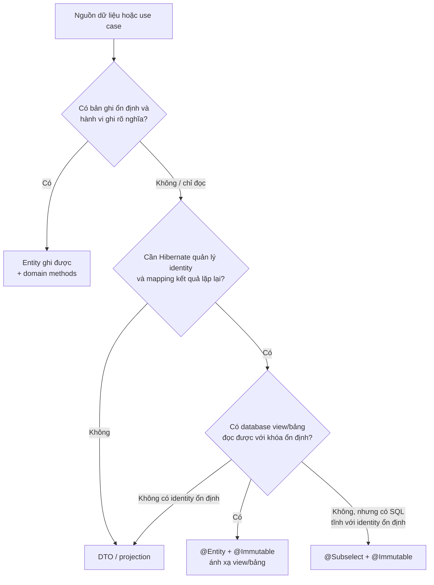
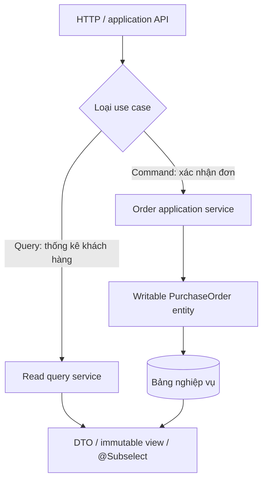

# Chọn ánh xạ chỉ đọc thay vì cố biến mọi nguồn dữ liệu thành thực thể có thể sửa

Không phải dữ liệu nào ứng dụng đọc được cũng nên được ánh xạ thành một entity có thể `persist`, thay đổi và `remove`. Trong hệ thống sử dụng Hibernate, có những nguồn dữ liệu được thiết kế **chỉ để truy vấn**: database view, kết quả tổng hợp từ nhiều bảng, bảng báo cáo, dữ liệu từ hệ thống legacy, materialized view hoặc một truy vấn chuyên phục vụ màn hình thống kê.

Cố biến mọi nguồn như vậy thành entity có khả năng ghi thường dẫn tới những câu hỏi không có câu trả lời tốt: sửa trường tổng doanh thu thì phải cập nhật đơn hàng nào; xóa một dòng thống kê có nghĩa là xóa khách hàng hay đơn hàng; một hàng kết quả join có ID nào ổn định; thay đổi một giá trị được tính toán sẽ đi vào bảng nào?

Hibernate cung cấp nhiều cách biểu diễn **mô hình đọc** mà không ép mọi kết quả thành mô hình ghi. Những lựa chọn thường gặp là:

- **DTO/projection**: trả kết quả truy vấn trực tiếp thành dữ liệu cho một use case, không đưa đối tượng vào persistence context dưới dạng managed entity.
- **`@Immutable` trên entity**: ánh xạ một bảng/view có identity ổn định thành entity được Hibernate xem là không cập nhật trạng thái.
- **`@Subselect` kết hợp `@Immutable`**: ánh xạ kết quả một biểu thức SQL được xác định sẵn thành entity chỉ đọc theo cơ chế riêng của Hibernate.
- **Trường chỉ đọc** như `@Formula` hoặc `@Column(insertable = false, updatable = false)`: khi chỉ một phần của entity được tính toán hoặc sở hữu bởi database.
- **Chế độ đọc của Session/transaction**: tối ưu việc tải dữ liệu trong một lần làm việc, nhưng không thay thế chính sách bất biến của mapping và quyền trên database.

Mục tiêu là **chọn mức ánh xạ tương ứng với khả năng và ý nghĩa của nguồn dữ liệu**. Bài học này giải thích khi nào dùng từng cách, các ví dụ Hibernate 6+/Jakarta Persistence, giới hạn về định danh, lifecycle, đồng bộ dữ liệu, hiệu năng và bảo vệ dữ liệu.

## 1. Phân biệt mô hình ghi và mô hình đọc

### 1.1. Mô hình ghi thể hiện hành vi nghiệp vụ

Ví dụ một `PurchaseOrder` được quản lý bởi Hibernate:

```java
@Entity
@Table(name = "purchase_orders")
public class PurchaseOrder {
    @Id
    @GeneratedValue(strategy = GenerationType.IDENTITY)
    private Long id;

    @Version
    private long version;

    @Enumerated(EnumType.STRING)
    private OrderStatus status;

    @Column(name = "total_amount", nullable = false)
    private BigDecimal totalAmount;

    protected PurchaseOrder() {}

    public void confirm() {
        if (status != OrderStatus.DRAFT) {
            throw new IllegalStateException("Order is not a draft");
        }
        status = OrderStatus.CONFIRMED;
    }
}
```

Ở đây, object có **danh tính**, vòng đời, quy tắc chuyển trạng thái và các thay đổi có ý nghĩa trên bản ghi database. Hibernate có thể theo dõi managed entity, kiểm tra version và sinh SQL update khi flush.

### 1.2. Mô hình đọc thể hiện thông tin cho một câu hỏi

Giả sử màn hình quản trị hiển thị:

| Khách hàng | Số đơn | Tổng giá trị | Đơn gần nhất |
|---|---:|---:|---|
| Khách A | 12 | 4.500.000 | 2026-10-30 |
| Khách B | 7 | 1.200.000 | 2026-11-02 |

Mỗi dòng là **kết quả tính toán** từ bảng khách hàng và đơn hàng. Không tồn tại một thao tác `updateCustomerOrderSummary(...)` có nghĩa hiển nhiên: đổi số đơn từ 12 thành 13 không chỉ là cập nhật một cột. Muốn thay đổi số đơn cần tạo/hủy đơn hàng qua đúng nghiệp vụ; tổng giá trị phải được tính lại theo dữ liệu nguồn.

Vì vậy, mô hình đọc có thể là:

```java
public record CustomerOrderSummary(
    Long customerId,
    String customerName,
    long orderCount,
    BigDecimal lifetimeTotal
) {}
```

`CustomerOrderSummary` chỉ là dữ liệu kết quả. Nó không cần `@Entity`, `@Id`, setter hoặc dirty checking.

### 1.3. Nguyên tắc thiết kế



Sơ đồ là hướng tư duy, không phải luật bắt buộc. Một kết quả tổng hợp có identity ổn định vẫn thường phù hợp DTO hơn nếu chỉ sử dụng trong một màn hình. Ngược lại, một database view được nhiều truy vấn sử dụng có thể đáng được ánh xạ thành immutable entity.

## 2. Vì sao “mọi nguồn đều là writable entity” là một giả định nguy hiểm?

### 2.1. Không có đích ghi rõ ràng

Một dòng view tạo bởi:

```sql
SELECT
    c.id AS customer_id,
    COUNT(o.id) AS order_count,
    COALESCE(SUM(o.total_amount), 0) AS lifetime_total
FROM customers c
LEFT JOIN purchase_orders o ON o.customer_id = c.id
GROUP BY c.id;
```

không có phép `UPDATE order_count = 15` hợp lệ về mặt nghiệp vụ. Giá trị tổng hợp xuất phát từ nhiều bản ghi `purchase_orders`. Hibernate không thể tự suy luận cần thêm ba đơn nào hoặc xóa bản ghi nào để đạt được kết quả.

### 2.2. Identity của hàng kết quả có thể không ổn định

Một entity Hibernate được nhận diện bằng **entity type + identifier** trong persistence context. Với query join/tổng hợp, một hàng có thể không tương ứng một khóa chính của bảng gốc:

- Join một-nhiều có thể lặp ID của bản ghi cha trên nhiều hàng.
- Group by nhiều trường có thể cần **khóa ghép** thay vì một ID đơn.
- `ROW_NUMBER() OVER (...)` có thể đổi số khi dữ liệu/sắp xếp thay đổi, nên không phải ID bền vững.
- Dữ liệu từ nhiều hệ thống có thể có ID trùng nhau nhưng thuộc các namespace khác nhau.

Ép một trường không duy nhất vào `@Id` sẽ khiến Hibernate xem những hàng khác nhau là **cùng một entity** và có thể trả về nội dung bất ngờ khi tái sử dụng object đã managed.

### 2.3. Dirty checking tạo nghĩa ghi không mong muốn

Một managed writable entity có thể được Hibernate kiểm tra thay đổi khi flush. Nếu lập trình viên sửa getter/setter trên object biểu diễn view, Hibernate có thể thử sinh SQL `UPDATE` hướng tới view/bảng không cho phép cập nhật. Lỗi có thể chỉ xuất hiện ở cuối transaction, xa nơi code sửa object.

### 2.4. Chia sẻ cùng object không có nghĩa dữ liệu nguồn cập nhật tức thời

Kể cả mapped entity chỉ đọc, Hibernate vẫn có **first-level cache** trong persistence context. Đọc lại ID đã managed không bảo đảm tải lại SQL. View được tính lại trên DB mỗi lần truy vấn nhưng managed entity trong Session vẫn có thể giữ snapshot cũ.

### 2.5. Xóa hoặc cascade mang nghĩa nguy hiểm

Một hàng tổng hợp không nhất thiết có vòng đời độc lập. Nếu code gọi `remove` trên entity được ánh xạ vào view hoặc thiết lập cascade sai, ứng dụng có thể phát sinh SQL không hợp lệ hoặc gây thao tác ngoài dự kiến. Vì vậy, không nên quảng bá các phương thức CRUD đầy đủ cho một nguồn chỉ đọc.

## 3. Các mức “chỉ đọc” không đồng nghĩa nhau

| Kỹ thuật | Áp dụng cho | Điều chủ yếu đạt được | Không tự bảo đảm |
|---|---|---|---|
| DTO/projection | Kết quả một truy vấn | Không là managed entity, không dirty checking cho DTO | Không tự phân quyền, không tự tối ưu query |
| Hibernate `@Immutable` trên entity | Một entity type | Hibernate không theo dõi update trạng thái scalar của entity như writable entity | Không tự cấm `DELETE`, native SQL hoặc DB writer khác |
| `@Subselect` + `@Immutable` | Read-model dựa trên một SQL expression | Ánh xạ kết quả query như entity chỉ đọc | Không cấp ID duy nhất, không làm dữ liệu luôn mới |
| `@Column(updatable=false, insertable=false)` | Một thuộc tính | Hibernate không ghi cột đó trong DML theo mapping | Entity và các cột khác vẫn có thể writable |
| `@Formula` | Thuộc tính tính toán | Giá trị được biểu diễn bằng công thức SQL khi tải | Không phải bảng kết quả có lifecycle riêng |
| `Session.setReadOnly(entity, true)` | Một entity managed trong Session | Giảm dirty checking/update trạng thái thuộc tính được quản lý theo chế độ read-only | Không đổi entity mapping toàn hệ thống |
| `@Transactional(readOnly=true)` | Ranh giới transaction Spring | Hint và tối ưu đọc tùy transaction manager/ORM | Không phải rào chắn ghi tuyệt đối trên mọi DB |

Các lựa chọn có thể kết hợp, nhưng cần nêu chính xác **cái gì được ngăn ở tầng nào**. Một annotation Java về tính immutable không thay thế user database chỉ có quyền `SELECT`.

## 4. Lựa chọn thứ nhất: DTO hoặc projection cho dữ liệu chỉ cần hiển thị

Đây thường là lựa chọn đơn giản nhất khi use case chỉ cần một vài cột từ nhiều bảng.

### 4.1. DTO projection với JPQL constructor expression

Giả sử `Customer` có `id`, `name` và `PurchaseOrder` có `customer`, `totalAmount`. Một lớp DTO:

```java
package com.example.readmodel;

import java.math.BigDecimal;

public record CustomerOrderSummary(
        Long customerId,
        String customerName,
        Long orderCount,
        BigDecimal lifetimeTotal) {}
```

Truy vấn JPQL:

```java
List<CustomerOrderSummary> summaries =
    entityManager.createQuery(
        """
        select new com.example.readmodel.CustomerOrderSummary(
            c.id,
            c.name,
            count(o.id),
            coalesce(sum(o.totalAmount), :zero)
        )
        from Customer c
        left join c.orders o
        group by c.id, c.name
        order by c.name
        """,
        CustomerOrderSummary.class
    )
    .setParameter("zero", BigDecimal.ZERO)
    .getResultList();
```

`CustomerOrderSummary` là **record Java**, không có `@Entity` hoặc `@Id`. Hibernate trả dữ liệu theo constructor expression; application service có thể trả DTO qua API mà không vô tình để controller sửa managed entity.

Các chi tiết kỹ thuật của ví dụ:

- `count(o.id)` trong JPQL trả giá trị `Long`.
- `sum(o.totalAmount)` với thuộc tính `BigDecimal` thường trả `BigDecimal` theo quy tắc kiểu aggregate của JPQL.
- `coalesce` xử lý trường hợp khách hàng chưa có đơn. Giá trị tham số `:zero` được bind để có kiểu mong muốn.
- Quan hệ `c.orders` cần tồn tại trong model. Nếu không có mapping collection, có thể viết một truy vấn khác dựa trên entity hiện có hoặc native SQL.
- Constructor expression yêu cầu tên class và chữ ký constructor khớp với kiểu dữ liệu query trả về.

DTO/projection có lợi khi:

1. Một màn hình chỉ cần ít cột trong entity lớn.
2. Kết quả là group-by, aggregate, join phức tạp hoặc kết quả không có identity riêng.
3. Cần phân trang/sắp xếp/lọc linh hoạt theo request.
4. Dữ liệu đến từ API bên ngoài hoặc nhiều nguồn không thể biến thành một managed entity hợp lý.
5. Không muốn persistence context giữ hàng nghìn entity chỉ để render response.

### 4.2. Native SQL và DTO

Một báo cáo dùng window function, CTE hoặc cú pháp vendor-specific có thể phù hợp với native SQL. Khi đó, ánh xạ bằng `Tuple`, `Object[]`, `@SqlResultSetMapping`/`@ConstructorResult` hoặc cơ chế projection của framework đang dùng, rồi chuyển thành DTO rõ ràng.

Ví dụ khái niệm:

```java
@SuppressWarnings("unchecked")
List<Object[]> rows = entityManager.createNativeQuery(
    """
    select c.id, count(o.id)
    from customers c
    left join purchase_orders o on o.customer_id = c.id
    group by c.id
    """
).getResultList();

List<CustomerCount> result = rows.stream()
    .map(row -> new CustomerCount(
        ((Number) row[0]).longValue(),
        ((Number) row[1]).longValue()
    ))
    .toList();
```

```java
public record CustomerCount(
    long customerId,
    long orderCount
) {}
```

Cần xử lý conversion của JDBC driver phù hợp kiểu SQL thực tế, đặc biệt timestamp, decimal và nullable fields. Native SQL không tự tránh injection khi câu query được ghép từ chuỗi người dùng; phải bind tham số và allowlist các phần SQL động như tên cột sắp xếp.

### 4.3. DTO không phải “entity thiếu annotation”

Không nên tạo một class DTO rồi truyền nó cho `entityManager.persist` hay `find`. DTO không có persistence identity hoặc lifecycle. Khi cần cập nhật nghiệp vụ, API nhận một **command** hoặc request DTO, service tải entity ghi được đúng ID rồi gọi method nghiệp vụ.

Ví dụ:

```java
@Transactional
public void confirmOrder(Long orderId) {
    PurchaseOrder order =
        entityManager.find(PurchaseOrder.class, orderId);

    if (order == null) {
        throw new NoSuchElementException("Order not found");
    }

    order.confirm();
}
```

Dữ liệu để đọc danh sách có thể là DTO; thao tác xác nhận đơn dùng entity ghi được. Không có yêu cầu hai luồng phải dùng cùng một model Java.

## 5. Lựa chọn thứ hai: ánh xạ database view thành @Immutable entity

Database view hữu ích khi một truy vấn tổng hợp được sử dụng ở nhiều nơi hoặc muốn quản trị SQL read model tại DB.

### 5.1. Ví dụ PostgreSQL view tổng hợp theo khách hàng

Giả sử bảng `customers(id, name)` và `purchase_orders(id, customer_id, total_amount, created_at)`. Tạo view:

```sql
CREATE VIEW v_customer_order_metrics AS
SELECT
    c.id AS customer_id,
    c.name AS customer_name,
    COUNT(o.id) AS order_count,
    COALESCE(SUM(o.total_amount), 0) AS lifetime_total,
    MAX(o.created_at) AS latest_order_at
FROM customers c
LEFT JOIN purchase_orders o
    ON o.customer_id = c.id
GROUP BY c.id, c.name;
```

Mỗi khách hàng có một dòng do `GROUP BY c.id, c.name`. Vì `customers.id` là khóa chính, `customer_id` có thể dùng làm **identity ổn định** của dòng kết quả trong view. Trường `order_count` và `lifetime_total` là giá trị tính toán, không có semantics update trực tiếp.

Bản thân view được tạo bởi migration/DBA, không nhờ Hibernate đoán câu SQL tổng hợp từ một entity.

### 5.2. Hibernate entity chỉ đọc ánh xạ tới view

```java
import jakarta.persistence.Column;
import jakarta.persistence.Entity;
import jakarta.persistence.Id;
import jakarta.persistence.Table;
import java.math.BigDecimal;
import java.time.Instant;
import org.hibernate.annotations.Immutable;

@Entity
@Immutable
@Table(name = "v_customer_order_metrics")
public class CustomerOrderMetrics {

    @Id
    @Column(name = "customer_id")
    private Long customerId;

    @Column(name = "customer_name")
    private String customerName;

    @Column(name = "order_count")
    private Long orderCount;

    @Column(name = "lifetime_total",
            precision = 19, scale = 2)
    private BigDecimal lifetimeTotal;

    @Column(name = "latest_order_at")
    private Instant latestOrderAt;

    protected CustomerOrderMetrics() {}

    public Long getCustomerId() { return customerId; }
    public String getCustomerName() { return customerName; }
    public Long getOrderCount() { return orderCount; }
    public BigDecimal getLifetimeTotal() { return lifetimeTotal; }
    public Instant getLatestOrderAt() { return latestOrderAt; }
}
```

Ở đây:

- `@Entity` cho Hibernate biết đây là một **managed entity type** có thể query qua JPQL/HQL và có identity trong persistence context.
- `@Table(name = "...")` hướng Hibernate tới **view** mang tên đó. JPA mapping không tự phân biệt view và bảng thông thường.
- `@Id` bắt buộc để Hibernate nhận diện mỗi dòng entity; khóa phải **duy nhất, không null và ổn định** trong kết quả view.
- `@Immutable` là annotation **riêng của Hibernate**. Với entity immutable, các thay đổi scalar trên managed instance không được dirty checking/update theo cách writable entity thông thường.
- Không cung cấp public setters thể hiện rõ hơn rằng object dành cho đọc. Đây là quy ước API; chính `@Immutable` mới khai báo chính sách Hibernate ở mức entity.

Ứng dụng truy vấn:

```java
List<CustomerOrderMetrics> metrics =
    entityManager.createQuery(
        """
        select m
        from CustomerOrderMetrics m
        where m.orderCount >= :minimum
        order by m.lifetimeTotal desc, m.customerId
        """,
        CustomerOrderMetrics.class
    )
    .setParameter("minimum", 5L)
    .setMaxResults(20)
    .getResultList();
```

Đọc theo `customerId` cũng có thể dùng `find(CustomerOrderMetrics.class, id)` vì đây là entity type. Tuy nhiên, nếu cùng ID đã tồn tại trong persistence context, `find` có thể trả object hiện có mà không query lại view.

### 5.3. @Immutable bảo đảm gì và không bảo đảm gì?

**Có ích:**

- Trạng thái entity được Hibernate xem là bất biến đối với các sửa đổi scalar qua dirty checking.
- Hibernate có thể tránh lưu snapshot và so sánh dirty state không cần thiết cho entity immutable.
- API biểu đạt “đây là mô hình đọc”, tránh kỳ vọng gọi setter rồi flush sẽ update view.
- Có thể dùng JPQL, query API, identity mapping và một số tiện ích Hibernate dành cho entity.

**Giới hạn quan trọng:**

- `@Immutable` **không phải cơ chế phân quyền DB**. SQL viết bằng công cụ khác, native SQL hoặc một user có quyền ghi vẫn có thể thay đổi bảng nguồn.
- `@Immutable` không tự chặn mọi thao tác như `entityManager.remove`. Nếu code cố xóa, ORM vẫn có thể phát DML; tùy DB view/cấp quyền, thao tác sẽ thất bại hoặc có hậu quả không mong muốn.
- Một view vẫn có thể bị database cho phép update theo quy tắc updatable view của engine. `@Immutable` không thay đổi khả năng đó ở DB.
- Nó không ngăn Spring/controller gọi một method Java vô tình sửa field trong RAM; chỉ tránh việc Hibernate coi đó là update bình thường.
- Không bảo đảm dữ liệu luôn mới khi phiên khác cập nhật bảng nền hoặc khi view đã được tải vào persistence context.

Nếu yêu cầu **không ai được phép ghi vào nguồn read model**, áp dụng quyền database thích hợp, ví dụ cấp `SELECT` và không cấp `INSERT/UPDATE/DELETE` cho user kết nối đọc. Đồng thời tách đường đọc/ghi và không cung cấp repository CRUD rộng rãi cho loại này.

### 5.4. View trong quản trị schema

Vì `v_customer_order_metrics` là view, cần migration để tạo/thay view theo trình tự phù hợp với bảng nguồn. Không để `hibernate.hbm2ddl.auto=update` hoặc cơ chế tự tạo schema trong production quyết định cấu trúc read model.

`ddl-auto=validate` có thể hữu ích để kiểm tra mapping, nhưng cách driver/Dialect báo metadata của view có thể khác nhau. Nếu validation không nhận ra view như một bảng hợp lệ, phải xử lý quy trình kiểm tra đúng với DBMS đang dùng, không phá schema view để làm vừa cơ chế auto-DDL.

Khi đổi tên cột của view, đó là thay đổi **contract giữa DB và Hibernate entity**. Cần triển khai migration và ứng dụng có tính tương thích phù hợp.

## 6. Lựa chọn thứ ba: @Subselect cho read model bằng SQL cố định

Hibernate có annotation riêng `org.hibernate.annotations.Subselect` để biểu diễn một entity có dữ liệu đến từ một câu SQL `SELECT` xác định sẵn, không yêu cầu một view vật lý được tạo trong schema.

### 6.1. Ví dụ @Subselect + @Immutable

```java
import jakarta.persistence.Column;
import jakarta.persistence.Entity;
import jakarta.persistence.Id;
import java.math.BigDecimal;
import org.hibernate.annotations.Immutable;
import org.hibernate.annotations.Subselect;
import org.hibernate.annotations.Synchronize;

@Entity
@Immutable
@Subselect("""
    select
        c.id as customer_id,
        c.name as customer_name,
        count(o.id) as order_count,
        coalesce(sum(o.total_amount), 0) as lifetime_total
    from customers c
    left join purchase_orders o
        on o.customer_id = c.id
    group by c.id, c.name
    """)
@Synchronize({"customers", "purchase_orders"})
public class CustomerOrderMetricsQuery {

    @Id
    @Column(name = "customer_id")
    private Long customerId;

    @Column(name = "customer_name")
    private String customerName;

    @Column(name = "order_count")
    private Long orderCount;

    @Column(name = "lifetime_total")
    private BigDecimal lifetimeTotal;

    protected CustomerOrderMetricsQuery() {}

    public Long getCustomerId() { return customerId; }
    public Long getOrderCount() { return orderCount; }
    public BigDecimal getLifetimeTotal() { return lifetimeTotal; }
}
```

Mapping `@Subselect` mang tính **Hibernate-specific**; SQL trong annotation là **native SQL**, không phải JPQL. Ví dụ dùng syntax thông dụng của SQL/PostgreSQL và cần đối chiếu Dialect của DB đích.

Khi query:

```java
List<CustomerOrderMetricsQuery> rows =
    entityManager.createQuery(
        """
        select m from CustomerOrderMetricsQuery m
        where m.orderCount > :minimum
        order by m.customerId
        """,
        CustomerOrderMetricsQuery.class
    )
    .setParameter("minimum", 10L)
    .getResultList();
```

Hibernate có thể dùng SQL trong `@Subselect` làm nguồn hàng cho query entity tương ứng. Vì đây là read model, `@Immutable` được khai báo rõ để không có kỳ vọng update vào kết quả SQL tổng hợp.

### 6.2. @Synchronize giải quyết vấn đề nào?

Giả sử cùng transaction:

```java
entityManager.persist(newPurchaseOrder);

// Sau đó query CustomerOrderMetricsQuery.
```

Hibernate có thể chưa gửi `INSERT` vì đang trì hoãn tới flush. Nếu `@Subselect` chỉ là một chuỗi SQL mà Hibernate không biết nó phụ thuộc bảng nào, ứng dụng có nguy cơ đọc tổng hợp trước khi các thay đổi đang chờ được đồng bộ.

`@Synchronize({"customers", "purchase_orders"})` khai báo những bảng nền liên quan để Hibernate biết khi nào cần **auto-flush các thay đổi đang chờ** trước khi thực hiện query theo cơ chế flush phù hợp.

**@Synchronize không bảo đảm dữ liệu luôn mới.** Nó không:

- Tự reload `CustomerOrderMetricsQuery` đã managed trong cùng persistence context.
- Tự phát hiện thay đổi từ transaction khác ngoài các quy tắc database isolation.
- Biến materialized view thành view cập nhật tức thời.
- Ngăn `READ COMMITTED`/snapshot isolation hoặc cache dẫn đến dữ liệu quan sát không như người dùng mong đợi.
- Thay thế `entityManager.flush()` khi luồng native SQL hoặc custom flush mode đòi hỏi sự đồng bộ tường minh.

Với `@Subselect` và bảng nguồn đều được ánh xạ thành entity trong cùng Session, Hibernate cảnh báo về **data aliasing**: cùng dữ liệu database có thể được biểu diễn bởi nhiều entity objects độc lập với trạng thái khác nhau. Khi cần đọc giá trị mới của read model đã có trong persistence context, cân nhắc `refresh`/`clear` hoặc mở transaction đọc phù hợp sau khi flush.

### 6.3. Khi nào @Subselect phù hợp?

Dùng khi:

- Có query SQL cố định tương đối ổn định và kết quả có khóa định danh duy nhất.
- Muốn tái sử dụng read model như một entity Hibernate mà không quản lý một database view độc lập.
- Query phải dựa vào các bảng nền mà ORM cần biết để auto-flush.
- Chấp nhận phụ thuộc API Hibernate và dialect SQL cụ thể.

Không phù hợp nếu:

- Query thay đổi cấu trúc mạnh theo từng request.
- Không có một identity ổn định duy nhất cho mỗi hàng.
- Dữ liệu đến từ HTTP API, search index hoặc nhiều hệ quản trị không thể biểu diễn bằng một SQL query trong database hiện tại.
- Cần một view/materialized view do DBA quản trị, quyền DB riêng hoặc được nhiều ứng dụng ngoài Hibernate dùng chung.
- Đòi hỏi dynamic SQL parameters **bên trong chính khai báo `@Subselect`**. Dòng SQL trong annotation là mapping tĩnh, không phải nơi tiện lợi để nối input người dùng.

Với báo cáo động, DTO/projection từ JPQL/native query thường trực tiếp và dễ kiểm soát hơn.

## 7. @Formula chỉ đọc một giá trị dẫn xuất, không làm cả entity immutable

Đôi khi entity vẫn là writable nhưng có một trường cần database tính. Hibernate hỗ trợ `@Formula` cho một SQL expression đọc khi tải entity.

Ví dụ:

```java
import jakarta.persistence.*;
import org.hibernate.annotations.Formula;

@Entity
@Table(name = "products")
public class Product {
    @Id
    private Long id;

    @Column(name = "unit_price", nullable = false)
    private BigDecimal unitPrice;

    @Column(name = "quantity_on_hand", nullable = false)
    private int quantityOnHand;

    @Formula("unit_price * quantity_on_hand")
    private BigDecimal inventoryValue;

    protected Product() {}

    public BigDecimal getInventoryValue() {
        return inventoryValue;
    }

    public void adjustStock(int newQuantity) {
        if (newQuantity < 0) {
            throw new IllegalArgumentException("Negative quantity");
        }
        quantityOnHand = newQuantity;
    }
}
```

`Product` vẫn là entity có thể sửa; riêng `inventoryValue` được biểu diễn từ một biểu thức SQL, không phải cột mà ứng dụng phải `INSERT`/`UPDATE`.

Lưu ý:

- `@Formula` là tính năng riêng của Hibernate; biểu thức phải hợp lệ với Dialect.
- Giá trị được đọc theo truy vấn Hibernate ở thời điểm tải. Nếu sửa `quantityOnHand` trong Java rồi đọc lại getter **trước khi reload**, `inventoryValue` không tự tính lại như Java computed getter.
- Formula phức tạp hoặc correlated subquery có thể làm SELECT đắt; xem SQL và execution plan.
- Không dùng `@Formula` để biến mọi báo cáo nhiều bảng thành một entity lớn nếu DTO hoặc view phù hợp hơn.

Với công thức hoàn toàn trong Java và không cần truy vấn theo giá trị đó, một getter tính trực tiếp có thể đơn giản hơn; với computed column do DB quản lý, mapping generated property có semantics riêng.

## 8. @Column(insertable=false, updatable=false) không tương đương read-only entity

Ví dụ một entity ghi được có cột `created_at` do database cấp:

```java
@Entity
@Table(name = "invoices")
class Invoice {
    @Id
    private Long id;

    @Column(name = "status")
    private String status;

    @Column(
        name = "created_at",
        insertable = false,
        updatable = false
    )
    private Instant createdAt;
}
```

Hibernate không đưa `created_at` vào phần ghi tương ứng theo mapping, nhưng **vẫn có thể update `status`**. Thuộc tính `createdAt` cũng không tự được refresh sau insert chỉ vì hai cờ `insertable/updatable` là false.

Nếu database thực sự sinh giá trị và ứng dụng cần đọc lại sau thao tác ghi, có thể dùng Hibernate `@Generated` với sự kiện phù hợp hoặc gọi `flush`/`refresh` có chủ đích. Đây là bài toán readback của một field, khác việc quyết định toàn bộ mô hình là read-only.

### 8.1. Dùng @Immutable đúng phạm vi

Hibernate hỗ trợ `@Immutable` cho entity và một số loại mapping khác, nhưng semantics thay đổi theo phạm vi:

- Trên **entity**: không cập nhật trạng thái scalar của entity như writable entity.
- Trên **basic attribute**: biểu đạt thuộc tính không được dirty checking như một trường có thể cập nhật.
- Trên **persistent collection**: sửa collection được ánh xạ immutable có thể dẫn đến exception khi flush; không suy từ hành vi entity immutable sang collection.

Khi chỉ một cột được DB quản lý, dùng metadata ở phạm vi trường đó; không nên đánh dấu cả entity immutable nếu nghiệp vụ vẫn phải cập nhật các trường khác.

## 9. Read-only Session và @Transactional(readOnly=true)

### 9.1. Hibernate Session#setReadOnly

Hibernate cho phép đánh dấu một entity đã managed là read-only trong phạm vi Session:

```java
Session session = entityManager.unwrap(Session.class);

Customer customer = session.find(Customer.class, customerId);
session.setReadOnly(customer, true);
```

Với entity được đánh dấu read-only, Hibernate có thể tránh theo dõi thay đổi scalar/simple fields và giảm việc tạo UPDATE cho chúng. Đây là lựa chọn **theo instance trong Session**, không phải thay đổi mapping của toàn bộ type.

Tương tự, Hibernate query có thể yêu cầu kết quả tải ra ở chế độ read-only bằng API Hibernate:

```java
Session session = entityManager.unwrap(Session.class);

List<Customer> customers = session.createQuery(
        "from Customer c where c.active = true",
        Customer.class
    )
    .setReadOnly(true)
    .getResultList();
```

Nếu entity đã nằm trong persistence context trước khi chạy query, cần chú ý kết quả đọc read-only của query **không mặc định thay đổi trạng thái read-only của object đã tồn tại**. Chế độ này không phải hàng rào tuyệt đối cho mọi collection/cascade/lifecycle; nếu cần chỉ đọc bền vững toàn hệ thống, dùng thiết kế mapping và quyền DB thích hợp.

### 9.2. @Transactional(readOnly=true) của Spring

```java
@Transactional(readOnly = true)
public List<CustomerOrderSummary> report() {
    return reportRepository.fetchSummaries();
}
```

`readOnly=true` trên Spring transaction là một **hint/tùy chọn tối ưu hóa**. Tùy transaction manager, Hibernate integration, JDBC driver và DBMS, nó có thể điều chỉnh flush mode hoặc cách transaction được thiết lập. Không nên coi đây là bảo đảm rằng mọi lời gọi `persist`, `merge`, bulk update hoặc native SQL sẽ bị chặn ở mọi môi trường.

Nếu hệ thống cần ngăn write bằng chính sách thực thi:

- Cấp tài khoản database đọc chỉ có `SELECT` trên những object cần thiết.
- Dùng read-only transaction ở DB khi phù hợp và được engine hỗ trợ.
- Tách repository/service của read model khỏi đường command/write.
- Kiểm soát quyền ghi theo nghiệp vụ và hạ tầng.

**Không dùng `@Transactional(readOnly=true)` thay cho `@Immutable` và ngược lại:** một cái mô tả phạm vi transaction, một cái mô tả cách ORM quản lý một entity type.

## 10. Định danh của read-only entity: yêu cầu khó bỏ qua

`@Immutable` hoặc `@Subselect` **không xóa yêu cầu entity phải có @Id**. Hibernate vẫn cần khóa để quản lý identity map, lazy references và tính nhất quán trong persistence context.

### 10.1. Khóa nên đại diện đúng một hàng logic

Với view tổng hợp theo khách hàng, `customer_id` có thể là khóa vì một khách chỉ có một dòng. Với thống kê theo **khách hàng + tháng**, `customer_id` đơn lẻ không còn duy nhất.

```text
customer_id | month    | order_count
------------+----------+------------
15          | 2026-09  | 3
15          | 2026-10  | 5
15          | 2026-11  | 4
```

Nếu map `@Id customerId`, cả ba hàng bị coi là cùng identity type+ID trong một Session. Cần khóa ghép đúng, chẳng hạn `(customer_id, month)` bằng `@EmbeddedId` hoặc `@IdClass`:

```java
@Embeddable
public class CustomerMonthKey implements Serializable {
    @Column(name = "customer_id")
    private Long customerId;

    @Column(name = "report_month")
    private YearMonth reportMonth;

    protected CustomerMonthKey() {}

    // equals/hashCode và mapping YearMonth phù hợp
    // là bắt buộc theo contract của composite ID.
}
```

`YearMonth` ở ví dụ cần converter/JDBC mapping hợp lệ với kiểu cột SQL; một thiết kế đơn giản hơn có thể lưu `report_month` dạng `LocalDate` là ngày đầu tháng. Không tự cho rằng mọi `YearMonth` sẽ được mọi Dialect ánh xạ thành cùng kiểu SQL.

Ví dụ dùng ngày đầu tháng để làm khóa:

```java
@Embeddable
public class CustomerMonthKey implements Serializable {

    @Column(name = "customer_id", nullable = false)
    private Long customerId;

    @Column(name = "month_start", nullable = false)
    private LocalDate monthStart;

    protected CustomerMonthKey() {}

    public CustomerMonthKey(Long customerId, LocalDate monthStart) {
        this.customerId = customerId;
        this.monthStart = monthStart;
    }

    @Override
    public boolean equals(Object other) {
        if (this == other) return true;
        if (!(other instanceof CustomerMonthKey key)) return false;
        return Objects.equals(customerId, key.customerId)
            && Objects.equals(monthStart, key.monthStart);
    }

    @Override
    public int hashCode() {
        return Objects.hash(customerId, monthStart);
    }
}

@Entity
@Immutable
@Table(name = "v_customer_month_stats")
public class CustomerMonthStats {

    @EmbeddedId
    private CustomerMonthKey id;

    @Column(name = "order_count")
    private Long orderCount;

    protected CustomerMonthStats() {}
}
```

Trong code thực tế cần các import tương ứng, và schema view phải trả chính xác các cột `customer_id`, `month_start`, `order_count` với cặp khóa duy nhất, không null.

### 10.2. ROW_NUMBER() không mặc định là khóa entity

Một query:

```sql
SELECT ROW_NUMBER() OVER (ORDER BY total_amount DESC) AS id,
       customer_id, total_amount
FROM some_report;
```

có thể cho một khách hàng `id=1` hôm nay nhưng `id=2` sau khi dữ liệu khác thay đổi. Trong persistence context đang giữ `id=1`, Hibernate có thể liên kết dữ liệu của hai hàng logic khác nhau qua những lần đọc. Chỉ dùng row number để **đánh số hiển thị**, không coi nó là identity bền vững của một entity.

Nếu kết quả không có khóa tự nhiên/gộp ổn định, **chọn DTO**. Không nên tạo ra ID giả chỉ để qua bước validation của Hibernate.

### 10.3. Có @Id không có nghĩa dữ liệu được phép ghi

Một read-only entity vẫn có ID để quản lý state đọc. ID không tự trao quyền CRUD hay ngụ ý rằng hàng dữ liệu có một vòng đời ghi độc lập.

## 11. Freshness: view thay đổi nhưng entity đang managed vẫn cũ

Giả sử cùng một transaction:

```java
CustomerOrderMetrics metrics =
    entityManager.find(CustomerOrderMetrics.class, customerId);

// Ở một thời điểm phù hợp, một đơn hàng mới được ghi.
purchaseOrderRepository.save(order);

// Dùng lại đối tượng metrics:
long orderCount = metrics.getOrderCount();
```

Ngay cả khi database view đã tính tổng mới khi truy vấn, object `metrics` có thể chứa dữ liệu cũ từ lúc được tải. Hibernate không phải hệ thống event subscription đến mọi view; identity map của Session không làm object tự cập nhật.

Nếu cần đọc giá trị đã thay đổi **trong cùng transaction**, cân nhắc:

```java
entityManager.flush();         // Gửi pending DML phù hợp.
entityManager.refresh(metrics); // Tải lại hàng từ nguồn ánh xạ.
```

Lưu ý:

- `refresh` cần entity còn managed; có thể thực thi SELECT và còn phụ thuộc transaction isolation.
- `flush` có thể gửi **tất cả pending changes** trong persistence context, không chỉ đơn mới được tạo.
- Nếu `metrics` là kết quả materialized view chưa refresh, `EntityManager.refresh` không tự chạy lệnh `REFRESH MATERIALIZED VIEW`.
- Nếu dữ liệu được ghi từ transaction khác, isolation level có thể khiến transaction hiện tại chưa nhìn thấy version mới.
- Nếu ứng dụng có second-level cache hoặc query cache, cần tính đến invalidation/TTL/eviction phù hợp; `@Immutable` không phải bảo đảm freshness.

Một cách khác khi chuẩn bị truy vấn báo cáo độc lập là kết thúc transaction ghi, tạo transaction đọc mới theo mức nhất quán cần thiết và query DTO trực tiếp.

### 11.1. Materialized view có vòng đời khác view thường

Database view thường chạy truy vấn dựa trên bảng nền khi đọc. **Materialized view** lưu dữ liệu đã được tính và chỉ cập nhật theo cơ chế refresh của database. Vì thế:

```text
Đơn hàng mới commit
       ↓
Bảng purchase_orders đã mới
       ↓
Materialized view có thể vẫn cũ
       ↓
Job/command refresh materialized view
       ↓
Read model mới phản ánh dữ liệu
```

Điều này có thể là chủ đích để giảm chi phí báo cáo. Ứng dụng phải mô tả rõ độ trễ chấp nhận được, lịch refresh, xử lý lỗi refresh và thông tin “cập nhật lần cuối” cho người dùng.

`@Immutable` trên entity ánh xạ materialized view chỉ điều chỉnh hành vi Hibernate khi đọc/ghi entity đó, **không tự cập nhật vật liệu hóa**.

## 12. Tối ưu hiệu năng: read-only không có nghĩa query tự nhanh

Ánh xạ read-only có thể giảm một phần overhead của dirty checking, nhưng hiệu năng tổng thể phụ thuộc cấu trúc truy vấn và khối lượng dữ liệu.

### 12.1. Entity immutable vẫn có chi phí persistence context

Khi dùng `@Entity`, Hibernate vẫn quản lý identity, đối tượng và metadata liên quan. Một báo cáo trả hàng trăm nghìn bản ghi có thể gây áp lực bộ nhớ nếu ứng dụng tải toàn bộ thành managed entities rồi giữ trong một Session dài.

DTO/projection thường phù hợp hơn cho màn hình chỉ cần vài cột, export streaming hoặc pipeline đọc một lần. Khi đọc khối lượng lớn, cân nhắc phân trang, streaming, giới hạn Session lifetime và xử lý batch.

### 12.2. View/subselect có thể thực thi SQL rất đắt

View không mặc định lưu kết quả sẵn. Một view group-by trên bảng đơn hàng nhiều triệu hàng có thể quét/tổng hợp tốn tài nguyên mỗi lần query. `@Subselect` cũng có thể tạo subquery lớn khi ORM bọc thêm `WHERE`/`ORDER BY`/pagination.

Cần đo:

- Execution plan trên DB đích.
- Index ở khóa join, cột lọc và cột sắp xếp.
- Số hàng được đọc so với số hàng trả.
- Tính phân trang và thứ tự ổn định.
- Khả năng database đẩy điều kiện lọc vào view/subquery.
- Chi phí refresh nếu dùng materialized view.

Lựa chọn read-only giải quyết **semantics của mô hình**, còn chỉ mục, aggregation strategy và phân trang giải quyết **hiệu năng**.

### 12.3. Quan hệ entity trên view có thể tạo N+1

Một immutable entity vẫn có thể khai association. Khi vòng lặp đọc quan hệ lazy của 100 dòng read model, Hibernate có thể phát nhiều SELECT. Không nên coi `@Immutable` là cách tránh N+1.

Với màn hình báo cáo đơn giản, projection trực tiếp các trường cần thiết thường giảm nhu cầu điều hướng quan hệ, phù hợp hơn mô hình entity gồm nhiều association.

### 12.4. Caching read model cần chính sách làm mới rõ ràng

Bảng nền thay đổi thường xuyên nhưng view/model được cache lâu có thể trở nên sai lệch. Nếu dùng second-level cache hoặc query cache, cần xác định cơ chế invalidation và thời hạn chấp nhận dữ liệu cũ, nhất là với update đến từ native SQL, service khác hoặc refresh materialized view bên ngoài ORM.

## 13. Phân quyền dữ liệu và read-only ở nhiều tầng

Read-only mapping không đồng nghĩa người dùng được phép xem mọi hàng. Một truy vấn báo cáo có thể cần lọc theo `tenant_id`, chủ sở hữu, bộ phận hoặc phạm vi quyền.

### 13.1. Đừng nhúng dữ liệu tenant tùy ý vào SQL tĩnh

Ví dụ `@Subselect` cố định:

```java
@Subselect("""
    select customer_id, count(*) as order_count
    from purchase_orders
    group by customer_id
    """)
```

có thể sai về bảo mật nếu customer ID trùng hoặc dữ liệu thuộc nhiều tenant. Nếu nguồn dữ liệu có tenant, thiết kế khóa logic/mapping đúng và áp điều kiện tenant một cách **đáng tin cậy trên mọi đường truy cập**.

Một DTO query có thể dễ thêm điều kiện quyền theo request:

```java
List<CustomerOrderSummary> result =
    entityManager.createQuery(
        """
        select new com.example.readmodel.CustomerOrderSummary(
            c.id,
            c.name,
            count(o.id),
            coalesce(sum(o.totalAmount), :zero)
        )
        from Customer c
        left join c.orders o
        where c.tenantId = :tenantId
        group by c.id, c.name
        """,
        CustomerOrderSummary.class
    )
    .setParameter("zero", BigDecimal.ZERO)
    .setParameter("tenantId", authenticatedTenantId)
    .getResultList();
```

`authenticatedTenantId` phải đến từ ngữ cảnh bảo mật đáng tin cậy, không dùng trực tiếp giá trị chưa kiểm tra từ URL/request. Nếu DB hỗ trợ row-level security, có thể dùng thêm để bảo vệ nhiều đường truy cập nhưng vẫn cần cấu hình đúng identity/session ở tầng DB.

### 13.2. Quyền đọc riêng ở database

Nếu một dịch vụ chỉ làm báo cáo, có thể dùng DB account chỉ có quyền `SELECT` trên views/bảng đã được cho phép. Điều này là lớp bảo vệ thực thi ngay cả khi một đoạn code vô tình gọi native update.

Tùy database, view có thể thực thi quyền theo owner/definer/invoker và có các quy tắc bảo mật riêng. Cần kiểm tra chính sách vendor, nhất là với view truy cập dữ liệu nhạy cảm hoặc multi-tenant.

### 13.3. Không phơi bày CRUD API chỉ vì đã có @Entity

Một repository Spring Data `JpaRepository<CustomerOrderMetrics, Long>` kế thừa các method như `save`/`delete`, dù object được đánh dấu immutable. Điều này dễ tạo API sai nghĩa. Nếu cần repository cho read model, cân nhắc:

- Một interface chỉ chứa phương thức truy vấn cần thiết.
- Repository đọc chuyên dụng dùng `EntityManager`, `JdbcClient`, Spring Data projections hoặc native SQL.
- Không đưa entity read-only ra controller dưới dạng object có setter/update endpoint.
- Chỉ cung cấp command service riêng cho các nghiệp vụ thực sự ghi vào bảng nguồn.

Nếu dùng Spring Data JPA, có thể khai một repository interface dùng `Repository<T, ID>` và chỉ định nghĩa phương thức đọc thay vì kế thừa đầy đủ `JpaRepository`. Đây là lựa chọn tổ chức API chứ không phải một cơ chế cấp quyền DB.

## 14. Phân biệt CQRS nhẹ với hệ thống CQRS phức tạp

Khi tách một `PurchaseOrder` có hành vi xác nhận/hủy khỏi `CustomerOrderSummary` phục vụ báo cáo, ứng dụng đã có sự tách biệt **mô hình đọc và mô hình ghi** ở cấp code. Điều đó không buộc phải triển khai event sourcing, message broker hoặc hai database riêng.



Chỉ cần chọn **model thích hợp cho từng nhiệm vụ**. Với hệ thống nhỏ, tất cả có thể dùng chung một database và transaction manager. Khi báo cáo lớn, có thể tăng mức tách biệt bằng materialized view, read replica, warehouse hoặc dịch vụ search; các nguồn đó càng không nên bị ép thành writable JPA entities nếu không có semantics ghi rõ ràng.

## 15. Các trường hợp không nên chọn entity chỉ đọc

Không phải cứ dữ liệu “chỉ hiển thị trên màn hình” là cần `@Immutable`. Một số tình huống nên chọn hướng khác:

| Tình huống | Lựa chọn thường thích hợp | Lý do |
|---|---|---|
| Một GET trả năm trường từ ba bảng | JPQL constructor DTO | Không cần identity map và metadata entity |
| Báo cáo group-by động theo bộ lọc người dùng | DTO/native query | SQL/query parameters thay đổi theo use case |
| Kết quả join có hàng trùng ID hoặc không có khóa ổn định | DTO | Không đáp ứng identity contract của entity |
| Database view có một row ổn định mỗi khách hàng | `@Entity + @Immutable` | Có thể tái sử dụng mapping và JPQL |
| SQL aggregation cố định, không muốn tạo DB view | `@Subselect + @Immutable` | Read entity riêng theo Hibernate |
| Một cột duy nhất do database tính | `@Formula` hoặc generated property | Entity còn lại vẫn cần ghi |
| Chỉ muốn tắt dirty checking trong job đọc | Session read-only hoặc transaction hint | Không nhất thiết thay đổi entity mapping toàn cục |
| Dữ liệu từ REST API/Elasticsearch | DTO/read-model thuần | Không thể coi tự nhiên như hàng thuộc cùng DB transaction |
| Aggregate nghiệp vụ cần thực thi hành vi ghi | Writable entity + domain methods | Có identity và update semantics rõ ràng |

### 15.1. Đừng dùng @Immutable để che giấu mô hình nghiệp vụ thiếu phương thức cập nhật

Nếu đối tượng thật sự có lifecycle ghi, nhưng code đang cập nhật sai, việc gắn `@Immutable` có thể chỉ làm Hibernate **bỏ qua thay đổi** thay vì giải quyết lỗi. Hãy sửa domain method, transaction và mapping đúng nhu cầu.

### 15.2. Đừng dùng DTO khi cần entity tracking thật sự

Khi use case cần dirty checking, version, cascade và quan hệ quản lý trong transaction, DTO không cung cấp những cơ chế đó. Lúc đó hãy tải entity phù hợp qua repository/entity manager rồi thực thi nghiệp vụ.

## 16. Kịch bản thực tế: bảng lịch sử, view báo cáo và nguồn legacy

### 16.1. Bảng lịch sử bất biến

Một bảng `audit_events` được ghi bởi một cơ chế audit riêng và chỉ để truy vấn. `@Immutable` có thể phù hợp nếu mỗi event có ID ổn định và ứng dụng dùng Hibernate để đọc.

Tuy nhiên, `@Immutable` không tự bảo vệ audit trail trước sửa/xóa bằng SQL ngoài Hibernate. Muốn bảo đảm tính toàn vẹn lịch sử, phải kết hợp quyền DB, ràng buộc storage, retention hoặc hệ thống audit độc lập tùy yêu cầu.

### 16.2. Database view tổng hợp doanh thu

Một view có `customer_id` duy nhất, được nhiều màn hình dùng chung, có thể map qua `@Immutable`. Khi cần báo cáo theo tháng, địa phương, nhân viên và hàng chục filter động, DTO query hoặc mô hình báo cáo chuyên dụng có thể dễ tối ưu hơn ánh xạ hàng trăm biến thể view thành hàng trăm entity.

### 16.3. Materialized view phục vụ dashboard

Dùng read-only entity hoặc DTO để đọc vật liệu hóa, nhưng thiết kế riêng tần suất refresh, độ trễ và thông tin freshness. Nếu dashboard báo “doanh thu tới 10:00”, dữ liệu cũ có thể hợp lệ trong business contract; Hibernate không quyết định điều đó.

### 16.4. Bảng legacy chỉ được đọc

Nếu ứng dụng không sở hữu schema và không được quyền ghi, map thành `@Immutable` với `@Id` đúng có thể giúp tái sử dụng JPQL. Nhưng nếu bảng legacy không có khóa ổn định hoặc có dữ liệu bẩn không đáp ứng JPA identity assumptions, native query trả DTO có thể an toàn và rõ ràng hơn.

### 16.5. Search index hoặc response từ dịch vụ khác

Elasticsearch hay HTTP API không tham gia persistence context/transaction JDBC của Hibernate giống một bảng trong database. Đừng tạo “entity giả” chỉ vì response có trường `id`. Dùng DTO/read model, mô tả riêng freshness, retry và quyền truy cập nguồn.

## 17. Các lỗi thường gặp và cách nhận diện

### “View chỉ cho SELECT nhưng Hibernate cố UPDATE”

Có thể entity đang thiếu `@Immutable` hoặc ứng dụng sửa managed object và Hibernate dirty checking phát DML. Cần xác định đây thực sự là read model; dùng DTO hoặc `@Immutable`; đồng thời tránh public CRUD method sai nghĩa. Không chỉ bắt exception khi flush rồi bỏ qua.

### “@Immutable rồi mà gọi remove vẫn phát SQL”

`@Immutable` tập trung vào việc bỏ qua update của trạng thái entity; nó **không phải cơ chế cấm xóa tuyệt đối**. Nếu muốn chặn DML, giới hạn API, quyền DB và luồng service.

### “@Subselect thiếu table nhưng query vẫn không thấy dữ liệu mới”

`@Synchronize` giúp Hibernate biết bảng nền để auto-flush; nó không refresh một managed read entity đã tồn tại hoặc vượt qua transaction isolation. Cần xem state trong Session, flush, refresh/clear, materialized view và cache.

### “Hai hàng báo cáo trả cùng object hoặc cùng dữ liệu”

Kiểm tra `@Id` có thật sự duy nhất cho **mỗi hàng kết quả**. Nếu group theo khách hàng + tháng mà ID chỉ là khách hàng, Hibernate coi nhiều hàng là cùng identity. Sử dụng composite ID hợp lệ hoặc DTO.

### “Truy vấn báo cáo trả 100 dòng nhưng SQL cực chậm”

Chỉ đọc không tự giảm chi phí JOIN/GROUP BY. Xem execution plan, chỉ mục, bộ lọc, thứ tự và số hàng phải tổng hợp. Có thể cần pre-aggregation, materialized view hoặc warehouse.

### “@Transactional(readOnly=true) nhưng vẫn có dữ liệu bị ghi”

Đây là hint tùy integration, không phải enforcement chung. Xác định transaction manager/DB behavior, giới hạn write API và cấp DB user read-only phù hợp.

### “@Column(updatable=false) vẫn làm entity có UPDATE”

Cờ đó chỉ loại **một cột** khỏi update. Những thuộc tính khác có thể vẫn dirty. Nếu toàn entity là mô hình đọc, dùng thiết kế phù hợp ở cấp entity hoặc DTO.

### “Không thấy cập nhật mới khi gọi find lại”

First-level cache trả managed instance theo identity. Refresh/reload trong transaction phù hợp và xét isolation/caching. Không mặc định view thay đổi sẽ sửa trực tiếp object trong Java.

### “Hibernate không nhận diện view lúc schema validate”

Khả năng metadata view phụ thuộc JDBC driver và Dialect. Quản lý view qua migration; kiểm tra tên/schema/permissions và quy trình validation phù hợp. Không biến view thành bảng ghi được chỉ để chạy qua startup.

## 18. Đặt câu hỏi nào trước khi chọn ánh xạ?

Một quy trình thiết kế read model có thể bắt đầu bằng các câu hỏi sau:

1. **Ai sở hữu dữ liệu?** Ứng dụng có quyền và trách nhiệm cập nhật nó không, hay chỉ đọc từ nguồn khác?
2. **Một dòng kết quả có identity ổn định không?** Có khóa duy nhất/khóa ghép đúng nghiệp vụ hay kết quả thay đổi hình dạng tùy query?
3. **Có hành vi ghi rõ nghĩa không?** Đổi một field có tương ứng một nghiệp vụ hợp lệ trên những bảng nguồn không?
4. **Mô hình có cần managed entity không?** Hay DTO đủ để trả response?
5. **Query tĩnh hay động?** Một view/subselect cố định có phục vụ nhiều nơi, hay mỗi request cần nhóm/lọc khác nhau?
6. **Nguồn ở đâu?** Bảng/view trong database hiện tại, materialized view, read replica, warehouse hay external API?
7. **Dữ liệu cần mới đến mức nào?** Ngay trong transaction, sau commit, trong vài giây hay chấp nhận refresh theo giờ?
8. **Ai được phép đọc?** Có tenant/owner restrictions, dữ liệu cá nhân hay cơ chế row-level security không?
9. **Hiệu năng đo bằng gì?** Số SQL, latency, execution plan, kích thước memory, tần suất refresh?
10. **Khi schema thay đổi thì ai bảo trì?** Hibernate mapping, migration, view definition và contract giữa hệ thống nào phải cập nhật?

Quyết định **DTO hoặc immutable entity** nên xuất phát từ những câu trả lời này, không phải vì một framework có sẵn annotation.

## 19. Mẫu tổ chức application service cho đường đọc và ghi

Một cách tổ chức đơn giản:

```java
@Service
public class OrderReportService {
    @PersistenceContext
    private EntityManager entityManager;

    @Transactional(readOnly = true)
    public List<CustomerOrderSummary> listCustomerSummaries(
            long minimumOrders) {

        return entityManager.createQuery(
            """
            select new com.example.readmodel.CustomerOrderSummary(
                c.id,
                c.name,
                count(o.id),
                coalesce(sum(o.totalAmount), :zero)
            )
            from Customer c
            left join c.orders o
            group by c.id, c.name
            having count(o.id) >= :minimum
            order by c.name
            """,
            CustomerOrderSummary.class
        )
        .setParameter("zero", BigDecimal.ZERO)
        .setParameter("minimum", minimumOrders)
        .getResultList();
    }
}

@Service
public class OrderCommandService {
    @PersistenceContext
    private EntityManager entityManager;

    @Transactional
    public void confirm(Long orderId) {
        PurchaseOrder order =
            entityManager.find(PurchaseOrder.class, orderId);

        if (order == null) {
            throw new NoSuchElementException("Order not found");
        }

        order.confirm();
    }
}
```

Trong ví dụ, read service truy vấn DTO; command service thao tác entity có hành vi nghiệp vụ. Cần bổ sung xác thực/phân quyền và phân trang theo yêu cầu thật của ứng dụng. Đây là cách tách mục đích rõ ràng mà không cần xây dựng một hạ tầng CQRS phức tạp.

Nếu chọn view entity thay DTO, read service có thể query `CustomerOrderMetrics` với `@Immutable`. Tuy nhiên, khi API chỉ cần vài field và quyền đọc khác nhau theo request, projection vẫn có thể phù hợp hơn.

## 20. Kết luận

**Không phải mọi kết quả có cấu trúc hàng/cột đều là một entity có thể sửa.** Một entity Hibernate ghi được cần danh tính ổn định và ý nghĩa cập nhật rõ ràng. Database view, kết quả tổng hợp, materialized view và dữ liệu báo cáo thường chỉ có nghĩa ở **chiều đọc**; cố gán chúng vào lifecycle CRUD dễ tạo mapping sai, SQL không hợp lệ, cache identity sai và rủi ro cập nhật ngoài ý muốn.

Khi chỉ cần trình bày dữ liệu, ưu tiên **DTO/projection**. Khi một view/bảng có định danh ổn định và muốn tái sử dụng query theo mô hình entity, dùng **`@Entity` cùng `@Immutable`**. Khi cần ánh xạ một SQL tĩnh không có view vật lý, có thể dùng **`@Subselect` + `@Immutable`** và khai báo `@Synchronize` đúng bảng nền. Khi chỉ một thuộc tính được tính toán, chọn **`@Formula`**, generated property hoặc cờ writeability ở phạm vi cột thích hợp.

Cuối cùng, mọi giải pháp đều phải xử lý **identity, freshness, isolation, phân quyền và hiệu năng** theo đặc tính nguồn dữ liệu. Annotation chỉ đọc của Hibernate giúp ORM hành xử đúng vai trò; nó không thay thế schema, quyền database, transaction design hoặc yêu cầu nghiệp vụ.

### Tài liệu tham khảo theo phiên bản

- [Hibernate ORM User Guide](https://docs.jboss.org/hibernate/orm/current/userguide/html_single/Hibernate_User_Guide.html) — các mục immutable entities, read-only entities, `@Subselect`, `@Synchronize`, `@Formula`, queries và persistence context.
- [Hibernate ORM Javadocs](https://docs.jboss.org/hibernate/orm/current/javadocs/) — tra contract của `org.hibernate.annotations.Immutable`, `Subselect`, `Synchronize` và `Formula` theo Hibernate release cụ thể.
- [Jakarta Persistence Specification](https://jakarta.ee/specifications/persistence/) — các yêu cầu entity identity, JPQL projection, persistence context, refresh, transaction và lifecycle.
- [Spring Framework Reference: Transaction Management](https://docs.spring.io/spring-framework/reference/data-access/transaction.html) — semantics và giới hạn của `@Transactional(readOnly = true)` trong Spring.

Khi triển khai, hãy đối chiếu chính xác phiên bản Hibernate/Jakarta Persistence, Dialect, JDBC driver và hệ quản trị cơ sở dữ liệu đích; những tính năng Hibernate-specific không phải hợp đồng portable giữa mọi JPA provider.
