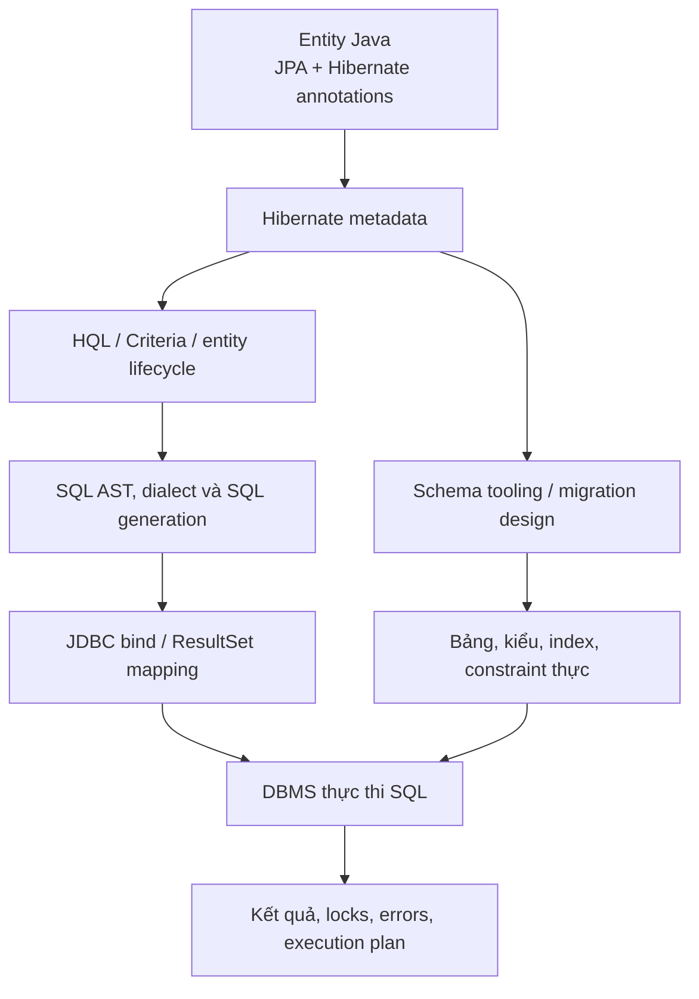
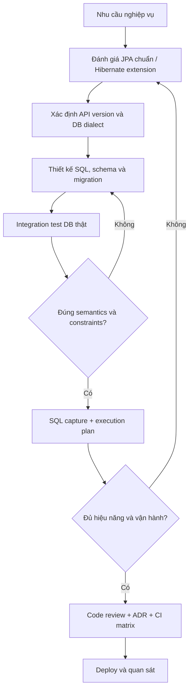

# Đánh giá khả năng di chuyển và kiểm thử SQL của mỗi phần mở rộng

Trong phần **ánh xạ nâng cao** của Hibernate ORM, các annotation và API mở rộng cho phép giải quyết nhiều nhu cầu vượt ra ngoài những mapping thông thường của Jakarta Persistence: tính thuộc tính bằng biểu thức SQL, biến đổi dữ liệu khi đọc/ghi, lưu JSON, áp dụng bộ lọc động, ánh xạ entity từ subquery, điều chỉnh phép JOIN, soft delete hay tối ưu cách tải association.

Những công cụ này hữu ích vì đưa logic ánh xạ gần với khả năng thực tế của database. Nhưng càng sử dụng cú pháp riêng của Hibernate hoặc DBMS, ứng dụng càng có nguy cơ **phụ thuộc phiên bản, phụ thuộc SQL dialect, khác biệt DDL và khác biệt hành vi runtime**.

Vì vậy, câu hỏi khi lựa chọn một phần mở rộng không chỉ là:

> “Annotation này có chạy được trên máy tôi không?”

mà là:

> “Nó phụ thuộc vào những hợp đồng nào, những câu SQL nào được tạo, chúng có đúng trên database thực tế không, và cần kiểm thử điều gì trước khi nâng cấp hoặc chuyển nền tảng?”

Bài học trình bày một phương pháp đánh giá có thể lặp lại cho từng Hibernate extension, sau đó áp dụng vào các nhóm mapping phổ biến. Mục tiêu là **chọn đúng mức phụ thuộc** và xây dựng **bằng chứng kiểm thử SQL**, không phải tránh mọi tính năng riêng của Hibernate.

## 1. Thế nào là “khả năng di chuyển” của một mapping?

Một tính năng hoạt động trên Hibernate + PostgreSQL hôm nay chưa chắc giữ nguyên hành vi nếu dự án:

- Nâng Hibernate ORM từ một phiên bản lên phiên bản khác.
- Đổi Java Persistence provider, ví dụ rời Hibernate để dùng implementation khác.
- Đổi database từ PostgreSQL sang MySQL, SQL Server hoặc Oracle.
- Đổi phiên bản DBMS nhưng giữ nguyên JDBC driver.
- Đổi JDBC driver, connection pool hoặc cách bind tham số.
- Chuyển từ Hibernate tự tạo schema sang Flyway/Liquibase.
- Dùng cùng entity trong hệ thống có nhiều database dialect.
- Chạy integration test trên H2 nhưng production dùng PostgreSQL.
- Thay đổi đường ghi từ managed entity thành HQL bulk update hoặc native SQL.

“Portability” vì thế có **nhiều chiều**, không phải một biến boolean.

| Chiều đánh giá | Câu hỏi cần trả lời |
|---|---|
| **API/provider portability** | Mapping có thuộc chuẩn Jakarta Persistence hay chỉ Hibernate hiểu? |
| **Hibernate version portability** | Annotation, tham số và hành vi có thay đổi giữa các phiên bản ORM? |
| **SQL/dialect portability** | SQL fragment dùng cú pháp ANSI SQL hay function/type riêng của DBMS? |
| **Schema portability** | Cột, constraint, index, generated column, trigger có tạo/migrate được ở DB khác? |
| **Runtime semantics** | Null, collation, timezone, JSON comparison, precision/scale, lock, cascade có giống nhau? |
| **Performance portability** | Query chạy đúng nhưng execution plan có còn phù hợp ở database mới? |
| **Data portability** | Dữ liệu đã lưu có đọc được sau khi đổi representation, converter hoặc DB type? |
| **Operational portability** | Backup, migration, caching, transaction và observability có cần thay đổi? |

Ví dụ `@Formula("price_cents / 100.0")` có thể được Hibernate xử lý tốt trên nhiều DBMS. Nhưng nếu biểu thức được thay bằng một hàm PostgreSQL riêng, khả năng chuyển DB giảm mạnh dù annotation Java không thay đổi.

### Phân loại phụ thuộc theo mức độ

Để nhất quán, có thể phân mỗi mapping vào bốn mức:

| Mức | Loại phụ thuộc | Ví dụ | Hành động mặc định |
|---|---|---|---|
| **P0 — Chuẩn JPA** | Annotation/semantic thuộc Jakarta Persistence | `@Column`, `@Convert`, `@OneToMany` | Kiểm thử trên provider/DBMS mục tiêu vì SQL vẫn có khác biệt |
| **P1 — Hibernate-specific nhưng ít SQL riêng** | Dùng Hibernate API, không nhất thiết viết raw SQL | `@BatchSize`, một số chiến lược fetch | Kiểm thử khi nâng Hibernate và đo SQL |
| **P2 — Hibernate + SQL dialect** | SQL expression hoặc cú pháp schema do extension dùng | `@Formula`, `@ColumnTransformer`, `@Check` | Test trực tiếp trên tất cả dialect hỗ trợ |
| **P3 — Phụ thuộc khả năng cụ thể của DBMS** | JSON operators, trigger, proprietary functions, collation, partial index | Formula dùng `jsonb_extract_path_text` | Cần phương án migration/fallback và test chuyên biệt DB |

Đây là **thang đánh giá thực hành**, không phải thuật ngữ chính thức của Hibernate. Một annotation có thể ở mức khác nhau tùy cách sử dụng. Ví dụ `@Formula("a + b")` có ít phụ thuộc database hơn `@Formula("custom_pg_function(a)")`.

## 2. Luồng từ mapping đến SQL và database



Hai lưu ý:

**Thứ nhất**, Hibernate có thể hiểu một mapping ở mức Java nhưng lỗi chỉ xuất hiện khi SQL thật chạy. Ví dụ tên function trong `@Formula` có thể không tồn tại ở database đích, hoặc biểu thức `@ColumnTransformer(write=...)` nhận tham số không phù hợp.

**Thứ hai**, việc Hibernate bootstrap thành công không chứng minh DDL production đúng. Với schema generation tắt, database vẫn có thể thiếu constraint, type hay trigger mà mapping ngầm giả định. Muốn xác nhận phải kiểm tra **schema thực đã được áp dụng**.

### Một phần mở rộng có thể ảnh hưởng nhiều loại SQL

Ví dụ một field JSON có thể ảnh hưởng:

- DDL: `JSONB`, `JSON`, `CLOB` hoặc kiểu khác.
- INSERT: binding object/string/binary bằng JDBC type tương ứng.
- SELECT: đọc dữ liệu và deserialize.
- UPDATE: dirty checking và rewrite payload.
- HQL predicate: hàm hoặc toán tử JSON theo dialect.
- Index: GIN/function index hay index thông thường.
- Migration: đổi cấu trúc JSON giữa các bản ứng dụng.

Vì thế không đủ chỉ kiểm tra “persist rồi find được”; phải thử đúng đường sử dụng thực tế.

## 3. Quy trình đánh giá một extension trước khi dùng

Với mỗi phần mở rộng, lưu một hồ sơ kỹ thuật ngắn gồm:

1. **Nhu cầu nghiệp vụ:** Tại sao mapping chuẩn JPA chưa đủ?
2. **Phạm vi áp dụng:** Field, entity, association, collection, schema hay fetch plan?
3. **Hợp đồng API:** Annotation thuộc `jakarta.persistence` hay `org.hibernate.annotations`? Version tối thiểu?
4. **SQL fragment và dialect:** Có raw SQL, function, JSON operator, cast, temporal function, collation hoặc schema object riêng không?
5. **Hành vi lúc đọc/ghi:** INSERT, SELECT, UPDATE, DELETE, bulk DML, lazy loading, cache.
6. **DDL/migration:** Bảng, type, index, constraint hoặc generated value cần tồn tại thật là gì?
7. **Semantics:** NULL, case sensitivity, timezone, precision, concurrency và error cases.
8. **Hiệu năng:** Số câu SQL, columns, joins, UNION, cardinality, round trips và execution plan.
9. **Cách kiểm thử:** Assertion dữ liệu nào, SQL capture nào, database versions nào?
10. **Phương án thay thế và thoát:** Có thể chuyển sang JPA chuẩn, view DB, converter, service query hoặc schema đơn giản hơn không?

### Mẫu ghi quyết định

```text
Feature:
Business requirement:
JPA-standard alternative:
Hibernate version:
Supported DBMS and version:
Generated/embedded SQL:
Required schema objects:
Read behavior:
Write behavior:
Bulk/Native SQL behavior:
Null/Unicode/timezone considerations:
Cache and concurrency:
Integration tests:
SQL assertions:
Migration/rollback strategy:
Owner and review date:
```

Một template như vậy giúp tránh tình trạng annotation đặc thù tồn tại nhiều năm mà không ai biết lý do hoặc không ai dám nâng cấp Hibernate.

## 4. Ma trận nhanh cho những phần mở rộng mapping phổ biến

| Phần mở rộng | Điểm phụ thuộc chính | SQL/DDL cần quan sát | Rủi ro đáng chú ý |
|---|---|---|---|
| `@Formula` | Hibernate + expression SQL | SELECT và projection | Function/dialect, tính lại giá trị, chi phí subquery |
| `@ColumnTransformer` | Hibernate + SQL read/write expressions | SELECT/INSERT/UPDATE | Convert không đối xứng, bind parameter, rounding |
| `@JdbcTypeCode(SqlTypes.JSON)` | Hibernate + JSON type support của dialect/driver | DDL, JDBC bind, query JSON | Representation/driver và operator khác DB |
| `@Type` / `UserType` | Hibernate SPI | Binding, extraction, cache, dirty checking | Thay đổi SPI, mutability, type mapping |
| `AttributeConverter` | JPA chuẩn, nhưng representation là contract dữ liệu | DDL type và giá trị JDBC | Converter thay đổi làm dữ liệu cũ không tương thích |
| `@SQLRestriction` | Hibernate + SQL fragment cố định | Mọi SELECT liên quan | Đường tải khác, native SQL, cache, policy bảo mật |
| `@Filter` / `@FilterDef` | Hibernate session-scoped filter | SELECT và binding filter parameters | Chưa enable filter, cache, direct load semantics |
| `@SoftDelete` / `@SQLDelete` | Hibernate version/cơ chế xóa logic | UPDATE thay DELETE, SELECT filtering | Đường bulk/native, associations, uniqueness |
| `@Subselect` + `@Immutable` | Hibernate + SQL SELECT phụ thuộc dialect | Derived table, refresh/read-only | Stale state, performance, mapping projection |
| `@Synchronize` | Hibernate flush synchronization | SQL trước query/subselect | Không biến entity read-only thành writable |
| `@JoinFormula` | Hibernate + SQL join expression | JOIN/WHERE và function index | Không có FK quan hệ chuẩn, optimizer |
| `@Check` / `@ColumnDefault` | Hibernate DDL metadata + DBMS | CREATE/ALTER TABLE | Schema thực khác mapping, default semantics |
| `@OnDelete` | Hibernate DDL/cascade của DB | FK `ON DELETE`, DELETE behavior | Không đồng nhất ORM callbacks/cache |
| `@BatchSize` / `@Fetch(SUBSELECT)` | Hibernate fetch strategy | SELECT shape, SQL count | Query explosion hoặc truy vấn quá rộng |
| `@Generated` và giá trị do DB sinh | Hibernate + DB/generated column/trigger | INSERT/UPDATE + read-back | Giá trị Java stale, RETURNING/extra SELECT |

Bảng là bản đồ định hướng. Những API kể trên có thể khác nhau theo Hibernate ORM 5.x, 6.x hoặc các phiên bản tương lai; **đọc tài liệu đúng phiên bản dự án đang dùng** trước khi áp dụng cú pháp cụ thể.

## 5. Phần mở rộng thứ nhất: `@Formula`

`@Formula` ánh xạ một thuộc tính đọc từ **biểu thức SQL**, thay vì một cột bình thường. Nó thường thích hợp với giá trị dẫn xuất ở mức truy vấn.

### 5.1. Ví dụ tính giá trị từ cột khác

Giả sử database lưu tiền theo đơn vị cent:

```sql
create table products (
    id bigint primary key,
    price_cents bigint not null
);
```

Hibernate entity có thể dùng:

```java
import jakarta.persistence.*;
import org.hibernate.annotations.Formula;
import java.math.BigDecimal;

@Entity
@Table(name = "products")
public class Product {

    @Id
    private Long id;

    @Column(name = "price_cents", nullable = false)
    private Long priceCents;

    @Formula("price_cents / 100.0")
    private BigDecimal priceAmount;

    public Long getPriceCents() { return priceCents; }
    public BigDecimal getPriceAmount() { return priceAmount; }
}
```

Khi tải entity, Hibernate có thể đặt biểu thức formula trong SELECT:

```sql
-- SQL minh họa, alias và CAST phụ thuộc dialect.
select
    p.id,
    p.price_cents,
    p.price_cents / 100.0 as formula_price
from products p
where p.id = ?;
```

`priceAmount` là thuộc tính **dẫn xuất chỉ đọc** ở mức mapping; Hibernate không coi setter Java của nó như một cột độc lập cần UPDATE. Nếu dùng getter Java thuần để tính `BigDecimal.valueOf(priceCents, 2)`, có thể tránh phụ thuộc SQL cho trường hợp đơn giản này.

### 5.2. Những điểm cần đánh giá portability

- Toán tử chia, cách suy luận kiểu số và scale có thể khác giữa DBMS.
- Một số biểu thức cần `CAST` tường minh để tránh integer division hoặc sai kiểu JDBC.
- Function SQL như `date_trunc`, `regexp_replace` hoặc các JSON function thường có biến thể theo dialect.
- Formula dùng subquery tương quan có thể phát sinh chi phí đáng kể khi tải một danh sách entity lớn.
- Formula chỉ là cách Hibernate đọc giá trị, không tự tạo generated column hay index tại database.
- Nếu formula phụ thuộc vào bảng khác, phải xem nó phản ánh dữ liệu mới khi entity đã được cache hay chưa.

### 5.3. Bộ kiểm thử tối thiểu cho `@Formula`

1. **Đọc giá trị:** Lưu `price_cents = 12345` bằng JDBC hoặc ORM, mở Session mới và kiểm tra `priceAmount == 123.45`.
2. **NULL và biên:** Xác định cách xử lý `price_cents = NULL` nếu schema cho phép, số âm, giá trị lớn và overflow.
3. **SQL:** Capture SELECT và xác nhận biểu thức được render dưới dialect đích, không chứa tên function không hỗ trợ.
4. **Tính mới:** Sau UPDATE ở transaction khác, kiểm tra behavior khi dùng Session mới, `refresh()` và L2 cache nếu bật.
5. **Hiệu năng:** Với formula là subquery, đo query plan trên lượng dữ liệu đại diện.

Nếu business chỉ cần giá trị tính trong Java, dùng method domain hoặc DTO projection có thể dễ chuyển DBMS hơn `@Formula`.

## 6. Phần mở rộng thứ hai: `@ColumnTransformer`

`@ColumnTransformer` cho phép cấu hình **biểu thức SQL khi đọc và khi ghi một cột**. Nó mạnh hơn một converter Java vì expression được database thực hiện.

Ví dụ một giá trị được lưu theo cent nhưng Java xử lý theo đơn vị tiền:

```java
import jakarta.persistence.*;
import org.hibernate.annotations.ColumnTransformer;
import java.math.BigDecimal;

@Entity
@Table(name = "catalog_prices")
public class CatalogPrice {

    @Id
    private Long id;

    @Column(name = "amount_cents", precision = 19, scale = 0)
    @ColumnTransformer(
        read = "amount_cents / 100.0",
        write = "? * 100"
    )
    private BigDecimal amount;

    public BigDecimal getAmount() { return amount; }
    public void setAmount(BigDecimal amount) {
        this.amount = amount;
    }
}
```

Đây là ví dụ ngữ nghĩa, cần DB column type thực tương thích với biểu thức. Trong trường hợp cần ép kiểu/rounding tuyệt đối chính xác, có thể phải dùng `CAST` hoặc hàm riêng DBMS và ràng buộc số chữ số thập phân.

SQL ý tưởng:

```sql
select amount_cents / 100.0
from catalog_prices
where id = ?;

update catalog_prices
set amount_cents = ? * 100
where id = ?;
```

Lưu ý:

- `read` dùng biểu thức SQL được đưa vào SELECT.
- `write` là biểu thức SQL chứa placeholder bind `?`, thường cần đúng một placeholder cho giá trị property tương ứng theo contract annotation.
- Hibernate không tự xác nhận phép biến đổi đọc và ghi là nghịch đảo toán học ở mọi input.
- Sau khi ghi bằng phép biến đổi không đối xứng hoặc làm tròn, state Java có thể khác state lưu trong DB. Cần hiểu cơ chế generated/read-back/refresh phù hợp.

### Các rủi ro phải kiểm thử

| Rủi ro | Test cần thực hiện |
|---|---|
| Đọc/ghi không đối xứng | Persist, flush, clear, reload; so sánh giá trị sau reload |
| Làm tròn hoặc truncate | `0.01`, `0.005`, số âm, scale lớn |
| Function không tồn tại trên DB khác | Chạy integration test trên từng DB mục tiêu |
| SQL bind sai | Capture INSERT/UPDATE + kiểm tra persisted value |
| Update một property khác | Xem liệu expression read/write vẫn giữ dữ liệu đúng |
| Null semantics | `null` và constraint DB nếu trường cho phép |
| Optimistic locking | Concurrent update nếu property liên quan `@Version`/dirty checking |

Nếu logic chuyển đổi có thể thực hiện hoàn toàn trong Java, `AttributeConverter` thường dễ chuyển provider hơn. Nếu transformation cần chức năng DB như mã hóa/giải mã với extension PostgreSQL, độ phụ thuộc DBMS tăng mạnh và phải thiết kế quản lý secret/key riêng.

## 7. Phần mở rộng thứ ba: JSON và kiểu JDBC đặc biệt

Hibernate có thể ánh xạ thuộc tính Java sang kiểu JSON của database, ví dụ thông qua `@JdbcTypeCode(SqlTypes.JSON)` trong những phiên bản hỗ trợ.

```java
import jakarta.persistence.*;
import org.hibernate.annotations.JdbcTypeCode;
import org.hibernate.type.SqlTypes;
import java.util.Map;

@Entity
@Table(name = "audit_events")
public class AuditEvent {

    @Id
    private Long id;

    @JdbcTypeCode(SqlTypes.JSON)
    @Column(name = "payload")
    private Map<String, Object> payload;

    public Map<String, Object> getPayload() {
        return payload;
    }
}
```

Hibernate cần chọn **JDBC type** và cách chuyển đổi object/JSON phù hợp với dialect và thư viện JSON có sẵn. Đừng suy luận rằng `SqlTypes.JSON` luôn dẫn đến cùng một DDL type hay cùng cách bind trên mọi database.

### 7.1. Khả năng di chuyển của JSON có nhiều lớp

- PostgreSQL có `json`/`jsonb` và operator/GIN index đặc thù.
- MySQL có JSON type và cú pháp expression/index khác.
- SQL Server có các cách lưu và truy vấn JSON khác, tùy version và feature.
- Một số hệ thống lưu JSON trong CLOB/VARCHAR thay vì native JSON.
- Thứ tự key, chuẩn hóa số, xử lý null trong JSON và SQL NULL có thể khác.
- JSON object graph trong Java có thể mutable; dirty checking và cache cần hiểu mutability của value type.
- Query theo JSON path có thể không portable qua HQL function nếu viết trực tiếp operator DB-specific.

### 7.2. Bộ test đúng cho JSON

**Round-trip dữ liệu:**

```java
// Ý tưởng kiểm thử: persist payload rồi mở Session mới để reload.
Map<String, Object> payload = Map.of(
    "source", "mobile",
    "attempts", 2,
    "flags", List.of("verified", "paid")
);
```

Kiểm tra payload sau reload có cùng ý nghĩa dữ liệu, đặc biệt giá trị number, null, boolean, nested arrays và ký tự Unicode. Đừng chỉ so sánh JSON text vì DBMS có thể chuẩn hóa thứ tự key hoặc biểu diễn số.

**Test DDL:** Xác nhận kiểu cột thực tế ở database đích, không chỉ type Hibernate yêu cầu.

**Test bind/extract:** Xác nhận JDBC driver chuyển dữ liệu đúng và không cần cast không được hỗ trợ.

**Test query JSON:** Nếu ứng dụng lọc theo `payload.source`, chạy SQL/HQL tương ứng trên database mục tiêu và quan sát index/execution plan.

**Test migration:** Thêm/đổi thuộc tính trong payload và đọc dữ liệu cũ. Dữ liệu JSON lịch sử không tự trở nên tương thích khi Java class thay đổi.

### 7.3. Khi nào nên thay JSON bằng mô hình quan hệ?

JSON phù hợp với payload linh hoạt, metadata thưa hoặc dữ liệu không cần join/filter quá phức tạp. Nếu ứng dụng liên tục lọc và join theo các trường bên trong JSON, cần uniqueness, foreign key, range query và báo cáo lớn, các cột quan hệ chuẩn hóa có thể đơn giản và dễ tối ưu hơn.

## 8. `AttributeConverter`, `@Type` và custom type SPI

Đây là nhóm cần phân biệt **mức portable của API** với **mức portable của dữ liệu**.

### 8.1. `AttributeConverter` là cơ chế JPA chuẩn

```java
import jakarta.persistence.AttributeConverter;
import jakarta.persistence.Converter;

@Converter(autoApply = false)
public class StatusConverter
        implements AttributeConverter<PaymentStatus, String> {

    @Override
    public String convertToDatabaseColumn(PaymentStatus status) {
        return status == null ? null : status.name();
    }

    @Override
    public PaymentStatus convertToEntityAttribute(String value) {
        return value == null ? null : PaymentStatus.valueOf(value);
    }
}
```

Dùng trong entity:

```java
@Convert(converter = StatusConverter.class)
@Column(name = "status", length = 30)
private PaymentStatus status;
```

`AttributeConverter` do Jakarta Persistence định nghĩa, nên **API portability** thường tốt hơn extension Hibernate riêng. Nhưng converter vẫn là **hợp đồng lưu trữ dữ liệu**: đổi tên enum constant hoặc format string có thể khiến bản ghi cũ không đọc được.

Nếu dùng converter cho enum, tránh khai báo các cơ chế ánh xạ enum không tương thích trên cùng property mà không hiểu quy tắc provider; chọn một cách mapping rõ ràng.

### 8.2. Khi nào cần `@Type`/`UserType`?

Một custom type Hibernate có thể cần khi:

- Mapping không thể diễn đạt qua converter đơn giản.
- Cần kiểm soát JDBC type/binding/extraction sâu.
- Có custom mutability plan, equality, hashing hoặc caching.
- Dùng database-specific type không có hỗ trợ chuẩn phù hợp.
- Cần ánh xạ các cấu trúc domain đặc thù.

Nhưng các SPI như `UserType`, `JavaType`, `JdbcType` và các annotation đăng ký type có thể khác giữa các đời Hibernate. Code viết cho ORM 5.x không nhất thiết tương thích nguyên vẹn với ORM 6.x/7.x.

### 8.3. Các kiểm thử bổ sung cho custom type

- **Null:** Java null ↔ SQL NULL theo đúng contract.
- **Round-trip:** Tất cả giá trị biên, Unicode, binary, large payload.
- **Equality:** Dirty checking không báo thay đổi giả hoặc bỏ sót thay đổi thật.
- **Mutability:** Mutable value object/collection bị sửa trong bộ nhớ có được phát hiện đúng?
- **Caching:** Deep copy/disassemble/assemble đúng khi qua L2 cache.
- **Bulk/native paths:** Dữ liệu do JDBC thuần ghi có được đọc lại bằng type này?
- **Schema:** JDBC type chính xác với column type DB đích?
- **Upgrade:** Compile và chạy integration test sau mỗi major Hibernate upgrade.

Một converter JPA đơn giản có thể portable về code nhưng vẫn gây **data migration** khó nếu representation đã được lưu rộng rãi.

## 9. Bộ lọc SQL tĩnh bằng `@SQLRestriction`

Trong những phiên bản Hibernate ORM hỗ trợ, `@SQLRestriction` áp dụng một **điều kiện SQL tĩnh** vào quá trình tải entity hoặc collection theo phạm vi annotation.

Ví dụ một record có cờ xóa logic:

```java
import jakarta.persistence.*;
import org.hibernate.annotations.SQLRestriction;

@Entity
@Table(name = "documents")
@SQLRestriction("deleted = false")
public class Document {

    @Id
    private Long id;

    @Column(nullable = false)
    private boolean deleted;

    @Column(nullable = false)
    private String title;
}
```

Điều kiện `deleted = false` là **SQL fragment**, không phải HQL predicate có thể tham số hóa tùy ý. Hibernate có thể chèn predicate khi tải `Document` qua một số đường ORM.

### Rủi ro portability

- Một số DBMS khác nhau về biểu diễn boolean (`false`, `0`, bit type).
- SQL fragment dùng tên **cột database**, không phải mọi trường hợp đều nhận tên field Java.
- Cách áp dụng với alias, JOIN, collection, loader theo ID và inheritance phải kiểm thử theo Hibernate version.
- Native SQL hoặc JDBC khác không tự chịu điều kiện của Hibernate.
- Filter tĩnh không thay đổi theo người dùng/tenant/runtime context.
- Không thể xem predicate này là **ranh giới bảo mật**, vì các đường ghi/đọc ngoài ORM vẫn tồn tại.

### Test nên có

1. Tạo hai hàng `deleted=false` và `deleted=true` bằng JDBC.
2. Chạy HQL truy vấn entity và kiểm tra chỉ nhận hàng mong muốn.
3. Kiểm tra tải theo ID và association tới entity trong phạm vi mapping/version đang dùng.
4. Kiểm tra native SQL có thể thấy cả hai hàng để không hiểu nhầm về bảo mật.
5. Capture SQL và xác minh predicate có thực sự xuất hiện ở các query quan trọng.
6. Đo query plan; predicate trên cột ít phân biệt giá trị có thể không đủ nếu thiếu index phù hợp.

Nếu đang dùng Hibernate version có native `@SoftDelete`, nên cân nhắc nó thay vì tự ghép nhiều annotation/filter riêng để thực hiện xóa logic.

## 10. Bộ lọc có tham số: `@FilterDef` và `@Filter`

`@Filter` dùng cho điều kiện SQL cần tham số thay đổi theo một Session hoặc đơn vị công việc, ví dụ chỉ lấy tài liệu theo khu vực.

```java
import jakarta.persistence.*;
import org.hibernate.annotations.Filter;
import org.hibernate.annotations.FilterDef;
import org.hibernate.annotations.ParamDef;

@Entity
@Table(name = "documents")
@FilterDef(
    name = "regionFilter",
    parameters = @ParamDef(
        name = "region",
        type = String.class
    )
)
@Filter(
    name = "regionFilter",
    condition = "region_code = :region"
)
public class Document {

    @Id
    private Long id;

    @Column(name = "region_code", nullable = false)
    private String regionCode;
}
```

Khi truy vấn:

```java
try (Session session = sessionFactory.openSession()) {
    session.enableFilter("regionFilter")
        .setParameter("region", "HCM");

    List<Document> documents =
        session.createSelectionQuery(
            "from Document", Document.class
        ).getResultList();
}
```

HQL không nhắc tới `regionCode`, nhưng filter có thể được Hibernate đưa vào SQL tương ứng với phạm vi mapping.

### Vì sao filter động cần test kỹ?

- Filter phải được **enable** và set parameter đúng tại mỗi Session/ngữ cảnh liên quan.
- Không thể giả định mọi cách load entity theo identifier, mọi association và mọi cache hit đều chịu filter giống hệt nhau; behavior thay đổi theo loại loader và mapping.
- Filter parameters có thể ảnh hưởng cache correctness. Cần hiểu loại cache có được dùng cùng filter hay không.
- Nếu Session được quản lý bởi framework, phải chắc chắn filter không vô tình “rò” sang unit of work khác; đừng chia sẻ Session giữa threads.
- Native SQL không tự biết Hibernate filter.
- Khi dùng filter để phân tách tenant, **không coi nó là cơ chế authorization duy nhất**.

### Ma trận test filter

| Tình huống | Kết quả cần kiểm chứng |
|---|---|
| Filter chưa bật | Query có trả dữ liệu toàn khu vực theo đúng contract? |
| Filter bật với HCM | Chỉ các record HCM xuất hiện ở query đã được filter áp dụng |
| Filter bật với HN | Không tái sử dụng nhầm kết quả HCM qua cache |
| Tải theo ID | Hành vi cụ thể của loader Hibernate đang dùng |
| Truy cập association lazy | Có áp dụng filter ở query tải association? |
| Native SQL | Không mặc định có filter; service cần tự bảo vệ |
| Nhiều request đồng thời | Parameter/session isolation không bị lẫn |

Filter giúp tái sử dụng điều kiện SQL ở mapping, nhưng càng quan trọng về bảo mật, càng cần bổ sung kiểm tra quyền và chính sách phân tách dữ liệu tại tầng thích hợp, thậm chí database row-level security nếu phù hợp.

## 11. Soft delete: `@SoftDelete` và giải pháp `@SQLDelete`

**Soft delete** có nghĩa yêu cầu xóa được biểu diễn bằng cập nhật trạng thái như `deleted=true` thay vì xóa vật lý ngay lập tức.

### 11.1. Mapping soft delete native

Trong các phiên bản Hibernate ORM hiện đại có hỗ trợ `@SoftDelete`, có thể dùng kiểu:

```java
import jakarta.persistence.*;
import org.hibernate.annotations.SoftDelete;
import org.hibernate.annotations.SoftDeleteType;

@Entity
@Table(name = "articles")
@SoftDelete(
    strategy = SoftDeleteType.DELETED,
    columnName = "deleted"
)
public class Article {

    @Id
    private Long id;

    @Column(nullable = false)
    private String title;
}
```

Ví dụ dùng `SoftDeleteType.DELETED` diễn đạt cột indicator nhận ý nghĩa “đã bị xóa”. Cần xác định **Hibernate version**, kiểu indicator, converter và DDL theo đúng tài liệu của bản sử dụng. Không thể mang annotation này sang một JPA provider khác và kỳ vọng nó hoạt động nguyên vẹn.

### 11.2. Giải pháp tùy biến cũ hơn

Các dự án có thể gặp:

```java
@SQLDelete(sql =
    "update articles set deleted = true where id = ?")
@SQLRestriction("deleted = false")
@Entity
@Table(name = "articles")
class Article {
    // Mapping và SQL tùy phiên bản, số placeholder,
    // version column và stored procedure semantics.
}
```

`@SQLDelete` cho Hibernate dùng SQL xóa tùy biến. **Câu SQL ở ví dụ chỉ mang tính sơ lược**: khi entity có `@Version`, SQL/delete parameter order và expectation checking có thể cần điều chỉnh. Một câu SQL hard-coded bỏ qua version có thể phá optimistic locking hoặc không phù hợp mapping thực tế.

### Điều phải kiểm thử cho soft delete

- `remove(entity)` dẫn tới UPDATE/indicator change chứ không phải physical DELETE.
- Query bình thường có còn trả entity đã xóa không?
- Tải theo ID và lazy association có semantics nào?
- `@OneToMany`/collection filtering có phù hợp không?
- HQL bulk `delete from Article` có cùng semantics hay bypass một số callback? Cần xác minh version và query path.
- Native SQL/JDBC trực tiếp xóa có thể bỏ qua soft-delete policy.
- Unique constraint khi “xóa rồi tạo lại cùng business key” xử lý thế nào?
- `@Version` và concurrent deletes có được kiểm tra đúng?
- Cache/invalidation và báo cáo thống kê có tính records deleted như mong muốn?

Đặc biệt, nếu dữ liệu soft-deleted vẫn tồn tại trong bảng, `UNIQUE(email)` thường vẫn giữ chỗ cho email cũ. Muốn tái sử dụng business key sau soft delete có thể cần partial unique index hoặc thiết kế uniqueness theo trạng thái; cú pháp và semantics phụ thuộc DBMS.

## 12. `@Subselect` và `@Immutable`: entity chỉ đọc từ SQL view logic

Đôi khi một read model tổng hợp từ nhiều bảng thích hợp được ánh xạ thành một entity chỉ đọc. Hibernate hỗ trợ `@Subselect` với câu SELECT tùy biến, thường phối hợp với `@Immutable`.

```java
import jakarta.persistence.Column;
import jakarta.persistence.Entity;
import jakarta.persistence.Id;
import org.hibernate.annotations.Immutable;
import org.hibernate.annotations.Subselect;
import org.hibernate.annotations.Synchronize;
import java.math.BigDecimal;

@Entity
@Immutable
@Subselect("""
    select
        c.id as customer_id,
        count(o.id) as order_count,
        coalesce(sum(o.total_amount), 0) as total_spent
    from customers c
    left join orders o on o.customer_id = c.id
    group by c.id
    """)
@Synchronize({"customers", "orders"})
public class CustomerSpending {

    @Id
    @Column(name = "customer_id")
    private Long customerId;

    @Column(name = "order_count")
    private Long orderCount;

    @Column(name = "total_spent")
    private BigDecimal totalSpent;

    protected CustomerSpending() {}

    public Long getCustomerId() { return customerId; }
    public Long getOrderCount() { return orderCount; }
    public BigDecimal getTotalSpent() { return totalSpent; }
}
```

Đây là SQL minh họa, phải kiểm tra type của `COUNT`, `SUM`, `COALESCE` và alias tương ứng trên database mục tiêu.

**`@Subselect` không tự tạo một database VIEW**. Nó khai báo biểu thức SQL được Hibernate dùng như nguồn đọc. `@Immutable` cho biết entity này không được quản lý cập nhật như entity thường; muốn ghi dữ liệu phải thao tác các bảng nguồn hoặc cơ chế khác.

`@Synchronize` chỉ rõ các bảng liên quan để Hibernate phối hợp **flush synchronization** trước một số query theo mapping. Nó không bảo đảm read model luôn fresh trong mọi tình huống, không tự invalidate mọi cache nếu có hệ thống khác ghi SQL trực tiếp, và không biến `@Subselect` thành một bảng cập nhật được.

### Các phép thử cần thiết

1. Dùng SQL/ORM tạo khách hàng và đơn hàng.
2. Query `CustomerSpending`, kiểm tra đúng tổng và số lượng.
3. Thay đổi dữ liệu bảng `orders` trong transaction và xác định kết quả trước/sau flush theo contract.
4. Mở Session mới để tránh kết luận sai do first-level cache.
5. Thử customer chưa có order: `count = 0`, `totalSpent = 0`.
6. Thử nhiều order với NULL nếu schema cho phép, rounding và overflow.
7. Đọc SQL thực/`EXPLAIN` để xem cost của aggregate và join.
8. Không giả định UPDATE entity `@Immutable` sẽ ghi lại các bảng nguồn.

Nếu SQL subselect phức tạp và được nhiều ứng dụng dùng chung, một **database VIEW** quản lý bằng migration hoặc query DTO có thể dễ kiểm soát hơn; cần cân nhắc khả năng portable của VIEW ở DBMS mục tiêu.

## 13. `@JoinFormula` và phép JOIN phi chuẩn

Hibernate có thể ánh xạ association qua một **biểu thức SQL**, thay vì chỉ dùng một foreign key column thông thường.

Ví dụ nhu cầu ghép một đối tượng theo một mã đã được biến đổi:

```java
import jakarta.persistence.*;
import org.hibernate.annotations.JoinFormula;

@Entity
@Table(name = "orders")
class PurchaseOrder {

    @Id
    private Long id;

    @ManyToOne(fetch = FetchType.LAZY)
    @JoinFormula(
        value = "upper(customer_code)",
        referencedColumnName = "normalized_code"
    )
    private Customer customer;
}
```

Ví dụ trên **phụ thuộc schema và DBMS**: bảng `customers` phải có cột `normalized_code` với semantics duy nhất phù hợp; phép `upper` phải có behavior đúng theo collation và dữ liệu. Cú pháp SQL/join được render bởi Hibernate có thể khác theo version. Đây không phải một mapping tham khảo để dùng mà không kiểm thử.

### Những điều phải xác minh

- Hibernate render JOIN/ON expression theo đúng alias, cột và function.
- Query tìm đúng một Customer khi expression ánh xạ tới natural/business key.
- Null và case-insensitive comparison xử lý đúng.
- Collation/Unicode tạo kết quả ổn định.
- Có index phù hợp trên expression/generated column để tránh scan lớn.
- Database có thể bảo vệ referential integrity hay không: formula join **không tự tương đương FK constraint**.
- Thay đổi mã tham chiếu có khiến association trỏ sang entity khác hay không.
- SQL thực trên từng DBMS được hỗ trợ.

Nếu chỉ cần join qua một khóa đơn ổn định, dùng `@JoinColumn` + FK thật thường dễ di chuyển và dễ kiểm soát dữ liệu hơn `@JoinFormula`.

## 14. `@Check` và `@ColumnDefault`: metadata DDL không phải Java validation

Một số Hibernate extensions tác động chủ yếu tới DDL:

```java
import jakarta.persistence.*;
import org.hibernate.annotations.Check;
import org.hibernate.annotations.ColumnDefault;

@Entity
@Table(name = "inventory_items")
@Check(constraints = "quantity >= 0")
class InventoryItem {

    @Id
    private Long id;

    @Column(nullable = false)
    private int quantity;

    @ColumnDefault("'ACTIVE'")
    @Column(length = 20)
    private String status;
}
```

- `@Check` có thể được Hibernate đưa thành constraint `CHECK` trong schema generation.
- `@ColumnDefault` mô tả DB column default khi Hibernate tạo DDL.
- Chúng không tự gọi Jakarta Bean Validation trên object Java.
- Nếu production tắt Hibernate DDL generation, các constraint/default ấy **không tự xuất hiện** ở database.

Đây là SQL schema mong muốn:

```sql
alter table inventory_items
add constraint chk_quantity_nonnegative
check (quantity >= 0);
```

### Những điều cần test

- DB catalog có constraint thật hay chưa sau migration?
- JDBC thuần insert `quantity=-1` có bị DB từ chối?
- ORM insert không truyền `status` có kích hoạt DB default không? Hibernate có thể gửi `NULL` tường minh khiến default không áp dụng.
- Nếu dùng `@DynamicInsert` để bỏ cột null khỏi INSERT, SQL nào thực sự được tạo, và giá trị Java được đọc lại khi nào?
- DDL syntax, biểu thức CHECK và default function có portable tới DBMS khác?
- Hàng legacy vi phạm rule có cản migration không?

**`@ColumnDefault` không khởi tạo Java field.** Nếu cần default ở domain model, hãy xử lý trong constructor/initializer; nếu cần DB-generated default, thiết kế cách Hibernate biết giá trị sau INSERT.

## 15. `@OnDelete` và database cascade

`@OnDelete` là extension dùng để khai báo hành vi cascade ở **constraint của database**, ví dụ:

```java
import jakarta.persistence.*;
import org.hibernate.annotations.OnDelete;
import org.hibernate.annotations.OnDeleteAction;

@Entity
class OrderLine {

    @Id
    private Long id;

    @ManyToOne(optional = false)
    @JoinColumn(name = "order_id", nullable = false)
    @OnDelete(action = OnDeleteAction.CASCADE)
    private PurchaseOrder order;
}
```

Khi schema được tạo như mong muốn, foreign key của `order_lines.order_id` có thể mang `ON DELETE CASCADE`. Điều này khác với:

```java
@OneToMany(mappedBy = "order", cascade = CascadeType.REMOVE)
private List<OrderLine> lines;
```

`CascadeType.REMOVE` là **ORM lifecycle cascade**; `ON DELETE CASCADE` là **database-side delete propagation**.

| Câu hỏi | ORM cascade remove | Database ON DELETE CASCADE |
|---|---|---|
| Ai thực hiện xóa child? | Hibernate phối hợp entity actions | DBMS |
| Có áp dụng với SQL trực tiếp xóa parent? | Không | Có, nếu FK thực có ON DELETE |
| Child lifecycle callbacks Java có chạy? | Có thể theo ORM operation | Không tự chạy bởi DB |
| L2 cache có tự đồng bộ tuyệt đối? | Phụ thuộc ORM invalidation | Phải hiểu cơ chế phối hợp với DB-side delete |
| SQL DDL có portable? | ORM mapping Java tương đối chuẩn | Syntax/action phụ thuộc DBMS |

### Test tối thiểu

1. Đọc DDL thật và xác nhận FK có `ON DELETE CASCADE`.
2. Tạo order cùng nhiều lines.
3. Xóa parent bằng ORM và xác minh DB rows child đã biến mất.
4. Xóa parent bằng JDBC trực tiếp trong transaction thử nghiệm và xác minh DB cascade.
5. Kiểm tra association trong Session/L2 cache khi có DB-side delete.
6. Xác định callbacks/audit có còn chạy như nghiệp vụ yêu cầu không.

Không nên thay ORM cascade bằng DB cascade nếu audit domain bắt buộc nhận callback trước khi mỗi child bị xóa, trừ khi thiết kế một cơ chế audit khác.

## 16. `@BatchSize` và `@Fetch(SUBSELECT)`: portability của SQL hiệu năng

Một số extension không thay đổi dữ liệu lưu trữ nhưng thay đổi **chiến lược tải association**. Chúng thường có mức phụ thuộc API Hibernate nhưng tác động SQL lớn.

### 16.1. `@BatchSize`

```java
import jakarta.persistence.*;
import org.hibernate.annotations.BatchSize;

@Entity
class Department {

    @Id
    private Long id;

    @OneToMany(mappedBy = "department")
    @BatchSize(size = 32)
    private List<Employee> employees;
}
```

Khi nhiều collection lazy được khởi tạo, Hibernate có thể gom một số key vào các truy vấn batch để tránh N+1. SQL thường có predicate dạng `IN (?, ?, ...)` hoặc biểu diễn phù hợp dialect/loader.

Điều cần kiểm thử:

- Với 50 departments, số query thực bao nhiêu khi truy cập collection?
- SQL có vượt giới hạn tham số `IN` của dialect đích?
- Batch size 32 có phù hợp dữ liệu, heap và round trip?
- Tương tác với first-level cache, L2 cache và pagination?
- Có fetch association thừa làm tăng lượng dữ liệu không?

### 16.2. `@Fetch(FetchMode.SUBSELECT)`

```java
import jakarta.persistence.*;
import org.hibernate.annotations.Fetch;
import org.hibernate.annotations.FetchMode;

@Entity
class Department {

    @Id
    private Long id;

    @OneToMany(mappedBy = "department")
    @Fetch(FetchMode.SUBSELECT)
    private List<Employee> employees;
}
```

Trong một số trường hợp, Hibernate có thể tải nhiều collection bằng một subselect dựa trên query trước đó đã lấy các parent. SQL shape khác với batch IN và phụ thuộc trạng thái Session/query.

Rủi ro:

- Subselect có thể chọn nhiều parent hơn phạm vi UI thật sự cần.
- Query phức tạp/pagination có thể làm subselect tốn chi phí.
- Sự khác biệt dialect về subquery, execution plan, row estimates.
- Không nên suy luận rằng “một SELECT” luôn nhanh hơn “vài SELECT”.

Đây là hai ví dụ **tối ưu hóa cần kiểm chứng bằng số đo**. Nếu code đã đúng nghiệp vụ, chúng có thể hữu ích mà không cần tạo business semantics độc quyền DBMS; nhưng khi nâng Hibernate, SQL shape có thể thay đổi.

## 17. `@Generated` và các giá trị do database sinh

Nhiều hệ thống có cột được tạo bởi trigger, computed column hoặc DB default. Hibernate có thể tích hợp thông tin rằng một giá trị được DB tạo ra để đọc lại sau INSERT/UPDATE.

Ví dụ ý tưởng:

```java
import jakarta.persistence.*;
import org.hibernate.annotations.Generated;
import org.hibernate.generator.EventType;

@Entity
@Table(name = "orders")
class Order {

    @Id
    private Long id;

    @Generated(event = {EventType.INSERT, EventType.UPDATE})
    @Column(name = "audit_token")
    private String auditToken;
}
```

Đây là mapping khái niệm, yêu cầu database **thực sự có trigger/computed logic** điền `audit_token` ở đúng event. Sự kết hợp giữa annotation, khả năng write của property, trigger và SQL returning/follow-up select cần được cấu hình phù hợp với Hibernate version.

### Những điều dễ bị bỏ qua

- `@Generated` không tự tạo trigger trong DB.
- Hibernate phải biết khi nào đọc lại giá trị do DB tạo.
- DBMS hỗ trợ `RETURNING`/`OUTPUT` khác nhau, nên số SQL có thể thay đổi.
- Nếu giá trị Java đang managed bị stale sau native SQL/bulk update, cần refresh hoặc mở persistence context mới.
- Generated value có thể thay đổi mà không qua setter Java, ảnh hưởng equality, auditing và cache.
- Default của DB có thể không chạy khi INSERT gửi giá trị NULL tường minh.

Bộ test nên gồm INSERT, UPDATE, reload Session mới, JDBC direct update, rollback, concurrency và so sánh giá trị quan sát được sau flush/commit.

## 18. Phân biệt kiểm thử chức năng, kiểm thử SQL và kiểm thử schema

Một mapping có thể vượt qua test chức năng nhưng vẫn tạo SQL xấu hoặc sử dụng schema không đúng.

### Tầng A — Test ngữ nghĩa entity

Ví dụ:

- Persist → flush → clear → reload.
- Đọc và cập nhật trường phức tạp.
- Null, Unicode, biên số và timezone.
- Lazy association sau khi Session mở/đóng.
- Concurrent transactions và unique/locking behavior.
- Cache bật/tắt và dữ liệu thay đổi ngoài Hibernate.

Tầng này trả lời: **Kết quả nghiệp vụ có đúng không?**

### Tầng B — Test SQL thực thi

Quan sát:

- SQL được sinh chứa biểu thức nào?
- Có SELECT/INSERT/UPDATE/DELETE không mong đợi?
- Có SQL function hoặc cast chỉ đúng ở một DBMS?
- Có bao nhiêu JDBC statements?
- Query có bind parameters thay vì ghép dữ liệu đầu vào trực tiếp không?
- Bulk update và native SQL có bypass một số entity hooks không?
- Có WHERE conditions cho soft delete/filter ở đường truy vấn đang kiểm thử không?

Tầng này trả lời: **Hibernate thực sự gửi SQL gì?**

### Tầng C — Test schema

Quan sát:

- Database có kiểu cột phù hợp và đầy đủ constraints?
- Unique/FK/CHECK/default/trigger/index có tồn tại?
- Migration chạy thành công trên database trống và database có dữ liệu cũ?
- Hibernate schema validation phát hiện những sai khác được hỗ trợ hay không?
- SQL trực tiếp ngoài ORM có thể phá invariant không?

Tầng này trả lời: **Database thực đã chuẩn bị đúng để thực thi mapping chưa?**

### Tầng D — Test execution plan và vận hành

Quan sát:

- SQL có dùng index phù hợp không?
- Có full table scan, sort nặng, join explosion?
- Số rows/bytes được đọc và chuyển về JDBC.
- Lock wait, transaction duration và pool usage.
- Độ trễ P95/P99 trên dữ liệu đại diện.
- Tác động khi tăng số tenant hoặc subtype.

Tầng này trả lời: **Mapping có vận hành tốt với dữ liệu thật không?**

Không có tầng nào tự thay thế hoàn toàn tầng khác.

## 19. Vì sao cần thử trên DBMS thật thay vì chỉ dùng H2?

H2 hữu ích cho những kiểm thử đơn vị và tích hợp nhẹ, nhưng **H2 compatibility mode không biến nó thành PostgreSQL/Oracle/MySQL thực sự**.

Khác biệt có thể bao gồm:

- DDL type và cách xử lý `BOOLEAN`, `JSON`, `UUID`, `ARRAY`.
- Function như `date_trunc` và JSON path.
- Chuẩn hóa identifier và quoted names.
- So sánh chuỗi, collation và Unicode.
- Timezone và timestamp precision.
- `RETURNING`, sequences, identity generation.
- `CHECK`, deferred constraints, partial indexes.
- Query optimizer, execution plans và lock/isolation semantics.
- JDBC driver binding cho kiểu dữ liệu riêng.

Một câu `@Formula` chạy trên H2 không chứng minh nó chạy đúng trên database production. Ngược lại, một function native PostgreSQL có thể không chạy trên H2 dù mapping production hoàn toàn hợp lệ.

### Testcontainers và database thật

Một chiến lược thiết thực là dùng Testcontainers để chạy DBMS mục tiêu trong integration test, ví dụ PostgreSQL:

```java
import org.junit.jupiter.api.Test;
import org.testcontainers.containers.PostgreSQLContainer;
import org.testcontainers.junit.jupiter.Container;
import org.testcontainers.junit.jupiter.Testcontainers;

@Testcontainers
class MappingIntegrationTest {

    @Container
    static PostgreSQLContainer<?> postgres =
        new PostgreSQLContainer<>("postgres:16-alpine");

    @Test
    void databaseIsAvailable() {
        // Khởi tạo SessionFactory/DataSource bằng:
        // postgres.getJdbcUrl()
        // postgres.getUsername()
        // postgres.getPassword()
        //
        // Chạy migration thật, rồi thực hiện test mapping.
    }
}
```

Đây là skeleton, không phải một ứng dụng khởi tạo Hibernate hoàn chỉnh. Trong Spring Boot, có thể dùng `@DynamicPropertySource` hoặc cơ chế test integration phù hợp để nạp JDBC URL/user/password từ container.

**Version image cần được pin có chủ đích** theo DBMS version đang vận hành; tránh chạy test trên `latest` rồi tưởng đã đại diện cho production. Nếu hỗ trợ nhiều DBMS, cần ma trận chạy trên từng engine/version được cam kết, ít nhất ở CI định kỳ và trước release quan trọng.

## 20. Ví dụ integration test round-trip với Hibernate

Một test có ý nghĩa phải tạo dữ liệu, ghi xuống DB thật, xóa persistence context để không nhận lại object từ first-level cache, rồi đọc lại.

```java
@Test
void formulaShouldReadDatabaseCalculatedValue() {
    Long productId = 101L;

    // Giả định test setup đã chạy migration và tạo dữ liệu:
    // INSERT INTO products(id, price_cents) VALUES (101, 12345)

    try (Session session = sessionFactory.openSession()) {
        Transaction tx = session.beginTransaction();

        Product product = session.find(Product.class, productId);

        assertNotNull(product);
        assertEquals(
            0,
            new BigDecimal("123.45")
                .compareTo(product.getPriceAmount())
        );

        tx.commit();
    }
}
```

Ví dụ dùng assertion JUnit ở mức ý tưởng; `Product` phải có mapping `@Formula` như phần trước. Với kiểm thử thực tế, có thể setup data bằng JDBC trong transaction độc lập và dọn dữ liệu bằng rollback/database cleanup.

**Tại sao `session.clear()` hoặc Session mới cần thiết?** Nếu vừa `persist` entity rồi đọc lại trong cùng Session, Hibernate có thể trả chính managed object ban đầu mà không phải chạy SELECT. Test ấy **không chứng minh** SQL read expression hoặc JDBC type extraction hoạt động.

### Test vòng đời đầy đủ

```text
Prepare schema bằng migration thực
        ↓
Insert dữ liệu chuẩn qua JDBC hoặc ORM
        ↓
Flush + commit
        ↓
Đóng Session / mở Session mới
        ↓
Đọc lại, assert values
        ↓
Update hoặc bulk/native operation
        ↓
Flush + commit
        ↓
Mở Session mới, kiểm tra again
        ↓
Kiểm tra SQL logs/statement capture/schema
```

Với soft-delete/filter, thêm đường truy cập bằng HQL, `find`, association và native SQL để hiểu ranh giới của extension.

## 21. Capture SQL bằng `StatementInspector`

Hibernate cung cấp interface `org.hibernate.resource.jdbc.spi.StatementInspector` để quan sát hoặc sửa SQL trước khi JDBC statement được chuẩn bị.

Một inspector chỉ ghi nhận SQL:

```java
import java.util.ArrayList;
import java.util.List;
import org.hibernate.resource.jdbc.spi.StatementInspector;

public final class SqlCapture implements StatementInspector {

    private final List<String> statements = new ArrayList<>();

    @Override
    public String inspect(String sql) {
        statements.add(sql);
        return null; // null: giữ nguyên SQL; không sửa câu lệnh.
    }

    public List<String> statements() {
        return List.copyOf(statements);
    }
}
```

Có thể gắn inspector riêng khi mở Session bằng API Hibernate có hỗ trợ:

```java
SqlCapture capture = new SqlCapture();

try (Session session = sessionFactory
        .withOptions()
        .statementInspector(capture)
        .openSession()) {

    Transaction tx = session.beginTransaction();

    List<Document> documents = session
        .createSelectionQuery(
            "from Document", Document.class
        )
        .getResultList();

    tx.commit();
}

for (String sql : capture.statements()) {
    System.out.println(sql);
}
```

Code `SqlCapture` sử dụng `ArrayList` chỉ phù hợp khi inspector thuộc **một Session dùng tuần tự** như ví dụ. Nếu gắn inspector chung ở `SessionFactory` và nhiều threads cùng gọi, cần collection/thread-safety/trace isolation phù hợp.

### Điều `StatementInspector` quan sát và không quan sát

- Quan sát SQL text được Hibernate chuẩn bị qua cơ chế inspector.
- Không tự chứa **giá trị bind parameters**; placeholders vẫn thường là `?`.
- Không tự trả execution plan, JDBC timings hoặc số rows thực.
- Không tự quan sát SQL chạy bằng một JDBC connection khác ngoài Hibernate.
- SQL text có thể đổi alias và format khi nâng Hibernate dù semantics không đổi.

Có thể dùng inspector để assert số statement và các đặc điểm quan trọng của SQL, kết hợp log bind hoặc JDBC proxy khi cần. Tránh dựa vào alias tự sinh như `p1_0` hoặc vị trí whitespace vì đó là **chi tiết implementation**, không phải contract ổn định.

## 22. Assert SQL như thế nào để tránh test giòn?

Một lỗi phổ biến là viết test yêu cầu SQL khớp tuyệt đối:

```java
assertEquals(
    "select p1_0.id,p1_0.price_cents from products p1_0 where p1_0.id=?",
    sql
);
```

Khi nâng Hibernate, alias, thứ tự cột hoặc whitespace có thể thay đổi mà dữ liệu và hiệu năng vẫn đúng. Test như vậy dễ gây **false regression**.

Thay vào đó, phân biệt ba loại assertion:

### 22.1. Assertion về kết quả (bắt buộc)

```java
assertEquals(expectedAmount, actualAmount);
```

Nếu mapping sai semantics, test phải thất bại ngay cả khi SQL nhìn có vẻ hợp lý.

### 22.2. Assertion về tính chất SQL (khi có lý do)

Ví dụ:

- `@Formula`: SQL SELECT có biểu thức dẫn xuất cần thiết.
- `@SQLRestriction`: query đọc tài liệu có predicate hạn chế dữ liệu.
- `@ColumnTransformer`: UPDATE có phép biến đổi write phù hợp.
- `@BatchSize`: số SELECT không còn N+1 ở workload đại diện.
- `@OnDelete`: database FK có `ON DELETE CASCADE` (assert từ catalog/DDL).

Có thể chuẩn hóa whitespace, hạ chữ SQL keyword hoặc dùng predicate không phụ thuộc alias. **Không kiểm tra một từ khóa duy nhất rồi xem đó là toàn bộ bằng chứng**; kết hợp với assertion dữ liệu và SQL count.

### 22.3. Golden SQL snapshot chỉ khi thật sự cần

Một số dự án kiểm soát chặt SQL vì query plan và audit quan trọng. Khi đó có thể lưu snapshot SQL theo Hibernate version/dialect, nhưng phải xác định rõ **đây là test tương thích implementation** và kỳ vọng sửa khi nâng version. Không dùng snapshot làm phép thử duy nhất của tính đúng đắn.

## 23. Đếm SQL và kiểm tra N+1

Một extension như `@BatchSize` hoặc `@Fetch(SUBSELECT)` thường được chọn để giảm số câu SELECT.

Giả sử load 40 departments rồi truy cập employees:

```java
SqlCapture capture = new SqlCapture();

try (Session session = sessionFactory
        .withOptions()
        .statementInspector(capture)
        .openSession()) {

    Transaction tx = session.beginTransaction();

    List<Department> departments =
        session.createSelectionQuery(
            "from Department", Department.class
        ).getResultList();

    for (Department dept : departments) {
        dept.getEmployees().size();
    }

    tx.commit();
}

long selectCount = capture.statements().stream()
    .map(String::stripLeading)
    .filter(sql -> sql.regionMatches(
        true, 0, "select", 0, 6
    ))
    .count();
```

Ví dụ này đếm những statement bắt đầu bằng `select`; với SQL dùng CTE bắt đầu `with`, query comments hoặc statement khác, cần bộ phân loại SQL đầy đủ hơn. Không dùng một phép đếm giản lược làm bằng chứng bao quát mọi statement.

Để tránh false positives:

- Chuẩn bị đúng số departments/employees đại diện.
- Mở Session mới, không để first-level cache che query.
- Kiểm soát second-level cache bật/tắt.
- So sánh số query dưới cùng workload trước/sau thay đổi.
- Đảm bảo vòng lặp **thực sự khởi tạo** collection.
- Kiểm tra độ trễ/bytes, không chỉ số câu SQL.

**Ít SELECT hơn không đồng nghĩa nhanh hơn** nếu một query mới phải trả quá nhiều rows hoặc tạo sort/hash join tốn bộ nhớ.

## 24. Schema test và migration verification

Những extension liên quan DDL như `@Check`, `@ColumnDefault`, `@OnDelete` hay JSON type cần được kiểm chứng bằng **schema thực**, không chỉ annotation trong source.

Một workflow hữu ích:

1. Tạo database trống đúng DBMS/version.
2. Áp dụng toàn bộ migrations như production.
3. Bootstrap Hibernate với schema validation phù hợp.
4. Đọc database catalog để kiểm tra constraints/index/type.
5. Chạy JDBC thuần cố tình vi phạm constraint cần bảo vệ.
6. Xác nhận database trả lỗi như mong đợi.
7. Kiểm tra upgrade migration từ một snapshot schema/dữ liệu cũ.
8. Kiểm tra rollback/forward fix cho những thay đổi không đảo được dễ dàng.

Ví dụ nếu `@Check` yêu cầu `quantity >= 0`, test chỉ:

```java
item.setQuantity(-1);
assertThrows(..., () -> session.flush());
```

chưa đủ nếu Hibernate/Bean Validation chặn trước khi SQL tới DB. Muốn chứng minh **DB constraint thật**, dùng JDBC trực tiếp để insert/update giá trị âm trong test transaction, rồi assert SQL exception từ database.

### Hibernate `validate` không kiểm toán toàn bộ DDL

Cấu hình `hibernate.hbm2ddl.auto=validate` có thể phát hiện một số sai khác schema như bảng, cột, kiểu, nhưng không nên xem nó là một công cụ tổng quát xác thực mọi `UNIQUE`, `CHECK`, default, index, trigger và FK action trên mọi dialect.

Quy tắc thực dụng: migration kiểm soát schema, còn schema validation chỉ là **một lớp phát hiện sai khác bổ sung**.

## 25. Kiểm thử tương thích nhiều DBMS

Nếu ứng dụng cam kết hỗ trợ PostgreSQL, MySQL và SQL Server, một extension phụ thuộc SQL phải được kiểm thử trên cả ba. Cách tổ chức có thể là:

```text
                  Mapping integration tests
                             |
              +--------------+--------------+
              |              |              |
         PostgreSQL        MySQL        SQL Server
         supported v.    supported v.    supported v.
              |              |              |
        Real driver     Real driver     Real driver
              |              |              |
          Migrations      Migrations      Migrations
              |              |              |
        Assertions       Assertions       Assertions
```

Đối với mỗi DBMS, nên có kết quả:

- DDL/migration khởi tạo thành công.
- CRUD và round-trip của từng extension.
- Query HQL/Criteria liên quan.
- Native SQL cố tình dùng function/type đặc thù.
- Constraint negative tests.
- SQL count và query plan cho use case quan trọng.
- So sánh dữ liệu sau migration, kể cả timezone/precision.
- Kết quả khi bật cache và khi bị invalidation.

### Không phải mọi SQL phải giống nhau giữa các dialect

Mục tiêu của Dialect là tạo SQL **phù hợp từng DBMS**. Vì vậy bài test đa database không nên đòi PostgreSQL và SQL Server sinh SQL text giống nhau. Cần xác minh:

1. **Kết quả và invariant giống nhau** ở mức nghiệp vụ.
2. **SQL hợp lệ** với mỗi dialect.
3. **Performance contract** được đáp ứng theo baseline từng DBMS.
4. Khác biệt được tài liệu hóa khi không thể che giấu bằng Hibernate.

Nếu một tính năng cần operator riêng mà một DB không hỗ trợ, có thể chọn mapping khác theo profile/persistence unit, query chuyên biệt theo dialect hoặc công khai giới hạn hỗ trợ. Không nên “giả vờ portable” bằng một điều kiện test bị tắt im lặng.

## 26. Kiểm thử nâng Hibernate ORM version

Một phần mở rộng có thể chạy ổn trên cùng DBMS nhưng bị ảnh hưởng khi nâng Hibernate:

- Annotation cũ bị thay thế hoặc đổi package/semantics.
- SPI custom type thay đổi method và contract.
- SQL AST translator tạo cấu trúc JOIN/UNION khác.
- Cách áp dụng filter/restriction với association thay đổi.
- Lazy loading, bytecode enhancement và batch fetching khác.
- Bulk DML hoặc soft-delete handling có thêm/đổi khả năng.
- JDBC binding/DDL type mapping cải tiến khiến SQL khác trước.
- Cách cache natural ID/entity/query tương tác với extension thay đổi.

Để nâng version có kiểm soát:

**Trước upgrade:** Ghi lại Hibernate version, dialect, JDBC driver, DBMS version, danh sách Hibernate-specific annotations và các SQL test quan trọng.

**Trong upgrade:** Compile code, chạy migration/bootstrap, integration tests trên database thật, so sánh query results, query count và các query plans nhạy cảm.

**Sau upgrade:** Kiểm tra exception behavior, batch operations, second-level cache, lifecycle callbacks, generated values và những SQL fragments custom.

**Khi thất bại:** Xác định lỗi ở tầng API, SQL generation, JDBC binding, database semantics hay cache. Không sửa bằng một `@Formula` mới mà không hiểu nguồn gốc.

Việc nâng major version thường cần đọc migration guide của phiên bản tương ứng. **Bài test đang chạy là bằng chứng runtime**, không phải bảo đảm mọi nhánh code đều tương thích nếu chưa được exercise.

## 27. Thử khi ghi dữ liệu ngoài Hibernate

Các phần mở rộng có thể chỉ có hiệu lực trên các entity operations do Hibernate quản lý.

Ví dụ:

- `@SQLRestriction` không tự bổ sung WHERE vào JDBC thuần.
- `@Filter` không tự áp dụng cho SQL của service khác.
- `@Formula` không cập nhật database; nó chỉ tính giá trị khi Hibernate đọc.
- `@ColumnTransformer` không áp dụng khi một script SQL trực tiếp cập nhật cột.
- `@SoftDelete` không thay thế mọi câu `DELETE` gửi từ bên ngoài.
- `@Generated` không khiến DB tạo giá trị nếu thiếu trigger/default thật.
- Hibernate custom type không điều khiển cách client khác encode dữ liệu.
- `@BatchSize` không liên quan tới JDBC thô.

Vì vậy, khi database có nhiều writer, cần xác định **bất biến nào phải được đặt trong DB schema**: unique constraints, foreign keys, check constraints, triggers hoặc row-level policies. Java-side mapping chỉ bảo vệ những đường đi qua Hibernate và hợp đồng tương ứng.

### Một tình huống integration quan trọng

1. Dùng Hibernate load entity và đưa vào persistence context.
2. Dùng JDBC riêng có phối hợp transaction hợp lệ hoặc ở transaction khác để cập nhật dữ liệu.
3. Truy cập entity đã managed trong Session cũ.
4. Quan sát stale state, refresh behavior và cache.
5. Mở Session mới và xác nhận dữ liệu DB thực.

Đừng diễn giải stale object là Hibernate đã “bỏ qua” cập nhật database; persistence context có identity map và không tự refresh mọi field ở mỗi getter.

## 28. Rủi ro bảo mật khi viết SQL fragment trong annotation

Các extension chứa raw SQL có thể dùng string literals do lập trình viên viết ở compile time. Điều đó khác với **ghép chuỗi đầu vào người dùng** thành SQL.

Không nên xây động metadata SQL bằng dữ liệu không đáng tin:

```java
// Không làm điều này trong SQL runtime:
String sql = "select * from orders where code = '" + input + "'";
```

Trong query runtime, dùng bind parameters:

```java
Order order = session.createSelectionQuery("""
    from Order o where o.code = :code
    """, Order.class)
    .setParameter("code", input)
    .uniqueResult();
```

`@Filter` cũng sử dụng parameter do Hibernate bind theo cơ chế phù hợp, không nên ghép giá trị người dùng trực tiếp vào condition SQL.

### Các rủi ro ngoài SQL injection

- **Tenant isolation:** Filter bị bỏ bật hoặc native SQL bỏ qua policy có thể lộ dữ liệu chéo tenant.
- **PII:** SQL bind logging có thể lưu email, số định danh và token.
- **Encryption functions:** Mã hóa bằng DB-specific function đòi quản lý key, rotation và quyền DB an toàn.
- **Function execution quyền cao:** Proprietary functions/stored procedures có thể có side effects hoặc chạy với quyền đặc biệt.
- **Soft delete:** Dữ liệu “đã xóa” vẫn nằm trên disk/backup nếu không có retention policy.

Không xem annotation Hibernate là lớp bảo mật duy nhất. Cần authorization, transaction isolation và DB permissions đúng.

## 29. Ví dụ đánh giá trọn vẹn: lựa chọn JSON và formula cho catalog

Giả sử dịch vụ catalog cần:

- Lưu các thuộc tính mở rộng của sản phẩm: màu sắc, kích thước, tags.
- Hiển thị giá tiền ở đơn vị chính dù DB lưu cents.
- Chỉ hiển thị sản phẩm chưa bị ẩn.
- Tối ưu truy vấn 50 sản phẩm trên trang listing.

Một đề xuất dùng ba extension:

```java
@Entity
@Table(name = "catalog_products")
@SQLRestriction("hidden = false")
public class CatalogProduct {

    @Id
    private Long id;

    @Column(name = "price_cents", nullable = false)
    private Long priceCents;

    @Formula("price_cents / 100.0")
    private BigDecimal price;

    @JdbcTypeCode(SqlTypes.JSON)
    @Column(name = "attributes")
    private Map<String, Object> attributes;

    @Column(name = "hidden", nullable = false)
    private boolean hidden;
}
```

Đánh giá theo ba extension:

### 29.1. `@SQLRestriction("hidden = false")`

**Lợi ích:** Tránh lặp điều kiện hiển thị ở nhiều HQL entity query.

**Giới hạn:** Native SQL/JDBC không bị bảo vệ; behavior các loader và cache phải được kiểm tra. Nếu admin cần truy cập sản phẩm bị ẩn, một entity mapping luôn bị restrict có thể gây bất tiện.

**Test:** Tạo cả hidden và visible, truy vấn listing và lookup theo ID, xem SQL + query results. Test đường admin riêng.

**Alternative:** Predicate trong repository/specification, database view, hoặc cơ chế filter có tham số theo role/use case.

### 29.2. `@Formula("price_cents / 100.0")`

**Lợi ích:** Có property dễ đọc ở mức ORM query.

**Giới hạn:** SQL numeric semantics khác DB; cần kiểm soát precision, có thể làm formula chạy lại nhiều lần ở listing.

**Test:** Giá 0, 1 cent, 12345 cents, số âm nếu dữ liệu cho phép, số rất lớn; kiểm tra exact monetary representation qua Session mới.

**Alternative:** Java getter với `BigDecimal.valueOf(priceCents, 2)`, tránh SQL formula nếu không cần lọc/sort theo expression trong database.

### 29.3. `@JdbcTypeCode(SqlTypes.JSON)`

**Lợi ích:** Thuộc tính linh hoạt, giảm số bảng phụ cho metadata ít được join.

**Giới hạn:** DB type và function JSON khác nhau. Mutability và dirty checking của `Map` cần hiểu.

**Test:** Round-trip nested object, Unicode, numeric, null; query theo JSON key nếu use case có; đo index/query plan.

**Alternative:** JPA `AttributeConverter` lưu JSON thành text, hoặc bảng quan hệ riêng nếu cần constraints/joins.

### 29.4. Bảng kết luận quyết định

| Extension | Có cần giữ? | Điều kiện |
|---|---|---|
| `@SQLRestriction` | Cân nhắc | Mọi đường đọc phổ biến phải được test; không dùng làm authorization |
| `@Formula` | Không nhất thiết | Java getter có thể đủ và portable hơn |
| JSON mapping | Có thể hữu ích | DB target hỗ trợ, tests JSON đúng, migration rõ |
| Index trên hidden/price | Cần đo | Chọn theo query plan và dữ liệu thật |

Bài học không yêu cầu luôn chọn giải pháp ít extension nhất. Nó yêu cầu **lợi ích có thể giải thích và rủi ro có test bao phủ**.

## 30. Mẫu bảng review phần mở rộng trước khi merge

Một bảng dùng trong code review hoặc ADR (Architecture Decision Record) có thể như sau:

| Hạng mục | Câu hỏi review | Bằng chứng nên có |
|---|---|---|
| Business | Tại sao không dùng JPA chuẩn? | Use case rõ ràng |
| Provider | Annotation thuộc Hibernate version nào? | API/version trong build |
| Dialect | Có raw SQL function/type riêng? | SQL thực trên DB đích |
| Schema | Constraint/index/type/trigger có tồn tại? | Migration và catalog |
| Semantics | Null, timezone, decimal, Unicode đúng? | Round-trip + boundary tests |
| Read | Query bằng ID/HQL/association hoạt động? | Integration tests |
| Write | INSERT/UPDATE/DELETE/bulk/native đúng? | Integration tests |
| Cache | L1/L2/query cache có làm stale không? | Tests bật/tắt cache |
| Concurrency | Race/locking/uniqueness xử lý thế nào? | Transaction tests |
| Performance | Query count, plan, latency chấp nhận? | SQL count/EXPLAIN/baseline |
| Upgrade | Hibernate major upgrade có rủi ro? | Compatibility matrix |
| Fallback | Đổi DB/provider sẽ sửa gì? | Kế hoạch thay thế/migration |

Không phải feature nào cũng cần một tài liệu dài. Nhưng nếu một extension liên quan dữ liệu quan trọng, security hoặc high-traffic query, nên có bằng chứng rõ ràng thay vì chỉ “máy tôi chạy được”.

## 31. Những nhầm lẫn điển hình

### “Dùng Hibernate Dialect là mọi SQL fragment tự portable.”

Không đúng. Dialect xử lý nhiều khác biệt khi Hibernate **tự sinh SQL**, nhưng một fragment trong `@Formula`, `@ColumnTransformer` hay `@JoinFormula` vẫn có thể chứa function/operator của DBMS cụ thể. Dialect không tự viết lại mọi SQL tùy biến thành cú pháp tương đương.

### “Unit test mock Session là đủ kiểm tra annotation.”

Không đúng. Mock chỉ kiểm tra flow gọi API, không thực thi parser, SQL translation, JDBC binding và DB constraints. Những phần mở rộng liên quan SQL cần integration tests với Hibernate và DBMS thật.

### “H2 tương thích PostgreSQL nên không cần PostgreSQL test.”

Không đúng. Compatibility mode không tái hiện mọi type, JSON function, collation, transaction, optimizer và constraint behavior.

### “Persist rồi find trong cùng Session đủ chứng minh converter hoạt động.”

Không chắc. First-level cache có thể trả object vừa persist mà không đọc lại JDBC value. Cần flush/commit và mở Session mới hoặc clear context để test round-trip.

### “Test chỉ cần so sánh toàn bộ SQL string.”

Không phù hợp cho đa số tình huống. Alias/format có thể đổi giữa Hibernate version mà semantics đúng. Nên ưu tiên assertion dữ liệu, tính chất SQL quan trọng và số lượng statement khi cần.

### “Chỉ cần test SELECT.”

Không đủ. `@ColumnTransformer` ảnh hưởng INSERT/UPDATE, `@SoftDelete` ảnh hưởng DELETE, `@Generated` ảnh hưởng read-back, `@OnDelete` ảnh hưởng FK DDL, `@Filter` cần kiểm tra lazy loaders và cache.

### “`@SQLRestriction` và `@Filter` là lớp bảo mật tenant tuyệt đối.”

Không đúng. Native SQL, JDBC và các đường truy vấn/loader không nằm trong contract áp dụng có thể bỏ qua. Cần authorization và bảo vệ ở tầng dữ liệu theo yêu cầu.

### “`@ColumnDefault` sẽ khởi tạo giá trị trong object Java.”

Không đúng. Nó mô tả database default; Java initializer và việc DB thực áp dụng default là hai việc khác nhau.

### “`@Check` sẽ được kiểm tra trong Java khi setter chạy.”

Không đúng. `@Check` chủ yếu cung cấp DDL metadata cho database constraint. Java validation là cơ chế riêng.

### “Ít SQL statements hơn luôn tốt hơn.”

Không đúng. Một SQL khổng lồ có JOIN explosion, UNION, sort hoặc subselect nặng có thể chậm hơn vài SQL được index tốt. Cần query plan và latency thực.

### “Đổi DB chỉ cần thay JDBC URL và Dialect.”

Không đúng nếu schema, data types, SQL fragments, triggers, indexes và migration đang phụ thuộc DBMS. Portability phải được đánh giá trên tất cả các lớp.

## 32. Quy trình triển khai an toàn từ ý tưởng tới production

Một quy trình thực dụng:



**Giai đoạn thiết kế:** Chỉ dùng extension khi nó cung cấp lợi ích cụ thể so với JPA chuẩn hoặc giải pháp domain/query đơn giản.

**Giai đoạn triển khai:** Giữ SQL fragment ngắn, tránh ghép đầu vào không đáng tin, gắn logic riêng database vào vùng code dễ tìm và ghi rõ dialect target.

**Giai đoạn test:** Chạy DBMS thật bằng Testcontainers/môi trường tích hợp, dùng migration thật, kiểm tra cả đọc/ghi/bulk/native/caching/constraints.

**Giai đoạn tối ưu:** Thu SQL được tạo, số round trips, `EXPLAIN` và latency với dữ liệu đại diện. Không chỉ tối ưu dựa trên câu SQL trông đẹp.

**Giai đoạn vận hành:** Giữ compatibility matrix, phát hiện schema drift, theo dõi lỗi JDBC và regression của query plan khi nâng version.

## 33. Tóm tắt cách nghĩ cho từng phần mở rộng

Có thể ghi nhớ theo ba câu hỏi:

**Câu 1 — Phụ thuộc vào ai?**

```text
Jakarta Persistence chuẩn
    ↓
Hibernate annotation / SPI
    ↓
SQL Dialect và JDBC driver
    ↓
DBMS-specific function, type, index, trigger
```

Càng đi xuống, càng cần test DBMS/version cụ thể và kế hoạch migration rõ.

**Câu 2 — Tác động lên những SQL nào?**

```text
SELECT    → @Formula, @SQLRestriction, @Filter, @Subselect, @JoinFormula,
            fetch strategies, JSON extraction

INSERT    → @ColumnTransformer, @JdbcTypeCode, converters, @Generated,
            DB defaults

UPDATE    → @ColumnTransformer, generated values, custom types,
            optimistic locking

DELETE    → @SoftDelete, @SQLDelete, @OnDelete, cascades

DDL       → @Check, @ColumnDefault, @OnDelete, JSON type,
            unique/FK/index constraints
```

Đây là danh sách điểm ảnh hưởng thường gặp, không phải khẳng định mỗi annotation chỉ chạy đúng một phase.

**Câu 3 — Bằng chứng nào chứng minh nó hoạt động?**

- Test dữ liệu sau round-trip với persistence context mới.
- Test SQL thực trên đúng dialect/DBMS.
- Test schema/migration và constraints bằng JDBC trực tiếp.
- Test query count, execution plan và performance cho hot paths.
- Test đường đặc biệt: bulk/native SQL, cache, concurrency, upgrade.
- Document fallback khi provider/DBMS thay đổi.

**Kết luận:** Các phần mở rộng của Hibernate không phải “xấu” vì kém portable; chúng là công cụ để tận dụng khả năng cụ thể của ORM và database. Điều cần làm là **định lượng phụ thuộc, kiểm thử SQL trên nơi dữ liệu thật được lưu, và giữ lựa chọn thay thế rõ ràng**. Khi mỗi extension có lý do sử dụng, ranh giới tác động và bộ kiểm thử tương xứng, ứng dụng có thể hưởng lợi từ ánh xạ nâng cao mà vẫn kiểm soát được rủi ro nâng cấp, đổi database và vận hành lâu dài.
