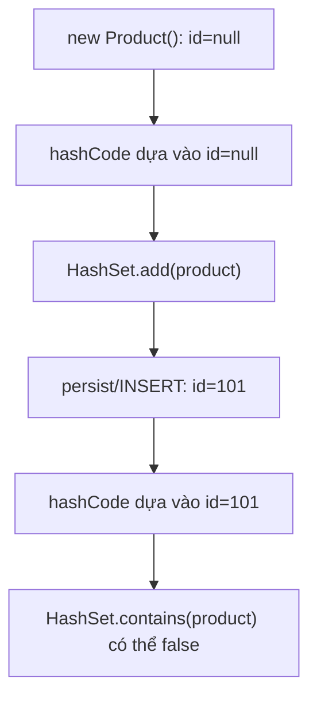
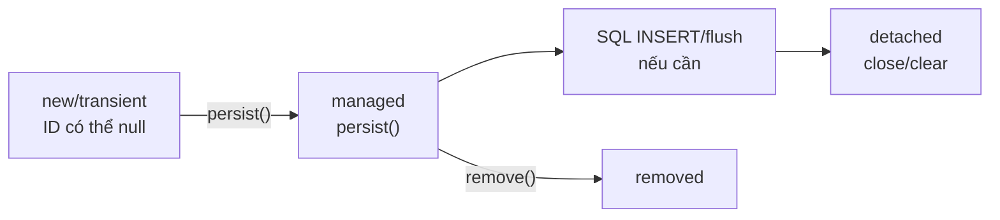
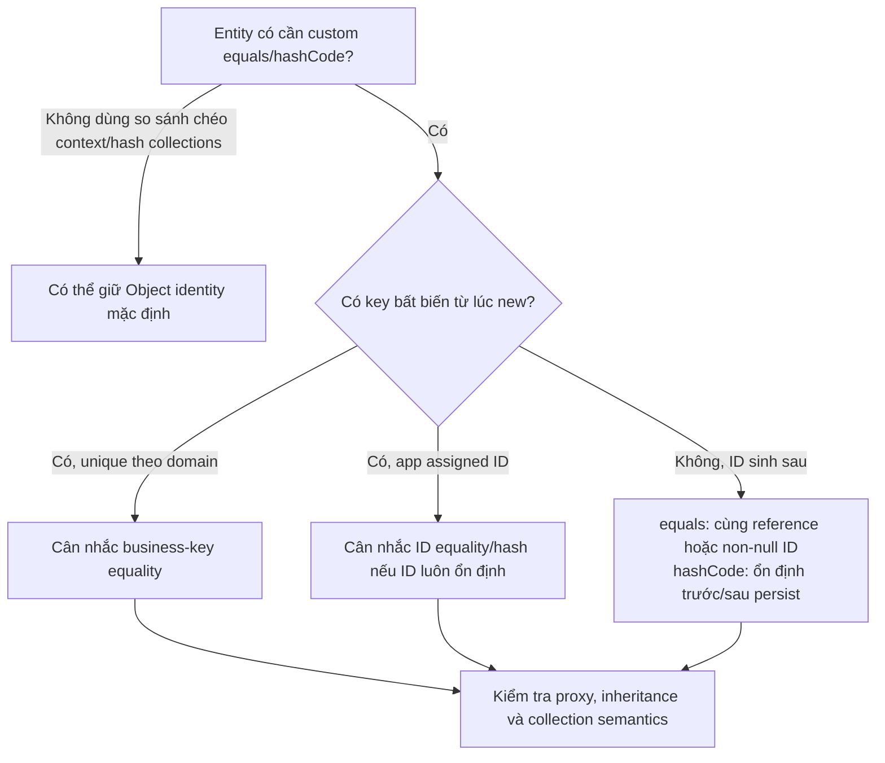

# Định danh chưa được sinh và tính ổn định của `hashCode` trong Hibernate

## 1. Vấn đề: Entity chưa có ID nhưng đã được dùng như một đối tượng Java

Khi làm việc với Hibernate/Jakarta Persistence, một entity có thể đã được tạo trong Java nhưng **chưa có khóa chính** do database hoặc ORM sinh. Ví dụ:

```java
@Entity
public class Product {

    @Id
    @GeneratedValue(strategy = GenerationType.IDENTITY)
    private Long id;

    private String name;

    protected Product() {
    }

    public Product(String name) {
        this.name = name;
    }

    public Long getId() {
        return id;
    }
}
```

Ngay sau khi tạo:

```java
Product product = new Product("Bàn phím");

System.out.println(product.getId()); // null
```

`product` là một Java object hợp lệ, nhưng nó chưa có định danh database. Nếu đưa object này vào `HashSet`, dùng làm key trong `HashMap` hoặc thêm vào một collection của Hibernate trước khi `id` được sinh, cách viết `equals()` và `hashCode()` quyết định liệu collection có tiếp tục tìm thấy phần tử hay không.

Một lỗi thường gặp là:

```java
@Override
public int hashCode() {
    return Objects.hash(id);
}
```

Khi `id` chuyển từ `null` thành `101L`, hash có thể thay đổi. `HashSet` đã đặt phần tử vào một bucket dựa trên hash cũ; khi tìm lại bằng hash mới, Java có thể không tìm thấy object, **ngay cả khi vẫn là cùng một tham chiếu**.



Đây là vấn đề về **hợp đồng Java object identity và hash collection**; Hibernate chỉ là nơi khiến một thuộc tính định danh thay đổi theo vòng đời.

Mục tiêu của bài học là hiểu thời điểm entity có ID, phân biệt các lớp danh tính, và chọn chiến lược `equals/hashCode` phù hợp khi entity có **khóa chính được sinh muộn**.

## 2. Ba lớp danh tính cần phân biệt

Từ “cùng một entity” có thể mang ba ý nghĩa khác nhau:

| Loại danh tính | Cách nhận diện | Ví dụ | Phạm vi |
|---|---|---|---|
| **Java reference identity** | `a == b` | Hai biến trỏ cùng một object trong JVM | Tham chiếu của object |
| **Persistence identity** | Loại entity + khóa chính trong persistence context | `Product #101` | Hibernate/JPA quản lý theo context |
| **Business identity** | Khóa tự nhiên/nghiệp vụ như SKU | `sku = "KB-001"` | Do quy tắc domain quyết định |

Hai biến trong cùng Java heap có thể tham chiếu cùng object:

```java
Product a = new Product("Bàn phím");
Product b = a;

System.out.println(a == b); // true
```

Hai object Java khác nhau có thể đại diện cho cùng một hàng database sau khi được tải ở hai persistence context:

```java
EntityManager em1 = emf.createEntityManager();
EntityManager em2 = emf.createEntityManager();

try {
    Product a = em1.find(Product.class, 101L);
    Product b = em2.find(Product.class, 101L);

    // Nếu hai phép find đều tìm thấy:
    // a và b biểu diễn cùng Product #101 nhưng không phải
    // cùng managed instance giữa hai context khác nhau.
} finally {
    em2.close();
    em1.close();
}
```

Trong **cùng một persistence context**, JPA/Hibernate duy trì identity map để cùng loại entity và khóa chính có một managed identity:

```java
Product a = em.find(Product.class, 101L);
Product b = em.find(Product.class, 101L);

// Nếu tìm thấy, thông thường a == b trong cùng context.
```

**`equals()` và `hashCode()` không phải là cơ chế tạo persistence identity.** Đó là hai method của Java được dùng bởi collection, thuật toán và code ứng dụng. Nhưng cách triển khai chúng ảnh hưởng mạnh đến việc dùng entity qua các ranh giới context.

### 2.1. Hai entity mới có ID null có phải bằng nhau không?

```java
Product first = new Product("Bàn phím");
Product second = new Product("Bàn phím");
```

Cả hai có thể có `id == null`. Điều này **không có nghĩa** chúng là cùng một entity. Chúng là hai object mới độc lập và có thể trở thành hai dòng database khác nhau.

Vì vậy, implementation dưới đây là **sai** đối với entity có generated ID:

```java
@Override
public boolean equals(Object other) {
    if (!(other instanceof Product p)) {
        return false;
    }
    return Objects.equals(id, p.id);
}
```

Vì `Objects.equals(null, null)` trả `true`, hai Product chưa persist sẽ bị coi là bằng nhau:

```java
Set<Product> products = new HashSet<>();

products.add(new Product("Bàn phím"));
products.add(new Product("Chuột"));

System.out.println(products.size());
// Có thể chỉ còn 1 nếu equals coi hai null ID là bằng nhau.
```

Đây là lỗi **đồng nhất nhầm các entity transient**, khác với lỗi hash thay đổi sau khi persist. Một implementation tốt phải xử lý **cả hai**.

## 3. Khi nào `@GeneratedValue` cấp ID?

Lifecycle đơn giản của entity:



Thời điểm nhận ID phụ thuộc **chiến lược sinh khóa** và provider:

- `GenerationType.IDENTITY`: thường cần thao tác `INSERT` để nhận khóa do database sinh. Hibernate có thể insert ngay ở `persist()` trong những điều kiện phù hợp, nhưng không nên viết logic phụ thuộc mù quáng vào thời điểm chính xác.
- `GenerationType.SEQUENCE`: Hibernate có thể lấy giá trị sequence trước khi insert để gán ID cho entity, tùy generator và cơ chế tối ưu.
- `GenerationType.TABLE`: dùng bảng sinh định danh; chi tiết và chi phí phụ thuộc chiến lược.
- `GenerationType.UUID` (Jakarta Persistence 3.1+) hoặc UUID generator của Hibernate: có thể sinh khóa phía Java/provider theo cơ chế tương ứng.
- **Assigned ID**: ứng dụng tự tạo một ID hợp lệ trước khi `persist()`; khi đó ID có thể ổn định ngay từ lúc khởi tạo, nhưng phải chịu trách nhiệm tính duy nhất và quy tắc gán.

Bảng quyết định:

| Chiến lược | ID có thể null sau `new`? | Có thể chỉ dựa vào `new` để biết ID cuối cùng? |
|---|---|---|
| `IDENTITY` | Có | Không |
| `SEQUENCE` | Có | Không |
| `TABLE` | Có | Không |
| `UUID` do provider sinh | Có, trước khi provider thực hiện sinh | Không nên giả định |
| ID tự gán trong constructor | Không, nếu constructor gán hợp lệ | Có, theo hợp đồng domain |

**Không lấy `id != null` làm dấu hiệu duy nhất cho “entity đang được quản lý”.** Một entity detached vẫn có ID nhưng không còn nằm trong persistence context. Ngược lại, thời điểm ID xuất hiện ở một entity mới phụ thuộc generator. Muốn biết một object đang được một entity manager quản lý, sử dụng `em.contains(entity)` trong ngữ cảnh phù hợp.

## 4. Hợp đồng `equals()` và `hashCode()` trong Java

Theo hợp đồng của Java:

1. `equals` cần **phản xạ**: `x.equals(x) == true`.
2. Cần **đối xứng**: nếu `x.equals(y)` đúng thì `y.equals(x)` cũng đúng.
3. Cần **bắc cầu**.
4. Kết quả phải **nhất quán khi các dữ liệu dùng cho equality không thay đổi**.
5. `x.equals(null)` phải trả `false`.
6. Nếu `x.equals(y)` là `true`, **`x.hashCode() == y.hashCode()`**.
7. Hai object không bằng nhau **được phép** có cùng hash.

Một quy tắc thực dụng của hash collection quan trọng ở đây:

> Khi một object đang là phần tử của `HashSet` hoặc key của `HashMap`, các thông tin ảnh hưởng đến `hashCode()` và `equals()` dùng để định vị phần tử không nên thay đổi theo cách làm hỏng cấu trúc collection.

`HashSet` được xây dựng trên `HashMap`. Khi thêm phần tử, collection chọn bucket dựa trên hash; khi `contains` hoặc `remove`, nó tính lại hash để tìm. Nếu hash đổi, object có thể nằm ở bucket cũ nhưng được tìm ở bucket mới.

```text
Thời điểm T1:
    id = null
    hashCode = h(null)
    HashSet.add(product)
              |
              +--> bucket số A

Thời điểm T2:
    id = 101
    hashCode = h(101)
    HashSet.contains(product)
              |
              +--> tìm bucket số B

A != B: collection có thể không tìm thấy product.
```

Đây là vấn đề của Java Collections, **không phụ thuộc vào việc Hibernate đã flush, commit hay chưa**. Thời điểm ID thay đổi chỉ làm lỗi dễ xảy ra hơn.

### 4.1. Ví dụ tối giản tái hiện lỗi

Một entity với implementation rủi ro:

```java
@Entity
public class Product {

    @Id
    @GeneratedValue(strategy = GenerationType.IDENTITY)
    private Long id;

    private String name;

    @Override
    public boolean equals(Object other) {
        if (this == other) {
            return true;
        }
        if (!(other instanceof Product p)) {
            return false;
        }
        return id != null && id.equals(p.id);
    }

    @Override
    public int hashCode() {
        return Objects.hashCode(id); // RỦI RO!
    }
}
```

Ở đây `equals` đã xử lý null ID tốt hơn bằng `id != null`, nhưng `hashCode` **vẫn thay đổi** khi id được gán.

```java
Product product = new Product("Bàn phím");
Set<Product> set = new HashSet<>();

set.add(product);
int before = product.hashCode();

em.persist(product);
em.flush(); // Đảm bảo các thao tác ghi cần thiết đã đồng bộ.

int after = product.hashCode();

System.out.println(before);
System.out.println(after);
System.out.println(set.contains(product));
```

Nếu ID mới làm bucket khác, `set.contains(product)` có thể trả `false`. Không nên viết ứng dụng dựa trên việc “thử vài lần thấy vẫn true”: hash table có thể tình cờ chọn cùng bucket dù hash khác, nên lỗi biểu hiện không ổn định.

### 4.2. `HashMap` có cùng rủi ro

```java
Map<Product, String> labels = new HashMap<>();

Product p = new Product("Bàn phím");
labels.put(p, "đã chọn");

// Sau khi p.id thay đổi:
String label = labels.get(p); // Có thể null.
```

Khi dùng entity làm key của cache hoặc map, rủi ro còn lớn hơn vì object có thể sống lâu hơn transaction và trải qua các trạng thái managed/detached.

## 5. Chiến lược 1: Equality theo generated ID, hash code ổn định

Với một entity **không tham gia kế thừa entity phức tạp** và sử dụng khóa chính do Hibernate/database sinh, một mẫu thường dùng là:

- `equals`: cùng object thì bằng nhau; nếu khác object, chỉ so ID khi **ID không null**.
- `hashCode`: dùng giá trị **ổn định theo loại entity**, không dùng ID vừa được sinh.

Ví dụ:

```java
package com.example.catalog;

import jakarta.persistence.Entity;
import jakarta.persistence.GeneratedValue;
import jakarta.persistence.GenerationType;
import jakarta.persistence.Id;
import jakarta.persistence.Table;

@Entity
@Table(name = "products")
public class Product {

    @Id
    @GeneratedValue(strategy = GenerationType.IDENTITY)
    private Long id;

    private String name;

    protected Product() {
    }

    public Product(String name) {
        this.name = name;
    }

    public Long getId() {
        return id;
    }

    public String getName() {
        return name;
    }

    @Override
    public boolean equals(Object other) {
        if (this == other) {
            return true;
        }

        // Mẫu đơn giản cho entity Product không có
        // hierarchy entity kế thừa.
        if (!(other instanceof Product that)) {
            return false;
        }

        // Hai entity mới với id == null không tự bằng nhau.
        return getId() != null
                && getId().equals(that.getId());
    }

    @Override
    public int hashCode() {
        // Không đổi khi ID chuyển từ null sang giá trị được sinh.
        return Product.class.hashCode();
    }
}
```

Bảng kết quả:

| Tình huống | `equals` | `hashCode` |
|---|---|---|
| Một object so với chính nó | `true` | Cùng giá trị |
| Hai Product mới khác tham chiếu, cùng null ID | `false` | Có thể cùng hash; hợp lệ |
| Hai Product đã có cùng ID, khác instance/context | `true`, nếu cùng logical entity class | Cùng hash |
| Hai Product có hai ID khác nhau | `false` | Có thể cùng hash; hợp lệ |
| Product trước và sau khi được gán ID | Không so với object khác chưa có ID theo cùng cách | **Hash không thay đổi** |

### 5.1. Vì sao constant hash không vi phạm hợp đồng Java?

Hợp đồng Java quy định **nếu hai object bằng nhau thì hash phải bằng nhau**; không yêu cầu các object khác nhau phải có hash khác nhau.

```java
@Override
public int hashCode() {
    return Product.class.hashCode();
}
```

Mọi instance `Product` trả về cùng một hash. Điều này tạo **collision** giữa các Product khác nhau nhưng vẫn đúng hợp đồng; khi cần phân biệt các phần tử có cùng hash, hash collection gọi `equals`.

Đổi lại, nếu một `HashSet<Product>` chứa lượng rất lớn entity, hash cố định có thể khiến hiệu năng giảm vì nhiều phần tử chung bucket. Đây là **trade-off đúng đắn**, không phải cách tối ưu mọi workload. Các lựa chọn gồm dùng khóa ổn định có sẵn từ lúc tạo entity hoặc dùng tập ID/DTO thay vì tập managed entities khi dữ liệu lớn.

### 5.2. Vì sao dùng `Product.class.hashCode()` thay cho `getClass().hashCode()`?

Hibernate có thể tạo **proxy** là một subclass runtime của entity để hỗ trợ lazy loading. Nếu gọi:

```java
@Override
public int hashCode() {
    return getClass().hashCode();
}
```

một proxy và một entity thực có thể có **class runtime khác nhau** dù đại diện cho cùng loại entity và ID. Điều này có nguy cơ vi phạm hợp đồng khi `equals` coi chúng bằng nhau nhưng `hashCode` khác nhau.

Trong mẫu đơn giản ở trên, `Product.class.hashCode()` không phụ thuộc class runtime của instance. Vì vậy, nó ổn định trước/sau khi sinh ID và không dao động chỉ vì Hibernate tạo proxy subclass.

**Điều kiện áp dụng:** mẫu `instanceof Product`/`Product.class.hashCode()` được trình bày cho **một entity type đơn lẻ, không có hierarchy kế thừa entity cần phân biệt bằng class**. Khi có entity inheritance, xử lý equality cần chặt chẽ hơn (mục 9).

### 5.3. Vì sao dùng getter `getId()` trong `equals`?

Với Hibernate proxy, việc đọc trực tiếp field của object proxy trong custom code có thể khác với việc truy cập ID qua accessor được proxy hỗ trợ. Gọi getter thường rõ contract hơn:

```java
return getId() != null
        && getId().equals(that.getId());
```

Không nên xem đây là bảo đảm tuyệt đối rằng `equals` **không bao giờ** khởi tạo proxy: hành vi proxy/bytecode enhancement còn phụ thuộc phiên bản Hibernate, chế độ tuân thủ JPA, access strategy và cách entity được mapping. Cần tránh đặt quá nhiều logic nghiệp vụ hoặc lazy association trong `equals`.

### 5.4. Không cần thêm setter cho generated ID

`id` được quản lý bởi persistence provider. Việc tự thêm setter `setId` rồi đổi ID của một entity managed là cách làm nguy hiểm: ID là thành phần của persistence identity, không phải thuộc tính nghiệp vụ thông thường.

Với generated ID, nên cho phép Hibernate/JPA gán giá trị qua mapping thích hợp, còn code nghiệp vụ nhận ID qua getter chỉ đọc.

## 6. Kiểm tra `HashSet` trước và sau `persist`

Một tình huống mô phỏng với implementation ổn định ở mục 5:

```java
import java.util.HashSet;
import java.util.Set;

Product a = new Product("Bàn phím");
Product b = new Product("Chuột");

Set<Product> products = new HashSet<>();

products.add(a);
products.add(b);

System.out.println(a.getId() == null); // true
System.out.println(b.getId() == null); // true
System.out.println(products.size());   // 2

int hashBefore = a.hashCode();

em.persist(a);
em.persist(b);
em.flush();

int hashAfter = a.hashCode();

System.out.println(hashBefore == hashAfter); // true
System.out.println(products.contains(a));   // true
System.out.println(products.contains(b));   // true
```

Phần này minh họa khi `em` đã nằm trong transaction và chiến lược sinh ID cho phép flush thành công. Trong môi trường transaction kiểu `RESOURCE_LOCAL`, cần bắt đầu transaction trước các thao tác ghi và commit/rollback theo quy tắc:

```java
EntityTransaction tx = em.getTransaction();
tx.begin();

try {
    em.persist(a);
    em.persist(b);
    em.flush();

    tx.commit();
} catch (RuntimeException ex) {
    if (tx.isActive()) {
        tx.rollback();
    }
    throw ex;
}
```

Lỗi `HashSet` không phụ thuộc vào cách bạn viết transaction, nhưng transaction đúng giúp thí nghiệm phản ánh vòng đời thật của entity.

### 6.1. Test chỉ kiểm tra `hashCode` chưa đủ

Các tình huống cần hiểu về semantics:

- Hai entity transient khác tham chiếu **không được coi bằng nhau chỉ vì null ID**.
- Cùng một entity được giữ trong `HashSet` trước/sau `persist` vẫn phải tìm thấy.
- Một entity detached và một entity managed trong context khác, cùng loại và cùng primary key, nên có equality theo chiến lược đã chọn.
- Proxy và entity có cùng identity phải có hợp đồng equality/hash tương thích, hoặc application tránh dùng chúng trong cấu trúc cần so sánh chéo.

Không nên sửa `equals` để “tăng tỉ lệ test passes” mà quên hợp đồng ở tất cả trạng thái của entity.

## 7. Chiến lược 2: Khóa nghiệp vụ bất biến có sẵn ngay từ lúc tạo

Nếu domain có một **business key** ổn định, duy nhất và được gán trước khi entity được persist, có thể dựa vào khóa này để viết `equals/hashCode`.

Ví dụ `Product` có `sku` bất biến:

```java
package com.example.catalog;

import java.util.Objects;

import jakarta.persistence.Column;
import jakarta.persistence.Entity;
import jakarta.persistence.GeneratedValue;
import jakarta.persistence.GenerationType;
import jakarta.persistence.Id;

import org.hibernate.annotations.NaturalId;

@Entity
public class CatalogItem {

    @Id
    @GeneratedValue(strategy = GenerationType.IDENTITY)
    private Long id;

    @NaturalId
    @Column(
        name = "sku",
        nullable = false,
        unique = true,
        updatable = false,
        length = 80
    )
    private String sku;

    private String displayName;

    protected CatalogItem() {
    }

    public CatalogItem(String sku, String displayName) {
        this.sku = Objects.requireNonNull(sku, "sku");
        this.displayName = displayName;
    }

    public String getSku() {
        return sku;
    }

    @Override
    public boolean equals(Object other) {
        if (this == other) {
            return true;
        }
        if (!(other instanceof CatalogItem that)) {
            return false;
        }
        return getSku().equals(that.getSku());
    }

    @Override
    public int hashCode() {
        return getSku().hashCode();
    }
}
```

Ở đây `sku` phải được gán **trước khi object được đưa vào `HashSet`** và không được đổi trong vòng đời entity. Cùng một SKU có thể được coi là cùng một business identity, ngay cả khi hai object chưa được persist.

### 7.1. Điều kiện để business-key equality thực sự an toàn

- Key **không null** trong mọi object được tạo hợp lệ.
- Key có quy tắc unique được domain định nghĩa và **ràng buộc tại database**.
- Key **bất biến** sau khi object xuất hiện trong collection.
- Key được chuẩn hóa thống nhất (chữ hoa/thường, khoảng trắng, Unicode, phạm vi tenant).
- Key không chứa secret hoặc dữ liệu nhạy cảm bị suy đoán tùy tiện.
- Nếu key chỉ unique trong một tenant, equality phải có cả **tenant identity**.

Ví dụ không đủ:

```java
@Override
public int hashCode() {
    return email.hashCode();
}
```

nếu ứng dụng cho phép người dùng đổi email; `email` khi đó là mutable property, không phải business key bất biến.

### 7.2. `@NaturalId` không tự sinh `equals/hashCode`

`@NaturalId` giúp Hibernate biết cách tra cứu entity theo natural identifier, ví dụ `Session.bySimpleNaturalId(...)`. Nó **không sinh** `equals` hoặc `hashCode` cho Java object.

Hai quyết định cần đưa ra riêng:

1. Có khai báo natural ID để ORM tra cứu/cache theo khóa nghiệp vụ hay không?
2. Có dùng chính business key ấy làm cơ sở equality Java hay không?

Một ứng dụng có thể dùng `@NaturalId` nhưng vẫn chọn equality theo surrogate ID nếu khóa nghiệp vụ có thể đổi hoặc có yêu cầu khác.

### 7.3. Khi nào không chọn business key?

Nếu business key được cấp từ hệ thống khác **sau khi entity đã được thêm vào collection**, hoặc có thể bị sửa (username, email, mã sản phẩm tái gán), hash dựa trên business key lại gặp vấn đề tương tự generated ID.

Không dùng một khóa tự nhiên chỉ vì nó “đang có vẻ unique”. Khóa phải ổn định theo **quy tắc nghiệp vụ**, không chỉ theo dữ liệu hiện tại.

## 8. Chiến lược 3: ID được gán từ đầu

Thay vì đợi database sinh `Long id`, một số domain có thể chủ động tạo định danh trước khi persist, chẳng hạn UUID:

```java
package com.example.catalog;

import java.util.Objects;
import java.util.UUID;

import jakarta.persistence.Entity;
import jakarta.persistence.Id;

@Entity
public class ExternalTask {

    @Id
    private UUID id;

    private String description;

    protected ExternalTask() {
    }

    public ExternalTask(String description) {
        this.id = UUID.randomUUID();
        this.description = description;
    }

    public UUID getId() {
        return id;
    }

    @Override
    public boolean equals(Object other) {
        if (this == other) {
            return true;
        }
        if (!(other instanceof ExternalTask that)) {
            return false;
        }
        return Objects.equals(getId(), that.getId());
    }

    @Override
    public int hashCode() {
        return Objects.hashCode(getId());
    }
}
```

Trong ví dụ, **ứng dụng tự gán ID trong constructor**; không dùng `@GeneratedValue`. Đối tượng được tạo hợp lệ qua constructor công khai có ID trước khi đưa vào `HashSet` nên hash theo ID không đổi do `persist`.

Tuy nhiên, cần chú ý:

- `UUID.randomUUID()` giảm đáng kể xác suất trùng nhưng không thay thế primary key constraint.
- Constructor không tham số dành cho JPA có thể tạo object tạm với ID null trong quá trình hydration; code ứng dụng nên dùng constructor hợp lệ và không đưa object chưa được khởi tạo vào collection.
- ID phải được coi là **bất biến**. Không tạo setter cho ID và không thay thế ID sau khi object đã được dùng làm key.
- Nếu dùng generator `@GeneratedValue(strategy = GenerationType.UUID)` thay vì tự gán UUID, thời điểm cấp ID do provider quyết định, không được xem như assigned ID có từ constructor.

**Không có yêu cầu bắt buộc phải chọn UUID.** Khóa số tự sinh của database vẫn phù hợp cho rất nhiều hệ thống; vấn đề ở đây là thiết kế equality/hash tương ứng với vòng đời khóa, không phải thay toàn bộ khóa chính bằng UUID.

## 9. Hibernate proxy, `getClass()` và entity inheritance

### 9.1. Proxy có thể không cùng runtime class

Hibernate có thể dùng lazy proxy subclass cho entity liên kết:

```java
Product reference = em.getReference(Product.class, productId);
Product loaded = em.find(Product.class, productId);
```

Ở một ngữ cảnh khác, `reference` có thể là Hibernate proxy, còn `loaded` là entity instance bình thường. Phụ thuộc state/context, chúng có thể cùng đại diện cho một bản ghi nhưng `reference.getClass()` có thể khác `Product.class`.

Vì vậy, nếu viết:

```java
@Override
public boolean equals(Object other) {
    if (other == null || getClass() != other.getClass()) {
        return false;
    }
    // ...
}
```

bạn có thể vô tình xem proxy và entity là **khác loại** mặc dù domain mong muốn chúng cùng identity.

Tuy nhiên, bỏ hết class check cũng không đúng:

```java
// SAI: chỉ so ID, không kiểm tra loại entity.
return id != null && id.equals(otherId);
```

Hai entity **khác bảng/khác loại** hoàn toàn có thể cùng primary key số `101`. `Product #101` không phải `Customer #101`.

### 9.2. `instanceof` phù hợp với entity đơn lẻ

Với một entity type không có hierarchy cần phân biệt subtype, mẫu:

```java
if (!(other instanceof Product that)) {
    return false;
}
return getId() != null && getId().equals(that.getId());
```

thường dễ hiểu và tương thích hơn với Hibernate subclass proxy so với so `getClass()` trực tiếp. Kết hợp `Product.class.hashCode()` giúp hash không phụ thuộc runtime proxy class.

Đây là **mẫu có điều kiện**, không phải công thức áp dụng tự động cho mọi quan hệ kế thừa.

### 9.3. Khi có `@Inheritance` hoặc subtype entity

Giả sử `Person` là entity gốc, `Employee` và `Customer` là hai subtype. Phép so:

```java
if (other instanceof Person p) {
    return id != null && id.equals(p.id);
}
```

có thể không phù hợp nếu domain muốn **hai subtype khác nhau không bao giờ bằng nhau**, dù có cùng giá trị ID trong những hoàn cảnh mapping nào đó.

Ngược lại, nếu hierarchy dùng shared identity và subtype chỉ là các mặt khác của cùng logical entity, chính sách equality cần phù hợp ngữ nghĩa đó. Không thể quyết định chỉ bằng tên annotation `@Inheritance`.

Một thiết kế proxy-aware nghiêm ngặt có thể cần lấy **persistent class** theo API Hibernate proxy, hoặc dùng chiến lược equality cho toàn hierarchy. API như `org.hibernate.proxy.HibernateProxy` và `Hibernate.getClass(...)` có các chi tiết về proxy initialization và thay đổi theo phiên bản; phải kiểm tra hành vi trên Hibernate version đang dùng.

### 9.4. Không làm entity/proxy bị vô hiệu hóa chỉ để viết equality

Các entity dùng cơ chế subclass proxy thường cần class/method có thể proxy. Không nên tùy tiện đánh dấu toàn bộ entity `final` hoặc mọi getter `final` chỉ để làm `equals/hashCode` “không bị override”; việc này có thể hạn chế lazy proxy và thay đổi cách Hibernate làm việc.

Với entity có kế thừa hoặc mô hình proxy phức tạp, ưu tiên kiểm thử equality giữa managed, detached và proxy trong môi trường thực tế thay vì sao chép một snippet `getClass()` hoặc `instanceof` không xét domain.

## 10. Detached entity, `merge()` và một hàng có nhiều Java object

Đôi khi entity được tải trong một request, sau đó transaction kết thúc và object trở thành **detached**. Khi request khác nạp cùng hàng, đó là **một object khác**.

```java
EntityManager em1 = emf.createEntityManager();
Product detached;

try {
    detached = em1.find(Product.class, productId);
} finally {
    em1.close();
}

EntityManager em2 = emf.createEntityManager();

try {
    Product managed = em2.find(Product.class, productId);

    // Với equality theo generated ID đã có giá trị,
    // detached và managed có thể được xem là bằng nhau
    // dù chúng không phải cùng reference.
} finally {
    em2.close();
}
```

Nếu ứng dụng chỉ dùng implementation mặc định từ `Object`:

```java
Object.equals(other) // so sánh theo reference identity.
Object.hashCode()     // hash gắn với object identity.
```

thì hai object này thường không bằng nhau. Điều đó **không sai đối với Java**; nó chỉ khác chính sách “bằng nhau theo cùng database row” mà một số domain mong muốn.

### 10.1. `merge` không biến detached object thành managed

```java
Product managedCopy = em.merge(detached);
```

Theo ngữ nghĩa Jakarta Persistence, `merge` sao chép trạng thái phù hợp sang một **managed instance** và trả về instance đó. `detached` ban đầu vẫn là detached. Có thể tồn tại hai Java object cùng primary key trong các context/vòng đời khác nhau.

Nếu muốn `Set`/`Map` nhận diện chúng theo cùng database identity, custom equality theo khóa đã sinh có thể có ích. Nhưng thay đổi `equals` có thể tác động đến toàn bộ Java collection của ứng dụng; hãy chọn theo yêu cầu rõ ràng, không tự động xem override là bắt buộc cho mọi entity.

### 10.2. Có nhất thiết phải override `equals/hashCode` không?

**Không.** Với entity chỉ được làm việc trong cùng một persistence context và không được dùng làm phần tử hash-based collection có yêu cầu so sánh giữa context, reference equality mặc định đôi khi là lựa chọn đơn giản, hợp lệ.

Cần cân nhắc override khi:

- Entity được truyền qua các tầng và so sánh giữa detached/managed instances.
- Domain sử dụng `Set<Entity>` hoặc entity làm map key.
- Quan hệ đa trị dùng `Set` mà logic thêm/gỡ phụ thuộc entity equality.
- Test hoặc API xác định rõ hai object cùng database ID phải được coi bằng nhau.

Không override cũng có trade-off: hai instance khác context cùng hàng sẽ được xem khác nhau trong `HashSet`. Đó là quyết định domain, không nhất thiết là bug nếu application không cần ghép chúng vào cùng tập.

## 11. Quan hệ đa trị với `Set`: vì sao lỗi hash nguy hiểm hơn tưởng tượng?

Một entity có thể nằm trong `Set` của entity khác:

```java
@Entity
public class Department {

    @Id
    @GeneratedValue
    private Long id;

    @OneToMany(mappedBy = "department")
    private Set<Employee> employees = new HashSet<>();
}
```

`Set` trong Java và Hibernate đều cần khả năng kiểm tra membership. Nếu `Employee.hashCode()` phụ thuộc generated ID:

1. Employee mới được thêm vào `Set` lúc `id == null`.
2. Hibernate persist Employee và sinh ID.
3. Hash thay đổi khi object **vẫn nằm trong Set**.
4. `employees.contains(employee)` hoặc `remove(employee)` có thể không tìm được phần tử.
5. Helper đồng bộ hai phía có thể tưởng employee chưa thuộc collection, thêm trùng hoặc không gỡ được; thao tác ORM trở nên khó dự đoán.

```java
Employee employee = new Employee("An");

department.addEmployee(employee); // Thêm vào Set trước persist.
em.persist(department);
em.persist(employee);

// Nếu hash dựa trên generated id, remove có thể gặp lỗi.
department.removeEmployee(employee);
```

Đây là lý do thiết kế `equals/hashCode` **liên quan trực tiếp đến quản lý association**, không chỉ các test unit trên `HashSet`.

### 11.1. `List` có tránh được hoàn toàn không?

`List` không định vị phần tử bằng bucket hash, nên không gặp **đúng lỗi hash thay đổi** khi tìm bằng hash. Tuy nhiên, nhiều method như `contains` hoặc `remove(Object)` vẫn gọi `equals`; nếu equality thay đổi theo vòng đời hoặc vô tình coi hai null IDs bằng nhau, logic collection vẫn có thể sai.

Ngoài ra, `List` có thể chứa duplicate và mapping `@OrderColumn` có chi phí cập nhật thứ tự. Không đổi toàn bộ `Set` thành `List` chỉ để bỏ qua một implementation equality không phù hợp.

### 11.2. `orphanRemoval` và `equals/hashCode`

Khi dùng:

```java
@OneToMany(
    mappedBy = "order",
    cascade = CascadeType.ALL,
    orphanRemoval = true
)
private Set<OrderLine> lines = new HashSet<>();
```

thao tác gỡ một `OrderLine` khỏi collection có thể quyết định entity đó sẽ bị xóa. Nếu `Set.remove(line)` thất bại vì hash đã đổi hoặc equality không phù hợp, business operation có thể không làm điều ứng dụng mong đợi.

Cũng không nên tự động dùng `orphanRemoval` cho các entity có thể được chuyển giữa nhiều parent. Tính ổn định hash là điều kiện hỗ trợ hành vi collection, **không thay thế** thiết kế vòng đời association.

## 12. Composite primary key: quy tắc khác với ID được sinh muộn

Khi entity có **khóa chính ghép** với `@EmbeddedId` hoặc `@IdClass`, lớp biểu diễn composite key cần có `equals()` và `hashCode()` phù hợp theo các thành phần khóa.

Ví dụ ID ghép gồm `tenantId` và `code`:

```java
package com.example.catalog;

import java.io.Serializable;
import java.util.Objects;

import jakarta.persistence.Column;
import jakarta.persistence.Embeddable;

@Embeddable
public class CatalogEntryId implements Serializable {

    @Column(name = "tenant_id", nullable = false)
    private Long tenantId;

    @Column(name = "entry_code", nullable = false)
    private String code;

    protected CatalogEntryId() {
    }

    public CatalogEntryId(Long tenantId, String code) {
        this.tenantId = Objects.requireNonNull(tenantId);
        this.code = Objects.requireNonNull(code);
    }

    public Long getTenantId() {
        return tenantId;
    }

    public String getCode() {
        return code;
    }

    @Override
    public boolean equals(Object other) {
        if (this == other) {
            return true;
        }
        if (!(other instanceof CatalogEntryId that)) {
            return false;
        }
        return tenantId.equals(that.tenantId)
                && code.equals(that.code);
    }

    @Override
    public int hashCode() {
        return Objects.hash(tenantId, code);
    }
}
```

Entity dùng ID:

```java
@Entity
public class CatalogEntry {

    @EmbeddedId
    private CatalogEntryId id;

    private String description;

    protected CatalogEntry() {
    }

    public CatalogEntry(
            CatalogEntryId id,
            String description) {

        this.id = Objects.requireNonNull(id);
        this.description = description;
    }
}
```

Trong ví dụ này, cả hai thành phần ID được xác định **trước khi persist** và không được thay đổi sau khi khóa được dùng. Khi đó `CatalogEntryId.hashCode()` dựa trên các field ID là hợp lý.

**Phân biệt:** `equals/hashCode` của **ID class** là một trách nhiệm cụ thể của composite key; không thể dùng y nguyên implementation này cho một entity có `@GeneratedValue Long id` đang null trước khi persist.

### 12.1. Khóa chính ghép có thành phần được xác định muộn

Nếu composite ID lấy một phần từ parent có generated ID, như trường hợp `@MapsId`, thời điểm định danh đầy đủ cũng có thể phụ thuộc việc parent được persist. Việc đưa ID object mutable vào `HashMap` trước khi các thành phần khóa ổn định lại gặp rủi ro tương tự.

Thiết kế tốt nên xác định rõ lúc nào composite key **đầy đủ và bất biến**; không sửa field của một key sau khi đã dùng nó trong hash collection.

## 13. Lombok, record và công cụ sinh phương thức

### 13.1. Không đặt `@Data` lên entity một cách máy móc

Lombok `@Data` bao gồm các thành phần như getter/setter, `toString`, `equals` và `hashCode` theo các field được chọn. Với Hibernate entity, điều này có thể gây:

- Hash phụ thuộc generated `id`, thay đổi sau persist.
- Equality phụ thuộc các field mutable như `name` hoặc `status`.
- Equality hoặc `toString` truy cập lazy association, phát SQL ngoài dự kiến.
- Quan hệ hai chiều tạo vòng gọi `equals`/`hashCode`/`toString`.
- Hai transient entities với giá trị field giống nhau bị coi bằng nhau dù domain không muốn.

Ví dụ cần tránh:

```java
@Data
@Entity
public class Product {
    @Id
    @GeneratedValue
    private Long id;

    private String name;

    @ManyToOne(fetch = FetchType.LAZY)
    private Category category;
}
```

Nếu dùng Lombok, chọn annotation tường minh như `@Getter`, constructor phù hợp JPA, và tự quyết định `equals/hashCode`. Đừng coi annotation hỗ trợ code generation là một chính sách domain identity.

### 13.2. `@EqualsAndHashCode(of = "id")` có đủ không?

Không nhất thiết. Nếu ID được sinh muộn, hash vẫn có thể thay đổi. Một công cụ tự sinh `equals` còn có thể coi hai null IDs bằng nhau tùy implementation.

Cần đọc semantics **cụ thể** của đoạn code sinh ra thay vì chỉ nhìn annotation. Mẫu “chọn id” không tự giải quyết điều kiện `id != null` và tính ổn định hash.

### 13.3. Java `record` phù hợp cho DTO và value object hơn là entity JPA truyền thống

`record` có equality/hash theo các component; đó là semantics của **giá trị bất biến**, phù hợp với nhiều DTO hoặc một số value object. Trong JPA truyền thống, entity cần hợp đồng constructor và cách provider quản lý state; record không phải lựa chọn portable cho entity mutable với generated ID.

Không chuyển một entity thành record chỉ để có `equals/hashCode` tự sinh. Nếu mục tiêu là biểu diễn snapshot dữ liệu từ entity để truyền qua API/async task, một record DTO có thể hợp lý hơn.

## 14. Equality theo ID và khóa nghiệp vụ: nên chọn cách nào?

| Câu hỏi | Generated ID + hash ổn định | Immutable business key | Assigned ID trước persist | Reference equality mặc định |
|---|---|---|---|---|
| ID/key có sẵn ngay khi `new`? | **Không cần** | Cần | Cần | Không cần |
| Có thể dùng entity transient trong `HashSet`? | Có, nếu implementation đúng | Có, nếu key đã cố định | Có, nếu ID cố định | Có theo reference |
| So sánh hai instance cùng row khác context? | Có sau khi đã có ID | Có nếu cùng business key | Có | Không |
| Hash có thay đổi khi persist? | Không, nếu hash cố định theo class | Không, nếu key bất biến | Không, nếu ID đã gán ổn định | Không |
| Cần business key thật sự duy nhất? | Không | Có | Không nhất thiết là business key | Không |
| Trade-off | Hash collision; cần kiểm soát proxy/inheritance | Key có thể vô tình bị đổi | Quản lý tạo/uniqueness ID | Không nhận diện cùng row khác instance |
| Thường phù hợp | Entity có `@GeneratedValue` và tham gia collections | Natural-key domain ổn định | Entity do ứng dụng cấp ID | Code chỉ dùng entity theo context/reference |

### 14.1. Cây quyết định



Đây là hướng lựa chọn, không phải một linter tự động. Những trường hợp có inheritance, natural ID mutable, composite key hoặc entity graph phức tạp cần quyết định dựa trên domain thực tế.

## 15. Những anti-pattern thường gặp

### 15.1. Hash dựa trực tiếp vào `id` được sinh

```java
@Override
public int hashCode() {
    return Objects.hash(id); // Hash thay đổi khi id thay đổi.
}
```

**Vấn đề:** đối tượng có thể mất khả năng được tìm trong `HashSet`/`HashMap` sau persist.

### 15.2. Hai null IDs được xem bằng nhau

```java
@Override
public boolean equals(Object o) {
    return o instanceof Product p
            && Objects.equals(id, p.id);
}
```

**Vấn đề:** `Objects.equals(null, null) == true`, nên hai Product mới có thể bị nhập thành một.

### 15.3. Dùng thuộc tính mutable như tên hiển thị

```java
@Override
public int hashCode() {
    return name.hashCode();
}
```

**Vấn đề:** đổi `name` sẽ đổi hash. Ngay cả khi name chưa đổi, hai entity khác nhau vẫn có thể trùng tên.

### 15.4. Dùng toàn bộ association trong equality

```java
@Override
public int hashCode() {
    return Objects.hash(id, department, employees);
}
```

**Vấn đề:** lazy collection có thể bị tải; quan hệ hai chiều có thể gây đệ quy; một thay đổi trong association làm hash đổi; chi phí và hành vi khó kiểm soát.

### 15.5. Dùng class runtime không xét proxy

```java
@Override
public int hashCode() {
    return getClass().hashCode();
}
```

**Vấn đề:** Hibernate proxy và concrete entity có thể có runtime class khác nhau. Nếu `equals` coi chúng bằng nhau, hash phải giống nhau.

### 15.6. Tùy ý thay khóa chính sau persist

```java
public void setId(Long id) {
    this.id = id;
}
```

**Vấn đề:** đổi primary key của managed entity phá vỡ giả định định danh của persistence context. Với generated ID, application không nên tự điều chỉnh giá trị này.

### 15.7. Coi mọi entity có cùng số ID là bằng nhau

```java
// Ý tưởng sai: Product #1 == Customer #1 vì đều có id=1.
return Objects.equals(this.id, other.getId());
```

**Vấn đề:** primary key không tự duy nhất trên toàn bộ các entity type. Equality phải tính đến loại logical entity phù hợp.

### 15.8. Cho rằng hash khác nhau là bắt buộc với object khác nhau

```java
@Override
public int hashCode() {
    return Product.class.hashCode();
}
```

Đây **không phải vi phạm hợp đồng** chỉ vì mọi Product có cùng hash. Nó là lựa chọn chấp nhận collision để đổi lấy tính ổn định. Với tập dữ liệu lớn, cân nhắc hiệu năng và các key ổn định khác.

## 16. Trường hợp thực tế: đơn hàng mới được thêm vào collection

Giả sử entity `Order` chứa các dòng `OrderLine`:

```java
@Entity
public class Order {

    @Id
    @GeneratedValue(strategy = GenerationType.IDENTITY)
    private Long id;

    @OneToMany(
        mappedBy = "order",
        cascade = CascadeType.ALL,
        orphanRemoval = true
    )
    private Set<OrderLine> lines = new HashSet<>();

    public void addLine(OrderLine line) {
        if (lines.add(line)) {
            line.assignOrder(this);
        }
    }

    public void removeLine(OrderLine line) {
        if (lines.remove(line)) {
            line.assignOrder(null);
        }
    }
}
```

`OrderLine` có generated ID:

```java
@Entity
public class OrderLine {

    @Id
    @GeneratedValue(strategy = GenerationType.IDENTITY)
    private Long id;

    @ManyToOne(fetch = FetchType.LAZY, optional = false)
    @JoinColumn(name = "order_id", nullable = false)
    private Order order;

    private String sku;

    protected OrderLine() {
    }

    public OrderLine(String sku) {
        this.sku = sku;
    }

    void assignOrder(Order order) {
        this.order = order;
    }

    public Long getId() {
        return id;
    }

    @Override
    public boolean equals(Object other) {
        if (this == other) {
            return true;
        }
        if (!(other instanceof OrderLine that)) {
            return false;
        }
        return getId() != null
                && getId().equals(that.getId());
    }

    @Override
    public int hashCode() {
        return OrderLine.class.hashCode();
    }
}
```

**Ví dụ này minh họa riêng cách giữ hash ổn định**. Các constructor, field/getter và business invariant còn lại của `Order` được rút gọn; khi xây dựng entity thực tế phải bổ sung constructor JPA, setter và validation phù hợp.

Một flow có ý nghĩa:

```java
Order order = new Order();
OrderLine line = new OrderLine("KB-001");

order.addLine(line); // line.id vẫn có thể null.

em.persist(order);
em.flush(); // ORM đồng bộ cascade/INSERT phù hợp.

order.removeLine(line);
// Set vẫn tìm thấy line nếu hash của line không đổi.
```

Khi `orphanRemoval = true`, thao tác gỡ line được thiết kế như xóa một thành phần thuộc vòng đời Order. Đây không phải cơ chế chung để “chuyển” một line sang order khác; với orphan removal, cần quy tắc lifecycle rõ ràng.

**Lưu ý thêm:** vì `OrderLine` được thêm trước khi ID có giá trị, hai line mới khác nhau có ID null và phải tiếp tục được coi là hai object khác nhau. Nếu `equals` dùng `Objects.equals(id, that.id)` không có guard, dòng thứ hai có thể bị `Set` từ chối ngay ở bước add.

## 17. Hiệu năng và lựa chọn cấu trúc dữ liệu

### 17.1. Một hash cho mọi entity có thể gây collision

Với `hashCode` cố định theo class, nhiều Product sẽ nằm trong cùng nhóm hash. Java `HashMap`/`HashSet` xử lý collision, nhưng chi phí tra cứu có thể tăng khi tập rất lớn.

Giải pháp tùy trường hợp:

- Với các collection entity nhỏ trong một aggregate, tính đúng và đơn giản thường ưu tiên hơn tối ưu hash hoàn hảo.
- Với một hệ thống xử lý hàng trăm nghìn/millions entities, cân nhắc **tập ID** (`Set<Long>`, `Set<UUID>`) thay vì tập entity managed.
- Nếu cần key trước persist cho workload lớn, dùng **assigned immutable identifier** được thiết kế đúng.
- Khi ứng dụng chỉ cần các giá trị bất biến, dùng DTO/value object thay vì entity làm map key.
- Không đo hiệu năng bằng giả định: dùng benchmark phù hợp với kích thước tập, loại hash collection, Hibernate proxy/collection và nhu cầu nghiệp vụ.

### 17.2. Không lạm dụng entity làm cache key

Ví dụ:

```java
Map<Product, PriceQuote> quotes = new HashMap<>();
```

Về kỹ thuật có thể hoạt động nếu equality/hash đúng, nhưng một key dạng `Product` mang nhiều trạng thái vòng đời: transient, managed, detached, proxy. Trong service có cache kéo dài qua request, key đơn giản như `productId` hoặc `sku` bất biến thường rõ ràng hơn.

```java
Map<Long, PriceQuote> quotesByProductId = new HashMap<>();
```

Đối với Product mới chưa có ID, business service cần quyết định quy tắc nhận diện phù hợp trước khi ghi vào cache dùng chung.

## 18. Các câu hỏi quan trọng về nhất quán

### 18.1. Nếu `hashCode` ổn định nhưng `equals` thay đổi sau persist thì sao?

Với mẫu generated-ID equality:

- Hai entity transient khác tham chiếu không bằng nhau.
- Sau khi có ID, một object khác biểu diễn cùng hàng có thể được coi bằng nhau.

Tức là khả năng so sánh với **object khác** có thể thay đổi theo vòng đời, dù hash vẫn ổn định. Điều này cần được hiểu và thiết kế theo phạm vi sử dụng, đặc biệt khi ứng dụng giữ đồng thời nhiều instance/transient copies và thêm chúng vào cùng collection. Không dùng kiểu equality này như một hợp đồng business-key bất biến tuyệt đối từ lúc tạo object.

Hash ổn định giải quyết lỗi **đổi bucket** của chính một object sau persist; nó không có nghĩa mọi tương tác giữa nhiều bản sao entity, merge hoặc chuyển context đều tự động chính xác.

### 18.2. Entity đang managed có bắt buộc override `equals` không?

Không. Persistence context dùng **entity type + primary key** để duy trì identity, không dựa vào custom `hashCode` của entity để phát hiện một row đã được quản lý theo cách Java collection của application làm.

Custom equality là quyết định của application/domain khi entity tham gia Java comparisons và collection, không phải yêu cầu để Hibernate hoạt động ở mọi mapping.

### 18.3. Có nên so ID của hai entity trong `equals` trước khi persist không?

Nếu ID là generated và chưa có, chỉ dùng reference equality:

```java
if (this == other) {
    return true;
}
if (!(other instanceof Product that)) {
    return false;
}
return getId() != null && getId().equals(that.getId());
```

Điều kiện `getId() != null` rất quan trọng. Nó ngăn hai object mới bị coi là một chỉ vì cả hai chưa được cấp khóa.

### 18.4. Có cần kiểm tra `@Version` trong equality không?

Không nên đưa `@Version` vào định danh entity. Version thay đổi khi cập nhật và được dùng cho optimistic locking; nếu đưa vào `hashCode` hoặc `equals`, mỗi lần update có thể làm equality/hash biến động dù database identity vẫn là cùng một row.

### 18.5. Hash có cần bất biến vĩnh viễn không?

Trong Java, `hashCode()` được phép phụ thuộc trạng thái nếu các quy tắc nhất quán được tôn trọng trong khoảng trạng thái đó không đổi. Tuy nhiên, **đối với một object đang nằm trong hash-based collection**, đổi hash ảnh hưởng bucket và có thể làm mất khả năng tìm phần tử.

Với Hibernate entity được sinh ID sau khi đã thêm vào collection, chọn một hash **không đổi qua chuyển trạng thái transient → managed → detached** giúp giảm rủi ro.

## 19. Bài tập tự thực hành

### Bài A — Hai entity mới đều có ID null

Tạo `Product a` và `Product b`. Viết implementation `equals` chỉ dùng `Objects.equals(a.id, b.id)` và cho vào `HashSet`. Quan sát vì sao tập có thể chứa một phần tử thay vì hai. Sau đó thêm guard `getId() != null`.

### Bài B — Generated ID làm đổi hash

Viết `hashCode()` dựa vào `id`, thêm entity mới vào `HashSet`, persist/flush rồi thử `contains` và `remove`. Sau đó chuyển sang hash ổn định theo class để so sánh.

### Bài C — Hai context, cùng một hàng

Tải cùng một `Product` bằng hai `EntityManager` khác nhau. So `==`, `equals` và giá trị ID. Giải thích sự khác nhau giữa reference identity và persistence identity.

### Bài D — Proxy và equality

Lấy tham chiếu bằng `em.getReference(Product.class, id)` và so sánh với entity từ một context khác hoặc instance thật đã tải. Quan sát class runtime, tác động của `getClass()`, `instanceof` và chiến lược `hashCode`. Kiểm tra theo Hibernate version thực tế.

### Bài E — Khóa nghiệp vụ bất biến

Tạo entity có `sku` bất biến, unique trong database. So hai instance có cùng SKU trước khi persist. Sau đó thử thiết kế cho phép đổi SKU và giải thích vì sao hash theo SKU không còn an toàn.

### Bài F — Quan hệ dùng `Set`

Dùng `Order.lines` là `Set<OrderLine>`, thêm hai dòng mới có ID null trước `persist`. Kiểm tra chúng đều tồn tại trong tập, sau đó thử remove một dòng sau khi ORM đã sinh ID.

### Bài G — Composite key

Tạo `CatalogEntryId(tenantId, code)` với `@Embeddable`. Thực hiện `equals/hashCode` trên hai thành phần khóa và giải thích vì sao không được đổi những thành phần đó sau khi đã dùng ID làm key của map.

### Bài H — Hiệu năng

Tạo một tập lớn các `Product` có hash cố định theo class và một tập `UUID`/ID bất biến, đo chi phí thêm/tìm kiếm. Phân tích trade-off mà không đánh đổi tính đúng của domain identity chỉ để có một phép hash phân bố đẹp.

## 20. Bảng xử lý sự cố

| Hiện tượng | Nguyên nhân thường gặp | Hướng xử lý |
|---|---|---|
| `HashSet.contains(entity)` trả false sau `persist()` | `hashCode` phụ thuộc ID vừa được sinh. | Dùng hash ổn định qua lifecycle hoặc không đưa entity chưa có ID vào hash collection. |
| Hai entity mới khác nhau chỉ giữ lại một trong `Set` | `equals` coi hai null IDs bằng nhau. | Đảm bảo hai transient entities chỉ bằng nhau khi cùng reference, nếu equality dựa generated ID. |
| `Set.remove(entity)` thất bại sau cập nhật thuộc tính | `hashCode` dựa field mutable như name/status/email. | Không dùng mutable field cho hash của object đã đưa vào Set. |
| `HashMap.get(entity)` trả null dù là cùng object | Hash đổi sau khi làm map key. | Dùng key bất biến như ID đã có/UUID/DTO hoặc hash ổn định. |
| Hai entity cùng row từ hai session không bằng nhau | Giữ reference equality mặc định. | Xác định có cần database-ID equality không; nếu cần, override có chủ đích. |
| Proxy và entity thật có hash khác nhau | Dùng `getClass().hashCode()` trong khi `equals` coi chúng bằng nhau. | Áp dụng chiến lược proxy-aware nhất quán với domain. |
| Entity khác loại nhưng có cùng ID được xem bằng nhau | `equals` chỉ so ID, bỏ kiểm tra entity type. | Đưa logical type/hierarchy vào chính sách equality. |
| `@Data` khiến stack overflow | Equality/toString duyệt association hai chiều. | Không sinh object methods trên toàn bộ graph. |
| Thêm child vào `Set` trước persist rồi không gỡ được | Generated-ID hash không ổn định, ảnh hưởng collection Hibernate. | Thiết kế equality/hash theo lifecycle; dùng helper quản lý association. |
| Tập entity rất lớn và lookup chậm | Constant hash gây collision nặng. | Cân nhắc cấu trúc ID/key bất biến, phân trang hoặc phương án khác. |
| Thay đổi `@Version` làm phần tử “biến mất” | Version bị đưa vào `hashCode`. | Không xem version là identity. |
| `merge` trả object khác khiến collection lẫn lộn | Detached object và managed copy là hai Java instances. | Dùng return của `merge` trong context mới, xác định policy equality. |

## 21. Kết luận

Một entity có `@GeneratedValue` **có thể chưa có ID khi vừa tạo**. Nếu `hashCode()` phụ thuộc vào ID đó và entity được thêm vào `HashSet`/`HashMap` trước lúc persist, việc ID được sinh sau đó có thể khiến collection không tìm thấy phần tử. Đồng thời, nếu `equals()` dùng `Objects.equals(id, other.id)` không có guard, hai entity transient cùng `null` ID có thể bị nhận nhầm là một.

Với generated ID, mẫu thường dùng là **`equals` theo non-null ID, `hashCode` ổn định theo entity type**, có cân nhắc proxy/inheritance. Nếu có **business key bất biến** hoặc **ID được gán ngay từ constructor**, những khóa đó có thể là cơ sở equality/hash phù hợp hơn. Trong những trường hợp ứng dụng chỉ dùng reference identity, việc không override cũng có thể hợp lệ.

Hãy xem `equals/hashCode` là một phần của **thiết kế danh tính domain và vòng đời ORM**, không phải đoạn boilerplate tự sinh. Khi quyết định chính sách, luôn nghĩ tới transient entity chưa có ID, managed/detached instances, Hibernate proxy và hành vi của hash-based collections.

### Tài liệu tham khảo

- [Java SE 17 — Object.equals và Object.hashCode](https://docs.oracle.com/en/java/javase/17/docs/api/java.base/java/lang/Object.html)
- [Java SE 17 — HashSet](https://docs.oracle.com/en/java/javase/17/docs/api/java.base/java/util/HashSet.html)
- [Hibernate ORM 6.6 User Guide — Entity types, equals/hashCode](https://docs.jboss.org/hibernate/orm/6.6/userguide/html_single/Hibernate_User_Guide.html#entity-equality)
- [Jakarta Persistence 3.1 Specification — Entity identity and lifecycle](https://jakarta.ee/specifications/persistence/3.1/jakarta-persistence-spec-3.1)

