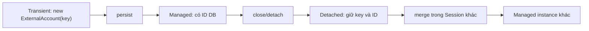

# Khóa tự nhiên bất biến như một tiêu chí so sánh khi phù hợp trong Hibernate

Khi làm việc với entity Hibernate, hai đối tượng Java có thể đại diện cho **cùng một bản ghi nghiệp vụ** nhưng lại nằm ở hai `Session`/`Persistence Context` khác nhau. Vì vậy, toán tử `==` không luôn phản ánh việc hai entity có cùng danh tính nghiệp vụ hay không. Lúc đó, lập trình viên thường cân nhắc cài đặt `equals()` và `hashCode()`.

Một cách tiếp cận hữu ích, **nếu domain thực sự có một khóa tự nhiên ổn định**, là dùng chính khóa đó làm tiêu chí so sánh. Chẳng hạn, một tài khoản được nhận diện bởi cặp `(sourceSystem, externalAccountCode)` do hệ thống nguồn cấp và được bảo đảm không thay đổi trong suốt vòng đời, thì hai object mang cùng cặp khóa ấy có thể được coi là cùng thực thể nghiệp vụ, kể cả trước khi database sinh khóa chính nội bộ.

Tuy nhiên, **không phải mọi thuộc tính unique đều là khóa tự nhiên bất biến**, và **không phải entity nào cũng nên dùng khóa tự nhiên trong `equals/hashCode`**. Email, tên đăng nhập, SKU, số điện thoại hoặc mã định danh có vẻ ổn định hôm nay nhưng có thể đổi theo chính sách nghiệp vụ. Nếu dùng một giá trị có thể thay đổi làm `hashCode`, các collection như `HashSet` và `HashMap` có thể hành xử sai sau khi entity đổi giá trị.

Bài học làm rõ khi nào nên dùng immutable natural key, quan hệ giữa `@NaturalId` và `@Id`, các quy tắc của Java equality, ảnh hưởng tới Hibernate proxy và lifecycle, cũng như những tình huống nên tránh áp dụng chiến lược này.

## 1. Định danh đối tượng có nhiều tầng

Khi đọc code ORM, hãy phân biệt ít nhất bốn khái niệm:

| Khái niệm | Ví dụ | Ý nghĩa |
| --- | --- | --- |
| Tham chiếu Java | `a == b` | Hai biến có trỏ đến **cùng một Java object** không? |
| Khóa chính database | `id = 1258` | Database nhận diện bản ghi bằng khóa chính |
| Khóa tự nhiên nghiệp vụ | `(sourceSystem, externalAccountCode)` | Domain nhận diện một thực thể bằng giá trị có ý nghĩa nghiệp vụ |
| Equality trong Java | `a.equals(b)` | Quy tắc ứng dụng xác định hai object được coi là bằng nhau |

Trong Hibernate, Persistence Context quản lý entity theo **entity identity gắn với khóa chính JPA**. Hai entity cùng kiểu và cùng `@Id` trong một Persistence Context bình thường được đại diện bởi cùng một managed instance, nhưng hai `Session` khác nhau không chia sẻ cùng object Java.

Ví dụ:

```java
ExternalAccount accountInSessionA;
ExternalAccount accountInSessionB;

try (Session a = sessionFactory.openSession();
     Session b = sessionFactory.openSession()) {

    accountInSessionA = a.find(ExternalAccount.class, 1258L);
    accountInSessionB = b.find(ExternalAccount.class, 1258L);
}

// Hai object có thể đại diện cùng một hàng,
// nhưng được tạo và quản lý ở hai Session khác nhau.
System.out.println(accountInSessionA == accountInSessionB); // Thường false.
```

Nếu entity giữ `equals()` mặc định từ `Object`, hai instance khác tham chiếu cũng thường không bằng nhau theo `equals()`. Nếu domain có natural key tốt, ứng dụng có thể lựa chọn quy tắc so sánh dựa trên khóa đó.

### Cùng khóa chính nhưng khác object

```text
Session A                  Database                 Session B
+-----------------+       +----------------+       +-----------------+
| ExternalAccount |       | id = 1258      |       | ExternalAccount |
| object A        | ----> | source = ERP   | <---- | object B        |
| id = 1258       |       | key = C-091    |       | id = 1258       |
+-----------------+       +----------------+       +-----------------+

A == B       -> false (thường gặp)
A.equals(B)  -> phụ thuộc chiến lược equality của entity
```

**Lưu ý:** cùng `@Id` là cách Hibernate phân biệt entity trong Persistence Context; còn `equals()` là hợp đồng Java do lớp định nghĩa. Hai cơ chế liên quan nhưng không phải một.

## 2. Khóa tự nhiên là gì?

**Khóa tự nhiên (*natural key*, *business key*)** là một hoặc nhiều thuộc tính vốn có ý nghĩa nhận diện trong domain, thay vì một số `id` thuần kỹ thuật được tạo chỉ để database lưu trữ.

Ví dụ có thể cân nhắc:

- Mã ngoại tệ trong danh mục tiền tệ, nếu chính sách domain coi mã là định danh ổn định.
- Mã định danh đối tác kết hợp mã hệ thống nguồn, nếu hệ thống nguồn bảo đảm mã không thay đổi hoặc tái sử dụng.
- Cặp `(organizationId, immutableContractCode)` nếu mã hợp đồng bất biến, duy nhất trong từng tổ chức.
- Cặp `(tenantId, externalRecordKey)` khi một khóa chỉ duy nhất trong tenant và không đổi.

Ví dụ **chưa chắc** là natural key bất biến:

- Email: có thể thay đổi, có thể được tái sử dụng.
- Username: nhiều hệ thống cho phép đổi tên hoặc tái cấp username.
- Số điện thoại: có thể thay, thu hồi và cấp lại.
- SKU/mã sản phẩm: có thể đổi khi tái phân loại sản phẩm, chuyển hệ thống hoặc nhập dữ liệu.
- Tên miền, đường dẫn `slug`: có thể đổi vì marketing hoặc tái cấu trúc.
- Mã đơn hàng: đôi khi chỉ được cấp khi xác nhận và có thể khác giữa tenant, năm hoặc chi nhánh.

**Natural key không có nghĩa là luôn bất biến.** Trong bài này, chỉ nên lấy khóa tự nhiên làm tiêu chí equality khi nó đồng thời thỏa các yêu cầu: có trước khi entity bắt đầu được dùng, ổn định, được chuẩn hóa, đủ phân biệt các entity theo đúng phạm vi và được database bảo vệ.

### Natural key và surrogate key

Surrogate key là ID kỹ thuật, ví dụ:

```java
@Id
@GeneratedValue(strategy = GenerationType.IDENTITY)
private Long id;
```

Natural key có thể tồn tại **cùng lúc** với surrogate key:

```java
@Id
@GeneratedValue(strategy = GenerationType.IDENTITY)
private Long id;

@NaturalId
@Column(name = "external_code", nullable = false, updatable = false)
private String externalCode;
```

Trong trường hợp này, khóa chính JPA vẫn là `id`, còn `externalCode` là khóa nghiệp vụ thứ hai. Hibernate vẫn theo dõi entity theo `@Id`; đánh dấu `@NaturalId` không tự thay `@Id` bằng một khóa khác.

## 3. Vì sao tiêu chí equality dựa trên khóa tự nhiên bất biến hấp dẫn?

Một entity dùng ID do database sinh thường chưa có `id` ngay sau `new`:

```java
CatalogItem item = new CatalogItem("ITEM-A1");

System.out.println(item.getId()); // null trước persist.
```

Nếu `equals/hashCode` phụ thuộc trực tiếp `id` được cấp sau, mã hash có thể đổi từ trạng thái transient sang managed. Khi object đã được thêm vào `HashSet` trước đó, Java collection không tự phân phối lại object theo hash mới.

Nếu entity có **khóa tự nhiên bất biến được gán khi tạo**, nó giữ một giá trị ổn định:

```java
CatalogItem a = new CatalogItem("ITEM-A1");
CatalogItem b = new CatalogItem("ITEM-A1");

// Giả sử equals/hashCode dựa trên code bất biến.
System.out.println(a.equals(b)); // true ngay trước persist.
```

Ưu điểm tiềm năng:

1. **So sánh trước persist:** không cần chờ Hibernate/database cấp khóa chính.
2. **So sánh giữa Session:** detached object và managed object có thể bằng nhau theo cùng business identity.
3. **Hash ổn định:** nếu khóa không đổi, `hashCode()` có thể giữ nguyên trong suốt vòng đời.
4. **Diễn đạt domain:** Java equality phản ánh cách nghiệp vụ nhận diện thực thể.
5. **Đơn giản hóa membership:** Set và Map có thể dùng khóa ổn định để xử lý phần tử.

Nhưng những ưu điểm ấy chỉ tồn tại khi key thực sự **duy nhất, bất biến và có ngữ nghĩa rõ**. Nếu business key được chỉnh sửa, hoặc chỉ duy nhất trong phạm vi chưa được đưa vào phép so sánh, thì chiến lược lại gây lỗi.

## 4. Hợp đồng `equals()` và `hashCode()` trong Java

Bất kể dùng Hibernate hay không, entity dùng trong collection Java vẫn cần tuân thủ các quy tắc của `Object.equals`:

- **Phản xạ:** `x.equals(x)` là `true`.
- **Đối xứng:** nếu `x.equals(y)` thì `y.equals(x)` cũng phải `true`.
- **Bắc cầu:** nếu `x.equals(y)` và `y.equals(z)` thì `x.equals(z)`.
- **Nhất quán:** khi các thuộc tính tham gia equality không đổi, kết quả phải không đổi qua nhiều lần gọi.
- **Với `null`:** `x.equals(null)` là `false`.

Quy tắc then chốt của hash:

> Nếu `a.equals(b)` là `true`, thì `a.hashCode() == b.hashCode()` bắt buộc phải đúng.

Chiều ngược lại không bắt buộc: hai object có hash bằng nhau vẫn có thể không bằng nhau.

### Vì sao không thể chỉ override `equals`?

`HashSet` và `HashMap` dùng hash để xác định vị trí lưu/tra cứu. Nếu hai entity có cùng natural key nhưng `equals` trả `true`, trong khi `hashCode` không nhất quán, Set vẫn có thể chứa hai phần tử mà domain coi là trùng.

```java
Set<ExternalAccount> accounts = new HashSet<>();
accounts.add(first);
accounts.add(second);

// Muốn Set nhận ra first và second trùng business identity,
// cả equals lẫn hashCode phải tuân thủ cùng tiêu chí.
```

### Hash ổn định là điều kiện vận hành, không chỉ một phong cách code

Giả sử khóa được sử dụng trong `hashCode` đổi sau khi thêm vào `HashSet`:

```java
Set<Customer> customers = new HashSet<>();
Customer c = new Customer("old@example.test");
customers.add(c);

c.setEmail("new@example.test");

// Nếu hashCode dựa trên email, object có thể nằm ở bucket cũ.
boolean found = customers.contains(c); // Có thể false.
```

`HashSet` không biết object trong nó đã đổi giá trị nội bộ. Với Map, khi key đổi hash cũng có thể làm `map.get(key)` không tìm thấy entry.

Đó là lý do **một khóa chỉ “hiếm khi đổi” vẫn chưa đủ**. Nếu code cho phép đổi nó trong thời gian object nằm trong Set/Map, nguy cơ đã xuất hiện.

## 5. Ví dụ hoàn chỉnh: natural key gồm hai trường bất biến

Giả sử một ứng dụng nhập tài khoản từ nhiều hệ thống ngoài. Hệ thống nguồn bảo đảm cặp `(sourceSystem, externalAccountCode)` xác định duy nhất một tài khoản và **không bao giờ tái cấp cặp mã ấy cho một tài khoản khác**.

Ứng dụng vẫn sử dụng khóa chính nội bộ `Long id` do database sinh. Khi so sánh entity ở Java, có thể dùng cặp business key.

### Entity

```java
import java.util.Locale;
import java.util.Objects;

import jakarta.persistence.Column;
import jakarta.persistence.Entity;
import jakarta.persistence.GeneratedValue;
import jakarta.persistence.GenerationType;
import jakarta.persistence.Id;
import jakarta.persistence.Table;
import jakarta.persistence.UniqueConstraint;

import org.hibernate.annotations.NaturalId;

@Entity
@Table(
    name = "external_accounts",
    uniqueConstraints = @UniqueConstraint(
        name = "uk_external_accounts_source_code",
        columnNames = {"source_system", "external_code"}
    )
)
public class ExternalAccount {

    @Id
    @GeneratedValue(strategy = GenerationType.IDENTITY)
    private Long id;

    @NaturalId(mutable = false)
    @Column(name = "source_system", nullable = false, updatable = false)
    private String sourceSystem;

    @NaturalId(mutable = false)
    @Column(name = "external_code", nullable = false, updatable = false)
    private String externalAccountCode;

    @Column(name = "display_name", nullable = false)
    private String displayName;

    protected ExternalAccount() {
        // Constructor không tham số cho JPA/Hibernate.
    }

    public ExternalAccount(
            String sourceSystem,
            String externalAccountCode,
            String displayName) {

        this.sourceSystem = normalizeKey(sourceSystem);
        this.externalAccountCode = normalizeKey(externalAccountCode);
        this.displayName = Objects.requireNonNull(displayName);
    }

    private static String normalizeKey(String value) {
        Objects.requireNonNull(value, "Natural key is required");
        String normalized = value.trim().toUpperCase(Locale.ROOT);
        if (normalized.isEmpty()) {
            throw new IllegalArgumentException(
                "Natural key must not be blank");
        }
        return normalized;
    }

    public Long getId() {
        return id;
    }

    public String getSourceSystem() {
        return sourceSystem;
    }

    public String getExternalAccountCode() {
        return externalAccountCode;
    }

    public String getDisplayName() {
        return displayName;
    }

    public void renameDisplayName(String newName) {
        this.displayName = Objects.requireNonNull(newName);
    }

    @Override
    public boolean equals(Object other) {
        if (this == other) {
            return true;
        }
        if (!(other instanceof ExternalAccount)) {
            return false;
        }

        ExternalAccount that = (ExternalAccount) other;

        // Không coi hai instance thiếu business key là bằng nhau.
        return getSourceSystem() != null
            && getExternalAccountCode() != null
            && Objects.equals(
                getSourceSystem(), that.getSourceSystem())
            && Objects.equals(
                getExternalAccountCode(),
                that.getExternalAccountCode());
    }

    @Override
    public int hashCode() {
        // Ổn định trong vòng đời ứng dụng
        // khi hai trường natural key không bao giờ thay đổi.
        return Objects.hash(
            getSourceSystem(),
            getExternalAccountCode());
    }
}
```

Mẫu này dành cho một **entity leaf** không có các subtype entity với equality riêng. Điều kiện `instanceof` giúp hoạt động với nhiều proxy kiểu subclass của Hibernate, nhưng khi entity có inheritance hierarchy phức tạp, cần thiết kế lại kiểm tra kiểu để bảo đảm đối xứng/bắc cầu và tránh so sánh nhầm hai entity type khác nhau. Phần về proxy giải thích thêm.

### Ý nghĩa từng annotation

| Thành phần | Vai trò |
| --- | --- |
| `@Id` | Khóa chính dùng cho JPA/Hibernate identity |
| `@GeneratedValue` | Database/Hibernate cấp ID kỹ thuật |
| `@NaturalId(mutable = false)` | Khai báo business key bất biến theo cơ chế riêng của Hibernate |
| Hai trường `@NaturalId` | Cùng tạo **natural ID tổng hợp** |
| `@Column(nullable = false)` | Mô tả ràng buộc không null ở cột |
| `@Column(updatable = false)` | Ngăn Hibernate đưa cột này vào `UPDATE` thông thường |
| `@UniqueConstraint` | Mô tả unique constraint tổng hợp khi tạo schema |
| `normalizeKey(...)` | Quy định canonical form trước khi entity được dùng |
| `equals/hashCode` | Quy định equality ở tầng Java bằng natural key |

`@NaturalId` **không tự viết `equals/hashCode`**; hai phương thức trên là code Java riêng. Ngược lại, một entity **có thể dùng natural key để so sánh mà không đặt `@NaturalId`**, miễn là business semantics và các ràng buộc đúng. Annotation chỉ khai báo thêm metadata cho các tính năng natural-id của Hibernate.

### Hình dạng bảng SQL

```sql
CREATE TABLE external_accounts (
    id BIGINT GENERATED BY DEFAULT AS IDENTITY PRIMARY KEY,
    source_system VARCHAR(80) NOT NULL,
    external_code VARCHAR(80) NOT NULL,
    display_name VARCHAR(200) NOT NULL,
    CONSTRAINT uk_external_accounts_source_code
        UNIQUE (source_system, external_code)
);
```

Đây là DDL minh họa. Trong một ứng dụng thật, độ dài cột, cách database so sánh chữ hoa/chữ thường, identity syntax và migration cần tương thích với Hibernate dialect và domain.

**Ràng buộc database là bắt buộc cho tính duy nhất lưu trữ**. `equals` chỉ bảo đảm hai Java object được so như thế nào trong một tiến trình; nó không ngăn hai request ở hai server cùng INSERT một khóa.

## 6. Vì sao mẫu trên có `hashCode` ổn định?

Ứng dụng tạo entity với key ngay từ constructor:

```java
ExternalAccount a = new ExternalAccount(
    "erp", "ACC-009", "Nguyễn An");

ExternalAccount b = new ExternalAccount(
    "ERP", "ACC-009", "Tên hiển thị cũ");
```

Vì normalize đưa hai source về cùng dạng chuẩn:

```java
System.out.println(a.equals(b)); // true
System.out.println(a.hashCode() == b.hashCode()); // true
```

Mặc dù `displayName` khác, domain đã quyết định tên hiển thị không tham gia identity. Khi đổi tên:

```java
int before = a.hashCode();
a.renameDisplayName("Nguyễn An Updated");
int after = a.hashCode();

System.out.println(before == after); // true
```

ID do database sinh sau này cũng không tham gia phép so sánh:

```java
Long beforePersistId = a.getId(); // null với entity mới.
entityManager.persist(a);
Long afterPersistId = a.getId();   // Thường có giá trị sau khi sinh ID.

System.out.println(a.getSourceSystem()); // Vẫn ERP
System.out.println(a.getExternalAccountCode()); // Vẫn ACC-009
```

Do các trường natural key không đổi, `hashCode` không bị ảnh hưởng bởi việc `id` từ `null` thành số.

### Thận trọng khi object được tạo không có key

JPA/Hibernate có thể gọi constructor không tham số khi materialize entity rồi gán thuộc tính qua cơ chế access nội bộ. Trạng thái trung gian trong quá trình materialize **không phải một entity application nên cho vào Set**.

Trong mã ứng dụng, hãy tạo entity qua constructor/factory bảo đảm key đầy đủ. Nếu cho phép các setter công khai tạo object mới với key `null` rồi điền dần, ta đã làm mất điều kiện “khóa có ngay từ lúc entity bắt đầu được dùng”.

Hai object mới cùng có natural key `null` **không nên được coi là bằng nhau** chỉ vì cùng thiếu dữ liệu. Mẫu `equals` trên yêu cầu cả hai trường của đối tượng bên trái khác `null`. Điều kiện constructor giúp các đối tượng nghiệp vụ thông thường luôn hợp lệ.

## 7. Natural key giúp gì cho Set và Map?

### Set tránh thêm hai đối tượng cùng business identity

```java
ExternalAccount a = new ExternalAccount(
    "ERP", "ACC-009", "Tên A");
ExternalAccount b = new ExternalAccount(
    "ERP", "ACC-009", "Tên B");

Set<ExternalAccount> accounts = new HashSet<>();
accounts.add(a);
accounts.add(b);

System.out.println(accounts.size()); // 1
```

Giá trị hiển thị khác nhau nhưng cặp natural key giống nhau; Set xem chúng là một phần tử theo `equals/hashCode`.

Điều này đặc biệt hữu ích khi domain nói: “Trong tập tài khoản đồng bộ này, mỗi account từ một nguồn chỉ được xuất hiện một lần”.

Tuy nhiên, nếu dữ liệu của `a` và `b` khác nhau một cách mâu thuẫn (ví dụ displayName khác do cập nhật), `Set` **không tự hòa giải hai phiên bản**. Nó chỉ quyết định membership. Ứng dụng phải chọn chính sách cập nhật dữ liệu riêng.

### Map dùng entity làm key

```java
Map<ExternalAccount, SyncStatus> syncStates =
    new HashMap<>();

syncStates.put(a, SyncStatus.PENDING);

SyncStatus state = syncStates.get(b);
// Nếu a.equals(b), có thể lấy cùng trạng thái.
```

Đây là ví dụ khi cần tra cứu bằng business identity. Trong nhiều thiết kế, cách đơn giản hơn là dùng **một value object bất biến đại diện cho natural key** làm Map key, thay vì toàn bộ entity.

Ví dụ:

```java
public record ExternalAccountKey(
    String sourceSystem,
    String externalCode
) {}
```

`record` ở đây minh họa Java 16+; hai trường cần được canonical hóa trước khi tạo record hoặc trong constructor chuẩn hóa. Với Java cũ, dùng class value object có `equals/hashCode`.

```java
Map<ExternalAccountKey, SyncStatus> states = new HashMap<>();
states.put(new ExternalAccountKey("ERP", "ACC-009"),
           SyncStatus.PENDING);
```

Map key bằng value object có thể tránh tải một entity Hibernate chỉ để xác định khóa, không phụ thuộc proxy/session và dễ truyền qua lớp service hơn.

### Không gắn việc loại trùng ở Java với constraint DB

`Set` có thể loại trùng trước khi gọi persist, nhưng không ngăn concurrency:

```text
Request A tạo key (ERP, ACC-009)
Request B tạo key (ERP, ACC-009)

Ở hai Session/transaction khác nhau:
    Cả hai đều có Java object hợp lệ.
    Cả hai đều định INSERT.

Unique constraint database:
    Chỉ cho phép một bản ghi mang cặp key đó.
```

Tầng Java và database cùng cần thực thi quy tắc ở phạm vi mà chúng kiểm soát.

## 8. `@NaturalId` của Hibernate hoạt động như thế nào?

`@NaturalId` là annotation **Hibernate-specific** trong `org.hibernate.annotations.NaturalId`. Nó đánh dấu một hoặc nhiều thuộc tính là natural identifier để Hibernate có thể:

- Biết rằng các thuộc tính ấy cùng tạo thành natural ID.
- Hỗ trợ API tìm entity theo natural ID.
- Theo dõi thay đổi natural ID trong các trường hợp được cấu hình mutable.
- Tùy cấu hình, phối hợp với cơ chế natural-id caching.

Với entity `ExternalAccount` có hai trường `@NaturalId`, có thể tìm bằng API native Hibernate:

```java
import org.hibernate.Session;

Session session = entityManager.unwrap(Session.class);

ExternalAccount account = session
    .byNaturalId(ExternalAccount.class)
    .using("sourceSystem", "ERP")
    .using("externalAccountCode", "ACC-009")
    .load();
```

Tên `sourceSystem` và `externalAccountCode` trong `using(...)` là **tên property của entity**, không phải tên cột SQL `source_system`/`external_code`.

Nếu entity chỉ có **một** thuộc tính `@NaturalId`, Hibernate còn hỗ trợ API đơn giản hơn như `bySimpleNaturalId(Entity.class)` trong các phiên bản thích hợp.

### `@NaturalId` không thay `@Id`

Vẫn cần khóa chính JPA:

```java
@Id
@GeneratedValue(strategy = GenerationType.IDENTITY)
private Long id;

@NaturalId
private String externalAccountCode;
```

Hibernate dùng `@Id` để quản lý entity identity trong Persistence Context, liên kết khóa ngoại thông thường và các thao tác cơ bản như `find(Entity.class, id)`.

`@NaturalId` mang ý nghĩa của một khóa nhận diện bổ sung và API tra cứu riêng. Vì vậy:

- `find(ExternalAccount.class, 1258L)` dùng primary key.
- `byNaturalId(...).using(...).load()` dùng natural ID.
- `equals/hashCode` chỉ dựa natural key **nếu chính bạn viết như vậy**.

Không có quy tắc rằng cứ đánh dấu `@NaturalId` thì Java `equals()` tự đổi hành vi.

### Mutable hay immutable natural ID?

Mặc định một natural ID của Hibernate được coi là immutable; có thể chỉ rõ:

```java
@NaturalId(mutable = false)
private String externalCode;
```

Khi business cho phép thay đổi key, Hibernate cũng hỗ trợ:

```java
@NaturalId(mutable = true)
private String editableCode;
```

Nhưng **mutable natural ID thường không phù hợp làm cơ sở của `hashCode`** nếu object có thể nằm trong hashed collection trong lúc key thay đổi. Hibernate có thể hỗ trợ đồng bộ natural-id resolution sau cập nhật, nhưng điều đó **không** làm Java `HashSet` tự rehash object.

Phân biệt rõ:

| Vấn đề | Ai quản lý? |
| --- | --- |
| Khóa được đánh dấu tự nhiên trong ORM | Hibernate `@NaturalId` |
| Cho phép sửa natural ID theo mapping | Hibernate `mutable` và mapping cột |
| Tính duy nhất khi nhiều transaction | Primary/unique constraint ở database |
| Hai Java object bằng nhau | `equals()` |
| Vị trí trong HashSet/HashMap | `hashCode()` và quy tắc Java collection |

### Natural-id cache không phải Java equality

Hibernate có thể cache phép phân giải `natural key -> primary key` khi bật hạ tầng cache tương ứng. Một số cấu hình có thể sử dụng `@NaturalIdCache` và second-level cache theo provider.

Cache này giúp tra cứu nhanh hơn trong các trường hợp thích hợp; nó **không** biến `@NaturalId` thành `equals/hashCode` và không đảm bảo mọi truy vấn đều không chạm database. Chi tiết cache phụ thuộc Hibernate version, cache provider, region và tình trạng dữ liệu.

## 9. Khi nào natural key thực sự bất biến?

Một natural key nên được coi là **bất biến về nghiệp vụ**, không chỉ vì entity không có public setter.

Ví dụ một mã được cấp khi account đăng ký:

```text
sourceSystem = ERP
externalCode = ACC-009
```

Muốn dùng cặp này làm equality key, cần trả lời “nếu account thay đổi tên, địa chỉ hoặc trạng thái, cặp code có thay không?”. Nếu chỉ thông tin khác thay đổi, natural key có thể phù hợp.

Nhưng còn các câu hỏi khó hơn:

1. Hệ thống nguồn có từng **tái sử dụng mã** cho đối tượng khác sau khi xóa không?
2. Khi **gộp tài khoản**, mã cũ có bị chuyển sang account khác không?
3. Khi thay phần mềm nguồn, `sourceSystem` có đổi không?
4. Nếu nhập dữ liệu từ hai tenant, cặp key có đủ phân biệt không?
5. Nếu domain cho phép **đổi mã hợp đồng**, cặp này còn là identity hay chỉ là một thuộc tính?
6. Khi soft delete, mã cũ được giữ vĩnh viễn hay có thể cấp lại?

Nếu business yêu cầu đổi/recycle key, nó có thể là **alternate key để tra cứu tại một thời điểm** nhưng không phải tiêu chí Java equality tốt trong suốt vòng đời object.

### Bất biến kỹ thuật và bất biến nghiệp vụ

`@Column(updatable = false)` chỉ giúp Hibernate bỏ cột khỏi `UPDATE` do mapping thông thường, không phải cơ chế bảo mật hoặc ràng buộc vật lý ngăn mọi đường ghi.

Không có setter public cũng chưa chắc đảm bảo dữ liệu không bao giờ đổi: reflection, SQL trực tiếp, migration hoặc tích hợp dữ liệu vẫn có thể thay cột.

Bất biến đúng nghĩa cần phối hợp:

- Quy tắc domain/constructor chỉ cấp key một lần.
- Mapping không cho phép sửa tùy tiện.
- Unique constraint thích hợp.
- Quy trình migration và thao tác vận hành tôn trọng key.
- Tài liệu hóa rõ giá trị nào không được thay đổi.

## 10. Vì sao email, username và SKU thường là lựa chọn rủi ro?

Một số hệ thống có quy tắc unique cho `email`:

```java
@Column(name = "email", unique = true)
private String email;
```

“Unique” chỉ có nghĩa không có hai bản ghi đang cùng dùng giá trị đó trong phạm vi constraint; nó **không chứng minh giá trị ấy bất biến**.

### Ví dụ email đổi sau khi entity nằm trong Set

```java
Customer customer = new Customer("old@example.test");
Set<Customer> set = new HashSet<>();
set.add(customer);

// Nghiệp vụ cho phép sửa email.
customer.changeEmail("new@example.test");

// Nếu hashCode dựa email, set.contains(customer)
// có thể không tìm được object ở bucket cũ.
```

Ngay cả khi mọi lần kiểm tra email đều thành công và database không có email trùng, Java collection đã có thể hỏng.

### Username có thể đổi do nghiệp vụ

Hôm nay username `alice` đại diện cho một người, nhưng ngày mai người ấy đổi thành `alice.dev` và tên `alice` được tái cấp. Hai bản ghi lịch sử có thể có cùng username ở các thời điểm khác nhau. So sánh entity chỉ bằng username sẽ gộp nhầm hai người.

### SKU có thể đổi trong doanh nghiệp

SKU thường được dùng làm mã hàng, nhưng có thể đổi khi sáp nhập danh mục, tái đóng gói hoặc đồng bộ ERP. Nếu hệ thống thực sự cam kết một SKU vĩnh viễn cho một physical product identity thì có thể dùng; nếu không, hãy tách `productId` ổn định khỏi `currentSku` có thể thay.

**Quy tắc:** đừng đánh đồng “người dùng đang coi đây là mã định danh” với “mã này sẽ không thay đổi trong toàn bộ vòng đời của entity và hệ thống”.

## 11. Equality theo natural key và Hibernate proxy

Hibernate có thể trả về một **proxy** thay vì entity đã được tải đầy đủ, chẳng hạn khi dùng lazy association hoặc `getReference`:

```java
ExternalAccount reference =
    entityManager.getReference(ExternalAccount.class, id);
```

Trong các cấu hình Hibernate proxy-based loading phổ biến, proxy có thể là subclass của entity. Điều này ảnh hưởng tới cách kiểm tra kiểu trong `equals`.

### Vì sao `getClass()` đơn giản có thể gây vấn đề?

Một cách cài đặt thường thấy:

```java
if (getClass() != other.getClass()) {
    return false;
}
```

Với entity thực và proxy subclass, `getClass()` của hai object có thể khác nhau dù chúng đại diện cho cùng entity type. Khi đó equality có thể sai.

Ngược lại, chỉ dùng `instanceof` mà không suy nghĩ về inheritance cũng có thể gây vấn đề nếu các entity subclass khác nhau vô tình so bằng nhau theo cùng natural key.

### Chiến lược phù hợp phụ thuộc mô hình kế thừa

Với một entity leaf không có mapped subclass, `instanceof ExternalAccount` như ví dụ trước thường là lựa chọn dễ hiểu. Khi có hierarchy entity, cần xác định:

- Hai entity khác concrete subtype nhưng cùng natural key có được coi là một business identity không?
- Equality phải đối xứng, bắc cầu như thế nào?
- Có proxy hoặc bytecode enhancement đang hoạt động không?
- Việc đọc key qua getter có thể khởi tạo proxy không?
- Key có sẵn khi entity đã detached không?

Các tiện ích Hibernate về xác định persistent class có thể giúp xử lý proxy, nhưng chi tiết API và việc có gây proxy initialization hay không tùy phiên bản. **Không sao chép một mẫu `equals` “proxy-safe” chung cho mọi entity** khi chưa xác định quy tắc equality của domain.

### Sử dụng getter thay vì truy cập field trực tiếp

Trong proxy subclass chưa được khởi tạo, các field kế thừa trên proxy có thể không chứa trạng thái giống một entity đã hydrate. Bởi vậy, mẫu equality truy cập qua getter thường an toàn hơn việc đọc field trực tiếp của `other`:

```java
Objects.equals(
    getExternalAccountCode(),
    that.getExternalAccountCode()
);
```

Nhưng gọi getter natural key trên proxy có thể dẫn tới truy vấn để khởi tạo entity. Nếu proxy đã detached và chưa được khởi tạo, việc đọc key có thể thất bại với `LazyInitializationException`.

Vì vậy, “equality theo natural key” không phải lúc nào cũng rẻ hoặc hoàn toàn không chạm database. Với tập hợp entity lớn, detached entities và lazy loading, cần hiểu giới hạn này.

### Không đặt truy vấn database vào `equals`

Tránh kiểu:

```java
@Override
public boolean equals(Object other) {
    // Sai ý tưởng: không query repository hoặc mở Session ở đây.
    // return repository.findMatching(...).isPresent();
    return super.equals(other);
}
```

`equals` có thể được Java collection gọi rất nhiều lần. Nó phải có ngữ nghĩa rõ, không phụ thuộc tình trạng transaction, không tạo side effect và không âm thầm truy vấn database. Nếu cần so identity theo một khóa nằm ngoài entity, nên chuyển khóa thành value object đã biết hoặc dùng một service chuyên trách xác minh cùng record.

## 12. Vòng đời transient, managed và detached

Một lý do hay chọn natural key bất biến là sự ổn định **xuyên vòng đời**.



### Trước khi lưu

```java
ExternalAccount first =
    new ExternalAccount("ERP", "ACC-001", "First");
ExternalAccount second =
    new ExternalAccount("ERP", "ACC-001", "Second");

System.out.println(first.getId()); // null
System.out.println(second.getId()); // null

System.out.println(first.equals(second)); // true
```

Ở đây domain nói hai object cùng mô tả **một mã tài khoản nguồn**, dù cả hai mới chỉ là object chưa persist. Điều đó phù hợp nếu việc tạo hai object cho cùng natural key nghĩa là hai bản sao của một business identity.

Tuy nhiên, nếu domain coi mỗi object được tạo là một **bản ghi dự kiến khác nhau** trước khi được chấp thuận, việc áp dụng natural-key equality ngay khi transient có thể là lựa chọn sai. Chính domain quyết định.

### Sau khi được quản lý

```java
entityManager.persist(first);

// first trở thành managed theo quy tắc persist.
// id được sinh theo chiến lược @GeneratedValue.
```

Key không đổi và `hashCode()` tiếp tục ổn định, ngay cả khi `id` được cấp.

Không nên persist đồng thời hai entity có cùng natural key như hai bản ghi độc lập rồi trông chờ `equals` tự gộp dữ liệu: unique constraint sẽ bảo vệ database, còn persistence operation có thể báo lỗi xung đột.

### Khi detached

Khi entity rời Persistence Context, khóa tự nhiên bất biến vẫn tồn tại trong entity đã được tải đầy đủ:

```java
ExternalAccount detached;
// ... tải trong transaction/session thứ nhất ...

ExternalAccount managedLater;
// ... tải trong transaction/session thứ hai ...

System.out.println(detached == managedLater); // Thường false.
System.out.println(detached.equals(managedLater)); // Có thể true.
```

Sự khác biệt này hữu ích trong code đối chiếu dữ liệu giữa hai luồng đồng bộ, nhưng cần để ý proxy chưa được khởi tạo.

### Với `merge`

`merge` thường trả về một managed instance có state được sao chép/tổng hợp từ detached instance, không nhất thiết biến chính object truyền vào thành managed.

```java
ExternalAccount managed =
    entityManager.merge(detached);

System.out.println(managed == detached); // Thường false.
System.out.println(managed.equals(detached)); // True nếu key giống nhau.
```

Equality theo natural key có thể phù hợp cho so sánh hai object, nhưng **không tự bảo đảm merge an toàn**. Hibernate còn phải xét khóa chính, version, cascade, existing row và xung đột ghi đồng thời.

## 13. Lưu ý quan trọng: equals cùng natural key không đồng nghĩa an toàn khi persist

Giả sử hai request đồng thời cố tạo account `(ERP, ACC-009)`:

```text
Request A (Session A)                 Request B (Session B)
new Account(ERP, ACC-009)            new Account(ERP, ACC-009)
persist(accountA)                     persist(accountB)
flush/commit                          flush/commit

Database UNIQUE(source_system, external_code):
    Chỉ một bản ghi có thể sở hữu cặp natural key.
```

Một trường hợp có thể commit thành công, còn trường hợp kia gặp lỗi constraint. Điều này xảy ra dù code `equals` được viết đúng.

Vì thế:

- Không dùng `Set` trong một JVM thay cho unique constraint ở database.
- Không dùng `existsBy...` trước insert như cơ chế chống race duy nhất.
- Nếu cần idempotency, hãy định nghĩa quy tắc “đã có thì cập nhật/trả lại cùng record” ở tầng service với transaction/concurrency phù hợp.
- Khi bắt lỗi unique constraint, cần xác định chính xác constraint bị vi phạm và xử lý đúng ngữ cảnh.
- Nếu dữ liệu có nhiều tenant, ràng buộc uniqueness phải chứa đủ tenant ID.

**Natural-key equality là quy tắc so sánh Java**, không phải cơ chế quản lý transaction hoặc giải quyết duplicate insert một cách tự động.

## 14. Phạm vi duy nhất: global hay theo tenant?

Một natural key chỉ có ý nghĩa khi biết nó **duy nhất trong phạm vi nào**.

Ví dụ một hệ thống nhiều tổ chức:

```text
Tenant ACME: externalCode = ACC-009
Tenant BETA: externalCode = ACC-009
```

Nếu mã chỉ duy nhất **trong từng tenant**, so sánh hai entity chỉ theo `externalCode` sẽ kết luận sai rằng account ACME và BETA là một.

Natural key đầy đủ nên là:

```text
(tenantId, externalCode)
```

hoặc nếu một tenant có nhiều hệ thống nguồn:

```text
(tenantId, sourceSystem, externalCode)
```

### Ví dụ equality gồm tenant

```java
@Entity
@Table(
    name = "tenant_accounts",
    uniqueConstraints = @UniqueConstraint(
        name = "uk_tenant_account_code",
        columnNames = {"tenant_id", "account_code"}
    )
)
public class TenantAccount {

    @Id
    @GeneratedValue(strategy = GenerationType.IDENTITY)
    private Long id;

    @NaturalId(mutable = false)
    @Column(name = "tenant_id", nullable = false, updatable = false)
    private String tenantId;

    @NaturalId(mutable = false)
    @Column(name = "account_code", nullable = false, updatable = false)
    private String accountCode;

    protected TenantAccount() {}

    public TenantAccount(String tenantId, String accountCode) {
        this.tenantId = Objects.requireNonNull(tenantId);
        this.accountCode = Objects.requireNonNull(accountCode);
    }

    public String getTenantId() {
        return tenantId;
    }

    public String getAccountCode() {
        return accountCode;
    }

    @Override
    public boolean equals(Object other) {
        if (this == other) return true;
        if (!(other instanceof TenantAccount)) return false;

        TenantAccount that = (TenantAccount) other;
        return getTenantId() != null
            && getAccountCode() != null
            && Objects.equals(getTenantId(), that.getTenantId())
            && Objects.equals(getAccountCode(), that.getAccountCode());
    }

    @Override
    public int hashCode() {
        return Objects.hash(getTenantId(), getAccountCode());
    }
}
```

Với hai tenant:

```java
TenantAccount a = new TenantAccount("ACME", "ACC-009");
TenantAccount b = new TenantAccount("BETA", "ACC-009");

System.out.println(a.equals(b)); // false
```

Đây là ý nghĩa đúng nếu hai account thuộc hai tenant độc lập.

### Multi-tenancy theo schema/database riêng

Trong mô hình mỗi tenant có database hoặc schema riêng, hai bản ghi có cùng primary key hay natural key cục bộ vẫn có thể là hai entity khác nhau khi xét xuyên tenant. Nếu object từ nhiều tenant có thể gặp nhau trong cùng Java collection/service, **tenant identifier phải thuộc identity logic hoặc được bao trong key có phạm vi đúng**.

Đừng giả định `@Id Long id` hoặc `@NaturalId(code)` đủ phân biệt khi mỗi tenant có một không gian khóa riêng.

## 15. Chuẩn hóa khóa trước khi so sánh

Natural key chỉ hoạt động ổn định khi ứng dụng và database thống nhất thế nào là “cùng giá trị”.

Ví dụ:

```text
"abc-009"
" ABC-009 "
"Abc-009"
```

Nếu nghiệp vụ coi cả ba là cùng mã, constructor/factory có thể chuẩn hóa:

```java
private static String normalizeAccountCode(String input) {
    Objects.requireNonNull(input, "Account code required");
    String code = input.trim().toUpperCase(Locale.ROOT);
    if (code.isBlank()) {
        throw new IllegalArgumentException("Blank account code");
    }
    return code;
}
```

Lưu ý `String.isBlank()` yêu cầu Java 11+, còn dự án cũ có thể dùng `isEmpty()` sau `trim()`.

Nhưng normalize là **quy tắc domain**, không phải một mẹo bắt buộc. Với code có phân biệt chữ hoa/chữ thường, tự chuyển uppercase có thể gộp nhầm hai identifier hợp lệ.

### Equality trong Java và collation của database có thể khác nhau

Một cột SQL dùng case-insensitive collation có thể coi `abc` và `ABC` là trùng, trong khi `String.equals` của Java không coi chúng bằng nhau. Kết quả:

- Java `Set` giữ cả hai.
- Database unique constraint từ chối một trong hai.

Chiều ngược lại cũng có thể xảy ra nếu ứng dụng chuẩn hóa dữ liệu mạnh hơn database.

Để tránh lệch:

1. Xác định chính sách chuẩn hóa key.
2. Chuẩn hóa **trước khi entity được dùng** trong Set/Map.
3. Chọn cột, collation và unique constraint phù hợp.
4. Không thay đổi chính sách normalization tùy môi trường.
5. Nếu đổi quy tắc chuẩn hóa, xem đây là thay đổi ảnh hưởng identity và migration.

### Unicode, khoảng trắng và các khóa phức tạp

Chuẩn hóa Unicode, dấu phụ, kiểu chữ hoa/thường theo locale hoặc loại bỏ khoảng trắng có thể không đơn giản như `trim().toUpperCase(...)`. Với natural key quốc tế, cần một quy tắc canonicalization được mô tả rõ, nhất quán giữa các dịch vụ và kiểm chứng bằng database. Không âm thầm “sửa” dữ liệu người dùng theo quy tắc không được business phê duyệt.

## 16. Khóa tự nhiên phức hợp và value object

Khi natural key gồm nhiều phần, không nên lặp đi lặp lại việc ghép chuỗi:

```java
// Dễ va chạm nếu không có format và escaping rõ:
String key = tenantId + ":" + externalCode;
```

Ví dụ hai cặp `("A:B", "C")` và `("A", "B:C")` đều cho chuỗi `"A:B:C"` nếu không encode cẩn thận. Cấu trúc dữ liệu dạng value object an toàn và rõ ý hơn.

### Immutable key type

Với Java record:

```java
import java.util.Objects;

public record AccountBusinessKey(
    String tenantId,
    String externalCode
) {
    public AccountBusinessKey {
        Objects.requireNonNull(tenantId);
        Objects.requireNonNull(externalCode);
    }
}
```

Khi dùng key:

```java
AccountBusinessKey keyA =
    new AccountBusinessKey("ACME", "ACC-009");
AccountBusinessKey keyB =
    new AccountBusinessKey("ACME", "ACC-009");

System.out.println(keyA.equals(keyB)); // true
```

Record tự sinh equality/hash code dựa trên thành phần. Với những trường component là String bất biến, nó giúp giữ ổn định. Tuy nhiên, nếu component là object mutable như `List`, record không tự biến nó thành bất biến sâu.

Có thể cung cấp method trên entity để lấy key:

```java
public AccountBusinessKey businessKey() {
    return new AccountBusinessKey(
        getTenantId(),
        getAccountCode());
}
```

Khi cần so sánh ở tầng service, có thể viết:

```java
boolean sameBusinessKey =
    first.businessKey().equals(second.businessKey());
```

Cách này hữu ích nếu không muốn override entity `equals` hoặc khi muốn **tách rõ so sánh business identity khỏi object equality**.

### Value object không nhất thiết là `@EmbeddedId`

Một `record` trong Java dùng để so key có thể chỉ là DTO/value object trong business logic. JPA `@Embeddable` hoặc `@EmbeddedId` là quyết định mapping khác và có yêu cầu riêng về constructor, access và hỗ trợ của provider.

Không cần biến một business key thành primary key composite chỉ vì muốn so sánh hai entity. Có thể giữ `Long id` làm PK và dùng cặp field natural key với unique constraint.

## 17. Dùng `@NaturalId` và `@Id` cùng nhau

Một thiết kế phổ biến:

```java
@Id
@GeneratedValue(strategy = GenerationType.SEQUENCE)
private Long id;

@NaturalId(mutable = false)
@Column(name = "business_code", nullable = false, updatable = false)
private String businessCode;
```

Có hai mục tiêu riêng:

- `@Id`: hỗ trợ định danh entity trong Persistence Context và foreign key.
- `@NaturalId`: mô tả business key với API Hibernate để tra cứu natural ID.

Có thể viết repository theo khóa chính:

```java
Optional<CatalogItem> findById(Long id);
```

và repository theo business key:

```java
Optional<CatalogItem> findByBusinessCode(String code);
```

Trong Spring Data JPA, method `findByBusinessCode` là truy vấn property thường theo cơ chế query derivation; nó không tự sử dụng API `Session.byNaturalId` chỉ vì thuộc tính có `@NaturalId`.

Nếu cần chủ động dùng Hibernate natural-id API, có thể unwrap `Session` trong lớp repository phù hợp hoặc xây một repository riêng.

### Không nhất thiết dùng natural ID trong equals

Một số domain có natural ID nhưng quyết định entity equality dựa trên primary key hoặc so tham chiếu, vì natural ID có những rủi ro về proxy, lifecycle hoặc bị sửa trong hệ thống cũ. Điều đó có thể là quyết định hợp lệ.

**`@NaturalId` và natural-key equality không bắt buộc đi đôi.** Chúng phục vụ hai vấn đề khác nhau: metadata/tra cứu ORM và Java object equality.

## 18. So sánh natural-key equality với ID-based equality

Hai chiến lược được thảo luận phổ biến:

| Tiêu chí | Natural key bất biến | ID database sinh |
| --- | --- | --- |
| Có key trước persist? | Có, nếu domain cấp ngay | Thường chưa có |
| Hash ổn định trước/sau persist? | Có, nếu key bất biến | Cần thiết kế cẩn thận vì ID có thể từ null thành giá trị |
| Mang ý nghĩa nghiệp vụ | Có | Thường không |
| Độc lập với database-generated ID | Có | Không |
| Khi business cho phép đổi key | Không phù hợp | PK có thể vẫn giữ ổn định |
| Phụ thuộc proxy loading | Có thể cần đọc property key | Lấy identifier từ proxy có thể thuận lợi hơn tùy API |
| Phức tạp khi inheritance | Có thể | Có thể |
| Trường hợp dữ liệu nguồn không có natural key đáng tin | Không thích hợp | Có thể phù hợp hơn |

### Mẫu ID-based equality minh họa

Một cách tiếp cận với entity có `@GeneratedValue` là chỉ coi hai object khác tham chiếu bằng nhau khi cả hai đã có cùng non-null ID:

```java
@Override
public boolean equals(Object other) {
    if (this == other) return true;
    if (!(other instanceof Order)) return false;

    Order that = (Order) other;
    return getId() != null
        && Objects.equals(getId(), that.getId());
}

@Override
public int hashCode() {
    // Tránh hash thay đổi từ null ID sang ID mới.
    // Đây chỉ là một hướng thiết kế, cần xét proxy/inheritance.
    return Order.class.hashCode();
}
```

Mẫu dùng hash constant theo kiểu có thể giữ hash ổn định; đánh đổi là nhiều object có cùng hash, ảnh hưởng hiệu năng trong một số hashed collection lớn. Khi có proxy/inheritance, chính sách xác định kiểu entity cũng cần được xử lý phù hợp.

Bài học hiện tại không đặt mục tiêu kết luận chiến lược ID-based luôn tốt hay xấu. Nó làm rõ rằng **natural key bất biến là một tiêu chí so sánh hữu ích khi thật sự tồn tại**, và tránh được một số vấn đề của generated ID.

## 19. Vì sao không nên đưa toàn bộ field vào equals/hashCode?

IDE, Lombok hoặc một số generator có thể đề xuất equality dựa trên toàn bộ field:

```java
// Phản ví dụ về ý tưởng:
// equals so id, code, name, email, status, createdAt, orders, ...
```

Điều này thường không phù hợp cho entity Hibernate:

- `name`, `status` và `email` có thể thay đổi, làm hash không ổn định.
- Quan hệ lazy như `orders` có thể bị khởi tạo khi so sánh, gây thêm truy vấn.
- Quan hệ hai chiều có thể gây đệ quy vô hạn: `Order.equals(Customer)` -> `Customer.equals(orders)` -> ...
- Collection lớn làm equality rất tốn kém.
- Nếu so theo mọi field, hai entity cùng identity nhưng khác trạng thái cập nhật sẽ bị coi là hai object khác nhau.

Natural-key equality thường chỉ so **một nhóm nhỏ field định danh bất biến**; không so dữ liệu mô tả và association có thể đổi.

### Khi dùng Lombok

Lombok `@Data` có thể tạo `equals/hashCode` theo field trong class, và có thể tạo `toString` bao gồm association. Dùng trực tiếp trên entity có quan hệ lazy cần thận trọng.

Nếu entity có natural key thực sự phù hợp, một lựa chọn là **chủ động chỉ định các field identity** bằng cách viết thủ công `equals/hashCode` hoặc sử dụng cấu hình Lombok loại trừ/chỉ bao gồm có chủ đích. Không để IDE hoặc annotation quyết định identity thay domain.

## 20. Bất biến natural key trong hệ thống có cập nhật dữ liệu lịch sử

Một thách thức là natural key có thể có vẻ bất biến trong phiên bản đầu nhưng thay đổi khi tích hợp thêm hệ thống:

```text
Năm 1:
    externalCode do ERP-A cấp, duy nhất và không đổi.

Năm 2:
    Công ty chuyển từ ERP-A sang ERP-B.
    Mã tài khoản được chuyển đổi.

Năm 3:
    Dữ liệu cũ và mới phải được hợp nhất.
```

Nếu `equals/hashCode` dùng `externalCode` mà giờ code bị đổi:

- Object đang ở `HashSet` có thể gặp lỗi tra cứu sau khi key đổi.
- Detached entities cũ và managed entities mới có thể không còn so bằng nhau.
- Natural-id cache và các tham chiếu ngoài Hibernate có thể cần invalidation/migration.
- Unique constraints và external references phải được điều chỉnh.

Một thiết kế bền vững hơn có thể là:

1. Duy trì **ID nội bộ bất biến** làm identity chính.
2. Lưu nhiều mã nguồn trong entity riêng `ExternalIdentifier` với source + externalCode.
3. Cho phép thay/mở rộng external aliases mà không đổi primary key.
4. Chỉ dùng các alias để tra cứu, không dùng làm `equals/hashCode` của entity gốc.

Ví dụ:

```text
Customer
    id = 1258 (bất biến)

CustomerExternalIdentifier
    (source = ERP-A, code = OLD-009, customerId = 1258)
    (source = ERP-B, code = NEW-552, customerId = 1258)
```

Điều này minh họa rằng **“khóa tự nhiên tốt để tra cứu” chưa chắc là “khóa tốt để làm object equality”** khi domain thực tế thay đổi.

## 21. Soft delete và tái sử dụng khóa

Giả sử hệ thống cho phép xóa mềm account:

```text
ACME / ACC-009 / deleted=true
```

Sau đó một tài khoản mới được cấp lại mã `ACC-009`. Khi đó hai account lịch sử khác nhau có cùng natural key tại hai thời điểm.

Nếu `equals` chỉ dựa trên `(tenantId, accountCode)`, hai object sẽ bị coi là cùng một entity dù domain coi đó là hai tài khoản khác nhau.

Những lựa chọn cần xác định:

- **Không tái sử dụng mã:** giữ unique constraint kể cả khi soft deleted.
- **Cho phép tái sử dụng mã:** không dùng mã đó làm equality của entity qua mọi thời điểm, hoặc thêm một identity component bất biến đủ phân biệt đời sử dụng.
- **Dùng surrogate ID:** natural code có thể dùng tra cứu record đang active, còn entity equality theo một identity ổn định khác.

Trong database hỗ trợ partial unique index, có thể áp dụng uniqueness cho bản ghi active; nhưng điều đó **không làm business code trở thành bất biến xuyên lịch sử**.

Đây là một trường hợp cho thấy việc chọn `equals` phải xét cả dữ liệu lịch sử và chính sách tái sử dụng key, không chỉ DDL hiện tại.

## 22. Khi nào không nên override equality bằng natural key?

Có nhiều tình huống natural-key equality là lựa chọn kém:

### Natural key không tồn tại ngay khi tạo

Ví dụ mã chứng từ chỉ được cấp lúc phát hành. Entity nháp chưa có code; sau khi phát hành nó mới nhận code. Nếu object đã nằm trong `Set` trước khi có code thì hash đổi.

### Natural key có thể đổi

Email, username, slug hoặc mã hàng có thể được chỉnh sửa. Một collection Java đang chứa entity không tự cập nhật hash.

### Natural key chỉ duy nhất tại một thời điểm

Mã được tái sử dụng sau khi soft delete hoặc hủy đăng ký. Hai thực thể khác nhau trong lịch sử có thể có cùng code.

### Natural key không duy nhất trong phạm vi cần so sánh

Mã trùng giữa tenant, chi nhánh, năm tài chính hoặc hệ thống nguồn. Thiếu thành phần trong equality khiến hai thực thể khác nhau bị coi là một.

### Natural key cần truy vấn lazy để tính

Nếu equality phải đọc `entity.getParent().getBusinessCode()` trong association lazy, việc so object có thể phát sinh SQL, lỗi detached proxy hoặc đệ quy quan hệ. Nên tránh phụ thuộc association phức tạp hoặc dùng scalar key bất biến đã lưu.

### Không kiểm soát được dữ liệu nguồn

Nếu dữ liệu nhập không có quy ước chuẩn hóa, có nhiều mã trùng/thiếu hoặc cập nhật ngoài Hibernate, không nên xây equality trên thuộc tính chưa đáng tin.

### Cần phân biệt hai object transient dù business key giống nhau

Một số workflow tạo draft record riêng biệt rồi xác minh trùng sau. Nếu hai draft cùng code vẫn là hai đơn vị cần xử lý riêng, equality dựa code có thể làm chúng mất đi khi đặt vào Set.

Trong các trường hợp trên, có thể giữ mặc định reference equality hoặc dùng một chiến lược identifier-based được thiết kế cẩn thận, tùy yêu cầu domain.

## 23. Đặt tiêu chí equality đúng ở abstraction nào?

Đôi khi ứng dụng không cần thay đổi `Entity.equals` mà chỉ cần **so sánh natural key trong một use case cụ thể**.

### Cách 1: đặt helper rõ nghĩa

```java
public boolean hasSameExternalKey(ExternalAccount other) {
    if (other == null) {
        return false;
    }
    return Objects.equals(
               getSourceSystem(), other.getSourceSystem())
        && Objects.equals(
               getExternalAccountCode(),
               other.getExternalAccountCode());
}
```

Hàm này diễn đạt “cùng khóa nguồn” mà không bắt buộc mọi Java collection phải xem hai object là `equals`.

### Cách 2: dùng value object key

```java
ExternalAccountKey aKey = a.externalKey();
ExternalAccountKey bKey = b.externalKey();

boolean same = aKey.equals(bKey);
```

Nếu key là record/immutable class, công việc equality tách khỏi entity lifecycle.

### Cách 3: dùng Comparator cho sắp xếp

```java
Comparator<ExternalAccount> byExternalKey =
    Comparator.comparing(ExternalAccount::getSourceSystem)
        .thenComparing(ExternalAccount::getExternalAccountCode);
```

Comparator dùng cho thứ tự hoặc kiểm tra kết quả so sánh theo tiêu chí riêng. Cần cẩn thận khi dùng `TreeSet`: nó xác định phần tử trùng theo `compare(...) == 0`, không theo `equals`. Nếu comparator chỉ dùng tên hiển thị thì hai account có cùng tên có thể bị loại nhầm.

### Cách 4: tra cứu database theo natural key

Nếu mục tiêu thực tế là biết bản ghi có tồn tại:

```java
ExternalAccount account = session
    .byNaturalId(ExternalAccount.class)
    .using("sourceSystem", "ERP")
    .using("externalAccountCode", "ACC-009")
    .load();
```

Đây là thao tác truy vấn, không phải việc gọi `equals` trong Java. Chọn đúng công cụ cho đúng nhiệm vụ giúp code dễ hiểu hơn.

## 24. Ví dụ domain: khóa tự nhiên ổn định hoặc không?

Hãy xét bốn mô hình:

| Entity | Ứng viên natural key | Đánh giá |
| --- | --- | --- |
| `Currency` | Mã đơn vị tiền theo bộ danh mục được quản trị | Có thể phù hợp nếu ứng dụng quy định mã không đổi và không tái sử dụng |
| `ExternalAccount` | `(sourceSystem, externalCode)` | Phù hợp nếu hệ thống nguồn cam kết bất biến/duy nhất |
| `Customer` | Email | Thường không phù hợp vì có thể đổi/tái sử dụng |
| `Product` | SKU | Chỉ phù hợp khi SKU là định danh bất biến thực sự |
| `Invoice` | Số hóa đơn | Cần xét phạm vi tenant/năm và thời điểm cấp số |
| `BlogPost` | Slug | Không phù hợp nếu biên tập viên có thể đổi slug |
| `TenantMembership` | `(tenantId, userId)` | Có thể phù hợp nếu membership không bị tái sử dụng cùng identity qua nhiều lần tham gia |
| `EventLog` | Timestamp | Thường không đủ duy nhất và có thể trùng |

### Case 1: danh mục mã cố định

Một bảng loại tiền `currency_units` có `code` như `USD`, `EUR`. Nếu domain quản lý phiên bản danh mục sao cho code không đổi suốt đời entity, đây có thể là khóa tốt.

Tuy nhiên, với hệ thống kế toán xuyên nhiều thập kỷ, một mã tiền có thể bị thay thế hoặc ngừng dùng. Quy tắc lưu lịch sử và tái sử dụng mã cần được xác định. Đừng tự suy rằng mọi mã chuẩn bên ngoài luôn bất biến tuyệt đối.

### Case 2: tài khoản khách hàng

Email thường là thuộc tính để liên hệ và có thể dùng unique constraint khi active, nhưng không phải identity vĩnh viễn của con người hoặc tổ chức. Khi customer đổi email, primary key `id` vẫn giữ nguyên. Nếu `equals` so email, cùng một customer trước/sau thay đổi có thể bất ngờ bị coi là khác.

### Case 3: quan hệ membership

Một membership có thể có cặp `(tenantId, userId)`. Nếu ứng dụng coi một membership là duy nhất và tồn tại liên tục, cặp này có thể là natural key. Nhưng nếu người dùng rời tổ chức và gia nhập lại, tạo **một membership record mới** với lịch sử riêng, thì hai lần tham gia không nhất thiết cùng business identity. Có thể cần `membershipId` riêng.

**Bài học:** tính duy nhất trong một snapshot dữ liệu chưa đủ; hãy xét toàn vòng đời nghiệp vụ.

## 25. Tác động tới API, DTO và serialization

Entity Hibernate không nhất thiết phải là DTO trả về từ REST API. Một entity có `equals/hashCode` dựa natural key vẫn có thể được chuyển thành DTO chứa:

```java
public record AccountResponse(
    Long id,
    String sourceSystem,
    String externalCode,
    String displayName
) {}
```

Điều này giúp API minh bạch cả khóa kỹ thuật và khóa nghiệp vụ, mà không ràng buộc client vào việc Java `equals` dùng trường nào.

Nếu hệ thống phát sự kiện hoặc trao đổi dữ liệu giữa microservices, nên xác định **contract của ID**:

- Event dùng global surrogate ID hay natural key?
- Natural key có đủ phân biệt tenant/source không?
- Nếu key đổi, có thông điệp alias/migration không?
- Consumer có dùng key làm khóa Map/cache không?
- Dữ liệu có cần bảo toàn identity sau khi hợp nhất hệ thống?

Không nên dựa vào `toString()` hay JSON serialization của entity để giải quyết các câu hỏi identity đó. Domain key nên được biểu diễn rõ trong DTO/event schema.

## 26. Kiểm thử hành vi equality theo vòng đời

Với entity dùng natural key bất biến, nên có các **tình huống minh họa** để lý giải behavior trước khi dùng trong Set/Map.

### Hai object mới cùng key

```java
ExternalAccount a =
    new ExternalAccount("ERP", "ACC-001", "A");
ExternalAccount b =
    new ExternalAccount("ERP", "ACC-001", "B");

assert a.equals(b);
assert a.hashCode() == b.hashCode();
```

### Hai object khác key

```java
ExternalAccount a =
    new ExternalAccount("ERP", "ACC-001", "A");
ExternalAccount b =
    new ExternalAccount("ERP", "ACC-002", "B");

assert !a.equals(b);
```

### Không đổi hash khi đổi field không thuộc identity

```java
ExternalAccount a =
    new ExternalAccount("ERP", "ACC-001", "Old Name");

int hashBefore = a.hashCode();
a.renameDisplayName("New Name");

assert hashBefore == a.hashCode();
```

### Object được đặt vào HashSet rồi persist

```java
ExternalAccount a =
    new ExternalAccount("ERP", "ACC-001", "A");

Set<ExternalAccount> set = new HashSet<>();
set.add(a);

entityManager.persist(a);

// Giả sử persist thành công và natural key bất biến.
assert set.contains(a);
```

Điều này minh họa lợi ích so với hash code dựa trên ID sinh muộn.

### Equality giữa các Session

Tạo một record, commit; sau đó tải record ở hai Session/transaction độc lập. Các object có thể `!=` theo tham chiếu nhưng `equals` là `true` nếu natural key giống nhau. Cần bảo đảm entity/proxy đã có dữ liệu key và Session còn phù hợp khi truy cập getter.

### Kiểm thử proxy và detached

Trong môi trường có lazy proxy, so sánh entity đã tải với reference chưa initialize; kiểm tra tác động tới query và cách equality hoạt động khi detached. Không giả định một mẫu Java đơn lẻ giải quyết mọi mapping proxy/inheritance.

Những ví dụ `assert` nêu trên nhằm minh họa hành vi mong đợi; Java assertions phải được bật nếu dùng trực tiếp. Trong dự án kiểm thử thực, nên dùng framework như JUnit để kiểm tra minh bạch và không phụ thuộc cờ chạy JVM.

## 27. Các lỗi thường gặp

### Lỗi 1: dùng mã có thể đổi làm hash code

`username`, `email` hoặc `slug` được sửa sau khi object đã nằm trong HashSet. `contains/remove` có thể trả sai vì hash bucket không còn tương ứng.

**Cách xử lý:** nếu key không bất biến, đừng dùng nó cho `hashCode` của entity. Có thể so bằng ID hoặc value object cho một use case riêng.

### Lỗi 2: natural key chỉ duy nhất theo tenant nhưng equality bỏ tenant

Hai entity `(ACME, ACC-001)` và `(BETA, ACC-001)` bị coi là bằng nhau, làm mất một phần tử khi thêm vào Set.

**Cách xử lý:** bổ sung tenant/source vào khóa so sánh và unique constraint; hoặc dùng global ID phù hợp.

### Lỗi 3: chỉ override `equals`, không override `hashCode`

Hai object bằng nhau theo business key nhưng hash khác nhau, vi phạm hợp đồng Java.

**Cách xử lý:** luôn thiết kế hai phương thức đồng bộ, trên cùng những giá trị ổn định.

### Lỗi 4: hai entity transient có null key bị coi là bằng nhau

`Objects.equals(null, null)` trả `true`. Nếu `equals` chỉ so một field `code` chưa được gán, hai entity mới có thể được xem là trùng dù là hai draft khác nhau.

**Cách xử lý:** bắt buộc key từ constructor/factory hoặc chỉ so bằng khi key hợp lệ, non-null.

### Lỗi 5: trộn natural key với field mutable khác

`equals` so cả `code` lẫn `displayName`. Khi user đổi tên, object cùng business identity đột nhiên khác.

**Cách xử lý:** chỉ sử dụng những trường thực sự xác định identity; không so status, số dư, timestamp cập nhật hay quan hệ thay đổi được.

### Lỗi 6: dùng field trực tiếp trên Hibernate proxy

`equals` truy cập `that.code` ở proxy chưa hydrate có thể không hoạt động như khi so hai entity đã tải. 

**Cách xử lý:** xem xét access qua getter và proxy behavior, đồng thời biết getter có thể trigger initialization.

### Lỗi 7: dùng `getClass()` cứng nhắc với proxy

Proxy subclass có Java runtime class khác entity đã tải đầy đủ; equality theo so sánh class cứng có thể trả sai.

**Cách xử lý:** xác định chính sách so concrete persistent type phù hợp proxy/inheritance, không sao chép máy móc.

### Lỗi 8: dùng `instanceof` cho hierarchy nhưng bỏ qua subtype

Hai subclass cùng natural key được coi là bằng nhau dù domain coi là hai entity loại khác. Điều này có thể phá đối xứng khi lớp con thêm tiêu chí so sánh.

**Cách xử lý:** thiết kế equality ở đúng tầng hierarchy và kiểm tra tính đối xứng/bắc cầu.

### Lỗi 9: tưởng `@NaturalId` tự tạo `equals/hashCode`

Annotation chỉ bổ sung Hibernate metadata, không thay behavior của `Object.equals`.

**Cách xử lý:** viết hoặc cấu hình equality riêng; kiểm tra quyết định domain trước khi làm.

### Lỗi 10: dùng `@Column(unique = true)` nhưng thiếu constraint production

Annotation có thể được dùng khi sinh schema, nhưng database production có thể do migration riêng quản lý; hai bản ghi trùng vẫn có thể chèn nếu constraint thực tế không tồn tại.

**Cách xử lý:** kiểm tra/migrate unique constraint thật ở DB, không chỉ nhìn vào entity annotation.

### Lỗi 11: đọc natural key qua lazy relation trong equals

`equals` gọi `getParent().getCode()`, dẫn tới N+1 queries hoặc `LazyInitializationException` khi detached.

**Cách xử lý:** ưu tiên scalar key có sẵn và không đổi; hoặc dùng value object ngoài entity.

### Lỗi 12: natural key bị tái sử dụng sau soft delete

Hai record khác nhau trong lịch sử có cùng key và bị coi là bằng nhau.

**Cách xử lý:** xét tính duy nhất xuyên thời gian; dùng surrogate ID hoặc version/epoch component đủ phân biệt nếu domain yêu cầu.

### Lỗi 13: chỉ dùng in-memory Set để chống duplicate từ nhiều request

Hai transaction độc lập cùng persist entity có cùng natural key.

**Cách xử lý:** database constraint và chiến lược xử lý uniqueness dưới concurrency.

### Lỗi 14: để Lombok `@Data` tự so mọi association

`equals/hashCode` chạm lazy collection, có thể đệ quy và phát sinh truy vấn.

**Cách xử lý:** xác định equality fields rõ ràng, tránh đưa các quan hệ mutable/lazy vào phép so sánh.

### Lỗi 15: coi natural ID và primary key là một

Một entity có `id=1258` và `externalCode=ACC-001`. Đổi hoặc dùng natural key không có nghĩa `find(Entity.class, "ACC-001")` là hợp lệ nếu `@Id` là `Long`.

**Cách xử lý:** phân biệt API `find` theo PK và `byNaturalId`/query theo khóa nghiệp vụ.

## 28. Checklist quyết định có dùng immutable natural key cho equals/hashCode

Trước khi chọn một trường hay bộ trường làm object equality, hãy tự hỏi:

| Câu hỏi | Nếu trả lời “không” |
| --- | --- |
| Key có tồn tại trước khi entity được dùng trong Set/Map không? | Không nên dùng làm hash ổn định trong toàn lifecycle |
| Key có thực sự không đổi trong suốt đời entity không? | Không phù hợp với `hashCode` của entity |
| Key có duy nhất trong phạm vi cần so sánh không? | Cần bổ sung tenant/source hoặc chọn key khác |
| Key có thể bị tái cấp cho entity khác không? | Không đủ xác định identity xuyên lịch sử |
| Cách chuẩn hóa key có nhất quán với database không? | Java equality và constraint có thể lệch nhau |
| Key được lưu trong scalar fields, không cần truy vấn lazy phức tạp? | Equality có thể bất ổn/tốn SQL |
| Entity inheritance/proxy có quy tắc so kiểu rõ ràng? | Cần giải quyết trước khi override |
| DB thực sự có unique constraint tương ứng không? | Không bảo vệ được uniqueness đa transaction |
| So bằng natural key có đúng nghĩa “cùng entity” của domain không? | Chỉ so key riêng ở use case, đừng override entity equality |
| Nếu mã nguồn bên ngoài đổi, có chiến lược migration/alias không? | Natural key có thể là coupling không bền vững |

Nếu tất cả các điều kiện cốt lõi đều được bảo đảm, immutable natural key là một chiến lược equality rất đáng cân nhắc. Nếu chỉ một hoặc hai điều kiện nền tảng không đúng, lựa chọn dựa trên ID hoặc so sánh bằng business-key value object ngoài entity có thể an toàn hơn.

## 29. Câu hỏi tự kiểm tra

**1. Natural key khác surrogate key ra sao?**

Natural key mang ý nghĩa nhận diện trong domain, như cặp mã nguồn và mã tài khoản; surrogate key là giá trị kỹ thuật như `id BIGINT` được tạo để nhận diện bản ghi. Một entity có thể có cả hai.

**2. Khi nào natural key phù hợp làm tiêu chí `equals/hashCode`?**

Khi key được gán trước khi entity được sử dụng, không đổi suốt vòng đời, duy nhất trong phạm vi đúng, có chuẩn hóa nhất quán và được bảo vệ ở database.

**3. Vì sao email có unique constraint vẫn có thể không phù hợp?**

Unique không đồng nghĩa immutable. Email có thể đổi hoặc được tái sử dụng; dùng email làm hash có thể làm hỏng HashSet/HashMap khi email đổi.

**4. `@NaturalId` có tự override `equals` không?**

Không. Đây là metadata riêng của Hibernate phục vụ natural identifier và API tra cứu. Java equality vẫn do class quyết định.

**5. `@Id Long id` và `@NaturalId String code` cùng tồn tại, Hibernate `find(Entity.class, id)` dùng khóa nào?**

`find` sử dụng primary key `@Id`. Natural key có API hoặc truy vấn riêng.

**6. Hai account khác tenant nhưng cùng `accountCode` có nên bằng nhau không?**

Không, nếu tenant là một phần phạm vi nhận diện. Equality phải gồm tenant hoặc dùng một global ID khác.

**7. Vì sao phải override cả `hashCode` khi override `equals`?**

Java yêu cầu object bằng nhau có cùng hash code. Nếu vi phạm, hashed collections có thể hành xử sai.

**8. Hibernate proxy ảnh hưởng gì đến equality?**

Proxy có thể là subclass và có trạng thái lazy; so `getClass()` đơn giản hoặc truy cập field/getter tự phát đều có rủi ro. Cần chính sách proxy/inheritance rõ, tránh gây query bất ngờ.

**9. Đưa một entity có natural key bất biến vào `HashSet` trước persist có lợi gì?**

Nếu key/hash đã ổn định, việc database cấp ID sau persist không làm hash thay đổi, nên collection vẫn có thể tìm đúng object.

**10. Nếu mã nghiệp vụ đổi được, có cách nào vẫn so natural key mà không override `equals`?**

Có. Dùng phương thức `hasSameBusinessKey`, value object key hoặc comparator chuyên biệt cho use case; entity equality giữ một chiến lược khác.

**11. Tại sao `@Column(updatable = false)` chưa đủ để cam kết bất biến?**

Nó chủ yếu điều khiển SQL UPDATE do Hibernate sinh, không ngăn SQL trực tiếp, migration hoặc thay đổi quy tắc nghiệp vụ. Bất biến cần được bảo đảm ở domain và vận hành dữ liệu.

**12. Một khóa natural duy nhất trong hệ thống hôm nay nhưng có thể tái sử dụng sau soft delete có phù hợp cho equality xuyên lịch sử không?**

Không nhất thiết. Hai entity khác nhau ở hai thời điểm có thể mang cùng key. Cần surrogate ID hoặc một tiêu chí nhận diện đủ phân biệt.

## 30. Ghi nhớ

- **Entity identity của Hibernate và Java equality là hai khái niệm khác nhau.** `@Id` được dùng cho định danh persistence; `equals/hashCode` do code Java định nghĩa.
- **Natural key chỉ thực sự phù hợp cho equality khi bất biến và duy nhất trong phạm vi đúng.** Unique hiện tại không đủ nếu key có thể thay đổi hoặc tái sử dụng.
- **Natural key ổn định trước `persist` giúp tránh việc hash đổi khi database cấp `@GeneratedValue`.**
- **`@NaturalId` là tính năng Hibernate để khai báo/tra cứu khóa tự nhiên; nó không tự cài đặt Java equality.**
- **`equals` và `hashCode` phải nhất quán**, không dựa trên field mutable hoặc association lazy phức tạp nếu không có lý do rõ ràng.
- **Proxy, inheritance, transient và detached** làm cho equality của entity phức tạp hơn equality của value object thông thường.
- **Phạm vi tenant/source và normalization** là thành phần của identity khi business key không duy nhất toàn hệ thống.
- **Unique constraint trong database** bảo vệ uniqueness giữa nhiều transaction, bổ sung cho equality của Java.
- Nếu natural key không bền vững, **đừng ép nó làm entity equality**; có thể so bằng surrogate ID hoặc dùng một immutable key object cho thao tác nghiệp vụ cụ thể.

Giá trị của chiến lược này nằm ở sự nhất quán: nếu domain đã có một khóa thực sự bất biến, luôn có trước khi sử dụng, đủ phân biệt thực thể và được bảo vệ bởi database, thì dùng khóa ấy để cài đặt `equals/hashCode` có thể làm danh tính đối tượng Hibernate rõ ràng và ổn định. Nếu không, việc lựa chọn một chiến lược so sánh khác là thiết kế đúng đắn hơn, chứ không phải thiếu một annotation.
