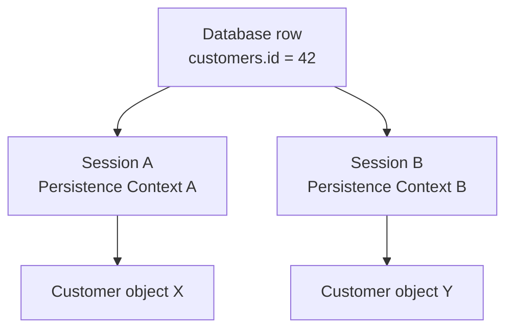
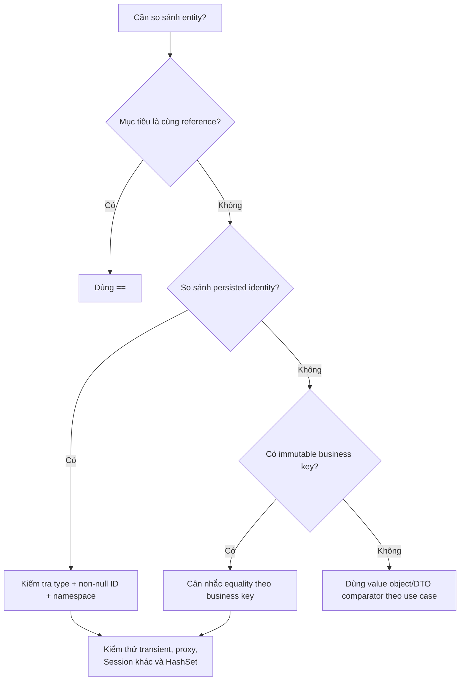

# So sánh các đối tượng thuộc nhiều Session khác nhau

Trong Hibernate ORM, hai biến Java có thể trỏ tới **hai object khác nhau** nhưng lại đại diện cho **cùng một hàng trong database**. Tình huống này xuất hiện thường xuyên khi mỗi request, transaction hoặc tác vụ nền sử dụng một `Session` riêng. Nếu dùng `==` hoặc triển khai `equals()/hashCode()` thiếu nhất quán, ứng dụng có thể gặp các lỗi khó nhận thấy: trùng phần tử trong `Set`, không tìm thấy object đã thêm vào collection, cập nhật nhầm một detached entity, hoặc hiểu sai một xung đột ghi đồng thời.

Muốn so sánh entity đúng, cần tách **ba loại danh tính**:

1. **Java reference identity:** hai biến có cùng trỏ đến đúng một object trong bộ nhớ hay không — dùng `==`.
2. **Hibernate persistence-context identity:** trong **một** `Session`, Hibernate bảo đảm quản lý nhất quán một entity instance theo khóa định danh của nó.
3. **Persistent/database identity:** hai entity có đại diện cho cùng bản ghi logic hay không — thường xét **loại entity và giá trị `@Id`**, đồng thời cần biết phạm vi database/tenant nếu ứng dụng có nhiều nguồn dữ liệu.

`equals()` là một hợp đồng **do lập trình viên định nghĩa** ở Java. Hibernate không tự thay thế phương thức này bằng phép so sánh primary key trên mọi entity.

Bài học giải thích sự khác nhau bằng ví dụ Java/Hibernate, trình bày các lựa chọn thiết kế equality, lưu ý về proxy/lazy loading, vòng đời đối tượng, cache và giao dịch, đồng thời đưa ra cách kiểm thử những tình huống liên quan nhiều Session.

## 1. Một hàng database, nhiều object Java

Giả sử bảng `customers` có dữ liệu:

| id | customer_code | name | version |
|---:|---|---|---:|
| 42 | `CUS-0042` | Nguyễn An | 3 |

Có hai request độc lập cùng đọc khách hàng có `id = 42`:

```java
Customer fromFirstSession;

try (Session session1 = sessionFactory.openSession()) {
    fromFirstSession = session1.find(Customer.class, 42L);
}

Customer fromSecondSession;

try (Session session2 = sessionFactory.openSession()) {
    fromSecondSession = session2.find(Customer.class, 42L);
}
```

Nếu hàng tồn tại và không có cơ chế đặc biệt làm thay đổi ví dụ, ta thường có:

```java
fromFirstSession == fromSecondSession
// false: hai Java object khác nhau.
```

Nhưng cả hai vẫn đại diện cho cùng một hàng `customers.id = 42`, trong cùng database và cùng tenant.

```text
Database
  customers: ID 42
         /          \
        /            \
Session 1           Session 2
Customer object A   Customer object B
   @id=42              @id=42
   Java ref A           Java ref B

A != B bằng ==
Cùng persistent identity nếu cùng entity type, DB/tenant và ID
```

**Đây không phải lỗi của Hibernate.** Nó phản ánh chính xác việc persistence context của hai Session là độc lập.

## 2. Vai trò của Session và first-level cache

Mỗi Hibernate `Session` thường gắn với một **persistence context** riêng. Persistence context quản lý các entity đang ở trạng thái `managed`. Hibernate duy trì identity map để các đường truy vấn khác nhau tới cùng entity identifier trong **cùng persistence context** quy về một managed instance.

Ví dụ:

```java
try (Session session = sessionFactory.openSession()) {
    Customer a = session.find(Customer.class, 42L);
    Customer b = session.find(Customer.class, 42L);

    System.out.println(a == b); // true, nếu hàng tồn tại
}
```

Không phải mỗi lần gọi `find` đều tạo một object mới. Sau khi entity được quản lý, Hibernate có thể trả lại cùng instance từ first-level cache.

Một HQL query cũng có thể trả chính managed instance:

```java
try (Session session = sessionFactory.openSession()) {
    Customer byId = session.find(Customer.class, 42L);

    Customer byCode = session.createSelectionQuery("""
            select c
            from Customer c
            where c.customerCode = :code
            """, Customer.class)
        .setParameter("code", "CUS-0042")
        .getSingleResult();

    System.out.println(byId == byCode); // true nếu cùng một hàng
}
```

Hibernate có thể thực thi SQL cho HQL, nhưng kết quả entity được giải quyết qua persistence context. Khi một instance có cùng entity key đã được quản lý, Hibernate không cần tạo một object managed thứ hai cho cùng entity identity.

### Ranh giới của bảo đảm này

Bảo đảm “một entity identity tương ứng một managed instance” áp dụng **trong một persistence context**, không xuyên mọi Session.



Không có một “first-level cache toàn cục” buộc Session A và Session B phải trả cùng một Java reference. `SessionFactory` là hạ tầng dùng chung, nhưng **không phải một persistence context dùng chung cho các giao dịch**.

### Session và transaction không đồng nghĩa

`Session` là ngữ cảnh quản lý entity; transaction là ranh giới commit/rollback của các thao tác dữ liệu. Nhiều ứng dụng sử dụng một Session gắn với một transaction, nhưng hai khái niệm không hoàn toàn trùng nhau. Với Spring `@Transactional`, persistence context thường được framework quản lý theo phạm vi giao dịch và cấu hình. Vì vậy, câu nói “cùng request sẽ nhận cùng object” chỉ đáng tin khi biết **có thật sự cùng persistence context** hay không.

## 3. Ba phép so sánh cần phân biệt

Xét hai object:

```java
Customer a = ...; // đọc từ Session 1
Customer b = ...; // đọc từ Session 2
```

Ba phép kiểm tra trả lời ba câu hỏi khác nhau:

| Phép kiểm tra | Câu hỏi | Bảo đảm gì? |
|---|---|---|
| `a == b` | Có phải cùng một object Java? | Reference identity |
| `a.equals(b)` | Hai object “bằng nhau” theo hợp đồng của class? | Tùy implementation `equals` |
| `a.getId().equals(b.getId())` | Có cùng giá trị primary key? | Chỉ so sánh ID, chưa xét type/database/tenant |

Nếu entity không override `equals()`, class kế thừa `Object.equals()`, mà mặc định tương đương reference identity. Khi đó:

```java
a == b        // false
a.equals(b)   // false nếu không override equals()
```

Dù cả hai cùng `id = 42`, mặc định Java không tự biết rằng chúng đại diện cùng database row.

Ngược lại, nếu entity có `equals` so sánh ID hợp lệ thì:

```java
a == b        // false
a.equals(b)   // có thể true
```

**Không có một kết quả `equals` chung cho mọi Hibernate entity.** Câu trả lời phụ thuộc thiết kế của class, trạng thái entity và cách xử lý proxy/inheritance.

## 4. Một entity mẫu có định danh kỹ thuật và khóa nghiệp vụ

Hãy dùng entity sau làm nền:

```java
package com.example.crm;

import jakarta.persistence.*;

@Entity
@Table(
    name = "customers",
    uniqueConstraints = @UniqueConstraint(
        name = "uk_customer_code",
        columnNames = "customer_code"
    )
)
public class Customer {

    @Id
    @GeneratedValue(strategy = GenerationType.IDENTITY)
    private Long id;

    @Column(name = "customer_code", nullable = false,
            updatable = false, length = 32)
    private String customerCode;

    @Column(name = "name", nullable = false, length = 150)
    private String name;

    @Version
    private long version;

    protected Customer() {}

    public Customer(String customerCode, String name) {
        this.customerCode =
            java.util.Objects.requireNonNull(customerCode);
        this.name = java.util.Objects.requireNonNull(name);
    }

    public Long getId() { return id; }
    public String getCustomerCode() { return customerCode; }
    public String getName() { return name; }

    public void rename(String newName) {
        this.name = java.util.Objects.requireNonNull(newName);
    }
}
```

Bảng tương ứng có thể được hình dung:

```sql
create table customers (
    id bigint generated by default as identity primary key,
    customer_code varchar(32) not null,
    name varchar(150) not null,
    version bigint not null,
    constraint uk_customer_code unique (customer_code)
);
```

DDL chỉ là minh họa; identity syntax và naming tùy DBMS/dialect. Trong ví dụ:

- `id` là primary key do database sinh.
- `customerCode` là mã nghiệp vụ được đặt unique trong schema.
- `name` là thuộc tính có thể thay đổi.
- `version` hỗ trợ optimistic locking khi hai giao dịch cập nhật cùng một hàng.

Ta sẽ cân nhắc cách định nghĩa equality dựa trên `id` hoặc khóa nghiệp vụ; mỗi cách có trade-off riêng.

## 5. Trạng thái entity ảnh hưởng tới so sánh

Hibernate thường phân biệt các trạng thái:

| Trạng thái | Ý nghĩa | Đặc điểm về identity |
|---|---|---|
| **Transient/new** | Object mới tạo bằng `new`, chưa được quản lý/persist | ID sinh bởi DB có thể còn `null` |
| **Managed/persistent** | Object thuộc persistence context của Session đang mở | Có identity map bảo đảm một managed instance cho entity key |
| **Detached** | Object từng được managed nhưng đã rời persistence context | Mang dữ liệu và thường có ID, nhưng không còn tự dirty-check/flush |
| **Removed** | Entity được đánh dấu xóa trong persistence context | Vẫn cần hiểu lifecycle/flush trước khi dùng nó |

Ví dụ:

```java
Customer customer = new Customer("CUS-0042", "Nguyễn An");
// Transient: chưa thuộc Session nào.

try (Session session = sessionFactory.openSession()) {
    Transaction tx = session.beginTransaction();
    session.persist(customer);
    // Managed trong Session này.
    tx.commit();
}
// Sau close(): customer trở thành detached.
```

Trạng thái **transient → managed → detached** không tự làm biến Java đổi reference:

```java
Customer sameReference = customer;
System.out.println(customer == sameReference); // true
```

Nhưng việc Hibernate còn theo dõi và tự đồng bộ thay đổi hay không **đã thay đổi**.

### Có ID chưa chắc đang managed

```java
Customer detached = ...; // Có id 42 nhưng Session đã đóng.
```

`detached.getId() != null` không có nghĩa `detached` đang managed. Muốn kiểm tra trong Session hiện tại:

```java
boolean managed = session.contains(detached);
```

`session.contains(detached)` kiểm tra **chính object instance đó** có thuộc persistence context hay không, không đơn giản kiểm tra database có hàng cùng ID.

Một detached object và managed object có thể cùng ID nhưng:

```java
session.contains(detached) // false
session.contains(managed)  // true
```

Đây là khác biệt cốt lõi khi so sánh entity giữa nhiều Session.

## 6. Ví dụ hai Session cùng đọc một hàng

Giả sử database đã có Customer ID 42.

```java
Customer first;
Customer second;

try (Session s1 = sessionFactory.openSession()) {
    first = s1.find(Customer.class, 42L);
}

try (Session s2 = sessionFactory.openSession()) {
    second = s2.find(Customer.class, 42L);
}

if (first == null || second == null) {
    throw new IllegalStateException("Thiếu dữ liệu test");
}

System.out.println(first == second);            // false
System.out.println(first.getId());              // 42
System.out.println(second.getId());             // 42
System.out.println(
    first.getId().equals(second.getId())
);                                             // true
```

Không có bước nào buộc hai Session phải chia sẻ object Java. Chúng chỉ chia sẻ **dữ liệu lưu trữ**.

Kết quả `first.equals(second)` chưa thể khẳng định nếu chưa biết code `equals`. Nếu không override, nó sẽ là `false` vì hai reference khác nhau.

### Khi hai Session tồn tại đồng thời

```java
try (
    Session s1 = sessionFactory.openSession();
    Session s2 = sessionFactory.openSession()
) {
    Customer first = s1.find(Customer.class, 42L);
    Customer second = s2.find(Customer.class, 42L);

    // Hai persistence context độc lập dù cùng SessionFactory.
}
```

Việc chúng mở cùng lúc hay nối tiếp không thay đổi nguyên tắc identity map theo Session. Tuy nhiên, nếu mỗi Session còn thực hiện UPDATE, sẽ xuất hiện các vấn đề **staleness, transaction isolation và concurrency**, được phân tích ở phần sau.

## 7. Không nên dùng `==` làm phép so sánh entity xuyên Session

`==` phù hợp khi bạn thực sự muốn kiểm tra **cùng một object Java**.

Ví dụ:

```java
Customer a = session.find(Customer.class, 42L);
Customer b = session.find(Customer.class, 42L);

assert a == b; // Trong cùng Session và cùng entity key.
```

Nhưng nếu biến được chuyển qua các request hoặc trả về từ repository khác nhau, phép so sánh reference có thể trả `false` dù persistent identity giống nhau.

Một lỗi thường thấy:

```java
boolean isOwner(Customer candidate, Customer owner) {
    return candidate == owner; // Sai nếu ý nghĩa là cùng row.
}
```

Nếu `candidate` và `owner` được load từ hai Session, kết quả có thể sai dù cùng ID. Nhưng thay bằng `candidate.equals(owner)` cũng chỉ đúng khi class đã có equality contract phù hợp.

Với logic kiểm tra quyền, không chỉ so sánh ID mà còn phải xác nhận tenant/authorization context phù hợp. So sánh entity identity **không tự thay thế kiểm soát truy cập**.

## 8. Có thể so sánh theo primary key không?

Khi muốn biết hai object đại diện cho cùng persisted entity, việc so sánh ID thường là điểm bắt đầu:

```java
boolean sameId =
    java.util.Objects.equals(a.getId(), b.getId());
```

Nhưng code này có hai vấn đề:

1. **Hai transient entities chưa có ID** thường đều trả `null`, khiến `Objects.equals(null, null)` trả `true` dù chúng là hai object hoàn toàn khác nhau.
2. **ID có thể trùng ở hai entity type hoặc hai database/tenant**. Ví dụ `Customer#42` và `Invoice#42` không phải cùng entity; `Customer#42` ở tenant A và tenant B có thể là hai khách hàng khác nhau.

Vì vậy, một phép so sánh persisted identity thường cần:

```text
Cùng persistence namespace (database/tenant phù hợp)
+ Cùng loại entity trong hệ phân cấp mapping
+ ID không null
+ Giá trị ID bằng nhau
```

Trong nhiều domain, các điều kiện namespace/type được đảm bảo sẵn vì hai tham số method đều là `Customer` trong cùng một persistence unit và cùng tenant. Khi đó so sánh ID không null là cách đơn giản, rõ ràng.

Ví dụ utility giới hạn chỉ cho `Customer`:

```java
public static boolean sameStoredCustomer(Customer a, Customer b) {
    if (a == b) {
        return true;
    }
    if (a == null || b == null) {
        return false;
    }

    Long aId = a.getId();
    Long bId = b.getId();

    return aId != null && aId.equals(bId);
}
```

Utility này giả định **hai object cùng thuộc database/tenant và cùng entity type đã xác định**. Nếu không biết nguồn dữ liệu, cần bổ sung namespace vào contract, không thể dựa hoàn toàn vào hai số ID.

### Vì sao kiểm tra `a == b` trước?

Nếu hai biến trỏ cùng một transient object, chúng vẫn là **cùng object Java**, dù ID chưa được sinh. Một số domain muốn coi trường hợp đó là bằng nhau. Nếu hai transient object khác nhau đều có ID null, utility không coi chúng là cùng persisted identity.

Đây là một cách thiết kế chấp nhận được, nhưng cần xác định rõ mục tiêu của method: **same Java instance**, **same persisted entity** hay **same business key**. Đừng dùng một tên method “isSame” quá mơ hồ.

## 9. `equals()` và `hashCode()` là hợp đồng Java

Theo Java, `equals()` nên có các thuộc tính:

- **Reflexive:** `x.equals(x)` là true.
- **Symmetric:** nếu `x.equals(y)` thì `y.equals(x)`.
- **Transitive:** nếu x bằng y và y bằng z thì x bằng z.
- **Consistent:** khi không thay đổi các giá trị tham gia so sánh, nhiều lần gọi có kết quả như nhau.
- `x.equals(null)` là false.

Nếu override `equals()`, phải override `hashCode()` nhất quán:

```java
a.equals(b) == true
    => a.hashCode() == b.hashCode()
```

Chiều ngược lại không bắt buộc: hai object khác nhau có thể trùng hash code.

**Hibernate không tự override `equals()/hashCode()` cho entity bạn viết.** Việc chọn field nào tham gia equality là quyết định của domain model, ảnh hưởng cả khi entity chưa được lưu và khi đang ở trạng thái detached.

## 10. Cách tiếp cận thứ nhất: equality dựa trên khóa nghiệp vụ bất biến

Nếu entity có một **natural key** duy nhất, được gán ngay khi tạo và không bao giờ đổi, có thể dùng key ấy cho `equals()/hashCode()`.

Ví dụ một danh mục sản phẩm theo mã SKU bất biến:

```java
import jakarta.persistence.*;
import org.hibernate.annotations.NaturalId;
import java.util.Objects;

@Entity
@Table(name = "products")
public class Product {

    @Id
    @GeneratedValue(strategy = GenerationType.IDENTITY)
    private Long id;

    @NaturalId
    @Column(name = "sku", nullable = false,
            updatable = false, length = 64)
    private String sku;

    @Column(nullable = false)
    private String name;

    protected Product() {}

    public Product(String sku, String name) {
        this.sku = Objects.requireNonNull(sku);
        this.name = Objects.requireNonNull(name);
    }

    public Long getId() { return id; }
    public String getSku() { return sku; }

    @Override
    public boolean equals(Object other) {
        if (this == other) {
            return true;
        }
        if (!(other instanceof Product that)) {
            return false;
        }
        return Objects.equals(this.getSku(), that.getSku());
    }

    @Override
    public int hashCode() {
        return Objects.hashCode(getSku());
    }
}
```

Đây là mẫu minh họa cho **entity không có hierarchy subtype có semantics equality khác**. Contract của class phải bảo đảm `sku` **không null** với mọi object tham gia collection/equality và **không được đổi** sau khi object được tạo.

Tính hữu ích:

- Hai `Product` từ hai Session cùng SKU có thể bằng nhau.
- ID chưa được database sinh không ảnh hưởng equality.
- Hash code ổn định khi persist/flush/commit.
- Phù hợp với `HashSet` hoặc `HashMap` nếu SKU không đổi.

### Các điều kiện bắt buộc

**Duy nhất ở phạm vi domain.** Nếu SKU chỉ duy nhất trong mỗi cửa hàng, chỉ dùng `sku` sẽ khiến hai sản phẩm khác cửa hàng bị coi là bằng nhau. Khi ấy business key phải gồm cả `storeCode` và `sku`.

**Bất biến thật sự.** Chỉ `@Column(updatable = false)` không bảo đảm field Java không thể bị sửa qua reflection/method khác. Cần thiết kế domain API và schema/migration phù hợp.

**Chuẩn hóa thống nhất.** Nếu nghiệp vụ coi `abc` và `ABC` là một SKU, cần chuẩn hóa trước khi tạo object và bảo đảm uniqueness tương ứng trong DB. `String.equals` phân biệt chữ hoa/thường; Hibernate không tự chuẩn hóa.

**Không dùng property lazy hoặc collection làm key.** Đọc field lazy trong `equals` có thể kích hoạt SQL hoặc `LazyInitializationException` nếu entity detached. Association mutable có thể dẫn đến recursion hoặc hash code không ổn định.

### Khóa nghiệp vụ có thể đổi thì sao?

Email, username và số điện thoại thường có thể đổi. Nếu dùng một trong những field mutable ấy trong `hashCode` rồi đặt object trong `HashSet`, thay đổi sau đó có thể khiến lookup không tìm thấy chính object ban đầu.

Vì vậy, **business key chỉ là ứng viên tốt cho equality khi nó thực sự immutable trong vòng đời mà collection và domain sử dụng**.

## 11. Cách tiếp cận thứ hai: equality dựa trên `@Id` đã được sinh

Một lựa chọn phổ biến là so sánh **primary key không null**, vì DB identity là điều bất biến sau khi entity đã được persist.

Ví dụ một class `Customer` không dùng hierarchy inheritance:

```java
@Entity
@Table(name = "customers")
public class Customer {

    @Id
    @GeneratedValue(strategy = GenerationType.IDENTITY)
    private Long id;

    @Column(nullable = false)
    private String name;

    protected Customer() {}

    public Long getId() { return id; }

    @Override
    public boolean equals(Object other) {
        if (this == other) {
            return true;
        }
        if (!(other instanceof Customer that)) {
            return false;
        }

        // Hai transient entities khác nhau không bằng nhau
        // chỉ vì cả hai chưa có ID.
        return this.getId() != null
            && this.getId().equals(that.getId());
    }

    @Override
    public int hashCode() {
        // Không dùng id.hashCode(): ID sẽ đổi từ null → giá trị.
        return Customer.class.hashCode();
    }
}
```

Tại sao `hashCode()` trả một hằng gắn với class?

Giả sử dùng `id.hashCode()`:

```java
Customer customer = new Customer(...);
Set<Customer> customers = new HashSet<>();

customers.add(customer); // ID đang null.

session.persist(customer); // ID có thể được sinh sau đó.

// Hash code có thể đã thay đổi!
customers.contains(customer); // Có thể false.
```

`HashSet` dựa vào bucket được chọn từ hash code **tại thời điểm thêm vào**. Nếu hash code thay đổi trong khi object đang nằm trong set, collection có thể hoạt động sai.

Với hash code hằng theo class:

- Hai transient object khác nhau có thể cùng hash code nhưng `equals` vẫn false: hợp lệ.
- Sau persist, `equals` có thể nhận diện hai bản sao cùng ID.
- Hash code của object không đổi chỉ vì ID chuyển từ null sang giá trị.

Đánh đổi là nhiều object cùng class có cùng hash code, có thể giảm hiệu năng hash collection lớn. Với nhiều business workloads, điều quan trọng là correctness và tính ổn định; nếu cần chứa số lượng cực lớn trong hash collections, hãy đo và cân nhắc một thiết kế khác.

### Không xem đây là “công thức đúng tuyệt đối”

Đoạn code dùng `instanceof Customer` phù hợp khi `Customer` là một entity type không có subclass với identity semantics riêng. Trong một hierarchy thực thể, `instanceof` có thể coi hai subtype khác nhau là bằng nhau chỉ vì ID trùng, trong khi identity của chúng khác. Ngược lại, dùng `getClass()` trực tiếp có thể gây vấn đề với **Hibernate proxy**, vốn có thể là subclass được runtime tạo ra.

Vì vậy, với entity inheritance hoặc proxy mapping phức tạp, cần một chiến lược xác định **effective entity type** nhất quán. Nên giới hạn ví dụ equality vào class/hierarchy có contract đã thiết kế thay vì copy máy móc sang mọi entity.

## 12. Proxy ảnh hưởng phép so sánh như thế nào?

Hibernate có thể dùng proxy để biểu diễn association lazy hoặc reference tới entity chưa được khởi tạo đầy đủ.

Ví dụ:

```java
Customer ref = session.getReference(Customer.class, 42L);
Customer loaded = session.find(Customer.class, 42L);
```

`getReference` có thể cung cấp reference dựa trên ID mà chưa SELECT toàn bộ row ngay lúc gọi. Proxy runtime có thể là một subclass hoặc được hiện thực qua bytecode enhancement tùy phiên bản/cấu hình.

### Vấn đề của `getClass()`

Một implementation:

```java
@Override
public boolean equals(Object other) {
    if (other == null || getClass() != other.getClass()) {
        return false;
    }
    // So sánh ID...
}
```

có thể đánh giá một entity class và proxy subclass của chính entity đó là **hai class khác nhau** dù chúng đại diện cùng một hàng.

### Vấn đề của `instanceof`

`instanceof` thường tương thích hơn với subclass-based proxies:

```java
other instanceof Customer
```

nhưng nếu bạn có hierarchy `PremiumCustomer extends Customer` và định danh của hai subtype cần phân biệt, `instanceof Customer` không tự giải quyết bài toán “cùng type” một cách hoàn chỉnh.

### Cách tiếp cận cho hierarchy cần strict type equality

Hibernate có API để lấy thông tin proxy/entity type; ví dụ interface `org.hibernate.proxy.HibernateProxy` cho phép xem thông tin lazy initializer.

```java
import org.hibernate.proxy.HibernateProxy;

static Class<?> effectivePersistentClass(Object entity) {
    if (entity instanceof HibernateProxy proxy) {
        return proxy.getHibernateLazyInitializer()
            .getPersistentClass();
    }
    return entity.getClass();
}
```

Đây là **gợi ý triển khai cho cơ chế subclass proxy của Hibernate**, không phải một API portable của Jakarta Persistence và không tự bao phủ mọi kiểu enhancement/inheritance mapping. Cần xác minh rằng metadata entity class nhận được tương ứng với concrete subtype mong muốn trong hierarchy của dự án.

Hơn nữa, một số cách gọi `Hibernate.getClass(entity)` có thể dẫn đến khởi tạo proxy hoặc có side effect truy cập database theo phiên bản/API. Vì vậy, **không nên vô thức gọi nó trong `equals/hashCode` của mọi entity** nếu chưa kiểm tra hành vi thực.

### Phép so sánh nên hạn chế việc truy cập field lazy

Có thể cần lấy ID từ proxy mà không initialize toàn bộ object, tùy access strategy và provider:

```java
Long id = customer.getId();
```

Nhưng một `equals` đọc `name`, `address` hoặc collection lazy có thể phát sinh SELECT, thậm chí ném `LazyInitializationException` nếu object đã detached.

Nguyên tắc: **equality phải dựa trên thông tin định danh ổn định, không đòi tải toàn bộ graph**.

## 13. Proxy khác Java object copy

Hai tình huống cần tách:

**Tình huống A: cùng một Session, cùng entity key.** Hibernate có identity map và cơ chế proxy resolution để duy trì identity của managed entity. Các cách tải khác nhau thường quy về cùng managed instance hoặc proxy đại diện theo cơ chế phiên bản.

**Tình huống B: hai Session khác nhau.** Session A có proxy của Customer#42; Session B có fully initialized Customer#42. Java reference khác nhau, nhưng persisted identity vẫn có thể giống nhau.

```text
Session A                       Session B
Customer proxy #42             Customer entity #42
      |                                |
      +----------- Database row -------+
                  customers.id=42
```

Nếu `equals` phụ thuộc vào concrete runtime class hoặc đọc lazy state, so sánh giữa hai object có thể khác mong đợi.

### Một ví dụ minh họa có chủ đích

```java
Customer fromA;
Customer fromB;

try (Session a = sessionFactory.openSession()) {
    fromA = a.getReference(Customer.class, 42L);
}

try (Session b = sessionFactory.openSession()) {
    fromB = b.find(Customer.class, 42L);
}

// Không mặc định kỳ vọng fromA == fromB.
// equals/hashCode phải được thiết kế để xử lý proxy,
// hoặc so sánh persistent identity bằng utility rõ contract.
```

Trong ví dụ, sau khi Session A đóng, proxy `fromA` có thể chưa được initialized. Truy cập một thuộc tính lazy của nó có thể gây lỗi. Test cụ thể phải được thiết kế có chủ đích và chạy trên Hibernate version đang dùng.

## 14. Detached entity và `merge()`: vì sao “gộp” không giữ cùng reference?

Một lỗi hiểu sai rất phổ biến là nghĩ rằng:

```java
session.merge(detached);
```

sẽ biến chính object `detached` thành managed. Thực tế, với Hibernate/JPA, `merge` **sao chép state từ detached object vào managed instance tương ứng** (hoặc tạo managed instance phù hợp nếu cần) và **trả về managed instance**. Object truyền vào **vẫn detached**.

Ví dụ:

```java
Customer detached;

try (Session first = sessionFactory.openSession()) {
    detached = first.find(Customer.class, 42L);
}

detached.rename("Nguyễn An mới");

try (Session second = sessionFactory.openSession()) {
    Transaction tx = second.beginTransaction();

    try {
        Customer managed = second.merge(detached);

        System.out.println(managed == detached);
        // Thông thường false: hai Java instances khác nhau.

        System.out.println(second.contains(managed));
        // true

        System.out.println(second.contains(detached));
        // false

        tx.commit();
    } catch (RuntimeException ex) {
        if (tx.isActive()) {
            tx.rollback();
        }
        throw ex;
    }
}
```

Điểm quan trọng:

- `merge` không phải “gắn lại reference detached bằng phép màu”.
- Dùng **giá trị trả về** từ `merge` nếu cần tiếp tục thao tác entity managed.
- Nếu trong Session thứ hai đã có Customer#42 managed, Hibernate có thể sao chép state của detached object vào **managed instance hiện có**.
- Cascade merge có thể tác động tới association theo mapping, cần tránh ghi đè state ngoài ý muốn từ graph cũ.
- Khi session đóng, managed instance trả về cũng trở thành detached.
- Với `@Version`, cập nhật state cũ có thể phát sinh optimistic locking conflict.

### So sánh trước và sau merge

```java
Customer managed = session.merge(detached);

boolean sameRef = managed == detached; // Thường false.
boolean sameId = java.util.Objects.equals(
    managed.getId(), detached.getId()
); // Thường true nếu cùng persisted entity.
```

`sameRef == false` không có nghĩa merge thất bại. Nó chỉ phản ánh managed object mới thuộc persistence context của Session thứ hai.

## 15. `merge` không giống `persist`, `update` hay `lock`

Các thao tác lifecycle có những mục đích khác nhau:

| Thao tác | Mục tiêu | Tác động tới object truyền vào |
|---|---|---|
| `persist(newEntity)` | Đưa entity mới vào persistence context để INSERT | Entity đó trở thành managed |
| `merge(detached)` | Sao chép state vào managed instance cùng identity | Detached input không tự chuyển thành managed; trả managed result |
| `remove(managed)` | Đánh dấu entity managed cần DELETE | Entity chuyển sang removed state |
| `session.contains(entity)` | Kiểm tra object instance có managed trong Session | Chỉ kiểm tra, không thay state |
| `detach(entity)` / `evict(entity)` | Loại entity khỏi persistence context | Object mất managed state |
| `clear()` | Detach tất cả managed entities trong Session | Identity map bị làm trống |

Hibernate native có các API reattachment khác trong một số phiên bản, như `Session.update`, nhưng availability và behavior thay đổi qua các phiên bản. Không nên mặc định `update` hoạt động như `merge`; nếu Session đã quản lý một instance có cùng ID, một thao tác reattachment kiểu update có thể dẫn đến xung đột instance như `NonUniqueObjectException`. Với JPA-centric code, `merge` có contract rõ ràng hơn cho việc sao chép detached state.

### Khi Session đang có instance cùng ID

```java
Customer managed = session.find(Customer.class, 42L);
Customer detached = obtainDetachedCustomer42();

Customer result = session.merge(detached);

// result có thể chính là managed instance đã tồn tại.
// detached vẫn không trở thành cùng reference với managed.
```

Nếu `detached` chứa `name` cũ, merge có thể **ghi đè** thay đổi mới hơn trên managed instance, tùy state/version/timing. Vì vậy đừng xem merge như một cơ chế “hợp nhất có giải quyết xung đột thông minh”. Nó thực hiện state copying theo mapping và lifecycle; business conflict resolution phải được thiết kế riêng.

## 16. Khi nào nên tránh đưa detached entity qua nhiều tầng?

Nhiều hệ thống dùng mô hình:

```text
Request A:
  Session A → load Entity → close Session → serialize Entity

Request B:
  deserialize Entity → Session B.merge(entity) → commit
```

Cách này dễ tạo ra:

- Detached graph có association không đầy đủ.
- Lazy-loading lỗi khi serialize.
- Over-posting: client gửi field không được phép sửa.
- Stale state ghi đè thay đổi vừa được transaction khác thực hiện.
- Nhầm lẫn giữa entity identity và object equality.
- Merge cascade ngoài ý muốn vào các child chưa được quản lý.

Một hướng an toàn hơn cho nhiều use case là dùng DTO chứa **ID và những field được phép sửa**:

```java
public record RenameCustomerRequest(
    Long customerId,
    String newName
) {}
```

Trong transaction service:

```java
@Transactional
public void renameCustomer(RenameCustomerRequest request) {
    Customer customer = entityManager.find(
        Customer.class,
        request.customerId()
    );

    if (customer == null) {
        throw new IllegalArgumentException("Customer không tồn tại");
    }

    customer.rename(request.newName());
    // Dirty checking flush khi transaction hoàn tất.
}
```

Ví dụ giả định Spring/JPA transaction integration và `EntityManager` được inject. Entity managed được tải trong transaction mới, thay đổi có kiểm soát, và không cần ghép một detached object nguyên vẹn từ client.

Điều này không có nghĩa `merge` luôn sai. Nó hữu ích trong những quy trình thực sự cần merge detached graph, nhưng cần biết rõ ý nghĩa và phạm vi state được copy.

## 17. Hai Session cùng có ID nhưng state có thể khác

`same persisted identity` **không đồng nghĩa** `same current values`.

Giả sử:

```text
Tại t0:
Customer#42 name="An", version=3
```

Session A tải entity:

```java
Customer a = sessionA.find(Customer.class, 42L);
// a.name = "An", a.version = 3
```

Session B tải entity tương tự rồi cập nhật và commit:

```java
Customer b = sessionB.find(Customer.class, 42L);
b.rename("An Nguyen");
sessionB.getTransaction().commit();
```

Session A có thể vẫn giữ:

```text
a.name = "An"
b.name = "An Nguyen"
```

Hai object vẫn cùng ID 42, nhưng field `name` khác do một Session đang giữ snapshot cũ.

### Identity và dữ liệu mới nhất là hai vấn đề độc lập

- `equals` dựa trên ID có thể trả `true`.
- `a.getName().equals(b.getName())` có thể là `false`.
- `a == b` vẫn là `false`.
- Nếu chưa refresh/clear/close và query lại, Session A thường không tự thay thế managed instance chỉ vì Session B commit.
- Transaction isolation và cache settings ảnh hưởng khả năng thấy dữ liệu mới từ database.

Đây là lý do không nên đưa mutable business fields như `name` hoặc `status` vào entity equality nếu ý nghĩa của equality là **cùng database row**.

## 18. Concurrency và `@Version`: cùng ID nhưng update xung đột

Hai Session độc lập có thể cập nhật cùng một hàng. Nếu không có cơ chế concurrency control, một giao dịch có thể ghi đè thay đổi của giao dịch kia.

Ví dụ entity có:

```java
@Version
private long version;
```

Một luồng ý tưởng:

```text
DB: Customer#42, version=3

Session A đọc version=3
Session B đọc version=3

Session A sửa name, UPDATE ... WHERE id=42 AND version=3
  → thành công, version=4

Session B sửa name, UPDATE ... WHERE id=42 AND version=3
  → không có hàng hợp lệ vì version đã là 4
  → optimistic locking conflict
```

SQL ý tưởng:

```sql
update customers
set name = ?, version = 4
where id = 42 and version = 3;
```

Hibernate/JPA có thể ném `OptimisticLockException`, `StaleObjectStateException` hoặc exception được wrapper bởi transaction/framework tùy runtime.

**So sánh ID không phát hiện stale state.** Hai entity cùng identity chỉ nói chúng đại diện một row; `@Version` giúp phát hiện state đã thay đổi từ lúc đọc trước khi UPDATE.

### Có nên merge và bỏ qua version không?

Không nên vô hiệu hóa concurrency checks chỉ để merge dữ liệu cũ thành công. Nếu domain cho phép “last write wins”, cần thiết kế điều đó có chủ đích; còn nếu cần tránh lost update, giữ version checking và trả phản hồi conflict cho người dùng.

### Một cảnh báo về timestamp

Không nên dùng `updatedAt` làm equality key hoặc surrogate cho locking nếu nó được phép đổi. Timestamp hữu ích để hiển thị/audit và đôi khi dùng cho concurrency strategy nhưng semantics có thể phụ thuộc precision/timezone/DBMS. Với Hibernate, `@Version` là cơ chế thường được ưu tiên cho optimistic locking.

## 19. First-level cache và second-level cache có cho cùng reference không?

Hibernate có nhiều tầng cache:

| Cơ chế | Phạm vi | Có chia sẻ cùng Java entity instance giữa các Session? |
|---|---|---|
| Persistence context / first-level cache | Một Session | Identity instance được giữ trong Session đó |
| Second-level entity cache | Thường theo SessionFactory/cache provider | Không biến nhiều Session thành một persistence context |
| Query cache | Cache thông tin kết quả truy vấn theo cấu hình | Không thay thế Session identity map |
| Natural-ID cache | Hỗ trợ resolve natural ID sang PK | Không đồng nghĩa cache một Java reference chung |

Nếu second-level cache bật, Session B có thể không cần SQL để lấy một entity đã có state trong cache. Nhưng Hibernate vẫn quản lý **instance riêng theo persistence context**. Cache thường chia sẻ dữ liệu/trạng thái, không chia sẻ một managed Java object duy nhất giữa mọi Session.

```text
       Second-level cache (có thể có)
                   |
            Entity state #42
              /          \
             /            \
      Session A          Session B
      Customer A         Customer B
```

Vì vậy, bật L2 cache **không làm `a == b` thành true** giữa hai Session độc lập.

### Cache và stale equality

Nếu equality dựa trên ID, hai object khác nhau do stale cached state vẫn có thể bằng nhau theo identity. Nếu equality dựa trên mutable fields, kết quả có thể khác giữa các Session chỉ vì một cache entry hoặc snapshot chưa cập nhật. Đây là một lý do mạnh để không gắn object equality vào mọi thuộc tính dữ liệu.

## 20. `HashSet` và những lỗi khó phát hiện

Một số người chỉ quan tâm `equals` vì dùng code:

```java
Set<Customer> customers = new HashSet<>();
customers.add(a);
customers.add(b);
```

Nếu `a` và `b` từ hai Session cùng row, số phần tử tùy equality contract:

- Mặc định `Object.equals`: có thể là **2** vì reference khác.
- Equality theo non-null ID: có thể là **1**.
- Equality theo immutable business key: có thể là **1** nếu key bằng nhau.
- Equality theo mutable `name`: kết quả không đáng tin và có thể sai nghiệp vụ.

### Sai lầm 1: `equals` theo ID nhưng `hashCode` theo name

```java
@Override
public boolean equals(Object other) {
    // So sánh ID.
}

@Override
public int hashCode() {
    return name.hashCode(); // Vi phạm contract nếu cùng ID, name khác.
}
```

Hai object cùng ID nhưng state khác nhau có thể bằng nhau theo `equals` và có hash khác nhau, vi phạm contract HashSet/HashMap.

### Sai lầm 2: ID null được coi là bằng nhau

```java
@Override
public boolean equals(Object other) {
    if (!(other instanceof Customer that)) {
        return false;
    }
    return Objects.equals(id, that.id);
}
```

Hai customer mới đều `id=null` sẽ bị coi bằng nhau. Nếu thêm cả hai vào `HashSet` trước `persist`, set có thể mất một object dù chúng là hai khách hàng khác nhau.

### Sai lầm 3: hashCode thay đổi sau khi persist

```java
@Override
public int hashCode() {
    return Objects.hashCode(id);
}
```

ID sinh ở database có thể chuyển từ null sang 42, làm hash code đổi trong khi object đang nằm trong `HashSet`. Ngay cả khi `equals` kiểm tra ID không null đúng, collection vẫn có thể gặp lỗi.

### Sai lầm 4: dùng mutable association

```java
@Override
public int hashCode() {
    return Objects.hash(customer, items);
}
```

Nếu `items` là collection lazy, thao tác hash có thể tải dữ liệu lớn, đệ quy vòng qua các quan hệ hai chiều hoặc thay đổi hash khi thêm/xóa item. Đây là lựa chọn rất nguy hiểm cho entity.

**Quy tắc:** Nếu định dùng entity làm key của `Map` hoặc phần tử `Set`, phải kiểm tra invariant của `equals/hashCode` xuyên các trạng thái transient, managed, detached, merged và proxied.

## 21. Lombok `@Data` trên entity có thể gây tác dụng phụ

Trong một số dự án, Lombok được dùng để sinh boilerplate:

```java
@Data
@Entity
public class Order {
    @OneToMany(mappedBy = "order")
    private List<OrderLine> lines;
}
```

`@Data` thường sinh `equals`, `hashCode` và `toString` dựa trên các field (trừ khi cấu hình khác). Với entity chứa lazy association hoặc graph hai chiều, code sinh tự động có thể:

- Truy cập collection lazy ngoài Session, gây `LazyInitializationException`.
- Tạo vòng lặp vô hạn trong `toString`/equality.
- So sánh mutable state không ổn định.
- Khiến `HashSet` hoặc `HashMap` hoạt động sai sau persist/update.
- Vô tình kéo theo nhiều SQL chỉ để log entity.

Nếu dùng Lombok, nên chỉ định rõ thành phần được đưa vào equals/hashCode hoặc tự viết hợp đồng equality có chủ đích. Không để toàn bộ entity fields tự động tham gia mà không kiểm tra vòng đời ORM.

## 22. Khóa chính ghép: định danh gồm nhiều thuộc tính

Không phải mọi entity có `Long id` đơn. Có entity dùng composite key, ví dụ mỗi sản phẩm chỉ duy nhất theo `tenantId` và `productCode`.

Một identifier class:

```java
import jakarta.persistence.Embeddable;
import java.io.Serializable;
import java.util.Objects;

@Embeddable
public class ProductKey implements Serializable {

    private String tenantId;
    private String productCode;

    protected ProductKey() {}

    public ProductKey(String tenantId, String productCode) {
        this.tenantId = Objects.requireNonNull(tenantId);
        this.productCode = Objects.requireNonNull(productCode);
    }

    public String getTenantId() { return tenantId; }
    public String getProductCode() { return productCode; }

    @Override
    public boolean equals(Object other) {
        if (this == other) {
            return true;
        }
        if (!(other instanceof ProductKey that)) {
            return false;
        }
        return tenantId.equals(that.tenantId)
            && productCode.equals(that.productCode);
    }

    @Override
    public int hashCode() {
        return Objects.hash(tenantId, productCode);
    }
}
```

Entity:

```java
@Entity
@Table(name = "products")
public class Product {

    @EmbeddedId
    private ProductKey id;

    @Column(nullable = false)
    private String name;

    protected Product() {}

    public Product(ProductKey id, String name) {
        this.id = java.util.Objects.requireNonNull(id);
        this.name = name;
    }

    public ProductKey getId() {
        return id;
    }
}
```

`ProductKey` phải có `equals/hashCode` nhất quán vì giá trị định danh ghép cần được dùng như một value object. **Các thành phần khóa không nên đổi trong vòng đời entity persisted**.

Khi so sánh hai `Product` từ các Session khác nhau, có thể so sánh `ProductKey` nếu cùng persistence namespace và cùng entity type:

```java
boolean sameId = a.getId().equals(b.getId());
```

Lưu ý: so sánh `EmbeddedId` là so sánh một **value object**; việc entity `equals` có dùng `EmbeddedId` làm căn cứ hay không vẫn là quyết định độc lập của class.

## 23. Multi-tenancy và nhiều database: ID bằng nhau chưa đủ

Giả sử hai tenant đều có row `customers.id = 42`:

```text
Tenant HCM:
  customers.id=42, customer_code="CUS-HCM-42"

Tenant HN:
  customers.id=42, customer_code="CUS-HN-42"
```

Nếu ứng dụng dùng schema-per-tenant hoặc database-per-tenant, `id = 42` chỉ duy nhất trong **phạm vi tenant**. Hai object này không phải cùng khách hàng.

Cần xác định namespace identity:

```text
Entity identity trong từng persistence scope
= (Entity type, Tenant/Database scope, Primary key)
```

Trong một Hibernate Session gắn tenant, context chứa thông tin tenant theo cấu hình multi-tenancy. Nhưng một utility `sameCustomerById(a, b)` chỉ nhận hai entity object có thể **không tự biết tenant mà mỗi object đến từ**.

Một DTO mang định danh toàn cục có thể thiết kế:

```java
public record CustomerRef(
    String tenantId,
    Long customerId
) {}
```

`record` tự có value equality theo hai thành phần. Khi truyền định danh qua service, message hay API, kiểu tham chiếu rõ namespace giúp tránh đồng nhất nhầm các hàng có cùng numeric ID.

Nếu nghiệp vụ có global UUID được cấp duy nhất trên mọi tenant, có thể dùng nó làm business reference xuyên tenant, nhưng vẫn phải xác định domain contract và bảo vệ quyền truy cập.

## 24. Entity type và hierarchy: cùng ID nhưng khác loại

Giả sử có `Invoice` ID 42 và `Customer` ID 42. Chúng là hai entity khác nhau:

```text
(Customer, 42) != (Invoice, 42)
```

Với inheritance hierarchy, một ID có thể cần được xem trong phạm vi root entity mapping hoặc concrete subtype tùy inheritance strategy. Vì vậy, equality implementation phải phù hợp mapping của hierarchy, proxy behavior và cách ORM định nghĩa entity key.

Một nguyên tắc an toàn: **không áp dụng method so sánh entity “mọi loại” bằng mỗi `getId()`**.

Ví dụ không nên viết helper chung:

```java
boolean sameEntity(Object a, Object b) {
    return getId(a).equals(getId(b));
}
```

Thiếu kiểm tra null, type, tenant và identifier extraction hợp lệ, helper này có thể gộp những entity không liên quan.

### Nên chọn equality ở đâu?

Có ba nơi có thể đặt phép so sánh:

1. **Trong entity `equals/hashCode`:** khi domain có contract ổn định và entity thường đi qua Set/Map.
2. **Trong một value object reference/ID:** ví dụ `CustomerRef(tenantId, customerId)`; thường phù hợp khi chuyển giữa service hoặc request.
3. **Trong service method có điều kiện rõ:** ví dụ `sameCustomerInCurrentTenant(a,b)`.

Không bắt buộc mọi entity phải override `equals()`. Nếu một application không dùng entity xuyên các collection đòi value equality, và chỉ thao tác trong một Session, reference equality mặc định có thể là lựa chọn đơn giản hơn. Điều quan trọng là hiểu hệ quả khi đưa object qua Session khác.

## 25. Truy vấn và so sánh entity không thay thế việc kiểm soát quyền

Giả sử request gửi `customerId = 42`. Code sau:

```java
Customer requested = session.find(Customer.class, 42L);

if (requested.equals(currentCustomer)) {
    // ...
}
```

chỉ có ý nghĩa sau khi xác định:

- `currentCustomer` được tải từ nguồn nào?
- Hai entity có cùng tenant/database không?
- Request có quyền xem hoặc sửa Customer#42 không?
- Equality contract có thực sự kiểm tra identity không?
- Một trong hai object có thể là transient/detached/proxy không?

Truy vấn bằng ID dễ bị sử dụng sai nếu ứng dụng bỏ qua tenant restriction hoặc authorization. Hai object cùng persistent identity không có nghĩa mọi người dùng đều được phép thao tác với nó. Equality phục vụ **mô hình danh tính**, không thay thế **security policy**.

## 26. So sánh entity với DTO hay record

Một DTO record thường có value semantics khác entity:

```java
public record CustomerView(
    Long id,
    String name
) {}
```

Hai record được coi bằng nhau nếu các component bằng nhau:

```java
CustomerView a = new CustomerView(42L, "Nguyễn An");
CustomerView b = new CustomerView(42L, "Nguyễn An");

System.out.println(a.equals(b)); // true
```

Nếu tên khác:

```java
CustomerView c = new CustomerView(42L, "Nguyễn An mới");

System.out.println(a.equals(c)); // false
```

Dù hai view cùng ID 42, record equality còn xét `name`. Đây là **value equality của snapshot DTO**, không phải persistent identity của entity.

Nếu muốn DTO chỉ biểu diễn định danh, dùng một record reference:

```java
public record CustomerId(Long value) {}
```

hoặc `CustomerRef` có tenant ID như phần trước. Như vậy, bạn có thể sử dụng value equality rõ ràng mà không cần tùy biến `equals()` của mọi entity.

### Vì sao nên chuyển sang DTO trước khi đóng Session?

DTO tránh việc serialize một entity chứa lazy proxies, collection chưa tải và managed state. Nó cũng giúp định nghĩa rõ contract dữ liệu gửi giữa request/service. Khi nhận DTO ở transaction mới, service tải entity managed theo ID và áp dụng thay đổi được phép.

## 27. Những API hữu ích khi xử lý nhiều Session

| API | Vai trò | Lưu ý |
|---|---|---|
| `session.find(Entity.class, id)` | Tải managed entity theo ID | Trả null nếu không tìm thấy; có thể dùng first-level cache |
| `session.getReference(Entity.class, id)` | Lấy reference/proxy theo ID | Có thể chưa SELECT; lỗi nếu entity không tồn tại có thể xuất hiện lúc dùng |
| `session.contains(entity)` | Kiểm tra chính object có managed trong Session | Không đồng nghĩa “DB có hàng cùng ID” |
| `session.persist(entity)` | Đưa entity mới vào managed state | Không dùng như merge detached graph |
| `session.merge(detached)` | Sao chép state vào managed instance | Dùng object trả về |
| `session.detach(entity)` / `session.evict(entity)` | Bỏ quản lý một entity | Không xóa hàng DB |
| `session.clear()` | Detach toàn bộ entities trong Session | Các tham chiếu Java bên ngoài vẫn tồn tại |
| `session.refresh(entity)` | Yêu cầu làm mới state managed từ DB theo contract | Cần entity managed và transaction/context phù hợp |
| `sessionFactory.getCache()` | Truy cập cơ chế cache cấp SessionFactory | Không biến nhiều Session thành cùng persistence context |

Các API cụ thể có thể khác chút theo Hibernate/Jakarta Persistence version. Bảng diễn đạt semantics chung trong trường hợp sử dụng phổ biến.

## 28. Kiểm thử trường hợp một Session và nhiều Session

Để hiểu rõ identity, nên dùng integration tests với database thật và Hibernate SessionFactory đang cấu hình.

### 28.1. Test cùng Session

```java
@Test
void sameSessionReturnsSameManagedInstance() {
    try (Session session = sessionFactory.openSession()) {
        Customer a = session.find(Customer.class, 42L);
        Customer b = session.find(Customer.class, 42L);

        assertNotNull(a);
        assertSame(a, b);
    }
}
```

`assertSame` kiểm tra Java reference, không gọi `equals`. Test này cho biết first-level cache và identity map hoạt động theo kỳ vọng.

### 28.2. Test hai Session độc lập

```java
@Test
void differentSessionsCanHoldDifferentInstancesOfSameRow() {
    Customer a;
    Customer b;

    try (Session first = sessionFactory.openSession()) {
        a = first.find(Customer.class, 42L);
    }

    try (Session second = sessionFactory.openSession()) {
        b = second.find(Customer.class, 42L);
    }

    assertNotNull(a);
    assertNotNull(b);
    assertNotSame(a, b);
    assertEquals(a.getId(), b.getId());
}
```

Test này **cố ý không assert `a.equals(b)`**, vì kết quả phải theo equality contract thực tế của entity.

### 28.3. Test hai transient entities

```java
@Test
void differentNewCustomersDoNotEqualByNullId() {
    Customer a = new Customer("CUS-A", "A");
    Customer b = new Customer("CUS-B", "B");

    assertNull(a.getId());
    assertNull(b.getId());

    // Khi dùng equality theo ID non-null:
    assertNotEquals(a, b);
}
```

Nếu entity không override `equals`, assertion cũng đúng vì khác reference. Nếu entity so sánh bằng immutable business key, nó đúng vì hai mã khác. Test quan trọng là **không coi null ID của hai object mới là bằng nhau**.

### 28.4. Test ổn định trong HashSet trước/sau persist

```java
@Test
void entityShouldRemainFindableInHashSetAfterPersist() {
    Customer customer = new Customer("CUS-NEW", "New");
    Set<Customer> set = new HashSet<>();

    set.add(customer);
    assertTrue(set.contains(customer));

    try (Session session = sessionFactory.openSession()) {
        Transaction tx = session.beginTransaction();
        session.persist(customer);
        tx.commit();
    }

    assertTrue(set.contains(customer));
}
```

Nếu `hashCode` dựa vào generated ID, test có thể phơi bày lỗi bucket. Đây là lý do cần thử vòng đời transient → managed → detached trong Java collections.

### 28.5. Test `merge` trả về managed instance khác

```java
@Test
void mergeReturnsManagedCopy() {
    Customer detached;

    try (Session first = sessionFactory.openSession()) {
        detached = first.find(Customer.class, 42L);
    }

    try (Session second = sessionFactory.openSession()) {
        Transaction tx = second.beginTransaction();

        Customer managed = second.merge(detached);

        assertTrue(second.contains(managed));
        assertFalse(second.contains(detached));
        assertNotSame(detached, managed);
        assertEquals(detached.getId(), managed.getId());

        tx.commit();
    }
}
```

Các snippet giả định JUnit 5 assertions/imports, dữ liệu Customer#42 được setup và test database được cô lập. Test không phải chạy trong STEP 4; đây chỉ là ví dụ giáo trình minh họa cách kiểm chứng.

### 28.6. Test proxy

Với một entity hỗ trợ lazy proxy:

```java
Customer proxy;
Customer loaded;

try (Session s1 = sessionFactory.openSession()) {
    proxy = s1.getReference(Customer.class, 42L);
}

try (Session s2 = sessionFactory.openSession()) {
    loaded = s2.find(Customer.class, 42L);
}

// Đảm bảo phép equality được chọn không buộc
// đọc lazy field của proxy đã detached.
```

Nếu `equals` dựa trên getter ID, hãy xác minh nó không gây truy cập DB ngoài ý muốn trong version Hibernate đang dùng. Nếu implementation dùng runtime class, test proxy càng cần thiết.

## 29. Kiểm thử optimistic locking với hai Session

Một test concurrency có thể thiết kế:

1. Mở Session A, bắt đầu transaction A, đọc Customer#42.
2. Mở Session B, bắt đầu transaction B, đọc Customer#42.
3. B sửa name và commit, khiến version tăng.
4. A sửa name theo state cũ rồi flush/commit.
5. Xác nhận transaction A nhận optimistic locking failure nếu versioned update được áp dụng đúng.
6. Rollback A, mở Session mới và xác nhận dữ liệu cuối cùng là thay đổi từ B.

Ví dụ khái niệm:

```java
Session a = sessionFactory.openSession();
Session b = sessionFactory.openSession();

Transaction txA = a.beginTransaction();
Transaction txB = b.beginTransaction();

try {
    Customer ca = a.find(Customer.class, 42L);
    Customer cb = b.find(Customer.class, 42L);

    cb.rename("Tên từ B");
    txB.commit();

    ca.rename("Tên từ A");
    // Với @Version, flush/commit A có thể báo conflict.
    txA.commit();
} finally {
    if (txA.isActive()) txA.rollback();
    if (txB.isActive()) txB.rollback();
    a.close();
    b.close();
}
```

Mức isolation/locking của database và test infrastructure có thể khiến các bước này cần sắp xếp lại để tránh lock wait hoặc deadlock. Trong integration test thật, nên dùng cơ chế transaction choreography/threads phù hợp, exception assertion rõ ràng và timeout có kiểm soát.

Bài học muốn nhấn mạnh: **cùng persistent identity không đồng nghĩa hai transaction có state hợp lệ đồng thời để ghi**. `@Version` giúp bảo vệ thay đổi theo phiên bản, không liên quan đến kết quả `==`.

## 30. Khi nào `refresh()` và `clear()` hữu ích?

Giả sử Session A đã tải Customer, sau đó Session B commit thay đổi. Session A đang giữ snapshot cũ:

```java
Customer a = sessionA.find(Customer.class, 42L);

// Session B update cùng row và commit...

sessionA.refresh(a);
```

`refresh` yêu cầu Hibernate làm mới state của managed object từ database theo contract và isolation hiện hành. Nếu transaction isolation giữ snapshot cũ, cần hiểu quy tắc hiển thị của DBMS; không đảm bảo mọi trường hợp refresh ở transaction đang chạy đều vượt qua isolation semantics.

Nếu muốn Hibernate không dùng managed instance cũ khi truy vấn lần sau:

```java
sessionA.clear();

Customer reloaded = sessionA.find(Customer.class, 42L);
```

`clear()` detach tất cả managed entities, rồi lần `find` sau có thể tạo managed instance mới. Bản `a` cũ vẫn tồn tại như một detached object; nó không biến mất khỏi Java heap chỉ vì Session đã clear.

`refresh` và `clear` là thao tác quản lý state, **không sửa hợp đồng `equals/hashCode`**. Nếu equality dựa trên mutable fields, refresh vẫn có thể làm giá trị tham gia equality thay đổi và gây vấn đề với hash collections.

## 31. Xử lý collection quan hệ giữa nhiều Session

Giả sử một `Order` có nhiều `OrderLine` và code làm:

```java
Set<OrderLine> lines = new HashSet<>();
lines.add(lineFromSessionA);
lines.add(lineFromSessionB);
```

Nếu hai line từ các Session khác nhau cùng database row, collection có thể chứa trùng theo reference mặc định. Điều này có thể biểu hiện thành:

- Hiển thị trùng item.
- Cố thêm một child trùng vào relationship.
- Không xóa được item khỏi Set khi dùng object detached được load lại.
- Hibernate phát hiện xung đột persistence identity khi cascade/flush.
- Unique constraint tại DB bị vi phạm.

Với association `Set`, Java equality contract ảnh hưởng trực tiếp cách collection nhận diện phần tử. Nhưng đổi entity `equals` không phải cách chữa mọi sai lệch relationship mapping: cần thiết kế owning side, cascade, orphan removal, unique constraints và thứ tự thao tác đúng.

### Một mẫu an toàn hơn khi xử lý ID từ nhiều request

Thay vì giữ các detached entity trong Set:

```java
Set<Long> selectedLineIds = new HashSet<>();
selectedLineIds.add(lineIdA);
selectedLineIds.add(lineIdB);
```

Sau đó trong transaction mới, tải những child cần thiết theo ID và xác minh tất cả đều thuộc đúng Order/tenant. Với dữ liệu có nhiều loại entity hoặc multi-tenancy, dùng kiểu reference gồm type/tenant/id.

Đây là cách giảm sự phụ thuộc vào entity equality khi trao đổi dữ liệu giữa các ranh giới giao dịch.

## 32. Tránh so sánh mọi field của entity

Một entity thường có:

- Dữ liệu thay đổi (`name`, `status`, `updatedAt`).
- Association lazy (`orders`, `address`).
- Version cho optimistic locking (`version`).
- ID do database sinh.
- Field dùng cho audit hoặc cache.

Nếu `equals` so sánh tất cả:

```java
return Objects.equals(id, other.id)
    && Objects.equals(name, other.name)
    && Objects.equals(version, other.version)
    && Objects.equals(orders, other.orders);
```

thì cùng một hàng DB có thể trở thành “không bằng nhau” chỉ vì hai Session đang giữ state khác nhau; hơn nữa, equality có thể kích hoạt load collection và đệ quy vô hạn ở graph hai chiều.

**Entity identity** không phải **deep object graph equality**. Nếu nghiệp vụ cần so sánh nội dung thay đổi, hãy tạo một snapshot/value object riêng hoặc một comparator chuyên biệt, có danh sách field rõ ràng.

Ví dụ:

```java
public record CustomerSnapshot(
    Long id, String name, long version
) {}
```

Hai `CustomerSnapshot` có thể được so sánh theo giá trị đầy đủ, giúp xác định nội dung khác nhau. Điều này khác với hỏi “hai entity có cùng ID không?”.

## 33. Phân biệt các mục tiêu so sánh trong code review

Khi thấy code:

```java
if (a.equals(b)) {
    // ...
}
```

cần xác định chính xác **ý định**:

| Ý định | Phương pháp thường phù hợp |
|---|---|
| Kiểm tra hai biến là cùng Java object | `a == b` |
| Kiểm tra cùng managed instance trong một Session | `a == b` kết hợp kiểm soát persistence context |
| Kiểm tra cùng persisted row trong cùng namespace | Entity type + non-null ID |
| Kiểm tra cùng mã nghiệp vụ bất biến | So sánh immutable natural/business key theo contract |
| Kiểm tra nội dung DTO bằng nhau | Record/value-object equality |
| Kiểm tra entity có đang thuộc Session | `session.contains(entity)` |
| Kiểm tra dữ liệu còn mới khi UPDATE | `@Version`/optimistic lock, không phải `equals` |
| Kiểm tra quyền truy cập | Authorization/tenant policy, không chỉ identity |
| Kiểm tra graph object đã thay đổi chỗ nào | Snapshot/comparator/diff chuyên biệt |

Một method có tên `sameCustomer` nên ghi rõ contract: cùng reference, cùng ID trong tenant hay cùng business code? Tên và kiểu tham số rõ sẽ giảm lỗi khi nhiều developer sử dụng.

## 34. Các lỗi thường gặp và cách khắc phục

### Lỗi 1: “Hai Session tải cùng ID nhưng `equals` trả false”

Nguyên nhân thường là entity giữ `Object.equals` mặc định. Nếu nghiệp vụ cần value-based persistent identity, xây dựng contract equality phù hợp hoặc so sánh ID/type ở service. Không xem việc khác reference là lỗi first-level cache.

### Lỗi 2: “Hai entity mới chưa persist bị coi bằng nhau”

Nguyên nhân có thể là `Objects.equals(id, other.id)` với cả hai ID null. Sửa bằng cách yêu cầu ID khác null khi so sánh persisted identity, hoặc dùng immutable business key duy nhất đã biết trước persist.

### Lỗi 3: “Không tìm thấy entity trong `HashSet` sau khi persist”

Nguyên nhân thường do hash code thay đổi khi ID được sinh. Tránh dùng generated ID trực tiếp trong `hashCode` khi object có thể được đưa vào hash-based collection trước persist.

### Lỗi 4: “Proxy và entity thật cùng ID nhưng `equals` sai”

Nguyên nhân có thể là `getClass()` so sánh runtime proxy subclass với entity class; hoặc `equals` đọc lazy fields. Cần chọn chiến lược proxy-aware, kiểm thử trên Hibernate version thực tế.

### Lỗi 5: “`merge` đã chạy nhưng object truyền vào vẫn detached”

Đây là hành vi đúng. Sử dụng entity mà `merge` trả về để thao tác managed state. Không mặc định input object đổi reference hoặc tự gia nhập persistence context.

### Lỗi 6: “Tải lại entity sau khi Session B commit mà Session A vẫn có tên cũ”

Persistence context A giữ managed snapshot cũ. Xác định transaction isolation, cache và quy trình refresh/clear/reopen Session phù hợp. ID equality không giải quyết độ mới dữ liệu.

### Lỗi 7: “`merge` của entity cũ ghi đè dữ liệu mới”

Cần quản lý optimistic locking và kiểm soát field được cập nhật. Ưu tiên DTO + load managed entity trong transaction mới nếu chỉ sửa một vài thuộc tính được phép.

### Lỗi 8: “Hai ID 42 ở hai tenant bị coi là một”

Chỉ so sánh ID mà bỏ namespace. Bổ sung tenant/database scope trong reference hoặc contract của service.

### Lỗi 9: “Lombok entity gây LazyInitializationException khi log”

`toString`/`equals/hashCode` sinh tự động có thể đọc association lazy. Cấu hình rõ field được tham gia hoặc tự viết method an toàn.

### Lỗi 10: “Session báo đã có object cùng ID”

Trong một Session, Hibernate không quản lý hai instance khác nhau của cùng entity key. Một thao tác reattachment không đúng, ví dụ kiểu `update` với object detached khi Session đã load một instance cùng ID, có thể gây conflict. Dùng `merge` khi muốn copy state, hoặc thao tác trên managed instance hiện có.

## 35. Quy trình chọn equality cho một entity mới

Một quy trình đơn giản nhưng hiệu quả:

**Bước 1 — Entity có được dùng làm phần tử `Set` hoặc key của `Map` không?** Nếu không, cân nhắc có thực sự cần override equality hay không.

**Bước 2 — Có một business key bất biến, duy nhất, gán ngay khi tạo không?** Nếu có, cân nhắc natural-key equality. Cần bảo đảm uniqueness/normalization toàn domain.

**Bước 3 — Nếu dùng generated primary key, lúc transient ID có null không?** Nếu có, `equals` cần tránh coi hai null ID là cùng persisted identity và `hashCode` cần giữ ổn định qua persist.

**Bước 4 — Entity có inheritance/proxy không?** Nếu có, thiết kế type equality tương thích proxy/hierarchy, không chỉ copy `getClass()==other.getClass()`.

**Bước 5 — Có multi-tenancy/nhiều DB không?** Nếu có, xác định namespace identity ở service/reference; đừng so sánh số ID trần xuyên scope.

**Bước 6 — Có dùng detached entity/merge trong API không?** Nếu có, kiểm thử detached-versus-managed equality, xử lý stale state, và nhớ merge trả managed instance khác.

**Bước 7 — Entity có lazy association/mutable collection không?** Tránh đưa chúng vào `equals/hashCode`.

**Bước 8 — Kiểm thử vòng đời.** Transient, managed trong một Session, detached từ nhiều Session, merge, proxy, HashSet, inheritance và concurrency.



## 36. Tổng kết: “cùng entity” có nhiều nghĩa

Xét hai object:

```java
Customer a = loadFromSessionA(42L);
Customer b = loadFromSessionB(42L);
```

Chúng có thể thỏa:

```text
a == b                           → false
a.getId().equals(b.getId())      → true
a.equals(b)                      → tùy contract equals()
a.getName().equals(b.getName())  → tùy state/cập nhật ở mỗi Session
```

Còn một managed instance trong cùng Session có thể thỏa:

```java
Customer x = session.find(Customer.class, 42L);
Customer y = session.find(Customer.class, 42L);

x == y // true, nếu row tồn tại.
```

Các nguyên tắc cần ghi nhớ:

1. **First-level cache gắn với từng Session**, nên bảo đảm cùng Java reference chỉ nằm trong persistence context tương ứng.
2. **Hai Session khác nhau có thể giữ hai Java object đại diện cùng database row.**
3. **`==` kiểm tra reference**, không kiểm tra persisted identity xuyên Session.
4. **`equals/hashCode` do domain thiết kế**, không mặc định so sánh ID; chúng phải nhất quán và ổn định, nhất là với `HashSet`.
5. **Generated ID thay đổi từ null sang giá trị**, nên cần xử lý trạng thái transient đúng.
6. **Proxy và inheritance làm việc xác định “cùng entity type” phức tạp hơn**; tránh equality đọc lazy fields.
7. **`merge` trả về managed instance; object detached truyền vào vẫn detached.**
8. **Cùng ID không có nghĩa cùng state mới nhất**; dùng transaction isolation, refresh và `@Version` khi cần xử lý concurrency.
9. **ID có phạm vi**: entity type, database và tenant; không so sánh hai số ID một cách mù quáng.
10. **DTO/reference value object thường tốt hơn để chuyển định danh qua các ranh giới request/service**, trong khi entity managed nên được thao tác trong transaction rõ ràng.

Trong Hibernate, hiểu được ranh giới giữa **danh tính Java, danh tính trong Session và danh tính lưu trữ** là nền tảng để so sánh entity chính xác. Một thiết kế tốt sẽ nói rõ “bằng nhau” nghĩa là gì ở mỗi use case, thay vì để `==`, `equals` và `@Id` vô tình bị xem là ba cách viết của cùng một phép so sánh.
