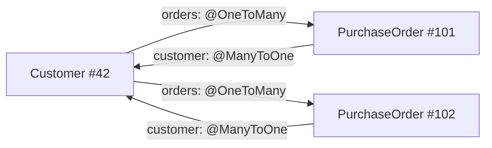

# Giới hạn của `equals`, `hashCode` hoặc `toString` được sinh tự động trên quan hệ trong Hibernate

Trong Java, IDE, Lombok và một số công cụ sinh mã có thể tạo `equals()`, `hashCode()` hoặc `toString()` chỉ bằng một thao tác hay vài annotation. Điều này thường tiện lợi với **DTO** hoặc **value object**. Nhưng với entity Hibernate/JPA, việc sinh tự động những phương thức đó dựa trên **mọi field**, nhất là các field quan hệ, có thể gây lỗi logic, tải dữ liệu ngoài ý muốn hoặc đệ quy vô hạn.

Lý do nằm ở đặc điểm của entity ORM:

- Entity có **danh tính bền vững** (*persistent identity*), liên quan đến khóa chính trong database và trạng thái vòng đời.
- Một quan hệ có thể được biểu diễn bằng **proxy** hoặc **persistent collection** chưa được tải.
- Đồ thị có thể có **cạnh hai chiều**: `Customer.orders` trỏ đến các `PurchaseOrder`, còn mỗi `PurchaseOrder.customer` trỏ ngược về `Customer`.
- Entity được theo dõi và thay đổi trạng thái qua transaction; khóa sinh bởi database có thể chưa có khi object được tạo.
- Các getter tưởng như vô hại có thể khiến Hibernate thực hiện SQL nếu đụng đến quan hệ lazy.

Do đó, **không nên tự động đưa các association vào `equals`, `hashCode` hay `toString` của entity**. Bài này giải thích vì sao, cho thấy các anti-pattern phổ biến với Lombok và trình bày cách xây dựng những phương thức an toàn hơn theo chính sách danh tính của domain.

## 1. Phân biệt ba phương thức và trách nhiệm của chúng

Trước hết, cần biết mỗi phương thức trả lời một câu hỏi riêng.

| Phương thức | Ý nghĩa Java | Điều cần đặc biệt lưu ý với Hibernate entity |
|---|---|---|
| `equals(Object)` | Hai đối tượng có được xem là bằng nhau về mặt logic không? | Có phản ánh đúng danh tính của entity, qua các Session và proxy không? |
| `hashCode()` | Phân phối object vào các cấu trúc băm như `HashSet`, `HashMap` | Có ổn định khi entity chuyển từ transient sang persistent không? |
| `toString()` | Tạo biểu diễn văn bản để log/debug | Có vô tình duyệt association, gây SQL, vòng lặp hoặc lộ dữ liệu không? |

Một quy tắc của Java: **nếu hai object bằng nhau theo `equals`, chúng phải có cùng `hashCode`**. Ngoài ra, hash code của một object dùng làm phần tử `HashSet` hoặc khóa `HashMap` nên ổn định khi object còn nằm trong cấu trúc đó. `toString` không tham gia quy tắc equality nhưng thường được gọi trong logging, debug hoặc thông báo lỗi, khiến những side effect của nó khó đoán.

Đối với entity Hibernate, ba phương thức có mối liên hệ với object graph nhưng **không nên coi toàn bộ graph là một phần danh tính**.

## 2. Ví dụ về một đồ thị quan hệ hai chiều

Xét hai entity đơn giản:

```java
import jakarta.persistence.*;
import java.util.ArrayList;
import java.util.List;

@Entity
@Table(name = "customer")
public class Customer {

    @Id
    @GeneratedValue(strategy = GenerationType.IDENTITY)
    private Long id;

    @Column(name = "name", nullable = false)
    private String name;

    @OneToMany(mappedBy = "customer", fetch = FetchType.LAZY)
    private List<PurchaseOrder> orders = new ArrayList<>();

    protected Customer() {}

    public Customer(String name) {
        this.name = name;
    }

    public Long getId() { return id; }
    public String getName() { return name; }
    public List<PurchaseOrder> getOrders() { return orders; }
}

@Entity
@Table(name = "purchase_order")
public class PurchaseOrder {

    @Id
    @GeneratedValue(strategy = GenerationType.IDENTITY)
    private Long id;

    @ManyToOne(fetch = FetchType.LAZY, optional = false)
    @JoinColumn(name = "customer_id", nullable = false)
    private Customer customer;

    @Column(name = "order_code", nullable = false)
    private String orderCode;

    protected PurchaseOrder() {}

    public PurchaseOrder(Customer customer, String orderCode) {
        this.customer = customer;
        this.orderCode = orderCode;
    }

    public Long getId() { return id; }
    public Customer getCustomer() { return customer; }
    public String getOrderCode() { return orderCode; }
}
```

Quan hệ hai chiều có dạng:



Trong SQL, bảng `purchase_order` có `customer_id` trỏ về `customer.id`. Nhưng trong Java, object graph có các cạnh **đi và về**. Đây là nguồn gốc của nhiều lỗi khi dùng phương thức sinh tự động.

Nếu `Customer.equals()` so sánh `orders`, sau đó `PurchaseOrder.equals()` lại so sánh `customer`, việc so sánh sẽ quay lại đối tượng ban đầu. Nếu `toString()` in toàn bộ field của cả hai lớp, quá trình in cũng có thể lặp tương tự.

Đây không phải lỗi riêng của Hibernate; vòng tham chiếu là đặc tính của graph Java. Hibernate làm rủi ro tăng thêm vì association có thể lazy, được tải bằng SQL và chứa rất nhiều phần tử.

## 3. Vì sao `@Data` của Lombok nguy hiểm trên entity?

Lombok `@Data` là annotation tiện lợi, thường tổng hợp hành vi của:

- `@Getter` và `@Setter` cho các field phù hợp.
- `@ToString`.
- `@EqualsAndHashCode`.
- `@RequiredArgsConstructor` theo quy tắc Lombok.

Ví dụ tưởng như ngắn gọn:

```java
import lombok.Data;
import jakarta.persistence.*;
import java.util.ArrayList;
import java.util.List;

@Data
@Entity
public class Customer {

    @Id
    @GeneratedValue(strategy = GenerationType.IDENTITY)
    private Long id;

    private String name;

    @OneToMany(mappedBy = "customer", fetch = FetchType.LAZY)
    private List<PurchaseOrder> orders = new ArrayList<>();
}
```

Vấn đề không phải Lombok “không biết Hibernate”. Vấn đề là **một policy sinh method dùng chung cho các Java field không đủ để quyết định semantic identity và fetch behavior của entity**.

Nếu các field như `orders` được đưa vào phương thức sinh tự động, có thể xảy ra:

1. `toString()` truy cập lazy collection chỉ để in log.
2. `equals()` duyệt toàn bộ collection và những entity liên quan.
3. `hashCode()` phụ thuộc vào số lượng/nội dung đơn hàng; thêm một order làm hash thay đổi.
4. Quan hệ hai chiều gây đệ quy liên tục qua hai phía.
5. So sánh hoặc hash entity có thể kích hoạt hàng loạt truy vấn và gây `LazyInitializationException` ngoài Session.
6. Các field mutable như `name` hoặc `status` thay đổi khiến kết quả equality/hash không ổn định.

**Khuyến nghị mặc định:** tránh `@Data` trên JPA entity. Chọn riêng những phương thức/annotation cần dùng, đồng thời chủ động viết quy tắc equality và biểu diễn log.

`@Data` vẫn có thể hữu ích với DTO phẳng không gắn persistence context, chẳng hạn request/response chỉ chứa các giá trị cơ bản.

## 4. Rủi ro thứ nhất: `toString` tạo vòng tham chiếu

Giả sử cả hai entity đều dùng Lombok:

```java
@Data
@Entity
public class Customer {
    @Id
    private Long id;

    @OneToMany(mappedBy = "customer")
    private List<PurchaseOrder> orders = new ArrayList<>();
}

@Data
@Entity
public class PurchaseOrder {
    @Id
    private Long id;

    @ManyToOne
    private Customer customer;
}
```

Ứng dụng ghi log:

```java
log.debug("Loaded customer: {}", customer);
```

Nếu phương thức `toString` sinh tự động in tất cả field quan hệ, luồng gọi có thể trở thành:

```text
Customer.toString()
  -> Customer.orders.toString()
     -> PurchaseOrder.toString()
        -> PurchaseOrder.customer.toString()
           -> Customer.toString()
              -> Customer.orders.toString()
                 -> ...
```

Kết quả có thể là `StackOverflowError` hoặc quá trình biểu diễn object cực tốn kém. Thậm chí khi collection ban đầu chưa tải, việc cố in collection có thể kích hoạt query trước khi tiến tới vòng lặp.

### 4.1. Không chỉ xảy ra với `@OneToMany`

Rủi ro tương tự có thể phát sinh với:

- `@OneToOne` hai chiều: `User.profile` và `Profile.user`.
- `@ManyToMany` hai chiều: `Student.courses` và `Course.students`.
- Quan hệ cây: `Category.parent` và `Category.children`.
- Các graph có nhiều node và cạnh vòng, kể cả không có quan hệ đối ứng trực tiếp.

Một graph không có vòng vẫn có thể rất lớn. In toàn bộ `Customer.orders.lines.product.tags` sẽ tạo chuỗi dài và làm tốn thời gian/bộ nhớ dù không có đệ quy vô hạn.

### 4.2. `toString` an toàn nên in gì?

Với entity, một biểu diễn log tối thiểu thường đủ:

```java
@Override
public String toString() {
    return "Customer{id=" + getId() + "}";
}
```

Nếu cần thêm thông tin, chỉ đưa vào những thuộc tính cơ bản đã được xem là an toàn, có dung lượng nhỏ và không chứa dữ liệu nhạy cảm:

```java
@Override
public String toString() {
    return "PurchaseOrder{id=" + getId()
        + ", code='" + orderCode + "'}";
}
```

Không in `customer`, `orders` hoặc `lines`. Cũng không mặc định in toàn bộ email, số điện thoại, token, nội dung thanh toán hoặc thông tin cá nhân trong log.

`toString` nên là phương thức **rẻ, dự đoán được, không làm thay đổi mức tải dữ liệu**.

## 5. Rủi ro thứ hai: `toString` khởi tạo lazy association

Giả sử `Customer.orders` có `fetch = FetchType.LAZY`:

```java
Customer customer = entityManager.find(Customer.class, 42L);
```

Việc lấy customer không nhất thiết tải `orders`. Nhưng một `toString` như sau có thể làm điều ngược lại:

```java
@Override
public String toString() {
    return "Customer{id=" + id + ", orders=" + orders + "}";
}
```

Dù field `orders` không được gọi qua getter, thao tác nối chuỗi với persistent collection có thể khiến wrapper phải biểu diễn các phần tử, dẫn tới khởi tạo collection.

Trong transaction đang hoạt động, hậu quả có thể là:

- Một query bổ sung đọc hàng trăm hoặc hàng nghìn order.
- Từ từng order, `toString` tiếp tục truy cập customer, order lines hoặc product.
- Hiệu năng đột ngột chậm vì logging được bật ở mức DEBUG.
- N+1 và tải dữ liệu không cần thiết chỉ để ghi thông tin chẩn đoán.

Ngoài Session, việc truy cập một collection lazy chưa được khởi tạo có thể ném:

```text
org.hibernate.LazyInitializationException
```

Do đó, lỗi xuất hiện ở dòng `log.debug(...)` không nhất thiết do truy vấn nghiệp vụ phía trước sai; nguyên nhân có thể là `toString` tự tải quan hệ.

### 5.1. Logging với placeholder không phải bảo đảm không gọi `toString`

```java
log.info("Customer = {}", customer);
```

Với đa số logging framework, việc định dạng argument có thể gọi `customer.toString()` khi thông điệp được thực sự dựng. Placeholder giúp tránh nối chuỗi thủ công trong vài tình huống, nhưng **không làm một `toString` nguy hiểm trở nên an toàn**.

Một cách rõ ràng hơn:

```java
log.info("Customer loaded, id={}", customer.getId());
```

Khi dùng proxy Hibernate, truy cập identifier thường được hỗ trợ mà không cần khởi tạo toàn bộ entity trong những cấu hình phổ biến; tuy nhiên hành vi tùy loại proxy và access strategy. Nếu logging đòi tuyệt đối không chạm ORM, hãy lấy ID từ DTO hoặc biến primitive đã có trước đó.

### 5.2. Debugger cũng có thể gọi `toString`

IDE có thể hiển thị object bằng cách đánh giá `toString()`. Nếu phương thức này truy cập quan hệ, thao tác mở biến trong debugger cũng có thể:

- Phát sinh SQL.
- Làm thay đổi thời điểm association được khởi tạo.
- Gây lỗi do Session đã đóng.
- Khiến thời gian quan sát và hành vi chương trình khác nhau.

Vì vậy không chỉ logger mà cả debugger là lý do nên giữ `toString` đơn giản.

## 6. Rủi ro thứ ba: `equals` sinh tự động so sánh toàn bộ graph

Một đoạn mã Lombok thường gặp:

```java
@EqualsAndHashCode
@Entity
public class PurchaseOrder {
    @Id
    private Long id;

    private String status;

    @ManyToOne(fetch = FetchType.LAZY)
    private Customer customer;
}
```

Nếu Lombok dùng các field tương ứng làm thành phần equality, việc gọi:

```java
orderA.equals(orderB);
```

không chỉ so sánh `id`. Nó có thể còn so sánh:

- `status`: thuộc tính có thể thay đổi theo nghiệp vụ.
- `customer`: association có thể là proxy hoặc entity khác phiên làm việc.
- Với entity khác, các collection liên quan của `customer`.

Như vậy, hai object đại diện **cùng một hàng `purchase_order`** nhưng được load ở hai thời điểm khác nhau có thể bị xem là khác nhau chỉ vì `status` đổi; hoặc phép so sánh có thể chạm database để so sánh `customer`.

### 6.1. Entity identity khác value equality

Một DTO như:

```java
public record OrderSummary(
    Long orderId,
    String status,
    String customerName
) {}
```

thường được so sánh theo **toàn bộ giá trị** của ba thành phần; đây là ngữ nghĩa hợp lý với record.

Entity `PurchaseOrder` lại biểu diễn **một bản ghi có identity**. Nếu order `#101` đổi trạng thái từ `CREATED` sang `PAID`, đó vẫn là cùng order về danh tính.

Do đó, `status` thường không nên là thành phần của `equals/hashCode` entity. Tương tự, danh sách dòng hàng hoặc khách hàng liên quan không nên tự động tham gia tính danh tính đơn hàng.

### 6.2. `equals` chạy trên quan hệ có thể tốn tài nguyên

Ví dụ:

```java
boolean equal = customerA.equals(customerB);
```

Nếu phép so sánh tự động xét `orders`, Hibernate có thể phải tải hai collection rồi so sánh theo cơ chế của `List.equals` hoặc `Set.equals`. Với 10.000 order, một phép kiểm tra equality đơn giản đã trở thành thao tác lớn, thậm chí tạo nhiều query lồng nhau.

Không sử dụng mức độ đầy đủ của graph để đo “hai customer là một” nếu domain đã có identifier ổn định.

## 7. Rủi ro thứ tư: `hashCode` thay đổi trong `HashSet` hoặc `HashMap`

Cấu trúc băm của Java đặt phần tử vào bucket dựa trên `hashCode`. Nếu giá trị hash thay đổi trong khi phần tử vẫn nằm trong `HashSet`, một lần tìm kiếm có thể không còn tìm thấy phần tử ở bucket ban đầu.

### 7.1. Vấn đề khi hash theo thuộc tính mutable

```java
Customer customer = new Customer("Lan");
Set<Customer> set = new HashSet<>();

set.add(customer);

// Nếu hashCode dựa vào name:
customer.rename("Lan Nguyen");

boolean found = set.contains(customer); // Có thể là false.
```

Đoạn code minh họa phương thức `rename` thuộc domain; điều quan trọng là giá trị dùng tính hash đã thay đổi sau `add`.

### 7.2. Vấn đề khi hash theo khóa được sinh sau `persist`

Ngay cả khi chọn chỉ trường `id`, entity dùng `@GeneratedValue` thường có `id == null` ở trạng thái mới tạo:

```java
Customer customer = new Customer("Lan"); // id == null

Set<Customer> set = new HashSet<>();
set.add(customer);

// Persist có thể làm Hibernate gán id.
entityManager.persist(customer);
entityManager.flush();

// Nếu hashCode dùng id, hash có thể đã thay đổi.
boolean found = set.contains(customer);
```

Nếu `hashCode` ban đầu dựa trên `null` rồi sau đó dựa trên `42L`, `HashSet` có thể không tìm thấy object mặc dù chính nó đang nằm trong tập hợp.

Thời điểm Hibernate gán ID phụ thuộc chiến lược sinh khóa và transaction; với một số generator ID có thể xuất hiện ngay ở `persist`, với số khác cần SQL sớm hoặc flush. Nhưng **rủi ro thay đổi hash khi ID được gán** vẫn là điều cần xem xét.

### 7.3. Hash theo collection càng nguy hiểm

```java
@EqualsAndHashCode
@Entity
public class Customer {
    @Id
    private Long id;

    @OneToMany(mappedBy = "customer")
    private Set<PurchaseOrder> orders = new HashSet<>();
}
```

Nếu `hashCode` bao gồm `orders`:

1. Gọi `customer.hashCode()` có thể tải collection lazy.
2. Thêm một order có thể làm hash của customer thay đổi.
3. Tính hash mỗi phần tử `PurchaseOrder` có thể đi ngược về `customer`.
4. Quan hệ hai chiều có thể tạo vòng lặp hash cho đến `StackOverflowError`.

Với entity ORM, **không đưa quan hệ đa trị vào `hashCode`**, dù là `List` hay `Set`.

## 8. Cảnh báo đặc biệt: Lombok `@EqualsAndHashCode(onlyExplicitlyIncluded = true)` chỉ theo ID chưa chắc đủ

Một cách sửa thường được nghĩ đến:

```java
@EqualsAndHashCode(onlyExplicitlyIncluded = true)
@Entity
public class Customer {

    @Id
    @GeneratedValue
    @EqualsAndHashCode.Include
    private Long id;
}
```

Cách này loại quan hệ khỏi equality, nhưng vẫn còn **hai vấn đề**.

**Vấn đề 1 — ID chưa được gán.** Tùy mã Lombok được sinh, hai entity mới tạo đều có `id == null` có thể được xem là bằng nhau nếu tất cả thành phần được so sánh đều null:

```java
Customer a = new Customer();
Customer b = new Customer();

// Không muốn hai object mới, chưa có identity DB,
// bị xem là cùng một customer.
```

**Vấn đề 2 — Hash thay đổi khi ID được gán.** Nếu hash code phụ thuộc giá trị `id`, nó có thể thay đổi sau `persist`/`flush`, làm hỏng hành vi `HashSet`/`HashMap` như mục 7.

Ngoài ra, entity với Hibernate proxy có thể có `getClass()` khác nhau giữa object thực và proxy; phương thức equality sinh tự động cần được đánh giá theo cả loại proxy và quy tắc inheritance.

Vì thế, **“chỉ dùng ID” là hướng đi phù hợp về danh tính, nhưng không được hiểu là chỉ cần một annotation Lombok mà mọi trạng thái vòng đời đều an toàn**.

## 9. Entity đi qua các trạng thái vòng đời

Một entity có thể ở các trạng thái chính:

| Trạng thái | Diễn giải | Ý nghĩa đối với equality |
|---|---|---|
| Transient/new | Object Java mới, chưa được quản lý; ID sinh có thể null | Chưa có persistent identity đã xác lập |
| Managed/persistent | Được theo dõi trong persistence context, thường có ID | Cùng PK trong cùng persistence context thường là cùng Java object |
| Detached | Đã có ID nhưng không còn được Session quản lý | Một row có thể có nhiều Java instance ở các Session khác nhau |
| Removed | Được đánh dấu xóa trong unit of work | Object Java vẫn tồn tại, ID thường còn; chính sách equality vẫn phải rõ ràng |

Trong cùng một persistence context, Hibernate thường bảo đảm một entity identity tương ứng một managed instance. Nhưng hai phiên làm việc khác nhau có thể tạo ra hai object Java đại diện cùng hàng:

```java
Customer first;
Customer second;

try (Session session1 = sessionFactory.openSession()) {
    first = session1.find(Customer.class, 42L);
}

try (Session session2 = sessionFactory.openSession()) {
    second = session2.find(Customer.class, 42L);
}

// first == second thường là false:
// hai object được tải từ hai Session khác nhau.
```

Nếu domain cần nhận biết “hai object này cùng khách hàng trong database”, equality chỉ dựa Java reference (mặc định `Object.equals`) không làm được điều đó. Nhưng override equality cũng phải tính đến trạng thái transient và proxy.

Không có một triển khai `equals/hashCode` duy nhất tối ưu cho **mọi loại entity** và mọi domain; điều cần thiết là định nghĩa **chính sách nhất quán** cho loại entity đang viết.

## 10. Cách tiếp cận entity có ID sinh: chỉ bằng nhau khi đã có ID hợp lệ

Với entity có surrogate ID sinh bởi database, một chính sách phổ biến là:

1. Nếu là **cùng Java object**, `equals` trả `true`.
2. Hai object khác nhau đều **chưa có ID** thì không được tự coi bằng nhau.
3. Nếu cả hai cùng loại entity thực và có **ID khác null, bằng nhau**, có thể coi chúng đại diện cùng persistent identity.
4. `hashCode` giữ ổn định khi ID chuyển từ null sang có giá trị.
5. Không chạm các field quan hệ, collection, tên hay trạng thái nghiệp vụ.

### 10.1. Ví dụ triển khai có xét Hibernate proxy

Ví dụ dưới đây thể hiện một policy dành riêng cho Hibernate (không tuyên bố là công thức bắt buộc cho mọi entity). Dùng `HibernateProxy` để nhận diện lớp entity thực mà không dựa trực tiếp vào `getClass()` của proxy:

```java
import jakarta.persistence.*;
import org.hibernate.proxy.HibernateProxy;
import java.util.Objects;

@Entity
@Table(name = "customer")
public class Customer {

    @Id
    @GeneratedValue(strategy = GenerationType.IDENTITY)
    private Long id;

    @Column(name = "name", nullable = false)
    private String name;

    protected Customer() {}

    public Customer(String name) {
        this.name = name;
    }

    public Long getId() {
        return id;
    }

    private static Class<?> persistentClass(Object value) {
        if (value instanceof HibernateProxy proxy) {
            return proxy.getHibernateLazyInitializer()
                        .getPersistentClass();
        }
        return value.getClass();
    }

    @Override
    public final boolean equals(Object other) {
        if (this == other) {
            return true;
        }
        if (other == null) {
            return false;
        }
        if (persistentClass(this) != persistentClass(other)) {
            return false;
        }

        Customer that = (Customer) other;
        return getId() != null
            && Objects.equals(getId(), that.getId());
    }

    @Override
    public final int hashCode() {
        return persistentClass(this).hashCode();
    }

    @Override
    public String toString() {
        return "Customer{id=" + getId() + "}";
    }
}
```

Điểm chính:

- `this == other` bảo đảm object luôn bằng chính nó, kể cả khi ID còn null.
- `getId() != null` ngăn hai instance transient với ID null bị so sánh bằng nhau.
- So sánh lớp entity thực tránh lỗi phổ biến khi một phía là subclass proxy.
- `hashCode()` dựa trên **lớp entity ổn định**, không dựa trên ID mới được sinh, nên không đổi chỉ vì `persist`.
- `orders` hoặc các association khác không xuất hiện trong equality, hash hay biểu diễn log.
- `getId()` được dùng thay vì truy cập trực tiếp field `id` trong `equals`; với Hibernate proxy, getter identifier thường có xử lý chuyên biệt.

Phương thức `persistentClass` dùng API nội bộ Hibernate theo nghĩa nhà cung cấp, nên **không di động sang một JPA provider khác**. Việc dùng `final` trên những method equality ảnh hưởng đến cách proxy/enhancement có thể can thiệp, nên khi áp dụng thực tế cần thử với đúng chiến lược proxy, version Hibernate và inheritance mapping của dự án. Mục tiêu của ví dụ là nêu rõ policy, không che giấu sự phức tạp của proxy.

### 10.2. Đánh đổi của hash theo lớp

Mọi `Customer` có cùng hash code vì cùng lớp. Về mặt contract Java, điều này hợp lệ: **các object khác nhau được phép có hash code trùng nhau**. Nhưng một `HashSet` chứa rất nhiều customer có thể có nhiều collision, giảm hiệu năng tra cứu.

Đây là đánh đổi chủ động để giữ hash ổn định từ trước đến sau khi ID được gán. Nếu ứng dụng cần một cấu trúc băm rất lớn, hãy cân nhắc:

- Dùng `Map<Long, Customer>` với khóa ID đã tồn tại và ổn định.
- Chỉ đưa entity vào `HashSet` sau khi identity đã được cấp và không còn thay đổi, nếu chọn policy khác.
- Dùng business key thật sự bất biến, nếu domain có khóa như vậy.

Không chọn một triển khai hash chỉ vì nó “tạo ít collision”, rồi đánh đổi tính đúng đắn khi object đổi ID.

### 10.3. Có nên luôn override `equals/hashCode` cho entity?

Không bắt buộc mọi entity JPA phải override hai phương thức này. Nếu ứng dụng chỉ so sánh reference trong một persistence context và không dùng entity làm khóa trong collection theo ngữ nghĩa xuyên Session, cách mặc định của `Object` có thể đủ.

Nhưng khi entity được đưa vào `Set`, dùng trong domain logic hoặc cần so sánh giữa các persistence context, phải quyết định rõ equality. Không nên để IDE/Lombok chọn chính sách ngầm thay cho kiến trúc.

## 11. Proxy Hibernate và giới hạn của `getClass()`, `instanceof`

Hibernate thường sử dụng proxy để trì hoãn tải một association. Một object có thể là instance của subclass proxy thay vì đúng lớp entity ban đầu:

```text
Customer (entity class)
└── Customer$HibernateProxy$... (runtime proxy subtype)
```

Do đó, phép kiểm tra trực tiếp:

```java
if (getClass() != other.getClass()) {
    return false;
}
```

có thể trả false giữa một object `Customer` thực và một proxy đại diện cùng hàng, nếu proxy là subclass được sinh.

Ngược lại, chỉ dùng:

```java
if (!(other instanceof Customer)) {
    return false;
}
```

thường cho phép proxy qua kiểm tra type, nhưng với **entity inheritance**, nó có thể mở rộng equality quá mức giữa các loại entity con khác nhau nếu không kiểm soát.

### 11.1. `Hibernate.getClass` và khởi tạo proxy

Hibernate cung cấp API để tìm lớp thực liên quan tới proxy. Một số cách gọi `Hibernate.getClass(proxy)` có thể khởi tạo proxy tùy phiên bản/API; không nên đưa một lời gọi chưa hiểu hành vi tải dữ liệu vào `equals/hashCode` rồi mặc định nó luôn rẻ.

Trong ví dụ ở mục 10, `HibernateProxy.getHibernateLazyInitializer().getPersistentClass()` được dùng để lấy metadata lớp qua lazy initializer. Dự án nên kiểm tra với phiên bản Hibernate đang chạy và các kiểu proxy/enhancement thực tế.

### 11.2. Inheritance làm chính sách equality khó hơn

Nếu `PremiumCustomer extends Customer` và cả hai là entity trong inheritance hierarchy, câu hỏi “cùng ID nhưng khác lớp có được coi bằng nhau không?” phụ thuộc cách Hibernate tổ chức identity và ý nghĩa domain.

Chính sách kiểm tra lớp thực là một lựa chọn bảo thủ. Với mô hình inheritance, cần xác định phạm vi định danh và bảo đảm `equals` **đối xứng** và **bắc cầu**:

- Nếu `a.equals(b)` thì `b.equals(a)` cũng phải đúng.
- Nếu `a.equals(b)` và `b.equals(c)` thì `a.equals(c)` phải đúng.

Không dùng một triển khai ở superclass rồi tùy tiện mở rộng field equality trong subclass, vì dễ phá vỡ contract.

## 12. So sánh theo business key bất biến: một lựa chọn khác

Một số entity có business key tồn tại **trước khi persist** và được bảo đảm là duy nhất, bất biến trong cả vòng đời. Ví dụ `Country` được định danh bằng mã ISO đã được domain quy định:

```java
@Entity
@Table(name = "country")
public class Country {

    @Id
    @GeneratedValue
    private Long id;

    @org.hibernate.annotations.NaturalId
    @Column(name = "iso_code",
            nullable = false,
            unique = true,
            updatable = false,
            length = 2)
    private String isoCode;

    protected Country() {}

    public Country(String isoCode) {
        this.isoCode = Objects.requireNonNull(isoCode);
    }

    public String getIsoCode() {
        return isoCode;
    }
}
```

Nếu mọi `Country` có mã ISO được chuẩn hóa, không thay đổi và được bảo vệ bằng `UNIQUE` ở database, có thể xây dựng equality theo mã đó. Nhưng trước khi làm, hãy hỏi:

1. Mã có **thật sự duy nhất** và được DB bảo vệ không?
2. Mã có được cấp **trước** khi object vào `HashSet` không?
3. Mã có thể bị đổi vì nghiệp vụ, rebranding hoặc migration không?
4. Quy tắc so sánh chữ hoa/chữ thường ở Java có nhất quán với DB không?
5. Entity con/inheritance có cần thêm thành phần định danh không?

`@NaturalId` là metadata hữu ích của Hibernate nhưng không tự tạo chính sách `equals/hashCode`. Đặc biệt, `@NaturalId(mutable = true)` không phải tín hiệu rằng khóa an toàn để dùng trong hash. Nếu business key mutable, hash theo key vẫn có nguy cơ thay đổi.

### 12.1. Không so sánh theo tên hiển thị

`Customer.name`, `Product.title` hoặc `User.displayName` thường:

- Không duy nhất.
- Có thể đổi.
- Phụ thuộc ngôn ngữ/định dạng.
- Không phải định danh thực sự của bản ghi.

Vì vậy, tránh đưa các trường này vào entity equality chỉ vì “nhìn có vẻ là danh tính” đối với người dùng.

### 12.2. Entity khác với value object

Một `Money` có `amount` và `currency` thường phù hợp với equality theo giá trị:

```java
public record Money(BigDecimal amount, String currency) {}
```

Nhưng một `Invoice` có `amount` và `currency` giống hệt invoice khác vẫn có thể là **hai hóa đơn riêng**, do đó không nên tự coi bằng nhau dựa vào hai field đó.

Lombok/record generation rất thuận tiện với value object; dùng nguyên xi policy đó cho entity là nhầm lẫn giữa **equality theo giá trị** và **identity theo bản ghi**.

## 13. Với `@EmbeddedId` hoặc `@IdClass`, quy tắc khác ở đâu?

Khóa ghép tạo ra hai loại object cần phân biệt:

1. **Lớp khóa** như `OrderLineId`: là value object chứa các thành phần định danh.
2. **Entity** như `OrderLine`: có vòng đời persistent, dùng lớp khóa làm identifier.

Lớp khóa phù hợp với `equals/hashCode` theo **tất cả thành phần khóa**:

```java
import jakarta.persistence.Embeddable;
import java.io.Serializable;
import java.util.Objects;

@Embeddable
public class OrderLineId implements Serializable {

    private Long orderId;
    private Long lineNo;

    protected OrderLineId() {}

    public OrderLineId(Long orderId, Long lineNo) {
        this.orderId = Objects.requireNonNull(orderId);
        this.lineNo = Objects.requireNonNull(lineNo);
    }

    public Long getOrderId() { return orderId; }
    public Long getLineNo() { return lineNo; }

    @Override
    public boolean equals(Object other) {
        if (this == other) return true;
        if (!(other instanceof OrderLineId)) return false;
        OrderLineId that = (OrderLineId) other;
        return Objects.equals(orderId, that.orderId)
            && Objects.equals(lineNo, that.lineNo);
    }

    @Override
    public int hashCode() {
        return Objects.hash(orderId, lineNo);
    }
}
```

Ở lớp khóa:

- `orderId` và `lineNo` chính là những thành phần của identity.
- Các thành phần này nên được xem là **bất biến về nghiệp vụ** sau khi tạo.
- Không cần đưa entity `PurchaseOrder` hay collection `lines` vào `equals/hashCode` của key.
- Equality theo giá trị là cần thiết để hai key instance chứa cùng cặp ID biểu diễn cùng khóa logic.

Entity `OrderLine` dùng `@EmbeddedId` có thể chọn policy equality theo `id` hợp lệ. Tuy nhiên, nếu embedded key chưa được tạo hoặc các trường trong nó còn null, cần định nghĩa hành vi đối với entity transient. Việc hash theo object key thay đổi vẫn gặp rủi ro khi khóa được gán hoặc sửa sau khi entity vào `HashSet`.

Đối với `@IdClass`, key class cũng cần equality/hash theo các thành phần ID, trong khi entity có quy tắc riêng tùy domain.

**Không suy ra rằng có thể sinh `equals/hashCode` của entity bằng cách so sánh tất cả association chỉ vì key của entity là composite.** Key class và entity không cùng một vai trò.

## 14. Các quan hệ tập hợp `Set` làm sai lầm equality dễ lộ hơn

Với `@ManyToMany`:

```java
@Entity
public class Student {

    @Id
    private Long id;

    @ManyToMany
    private Set<Course> courses = new HashSet<>();
}
```

Một `Set` dựa trên `equals/hashCode` của phần tử để tránh trùng và hỗ trợ `contains/remove`. Nếu `Course.hashCode` phụ thuộc vào `Course.students`, việc thêm sinh viên vào course có thể làm hash thay đổi và tạo hành vi collection bất thường.

Ví dụ về vòng phụ thuộc:

```text
Student.hashCode()
 -> courses.hashCode()
    -> Course.hashCode()
       -> students.hashCode()
          -> Student.hashCode()
             -> ...
```

Với collection được Hibernate quản lý, những thay đổi như vậy còn có thể ảnh hưởng đến cách framework phát hiện phần tử được thêm/xóa, đặc biệt nếu kiểu collection dựa trên hash. Không dùng collection association làm thành phần equality của entity.

### 14.1. Helper method hai chiều cũng cần cẩn thận

Ví dụ helper:

```java
public void enroll(Course course) {
    courses.add(course);
    course.getStudents().add(this);
}
```

Nếu `courses` và `students` là `Set`, việc gọi `add` có thể cần tính hash của `Course`/`Student`. Nếu hash lại duyệt các Set liên quan, thao tác quản lý quan hệ đã bị đệ quy ngay cả trước khi flush.

Điều cần sửa là **chính sách equality của entity**, không phải mặc định chuyển `Set` thành `List` để giấu lỗi. Chọn collection type theo semantics nghiệp vụ; thiết kế equality ổn định để hỗ trợ collection type đã chọn.

### 14.2. Xóa entity khỏi `Set` sau khi ID được sinh

Nếu object được thêm vào Set lúc ID còn null, sau đó persist làm ID được gán, hash theo ID có thể đổi và `remove` thất bại. Đây là vấn đề Java collection thuần, không cần SQL hay Hibernate bug để tái hiện.

Một chiến lược thực dụng là không dùng managed entity mutable làm khóa của các collection dùng lâu dài; dùng identifier hoặc value object khóa khi có thể. Với domain collection phải lưu entity trong `Set`, chọn và kiểm thử equality/hash qua các trạng thái vòng đời.

## 15. Những giới hạn cụ thể của các annotation Lombok

Lombok vẫn có thể được dùng với entity nếu phạm vi được kiểm soát.

### 15.1. `@Getter`, `@Setter`: tương đối độc lập với equality

```java
@Getter
@Setter
@Entity
public class Customer {
    @Id
    private Long id;

    private String name;
}
```

Sinh getter/setter không tự động sinh `equals/hashCode/toString`. Nhưng phải cân nhắc **setter cho identifier** và các association: không phải field nào cũng nên được thay đổi tự do. Nhiều dự án chỉ dùng `@Getter` và các method domain để thay đổi trạng thái hợp lệ.

### 15.2. `@ToString.Exclude` để loại quan hệ

```java
import lombok.ToString;

@ToString
@Entity
public class Customer {

    @Id
    private Long id;

    private String name;

    @OneToMany(mappedBy = "customer", fetch = FetchType.LAZY)
    @ToString.Exclude
    private List<PurchaseOrder> orders;
}
```

`@ToString.Exclude` giúp loại riêng field `orders` khỏi `toString`. Nhưng nếu mai sau thêm association mới mà quên exclude, rủi ro quay lại. Ngoài ra, một field cơ bản nhưng chứa dữ liệu nhạy cảm vẫn có thể bị in.

**Giải pháp kiểm soát tốt hơn:** chỉ khai báo những trường được phép đưa vào string representation.

### 15.3. `@ToString(onlyExplicitlyIncluded = true)`

```java
import lombok.ToString;

@ToString(onlyExplicitlyIncluded = true)
@Entity
public class PurchaseOrder {

    @Id
    @ToString.Include
    private Long id;

    @Column(name = "order_code")
    @ToString.Include
    private String orderCode;

    @ManyToOne(fetch = FetchType.LAZY)
    private Customer customer;

    @OneToMany(mappedBy = "order")
    private List<OrderLine> lines = new ArrayList<>();
}
```

Chỉ `id` và `orderCode` được in; hai association không được đưa vào `toString` theo cấu hình này.

Tuy vậy, Lombok có thể sử dụng getter khi tạo method tùy cấu hình. Nếu getter của một field được include có logic phức tạp hoặc lazy, việc in vẫn có side effect. Do đó hãy **chỉ include các field cơ bản an toàn** và biết cơ chế sinh mã thực tế.

### 15.4. `@EqualsAndHashCode.Exclude` không tự giải quyết ID lifecycle

```java
@EqualsAndHashCode
@Entity
public class PurchaseOrder {

    @Id
    private Long id;

    private String status;

    @EqualsAndHashCode.Exclude
    @ManyToOne
    private Customer customer;
}
```

Exclude `customer` giúp tránh một nguy cơ, nhưng `status` vẫn có thể được đưa vào equality/hash, và `id` vẫn có thể chuyển từ null sang có giá trị. Vì vậy **loại association là điều kiện cần chứ chưa đủ** để entity equality đúng.

### 15.5. `@NoArgsConstructor` cho JPA

JPA thường yêu cầu constructor không tham số có mức truy cập phù hợp (thường `public` hoặc `protected`). Nếu dùng Lombok:

```java
@NoArgsConstructor(access = AccessLevel.PROTECTED)
@Entity
public class Customer {
    // ...
}
```

Annotation constructor không giải quyết các vấn đề equality hoặc lazy loading. Đừng dùng `@Data` chỉ để có constructor/getter; chọn từng annotation theo nhu cầu thật.

### 15.6. `@Builder` có thể tạo entity với graph chưa đồng bộ

Builder không trực tiếp sinh `equals/hashCode/toString`, nhưng nếu sử dụng chung với `@Data` hoặc các collection quan hệ, cần đảm bảo builder khởi tạo giá trị mặc định và không tạo object graph hai chiều thiếu liên kết. Domain constructor/factory thường là nơi rõ ràng hơn để bảo vệ invariant.

## 16. Sinh mã bằng IDE cũng có các rủi ro tương tự

Ngay cả khi không dùng Lombok, lệnh **Generate equals()/hashCode()** hoặc **Generate toString()** của IDE có thể cho phép chọn tất cả field.

Nếu vô tình chọn `orders`, `customer`, `lines`, code Java sinh ra vẫn có thể tải quan hệ hoặc đệ quy. Ví dụ:

```java
@Override
public int hashCode() {
    return Objects.hash(id, name, orders);
}
```

Đây là anti-pattern vì:

- `name` có thể thay đổi.
- `orders` có thể lazy hoặc bị thay đổi.
- `orders.hashCode()` có thể chạm tới `PurchaseOrder.hashCode()`.
- Vòng quan hệ hai chiều có thể dẫn đến đệ quy hoặc tải dữ liệu bất ngờ.

Sinh mã tự động không thay thế quyết định thiết kế. Chỉ sau khi xác định chính sách identity/logging, mới chọn field và công cụ hỗ trợ.

## 17. `toString` không phải phương thức tạo DTO hay JSON

Một cách xử lý không nên dùng:

```java
String responseBody = customer.toString();
```

`toString` là biểu diễn phục vụ con người/debug, **không phải hợp đồng dữ liệu API**. Không nên dùng nó để:

- Trả HTTP response với JSON hoặc text có cấu trúc cố định.
- Tạo khóa cache hoặc key trong message queue.
- Làm dữ liệu audit bắt buộc ổn định.
- Serialize object graph qua nhiều phiên bản ứng dụng.
- In thông tin bảo mật hoặc dữ liệu cá nhân vào log.

Nếu cần JSON, hãy tạo DTO/record theo nhu cầu:

```java
public record CustomerSummary(
    Long id,
    String name,
    long orderCount
) {}
```

Sau đó lấy `orderCount` bằng query `COUNT` hoặc projection, thay vì gọi `customer.getOrders().size()` chỉ để xây dựng DTO. Điều này đồng thời tránh mở rộng đồ thị entity và tránh phụ thuộc vào `toString`.

### 17.1. JSON serialization và `toString` là hai cơ chế khác nhau

Jackson hoặc serializer tương tự thường truy cập field/getter để tạo JSON; nó không mặc định sử dụng `toString` của toàn bộ entity cho mọi object. Tuy nhiên, cả hai có chung rủi ro **đi qua association**:

- In toàn bộ quan hệ hai chiều có thể gây vòng lặp.
- Truy cập lazy field có thể kích hoạt SQL.
- Tạo output rất lớn hoặc rò rỉ dữ liệu.

Không nên đánh đồng việc thêm `@ToString.Exclude` với việc đã kiểm soát JSON serialization. Cần thiết kế DTO hoặc cấu hình serialization riêng.

## 18. Equality và dirty checking là hai trách nhiệm khác nhau

Hibernate theo dõi thay đổi của entity thông qua persistence context và cơ chế dirty checking. Điều đó **không đồng nghĩa** Hibernate sẽ dùng entity `equals()` để quyết định mọi thay đổi của các field.

Ví dụ:

```java
PurchaseOrder order = entityManager.find(
    PurchaseOrder.class, 101L);

order.changeStatus("PAID");
```

Nếu entity đang được quản lý trong transaction phù hợp, Hibernate có thể kiểm tra snapshot và đồng bộ thay đổi `status` khi flush. Không cần đưa `status` vào entity `equals/hashCode` để Hibernate biết nó thay đổi.

Với collection như `Set`, cơ chế Java equality/hash của **phần tử** có thể ảnh hưởng việc thêm/xóa và cách framework theo dõi collection. Đây là lý do entity equality đúng đặc biệt quan trọng cho collection-valued associations, không phải lý do để đưa toàn bộ collection vào entity equality.

### 18.1. Không dùng `equals` để kiểm tra “dữ liệu hiện tại có giống snapshot DB không?”

Hai entity có cùng `@Id` có thể `equals() == true` ngay cả khi một bản trong bộ nhớ có thay đổi chưa flush. Điều đó **đúng nếu equality định nghĩa theo identity**, nhưng không nói rằng nội dung mọi field giống nhau.

Nếu cần so sánh dữ liệu nghiệp vụ, hãy định nghĩa phương thức chuyên biệt hoặc snapshot DTO/value object:

```java
public boolean sameBusinessContent(OrderSnapshot other) {
    // So sánh đúng những field nghiệp vụ cần thiết.
}
```

Tách khỏi `equals` giúp tránh mâu thuẫn giữa “cùng entity” và “cùng nội dung hiện tại”.

## 19. Những trường hợp kiểm thử cần thiết cho equality/hash

Một policy chỉ có ý nghĩa khi hoạt động qua các trường hợp quan trọng của JPA/Hibernate. Ví dụ với entity có generated ID và equals theo persistent identity:

| Tình huống | Hành vi mong muốn |
|---|---|
| Một entity transient so với chính nó | `true` |
| Hai entity transient khác nhau, đều có `id == null` | `false` |
| Hai managed reference cùng identity trong một Session | `true` |
| Entity detached và entity được tải lại cùng PK, cùng entity type | `true` theo policy ID-based |
| Hai entity có PK khác nhau | `false` |
| Entity thực và proxy biểu diễn cùng hàng | Kết quả đối xứng, phù hợp policy |
| `hashCode` trước/sau khi ID sinh | Không làm hỏng `HashSet` nếu có dùng object qua giai đoạn đó |
| Equality/hash trên entity có quan hệ LAZY chưa khởi tạo | Không chủ động tải collection chỉ để so sánh |
| `toString` trên entity có graph hai chiều | Không đệ quy, không tải quan hệ |
| So sánh subtype trong inheritance | Không vi phạm tính đối xứng/bắc cầu |

### 19.1. Kiểm thử hai entity transient

Ví dụ JUnit minh họa:

```java
@Test
void twoNewCustomersMustNotBeEqualByNullId() {
    Customer first = new Customer("Lan");
    Customer second = new Customer("Lan");

    assertNotEquals(first, second);
    assertEquals(first, first);
}
```

Đây là trường hợp có thể phát hiện lỗi của equality sinh tự động khi hai khóa null bị coi bằng nhau.

### 19.2. Kiểm thử tính ổn định của hash qua persist

```java
@Test
void setMustStillContainEntityAfterIdIsAssigned() {
    Customer customer = new Customer("Lan");
    Set<Customer> set = new HashSet<>();

    set.add(customer);

    entityManager.persist(customer);
    entityManager.flush();

    assertTrue(set.contains(customer));
}
```

Test này cần chạy trong transaction/test infrastructure phù hợp với `EntityManager`. Nếu `hashCode` phụ thuộc vào generated ID, test có thể phát hiện hash thay đổi làm `contains` sai.

### 19.3. Kiểm thử `toString` không khởi tạo lazy collection

Trong integration test có Hibernate thật, có thể dùng API:

```java
Customer customer = entityManager.find(Customer.class, id);

boolean before = Hibernate.isInitialized(customer.getOrders());
String debugText = customer.toString();
boolean after = Hibernate.isInitialized(customer.getOrders());

assertFalse(before);
assertFalse(after);
assertTrue(debugText.contains("Customer"));
```

Đoạn này giả định collection chưa được khởi tạo khi bắt đầu test. `Hibernate.isInitialized` thuộc `org.hibernate.Hibernate` và phục vụ việc quan sát trạng thái lazy; không nên biến nó thành điều kiện nghiệp vụ cho ứng dụng.

Nếu `toString` an toàn chỉ in ID/trường cơ bản, test này giúp phát hiện vô tình thêm association vào method sau lần refactor sau.

### 19.4. Kiểm thử proxy khi persistence context khác nhau

Một integration test có thể:

1. Lấy `Customer` bằng `find` trong một persistence context.
2. Lấy reference hoặc proxy cùng ID trong một context khác.
3. Kiểm tra `a.equals(b)` và `b.equals(a)` có cùng kết quả.
4. Quan sát xem test có khởi tạo proxy hoặc gây `LazyInitializationException` không ngoài mong đợi.

Không khẳng định mọi triển khai `equals` hoạt động đúng với proxy chỉ bằng unit test tạo `new Customer()` thông thường. Đây là tình huống phải thử với Hibernate runtime thực tế nếu policy có liên quan proxy.

## 20. Mẫu thiết kế thực hành: tách domain identity, value object và log

Một mô hình dễ bảo trì thường chia rõ trách nhiệm:

```text
PurchaseOrder (@Entity)
  - id: Long                         # persistent identity
  - status: OrderStatus              # mutable state
  - customer: Customer               # association, không xét equality
  - lines: List<OrderLine>           # collection, không xét equality

OrderLineId (@Embeddable)
  - orderId: Long                     # identity component
  - lineNo: Integer                   # identity component
  - equals/hashCode theo hai giá trị

OrderSummary (DTO/record)
  - id: Long
  - status: String
  - customerName: String
  - equals/hashCode theo toàn bộ giá trị DTO nếu cần

Log:
  "orderId=101, status=PAID"          # thông tin chọn lọc
```

Theo mô hình này:

- Entity dùng identity policy độc lập với quan hệ.
- Embeddable key và value object dùng equality theo giá trị.
- DTO có thể dùng record hoặc Lombok `@Value` khi phù hợp.
- `toString` của entity không phải nơi mở rộng graph.
- Tầng truy vấn quyết định những association cần tải; logging không làm việc đó.

### 20.1. Ví dụ entity dùng Lombok có chọn lọc

```java
import jakarta.persistence.*;
import lombok.AccessLevel;
import lombok.Getter;
import lombok.NoArgsConstructor;
import lombok.ToString;
import java.util.ArrayList;
import java.util.List;

@Getter
@NoArgsConstructor(access = AccessLevel.PROTECTED)
@ToString(onlyExplicitlyIncluded = true)
@Entity
@Table(name = "purchase_order")
public class PurchaseOrder {

    @Id
    @GeneratedValue(strategy = GenerationType.IDENTITY)
    @ToString.Include
    private Long id;

    @Column(name = "order_code", nullable = false)
    @ToString.Include
    private String orderCode;

    @Column(name = "status", nullable = false)
    private String status;

    @ManyToOne(fetch = FetchType.LAZY, optional = false)
    @JoinColumn(name = "customer_id", nullable = false)
    private Customer customer;

    @OneToMany(mappedBy = "order", fetch = FetchType.LAZY)
    private List<OrderLine> lines = new ArrayList<>();

    public void changeStatus(String nextStatus) {
        this.status = nextStatus;
    }

    // equals/hashCode được quyết định riêng theo chính sách
    // identity của dự án; không sinh tự động trên mọi field.
}
```

Mẫu này giảm nguy cơ in quan hệ. Việc chưa override equality là **một quyết định độc lập**: sử dụng identity của `Object` cho tới khi domain yêu cầu quy tắc khác. Nếu domain cần so sánh giữa các Session, thêm triển khai thủ công phù hợp, thay vì bật `@Data` cho toàn bộ entity.

### 20.2. Quản lý association không đồng nghĩa đưa nó vào identity

Khi domain cần liên kết order với customer, có thể có method:

```java
public void assignCustomer(Customer customer) {
    this.customer = Objects.requireNonNull(customer);
}
```

Một helper cập nhật quan hệ hai chiều có thể giữ `Customer.orders` và `PurchaseOrder.customer` nhất quán trong bộ nhớ, nhưng dù quan hệ thay đổi, identity của order theo ID vẫn không đổi.

Đừng dùng `equals/hashCode` như cơ chế đồng bộ hai chiều giữa các association. Đó là trách nhiệm của domain methods và mapping owning/inverse side.

## 21. Chẩn đoán lỗi do sinh tự động phương thức

| Triệu chứng | Nguyên nhân có thể | Hướng kiểm tra/sửa |
|---|---|---|
| `StackOverflowError` khi log entity | `toString` đi qua quan hệ hai chiều | Loại quan hệ khỏi `toString`, dùng ID/trường cơ bản |
| `StackOverflowError` khi thêm vào `Set` | `hashCode` lặp qua quan hệ `Set` hai chiều | Định nghĩa hash không phụ thuộc association |
| `LazyInitializationException` tại logging | `toString`/`equals`/`hashCode` đọc lazy collection sau khi đóng Session | Không chạm quan hệ trong các method này; log chọn lọc |
| N+1 chỉ xuất hiện khi bật DEBUG | Logger hoặc debugger format toàn bộ entity | Kiểm tra `toString` và fields được include |
| Hai entity mới bị xem là bằng nhau | Equality sinh theo ID null | Xử lý transient identity, không đồng nhất mọi ID null |
| `HashSet.contains` trả false sau `persist` | Hash theo ID được gán sau khi thêm vào Set | Dùng hash ổn định hoặc thay collection design |
| Hash thay đổi khi đổi tên/trạng thái | `equals/hashCode` gồm mutable fields | Loại mutable state khỏi entity identity |
| Một entity và proxy của nó không bằng nhau | So sánh class bằng `getClass()` thuần túy | Thiết kế proxy-aware policy và kiểm thử |
| `equals(a,b)` khác `equals(b,a)` | Kế thừa/proxy/type checks không đối xứng | Sửa chính sách equality, test cả hai hướng |
| So sánh hai entity gây truy vấn rất chậm | Equality xét association hoặc collection lớn | Chỉ so sánh các thành phần identity phù hợp |
| Log chứa dữ liệu nhạy cảm | `toString` in toàn bộ field | Whitelist field an toàn, masking và DTO logging |
| `Set` trong `@ManyToMany` có phần tử bất thường | Equality/hash của entity thay đổi theo quan hệ | Xem lại identity policy và thời điểm thêm phần tử |

### 21.1. Cách tìm mã sinh ra bởi Lombok

Nếu stack trace có các khung:

```text
Customer.toString(...)
PurchaseOrder.toString(...)
Customer.toString(...)
PurchaseOrder.toString(...)
...
```

hãy xem annotation `@ToString`/`@Data` và quan hệ giữa các entity.

Nếu stack trace có:

```text
Customer.hashCode(...)
HashSet.add(...)
PurchaseOrder.hashCode(...)
Customer.hashCode(...)
...
```

hãy kiểm tra `@EqualsAndHashCode` và field collection. Có thể xem mã đã được *delombok* hoặc khả năng hiển thị code được Lombok sinh trong IDE/build tool để biết chính xác field nào đang được dùng. Không phải mọi dự án dùng cùng phiên bản/config Lombok đều sinh method với cùng lựa chọn khi có inheritance và custom method.

Không nên sửa bằng cách xóa annotation `@OneToMany` hay đổi fetch thành EAGER: vấn đề gốc thường là **method tiện ích đã đi vào association mà nó không nên xét**.

## 22. Bài thực hành: làm an toàn một entity có Lombok `@Data`

Cho hai entity ban đầu:

```java
@Data
@Entity
public class BlogPost {

    @Id
    @GeneratedValue
    private Long id;

    private String title;

    @ManyToOne(fetch = FetchType.LAZY)
    private Author author;

    @OneToMany(mappedBy = "post", fetch = FetchType.LAZY)
    private List<Comment> comments = new ArrayList<>();
}

@Data
@Entity
public class Author {

    @Id
    @GeneratedValue
    private Long id;

    private String displayName;

    @OneToMany(mappedBy = "author", fetch = FetchType.LAZY)
    private List<BlogPost> posts = new ArrayList<>();
}
```

### Yêu cầu

1. Nêu hai đường đi có thể gây vòng lặp nếu `toString` in toàn bộ quan hệ.
2. Giải thích vì sao không nên đưa `title` vào `equals/hashCode` của `BlogPost` nếu title đổi được.
3. Giải thích vì sao chỉ include `id` bằng Lombok chưa chắc giải quyết vấn đề hai object transient có `id == null`.
4. Đề xuất một `toString` an toàn cho `BlogPost`.
5. Nếu dùng `HashSet<BlogPost>` trước/sau persist, cần kiểm tra điều gì?
6. Nếu API cần trả tên author và số comment, nên lấy dữ liệu thế nào mà không serialize toàn bộ graph?

### 22.1. Đáp án gợi ý

**Câu 1.** Các vòng điển hình:

```text
Author.toString()
  -> posts.toString()
     -> BlogPost.toString()
        -> author.toString()
           -> ...

BlogPost.toString()
  -> comments.toString()
     -> Comment.toString()
        -> post.toString()
           -> ...
```

Vòng thứ hai giả định `Comment` cũng có association `post` và method sinh tự động in field đó.

**Câu 2.** `title` là dữ liệu nghiệp vụ có thể thay đổi. Hai instance của cùng blog post vẫn phải là cùng một entity về identity sau khi sửa title, nếu chính sách equality theo persistent identity.

**Câu 3.** Hai entity mới có cùng `id == null` có thể bị equals theo generated ID đánh giá sai; hash theo ID cũng có thể thay đổi khi ID được cấp.

**Câu 4.** Ví dụ:

```java
@Override
public String toString() {
    return "BlogPost{id=" + getId() + "}";
}
```

Hoặc dùng `@ToString(onlyExplicitlyIncluded = true)` và chỉ include `id`, sau khi kiểm tra cách getter/proxy hoạt động trong dự án. Không include `author` hoặc `comments`.

**Câu 5.** Kiểm tra `set.contains(post)` sau `persist`/`flush`, độ ổn định `hashCode`, equality của hai object cùng ID từ hai Session và proxy. Không tự động cho `HashSet` chứa entity mutable mà không xác định policy.

**Câu 6.** Tạo DTO:

```java
public record BlogPostSummary(
    Long postId,
    String title,
    String authorName,
    long commentCount
) {}
```

Dùng projection/query lấy các cột cần thiết và `COUNT` comment hoặc truy vấn tổng hợp phù hợp. Không gọi `post.getComments().size()` cho một tập hợp lớn rồi đưa `post.getAuthor()` và `post.getComments()` trực tiếp vào serializer.

## 23. Câu hỏi kiểm tra kiến thức

**Câu hỏi 1.** Một entity `Invoice` có ID `42` và `status` thay đổi từ `DRAFT` sang `PAID`. Nếu policy equality theo identity, `equals` của cùng invoice trước và sau thay đổi cần phản ánh điều gì?

**Trả lời:** Invoice vẫn là cùng entity; thay đổi trạng thái không tự làm danh tính khác đi.

**Câu hỏi 2.** Vì sao `@ToString.Exclude` trên một field `orders` chưa đủ nếu entity còn field `paymentDetails` chứa thông tin nhạy cảm?

**Trả lời:** Exclude chỉ xử lý field `orders`; `toString` sinh mặc định vẫn có thể in các field khác. Tốt hơn nên whitelist trường được phép log.

**Câu hỏi 3.** Một Hibernate proxy và entity thật cùng đại diện PK `42` nhưng `getClass()` khác nhau. Điều đó chứng minh chúng là hai bản ghi khác nhau hay không?

**Trả lời:** Không. Proxy có thể là subclass runtime. Equality phải phân biệt kiểu thực và identity theo chính sách của dự án.

**Câu hỏi 4.** Có nên thêm `@EqualsAndHashCode.Exclude` cho tất cả association rồi giữ nguyên mọi field scalar còn lại?

**Trả lời:** Chưa chắc. Scalar mutable, ID sinh trễ hoặc các trường không duy nhất cũng có thể làm equality/hash sai. Cần policy danh tính tổng thể.

**Câu hỏi 5.** Vì sao `equals` của `OrderLineId` thường so sánh toàn bộ cặp khóa, còn `equals` của `OrderLine` không nên so sánh collection `product.tags`?

**Trả lời:** `OrderLineId` là value object của identity, gồm các thành phần khóa; `OrderLine` là entity có vòng đời, quan hệ không cấu thành danh tính và có thể lazy/mutable.

## 24. Nguyên tắc cần ghi nhớ

1. **Entity Hibernate không phải DTO hoặc value object.** Không tự động áp dụng equality theo tất cả field.
2. **Tránh `@Data` trên entity.** Dùng annotation Lombok có chọn lọc, không để công cụ tự quyết định danh tính.
3. **Không đưa association vào `equals/hashCode/toString`** nếu không có lý do domain đặc biệt được kiểm soát; đặc biệt nguy hiểm với quan hệ hai chiều.
4. **`toString` phải ngắn, an toàn, không tải graph.** Chỉ in ID hoặc các field cơ bản đã được cho phép; không in dữ liệu nhạy cảm.
5. **`equals` phải phản ánh một policy identity rõ ràng.** Phân biệt hai transient object, managed/detached object, inheritance và Hibernate proxy.
6. **`hashCode` phải phù hợp với `equals` và ổn định khi object nằm trong cấu trúc băm.** Generated ID và mutable state là hai nguồn rủi ro lớn.
7. **Khóa ghép/value object có thể dùng equality theo thành phần giá trị**, nhưng entity vẫn cần chính sách identity riêng.
8. **Đừng dùng lazy loading hay fetch type để che lỗi utility method.** Sửa phương thức đang đi qua association không cần thiết.
9. **Kiểm thử với Session/proxy/HashSet thật** nếu chức năng phụ thuộc equality xuyên transaction.
10. **Dùng DTO/projection cho API và báo cáo**, thay vì dùng entity `toString` hoặc serialize nguyên graph.

Khi một công cụ sinh mã đề nghị đưa tất cả field vào `equals`, `hashCode` hoặc `toString`, hãy đặt câu hỏi: **field đó có thực sự xác định danh tính của entity không, có thay đổi trong vòng đời không, và việc truy cập nó có thể tải một quan hệ Hibernate không?** Nếu không trả lời rõ cả ba câu hỏi, nên loại field ấy khỏi các phương thức này. Điều đó giữ danh tính entity ổn định, tránh chi phí truy vấn bất ngờ và làm object graph hai chiều an toàn hơn.
