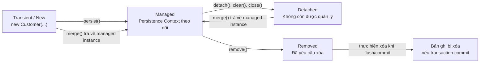

# persist và quá trình đưa thực thể mới vào Persistence Context

## 1. Vì sao tạo đối tượng Java chưa đồng nghĩa với lưu entity?

Trong ứng dụng Java sử dụng Hibernate ORM, việc tạo một đối tượng bằng `new` chỉ tạo ra một đối tượng trong bộ nhớ Java:

```java
Customer customer = new Customer("lan@example.test", "Lan");
```

Đối tượng đó chưa mặc nhiên nằm trong **Persistence Context** và chưa có bản ghi tương ứng trong database. Hibernate chưa theo dõi trạng thái của nó để thực hiện những thao tác lưu trữ cần thiết.

Để yêu cầu Hibernate quản lý một entity mới, ứng dụng thường gọi:

```java
session.persist(customer);
```

hoặc dùng giao diện tiêu chuẩn Jakarta Persistence:

```java
entityManager.persist(customer);
```

Lời gọi `persist()` là một **bước chuyển trạng thái trong vòng đời entity**, không đơn thuần là một câu lệnh `INSERT` được thực thi ngay tại dòng code đó.

Hiểu chính xác sự khác nhau giữa **tạo đối tượng**, **đưa vào Persistence Context**, **flush SQL** và **commit transaction** là nền tảng để làm việc với Hibernate ORM một cách có kiểm soát.

### Mục tiêu của bài

Sau bài này, bạn cần nắm được:

- Một entity **transient/new** khác entity **managed/persistent** như thế nào.
- `persist()` khiến entity mới trở thành managed ra sao.
- Vì sao `persist()` không bảo đảm `INSERT` đã chạy hoặc dữ liệu đã commit.
- Persistence Context nhận diện object, lưu trạng thái và phối hợp dirty checking như thế nào.
- Khóa định danh có thể được gán lúc nào tùy chiến lược ID generator.
- `CascadeType.PERSIST` tác động đến đồ thị entity được persist.
- Những lỗi thường gặp với entity detached, transient association, constraint và transaction rollback.

> Các ví dụ hướng đến Hibernate ORM hiện đại dùng `jakarta.persistence.*`, ví dụ Hibernate ORM 6.x. Một số API legacy trong Hibernate 5.x dùng `javax.persistence.*`; ý tưởng vòng đời tương tự nhưng import, generator và những chi tiết triển khai có thể khác.

## 2. Bốn trạng thái thường gặp của entity

Một entity thường được mô tả bằng các trạng thái:

| Trạng thái | Có nằm trong Persistence Context? | Hibernate có tự theo dõi thay đổi? | Đặc điểm |
|---|---|---|---|
| **Transient / New** | Không | Không | Đối tượng vừa tạo, chưa được quản lý; có thể chưa có ID |
| **Managed / Persistent** | Có | Có | Được Session/EntityManager quản lý, có identity trong context |
| **Detached** | Không | Không, đối với context cũ | Đã từng managed nhưng bị detach/clear/close; bản thân object Java vẫn còn |
| **Removed** | Trong lifecycle của context cho tới khi xử lý | Được đánh dấu để xóa | Entity managed được gọi `remove()`; xóa thực tế phụ thuộc flush/transaction |

Sơ đồ các chuyển trạng thái chính:



Sơ đồ tập trung vào luồng phổ biến; các trạng thái JPA/Hibernate và thời điểm xử lý cụ thể có thêm quy tắc với callback, cascade, generated ID, rollback và thao tác của provider.

**`persist()` được dùng cho entity mới.** Nó không phải thao tác “gắn lại” một entity detached đang có bản ghi database. Khi cần xử lý dữ liệu detached, thường xem xét `merge()` trong một transaction phù hợp.

## 3. Persistence Context thực chất là gì?

Persistence Context là phạm vi Hibernate dùng để quản lý một tập **entity instance** và trạng thái của chúng. Khi dùng API Hibernate native, Persistence Context thường gắn với một `Session`. Trong Jakarta Persistence, nó gắn với một `EntityManager` theo loại và phạm vi context được cấu hình.

Persistence Context thực hiện nhiều nhiệm vụ:

1. **Identity map:** trong cùng context, cùng entity type và cùng identifier tương ứng với một managed instance.
2. **Quản lý trạng thái:** ghi nhận những entity cần insert, update hoặc delete theo cơ chế ORM.
3. **Dirty checking:** phát hiện những thay đổi của managed entity cần đồng bộ xuống database khi flush.
4. **Điều phối cascade:** lan truyền thao tác theo metadata quan hệ khi được cấu hình.
5. **Làm việc với lazy association:** khởi tạo proxy/collection khi truy cập trong điều kiện Session còn khả dụng.

Ví dụ:

```java
Customer first = session.find(Customer.class, customerId);
Customer second = session.find(Customer.class, customerId);

System.out.println(first == second); // Thông thường: true
```

Hai lời gọi tìm cùng một entity trong **cùng Session/Persistence Context** thường cho cùng object Java, bởi Hibernate dùng identity map để tránh giữ hai phiên bản managed độc lập cho cùng một khóa.

**Persistence Context không phải database và không phải second-level cache.** Nó có vòng đời riêng, thường ngắn, gắn với đơn vị công việc. Dữ liệu đang được giữ trong context có thể **chưa được commit** và thậm chí **chưa phát SQL**.

### SessionFactory khác Session

`SessionFactory` thường được khởi tạo một lần và chia sẻ giữa các request/thread. `Session` mang trạng thái xử lý, **không thread-safe**, không nên chia sẻ đồng thời giữa nhiều request. Cứ mỗi đơn vị công việc, ứng dụng hoặc framework sẽ quản lý một Session/Persistence Context phù hợp.

## 4. Điều gì xảy ra tại session.persist(entity)?

Với một đối tượng mới, `persist()` yêu cầu Hibernate đưa đối tượng vào phạm vi quản lý và chuẩn bị những thao tác cần thiết để lưu nó.

```mermaid
sequenceDiagram
    participant App as Application
    participant S as Session
    participant PC as Persistence Context
    participant DB as Database
    App->>App: new Customer(...)
    App->>S: persist(customer)
    S->>PC: Đăng ký managed entity
    Note over S,DB: ID có thể được cấp; SQL INSERT chưa chắc chạy ngay
    App->>App: customer.rename(...)
    App->>S: flush() hoặc commit()
    S->>DB: INSERT / SQL cần đồng bộ
    DB-->>S: Kết quả statement
    App->>S: commit()
    S->>DB: COMMIT transaction
    Note over PC: Entity vẫn managed cho tới khi Session kết thúc
    App->>S: close()
    Note over App: Customer trở thành detached
```

### Các đặc tính quan trọng

- `persist()` **không trả về entity mới**: method trả `void` trong Jakarta Persistence và API Hibernate `Session.persist()`.
- Đối tượng Java được truyền vào thường **chính là managed instance** sau khi persist thành công; Hibernate không phải tạo một bản sao managed mới để trả lại như cách `merge()` hoạt động.
- Việc gán ID và phát `INSERT` có thể xảy ra vào những thời điểm khác nhau, tùy generator và flush strategy.
- Một lần `persist()` chưa xác nhận transaction; chỉ **commit thành công** mới bảo đảm thay đổi được xác nhận theo hợp đồng database.
- Nếu `persist()` dẫn tới lỗi hoặc transaction rollback, cần kết thúc transaction và loại bỏ Session không còn dùng được; không coi entity trong RAM là bằng chứng database đã lưu.

### Hai dòng code có ý nghĩa khác nhau

```java
session.persist(customer); // Chuyển new -> managed.
session.flush();            // Đồng bộ những SQL đang chờ xuống JDBC/DB.
```

`flush()` chưa phải `commit()`. Sau flush, transaction vẫn có thể rollback.

## 5. Ví dụ trọn vẹn: lưu Customer mới bằng Hibernate

### 5.1. Entity mapping

Ví dụ dùng PostgreSQL và sequence. Một sequence generator giúp phân biệt rõ **cấp ID** với **thời điểm chạy INSERT**:

```java
package com.example.crm;

import jakarta.persistence.Column;
import jakarta.persistence.Entity;
import jakarta.persistence.GeneratedValue;
import jakarta.persistence.GenerationType;
import jakarta.persistence.Id;
import jakarta.persistence.SequenceGenerator;
import jakarta.persistence.Table;

@Entity
@Table(name = "app_customers")
public class Customer {

    @Id
    @GeneratedValue(
        strategy = GenerationType.SEQUENCE,
        generator = "customer_sequence_generator"
    )
    @SequenceGenerator(
        name = "customer_sequence_generator",
        sequenceName = "app_customer_seq",
        allocationSize = 1
    )
    private Long id;

    @Column(name = "email", nullable = false,
            unique = true, length = 200)
    private String email;

    @Column(name = "display_name", nullable = false, length = 120)
    private String displayName;

    protected Customer() {
        // JPA/Hibernate cần constructor không tham số.
    }

    public Customer(String email, String displayName) {
        this.email = email;
        this.displayName = displayName;
    }

    public Long getId() {
        return id;
    }

    public String getEmail() {
        return email;
    }

    public String getDisplayName() {
        return displayName;
    }

    public void rename(String newName) {
        this.displayName = newName;
    }
}
```

Ý nghĩa:

- `@Entity` khai báo class có mapping ORM.
- `@Id` xác định định danh entity.
- `@GeneratedValue` + `@SequenceGenerator` hướng Hibernate dùng sequence để cấp ID.
- `@Column(nullable = false, unique = true)` mô tả các ràng buộc mong muốn khi sinh schema. Nếu database quản lý bằng migration, phải bảo đảm các constraint đó **thực sự tồn tại**.
- Entity có constructor `protected` cho Hibernate và constructor nghiệp vụ để tạo đối tượng mới.

### 5.2. Schema PostgreSQL tương ứng

```sql
CREATE SEQUENCE app_customer_seq
    START WITH 1
    INCREMENT BY 1;

CREATE TABLE app_customers (
    id BIGINT PRIMARY KEY,
    email VARCHAR(200) NOT NULL UNIQUE,
    display_name VARCHAR(120) NOT NULL
);
```

DDL này là ví dụ cho mapping sử dụng `allocationSize = 1`. Nếu hệ thống dùng allocation size khác, cần thiết kế sequence và cách cấp phát nhất quán với Hibernate version, generator optimizer và schema thực tế.

### 5.3. Mở Session và persist

```java
package com.example.crm;

import org.hibernate.Session;
import org.hibernate.SessionFactory;
import org.hibernate.Transaction;

public class CustomerService {

    private final SessionFactory sessionFactory;

    public CustomerService(SessionFactory sessionFactory) {
        this.sessionFactory = sessionFactory;
    }

    public Long createCustomer(String email, String displayName) {
        Customer customer = new Customer(email, displayName);
        // customer hiện là transient/new.

        try (Session session = sessionFactory.openSession()) {
            Transaction tx = session.beginTransaction();
            try {
                session.persist(customer);
                // customer hiện được quản lý bởi Persistence Context.

                System.out.println(
                    "Managed: " + session.contains(customer)
                );

                // Thay đổi trên cùng instance đang managed.
                customer.rename(displayName.trim());

                // Với AUTO flush thông thường, commit sẽ
                // đồng bộ INSERT/UPDATE cần thiết rồi commit.
                tx.commit();

                return customer.getId();
            } catch (RuntimeException ex) {
                if (tx.isActive()) {
                    tx.rollback();
                }
                throw ex;
            }
        } // Session đóng; customer không còn managed.
    }
}
```

Ví dụ giả định `SessionFactory` đã được bootstrap với `Customer.class`, JDBC datasource và transaction settings phù hợp. Với một transaction resource-local, `beginTransaction()` và `commit()` được ứng dụng quản lý. Khi dùng Spring `@Transactional` hoặc Jakarta Transactions, framework/container có thể sở hữu vòng đời transaction và Session.

### 5.4. Theo dõi vòng đời trong ví dụ

| Thời điểm | Java object `customer` | Persistence Context | Database |
|---|---|---|---|
| Sau `new Customer(...)` | Transient | Chưa quản lý | Chưa có bản ghi |
| Sau `session.persist(customer)` | Managed | Đăng ký và theo dõi entity | `INSERT` chưa chắc đã chạy |
| Sau `customer.rename(...)` | Vẫn managed | Có thể ghi nhận giá trị mới để flush | Chưa chắc có thay đổi |
| Trong quá trình `flush()`/`commit()` | Managed | Phối hợp SQL và trạng thái | SQL đã thực hiện nếu không lỗi |
| Sau `tx.commit()` thành công, Session vẫn mở | Managed | Vẫn theo dõi trong Session | Transaction đã commit |
| Sau `session.close()` | Detached | Context cũ chấm dứt | Dữ liệu đã commit vẫn tồn tại |

Trong mapping `SEQUENCE`, Hibernate thường lấy giá trị sequence **trước câu `INSERT`**, nên `customer.getId()` có thể có giá trị sau `persist()`. Nhưng việc “ID đã có” **không chứng minh một hàng đã được ghi**, và không chứng minh transaction đã commit.

## 6. Vì sao persist() thường không chạy INSERT ngay?

Hibernate sử dụng mô hình **write-behind**: thao tác trên object managed được ghi nhận trong Persistence Context và hàng đợi hành động, sau đó Hibernate đồng bộ SQL vào những thời điểm phù hợp.

Một chuỗi diễn biến có thể là:

```text
new Customer()
    ↓
persist(customer)
    ↓
Hibernate cấp identifier (ví dụ lấy sequence)
    ↓
Entity trở thành managed
    ↓
Ứng dụng tiếp tục thay đổi field
    ↓
flush() hoặc auto-flush hoặc commit()
    ↓
INSERT INTO app_customers (...)
    ↓
COMMIT
```

**Không phải mọi mapping đều chờ tới commit**: chiến lược ID `IDENTITY` có thể khiến Hibernate phải INSERT sớm để lấy khóa do database sinh. Query cần thấy dữ liệu mới cũng có thể kích hoạt auto-flush. Ngoài ra, flush mode và cấu hình transaction tác động đến thời điểm đồng bộ.

### Persist khác flush ở đâu?

```java
session.persist(customer);
// Yêu cầu persist và quản lý entity.

session.flush();
// Đồng bộ SQL cần thiết xuống database, nếu transaction hợp lệ.
```

`flush()` xử lý **nhiều entity/collection đang chờ**, không chỉ entity vừa persist. Nếu Session đang quản lý nhiều thay đổi, nó có thể phát cả `INSERT`, `UPDATE`, `DELETE` theo thứ tự Hibernate xác định để đáp ứng dependency và constraint.

### Flush khác commit ở đâu?

```java
session.flush(); // SQL đã chạy, nhưng transaction còn hoạt động.
tx.commit();     // Xác nhận transaction.
```

Sau flush, một transaction khác thường **chưa nhìn thấy** dữ liệu chưa commit dưới isolation thông dụng, còn transaction hiện tại có thể đọc trạng thái vừa ghi. Nếu `rollback`, các SQL đã flush cũng bị hoàn tác theo ngữ nghĩa transaction database.

### Khi nào Hibernate tự flush?

Với Hibernate `FlushMode.AUTO` thông thường, auto-flush có thể diễn ra:

- Trước lúc commit transaction.
- Trước những truy vấn ORM mà kết quả cần tính đến pending DML liên quan.
- Trước một số native query theo API và cấu hình nhất định.

Không mặc định mọi `SELECT` đều flush hoặc mọi lệnh `persist()` đều lập tức INSERT. Với `FlushMode.MANUAL` hoặc những chế độ khác, ứng dụng phải hiểu rõ trách nhiệm flush của mình.

## 7. Persistence Context nhận diện entity vừa persist như thế nào?

Sau khi entity được quản lý, Hibernate gắn đối tượng với **entity identity** của mapping và trạng thái trong context. Điều này giúp các thao tác tiếp theo sử dụng cùng instance.

Ví dụ với `SEQUENCE` và identifier đã được cấp:

```java
Customer customer = new Customer("hoa@example.test", "Hoa");
session.persist(customer);

Long id = customer.getId();
Customer found = session.find(Customer.class, id);

System.out.println(found == customer); // Thông thường: true.
```

`find()` có thể trả ngay instance đang managed, không cần `SELECT` mới. Vì vậy, đọc lại bằng cùng Session **không phải phép thử chắc chắn** để biết dữ liệu đã được gửi xuống database hoặc commit.

Muốn kiểm chứng dữ liệu đã commit, cần hoàn tất transaction, dùng một Session/transaction mới với cách đọc phù hợp và cân nhắc isolation/cache. Trong kiểm thử tích hợp, có thể sử dụng database thực tế để quan sát hành vi đó.

### Thay đổi thuộc tính sau persist

```java
session.persist(customer);
customer.rename("Hòa Nguyễn");
```

Với entity mới chưa INSERT, Hibernate có thể sử dụng **giá trị cuối cùng** khi sinh INSERT. Không nhất thiết phát một `INSERT` với tên cũ rồi một `UPDATE` với tên mới. SQL cụ thể phụ thuộc flush timing, enhanced dirty tracking, generator và mapping.

Với entity đã flush/insert rồi thay đổi tiếp trong cùng Session, Hibernate có thể phát `UPDATE` ở một lần flush tiếp theo nếu cần.

## 8. Thời điểm cấp khóa định danh tùy generator

Một lỗi tư duy phổ biến là coi **“đã có ID” = “đã INSERT”**. Trong Hibernate, generator quyết định khi nào ID có thể được xác định.

| Chiến lược | Ví dụ khai báo | Nguồn tạo ID | Tác động tới thời điểm INSERT |
|---|---|---|---|
| `SEQUENCE` | `@GeneratedValue(strategy = SEQUENCE)` | Database sequence; Hibernate có thể cấp phát theo khối | Thường lấy/cấp ID trước INSERT và có thể trì hoãn INSERT đến flush |
| `IDENTITY` | `@GeneratedValue(strategy = IDENTITY)` | Cột identity/auto increment của database | Thường cần INSERT sớm để biết ID; batching INSERT có thể bị hạn chế |
| `UUID` | `@GeneratedValue(strategy = UUID)` | Provider/Hibernate tạo UUID | Có thể tạo ID trong ứng dụng trước INSERT; yêu cầu Jakarta Persistence 3.1+ |
| Assigned ID | `@Id`, không `@GeneratedValue` | Ứng dụng gán trước persist | ID đã tồn tại trong Java nhưng bản ghi chưa chắc đã INSERT |
| `TABLE` | `@GeneratedValue(strategy = TABLE)` | Bảng cấp số định danh | Có thêm logic truy cập bảng cấp ID; đặc tính phụ thuộc provider |

### SEQUENCE: ID được biết trước khi có hàng

```java
@Id
@GeneratedValue(strategy = GenerationType.SEQUENCE)
private Long id;
```

Với generator này, Hibernate thường có thể lấy một giá trị sequence hoặc cấp từ pool đã có. Mặc dù `id` đã khác `null` sau `persist()`, câu `INSERT` có thể vẫn nằm trong hàng đợi.

Đối với sequence, **giá trị ID đã cấp có thể bị bỏ qua nếu transaction rollback**. Sequence database thường không hoàn tác việc tăng bộ đếm theo rollback, nên có khoảng trống ID là bình thường, không nên coi đó là mất dữ liệu.

### IDENTITY: INSERT có thể cần chạy sớm

```java
@Id
@GeneratedValue(strategy = GenerationType.IDENTITY)
private Long id;
```

Vì ID được database tạo trong quá trình INSERT, Hibernate thường phải gửi INSERT để nhận ID trước khi hoàn thành một số bước. Do đó **không thể hứa rằng `persist()` luôn tránh JDBC INSERT**.

Trên một số hoàn cảnh (ví dụ flush mode và transaction chưa bắt đầu), Hibernate có các quy tắc trì hoãn xử lý IDENTITY phức tạp hơn. Điều an toàn là **không phụ thuộc thời điểm SQL ở mức từng dòng** nếu không có yêu cầu kiểm soát rõ ràng.

### UUID: ID có thể sinh phía ứng dụng

Với Jakarta Persistence 3.1 và Hibernate hỗ trợ:

```java
@Id
@GeneratedValue(strategy = GenerationType.UUID)
private UUID id;
```

Provider sinh UUID, không cần một sequence tăng dần. Điều đó tách quá trình cấp ID khỏi việc INSERT, nhưng không loại bỏ transaction, ràng buộc unique/primary key hoặc kiểm tra foreign key của database.

### Assigned ID: không nhầm với generated ID

```java
@Id
private UUID id = UUID.randomUUID();
```

Ở đây ứng dụng tự cấp UUID. Không dùng `@GeneratedValue` cùng lúc cho logic assigned ID. Khi `persist()`, entity trở thành managed và được lên kế hoạch lưu, nhưng ID đã có ngay từ khi constructor/field initializer chạy.

**Chọn generator là quyết định về định danh và hiệu năng**, không phải cách thay thế ý nghĩa quản lý lifecycle của `persist()`.

## 9. CascadeType.PERSIST: persist cả một đồ thị entity

Trong ứng dụng thực tế, một entity mới thường chứa entity con mới. Ví dụ khách hàng được tạo kèm ghi chú ban đầu:

```text
Customer (new)
  ├── CustomerNote("Liên hệ vào buổi sáng") (new)
  └── CustomerNote("Ưu tiên email")        (new)
```

Nếu dùng `CascadeType.PERSIST` trên association thích hợp, gọi `persist(customer)` có thể lan truyền `persist` tới các note mới.

### 9.1. Child entity

```java
package com.example.crm;

import jakarta.persistence.Column;
import jakarta.persistence.Entity;
import jakarta.persistence.FetchType;
import jakarta.persistence.GeneratedValue;
import jakarta.persistence.GenerationType;
import jakarta.persistence.Id;
import jakarta.persistence.JoinColumn;
import jakarta.persistence.ManyToOne;
import jakarta.persistence.Table;

@Entity
@Table(name = "customer_notes")
public class CustomerNote {

    @Id
    @GeneratedValue(strategy = GenerationType.IDENTITY)
    private Long id;

    @ManyToOne(fetch = FetchType.LAZY, optional = false)
    @JoinColumn(name = "customer_id", nullable = false)
    private Customer customer;

    @Column(name = "note_text", nullable = false, length = 500)
    private String noteText;

    protected CustomerNote() {}

    public CustomerNote(Customer customer, String noteText) {
        this.customer = customer;
        this.noteText = noteText;
    }
}
```

### 9.2. Khai báo collection trong Customer

Thêm vào class `Customer` của ví dụ:

```java
import jakarta.persistence.CascadeType;
import jakarta.persistence.OneToMany;
import java.util.ArrayList;
import java.util.List;

@OneToMany(
    mappedBy = "customer",
    cascade = CascadeType.PERSIST
)
private List<CustomerNote> notes = new ArrayList<>();

public void addNote(String text) {
    notes.add(new CustomerNote(this, text));
}
```

Ở đây `mappedBy = "customer"` trỏ đến thuộc tính `CustomerNote.customer`; child là phía sở hữu khóa ngoại `customer_id`. Method `addNote(...)` bảo đảm child luôn biết owner.

### 9.3. Persist một aggregate mới

```java
Customer customer =
    new Customer("minh@example.test", "Minh");

customer.addNote("Liên hệ vào buổi sáng");
customer.addNote("Ưu tiên email");

session.persist(customer);
// CascadeType.PERSIST lan truyền tới các CustomerNote mới.
```

Trong transaction, Hibernate có thể thực hiện:

```sql
INSERT INTO app_customers (...);
INSERT INTO customer_notes (customer_id, note_text) VALUES (...);
INSERT INTO customer_notes (customer_id, note_text) VALUES (...);
```

Thứ tự statement cụ thể phụ thuộc generator và action queue, nhưng Hibernate cần đáp ứng liên kết khóa ngoại trong quá trình ghi.

### Cascade không có nghĩa “tự lưu mọi đối tượng tham chiếu”

Nếu không cấu hình `cascade = PERSIST` hoặc `ALL` ở association cần thiết, việc gọi `persist(customer)` **không tự động persist mọi transient child** mà customer trỏ tới. Đặc biệt, khi một entity mới có quan hệ `@ManyToOne` bắt buộc tới một entity khác chưa được lưu, Hibernate có thể báo lỗi transient association.

Ví dụ với đơn hàng trỏ tới khách hàng đã tồn tại:

```java
Order order = new Order(existingCustomer);
session.persist(order);
```

Nếu `existingCustomer` là entity đã có ID hợp lệ, ứng dụng có thể nạp nó trong Session hoặc dùng `getReference(...)` thích hợp. Không nên cấu hình `CascadeType.PERSIST` bừa bãi trên `@ManyToOne` đến Customer chỉ để Hibernate tự lưu mọi đối tượng, vì `Customer` thường có vòng đời độc lập và được nhiều đơn hàng dùng chung.

### Cascade và transaction

`CascadeType.PERSIST` chỉ mô tả lan truyền **thao tác persist**, không phải cơ chế tạo transaction mới cho mỗi child. Các SQL thuộc cùng transaction khi được persist trong một unit of work. Nếu transaction rollback, cả thay đổi parent và child trong transaction ấy bị hoàn tác.

## 10. persist khác merge, remove, detach và refresh

Các phương thức này cùng làm việc với entity lifecycle nhưng không thay thế nhau.

| Phương thức | Mục đích | Đối tượng đầu vào điển hình | Kết quả quan trọng |
|---|---|---|---|
| `persist(entity)` | Đưa entity **mới** vào Persistence Context | Transient/new | Cùng instance trở thành managed, method trả `void` |
| `merge(entity)` | Sao chép trạng thái từ đối tượng new/detached sang managed instance | New hoặc detached theo quy tắc JPA | **Trả về managed instance**; đối tượng truyền vào không tự trở thành managed |
| `remove(entity)` | Đánh dấu entity managed để xóa | Managed | SQL DELETE có thể xảy ra khi flush |
| `detach(entity)` | Bỏ một entity khỏi Persistence Context | Managed | Hibernate không tiếp tục theo dõi thay đổi trên đối tượng detached |
| `clear()` | Xóa toàn bộ entity khỏi context | Session/EntityManager | Mọi entity đang managed bị detach; các thay đổi chưa flush có thể mất |
| `refresh(entity)` | Tải lại trạng thái entity managed từ database | Managed | Có thể ghi đè thay đổi trong bộ nhớ |

### Vì sao không dùng persist cho detached entity?

Giả sử:

```java
Customer customer;
try (Session session = factory.openSession()) {
    customer = session.find(Customer.class, existingId);
}
// Session đóng. customer hiện detached.
```

Trong Session mới, gọi:

```java
session.persist(customer);
```

là **sai mục đích** nếu `customer` đại diện cho hàng đã tồn tại. Với Hibernate, trường hợp này có thể dẫn tới `PersistentObjectException` hoặc một lỗi tương đương, đôi khi được bọc trong exception JPA. Đặc tả JPA có thể báo `EntityExistsException` khi gọi `persist` hoặc ở thời điểm flush/commit.

Nếu nghiệp vụ muốn áp thay đổi của detached entity, có thể:

```java
Customer managed = session.merge(customer);
// managed là giá trị trả về, không mặc định cùng object với customer.
```

Tuy nhiên, `merge()` không phải một lệnh “upsert an toàn cho mọi trường hợp”; nó có quy tắc cascade, version/concurrency và nguy cơ ghi đè dữ liệu không mong muốn. Nhiều ứng dụng ưu tiên tải entity managed theo ID rồi áp các thay đổi hợp lệ từ DTO, thay vì merge toàn bộ dữ liệu người dùng gửi.

### Không nhầm persist với save() legacy

Hibernate từng phổ biến `session.save(...)`, trả một giá trị định danh theo API cũ. Các API như `save`, `update`, `saveOrUpdate` đã được thay đổi hoặc deprecated/không còn ở những thế hệ Hibernate mới. Với dự án dùng Jakarta Persistence/Hibernate hiện đại, **`persist()` là thao tác chuẩn** khi lưu entity mới.

Không dùng tiêu chí “method có trả ID hay không” để suy ra dữ liệu đã được commit. ID generation và transaction lifecycle vẫn độc lập.

## 11. Các tình huống xảy ra lỗi với persist()

### 11.1. Entity không có @Id hợp lệ

Một class không có mapping `@Entity` hoặc identifier phù hợp không thể được Hibernate quản lý như entity thông thường:

```java
public class PlainCustomer {
    private String name;
}
```

Gọi `session.persist(new PlainCustomer())` không biến class Java tùy ý thành entity. Provider cần metadata mapping hợp lệ.

### 11.2. Truyền null vào trường NOT NULL

```java
Customer invalid = new Customer(null, "Lan");
session.persist(invalid);
```

Với schema `email NOT NULL`, transaction có thể thất bại khi Hibernate kiểm tra nullability/validation hoặc khi database thực thi INSERT. Không mặc định exception xuất hiện ngay tại dòng `persist()`.

Để báo lỗi sớm hơn, có thể kiểm tra ở constructor/service và dùng Jakarta Validation nếu dự án cấu hình:

```java
if (email == null || email.isBlank()) {
    throw new IllegalArgumentException("Email is required");
}
```

Kiểm tra ở Java hỗ trợ trải nghiệm người dùng; constraint `NOT NULL` trong database bảo vệ dữ liệu khi có các tác nhân ghi khác.

### 11.3. Trùng unique constraint

Ví dụ hai customer cùng email:

```java
session.persist(new Customer("lan@example.test", "Lan 1"));
session.persist(new Customer("lan@example.test", "Lan 2"));
```

Nếu database có unique constraint trên `email`, lần ghi thứ hai sẽ bị từ chối khi INSERT chạy. Với generator có thể trì hoãn INSERT, lỗi có thể **chỉ xuất hiện tại flush/commit**, không phải ngay ở `persist()`.

Khi bắt exception SQL/Hibernate trong transaction, nên rollback và **không tiếp tục dùng Session như chưa có lỗi**.

### 11.4. Quan hệ tới transient entity chưa được persist

Ví dụ:

```java
Customer customer = new Customer("mai@example.test", "Mai");
PurchaseOrder order = new PurchaseOrder(customer);

session.persist(order);
// customer vẫn transient nếu không được persist/cascade phù hợp.
```

Nếu mapping yêu cầu một khóa ngoại đến `Customer` đã tồn tại mà customer chưa được lưu, Hibernate có thể báo `TransientPropertyValueException` hoặc lỗi về đối tượng transient chưa được lưu. Giải pháp là thiết kế rõ **aggregate boundary và cascade**, hoặc persist customer trước khi persist order.

Không bật cascade mọi nơi để che giấu lỗi: một quan hệ đến danh mục/khách hàng dùng chung thường không nên tự động tạo bản ghi tham chiếu khi persist entity khác.

### 11.5. Cố persist detached entity như mới

Entity đã có identifier và tương ứng với hàng database không nên được coi là entity transient tùy tiện. Hibernate có thể nhận diện trạng thái detached và từ chối. Khi chưa rõ trạng thái, dùng `session.contains(entity)` để biết **đối tượng có managed bởi Session hiện tại không**; lưu ý `contains == false` có thể là **transient hoặc detached**, không phân biệt hai trường hợp.

### 11.6. Vi phạm foreign key

Ngay cả khi ID đã được gán, một association có FK tới entity không tồn tại vẫn có thể làm INSERT thất bại. `@ManyToOne(optional = false)` hoặc `@JoinColumn(nullable = false)` không tự tạo bản ghi đích. Cần bảo đảm entity tham chiếu hợp lệ và FK constraint có trong schema.

## 12. Transaction rollback không “undo” bộ nhớ Java

Giả sử:

```java
Customer customer = new Customer("test@example.test", "Test");

try (Session session = factory.openSession()) {
    Transaction tx = session.beginTransaction();
    try {
        session.persist(customer);
        session.flush(); // INSERT có thể đã chạy.

        throw new IllegalStateException("Simulated failure");
    } catch (RuntimeException ex) {
        if (tx.isActive()) {
            tx.rollback();
        }
    }
}
```

Database sẽ rollback những thay đổi thuộc transaction theo cơ chế transactional của database. Nhưng đối tượng Java `customer` vẫn tồn tại trong RAM và có thể **vẫn giữ một giá trị ID đã được Hibernate cấp**.

**Rollback transaction không tua ngược constructor, setter hoặc generator state của object Java.** Sau rollback:

- Không kết luận bản ghi tồn tại chỉ vì `customer.getId() != null`.
- Đừng mặc định có thể tiếp tục thao tác với cùng Session như một transaction sạch.
- Thường nên đóng Session sau lỗi và tạo unit of work mới nếu cần retry.
- Nếu retry việc tạo entity, cần xác định ID do ứng dụng cấp, sequence, identity và idempotency như thế nào.

Đặc biệt, nếu transaction đã rollback nhưng ID được cấp qua sequence, database có thể vẫn tăng sequence; **khoảng trống ID là điều bình thường**.

## 13. Lifecycle callbacks quanh persist()

Jakarta Persistence cung cấp các callback như `@PrePersist` và `@PostPersist`.

Ví dụ tự gán thời gian tạo:

```java
import jakarta.persistence.Column;
import jakarta.persistence.PrePersist;
import java.time.Instant;

@Column(name = "created_at", nullable = false)
private Instant createdAt;

@PrePersist
protected void onCreate() {
    if (createdAt == null) {
        createdAt = Instant.now();
    }
}
```

Đoạn này được đặt bên trong entity `Customer` và yêu cầu bảng có cột `created_at` phù hợp.

### Phân biệt hai callback

| Callback | Ý nghĩa |
|---|---|
| `@PrePersist` | Chạy trong quá trình xử lý thao tác persist, trước khi entity mới được INSERT; thường dùng đặt dữ liệu khởi tạo |
| `@PostPersist` | Chạy sau khi INSERT tương ứng đã diễn ra; thời điểm cụ thể có thể tại persist/flush/commit theo generator và provider |

Với ID do database sinh qua `IDENTITY`, thời điểm có ID và callback có thể khác với `SEQUENCE`. Không thiết kế callback phụ thuộc một thứ tự không được đặc tả bảo đảm trong mọi provider.

Callback nên giữ logic gọn, tránh gọi HTTP service hoặc tạo side effect ngoài transaction mà không có cơ chế đảm bảo nhất quán. Nếu cần phát sự kiện ra hệ thống khác sau khi dữ liệu commit, cân nhắc **transactional outbox** hoặc cơ chế sự kiện sau commit thích hợp, thay vì gửi trực tiếp trong `@PrePersist`.

## 14. persist() và dirty checking: thay đổi trước/sau INSERT

Một lý do quan trọng của trạng thái managed là Hibernate có thể theo dõi đối tượng sau persist.

Ví dụ:

```java
Customer customer = new Customer("hoa@example.test", "Hoa");
session.persist(customer);

customer.rename("Hoa Nguyễn");
session.flush();
```

Khi flush lần đầu, Hibernate có thể sinh một INSERT chứa `display_name = 'Hoa Nguyễn'`, tùy thời điểm SQL thực thi. Nếu đã INSERT trước đó, lần flush khác có thể phát UPDATE để đồng bộ thay đổi.

Với một entity đã tồn tại và đang managed:

```java
Customer customer = session.find(Customer.class, customerId);
customer.rename("Tên mới");
// Không bắt buộc gọi session.persist(customer) lần nữa.
```

Hibernate dùng dirty checking để phát hiện cập nhật khi flush. **`persist()` không phải lệnh “save changes” cần gọi sau mọi setter**; nó có mục đích chuyển **new entity** vào managed state.

### Không nhầm clear với flush

```java
session.persist(customer);
session.clear();
```

Nếu thay đổi còn pending mà chưa flush, `clear()` có thể loại bỏ những thay đổi chưa được đồng bộ. Vì vậy nếu cố ý muốn giải phóng Persistence Context trong batch processing, thường dùng:

```java
session.flush();
session.clear();
```

theo ranh giới transaction đã thiết kế. `clear()` detach toàn bộ entity của Session, làm mất khả năng dirty checking tự động đối với các object ấy.

## 15. Khi nào entity trở thành detached?

Sau khi `persist()` thành công và transaction commit, entity vẫn có thể **managed nếu Session còn mở**. Entity chỉ detached khi rời persistence context:

```java
Customer customer = new Customer("an@example.test", "An");

try (Session session = factory.openSession()) {
    Transaction tx = session.beginTransaction();
    try {
        session.persist(customer);
        tx.commit();

        System.out.println(session.contains(customer));
        // Session vẫn mở: thường là true.
    } catch (RuntimeException ex) {
        if (tx.isActive()) {
            tx.rollback();
        }
        throw ex;
    }
}

// Session đóng: object không còn managed bởi context cũ.
customer.rename("An Mới");
// Chỉ thay đổi object Java; không tự phát UPDATE.
```

Nếu muốn lưu thay đổi từ bên ngoài context, không dùng `persist(customer)` một cách vô điều kiện. Có thể mở transaction mới, tải Customer theo ID rồi đổi trạng thái trên managed entity:

```java
try (Session session = factory.openSession()) {
    Transaction tx = session.beginTransaction();
    try {
        Customer managed =
            session.find(Customer.class, customer.getId());

        if (managed == null) {
            throw new IllegalArgumentException("Customer not found");
        }

        managed.rename("An Mới");
        tx.commit();
    } catch (RuntimeException ex) {
        if (tx.isActive()) {
            tx.rollback();
        }
        throw ex;
    }
}
```

Cách tải rồi áp thay đổi cho entity đang managed giúp ứng dụng kiểm soát những field được phép sửa và tận dụng optimistic locking nếu model có `@Version`.

## 16. Tạo entity mới trong Spring với @Transactional

Trong ứng dụng dùng Spring Data JPA hoặc Spring ORM, thông thường không nên mở/đóng `Session` thủ công trong service đã được framework quản lý transaction.

Ví dụ sử dụng `EntityManager` tiêu chuẩn:

```java
import jakarta.persistence.EntityManager;
import jakarta.persistence.PersistenceContext;
import org.springframework.stereotype.Service;
import org.springframework.transaction.annotation.Transactional;

@Service
public class CustomerApplicationService {

    @PersistenceContext
    private EntityManager entityManager;

    @Transactional
    public Long register(String email, String displayName) {
        Customer customer = new Customer(email, displayName);
        entityManager.persist(customer);

        // Với SEQUENCE, ID thường đã được cấp.
        return customer.getId();
    }
}
```

Trong tình huống này:

1. Framework mở hoặc tham gia transaction theo cấu hình.
2. `EntityManager` tham gia Persistence Context gắn với transaction phù hợp.
3. `persist()` đưa entity mới vào context.
4. Khi kết thúc method thành công, interceptor transaction thường flush và commit theo quy tắc framework.

Không hiểu việc `register()` trả ID là đã commit tại chính câu `return`. Việc commit diễn ra ở phần quản lý transaction bên ngoài method và có thể thất bại vì constraint/database.

**Chú ý:** `@Transactional` của Spring áp dụng thông qua cơ chế proxy và có các quy tắc về self-invocation, propagation, rollback rules. Đây là vấn đề quản lý transaction của Spring, không làm thay đổi ý nghĩa cốt lõi của `EntityManager.persist()`.

## 17. Bài toán nhiều entity mới và thứ tự INSERT

Giả sử cần tạo đơn hàng mới với nhiều dòng hàng:

```text
PurchaseOrder (new)
    ├── PurchaseOrderLine (new)
    ├── PurchaseOrderLine (new)
    └── PurchaseOrderLine (new)
```

Để ghi dữ liệu hợp lệ, khóa ngoại của `PurchaseOrderLine` phải tham chiếu được order. Nếu dùng `CascadeType.PERSIST` ở collection có sở hữu quan hệ đúng, Hibernate có thể tổ chức việc ghi parent/child trong cùng unit of work.

Các nguyên tắc:

- Đảm bảo child trỏ tới parent ở **phía sở hữu foreign key**, không chỉ thêm child vào collection inverse.
- Chỉ cascade PERSIST tới những entity **thực sự thuộc vòng đời** của aggregate và được tạo mới cùng nó.
- Không cố gắng ép thứ tự INSERT bằng cách gọi `flush()` sau mỗi entity nếu không có yêu cầu rõ ràng; việc đó làm giảm cơ hội JDBC batching và tăng round-trip.
- Không cho rằng `persist(order)` tự đảm bảo mọi FK của toàn đồ thị hợp lệ; Hibernate và database vẫn có thể từ chối những association không phù hợp.

Với dữ liệu lớn, xử lý batch cần giới hạn số entity managed trong context. `persist()` hàng trăm nghìn entity rồi để tất cả managed đến cuối job có thể làm tăng RAM và chi phí flush. Thiết kế chunk, flush/clear và transaction phù hợp với yêu cầu tính nguyên tử.

## 18. Minh họa bằng SQL log

Để hiểu `persist()` đang xảy ra lúc nào, có thể quan sát SQL Hibernate khi chạy ứng dụng thử nghiệm.

Ở Hibernate ORM 6.x, các logging category thường được dùng:

```properties
# Ví dụ cấu hình logging ở mức ứng dụng:
logging.level.org.hibernate.SQL=DEBUG
logging.level.org.hibernate.orm.jdbc.bind=TRACE
```

Ví dụ trên là cú pháp properties kiểu Spring Boot. Trong hệ thống khác, cấu hình logger phụ thuộc Log4j2, Logback hoặc framework đang dùng.

Với `SEQUENCE`, một luồng có thể trông như:

```text
Application: new Customer(...)
Application: session.persist(customer)
SQL:         select nextval('app_customer_seq')
Application: customer.getId() -> 101
Application: customer.rename(...)
Application: tx.commit()
SQL:         insert into app_customers
             (display_name, email, id) values (?, ?, ?)
JDBC:        commit
```

Đây là **mẫu diễn biến minh họa**, không phải lịch phát SQL cố định ở mọi môi trường. ID generator optimizer có thể cấp từ pool không cần `nextval` ở mỗi entity, và Hibernate có thể auto-flush trước commit hoặc truy vấn.

**Cảnh báo vận hành:** log JDBC bind parameters có thể chứa thông tin cá nhân hoặc dữ liệu nhạy cảm. Chỉ bật ở môi trường thử nghiệm có kiểm soát, không để logging chi tiết hoạt động tùy tiện ở production.

## 19. Phân biệt tác động của persist, flush, commit và close

| Thao tác | Chủ thể chịu trách nhiệm | Tác dụng chính | Có đồng nghĩa database đã commit? |
|---|---|---|---|
| `new Entity(...)` | JVM/application | Tạo object transient | Không |
| `persist(entity)` | Hibernate/JPA | Đưa entity mới vào Persistence Context và lên kế hoạch lưu | Không |
| `flush()` | Hibernate | Phát các SQL đang chờ trong transaction | Không |
| `commit()` | Transaction manager/database | Xác nhận transaction sau khi các thao tác cần thiết đã hoàn tất | Có, nếu commit thực sự thành công |
| `close()` | Session/EntityManager lifecycle | Giải phóng Persistence Context và tài nguyên | Không thay thế commit |

Đọc bảng từ trên xuống là cách nhanh để phân biệt lỗi “đã gọi persist sao không thấy dữ liệu” với vấn đề transaction, flush hoặc schema constraint.

## 20. Các nhầm lẫn phổ biến

### “persist() là INSERT ngay lập tức”

Không luôn đúng. Với nhiều generator, Hibernate có thể trì hoãn INSERT tới flush. Với `IDENTITY`, INSERT có thể xảy ra sớm. Hãy phân biệt **managed transition** với **JDBC execution**.

### “ID khác null tức là đã lưu thành công”

Sai. `SEQUENCE`, UUID hay assigned ID đều có thể tạo ID **trước khi INSERT hoặc commit**.

### “persist trả về khóa chính”

Sai với API Jakarta Persistence/Hibernate `persist()`: nó trả `void`. Bạn đọc ID trên entity sau khi generator đã gán, hoặc dùng API/chiến lược khác theo nhu cầu.

### “Sau persist phải gọi persist lại mỗi lần set field”

Không. Khi entity đang managed, Hibernate theo dõi thay đổi; dirty checking/flush xử lý cập nhật.

### “Persist một entity có association sẽ luôn lưu cả đồ thị”

Không. Cascade chỉ lan truyền khi **được cấu hình** tương ứng; phần tử giá trị `@ElementCollection` và entity association có quy tắc lifecycle khác nhau.

### “Persist detached entity giống merge”

Không. `persist()` dành cho entity mới; `merge()` sao chép trạng thái sang managed instance và trả instance đó. Hai method có semantics và rủi ro khác nhau.

### “Flush là commit”

Không. Flush đồng bộ SQL trong transaction; rollback có thể hủy các thay đổi đã flush.

### “Rollback sẽ xóa ID và trả object về y hệt trước persist”

Không. Transaction rollback tác động tới database, không tua ngược mọi giá trị trong object Java; generator như sequence có thể đã cấp ID.

### “Session đóng thì bản ghi vừa persist bị mất”

Không nếu transaction đã commit thành công. `close()` chỉ kết thúc Persistence Context; bản ghi đã commit vẫn nằm ở database.

### “contains(entity) false nghĩa là đối tượng chưa tồn tại trong DB”

Không. `contains()` chỉ cho biết entity có managed bởi **Persistence Context hiện tại** hay không. Entity detached có thể vẫn tồn tại trong database.

## 21. Bài thực hành: theo dõi entity qua các trạng thái

Thiết kế một bài tập dùng entity `Customer` ở phần trên.

### Phần A — Đưa entity mới vào context

1. Tạo `Customer customer = new Customer(...)`.
2. Mở Session và transaction.
3. Gọi `session.contains(customer)` trước `persist()`.
4. Gọi `session.persist(customer)`.
5. Gọi `session.contains(customer)` lần nữa.
6. In `customer.getId()` để quan sát hành vi generator `SEQUENCE`.

Kỳ vọng về managed state: trước persist, entity chưa thuộc context; sau persist thành công, entity được quản lý.

### Phần B — Flush và rollback

Trong transaction thử nghiệm:

```java
Customer customer =
    new Customer("rollback@example.test", "Rollback Case");

try (Session session = factory.openSession()) {
    Transaction tx = session.beginTransaction();
    try {
        session.persist(customer);
        session.flush();

        // Hủy thay đổi dù INSERT có thể đã chạy.
        tx.rollback();
    } catch (RuntimeException ex) {
        if (tx.isActive()) {
            tx.rollback();
        }
        throw ex;
    }
}
```

Kiểm tra database bằng unit of work mới xem bản ghi có tồn tại hay không. Quan sát rằng `customer.getId()` vẫn có thể giữ giá trị ID. **Đừng coi ID đó là bằng chứng persist đã commit**.

### Phần C — Gọi persist trên entity detached

1. Persist và commit một Customer.
2. Đóng Session; giữ lại Java object.
3. Mở Session mới và thử gọi `persist(...)` trên object đã có ID.
4. Quan sát lỗi/semantics của provider.
5. Viết lại service theo hướng tải managed entity theo ID rồi cập nhật field cần thay đổi.

Không dùng trực tiếp dữ liệu production khi làm bài tập này; lỗi transaction và unique constraint có thể xảy ra theo ý đồ thực hành.

### Phần D — Cascade PERSIST

1. Tạo Customer và hai CustomerNote mới.
2. Dùng method `addNote(...)` để thiết lập cả danh sách và phía sở hữu FK.
3. Persist Customer trong transaction với `cascade = PERSIST`.
4. Kiểm tra sau commit có một hàng customer và hai hàng note với cùng `customer_id`.
5. Thử bỏ cascade trên quan hệ, rồi quan sát sự khác biệt giữa parent và child mới chưa được persist.

### Câu hỏi tự kiểm tra

1. Vì sao `session.persist(customer)` không bắt buộc phát `INSERT` ngay lập tức?
2. `session.contains(customer)` trước và sau persist khác nhau thế nào?
3. Với `GenerationType.SEQUENCE`, ID đã có nghĩa transaction đã commit chưa?
4. Khi `flush()` thành công nhưng `rollback()` xảy ra, bản ghi còn tồn tại không?
5. Vì sao entity detached không nên truyền trực tiếp vào `persist()`?
6. `CascadeType.PERSIST` có làm mọi `@ManyToOne` tự persist entity đích không?
7. Sau khi Session đóng, sửa một field trên entity Java có tự phát SQL không?
8. Một lỗi unique constraint có thể xuất hiện tại thời điểm nào nếu Hibernate trì hoãn INSERT?

**Gợi ý:** (1) write-behind/flush; (2) từ không managed sang managed; (3) chưa; (4) các thay đổi trong transaction rollback bị hủy; (5) persist dành cho new, không phải reattach detached; (6) chỉ lan truyền ở association được cấu hình; (7) không; (8) có thể tại flush/commit.

## 22. Nguyên tắc cần ghi nhớ

1. **`new` tạo transient object; `persist()` chuyển entity mới sang managed state** trong Persistence Context.
2. **`persist()` không phải `INSERT` hay `COMMIT`.** SQL có thể được phát ở flush hoặc sớm hơn tùy generator, query và flush mode.
3. **Managed entity được Hibernate theo dõi**, có identity map và dirty checking; không cần gọi persist lại mỗi lần sửa field.
4. **ID generation là một bước riêng.** `SEQUENCE` hoặc UUID có thể cấp ID trước INSERT; `IDENTITY` có thể yêu cầu INSERT sớm.
5. **Transaction phải được commit thành công** để các thay đổi trong database được xác nhận. Flush không thay thế commit; rollback không tua ngược object Java.
6. **Cascade PERSIST là lựa chọn cho quan hệ được cấu hình**, không phải cách lưu tự động mọi đối tượng tham chiếu.
7. **Persist chỉ dành cho entity mới.** Với dữ liệu detached, hãy hiểu `merge()` hoặc tải entity managed rồi áp thay đổi nghiệp vụ.
8. **Persistence Context có vòng đời hữu hạn.** Sau `detach/clear/close`, object không còn tự được theo dõi; `contains(false)` không chứng minh bản ghi chưa tồn tại trong DB.
9. **Exception có thể đến muộn.** Constraint, FK và unique có thể chỉ được kiểm tra khi SQL chạy tại flush/commit, nên transaction boundary và rollback phải được xử lý đúng.
10. **Đo hành vi thật trên Hibernate version và database mục tiêu**, đặc biệt khi dùng IDENTITY, cascading, batching hoặc flush mode đặc biệt.

Khi gặp câu hỏi “tôi đã gọi `persist()`, tại sao dữ liệu chưa xuất hiện?”, hãy tách quá trình thành ba câu hỏi: **entity đã managed chưa, SQL đã flush chưa, và transaction đã commit thành công chưa?** Sự phân tách này là chìa khóa để debug vòng đời entity trong Hibernate ORM.

### Tài liệu chính thức để đọc thêm

- [Hibernate ORM User Guide — Persistence Context](https://docs.jboss.org/hibernate/orm/current/userguide/html_single/Hibernate_User_Guide.html#pc)
- [Hibernate ORM User Guide — Making entities persistent](https://docs.jboss.org/hibernate/orm/current/userguide/html_single/Hibernate_User_Guide.html#pc-persist)
- [Hibernate ORM User Guide — Flushing](https://docs.jboss.org/hibernate/orm/current/userguide/html_single/Hibernate_User_Guide.html#flushing)
- [Hibernate ORM User Guide — Identifier generation](https://docs.jboss.org/hibernate/orm/current/userguide/html_single/Hibernate_User_Guide.html#identifiers)
- [Hibernate ORM Javadocs — Session](https://docs.jboss.org/hibernate/orm/current/javadocs/org/hibernate/Session.html)
- [Jakarta Persistence Specification](https://jakarta.ee/specifications/persistence/)
