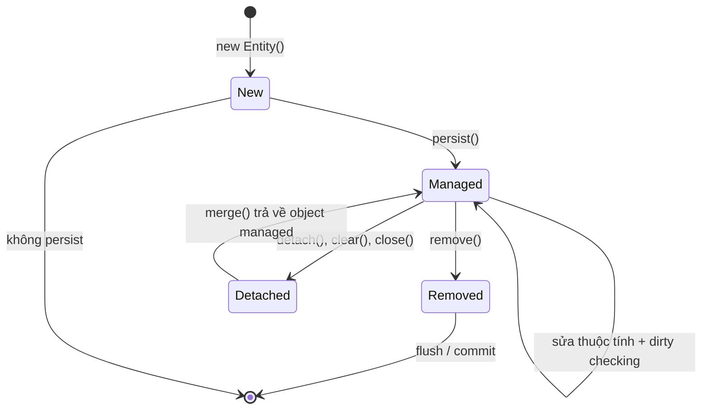

# Thay đổi thuộc tính của thực thể đang được quản lý trong Hibernate

Khi một entity nằm trong trạng thái **managed** (*được quản lý*), Hibernate theo dõi trạng thái của entity đó trong **persistence context**. Lập trình viên chỉ cần thực hiện những thay đổi hợp lệ lên các thuộc tính của object Java; trong một transaction phù hợp, Hibernate có thể phát hiện chúng và tạo câu lệnh `UPDATE` khi flush mà không cần gọi `update()` cho từng setter.

Ví dụ:

```java
@Transactional
public void renameCustomer(Long customerId, String newName) {
    Customer customer =
        entityManager.find(Customer.class, customerId);

    if (customer == null) {
        throw new NoSuchElementException("Customer not found");
    }

    customer.rename(newName);

    // Không cần entityManager.persist(customer).
    // Hibernate sẽ kiểm tra thay đổi lúc flush.
}
```

Tuy nhiên, câu nói “Hibernate tự lưu mọi thay đổi” dễ gây hiểu nhầm nếu bỏ qua **trạng thái managed**, **transaction**, **dirty checking**, **thời điểm flush**, **quy tắc mapping** và **concurrency**.

Bài học này giải thích đầy đủ việc thay đổi thuộc tính của entity đang được quản lý: thay giá trị đơn giản, sửa giá trị mutable, cập nhật quan hệ, collection, optimistic locking, thời điểm chạy SQL và những tình huống mà Hibernate không tự đồng bộ như detached entity, bulk JPQL hay native SQL.

## 1. Managed entity là gì?

JPA/Hibernate phân biệt các trạng thái quan trọng trong vòng đời entity:

| Trạng thái | Ý nghĩa | Thay đổi thuộc tính có được theo dõi tự động? |
|---|---|---|
| **New/transient** | Object Java vừa tạo, chưa được quản lý và chưa gắn với database | Chưa; khi persist, trạng thái sẽ được dùng để insert |
| **Managed/persistent** | Object thuộc một persistence context đang hoạt động | Có, theo mapping và cơ chế dirty checking |
| **Detached** | Object từng được quản lý nhưng không còn thuộc persistence context hiện tại | Không; sửa object detached không tự sinh SQL |
| **Removed** | Entity đang được quản lý nhưng đã được đánh dấu để xóa | Lúc flush Hibernate thực hiện thao tác xóa; không nên tiếp tục xem là bản ghi cập nhật bình thường |



Sơ đồ đơn giản hóa một số trường hợp `merge`, `remove` và rollback; các thao tác cụ thể tuân thủ hợp đồng JPA và trạng thái của entity tại thời điểm gọi.

Một entity trở thành managed khi:

- Được tải bởi `entityManager.find(Entity.class, id)`.
- Xuất hiện trong kết quả truy vấn entity bằng JPQL, Criteria hoặc cách truy vấn hợp lệ khác.
- Là entity mới được gọi `entityManager.persist(entity)` trong persistence context.
- Là **instance managed do `merge` trả về** khi merge trạng thái từ một entity detached/new phù hợp.

### 1.1. Persistence context là bộ quản lý danh tính và trạng thái

Một persistence context theo dõi các entity managed, thường được truy cập qua `EntityManager` hoặc Hibernate `Session`. Với cùng **loại entity + khóa định danh** trong một context, Hibernate duy trì một instance được quản lý duy nhất ở mức identity map.

```java
Customer first = entityManager.find(Customer.class, 42L);
Customer second = entityManager.find(Customer.class, 42L);

System.out.println(first == second); // true trong cùng context
```

Nhờ đó, Hibernate có một nơi tập trung để phát hiện thay đổi và tránh việc hai object managed khác nhau cùng đại diện một bản ghi trong cùng context.

Điểm cần phân biệt: **object đang được giữ trong biến Java không đồng nghĩa object còn managed**. Sau khi `EntityManager` đóng, `clear()` hoặc `detach(entity)`, cùng object vẫn có thể tồn tại trong bộ nhớ nhưng không còn được dirty checking trong context cũ.

### 1.2. Làm sao biết một entity đang managed?

JPA cung cấp:

```java
boolean managed = entityManager.contains(customer);
```

`contains` trả về `true` nếu object cụ thể là một managed entity của persistence context hiện tại. Nó không trả về true chỉ vì một object khác có cùng ID.

Trong debug, một object vừa được deserialize từ HTTP request hoặc đọc từ cache ngoài ORM thường **không tự nhiên thành managed entity** chỉ vì có `id` giống bản ghi database.

## 2. Ví dụ nền tảng: sửa thuộc tính của managed entity

Xét một entity đơn hàng:

```java
import jakarta.persistence.*;
import java.math.BigDecimal;
import java.util.Objects;

@Entity
@Table(name = "purchase_orders")
public class PurchaseOrder {

    @Id
    @GeneratedValue(strategy = GenerationType.IDENTITY)
    private Long id;

    @Version
    @Column(name = "row_version", nullable = false)
    private long version;

    @Enumerated(EnumType.STRING)
    @Column(name = "status", nullable = false, length = 20)
    private OrderStatus status;

    @Column(name = "delivery_note", length = 500)
    private String deliveryNote;

    @Column(
        name = "total_amount",
        nullable = false,
        precision = 19,
        scale = 2
    )
    private BigDecimal totalAmount;

    protected PurchaseOrder() {
        // Constructor cho Hibernate.
    }

    public PurchaseOrder(BigDecimal totalAmount) {
        if (totalAmount == null || totalAmount.signum() < 0) {
            throw new IllegalArgumentException("Invalid total");
        }
        this.totalAmount = totalAmount;
        this.status = OrderStatus.DRAFT;
    }

    public void changeDeliveryNote(String note) {
        if (note != null && note.length() > 500) {
            throw new IllegalArgumentException("Note is too long");
        }
        this.deliveryNote = note;
    }

    public void confirm() {
        if (status != OrderStatus.DRAFT) {
            throw new IllegalStateException(
                "Only draft orders can be confirmed");
        }
        status = OrderStatus.CONFIRMED;
    }

    public Long getId() { return id; }
    public long getVersion() { return version; }
    public OrderStatus getStatus() { return status; }
    public String getDeliveryNote() { return deliveryNote; }
    public BigDecimal getTotalAmount() { return totalAmount; }
}
```

Enum:

```java
public enum OrderStatus {
    DRAFT, CONFIRMED, CANCELLED
}
```

Một service thực hiện thay đổi:

```java
import jakarta.persistence.EntityManager;
import jakarta.persistence.PersistenceContext;
import java.util.NoSuchElementException;
import org.springframework.stereotype.Service;
import org.springframework.transaction.annotation.Transactional;

@Service
public class OrderCommandService {

    @PersistenceContext
    private EntityManager entityManager;

    @Transactional
    public void confirm(Long orderId, String deliveryNote) {
        PurchaseOrder order =
            entityManager.find(PurchaseOrder.class, orderId);

        if (order == null) {
            throw new NoSuchElementException("Order not found");
        }

        order.changeDeliveryNote(deliveryNote);
        order.confirm();

        // Không gọi persist(order) hay merge(order).
        // order là managed entity trong transaction này.
    }
}
```

Trình tự khái quát:

1. `find` tải bản ghi và đưa `PurchaseOrder` vào persistence context.
2. `changeDeliveryNote` và `confirm` thay đổi trạng thái Java hợp lệ.
3. Hibernate nhận biết trạng thái mới tại thời điểm dirty checking.
4. Khi flush, Hibernate có thể phát `UPDATE` với khóa định danh và version đã được quản lý.
5. Database kiểm tra constraint và cập nhật hàng; transaction chỉ được commit khi kết thúc thành công.

Một SQL minh họa:

```sql
UPDATE purchase_orders
SET delivery_note = ?,
    status = ?,
    total_amount = ?,
    row_version = ?
WHERE id = ?
  AND row_version = ?;
```

Đây chỉ là **hình dung** SQL; Hibernate có thể đưa nhiều hoặc ít cột hơn tùy mapping, `@DynamicUpdate`, trường được phép ghi, Dialect và phiên bản ORM. Không suy luận rằng một setter Java luôn tạo đúng một câu `UPDATE` lập tức.

## 3. Dirty checking hoạt động như thế nào?

**Dirty checking** là cơ chế xác định entity hoặc thuộc tính nào đã đổi so với trạng thái được Hibernate biết trước đó để đồng bộ với database.

Trong cách hiểu phổ biến dựa trên snapshot, khi Hibernate tải một entity managed, persistence context có thể giữ **trạng thái gốc**. Khi flush, Hibernate so sánh trạng thái hiện tại với trạng thái gốc theo metadata của từng thuộc tính.

```mermaid
sequenceDiagram
    participant A as Application
    participant PC as Persistence context
    participant H as Hibernate
    participant DB as Database

    A->>H: find(PurchaseOrder, 42)
    H->>DB: SELECT ...
    DB-->>H: status=DRAFT, version=3
    H->>PC: Managed entity và trạng thái gốc
    H-->>A: order (managed)
    A->>A: order.confirm()
    Note over A,PC: Java state đổi ngay; DB chưa chắc đổi
    A->>H: flush / commit
    H->>PC: Kiểm tra dirty state
    H->>DB: UPDATE ... WHERE id=42 AND version=3
    DB-->>H: Số hàng bị ảnh hưởng
    H->>PC: Đồng bộ version / trạng thái lưu
    Note over A,DB: Commit chỉ hoàn tất nếu transaction thành công
```

### 3.1. Từ snapshot tới UPDATE

Ví dụ một entity ban đầu:

```text
ID:              42
status:          DRAFT
deliveryNote:    null
totalAmount:     800.00
version:         3
```

Sau khi gọi method nghiệp vụ:

```text
ID:              42             (không đổi)
status:          CONFIRMED       (đổi)
deliveryNote:    "Giao giờ hành chính" (đổi)
totalAmount:     800.00         (không đổi)
version:         3              (Hibernate quản lý)
```

Tại flush, Hibernate nhận diện những thay đổi có thể ghi theo mapping, lên lịch SQL update và quản lý version nếu entity có `@Version`.

Trong thực tế Hibernate có thể dùng **bytecode enhancement** để cải thiện cách theo dõi thay đổi thay vì chỉ quét và so sánh mọi field ở mọi trường hợp. Dù chiến lược nội bộ khác nhau, nguyên tắc bên ngoài vẫn là: **managed state thay đổi → Hibernate xác định dirty → SQL được đồng bộ vào database**.

### 3.2. Có phải gọi setter thì mới phát hiện?

Không nhất thiết. Với field access, Hibernate có thể theo dõi thay đổi trực tiếp qua trạng thái field khi flush; với property access, framework sử dụng quy tắc mapping tương ứng. Điều quan trọng là entity managed, trường được ánh xạ và sự thay đổi được cơ chế tracking nhận diện.

Tuy vậy, **nên thay đổi qua phương thức nghiệp vụ** thay vì cho mọi tầng gán thẳng field. Phương thức như `confirm()` giữ bất biến nghiệp vụ và tránh biến entity thành một túi setter không được kiểm soát.

### 3.3. Gán lại cùng giá trị có phát UPDATE không?

Không thể suy từ việc “method đã được gọi” rằng sẽ có SQL update. Ví dụ:

```java
order.changeDeliveryNote(order.getDeliveryNote());
```

Nếu giá trị bằng trạng thái Hibernate đang biết và không có yếu tố tracking/force-increment khác, ORM có thể kết luận thuộc tính **không dirty** và không phát update chỉ vì lời gọi setter. Với bytecode enhancement hoặc mapping đặc biệt, cách đánh dấu dirty có thể khác; hãy xem SQL thực nếu behavior quan trọng.

Đây là lý do các callback như `@PreUpdate` không nên được dùng để giả định rằng chỉ cần gọi bất kỳ setter nào thì timestamp sửa đổi chắc chắn thay đổi.

## 4. Managed không có nghĩa SQL được chạy ngay

Có ba thời điểm phải phân biệt:

- **Sửa Java object:** chạy `order.confirm()`; getter trong cùng object có thể thấy `CONFIRMED` ngay.
- **Flush:** Hibernate đồng bộ pending state với database bằng SQL `INSERT`, `UPDATE`, `DELETE` cần thiết.
- **Commit:** transaction được xác nhận thành công; các thay đổi trở thành bền vững theo contract của DBMS.

```java
order.confirm();

System.out.println(order.getStatus()); // CONFIRMED

entityManager.flush(); // Yêu cầu đẩy SQL đang chờ xuống DB.

// Transaction vẫn đang mở và có thể rollback.
```

### 4.1. Flush không phải commit

Một thao tác flush thành công có thể bị rollback về sau do exception hoặc do transaction bị đánh dấu rollback-only. Không dùng việc đọc trạng thái entity sau flush làm bằng chứng rằng dữ liệu đã được commit cho transaction khác nhìn thấy.

```text
Java object dirty
      ↓
flush → UPDATE gửi tới DB
      ↓
database kiểm tra statement
      ↓
commit thành công → thay đổi được xác nhận
     hoặc
rollback → thay đổi database bị hủy
```

Object Java sau rollback không nhất thiết tự quay mọi field về giá trị trước transaction. Sau lỗi transaction, thường cần xử lý đúng lifecycle của persistence context và tải lại dữ liệu trong một transaction mới nếu muốn state đáng tin cậy.

### 4.2. Hibernate tự flush khi nào?

Tùy flush mode, transaction và loại truy vấn, Hibernate có thể flush:

- Trước khi transaction commit.
- Trước một truy vấn nếu cần đồng bộ các thay đổi liên quan để query thấy dữ liệu phù hợp theo chế độ flush.
- Khi ứng dụng gọi `entityManager.flush()`.
- Khi framework quyết định một điểm đồng bộ phù hợp với contract của JPA/Hibernate.

JPA định nghĩa `FlushModeType.AUTO` và `COMMIT`. Hibernate có thêm các chế độ riêng khi dùng Session API. Không suy luận rằng mọi SELECT đều flush hoặc không SELECT nào flush; behavior phụ thuộc query, flush mode và những bảng có liên quan.

### 4.3. Ví dụ query sau khi sửa

```java
PurchaseOrder order = entityManager.find(
    PurchaseOrder.class, 42L);

order.confirm();

Long confirmedCount = entityManager.createQuery(
    "select count(o) from PurchaseOrder o where o.status = :status",
    Long.class
)
.setParameter("status", OrderStatus.CONFIRMED)
.getSingleResult();
```

Với AUTO flush mode trong transaction bình thường, Hibernate/JPA cần cân nhắc các thay đổi chưa flush để query phản ánh trạng thái theo yêu cầu. Nhưng việc khi nào ORM gửi `UPDATE` trước `SELECT` cần xem hành vi cụ thể của Hibernate release và cấu hình. Nếu ứng dụng cần một điểm SQL chắc chắn trước thao tác phụ thuộc DB, `flush()` là lựa chọn tường minh.

### 4.4. Không gọi flush sau mọi setter

```java
// Thường không nên:
order.changeDeliveryNote("A");
entityManager.flush();

order.changeDeliveryNote("B");
entityManager.flush();

order.confirm();
entityManager.flush();
```

Làm vậy có thể tạo nhiều SQL round-trip không cần thiết, giảm cơ hội batching và làm phát hiện constraint error sớm không đúng nhu cầu. Trong phần lớn transaction ngắn, sửa các field cần thiết rồi để ORM flush một lần khi phù hợp sẽ rõ ràng hơn.

Chỉ gọi flush chủ động nếu cần kết quả DB ngay trong transaction, kiểm tra constraint trước khi làm bước khác, lấy giá trị do DB sinh hoặc kiểm soát ranh giới SQL có chủ đích.

## 5. Vì sao managed entity không cần persist, merge hoặc save lần nữa?

### 5.1. persist dành cho entity mới

```java
PurchaseOrder order = new PurchaseOrder(
    new BigDecimal("250.00"));

entityManager.persist(order);
```

`persist` chuyển một entity mới phù hợp sang trạng thái managed và chuẩn bị insert. Nó **không phải** thao tác “lưu lại mọi field đã sửa của managed entity” như một lệnh save tài liệu.

Sau `persist`, nếu object vẫn managed, việc sửa thêm các field hợp lệ trước flush có thể ảnh hưởng đến SQL insert/update tương ứng. IDENTITY có thể khiến insert xảy ra sớm để lấy ID; đừng giả định thời điểm persist luôn hoàn toàn không có SQL.

### 5.2. merge dành cho việc sao chép state vào managed instance

Ví dụ:

```java
PurchaseOrder detached = obtainDetachedOrder();

PurchaseOrder managed =
    entityManager.merge(detached);

// managed là instance dùng tiếp;
// detached không tự trở thành managed chỉ vì được merge.
```

`merge` copy trạng thái của object đầu vào vào một managed instance phù hợp rồi trả về instance managed. Nó có thể truy vấn và gây các thao tác khác theo graph/cascade. Không nên dùng như biện pháp mặc định cho object đã managed.

Đặc biệt, **không merge thẳng entity được deserialize từ HTTP request** rồi coi toàn bộ field của request là trạng thái hợp lệ. Dữ liệu không được cung cấp, giả mạo ID/version, quan hệ lồng nhau và field nhạy cảm có thể tạo rủi ro ghi đè ngoài ý muốn.

Thiết kế an toàn thường là:

```java
@Transactional
public void changeNote(Long id, String note) {
    PurchaseOrder managed =
        entityManager.find(PurchaseOrder.class, id);

    if (managed == null) {
        throw new NoSuchElementException("Not found");
    }

    managed.changeDeliveryNote(note);
}
```

Application service tải entity thật, kiểm tra quyền và gọi method nghiệp vụ cho những field được phép thay đổi.

### 5.3. save của repository là abstraction khác

Với Spring Data JPA, `repository.save(entity)` là API tiện lợi thường thực hiện persist hoặc merge dựa trên cách nhận diện entity mới của framework. Nó **không bắt buộc** để Hibernate dirty-check một entity đã managed trong transaction.

```java
@Transactional
public void rename(Long id, String newName) {
    Customer customer = customerRepository.findById(id)
        .orElseThrow();

    customer.rename(newName);

    // Không bắt buộc gọi customerRepository.save(customer)
    // chỉ để thay đổi managed entity được flush.
}
```

Vẫn có những codebase gọi `save` để tuân thủ convention repository, nhưng cần hiểu behavior thật thay vì coi nó là điều kiện của dirty checking.

## 6. Loại thuộc tính ảnh hưởng tới việc phát hiện thay đổi

### 6.1. Thuộc tính đơn giản và giá trị immutable

Các kiểu như `String`, `Integer`, `Long`, `UUID`, `BigDecimal` và nhiều kiểu `java.time` không bị sửa nội dung ngay trên object. Khi muốn đổi, ứng dụng thường gán giá trị mới:

```java
order.changeDeliveryNote("Gọi trước khi giao");

// Với BigDecimal:
BigDecimal previous = new BigDecimal("100.00");
BigDecimal next = previous.add(new BigDecimal("20.00"));
// previous vẫn là 100.00
```

Hibernate có thể so sánh trạng thái mới với trạng thái cũ theo Java type mapping.

### 6.2. Mutable value: reference không đổi, nội dung có thể đổi

Một `Date`, `byte[]`, map hoặc object JSON mutable có thể đổi nội dung mà entity vẫn trỏ vào cùng instance.

```java
Date current = appointment.getScheduledAt();

current.setTime(current.getTime() + 3_600_000L);

// Field scheduledAt có thể vẫn trỏ cùng object Date.
```

Hibernate dùng metadata kiểu, snapshot/mutability strategy và cơ chế tracking để xác định thay đổi. Với các basic types được hỗ trợ sẵn, ORM thường có chiến lược phù hợp. Nhưng với converter hoặc custom JSON type, **đánh dấu sai mutable là immutable** hay tạo snapshot nông có thể làm Hibernate bỏ sót thay đổi bên trong object.

Ví dụ aliasing:

```java
List<String> current = new ArrayList<>(List.of("EMAIL"));
List<String> wrongSnapshot = current; // Cùng reference.

current.add("SMS");

System.out.println(wrongSnapshot); // [EMAIL, SMS]
System.out.println(wrongSnapshot.equals(current)); // true
```

Nếu snapshot để so sánh dùng chung reference với object mutable, bản “cũ” cũng bị sửa theo. Với custom basic type, cần xem `JavaType`, `MutabilityPlan`, deep copy và equality phù hợp. Bytecode enhancement theo dõi assignment field không nhất thiết bắt được mọi nested mutation.

**Phân biệt:** một `List` là Java basic value được lưu vào **một cột JSON** không giống một collection `@OneToMany` được Hibernate quản lý bằng collection wrapper và hàng quan hệ.

### 6.3. Embedded value

`@Embeddable` là nhóm thuộc tính giá trị nằm trong mapping của entity chủ:

```java
@Embeddable
public class ShippingAddress {
    @Column(name = "ship_city")
    private String city;

    @Column(name = "ship_street")
    private String street;

    protected ShippingAddress() {}

    public ShippingAddress(String city, String street) {
        this.city = Objects.requireNonNull(city);
        this.street = Objects.requireNonNull(street);
    }

    public String getCity() { return city; }
    public String getStreet() { return street; }
}

@Entity
public class Shipment {
    @Id
    private Long id;

    @Embedded
    private ShippingAddress destination;

    public void redirect(String city, String street) {
        destination = new ShippingAddress(city, street);
    }
}
```

Thay toàn bộ embeddable bằng một value object mới làm ý định rõ ràng. Trong mapping cho phép sửa embeddable tại chỗ, dirty checking cũng phụ thuộc access strategy, mutability của thành phần và Hibernate version. Với value object, thiết kế thay mới (*replace-on-write*) thường dễ suy luận hơn để tránh aliasing.

## 7. Thay đổi quan hệ @ManyToOne và @OneToOne của managed entity

Với quan hệ entity, điều cần kiểm soát không chỉ là một reference Java mà còn là **phía sở hữu quan hệ** và khóa ngoại database.

### 7.1. @ManyToOne: đổi phía sở hữu

```java
@Entity
@Table(name = "employees")
public class Employee {
    @Id
    private Long id;

    @ManyToOne(fetch = FetchType.LAZY, optional = false)
    @JoinColumn(name = "department_id", nullable = false)
    private Department department;

    public void moveTo(Department next) {
        this.department = Objects.requireNonNull(next);
    }
}
```

Nếu `Employee` là managed và `department` đổi sang một `Department` managed hợp lệ, Hibernate có thể cập nhật khóa ngoại `employees.department_id` khi flush.

```java
Employee employee =
    entityManager.find(Employee.class, employeeId);

Department next =
    entityManager.find(Department.class, nextDepartmentId);

employee.moveTo(next);
```

Phần SQL liên quan đến FK do **owning side** quyết định. Với một bidirectional mapping, nếu `Department` còn có `employees` collection, ứng dụng nên đồng bộ object graph ở cả hai phía bằng helper method để RAM không mâu thuẫn, dù FK được ghi theo phía Employee.

### 7.2. @OneToOne cần biết phía sở hữu

```java
// Một phía:
@OneToOne
@JoinColumn(name = "profile_id")
private Profile profile;

// Phía ngược lại:
@OneToOne(mappedBy = "profile")
private Account account;
```

Chỉ sửa field `account` trên phía inverse không bảo đảm Hibernate cập nhật FK. Cần thay owning side và giữ hai phía nhất quán nếu quan hệ hai chiều. Đừng hiểu dirty checking của từng field Java có thể thay thế quy tắc owning side trong JPA mapping.

### 7.3. Không gán tùy tiện entity detached như managed

Một object được tạo thủ công chỉ có ID:

```java
Department placeholder = new Department();
// Giả sử gán id bằng cách riêng rồi truyền vào employee.
employee.moveTo(placeholder);
```

có thể không có lifecycle hợp lệ; Hibernate có thể gặp lỗi transient reference hoặc semantics cascade không phù hợp. Trong application service, thường nên tải entity đích qua `find`, hoặc lấy managed reference bằng `getReference` khi có chủ đích và đã xét lỗi ID không tồn tại.

Không dùng entity do request deserialize như thể là một managed target đáng tin cậy.

## 8. Thay đổi collection được quản lý

`@OneToMany`, `@ManyToMany` và `@ElementCollection` có những quy tắc riêng. Hibernate thường dùng **persistent collection wrapper** để theo dõi thao tác thêm/xóa và có thể tạo SQL cho bảng liên kết, FK hoặc bảng element collection.

### 8.1. Dùng helper thay vì sửa một phía

Ví dụ `Department` có collection inverse:

```java
@Entity
public class Department {
    @Id
    private Long id;

    @OneToMany(mappedBy = "department")
    private Set<Employee> employees = new HashSet<>();

    public Set<Employee> getEmployees() {
        return Collections.unmodifiableSet(employees);
    }

    void addReference(Employee employee) {
        employees.add(employee);
    }

    void removeReference(Employee employee) {
        employees.remove(employee);
    }
}
```

`Employee` điều phối việc chuyển phòng ban:

```java
public void moveTo(Department next) {
    Objects.requireNonNull(next);

    if (department == next) {
        return;
    }

    Department old = department;

    if (old != null) {
        old.removeReference(this);
    }

    department = next;
    next.addReference(this);
}
```

Cách này giữ hai phía Java nhất quán. SQL cập nhật `department_id` vẫn phụ thuộc `Employee.department` là owning side. Không coi thao tác `department.getEmployees().add(e)` trên inverse collection là đủ để thay khóa ngoại.

Ví dụ giả định `Department` và `Employee` có mapping hợp lệ, cùng thuộc một persistence context và entity equality phù hợp với Set. Nếu entity có `hashCode` phụ thuộc ID được sinh sau persist, phải rất cẩn thận vì `HashSet.remove` có thể thất bại khi hash đổi.

### 8.2. Thay nguyên collection reference có thể gây vấn đề

```java
// Dễ gây sự cố với collection đã được Hibernate quản lý:
this.lineItems = new ArrayList<>(incomingItems);
```

Với orphan removal, cascade hoặc persistent collection wrapper, việc thay reference bằng collection Java hoàn toàn mới có thể làm Hibernate khó theo dõi vòng đời, mất quan hệ hoặc báo lỗi rằng collection không còn được tham chiếu bởi owning entity.

Tùy mapping, cách phù hợp hơn là thay đổi **nội dung của collection managed** qua domain helpers:

```java
public void addItem(OrderLine line) {
    lineItems.add(line);
    line.setOrder(this);
}

public void removeItem(OrderLine line) {
    lineItems.remove(line);
    line.setOrder(null);
}
```

Chỉ sử dụng kiểu helper này nếu quy tắc sở hữu và nullable FK/orphan removal cho phép. Với collection inverse, update owning side vẫn quan trọng. Với collection lớn, mỗi thao tác có thể tạo query/lazy initialization; cần đo số SQL thay vì nghĩ mọi collection operation là miễn phí.

### 8.3. orphanRemoval không phải chỉ là cập nhật field

`@OneToMany(orphanRemoval = true)` mô tả vòng đời entity con: khi một con bị bỏ khỏi liên kết thuộc sở hữu, Hibernate có thể xóa bản ghi con ở flush thay vì chỉ bỏ FK. Đây là quyết định nghiệp vụ quan trọng.

Không bật `orphanRemoval=true` khi entity con có vòng đời độc lập hoặc cần chuyển sang parent khác mà không bị xóa.

## 9. Các thuộc tính không được Hibernate cập nhật như field bình thường

### 9.1. @Column(updatable = false)

```java
@Column(name = "created_at", updatable = false)
private Instant createdAt;
```

Đối với SQL UPDATE mà Hibernate sinh theo mapping, cột này không được ghi. Việc ứng dụng sửa `createdAt` trong RAM không khiến mapping cho phép cập nhật cột; object có thể lệch dữ liệu database cho tới khi reload.

`updatable=false` không biến toàn bộ entity thành immutable: các field khác vẫn được dirty checking và cập nhật.

### 9.2. @Immutable trên entity

Hibernate có annotation `org.hibernate.annotations.Immutable`:

```java
@Entity
@Immutable
@Table(name = "audit_events")
public class AuditEvent {
    @Id
    private Long id;

    private String eventType;
}
```

Hibernate xem entity này là immutable cho việc theo dõi update trạng thái. Sửa field Java của entity managed không có nghĩa ORM sẽ cập nhật bản ghi như writable entity. Đây là mô hình phù hợp với bảng lịch sử/read model chỉ đọc, không phải cách chữa lỗi dirty checking.

`@Immutable` không đồng nghĩa cấm mọi `DELETE` hoặc native SQL ở database, không bảo vệ trước writer khác, và không thay thế quyền DB read-only khi cần bảo đảm dữ liệu không thể sửa.

### 9.3. Read-only Session và @Transactional(readOnly = true)

Hibernate `Session` có khả năng đặt entity ở chế độ read-only:

```java
Session session = entityManager.unwrap(Session.class);
PurchaseOrder order = session.find(PurchaseOrder.class, orderId);

session.setReadOnly(order, true);
```

Chế độ này làm thay đổi cách Hibernate theo dõi/cập nhật entity trong Session phù hợp, không phải một annotation bền vững trên entity class.

Spring `@Transactional(readOnly = true)` là hint/tối ưu hóa thông qua transaction manager/ORM/driver, **không phải công cụ bảo đảm rằng mọi kiểu lệnh ghi đều bất khả thi**. Nếu nghiệp vụ cần thay đổi entity, dùng transaction đọc-ghi và quyền tương ứng.

### 9.4. @Formula, trường generated và cột do database sở hữu

Một field `@Formula` hoặc cột computed/generated không phải giá trị ứng dụng tự do ghi. Nếu cột được database tạo bằng default/trigger, dùng mapping read-only và cơ chế `@Generated` hoặc `refresh` khi cần đọc lại đúng thời điểm.

Không mong rằng Java setter trên một getter chứa công thức sẽ làm DB cập nhật một cột dẫn xuất theo cách thông thường.

## 10. @DynamicUpdate có liên quan thế nào?

Mặc định Hibernate có thể dùng SQL UPDATE có cấu trúc tương đối ổn định cho một entity type và gán nhiều cột updatable, không nhất thiết chỉ những cột vừa thay đổi. Với Hibernate, `@DynamicUpdate` cho phép sinh SQL chứa những cột cần cập nhật dựa trên dirty state:

```java
import org.hibernate.annotations.DynamicUpdate;

@Entity
@DynamicUpdate
@Table(name = "purchase_orders")
public class PurchaseOrder {
    // ... các trường được ánh xạ ...
}
```

Ví dụ chỉ sửa `deliveryNote` thì SQL minh họa:

```sql
UPDATE purchase_orders
SET delivery_note = ?, row_version = ?
WHERE id = ? AND row_version = ?;
```

Ưu điểm có thể là giảm số cột được update, đặc biệt với bảng rộng hoặc khi DB có trigger/logic phụ thuộc cột thay đổi. Nhưng cũng có trade-off:

- Hibernate cần tạo các biến thể câu SQL theo tập field dirty.
- Các SQL shape khác nhau có thể giảm khả năng tái sử dụng prepared statement và batching trong một số workload.
- Nếu dirty checking của một mutable custom type bị sai, `@DynamicUpdate` không tự phát hiện được thay đổi bị bỏ sót.
- Các update vẫn tuân theo `@Version`, optimistic locking, column writeability và lifecycle như mapping.
- Không bật mặc định cho mọi entity mà không đo SQL, số cột, hiệu năng và nhu cầu thực tế.

**`@DynamicUpdate` là tối ưu cách render SQL sau khi biết dirty fields, không phải điều kiện để Hibernate dirty checking hoạt động.**

## 11. @Version và thay đổi đồng thời

Một managed entity có thể được sửa bởi nhiều transaction. Dirty checking chỉ nói “object của transaction này đã khác trạng thái ban đầu”; nó không tự bảo đảm transaction khác chưa thay đổi cùng bản ghi.

### 11.1. Optimistic locking

```java
@Version
@Column(name = "row_version")
private long version;
```

Khi update, Hibernate có thể thêm điều kiện version:

```sql
UPDATE purchase_orders
SET status = ?, row_version = ?
WHERE id = ?
  AND row_version = ?;
```

Nếu transaction T1 và T2 cùng đọc version 4:

```text
T1: đọc order(version=4, status=DRAFT)
T2: đọc order(version=4, status=DRAFT)
T1: confirm → flush/commit, version thành 5
T2: confirm → UPDATE WHERE version=4, không còn khớp
T2: nhận lỗi optimistic locking theo provider/framework
```

Điều này giúp tránh kiểu **lost update** ở phạm vi entity/version. Tùy API và provider, lỗi có thể là `OptimisticLockException` hoặc exception được framework dịch sang loại phù hợp.

### 11.2. Không tự sửa @Version

`@Version` là trường do ORM quản lý. Không đặt setter public để người dùng sửa version hoặc gán `version++` theo ý muốn. Nếu cần force-increment version, Hibernate/JPA có API lock phù hợp trong một số bối cảnh; phải hiểu semantics và transaction.

### 11.3. @Version không thay thế mọi constraint

Ví dụ hai khách hàng khác nhau cùng đăng ký một mã đặt chỗ duy nhất. `@Version` của từng entity không ngăn họ cùng chọn mã; cần unique constraint ở database và xử lý xung đột. Tương tự, quy tắc tổng tồn kho nhiều hàng cần transaction/isolation hoặc locking thích hợp; chỉ dirty checking từng entity chưa đủ.

### 11.4. Tránh giao dịch kéo dài

Managed entity được giữ lâu rồi người dùng chỉnh trong nhiều phút có thể tăng rủi ro stale state, optimistic conflict và chi phí persistence context. Với ứng dụng web, thường nên giữ transaction ngắn theo đơn vị nghiệp vụ và dùng version trong API nếu cần xử lý chỉnh sửa “người dùng mở màn hình lâu”.

## 12. Lifecycle callbacks khi entity thay đổi

JPA hỗ trợ callback như `@PreUpdate` và `@PostUpdate`:

```java
@PreUpdate
void beforeUpdate() {
    updatedAt = Instant.now();
}
```

Callback diễn ra trong lifecycle update của ORM, không phải mỗi khi setter chạy. Nếu entity không được xác định là dirty hoặc không có SQL update theo tình huống tương ứng, không nên dựa vào việc callback chắc chắn chạy.

Nếu tạo audit field chung, có thể dùng mapped superclass chứa callback; nhưng đừng bỏ qua những đường ghi nằm ngoài lifecycle entity:

- Bulk JPQL/HQL update.
- Native SQL/JDBC trực tiếp.
- Dịch vụ khác ghi vào database.
- Database trigger hoặc job xử lý hậu kỳ.

Với Hibernate có `@UpdateTimestamp`, có thể chọn cơ chế tự sinh timestamp phù hợp thay vì callback tự gán. Không dùng chồng chéo nhiều nguồn timestamp không có chủ đích.

### 12.1. Callback không phải nơi tự do truy cập mọi repository

Trong callback nên tránh tự ý thực hiện query/flush hoặc giao tiếp hệ thống bên ngoài không được JPA lifecycle bảo đảm. Đặt hành vi nghiệp vụ phức tạp ở domain method/application service, nơi transaction, quyền và lỗi được kiểm soát rõ ràng hơn.

### 12.2. Flush có thể làm lỗi xuất hiện muộn

Ví dụ phương thức nghiệp vụ sửa field không null thành null:

```java
order.setRequiredCode(null); // Giả sử mapping cho phép gọi setter này.

// Lỗi constraint có thể chỉ xuất hiện khi flush/commit.
```

Validation ở domain/service nên chặn sớm, còn database constraint là lớp bảo vệ cuối. Không dựa chỉ vào thời điểm gọi setter để khẳng định transaction thành công.

## 13. Bulk JPQL/HQL và native SQL không theo dõi managed entity như thông thường

### 13.1. Bulk update bỏ qua dirty checking của từng object

```java
PurchaseOrder order =
    entityManager.find(PurchaseOrder.class, orderId);

int affected = entityManager.createQuery(
    """
    update PurchaseOrder o
    set o.status = :confirmed
    where o.status = :draft
    """
)
.setParameter("confirmed", OrderStatus.CONFIRMED)
.setParameter("draft", OrderStatus.DRAFT)
.executeUpdate();
```

Đây là bulk query trực tiếp thao tác lên các hàng database; nó không tương đương với lặp qua từng entity managed và gọi `order.confirm()`. Do đó:

- Các domain methods/validation trên từng entity không được gọi.
- Lifecycle callbacks tương ứng của từng entity không chạy như thao tác dirty checking bình thường.
- Các entity đã managed trong persistence context có thể tiếp tục giữ trạng thái cũ.
- Optimistic locking/version không tự có cùng semantics như update thông thường nếu query không xử lý version có chủ đích.
- Cần cân nhắc cache invalidation và những thao tác đang chờ flush.

Ví dụ `order.getStatus()` có thể vẫn là `DRAFT` sau bulk update vì object đã tải chưa được refresh.

Nếu cần đọc trạng thái mới:

```java
entityManager.flush();     // Đồng bộ pending ORM work phù hợp.
entityManager.clear();     // Tách các managed entities khỏi context.

PurchaseOrder reloaded =
    entityManager.find(PurchaseOrder.class, orderId);
```

`clear()` ảnh hưởng **toàn bộ** persistence context và có thể bỏ qua các thay đổi chưa flush nếu gọi không đúng thời điểm. Khi chỉ một entity cần làm mới, có thể dùng `refresh(entity)` theo semantics thích hợp.

### 13.2. Native SQL hoặc JDBC bên ngoài

Một câu lệnh:

```java
entityManager.createNativeQuery(
    "update purchase_orders set delivery_note = ? where id = ?")
    .setParameter(1, "Đã giao")
    .setParameter(2, orderId)
    .executeUpdate();
```

có thể thay đổi DB, nhưng managed `PurchaseOrder` đã tải từ trước **không tự được cập nhật field** trong RAM. Hibernate không có cơ chế đồng bộ tức thời mọi object với mọi SQL tùy ý.

Nếu vừa dùng ORM updates vừa dùng native SQL trong cùng transaction, phải hiểu thứ tự flush, version và chuyện “last writer wins”; nếu không, một flush sau đó có thể vô tình ghi giá trị cũ lên những cột vừa được native SQL sửa.

### 13.3. Native SQL không phải đường vòng để bỏ nghiệp vụ

Chỉ dùng bulk/native operations khi bài toán thực sự cần hiệu năng và semantics tương ứng. Một thao tác như xác nhận đơn thường cần domain invariant và optimistic locking; nếu chuyển sang bulk SQL, phải thiết kế lại các kiểm tra đó trong query/transaction.

## 14. refresh, clear, detach: khi nào thay đổi Java bị mất hoặc ngừng được theo dõi?

### 14.1. refresh lấy lại trạng thái database

```java
PurchaseOrder order =
    entityManager.find(PurchaseOrder.class, orderId);

order.changeDeliveryNote("Chưa gửi");

// Nếu refresh ngay:
entityManager.refresh(order);
```

`refresh` có thể **ghi đè thay đổi chưa flush** bằng trạng thái đang tồn tại trong database. Đây là điểm rất quan trọng: không dùng refresh như một “save” cho managed entity.

Nếu vừa thay đổi database qua một phương thức cần SQL trước rồi muốn tải lại field DB-generated, quy trình có thể là:

```java
order.changeDeliveryNote("Gửi sáng thứ Hai");
entityManager.flush();
entityManager.refresh(order);
```

Nhưng nếu Hibernate đã tự đồng bộ generated fields, refresh có thể là truy vấn dư. Hãy xác định rõ nguyên nhân cần đọc lại.

### 14.2. detach ngừng theo dõi object cụ thể

```java
PurchaseOrder order =
    entityManager.find(PurchaseOrder.class, orderId);

entityManager.detach(order);
order.changeDeliveryNote("Chỉ thay đổi trong bộ nhớ");
```

Sau detach, việc sửa `order` không được persistence context cũ theo dõi. Khi cần ghi thay đổi, phương án an toàn thường là tải lại managed entity và áp dụng command mới có kiểm tra quyền, hoặc dùng `merge` khi thật sự phù hợp và hiểu quy tắc merge graph.

### 14.3. clear tách mọi managed entities

```java
entityManager.clear();
```

`clear()` làm tất cả entity managed trong persistence context trở thành detached. Nếu trước đó có các thay đổi chưa flush, chúng có thể **không được đồng bộ xuống database**. Cần hiểu luồng hiện tại trước khi gọi; thường phải flush những thay đổi có ý định lưu nếu chuẩn bị clear.

### 14.4. close hoặc transaction kết thúc

Với entity manager transaction-scoped, sau khi transaction/context kết thúc và object rời context, sửa object bên ngoài transaction không tự phát sinh SQL. Trong một số kiến trúc như extended persistence context hoặc Open Session in View, thời điểm đóng context khác nhau; không nên dựa vào các cơ chế đó để kéo dài transaction ghi.

## 15. Transaction read-only không phù hợp với use case ghi

```java
@Transactional(readOnly = true)
public void confirm(Long id) {
    PurchaseOrder order =
        entityManager.find(PurchaseOrder.class, id);

    order.confirm();
}
```

Đoạn code này mâu thuẫn về ý định: method ghi nghiệp vụ nhưng được khai là read-only. Spring có thể tối ưu flush mode qua integration Hibernate; vì vậy dirty changes có thể không được flush như kỳ vọng. Mặt khác, `readOnly=true` là hint trong nhiều cấu hình, **không phải cơ chế chặn DML chắc chắn trên mọi DBMS**.

Quy tắc:

- Use case đọc: dùng transaction read-only và projection/DTO khi thích hợp.
- Use case ghi: dùng transaction đọc-ghi, entity managed và domain methods.
- Nếu muốn cấm write ở tầng DB: sử dụng quyền database, transaction mode DB hoặc kiến trúc kết nối tương ứng.

Một phương thức không có `@Transactional` nhưng chạy trong transaction do caller mở có thể vẫn có managed entity; ngược lại, một entity manager đóng hoặc object detached không được tự theo dõi. Cần hiểu ranh giới transaction thực tế của framework.

## 16. Thuộc tính do database sinh và thời điểm đọc lại

Không phải mọi field đều do Java gán trước khi flush. Cơ sở dữ liệu có thể dùng:

- `DEFAULT CURRENT_TIMESTAMP` cho thời điểm tạo.
- Trigger để cập nhật `updated_at`.
- Generated/computed column cho tổng tiền hoặc giá trị dẫn xuất.
- Identity/sequence cho ID.

Nếu DB sinh một field khi `INSERT` hoặc `UPDATE`, Hibernate cần metadata phù hợp để biết cách đọc lại giá trị. Trong Hibernate, các mapping `@Generated` cho insert/update hoặc cách dùng `@CreationTimestamp`/`@UpdateTimestamp` có thể xử lý trường hợp tương ứng, tùy nguồn thời gian và version.

Ví dụ:

```java
@Generated(event = {
    EventType.INSERT,
    EventType.UPDATE
})
@Column(name = "updated_at",
        insertable = false, updatable = false)
private Instant updatedAt;
```

Ở đây giả định **database thực sự có default/trigger** tạo `updated_at`. Annotation không tự tạo logic trigger cho mọi schema production. Khi câu update do dirty checking chạy và generated value được đồng bộ, Hibernate có thể đọc lại field qua khả năng trả về SQL hoặc SELECT phụ, tùy Dialect.

Gọi `order.setUpdatedAt(...)` với một field DB-owned/read-only không khiến database tự động dùng giá trị đó. Với những field này phải phân biệt **Java-managed change** và **database-generated change**.

## 17. Các tình huống hiệu năng liên quan dirty checking

### 17.1. Persistence context quá lớn

Giữ hàng chục nghìn entity managed trong một transaction dài có thể tiêu tốn nhiều bộ nhớ và thời gian kiểm tra dirty state. Ví dụ đọc dữ liệu để export mà không sửa thường không cần quản lý tất cả entity như writable object; cân nhắc projection, pagination, scroll/streaming và read-only mode phù hợp.

### 17.2. N+1 không do dirty checking trực tiếp

Việc gọi getter quan hệ lazy trong vòng lặp có thể phát nhiều SQL SELECT:

```java
for (PurchaseOrder order : orders) {
    System.out.println(order.getCustomer().getName());
}
```

Nếu mỗi `customer` chưa được tải, có nguy cơ N+1 queries. Đây là vấn đề fetch plan, không phải vì `order` đã dirty. Chọn DTO projection, join fetch hoặc entity graph theo use case đọc, thay vì bật `EAGER` cho mọi quan hệ.

### 17.3. UPDATE tất cả cột không nhất thiết là bug

Hibernate có thể sử dụng SQL UPDATE với nhiều cột để giữ SQL shape ổn định; điều đó không chứng minh mọi cột đều đã được thay đổi trong Java. Nếu bảng có những cột rất lớn, trigger đặc biệt hoặc tỷ lệ update thưa, cân nhắc `@DynamicUpdate` có đo lường. Cần phân biệt số lượng **entity dirty** với số lượng **cột được liệt kê** trong mỗi SQL.

### 17.4. Deep copy custom mutable types

Với một thuộc tính JSON chứa object graph lớn, Hibernate có thể cần snapshot/deep copy để phát hiện thay đổi. Cấu trúc immutable hoặc replace-on-write có thể giảm rủi ro aliasing, nhưng không được khai sai mutability chỉ để tiết kiệm CPU. Việc mất cập nhật vì snapshot sai nghiêm trọng hơn một tối ưu chưa đo.

### 17.5. Flush liên tục trong vòng lặp

```java
for (Long id : orderIds) {
    PurchaseOrder order =
        entityManager.find(PurchaseOrder.class, id);

    order.changeDeliveryNote("Batch update");
    entityManager.flush();
}
```

Flush sau từng hàng có thể giảm batching và tăng round trips. Trong xử lý khối lượng lớn, có thể xử lý từng batch hợp lý với flush/clear theo chính sách transaction, nhưng phải cân nhắc hiệu ứng tách entity, exception, version, retry và memory.

Nếu công việc chỉ là một phép biến đổi đơn giản trên hàng triệu bản ghi, bulk SQL có thể hiệu quả hơn, đổi lại phải chủ động xử lý lifecycle, cache và optimistic locking.

## 18. Ví dụ tích hợp: thay đổi managed entity và kiểm tra dữ liệu thực

Giả sử một integration test chạy trong transaction, cơ sở dữ liệu đã có `PurchaseOrder` ở trạng thái `DRAFT`:

```java
@Test
@Transactional
void managedChangesAreFlushed() {
    PurchaseOrder order =
        entityManager.find(PurchaseOrder.class, orderId);

    assertNotNull(order);
    assertTrue(entityManager.contains(order));

    order.changeDeliveryNote("Giao buổi chiều");
    order.confirm();

    // SQL có thể chưa được gửi.
    assertEquals(OrderStatus.CONFIRMED, order.getStatus());

    entityManager.flush();

    // clear loại bỏ managed instance, buộc lần find sau
    // tải lại trong persistence context.
    entityManager.clear();

    PurchaseOrder reloaded =
        entityManager.find(PurchaseOrder.class, orderId);

    assertEquals(
        OrderStatus.CONFIRMED,
        reloaded.getStatus()
    );
    assertEquals(
        "Giao buổi chiều",
        reloaded.getDeliveryNote()
    );
}
```

Đoạn code minh họa assertions JUnit; giả định fixture tồn tại, transaction được mở và `EntityManager` được inject. Một số test framework mặc định rollback transaction sau test, vì vậy test trên chứng minh dữ liệu đã đồng bộ trong transaction khi flush/reload, **không khẳng định transaction đã commit**.

### 18.1. Trường hợp không có thay đổi

```java
PurchaseOrder order =
    entityManager.find(PurchaseOrder.class, orderId);

order.changeDeliveryNote(order.getDeliveryNote());
entityManager.flush();
```

Một kiểm tra thực tế có thể quan sát số SQL UPDATE thay vì chỉ xem getter; không nên coi lời gọi method là bằng chứng update đã xảy ra.

### 18.2. Detached không tự được cập nhật

```java
PurchaseOrder order =
    entityManager.find(PurchaseOrder.class, orderId);

entityManager.detach(order);
assertFalse(entityManager.contains(order));

order.changeDeliveryNote("Detached");
entityManager.flush();

// Không mong UPDATE do thay đổi detached ở trên.
```

### 18.3. Bulk update để lại managed object cũ

```java
PurchaseOrder order =
    entityManager.find(PurchaseOrder.class, orderId);

entityManager.createQuery(
    """
    update PurchaseOrder o
       set o.deliveryNote = :note
     where o.id = :id
    """
)
.setParameter("note", "Updated via JPQL")
.setParameter("id", orderId)
.executeUpdate();

// order.getDeliveryNote() có thể vẫn là giá trị cũ.
entityManager.refresh(order);

assertEquals(
    "Updated via JPQL",
    order.getDeliveryNote()
);
```

Khi tích hợp bulk DML cùng managed entities, cần xem xét flush pending changes trước bulk và version/concurrency semantics phù hợp. Không gọi refresh một cách mù quáng khi entity còn những thay đổi hợp lệ chưa flush vì có thể bị ghi đè.

## 19. Những ngộ nhận thường gặp

### “Đã gọi setter thì Hibernate lập tức UPDATE”

Không. Setter thường thay state Java. SQL được lên lịch/phát ở thời điểm flush phù hợp. Transaction có thể rollback sau khi flush.

### “Entity có ID thì đương nhiên đang managed”

Không. Object detached hoặc object tạo thủ công có thể có ID nhưng không nằm trong persistence context. Dùng `entityManager.contains` để kiểm tra object cụ thể.

### “Muốn lưu entity vừa sửa bắt buộc gọi persist/merge/save”

Với **managed entity trong transaction**, dirty checking có thể đồng bộ trực tiếp lúc flush; không cần gọi persist/merge cho mỗi thay đổi. `persist` dành cho entity mới; `merge` copy detached state vào managed instance.

### “Chỉ thay giá trị scalar mới được theo dõi”

Không. Hibernate có thể theo dõi association, collection và mutable value theo mapping và kế hoạch mutability. Tuy nhiên, phải tôn trọng owning side của quan hệ và tránh custom value copy/equality sai.

### “Bỏ phần tử khỏi collection inverse luôn xóa hàng con”

Không mặc định. Quyết định FK, join table, cascade và orphan removal phụ thuộc mapping. Một collection inverse thay đổi không nhất thiết tương đương thao tác trên owning side.

### “@DynamicUpdate bật lên mới có dirty checking”

Không. Dirty checking là cơ chế phát hiện change; `@DynamicUpdate` thay đổi hình dạng SQL dựa trên những field được nhận diện.

### “@Column(updatable=false) khiến cả entity chỉ đọc”

Không. Chỉ field/cột đó không được Hibernate ghi vào UPDATE theo mapping; field khác vẫn có thể cập nhật.

### “@Immutable bảo vệ DB khỏi mọi UPDATE/DELETE”

Không. Nó thay đổi cách Hibernate theo dõi update entity; không thay quyền DB, native SQL và mọi thao tác xóa.

### “@Transactional(readOnly=true) vẫn phù hợp nếu chỉ có một setter”

Nếu đây là nghiệp vụ ghi, read-only transaction là tín hiệu sai và có thể làm thay đổi flush behavior. Dùng transaction đọc-ghi và phân quyền đúng.

### “flush thành công là đã commit”

Không. Flush chỉ đồng bộ SQL trong transaction, còn commit có thể thất bại hoặc rollback.

### “find gọi lại luôn nhận dữ liệu vừa được SQL ngoài ORM sửa”

Cùng persistence context, `find` thường trả managed instance đã tồn tại. Khi bulk/native SQL thay đổi DB, cần refresh/clear và cân nhắc transaction isolation.

### “@Version giải quyết mọi xung đột đồng thời”

Không. Version hỗ trợ optimistic locking theo entity. Unique constraints, quy tắc liên bảng, inventory và transaction isolation vẫn cần thiết kế riêng.

### “Callback @PreUpdate chạy sau mọi setter”

Không. Callback gắn với lifecycle update tại flush, không phải setter event. Không có SQL update thì không mặc định có callback update.

### “Hibernate có thể rollback Java object về trạng thái cũ”

Sau rollback, object Java có thể vẫn chứa những giá trị đã gán. Không dùng lại entity/context sau transaction lỗi mà không quản lý lifecycle và tải lại dữ liệu phù hợp.

## 20. Quy trình thay đổi một managed entity an toàn

Một cách làm phù hợp cho application service:

1. **Mở transaction đọc-ghi** ở ranh giới nghiệp vụ.
2. **Xác định danh tính và quyền truy cập** của người gọi; không dùng ID từ request nếu chưa kiểm tra authorization.
3. **Tải entity managed** từ `EntityManager`/repository và xử lý trường hợp không tồn tại.
4. **Gọi domain method** như `confirm()`, `rename()`, `moveTo()`; method kiểm tra bất biến và thay những field cho phép.
5. **Duy trì hai phía của quan hệ** nếu bidirectional, và chỉ thay entity/collection theo lifecycle được mapping hỗ trợ.
6. **Để Hibernate dirty-check/flush** tại thời điểm transaction thích hợp. Chỉ gọi `flush` tường minh nếu thật sự cần.
7. **Dựa trên @Version/constraint/transaction isolation** để xử lý concurrent updates; thiết kế đường trả lỗi hoặc retry an toàn khi phù hợp.
8. **Không trộn bulk/native SQL** với managed object mà không giải quyết trạng thái stale, version và thứ tự flush.
9. **Kết thúc transaction**, xử lý commit failure và không giả định object còn managed ở những request sau.
10. **Quan sát SQL và reload khi cần xác minh**, thay vì suy luận chỉ từ setter.

Một dạng service tổng hợp:

```java
@Service
public class OrderManagementService {
    @PersistenceContext
    private EntityManager entityManager;

    @Transactional
    public void confirmOrder(Long orderId, String note) {
        PurchaseOrder order =
            entityManager.find(PurchaseOrder.class, orderId);

        if (order == null) {
            throw new NoSuchElementException(
                "Order does not exist");
        }

        // Authorization đặt ở service/security layer phù hợp.

        order.changeDeliveryNote(note);
        order.confirm();

        // Hibernate tự theo dõi managed state.
        // SQL được đồng bộ khi flush/commit phù hợp.
    }
}
```

Cách thiết kế này tránh biến persistence code thành chuỗi `save` không có ngữ nghĩa; mọi thay đổi trọng yếu đi qua phương thức nghiệp vụ, còn Hibernate thực hiện việc đồng bộ trạng thái theo mapping.

## 21. Kết luận

Khi một entity ở trạng thái **managed**, Hibernate giữ nó trong persistence context và có thể phát hiện các thay đổi thuộc tính thông qua **dirty checking**. Ứng dụng không phải gọi `persist` hay `merge` sau mỗi lần đổi field. Nhưng thay đổi trong **object Java** và thay đổi đã được **database thực thi/commit** là các giai đoạn khác nhau: SQL thường được phát ở flush, và transaction vẫn có thể rollback.

Tính đúng đắn còn phụ thuộc kiểu thuộc tính, ownership của quan hệ, việc quản lý collection, các cột read-only, generated values, `@Version` và trạng thái transaction. Với detached entity, bulk/native SQL hay custom mutable value, không thể chỉ dựa vào một câu “Hibernate tự lưu hết” mà bỏ qua những cơ chế riêng.

Một nguyên tắc có thể áp dụng ngay là: **tải entity managed trong transaction, đổi nó bằng domain method, để Hibernate đồng bộ khi flush, và kiểm soát tính nhất quán bằng ràng buộc database cùng chính sách transaction phù hợp**.

### Tài liệu tham khảo

- [Hibernate ORM User Guide](https://docs.jboss.org/hibernate/orm/current/userguide/html_single/Hibernate_User_Guide.html) — persistence context, entity states, dirty checking, flush, bytecode enhancement, locking và bulk queries.
- [Jakarta Persistence Specification](https://jakarta.ee/specifications/persistence/) — contract của `EntityManager`, `persist`, `merge`, `flush`, `refresh` và lifecycle.
- [Hibernate ORM Javadocs](https://docs.jboss.org/hibernate/orm/current/javadocs/) — các annotation `@DynamicUpdate`, `@Immutable`, `@Generated` và Session APIs.
- [Spring Framework Transaction Management](https://docs.spring.io/spring-framework/reference/data-access/transaction.html) — semantics của transaction boundary và `@Transactional`.

Khi triển khai, đối chiếu ví dụ với phiên bản Hibernate/Jakarta Persistence, Spring Framework và hệ quản trị cơ sở dữ liệu thực tế của dự án.
