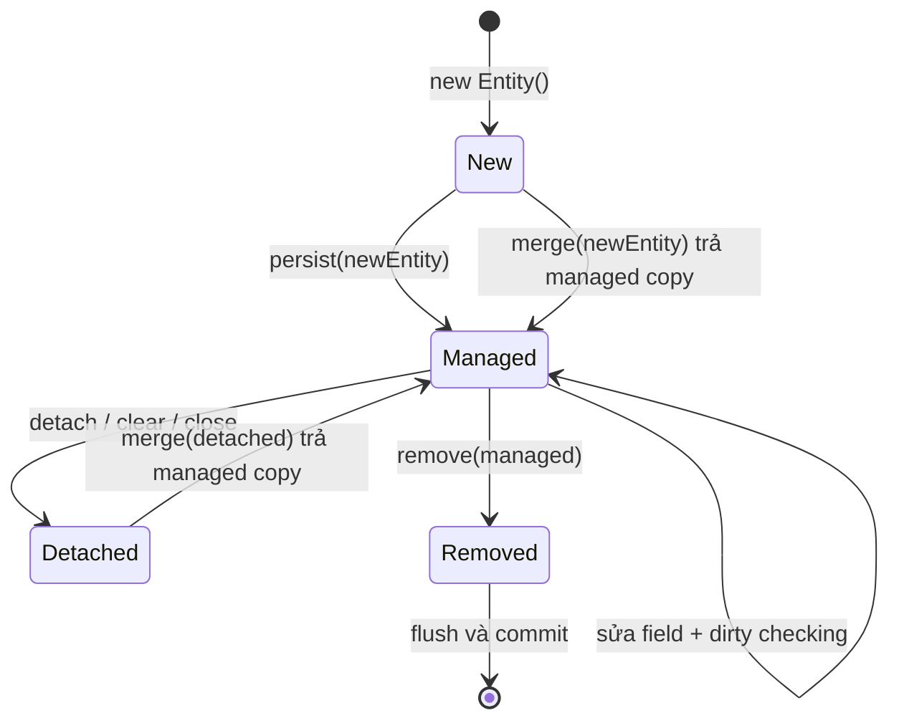
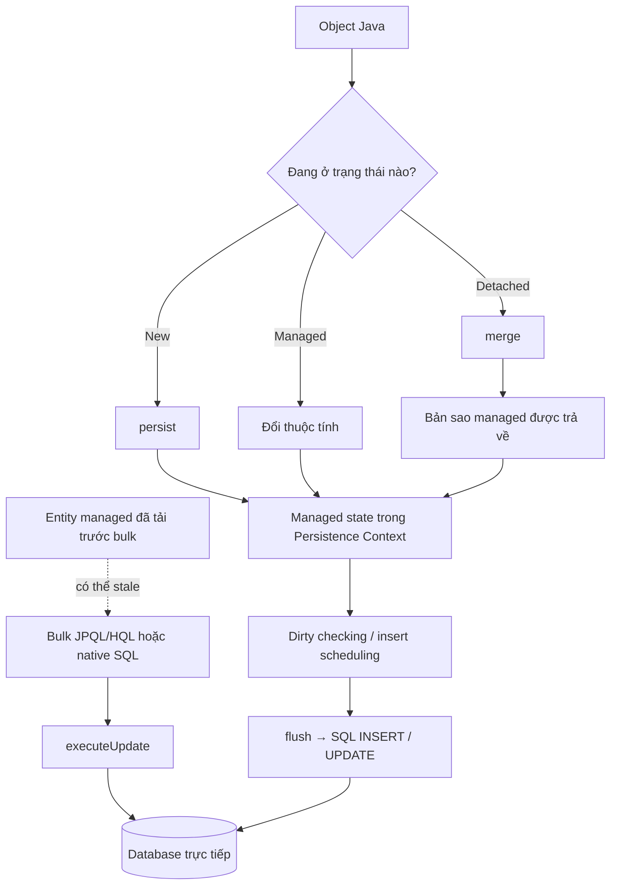
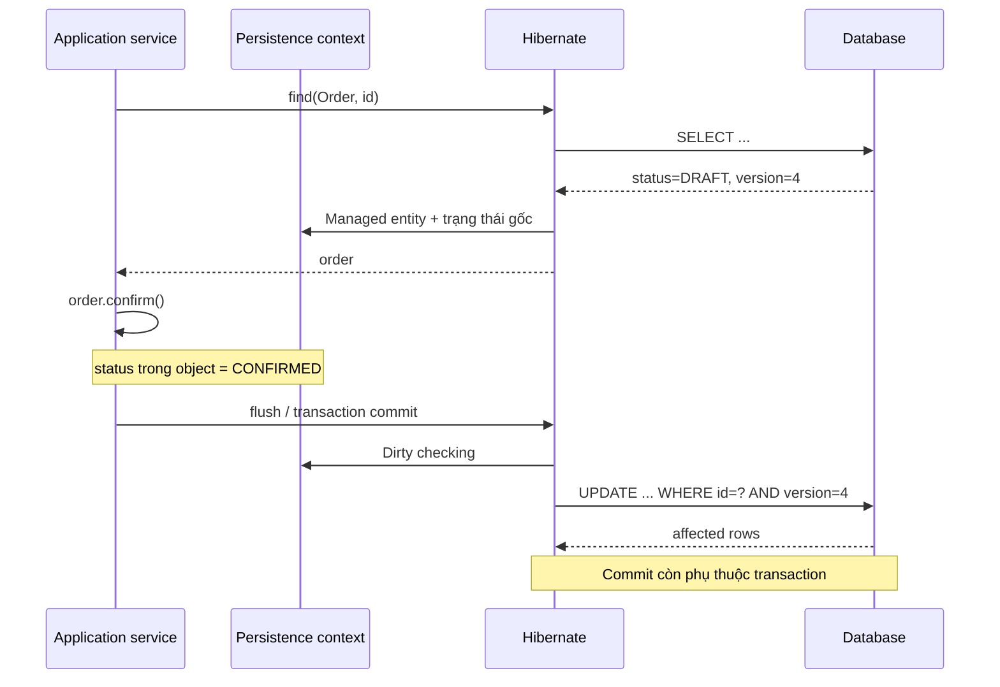
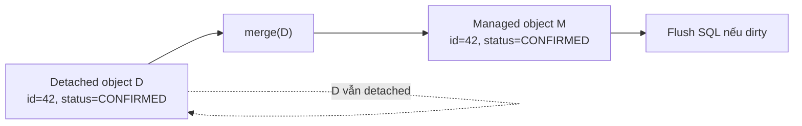
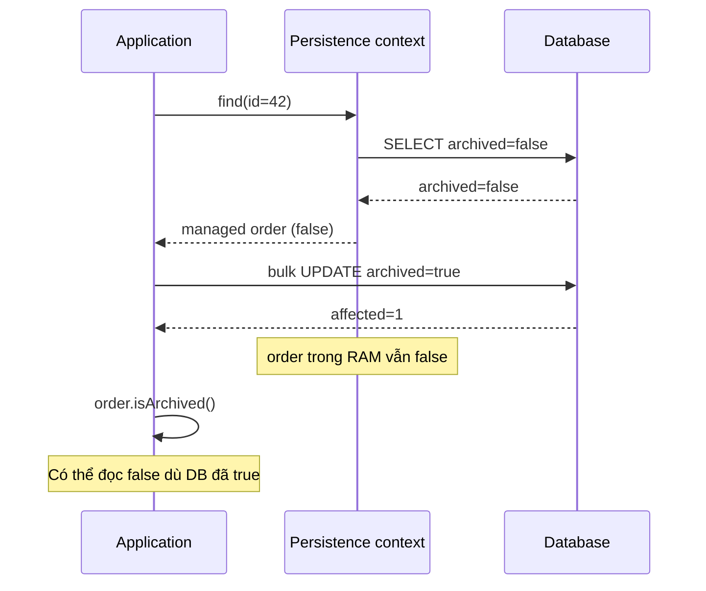
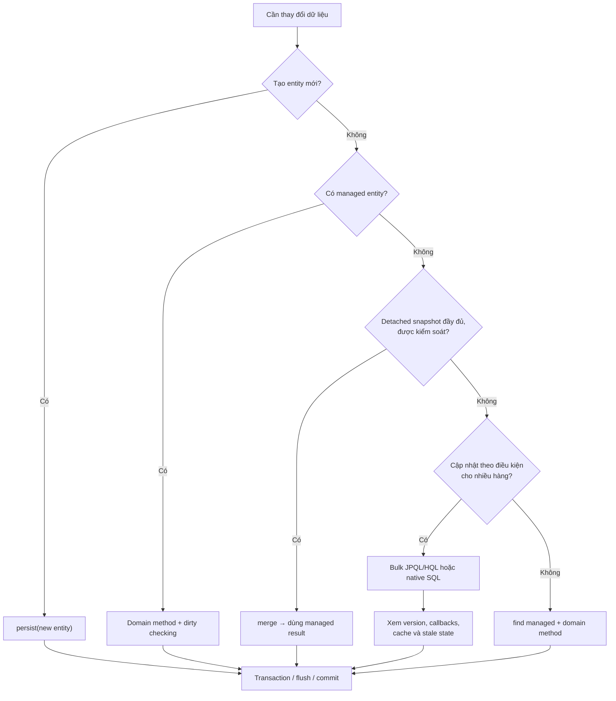

# Phân biệt persist, merge và cập nhật dữ liệu trực tiếp bằng truy vấn trong Hibernate

Trong ứng dụng Java dùng Jakarta Persistence và Hibernate, ba thao tác thường bị gọi chung là “lưu dữ liệu” nhưng có **cơ chế và ý nghĩa khác nhau**:

1. **`EntityManager.persist(entity)`** đưa **entity mới** vào trạng thái được quản lý (*managed*) và sắp xếp việc chèn bản ghi.
2. **`EntityManager.merge(entity)`** sao chép trạng thái của một entity mới hoặc detached vào **một instance managed** và trả về instance managed đó.
3. **Câu lệnh cập nhật trực tiếp**, ví dụ `UPDATE` bằng JPQL/HQL hoặc native SQL, tác động lên các hàng database theo điều kiện truy vấn, **không đi qua quy trình dirty checking của từng entity**.

Ngoài ba cách trên, còn một trường hợp thường quan trọng hơn: **entity đã managed thì chỉ cần thay đổi thuộc tính bằng phương thức nghiệp vụ**. Khi flush, Hibernate có thể tự tạo SQL nhờ dirty checking. Không cần gọi `persist` hoặc `merge` mỗi lần thay đổi một field.

Ví dụ:

```java
// 1. Entity mới: persist
PurchaseOrder fresh = new PurchaseOrder(customer, "NEW-001");
entityManager.persist(fresh);

// 2. Entity managed: đổi trạng thái rồi để Hibernate dirty-check
PurchaseOrder managed =
    entityManager.find(PurchaseOrder.class, orderId);
managed.confirm();

// 3. Entity detached: merge trả về instance managed
PurchaseOrder managedCopy = entityManager.merge(detachedOrder);

// 4. Truy vấn UPDATE trực tiếp: không cần tải từng entity
int affected = entityManager.createQuery(
        "update PurchaseOrder o set o.archived = true " +
        "where o.status = :status")
    .setParameter("status", OrderStatus.CANCELLED)
    .executeUpdate();
```

Đoạn code chỉ minh họa bốn cơ chế, không khuyên thực hiện tất cả trong cùng một transaction. Đặc biệt, **bulk update có thể làm các managed entities đã tải trước đó trở nên cũ**; phải tổ chức ranh giới đọc/ghi rõ ràng.

Mục tiêu bài học là hiểu đúng vòng đời entity, thời điểm SQL được gửi xuống database, trạng thái của object Java sau thao tác và những rủi ro về transaction, version, callback, cascade, dữ liệu cũ trong persistence context.

## 1. Bốn trạng thái entity cần nhớ

Jakarta Persistence quản lý các object entity theo một vòng đời có thể tóm lược như sau:

| Trạng thái | Ý nghĩa | Hibernate có tự theo dõi thay đổi trên object này không? |
|---|---|---|
| **New / transient** | Object Java mới, chưa được gắn với persistence context | Chưa; phải `persist` hoặc dùng một luồng merge phù hợp |
| **Managed / persistent** | Object thuộc một persistence context, có identity được ORM quản lý | Có, theo mapping/dirty checking và trạng thái read-only |
| **Detached** | Object từng được quản lý nhưng không còn thuộc persistence context hiện tại | Không; sửa object không tự phát SQL |
| **Removed** | Object managed đã được đánh dấu xóa | Hibernate lên lịch xóa theo lifecycle; không xem là đối tượng cập nhật thông thường |



Sơ đồ mô tả khái niệm, không phải mọi trường hợp `merge` đều đơn giản như mũi tên: provider có thể tìm instance đã tồn tại, tải dữ liệu, cấp ID, kiểm tra version và áp dụng cascade. Với entity đã removed, các thao tác tiếp theo còn phụ thuộc contract JPA và thời điểm flush/rollback.

Một persistence context thường được ứng dụng truy cập qua `EntityManager`, còn Hibernate `Session` là API nền tảng có các tính năng riêng.

### 1.1. Managed object có danh tính bên trong persistence context

Trong cùng một persistence context, Hibernate có xu hướng duy trì **một managed instance cho mỗi entity type + primary key**:

```java
PurchaseOrder first =
    entityManager.find(PurchaseOrder.class, orderId);

PurchaseOrder again =
    entityManager.find(PurchaseOrder.class, orderId);

System.out.println(first == again); // true trong cùng context
```

Điều này giúp Hibernate biết object nào đang đại diện bản ghi nào và theo dõi trạng thái để phát `UPDATE` khi flush. Nhưng object có ID không đương nhiên là managed:

```java
boolean managed = entityManager.contains(first);
```

`contains` chỉ kiểm tra object cụ thể trong persistence context hiện tại, không tìm theo ID để kết luận mọi object cùng ID đều được quản lý.

### 1.2. Persist, merge và bulk update tác động lên những tầng khác nhau



Các câu lệnh bulk `UPDATE` và `DELETE` tạo đường đi khác: ứng dụng biểu diễn phép biến đổi trên tập hàng database thay vì gọi method trên từng managed entity.

## 2. Bảng so sánh nhanh: persist, merge, dirty checking và bulk update

| Tiêu chí | `persist` | `merge` | Đổi managed entity | JPQL/HQL hoặc SQL update trực tiếp |
|---|---|---|---|---|
| Mục đích chính | Tạo entity mới | Hợp nhất trạng thái từ object khác vào managed instance | Chỉnh sửa entity đã quản lý | Thay đổi hàng theo điều kiện SQL/query |
| Đầu vào | Entity new phù hợp | New hoặc detached, đôi khi managed | Managed entity | Điều kiện, tham số, tên entity/bảng |
| Kết quả Java | Entity đầu vào trở thành managed | **Trả về managed instance**, có thể khác đầu vào | Vẫn là chính managed object | Trả về số lượng bị ảnh hưởng (ý nghĩa theo API/query) |
| Thời điểm SQL | Có thể hoãn tới flush; IDENTITY có thể insert sớm | Có thể SELECT trước; insert/update khi cần | Thường ở flush | `executeUpdate()` thực thi bulk statement |
| Dirty checking | Sau persist, object được managed | Trên managed instance đích | Có | **Không** dirty-check từng hàng được cập nhật |
| Cascades | `CascadeType.PERSIST` khi mapping cho phép | `CascadeType.MERGE` khi mapping cho phép | Quan hệ/lifecycle theo mapping | Không thực thi cascade lifecycle JPA trên từng entity |
| Callbacks | Lifecycle insert thông thường | Tùy entity thực sự được insert/update | Lifecycle update thông thường | Không chạy lifecycle callback cho từng hàng do bulk tác động |
| `@Version` | Thiết lập version theo ORM | Có thể kiểm tra version khi hợp nhất/cập nhật | Optimistic locking thông thường | **Không tự giống** update versioned entity thông thường |
| Persistence context | Quản lý đầu vào | Quản lý object trả về | Quản lý object đang sửa | Có thể để object đã managed **bị stale** |
| Bài toán phù hợp | Tạo bản ghi | Xử lý detached graph có chủ đích | Thao tác nghiệp vụ từng entity | Cập nhật/xóa hàng loạt, thao tác có điều kiện |

**Lưu ý số lượng từ `executeUpdate()`:** với JPQL/HQL, đó là số lượng entity bị ảnh hưởng theo semantics của query provider; với inheritance mapping, một bulk mutation có thể sinh nhiều SQL statements/hàng vật lý. Không mặc định đây luôn là số lượng hàng vật lý ở một bảng. Với native JDBC/SQL, số row count còn phụ thuộc driver và DBMS.

## 3. persist(): đưa một entity mới vào trạng thái managed

### 3.1. Cách dùng cơ bản

Xét entity đơn hàng:

```java
import jakarta.persistence.*;
import java.time.Instant;
import java.util.Objects;

@Entity
@Table(name = "purchase_orders")
public class PurchaseOrder {

    @Id
    @GeneratedValue(strategy = GenerationType.IDENTITY)
    private Long id;

    @Version
    @Column(name = "row_version", nullable = false)
    private long version;

    @Column(name = "order_code", nullable = false, unique = true)
    private String orderCode;

    @Enumerated(EnumType.STRING)
    @Column(name = "status", nullable = false)
    private OrderStatus status;

    @Column(name = "archived", nullable = false)
    private boolean archived;

    @Column(name = "created_at", nullable = false)
    private Instant createdAt;

    protected PurchaseOrder() {}

    public PurchaseOrder(String orderCode) {
        this.orderCode = Objects.requireNonNull(orderCode);
        this.status = OrderStatus.DRAFT;
        this.createdAt = Instant.now();
    }

    public Long getId() { return id; }
    public long getVersion() { return version; }
    public OrderStatus getStatus() { return status; }
    public boolean isArchived() { return archived; }

    public void confirm() {
        if (status != OrderStatus.DRAFT) {
            throw new IllegalStateException(
                "Only a draft order can be confirmed");
        }
        status = OrderStatus.CONFIRMED;
    }

    public void archive() {
        if (status != OrderStatus.CANCELLED) {
            throw new IllegalStateException(
                "Only cancelled orders can be archived");
        }
        archived = true;
    }
}
```

```java
public enum OrderStatus {
    DRAFT, CONFIRMED, CANCELLED
}
```

Tạo entity mới trong một transaction:

```java
@Transactional
public Long createOrder(String orderCode) {
    PurchaseOrder order = new PurchaseOrder(orderCode);

    entityManager.persist(order);

    // Cùng object vừa được chuyển sang trạng thái managed.
    assert entityManager.contains(order);

    return order.getId();
}
```

Ở đây dùng `GenerationType.IDENTITY`. Hibernate thường cần thực thi insert để lấy generated ID, nhưng chi tiết thời điểm xảy ra SQL phụ thuộc provider, flush mode, transaction và cấu hình ID. Nếu dùng `SEQUENCE`, Hibernate có thể cấp ID trước `INSERT`. Do đó, không coi `id != null` là bằng chứng chắc chắn rằng transaction đã commit.

### 3.2. persist không nhất thiết thực thi INSERT tức thì

```java
PurchaseOrder order = new PurchaseOrder("PO-2026-01");

entityManager.persist(order);

// Hibernate có thể đã insert để lấy IDENTITY key,
// hoặc vẫn còn SQL cần đẩy xuống DB.

entityManager.flush(); // Đồng bộ pending SQL.
```

`flush()` yêu cầu Hibernate gửi SQL cần thiết, nhưng **không phải commit**. Database vẫn có thể rollback transaction sau flush vì lỗi, exception hoặc quyết định của application.

```text
new Java object
       ↓ persist
managed entity trong persistence context
       ↓ flush / SQL INSERT
bản ghi trong transaction DB
       ↓ commit thành công
thay đổi được xác nhận
```

Khi ID được cấp từ sequence hoặc identity, các “khoảng trống ID” sau rollback không phải bằng chứng hệ thống làm mất bản ghi; cơ chế cấp số ở nhiều DBMS không hoàn nguyên mọi giá trị đã cấp.

### 3.3. Điều gì xảy ra nếu gọi persist với entity không new?

`persist` dành cho việc đưa một **new entity** vào persistence context. Nếu truyền detached entity hoặc object mang danh tính đã tồn tại theo cách không hợp lệ, Hibernate/JPA có thể báo lỗi như entity exists, detached entity passed to persist, identifier conflict hoặc constraint violation, tùy tình huống và thời điểm flush.

Không dùng:

```java
PurchaseOrder detached = loadOrderInPreviousRequest();

// Không phải cách cập nhật detached:
entityManager.persist(detached);
```

Cũng không nên “chữa” bằng cách đặt `id = null` cho một detached entity rồi `persist`: cách đó có thể tạo bản ghi trùng và làm mất semantics của identity/quan hệ.

### 3.4. Cascade PERSIST

Khi parent chứa entity con có cùng vòng đời, có thể cấu hình:

```java
@OneToMany(
    mappedBy = "order",
    cascade = CascadeType.PERSIST
)
private List<OrderLine> lines = new ArrayList<>();
```

Khi persist parent, thao tác persist có thể lan đến các child phù hợp. Nhưng **cascade không tự đồng bộ hai phía quan hệ**. Parent phải có helper gán owning side:

```java
public void addLine(OrderLine line) {
    lines.add(line);
    line.setOrder(this);
}
```

Không dùng `CascadeType.ALL` tùy tiện giữa entity có vòng đời độc lập (như Order và Customer) vì thao tác remove từ một entity có thể lan tới entity không nên xóa.

## 4. Thay đổi managed entity: nhiều khi không cần gọi persist hoặc merge

Đây là tình huống phổ biến nhất khi cập nhật một bản ghi theo nghiệp vụ.

```java
@Transactional
public void confirm(Long orderId) {
    PurchaseOrder order =
        entityManager.find(PurchaseOrder.class, orderId);

    if (order == null) {
        throw new NoSuchElementException("Order not found");
    }

    order.confirm();

    // Không cần entityManager.persist(order);
    // Không cần entityManager.merge(order).
}
```

Entity tải từ `find` là managed. Hibernate so sánh state theo cơ chế dirty checking hoặc theo dõi qua enhancement, sau đó tạo SQL update ở flush phù hợp.



Không đồng nhất “đã gọi setter” với “database đã update”. Trong cùng Java object, getter có thể trả giá trị mới ngay lập tức nhưng SQL chưa được gửi. Gọi `flush` để đồng bộ cũng chưa chứng minh commit thành công.

### 4.1. Vì sao không nên gọi merge cho mọi managed entity?

`merge` về cơ bản là thao tác **sao chép state vào một managed representation**. Với managed entity thông thường, Hibernate đã biết state; gọi merge lại chỉ gây nhầm lẫn về API, có thể kích hoạt xử lý cascade và làm người đọc tưởng rằng nếu thiếu merge thì cập nhật sẽ không được lưu.

Ví dụ thường là đủ:

```java
Order order = entityManager.find(Order.class, id);
order.changeShippingAddress(newAddress);
// Để Hibernate flush.
```

Nếu repository/service của dự án quy định gọi `save` theo convention, cần hiểu bản chất `save` của framework chứ không suy ra JPA bắt buộc phải có lệnh “save” cho mọi update.

### 4.2. Không chỉ scalar fields được theo dõi

Một managed entity có thể có thay đổi:

- `String`, `BigDecimal`, `LocalDate` và các giá trị basic.
- `@Embedded` value object.
- Quan hệ `@ManyToOne`/`@OneToOne` ở phía sở hữu.
- `@OneToMany`/`@ManyToMany`/`@ElementCollection` theo collection mapping.
- Giá trị mutable như `Date` hoặc JSON custom type theo mutability metadata.

Với quan hệ hai chiều, phải đồng bộ hai phía bằng helper phù hợp; owning side quyết định FK. Với JSON/custom basic value mutable, cần deep copy/equality/MutabilityPlan chính xác để Hibernate không bỏ sót thay đổi tại chỗ.

## 5. merge(): hợp nhất trạng thái, không phải “lưu chính object đầu vào”

Điểm dễ nhầm nhất của `merge` là **object được truyền vào và object được trả về không nhất thiết là cùng một instance**.

### 5.1. Ví dụ detached entity

Giả sử entity được tải ở request trước, persistence context cũ đã đóng:

```java
PurchaseOrder detached = loadFromEarlierContext();

detached.confirm(); // Chỉ sửa object detached trong RAM.
```

Khi vào transaction mới:

```java
@Transactional
public void mergeDetached(PurchaseOrder detached) {
    PurchaseOrder managed =
        entityManager.merge(detached);

    System.out.println(entityManager.contains(detached));
    // Thường false nếu detached thực sự khác managed instance.

    System.out.println(entityManager.contains(managed));
    // true nếu merge thành công và context còn hoạt động.

    // Những thay đổi tiếp theo nên thực hiện trên managed.
}
```

**Quy tắc then chốt: dùng instance trả về từ `merge`.** Với một detached input, JPA copy state của nó vào một managed instance hiện có hoặc mới được xác lập cho identity đó. Detached input không trở thành managed chỉ vì được truyền vào method.



Một thao tác sau merge trên object cũ:

```java
PurchaseOrder managed = entityManager.merge(detached);

detached.setSomeValue("newer");

// Không giả định thay đổi sau merge trên detached
// sẽ được copy tiếp vào managed.
```

phải được tránh. Nếu muốn thay đổi tiếp sau merge:

```java
PurchaseOrder managed = entityManager.merge(detached);
managed.changeDeliveryNote("newer");
```

Ví dụ gọi method tương ứng với entity có API đó, không yêu cầu setter công khai.

### 5.2. Hibernate lấy managed instance ở đâu?

Nếu persistence context đã có một entity managed với cùng identity, merge có thể copy state vào instance đó. Nếu chưa có, provider có thể tải bản ghi từ DB hoặc tạo managed representation thích hợp. Với detached entity có `@Version`, việc merge/cập nhật có thể phát hiện optimistic locking conflict khi version đã cũ.

Không mặc định `merge` luôn tạo một câu `UPDATE` ngay tại dòng gọi, hoặc luôn cần một SELECT duy nhất. SQL thực tế phụ thuộc state, identity, version, cascade, cấu hình và phiên bản Hibernate.

### 5.3. Merge có thể xử lý entity mới

`merge` không chỉ dùng cho detached entity. Theo JPA contract, khi truyền **new entity**, trạng thái có thể được copy vào một **managed entity mới**; provider có thể lên lịch insert.

```java
PurchaseOrder transientOrder =
    new PurchaseOrder("PO-NEW");

PurchaseOrder managedCopy =
    entityManager.merge(transientOrder);
```

Tuy nhiên, nếu mục đích là tạo một entity mới trong domain, **`persist` thường biểu đạt ý định rõ hơn**: nó quản lý chính input entity mới. Không nên chọn `merge` chỉ để có một API dùng cho mọi create/update mà bỏ qua khác biệt lifecycle.

### 5.4. Cascade MERGE không giống cascade PERSIST

```java
@OneToMany(
    mappedBy = "order",
    cascade = CascadeType.MERGE
)
private List<OrderLine> lines;
```

Khi merge parent, thao tác merge có thể lan sang các child theo mapping. Nhưng:

- Cascade MERGE **không đồng nghĩa** rằng child mới được xử lý giống cascade PERSIST trong mọi tình huống.
- Mỗi child có identity và lifecycle cần xác định.
- Object graph detached có thể có child bị xóa, child mới, child bị chuyển owner; semantics với orphanRemoval, equality và cascade phải được thiết kế cẩn thận.
- Nhiều bản object detached khác nhau nhưng cùng identity trong một graph có thể gây xung đột entity copy/duplicate representations tùy Hibernate config.
- Merge một graph lớn có thể phát sinh nhiều truy vấn và ghi đè dữ liệu không có ý định sửa.

Vì vậy, không đưa object graph nhận trực tiếp từ API vào `merge` chỉ vì DTO có cấu trúc giống entity.

## 6. Rủi ro “ghi đè nguyên trạng thái” khi merge dữ liệu không đầy đủ

Giả sử đơn hàng có `status`, `deliveryNote` và `shippingAddress`. Client chỉ muốn đổi ghi chú giao hàng, nhưng gửi request:

```json
{
  "id": 42,
  "deliveryNote": "Gọi trước khi giao"
}
```

Nếu deserialize JSON thẳng thành `PurchaseOrder` rồi gọi `merge`, những field không có trong request có thể trở thành `null`/giá trị mặc định trong object đầu vào. Merge nhằm sao chép **trạng thái object**, không tự biết field nào là “không được client gửi” theo semantics PATCH.

```java
// Cách làm dễ gây mất dữ liệu:
PurchaseOrder detached = deserializeRequestAsEntity(body);
entityManager.merge(detached);
```

Nguy cơ:

1. Field không có trong JSON bị ghi đè thành `null`.
2. Quan hệ bị thay bằng empty collection hoặc object detached giả.
3. Trạng thái nghiệp vụ bị client tự đặt mà không qua domain method.
4. Version/ID bị client cung cấp sai hoặc cố ý chỉnh sửa.
5. Các field bảo mật như owner/tenant/approvedBy bị thao túng nếu binding không được giới hạn.

### 6.1. Mẫu an toàn hơn cho cập nhật một phần

Dùng request DTO riêng và tải managed entity theo ID:

```java
public record ChangeDeliveryNoteRequest(String note) {}

@Transactional
public void changeDeliveryNote(
        Long orderId,
        ChangeDeliveryNoteRequest request) {

    PurchaseOrder order =
        entityManager.find(PurchaseOrder.class, orderId);

    if (order == null) {
        throw new NoSuchElementException("Order not found");
    }

    // Xác thực user có quyền sửa order.
    order.changeDeliveryNote(request.note());
}
```

Ở đây thay đổi nhỏ được thực hiện có chủ đích, chỉ áp dụng cho thuộc tính mà endpoint cho phép, và dirty checking ghi nhận trên managed entity.

Nếu use case thật sự cần replace toàn bộ entity graph theo một snapshot detached, merge vẫn có giá trị, nhưng phải xác định rõ **quyền sở hữu tất cả field**, version, cascade, orphanRemoval và conflict policy.

## 7. Optimistic locking với persist, merge và managed update

`@Version` giúp Hibernate phát hiện xung đột cập nhật đồng thời trong quy trình managed entity bình thường:

```java
@Version
@Column(name = "row_version")
private long version;
```

Một câu UPDATE minh họa khi thay trạng thái:

```sql
UPDATE purchase_orders
SET status = ?, row_version = ?
WHERE id = ?
  AND row_version = ?;
```

Hai transaction cùng đọc version 5:

```text
T1: đọc order id=42, version=5
T2: đọc order id=42, version=5
T1: confirm, UPDATE với version=5 -> thành 6
T2: confirm, UPDATE với version=5 -> không có row khớp
T2: nhận lỗi optimistic locking theo provider/framework
```

Với `merge` của detached entity, nếu data mang version cũ, Hibernate có thể phát hiện conflict khi merge, flush hoặc commit, tùy trường hợp. Không giả định lỗi luôn xảy ra tại chính lời gọi `merge`.

Để giải quyết xung đột, application có thể trả lỗi cho người dùng chỉnh sửa lại, hoặc retry **toàn bộ transaction nghiệp vụ** khi operation an toàn để thử lại. Không tự tăng version hay bỏ qua version cũ chỉ để ép ghi.

### 7.1. Version không bảo vệ mọi bất biến

Một quy tắc “mỗi ghế chỉ được một người đặt” cần unique constraint ở DB hoặc cơ chế locking phù hợp, vì hai transaction có thể đang sửa **hai entity khác nhau**. `@Version` trên mỗi entity không tự bảo vệ quy tắc liên hàng/ liên bảng.

### 7.2. Merge stale state là vấn đề nghiệp vụ, không chỉ kỹ thuật

Một detached entity được tạo từ dữ liệu hai ngày trước có thể ghi đè trạng thái mới nếu không có version hoặc conflict policy. Hibernate không tự suy luận dữ liệu nào có ưu tiên đúng cho domain. Với request cập nhật, nên mang version/ETag khi có yêu cầu kiểm soát “không ghi đè thay đổi của người khác”.

## 8. Cập nhật trực tiếp bằng JPQL/HQL: bulk UPDATE

Một **bulk update** thay đổi nhiều hàng dựa trên điều kiện, không cần `find` từng entity.

Ví dụ nghiệp vụ dọn dữ liệu cũ: đánh dấu những đơn đã hủy là archived:

```java
@Transactional
public int archiveCancelledOrders() {
    return entityManager.createQuery(
        """
        update PurchaseOrder o
        set o.archived = true
        where o.status = :status
          and o.archived = false
        """
    )
    .setParameter("status", OrderStatus.CANCELLED)
    .executeUpdate();
}
```

JPQL dùng **tên entity và tên thuộc tính Java**, không phải tên bảng/cột SQL:

```text
JPQL:  update PurchaseOrder o set o.archived = true
SQL:   UPDATE purchase_orders SET archived = true
```

Hibernate quyết định SQL thực tương ứng với mapping và Dialect. `executeUpdate()` thực thi câu mutation query và trả kết quả ảnh hưởng theo semantics JPA/Hibernate.

### 8.1. Vì sao bulk update nhanh hơn cho tập lớn?

Cách sửa từng entity có thể làm:

```java
List<PurchaseOrder> orders = entityManager.createQuery(
        """
        select o from PurchaseOrder o
        where o.status = :status and o.archived = false
        """,
        PurchaseOrder.class
    )
    .setParameter("status", OrderStatus.CANCELLED)
    .getResultList();

for (PurchaseOrder order : orders) {
    order.archive();
}
```

Cách này có thể cần tải nhiều object vào persistence context, kiểm tra dirty state, callback và phát nhiều SQL updates, dù Hibernate có thể batch chúng.

Bulk update chuyển phép biến đổi thành **một query ở cấp dữ liệu** (hoặc một số SQL statements tùy mapping), không cần hydrate toàn bộ entities. Phù hợp khi operation giống nhau cho nhiều hàng và không cần gọi domain method/callback từng bản ghi.

Nhưng đổi lại, bulk update bỏ qua những cơ chế cấp entity thường là lý do chúng ta dùng ORM.

### 8.2. Bulk update không chạy domain methods cho từng bản ghi

```java
// Bulk query không gọi order.archive() cho từng PurchaseOrder.
update PurchaseOrder o
set o.archived = true
where o.status = :status
```

Nếu `archive()` còn kiểm tra điều kiện ngoài status, tạo event hoặc ghi audit log, JPQL trên **không tự chạy những hành vi đó**. Để dùng bulk an toàn, cần xem phép biến đổi có hoàn toàn thể hiện bằng điều kiện query và database constraints không.

Nếu mỗi đơn có chính sách khác nhau theo thời điểm, số lượng line items, tenant, quyền và trạng thái liên quan, bulk update có thể không còn đơn giản và an toàn.

## 9. Bulk JPQL/HQL bỏ qua trạng thái managed entity đã tải

Giả sử trong cùng persistence context:

```java
PurchaseOrder order =
    entityManager.find(PurchaseOrder.class, orderId);

System.out.println(order.isArchived()); // false

entityManager.createQuery(
        "update PurchaseOrder o " +
        "set o.archived = true where o.id = :id")
    .setParameter("id", orderId)
    .executeUpdate();

System.out.println(order.isArchived());
// Vẫn có thể là false: object đã managed bị stale.
```

Hibernate đã gửi bulk UPDATE tới database, nhưng **không tự duyệt từng managed object tương ứng để sửa các field trong RAM**. `@Version`/snapshot và những cache đang giữ state cũng có thể không phản ánh đầy đủ sự thay đổi đó.



Đây là một lý do quan trọng để **không trộn bulk update với code đang tiếp tục dùng các managed entities của cùng tập hàng** mà không có chiến lược đồng bộ.

### 9.1. Làm mới một entity bằng refresh

```java
entityManager.refresh(order);

System.out.println(order.isArchived());
// Có thể thấy true sau khi tải lại từ DB theo transaction isolation.
```

`refresh` yêu cầu lấy lại state của managed object. Tuy nhiên, nếu object còn **thay đổi chưa flush**, refresh có thể ghi đè những thay đổi ấy. Vì vậy phải quyết định thứ tự thao tác chứ không gọi refresh tùy tiện.

### 9.2. Clear toàn bộ persistence context

Sau bulk update, nếu không cần giữ những managed instances hiện tại:

```java
entityManager.clear();

PurchaseOrder reloaded =
    entityManager.find(PurchaseOrder.class, orderId);
```

`clear()` tách **tất cả** managed entities. Những thay đổi chưa flush có nguy cơ bị bỏ qua, nên thường cần flush các thay đổi có ý định lưu **trước** bulk hoặc trước clear theo kế hoạch cụ thể.

### 9.3. Vì sao gọi lại find không đủ?

```java
PurchaseOrder again =
    entityManager.find(PurchaseOrder.class, orderId);
```

Trong cùng persistence context, `find` thường trả lại instance managed hiện có. Nếu instance đó stale, gọi lại `find` không đảm bảo tải dữ liệu mới. Cần `refresh`, `clear` rồi find, hoặc sử dụng persistence context/transaction mới phù hợp.

## 10. Thứ tự an toàn khi phối hợp ORM updates với bulk mutation

Một mẫu rõ nghĩa khi transaction đã có pending dirty entities và cần chạy bulk query:

```java
@Transactional
public int updateAndArchive(Long orderId) {
    PurchaseOrder order =
        entityManager.find(PurchaseOrder.class, orderId);

    order.changeDeliveryNote("Checked");

    // Nếu muốn bảo đảm các thay đổi đã theo dõi được gửi xuống DB
    // trước khi thực hiện bulk:
    entityManager.flush();

    int affected = entityManager.createQuery(
            """
            update PurchaseOrder o
            set o.archived = true
            where o.status = :status
              and o.archived = false
            """
        )
        .setParameter("status", OrderStatus.CANCELLED)
        .executeUpdate();

    // Nếu không cần giữ object hiện tại và không có pending work:
    entityManager.clear();

    return affected;
}
```

Trong transaction với flush mode AUTO, Hibernate có thể tự flush phù hợp trước query, nhưng khi sự đúng đắn phụ thuộc thứ tự thì `flush()` tường minh giúp làm rõ ranh giới. Không dùng `clear` nếu còn cần chỉnh sửa các managed entities đó hoặc không muốn tách toàn bộ graph.

**Quan trọng:** `flush()` trước bulk không tự giải quyết mọi vấn đề optimistic locking. Bulk update có thể bỏ qua version và khiến một transaction khác/managed entity đang giữ version cũ có hành vi cần xử lý riêng.

### 10.1. Tách command theo transaction thường dễ suy luận hơn

Nếu bulk update là một tác vụ quản trị dữ liệu, thiết kế nó trong **transaction riêng**, không tải cùng tập managed entities trước đó rồi tiếp tục dùng chúng sau bulk. Việc tách này giảm aliasing và stale state trong persistence context.

Đối với use case hỗn hợp bắt buộc phải làm trong một transaction, cần cân nhắc isolation, flush, cache và exception handling.

## 11. Bulk update có tự kiểm tra @Version không?

Thông thường, bulk JPQL/HQL update **không tự sử dụng @Version và dirty checking cho từng bản ghi giống thao tác entity managed**. Đây là một khác biệt lớn.

Giả sử mỗi `PurchaseOrder` có cột `row_version`. Một bulk query:

```java
entityManager.createQuery(
        "update PurchaseOrder o " +
        "set o.archived = true where o.status = :status")
    .setParameter("status", OrderStatus.CANCELLED)
    .executeUpdate();
```

không nên được giả định sẽ tự tăng version từng order theo lifecycle update bình thường. Điều này có thể khiến một managed entity ở transaction khác đang giữ version cũ không phát hiện dữ liệu `archived` đã đổi theo quy tắc mong muốn.

### 11.1. Điều kiện version tường minh cho một hàng

Với version số nguyên, khi muốn cập nhật trực tiếp một hàng và chỉ chấp nhận nếu version vẫn là giá trị client đã đọc, có thể viết:

```java
@Transactional
public boolean archiveIfVersionMatches(
        Long orderId,
        long expectedVersion) {

    int affected = entityManager.createQuery(
            """
            update PurchaseOrder o
               set o.archived = true,
                   o.version = o.version + 1
             where o.id = :id
               and o.version = :expectedVersion
               and o.status = :status
               and o.archived = false
            """
        )
        .setParameter("id", orderId)
        .setParameter("expectedVersion", expectedVersion)
        .setParameter("status", OrderStatus.CANCELLED)
        .executeUpdate();

    return affected == 1;
}
```

Đây là **conditional update**, có cả kiểm tra version và tăng version tường minh cho trường numeric. Ý nghĩa kết quả:

- `affected == 1`: câu lệnh đã cập nhật một entity khớp điều kiện.
- `affected == 0`: không có hàng khớp; nguyên nhân có thể là ID không tồn tại, version đã đổi, trạng thái không còn CANCELLED hoặc đã archived. Ứng dụng cần phân biệt các tình huống nếu API yêu cầu.
- Với inheritance hoặc bulk mapping phức tạp, kiểm tra số lượng bị ảnh hưởng phải theo semantics query/provider, không suy mọi mutation đều đúng một hàng vật lý.
- Nếu version được quản lý bằng timestamp, user type hoặc cơ chế khác, không thể áp dụng công thức `version + 1` một cách máy móc.

**Không nên trộn cách này với một managed instance của cùng order đang có pending state** rồi kỳ vọng Hibernate tự điều chỉnh version trong RAM. Tách transaction/context hoặc làm mới state có chủ đích.

### 11.2. Hibernate-specific HQL versioned update

Một số dòng Hibernate hỗ trợ cú pháp HQL riêng cho versioned bulk update, thường được nhắc đến là `update versioned ...`. Đây **không phải JPQL portable** và có giới hạn về kiểu version/custom user types. Không đưa cú pháp đó vào code chỉ vì đọc thấy trên một phiên bản Hibernate khác; phải kiểm tra đúng release hiện tại.

Dù dùng HQL versioned mutation, bulk query vẫn không tự gọi domain methods, cascade lifecycle và callback cho từng entity như cơ chế managed dirty checking.

### 11.3. Một con số affected không thay thế xử lý concurrency

Nếu câu lệnh chỉ có `WHERE id=:id` mà không kiểm tra version/trạng thái, request cũ có thể ghi đè dữ liệu mới. Nếu dùng conditional update và thấy `affected=0`, phải trả kết quả nghiệp vụ phù hợp, không tự mặc định thử lại không giới hạn hoặc bỏ qua xung đột.

## 12. Bulk DELETE và EntityManager.remove() khác nhau như thế nào?

Để hiểu trọn “cập nhật dữ liệu trực tiếp”, cần xét thêm delete.

### 12.1. Xóa một managed entity

```java
@Transactional
public void deleteOrder(Long id) {
    PurchaseOrder order =
        entityManager.find(PurchaseOrder.class, id);

    if (order == null) {
        return;
    }

    entityManager.remove(order);
}
```

Đây là thao tác lifecycle entity. Hibernate có thể áp dụng:

- `CascadeType.REMOVE` tới những association được cấu hình.
- `orphanRemoval` và quy tắc vòng đời liên quan.
- Lifecycle callbacks như `@PreRemove`, `@PostRemove`.
- Optimistic locking/version khi xóa, tùy mapping.
- Kiểm soát các dependent entities theo mapping.

Không có nghĩa mọi delete sẽ thực thi một SQL duy nhất; quan hệ và cascade có thể tạo thêm statements.

### 12.2. Bulk DELETE theo JPQL

```java
@Transactional
public int purgeOldCancelledOrders(Instant cutoff) {
    return entityManager.createQuery(
            """
            delete from PurchaseOrder o
            where o.status = :status
              and o.createdAt < :cutoff
            """
        )
        .setParameter("status", OrderStatus.CANCELLED)
        .setParameter("cutoff", cutoff)
        .executeUpdate();
}
```

Đây là một phép mutation trực tiếp lên các hàng database. Nó **không gọi `entityManager.remove` cho mỗi entity**, vì vậy không tự lan truyền JPA cascade remove và callback như thao tác lifecycle thông thường. Nếu còn row con có FK, DB có thể từ chối delete hoặc thực hiện `ON DELETE CASCADE` nếu schema đã cấu hình.

**Database cascade** (`ON DELETE CASCADE`) khác với **JPA cascade** (`CascadeType.REMOVE`): một cái do database thực thi, một cái do ORM áp dụng trong lifecycle entity.

Bulk delete đặc biệt nguy hiểm khi dữ liệu có audit/history, soft delete, event cần phát hoặc quy tắc xóa phức tạp. Cần xác định tác dụng phụ trước khi tối ưu thành một câu SQL.

### 12.3. Soft delete cũng cần thống nhất chiến lược

Nếu hệ thống dùng field `deleted`/`deletedAt` thay cho xóa vật lý, một câu bulk `DELETE` có thể phá chính sách soft delete. Có thể dùng bulk UPDATE cho trường trạng thái, nhưng vẫn phải xét version, callbacks, auditing và query filters.

Không chọn bulk delete chỉ vì tên service là `deleteOldOrders()`; hãy xem yêu cầu lưu giữ dữ liệu và pháp lý của ứng dụng.

## 13. Cập nhật trực tiếp bằng native SQL

JPQL/HQL mô tả thao tác theo entity model. Native SQL thao tác trực tiếp theo **tên bảng và cột thực** của DBMS:

```java
@Transactional
public int archiveBySql(Instant cutoff) {
    return entityManager.createNativeQuery(
            """
            UPDATE purchase_orders
               SET archived = true
             WHERE status = :status
               AND created_at < :cutoff
               AND archived = false
            """
        )
        .setParameter("status", "CANCELLED")
        .setParameter("cutoff", cutoff)
        .executeUpdate();
}
```

Đây là ví dụ cho DBMS hỗ trợ literal boolean `true/false`. Mapping `OrderStatus` phải phù hợp cách database lưu enum (trong ví dụ `EnumType.STRING`). Với các dialect khác, tên bảng, cột, kiểu boolean và binding timestamp có thể khác.

### 13.1. Native SQL phù hợp khi nào?

- Cần tính năng SQL riêng của vendor như CTE phức tạp, window function, `RETURNING`/`OUTPUT`, JSON operator hoặc UPSERT.
- Cần tối ưu bulk thao tác trên nhiều hàng mà JPQL/HQL không diễn tả đủ.
- Cần cập nhật một bảng legacy không có mapping entity phù hợp.
- Cần thao tác DML có điều kiện mạnh ngay trong database để giảm race.

Đổi lại, code kém portable hơn và phải chịu trách nhiệm kiểm soát cú pháp SQL thật, quyền DB, isolation, index, constraint và tác động lên cache/managed state.

### 13.2. Dùng bind parameters, không ghép user input thành SQL

Không nên:

```java
String sql =
    "UPDATE purchase_orders SET status = '" + requestStatus +
    "' WHERE id = " + requestId;
```

Nối giá trị không tin cậy vào SQL có nguy cơ injection và lỗi escaping. Dùng parameter binding:

```java
entityManager.createNativeQuery(
        "UPDATE purchase_orders SET status = :status WHERE id = :id")
    .setParameter("status", validatedStatus)
    .setParameter("id", orderId)
    .executeUpdate();
```

Identifier như tên cột/bảng hoặc hướng `ORDER BY` thường không thể truyền như bind parameter thông thường. Nếu thật sự cần SQL động, phải dùng allowlist các identifier hợp lệ và cách render an toàn, không nhận nguyên chuỗi SQL từ request.

### 13.3. Native UPDATE không tự đồng bộ entity đang managed

Giống bulk JPQL, native UPDATE trực tiếp có thể làm state trong persistence context bị cũ. Nếu Hibernate sau đó flush một managed entity chứa giá trị cũ, có thể xảy ra ghi đè không mong muốn, nhất là khi không có version/conditional update phù hợp.

Sau native DML, cần xác định khi nào nên `flush`, `refresh`, `clear`, hoặc dùng transaction đọc mới. Không dùng `find` lại cùng ID trong cùng context như một cách refresh chắc chắn.

### 13.4. DDL, procedure và RETURNING không giống executeUpdate thông thường

Một truy vấn cần trả về nhiều giá trị sau update (ví dụ PostgreSQL `UPDATE ... RETURNING`) có thể yêu cầu API native query xử lý result set phù hợp thay vì coi mọi trường hợp là `executeUpdate()`. Cách xử lý phụ thuộc JDBC/provider/database.

Khi dùng stored procedure hoặc native SQL có tác dụng phụ, phải xét transaction, row count semantics và cache synchronization riêng; không giả định JPA lifecycle callbacks được gọi.

## 14. Spring Data JPA: save, saveAndFlush và @Modifying

Trong dự án Spring Boot, người dùng có thể thấy `repository.save` hoặc `@Modifying` và lẫn chúng với JPA API gốc.

### 14.1. save không giống persist trong mọi trường hợp

Spring Data JPA `JpaRepository.save(entity)` thường quyết định entity mới hay không để gọi `EntityManager.persist` hoặc `EntityManager.merge` tương ứng. Quyết định “newness” phụ thuộc version/ID và các interface/cấu hình như `Persistable`.

```java
PurchaseOrder order = new PurchaseOrder("PO-101");
PurchaseOrder saved = orderRepository.save(order);
```

Không coi `save` là cùng một lời gọi vật lý bất kể entity state. Với managed entity được tải trong transaction, gọi `save` sau mỗi thay đổi thường không phải điều kiện để Hibernate flush changes.

### 14.2. saveAndFlush có ý nghĩa thời điểm SQL

`saveAndFlush(entity)` là API repository nhằm lưu theo semantics Spring Data rồi flush ngay. Nó **không commit transaction ngay**. Nếu transaction về sau rollback, SQL vừa flush vẫn có thể bị hủy.

Chỉ dùng flush sớm khi có lý do: cần constraint exception sớm, đọc generated values hoặc đồng bộ trước một phép query phụ thuộc dữ liệu mới.

### 14.3. @Modifying cho JPQL bulk update

Một Spring Data repository có thể khai:

```java
public interface PurchaseOrderRepository
        extends JpaRepository<PurchaseOrder, Long> {

    @Modifying
    @Query("""
        update PurchaseOrder o
           set o.archived = true
         where o.status = :status
           and o.archived = false
        """)
    int archiveCancelled(@Param("status") OrderStatus status);
}
```

Gọi trong service có transaction:

```java
@Transactional
public int archiveCancelled() {
    return orderRepository.archiveCancelled(
        OrderStatus.CANCELLED);
}
```

`@Modifying` cho Spring Data biết method `@Query` là mutation query, không phải truy vấn chọn. Nó **không biến** bulk update thành vòng lặp cập nhật managed entities; vì vậy những hệ quả về callbacks, version và stale persistence context vẫn tồn tại.

### 14.4. flushAutomatically và clearAutomatically

Spring Data `@Modifying` có các tuỳ chọn thường dùng:

```java
@Modifying(
    flushAutomatically = true,
    clearAutomatically = true
)
@Query("""
    update PurchaseOrder o
       set o.archived = true
     where o.status = :status
""")
int archiveCancelled(@Param("status") OrderStatus status);
```

- `flushAutomatically=true`: yêu cầu flush context trước khi mutation query chạy, giúp những pending changes đã được quản lý không bị bỏ qua khi kết hợp với bulk.
- `clearAutomatically=true`: clear context sau mutation để tránh tiếp tục dùng managed entities stale.
- Clear là hành động **toàn context**, có thể làm mất những thay đổi chưa flush nếu không được lưu trước đó; vì thế mặc định không nên tự động clear mọi repository method.

Không cần bật hai tùy chọn cho mọi `@Modifying`. Đánh giá theo ranh giới transaction và việc còn dùng entity managed sau bulk hay không.

## 15. Cách chọn giữa merge và cập nhật một hàng bằng query

Một use case “đổi trạng thái của đơn hàng có ID và version” có thể được triển khai theo hai hướng.

### 15.1. Hướng A: tải managed entity, gọi domain method

```java
@Transactional
public void confirmOrder(Long id) {
    PurchaseOrder order =
        entityManager.find(PurchaseOrder.class, id);

    if (order == null) {
        throw new NoSuchElementException("Not found");
    }

    // Logic nghiệp vụ có thể kiểm tra nhiều field.
    order.confirm();
}
```

Ưu điểm:

- Bất biến nghiệp vụ nằm trong domain method.
- Có thể dùng optimistic locking `@Version` bình thường.
- Lifecycle callbacks/cascade tương ứng được áp dụng theo entity mapping.
- Dễ phối hợp với quan hệ, collection và nghiệp vụ phức tạp.

Nhược điểm:

- Cần tải entity (có thể thêm SELECT).
- Có overhead quản lý entity/dirty checking.
- Với hàng triệu bản ghi, tải từng entity có thể quá tốn tài nguyên.

### 15.2. Hướng B: conditional UPDATE một hàng

```java
@Transactional
public boolean confirmIfDraft(Long id, long expectedVersion) {
    int affected = entityManager.createQuery(
            """
            update PurchaseOrder o
               set o.status = :confirmed,
                   o.version = o.version + 1
             where o.id = :id
               and o.status = :draft
               and o.version = :version
            """
        )
        .setParameter("confirmed", OrderStatus.CONFIRMED)
        .setParameter("draft", OrderStatus.DRAFT)
        .setParameter("id", id)
        .setParameter("version", expectedVersion)
        .executeUpdate();

    return affected == 1;
}
```

Ưu điểm:

- Không nhất thiết tải entity.
- Có thể kiểm tra điều kiện và update nguyên tử trong database.
- Giảm round trip nếu điều kiện nghiệp vụ đủ gói trong một câu query.

Giới hạn:

- Domain method `confirm()` và callbacks không chạy trên từng entity.
- Bắt buộc tự thể hiện toàn bộ điều kiện nghiệp vụ có liên quan trong query hoặc transaction.
- `@Version` không được xử lý tự động như managed update; ví dụ này phải tự tăng version số.
- Persistence context có thể stale nếu đã tải order trước đó.
- Nếu muốn tạo domain event/outbox liên quan, phải thiết kế sự kiện và transaction riêng, không có callback tự động cho từng row.

**Không có cách nào luôn “tốt nhất”.** Nếu hành vi quan trọng và cần validation/cascade, managed entity thường rõ nghĩa. Nếu phép biến đổi chỉ phụ thuộc một số điều kiện SQL rõ ràng và cần throughput cao, conditional update có thể phù hợp hơn.

### 15.3. Merge có phải lựa chọn thứ ba tốt hơn?

Với request mới gửi vài field để cập nhật, merge detached entity thường **không phải** hướng mặc định an toàn. Tải managed entity rồi dùng domain method giúp tránh copy những field không chủ ý. Merge phù hợp hơn với một **snapshot detached đầy đủ** được kiểm soát, ví dụ một workflow đồng bộ graph được thiết kế cho merge, với version và cascade rõ ràng.

## 16. Ứng dụng cần lưu ý transaction và flush ở mọi cách

### 16.1. Transaction không tự xuất hiện vì gọi persist

JPA/Hibernate có nhiều bootstrap và integration modes; trong ứng dụng resource-local hoặc Spring transaction thông dụng, các thao tác thay đổi database cần transaction phù hợp.

```java
@Transactional
public void createAndConfirm(String code) {
    PurchaseOrder order = new PurchaseOrder(code);

    entityManager.persist(order);
    order.confirm();
}
```

Nếu không có transaction hoặc persistence context đã đóng, hành vi có thể khác hoặc ném exception. Không dựa vào việc một method tên `save` được gọi là đủ để bảo đảm commit thành công.

### 16.2. Flush là một phần của transaction, không thay commit

```java
entityManager.persist(order);
entityManager.flush();

// SQL đã được đẩy theo yêu cầu,
// nhưng transaction có thể rollback.
```

`flush` có thể làm lộ constraint violation sớm, nhưng cũng tạo I/O. Với bulk `executeUpdate`, SQL mutation được thực thi tại thời điểm gọi, song kết quả **vẫn thuộc transaction** và có thể rollback.

### 16.3. AUTO flush mode và query

Trong flush mode AUTO, ORM có thể flush các thay đổi liên quan trước khi chạy query để bảo đảm tính nhất quán theo JPA/Hibernate contract. Trong các mode khác, ví dụ COMMIT hoặc các chế độ riêng của Hibernate Session, thời điểm flush khác.

Không suy luận rằng mọi JPQL bulk query sẽ luôn tự flush bất cứ pending state nào trong mọi cấu hình. Nếu thứ tự quyết định đúng/sai, dùng flush có chủ đích và giữ transaction dễ hiểu.

### 16.4. Transaction read-only không phải cách thực hiện mutation

```java
@Transactional(readOnly = true)
public int archiveCancelled() {
    // Không nên thực hiện mutation trong service đọc-only.
    return orderRepository.archiveCancelled(OrderStatus.CANCELLED);
}
```

Spring `readOnly=true` là hint/tối ưu qua transaction manager/Hibernate/driver, có thể ảnh hưởng flush behavior và khả năng ghi tùy môi trường. Nó không phải khóa bảo mật tuyệt đối chống mọi DML. Service thực hiện write nên mở transaction đọc-ghi và có quyền phù hợp.

## 17. Các hệ quả của bulk update với version, cache và auditing

### 17.1. First-level cache trong persistence context

Object managed đã tải trước bulk có thể stale. Phải tổ chức `refresh`, `clear` hoặc kết thúc transaction khi cần. Không gọi `find` lại trong cùng context rồi giả định Hibernate luôn làm mới.

### 17.2. Second-level cache và query cache

Hibernate có cơ chế invalidation/cleanup cache liên quan khi thực thi HQL/JPQL bulk operations theo khả năng framework, nhưng với native SQL, external writers, custom cache hoặc những query đặc biệt, không nên mặc định mọi entry đều được đồng bộ theo ý nghĩa nghiệp vụ.

Thiết kế cache nên xác định rõ bảng/query spaces bị ảnh hưởng, transaction boundaries và cơ chế evict/TTL/invalidation khi có những nguồn ghi ngoài ORM. `@Cache` không giải quyết automatically mọi stale state.

### 17.3. @PreUpdate và @PostUpdate

Bulk update không đi qua callback entity cho từng hàng như dirty checking-managed update. Nếu hệ thống phụ thuộc callback để đặt `updatedAt`, bulk JPQL có thể bỏ sót field đó, trừ khi query tự cập nhật hoặc DB trigger chịu trách nhiệm.

Ví dụ:

```java
@PreUpdate
void beforeUpdate() {
    updatedAt = Instant.now();
}
```

Khi bulk JPQL update, không mong callback này được gọi cho mỗi order. Nếu muốn timestamp, có thể cập nhật trực tiếp trong query theo nguồn thời gian đã chọn:

```java
entityManager.createQuery(
        """
        update PurchaseOrder o
        set o.archived = true,
            o.updatedAt = :now
        where o.status = :status
        """
    )
    .setParameter("now", Instant.now())
    .setParameter("status", OrderStatus.CANCELLED)
    .executeUpdate();
```

Đoạn ví dụ giả định entity có `updatedAt` được ánh xạ và cho phép cập nhật, phù hợp kiểu DB. Nếu DB trigger tạo timestamp, nên dùng chính sách DB nhất quán, không chồng chéo hai nguồn giờ không kiểm soát.

### 17.4. Domain events và outbox

Nếu entity method `confirm()` tạo domain event hoặc application service ghi vào outbox, bulk update bỏ qua method đó sẽ không tự phát event cho từng order. Không dùng bulk update cho những nghiệp vụ yêu cầu side effects riêng nếu chưa xây dựng cơ chế đảm bảo event/audit nhất quán.

Một thiết kế có thể dùng transaction lưu bảng nguồn cùng bảng outbox và job xử lý sự kiện, hoặc tách batch nghiệp vụ thành các đơn vị nhỏ được kiểm soát.

### 17.5. Database triggers và constraints vẫn chạy

Bulk query không gọi JPA callbacks, **nhưng database vẫn thực thi các trigger/constraint liên quan tới chính SQL đó**. Nếu có trigger `BEFORE UPDATE`, DB sẽ chạy theo quy tắc engine. Phân biệt rõ JPA lifecycle callback với database trigger.

## 18. Khi nào tránh bulk update dù “nhanh hơn”?

Một số thay đổi thuộc phạm vi nghiệp vụ phức tạp, không nên bỏ qua entity lifecycle:

- Xác nhận đơn phải kiểm tra tồn kho, trạng thái thanh toán và giới hạn tín dụng.
- Chuyển trạng thái hợp đồng phải ghi lịch sử, phát sự kiện và cập nhật các đối tượng liên quan.
- Thay owner của aggregate phải đồng bộ nhiều quan hệ và quyền.
- Xóa entity con phải tôn trọng orphan removal và cascade đúng domain.
- Thao tác có quy tắc khác nhau theo từng bản ghi và dữ liệu liên quan đã tải.
- Yêu cầu optimistic locking và phản hồi xung đột chính xác cho từng entity.

Đối với những trường hợp này, tải managed entities, gọi domain methods và dùng transaction rõ ràng thường bảo toàn ý nghĩa nghiệp vụ hơn một SQL update khó kiểm chứng.

Không biến “một câu SQL” thành tiêu chí duy nhất. Hiệu năng quan trọng nhưng **một bulk update sai nghiệp vụ có thể phá dữ liệu hàng loạt**.

## 19. Tình huống thực tế: import dữ liệu, sửa một đơn và dọn dữ liệu cũ

### Tình huống A — Tạo đơn hàng mới qua API

Đầu vào là request tạo đơn hợp lệ. Service dựng entity mới, áp dụng domain validation rồi `persist`:

```java
@Transactional
public Long create(CreateOrderCommand cmd) {
    validateCreatePermission(cmd);

    PurchaseOrder order =
        new PurchaseOrder(cmd.orderCode());

    entityManager.persist(order);

    return order.getId();
}
```

Nếu nghiệp vụ phải trả ID sau insert, cần hiểu chiến lược ID. IDENTITY có thể cần insert để biết ID; SEQUENCE có thể cấp trước insert. Không coi ID đã có là bằng chứng commit.

### Tình huống B — Khách đổi ghi chú giao hàng

Endpoint PATCH chỉ đổi một field. Service tải entity managed rồi gọi method:

```java
@Transactional
public void updateNote(Long id, String note) {
    PurchaseOrder order =
        entityManager.find(PurchaseOrder.class, id);

    if (order == null) {
        throw new NoSuchElementException("Order not found");
    }

    checkCanEdit(order);
    order.changeDeliveryNote(note);
}
```

Không cần merge một entity deserialize thiếu các field khác.

### Tình huống C — Đồng bộ snapshot detached từ một hệ thống nội bộ

Nếu hệ thống được thiết kế truyền **đầy đủ graph entity** qua một ranh giới persistence context và có version cùng chính sách merge, có thể gọi `merge`:

```java
@Transactional
public PurchaseOrder mergeControlledSnapshot(
        PurchaseOrder trustedDetachedSnapshot) {

    verifySnapshotOrigin(trustedDetachedSnapshot);

    PurchaseOrder managed =
        entityManager.merge(trustedDetachedSnapshot);

    return managed;
}
```

Đây là một lựa chọn nâng cao, **không mặc định an toàn cho dữ liệu từ client không tin cậy**. Phải xử lý cascade, version, collection ownership, dữ liệu thiếu, merge graph và side effects.

### Tình huống D — Đánh dấu hàng trăm nghìn đơn đã hủy là archived

Nếu quy tắc là “đơn đã CANCELLED và chưa archived thì được đánh dấu archived”, không cần callback/domain side effects từng order, bulk update có thể phù hợp:

```java
@Transactional
public int archiveCancelled() {
    return entityManager.createQuery(
            """
            update PurchaseOrder o
            set o.archived = true
            where o.status = :status
              and o.archived = false
            """
        )
        .setParameter("status", OrderStatus.CANCELLED)
        .executeUpdate();
}
```

Cần định nghĩa cách cập nhật timestamp/version, giao dịch, cache và ghi audit tổng nếu có yêu cầu. Nếu use case chạy trong một context đã tải các order, xử lý stale state.

### Tình huống E — Cập nhật một hàng nếu chưa bị người khác thay đổi

Một conditional bulk JPQL update với `WHERE version = :expectedVersion` và tăng numeric version có thể tránh SELECT trong một workflow giản lược. Đây không phải tương đương đầy đủ với managed entity update: phải tự bảo đảm invariants, xử lý `affected=0` và đồng bộ cache/context.

### Tình huống F — Dọn dữ liệu gắn với nhiều bảng con

Bulk `DELETE` trực tiếp có thể vướng khóa ngoại và bỏ qua JPA cascade/orphan lifecycle. Nếu cần xóa theo cascade domain, dùng entity lifecycle hoặc một kế hoạch xóa SQL ở database có transaction và constraints rõ ràng, không chọn bulk delete một cách tự động.

## 20. Thiết kế kiểm thử tích hợp cho từng cơ chế

Các ví dụ dưới đây minh họa điều cần quan sát. Giả định transaction, fixture, repository/EntityManager, import JUnit và schema đã được chuẩn bị.

### 20.1. persist tạo entity mới

```java
PurchaseOrder order = new PurchaseOrder("PO-PERSIST-1");

entityManager.persist(order);
assertTrue(entityManager.contains(order));

entityManager.flush();
assertNotNull(order.getId());

entityManager.clear();

PurchaseOrder loaded =
    entityManager.find(PurchaseOrder.class, order.getId());

assertNotNull(loaded);
```

Điều này chứng minh insert được đồng bộ trong transaction khi flush/clear/reload; nếu test transaction mặc định rollback, không có nghĩa bản ghi được commit vĩnh viễn.

### 20.2. Managed update được dirty checking

```java
PurchaseOrder order =
    entityManager.find(PurchaseOrder.class, id);

order.confirm();
entityManager.flush();
entityManager.clear();

PurchaseOrder reloaded =
    entityManager.find(PurchaseOrder.class, id);

assertEquals(OrderStatus.CONFIRMED, reloaded.getStatus());
```

Không cần `persist`/`merge` ở giữa.

### 20.3. Merge copy trạng thái vào instance khác

```java
PurchaseOrder detached =
    entityManager.find(PurchaseOrder.class, id);

entityManager.detach(detached);
assertFalse(entityManager.contains(detached));

detached.confirm();

PurchaseOrder managed =
    entityManager.merge(detached);

assertTrue(entityManager.contains(managed));
assertFalse(entityManager.contains(detached));

entityManager.flush();
entityManager.clear();
```

Để test rõ semantics, dùng controlled fixture sao cho order đang ở trạng thái DRAFT; `confirm` chỉ được gọi một lần theo domain rule.

### 20.4. Bulk update không sửa entity đã managed

```java
PurchaseOrder loaded =
    entityManager.find(PurchaseOrder.class, id);

entityManager.createQuery(
        "update PurchaseOrder o set o.archived = true " +
        "where o.id = :id")
    .setParameter("id", id)
    .executeUpdate();

// Có thể vẫn là false trong object đã tải:
boolean memoryValue = loaded.isArchived();

entityManager.refresh(loaded);

assertTrue(loaded.isArchived());
```

Biến `memoryValue` minh họa khả năng stale; không suy ra query bulk luôn cập nhật state của object managed. Với case cần đọc kết quả ngay, `refresh` là một cách có chủ đích.

### 20.5. Kiểm tra version với hai transaction

Một test optimistic locking nên dùng hai persistence contexts/transactions độc lập, cùng tải version ban đầu rồi cập nhật theo thứ tự kiểm soát. Kỳ vọng transaction cập nhật sau theo version cũ bị báo conflict, thay vì chỉ so sánh field trong một context.

### 20.6. Query direct không gọi lifecycle callback

Nếu hệ thống có `@PreUpdate` đếm sự kiện hoặc đặt timestamp, test cần so kết quả managed update với bulk JPQL; bulk không chạy callback cho từng hàng. Đặt expectation theo semantics thật, không viết test giả định tất cả thao tác UPDATE đều đi qua callback.

**Không chỉ test trên H2 nếu production dùng PostgreSQL, MySQL, Oracle hoặc SQL Server** khi các hành vi version, locking, generated keys và SQL cụ thể có thể khác. Integration tests với DBMS đích giúp xác nhận mapping và transaction semantics.

## 21. Những hiểu lầm thường gặp

### “persist và merge khác tên nhưng đều chỉ là save”

Sai. `persist` quản lý **chính entity mới được truyền vào**. `merge` sao chép state vào một managed representation rồi **trả instance managed**, input detached không tự được gắn lại.

### “merge trả về đúng object input”

Không đảm bảo; với detached input thường là một object managed khác. Dùng instance trả về khi muốn thao tác tiếp.

### “merge là cách an toàn để PATCH một field”

Không tự động. Merge xử lý trạng thái object được đưa vào; field absent/null có thể ghi đè ngoài ý định. Dùng DTO command và managed entity để sửa có chọn lọc.

### “Entity đã managed phải gọi save lần cuối”

Không bắt buộc. Dirty checking và flush xử lý thay đổi. `save` Spring Data là abstraction có semantics persist/merge theo trạng thái.

### “persist luôn chạy INSERT ngay lập tức”

Không đúng cho mọi generator và trạng thái. IDENTITY thường cần INSERT để lấy ID; SEQUENCE có thể cấp ID trước SQL insert. `flush` và commit là các thời điểm khác nhau.

### “Gọi executeUpdate() sẽ đồng bộ cả Java object”

Không. Bulk mutation tác động vào DB; các managed instances đã tải có thể giữ state cũ. Cần refresh/clear hoặc transaction mới.

### “Bulk update tự tăng @Version như managed entity”

Không mặc định. Nếu query cần optimistic version check/increment, phải tự biểu diễn hoặc dùng tính năng Hibernate-specific được version hỗ trợ và xác minh rõ.

### “Bulk update chạy @PreUpdate cho mọi hàng”

Không. Nó không chạy lifecycle callback và domain method trên từng entity. DB trigger vẫn chạy nếu DB cấu hình chúng cho SQL update.

### “Bulk DELETE giống gọi remove cho mọi entity”

Không. Bulk delete không có JPA cascade/orphan removal callbacks như entity lifecycle. Khóa ngoại, ON DELETE actions của DB và cleanup do ứng dụng phải được xem xét.

### “executeUpdate trả về số row vật lý chính xác trong mọi mapping”

Không nhất thiết. JPQL/HQL có semantics entity count; với inheritance, mutation có thể phát nhiều SQL statements, nên kết quả không đơn giản là một row count ở một bảng.

### “flush cũng là commit”

Không. Flush gửi SQL trong transaction, nhưng vẫn có thể rollback.

### “@Transactional(readOnly=true) bảo vệ tuyệt đối khỏi SQL UPDATE”

Không. Đây là hint/tùy chọn tối ưu tùy integration, không phải chính sách DB user permission. Service ghi cần transaction đọc-ghi.

### “native SQL không ảnh hưởng managed entities vì Hibernate không biết”

Native SQL **có thể thay đổi database**, nhưng không tự đồng bộ Java object managed. Nếu ORM flush sau đó, state cũ có nguy cơ tạo ghi đè hoặc xung đột.

### “Version đã có là đủ để ngăn mọi race”

`@Version` giúp optimistic locking theo entity nhưng không tự bảo đảm constraint liên nhiều hàng, unique business key hoặc mọi bulk/native update.

### “clear sau bulk lúc nào cũng an toàn”

`clear` có thể làm mất pending changes chưa flush và tách mọi managed entities. Phải xác định transaction có những thay đổi nào trước khi clear.

## 22. Quy trình ra quyết định

Khi gặp yêu cầu “ghi dữ liệu vào database”, có thể đi theo thứ tự sau.

### Bước 1: Có phải tạo entity mới?

- **Có:** dựng object hợp lệ, kiểm tra quyền/validation, gọi `persist`; xử lý cascade nếu vòng đời thuộc cùng aggregate.
- **Không:** chuyển bước tiếp theo.

### Bước 2: Đang có managed entity trong transaction?

- **Có:** gọi method nghiệp vụ thay field/quan hệ; để Hibernate dirty-check/flush.
- **Không:** xem có cần tải managed entity hay đang giữ detached state.

### Bước 3: Input là detached snapshot đáng tin cậy hay PATCH DTO?

- **PATCH/partial update từ API:** tải managed entity, áp dụng những field được phép.
- **Detached snapshot đầy đủ có version và cascade được kiểm soát:** cân nhắc `merge`, dùng kết quả trả về.
- **Không chắc:** không merge object không rõ nguồn để tránh mất dữ liệu.

### Bước 4: Cần cập nhật một tập rất lớn với cùng một phép biến đổi?

- **Có:** xét bulk JPQL/HQL hoặc native SQL để tiết kiệm tải object.
- **Nhưng** phải kiểm tra domain invariant, auditing, version, cache, callbacks, FK, cascade và trạng thái managed stale.
- Nếu những yêu cầu đó phải chạy cho từng entity, cân nhắc xử lý từng entity theo batch/transaction phù hợp.

### Bước 5: Có yêu cầu đồng thời hoặc phản hồi lỗi cụ thể?

- Dùng `@Version` với managed update.
- Hoặc conditional SQL update có `WHERE` đúng state/version, kiểm tra affected count và cập nhật version có chủ đích.
- Database unique/FK/check constraints vẫn cần làm lớp bảo vệ dữ liệu.

### Bước 6: Phải đọc lại ngay sau ghi?

- Xác định đã flush hay chưa, transaction isolation, generated fields và cache.
- Với bulk/native SQL, làm mới managed entities hoặc dùng context mới khi thích hợp.
- Không coi ID có giá trị hoặc getter Java trả state mới là bằng chứng commit.



## 23. Kết luận

**`persist`, `merge` và UPDATE trực tiếp là ba cơ chế khác nhau, không phải ba tên gọi cho cùng thao tác save.** `persist` hướng tới entity mới, `merge` copy detached/new state vào một managed instance và trả về instance đó, còn bulk JPQL/HQL/native SQL thay đổi hàng database theo câu truy vấn mà không đi qua lifecycle update của từng entity managed.

Khi đã có entity **managed**, cách tự nhiên trong Hibernate là **gọi domain method và để dirty checking/flush xử lý SQL**. Cách này hỗ trợ các quy tắc mapping, version và lifecycle thông thường. Ngược lại, bulk mutation có thể nhanh và nguyên tử ở cấp database, nhưng ứng dụng phải chịu trách nhiệm về domain invariants, version, callbacks, cascade, dữ liệu cũ trong persistence context, cache và transaction semantics.

Nhớ ba câu hỏi trước khi chọn API:

- **Object hiện tại là new, managed hay detached?**
- **Mục tiêu là thay một entity theo nghiệp vụ, hay biến đổi nhiều hàng theo điều kiện SQL?**
- **Sau thao tác, state trong RAM, database và các transaction khác cần nhất quán ở thời điểm nào?**

Trả lời rõ ba câu hỏi này giúp tránh ghi đè dữ liệu khi merge, bỏ sót thay đổi do hiểu sai managed state và các lỗi đồng thời nguy hiểm khi dùng bulk update một cách tùy tiện.

### Tài liệu tham khảo theo phiên bản

- [Jakarta Persistence Specification](https://jakarta.ee/specifications/persistence/) — contract của `EntityManager.persist`, `merge`, `flush`, `remove`, `Query.executeUpdate` và lifecycle.
- [Hibernate ORM User Guide](https://docs.jboss.org/hibernate/orm/current/userguide/html_single/Hibernate_User_Guide.html) — persistence context, flushing, dirty checking, JPQL/HQL DML, bulk mutations, optimistic locking và caching.
- [Hibernate ORM Javadocs](https://docs.jboss.org/hibernate/orm/current/javadocs/) — Hibernate Session API và các tính năng HQL-specific theo version.
- [Spring Data JPA Reference](https://docs.spring.io/spring-data/jpa/reference/) — `save`, `@Modifying`, `flushAutomatically` và `clearAutomatically`.
- [Spring Framework Transaction Management](https://docs.spring.io/spring-framework/reference/data-access/transaction.html) — ranh giới transaction, commit/rollback và ý nghĩa read-only.

Khi triển khai vào dự án, cần đối chiếu **đúng phiên bản Hibernate, Jakarta Persistence, Spring Data JPA và DBMS/Dialect** đang sử dụng. Native SQL và một số cú pháp HQL không portable giữa mọi framework hoặc hệ quản trị.
