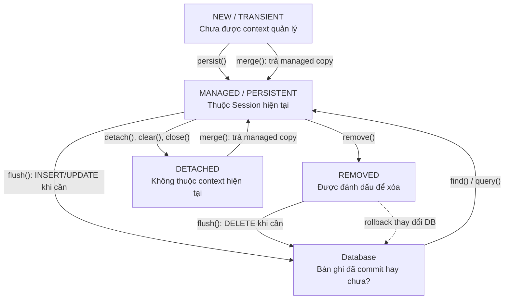

# Rà soát vòng đời qua SQL, định danh và trạng thái Session trong Hibernate

## 1. Ba góc nhìn để hiểu đúng vòng đời entity

Một lỗi phổ biến khi học Hibernate là nhìn thấy **khóa chính đã có giá trị** rồi kết luận entity đã được lưu, hoặc gọi `persist()` rồi khẳng định database đã có ngay một dòng mới. Cả hai suy luận đều có thể sai nếu chưa xét **trạng thái persistence context, giao dịch và thời điểm SQL được thực thi**.

Để rà soát vòng đời entity, hãy quan sát đồng thời ba góc nhìn:

1. **Định danh (identifier):** field `@Id` đang `null` hay đã có giá trị? Giá trị được ứng dụng gán, Hibernate lấy từ sequence, hay database sinh khi INSERT?
2. **Trạng thái trong `Session`/`EntityManager`:** entity đang `new/transient`, `managed/persistent`, `detached` hay đã được đánh dấu `removed`? Session còn mở không? Có transaction đang hoạt động không?
3. **Hành vi SQL:** Hibernate đã gửi `SELECT`, `INSERT`, `UPDATE` hoặc `DELETE` nào tới database? Thao tác đó đã **commit** hay còn có thể **rollback**?

Ba góc nhìn này liên quan nhau nhưng **không đồng nghĩa**.

Ví dụ:

```java
StockItem item = new StockItem("KB-101", 5);
em.persist(item);
```

Sau `persist(item)`, entity thường đã được quản lý trong persistence context. Tuy nhiên:

- Nếu dùng `GenerationType.SEQUENCE`, ID có thể đã được cấp từ sequence trước khi dòng được INSERT.
- Nếu dùng `GenerationType.IDENTITY`, Hibernate thường cần INSERT để lấy ID do database sinh; thời điểm INSERT thực tế phụ thuộc provider, transaction và ngữ cảnh flush.
- INSERT đã chạy cũng **không đồng nghĩa đã commit**. Transaction còn có thể rollback.
- Một entity đã commit và được đóng session thường là **detached**, dù hàng database vẫn tồn tại và ID vẫn giữ nguyên.

### 1.1. Sơ đồ vòng đời khái quát



Sơ đồ nêu các luồng thường gặp, không phải mọi chuyển trạng thái đặc biệt trong đặc tả JPA. Quan trọng hơn, **`merge()` tạo hoặc trả về một managed instance trong context đích; object nguồn detached không tự chuyển thành managed**.

### 1.2. Ma trận ba góc nhìn

| Trạng thái entity | ID thường ra sao? | Có được context hiện tại quản lý? | SQL có thể xảy ra |
|---|---|---|---|
| **New/transient** | `null` nếu generated ID chưa cấp; có thể khác null nếu assigned ID | Không | Chưa có SQL do chính entity mới tạo, trừ thao tác tạo khóa do ứng dụng thực hiện |
| **Managed sau `persist`** | Có thể đã được cấp hoặc chưa, tùy generator/điều kiện | Có | Có thể lấy sequence, có thể INSERT sớm với IDENTITY; INSERT cũng có thể chờ flush |
| **Managed sau `find`** | Thường đã có ID từ DB | Có | `SELECT` nếu không được đáp ứng từ context/cache |
| **Managed bị sửa thuộc tính** | Thường giữ nguyên | Có | `UPDATE` khi dirty checking và flush xác định cần ghi |
| **Removed** | ID vẫn có thể giữ giá trị trong Java | Được đánh dấu xóa trong context; đừng chỉ suy trạng thái từ `contains` | `DELETE` khi flush/commit phù hợp |
| **Detached** | Thường giữ ID đã cấp; vẫn có thể là assigned ID | Không | Sửa field detached không tự tạo `UPDATE` |
| **Entity đã commit rồi context đóng** | Vẫn giữ ID | Không | Bản ghi DB tồn tại, nhưng entity Java không còn managed |
| **Đã rollback sau khi Hibernate cấp ID** | ID Java có thể vẫn không null | Không thể suy trạng thái chỉ từ ID | SQL có thể đã chạy rồi bị rollback; ID không chứng minh bản ghi tồn tại |

Từ đây, mọi thí nghiệm nên ghi lại **ID**, **`em.contains(entity)`**, **`em.isOpen()`**, **transaction** và **SQL log** thay vì chỉ quan sát một dấu hiệu.

## 2. Các khái niệm nền tảng

### 2.1. `Session` và `EntityManager` là gì?

`jakarta.persistence.EntityManager` là API chuẩn Jakarta Persistence để quản lý entity, query và persistence context. Khi dùng Hibernate làm provider, có thể truy cập API Hibernate thông qua `org.hibernate.Session`:

```java
EntityManager em = emf.createEntityManager();
Session session = em.unwrap(Session.class);
```

Trong Hibernate hiện đại, `Session` là API triển khai/mở rộng liên quan chặt chẽ tới `EntityManager`. Cả hai đại diện cho một **đơn vị quản lý trạng thái ORM**, không phải cache ứng dụng toàn cục và không phải đối tượng thread-safe để dùng tùy tiện từ nhiều thread.

`EntityManagerFactory` / `SessionFactory` được thiết kế để chia sẻ, còn các `EntityManager`/`Session` nên được dùng theo phạm vi đơn vị công việc và transaction phù hợp.

### 2.2. Persistence context và first-level cache

Persistence context duy trì các entity managed cùng thông tin cần thiết để ORM làm việc:

- **Identity map:** với một loại entity và primary key, trong một context thường chỉ có một managed instance tương ứng.
- **Snapshot/tracking:** Hibernate so sánh hoặc theo dõi trạng thái để thực hiện dirty checking.
- **Action queue:** nhiều thao tác ghi được hoãn và đồng bộ ở thời điểm flush.
- **Lazy association/proxy:** có thể hỗ trợ tải dữ liệu liên quan khi context còn hợp lệ.
- **Trạng thái vòng đời:** entity được persist, load, remove, detach, v.v.

Ví dụ:

```java
StockItem a = em.find(StockItem.class, 101L);
StockItem b = em.find(StockItem.class, 101L);

System.out.println(a == b);
// Nếu cùng tìm thấy và trong một persistence context,
// thông thường là true.
```

Lời gọi `find` lần hai **không nhất thiết có SQL SELECT mới**, bởi entity đã nằm trong identity map.

### 2.3. Transaction không phải Session

`Session` có vòng đời mở/đóng. Transaction có vòng đời bắt đầu, commit hoặc rollback. Trong Java SE với giao dịch `RESOURCE_LOCAL`:

```java
EntityManager em = emf.createEntityManager();

try {
    EntityTransaction tx = em.getTransaction();
    tx.begin();

    // Persist, find, update, remove...

    tx.commit();
} finally {
    em.close();
}
```

`em.close()` giải phóng persistence context/tài nguyên liên quan; **nó không thay thế một lệnh `commit()` đúng cách**. Khi exception, phải rollback transaction đang hoạt động. Khi `commit` thành công mà EntityManager vẫn mở, các entity thường vẫn managed trong context đó; khi context bị đóng hoặc entity bị detach, chúng thành detached.

Trong môi trường Spring/Jakarta EE/JTA, việc quản lý context/transaction có thể do container hoặc framework đảm nhận; không copy nguyên mô hình `RESOURCE_LOCAL` vào mọi ứng dụng.

## 3. Chuẩn bị môi trường quan sát SQL

Để các trạng thái dễ nhìn, ta dùng một bảng `stock_items` và entity đơn giản với ID do database sinh. Ví dụ phù hợp cho ứng dụng Java SE minh họa dùng Hibernate ORM 6.x, Jakarta Persistence 3.x, Java 17 và H2.

### 3.1. Maven dependencies

Ví dụ cấu hình `pom.xml` rút gọn nhưng đủ cho console application:

```xml
<project xmlns="http://maven.apache.org/POM/4.0.0"
         xmlns:xsi="http://www.w3.org/2001/XMLSchema-instance"
         xsi:schemaLocation="
           http://maven.apache.org/POM/4.0.0
           https://maven.apache.org/xsd/maven-4.0.0.xsd">

    <modelVersion>4.0.0</modelVersion>

    <groupId>com.example</groupId>
    <artifactId>hibernate-lifecycle-demo</artifactId>
    <version>1.0.0</version>

    <properties>
        <maven.compiler.release>17</maven.compiler.release>
        <project.build.sourceEncoding>UTF-8</project.build.sourceEncoding>
    </properties>

    <dependencies>
        <dependency>
            <groupId>org.hibernate.orm</groupId>
            <artifactId>hibernate-core</artifactId>
            <version>6.6.0.Final</version>
        </dependency>
        <dependency>
            <groupId>com.h2database</groupId>
            <artifactId>h2</artifactId>
            <version>2.3.232</version>
            <scope>runtime</scope>
        </dependency>
        <dependency>
            <groupId>org.slf4j</groupId>
            <artifactId>slf4j-simple</artifactId>
            <version>2.0.16</version>
            <scope>runtime</scope>
        </dependency>
    </dependencies>
</project>
```

Các version ở trên là phiên bản minh họa của một hệ sinh thái Hibernate 6.x và không phải tuyên bố phiên bản mới nhất. Dùng một bộ version tương thích với dự án thực tế và quản lý dependency theo chính sách tổ chức.

### 3.2. Persistence unit và SQL log

Tạo `src/main/resources/META-INF/persistence.xml`:

```xml
<?xml version="1.0" encoding="UTF-8"?>
<persistence xmlns="https://jakarta.ee/xml/ns/persistence"
             xmlns:xsi="http://www.w3.org/2001/XMLSchema-instance"
             xsi:schemaLocation="
               https://jakarta.ee/xml/ns/persistence
               https://jakarta.ee/xml/ns/persistence/persistence_3_1.xsd"
             version="3.1">

    <persistence-unit name="lifecyclePU"
                      transaction-type="RESOURCE_LOCAL">
        <provider>
            org.hibernate.jpa.HibernatePersistenceProvider
        </provider>

        <class>com.example.lifecycle.StockItem</class>

        <properties>
            <property name="jakarta.persistence.jdbc.driver"
                      value="org.h2.Driver"/>
            <property name="jakarta.persistence.jdbc.url"
                      value="jdbc:h2:mem:lifecycle;DB_CLOSE_DELAY=-1"/>
            <property name="jakarta.persistence.jdbc.user"
                      value="sa"/>
            <property name="jakarta.persistence.jdbc.password"
                      value=""/>

            <!-- Chỉ phù hợp cho ví dụ/test có thể bỏ schema. -->
            <property name="hibernate.hbm2ddl.auto"
                      value="create-drop"/>

            <!-- Quan sát SQL dạng đã định dạng. -->
            <property name="hibernate.show_sql"
                      value="true"/>
            <property name="hibernate.format_sql"
                      value="true"/>
            <property name="hibernate.use_sql_comments"
                      value="true"/>

            <!-- Thống kê ORM khi cần phân tích thí nghiệm. -->
            <property name="hibernate.generate_statistics"
                      value="true"/>
        </properties>
    </persistence-unit>
</persistence>
```

Những điểm cần chú ý:

- `META-INF/persistence.xml` phải có trên classpath để `Persistence.createEntityManagerFactory("lifecyclePU")` tìm được persistence unit.
- `RESOURCE_LOCAL` cho phép ví dụ điều khiển `EntityTransaction` trực tiếp.
- H2 in-memory giúp thí nghiệm tách biệt; đường dẫn JDBC dùng `DB_CLOSE_DELAY=-1` để DB còn tồn tại trong JVM khi connection đóng.
- `hibernate.hbm2ddl.auto=create-drop` có thể **xóa schema/dữ liệu**; chỉ dùng cho ví dụ, không bật tùy tiện trên production.
- `show_sql` hiển thị câu SQL nhưng không đủ để kết luận transaction đã commit.
- Binding values không nhất thiết xuất hiện trong `show_sql` vì SQL dùng các dấu `?`. Với Hibernate 6.x có thể bật logger category `org.hibernate.orm.jdbc.bind` ở mức `TRACE` trong hệ thống logging khi cần biết tham số; tránh log dữ liệu nhạy cảm trong production.
- Số lượng và thời điểm SQL phụ thuộc generator, flush mode, JDBC batch, cache và dialect. Tập trung hiểu **quy tắc**, không học thuộc đúng một trace.

### 3.3. Entity mẫu

Tạo `src/main/java/com/example/lifecycle/StockItem.java`:

```java
package com.example.lifecycle;

import jakarta.persistence.Column;
import jakarta.persistence.Entity;
import jakarta.persistence.FetchType;
import jakarta.persistence.GeneratedValue;
import jakarta.persistence.GenerationType;
import jakarta.persistence.Id;
import jakarta.persistence.Table;
import jakarta.persistence.Version;

@Entity
@Table(name = "stock_items")
public class StockItem {

    @Id
    @GeneratedValue(strategy = GenerationType.IDENTITY)
    private Long id;

    @Column(nullable = false, unique = true, length = 80)
    private String sku;

    @Column(nullable = false)
    private int quantity;

    @Version
    private Long version;

    protected StockItem() {
        // JPA yêu cầu constructor không tham số hợp lệ.
    }

    public StockItem(String sku, int quantity) {
        if (sku == null || sku.isBlank()) {
            throw new IllegalArgumentException("SKU is required");
        }
        if (quantity < 0) {
            throw new IllegalArgumentException(
                    "quantity must be non-negative");
        }

        this.sku = sku;
        this.quantity = quantity;
    }

    public Long getId() {
        return id;
    }

    public String getSku() {
        return sku;
    }

    public int getQuantity() {
        return quantity;
    }

    public Long getVersion() {
        return version;
    }

    public void changeQuantity(int nextQuantity) {
        if (nextQuantity < 0) {
            throw new IllegalArgumentException(
                    "quantity must be non-negative");
        }
        this.quantity = nextQuantity;
    }
}
```

`@Version` cho phép quan sát optimistic locking trong SQL cập nhật; nó không bắt buộc cho bài học vòng đời nhưng giúp nhìn rõ tại sao Hibernate ghi `version` trong `WHERE`.

Khi dùng `GenerationType.IDENTITY`, ID thường do lệnh INSERT của database sinh. Vì cần khóa sinh ra để quản lý entity, Hibernate có thể chạy INSERT sớm hơn lần gọi `flush()` tường minh.

### 3.4. Các công cụ quan sát trạng thái

Ta có thể ghi trạng thái entity từ API JPA:

```java
static void inspect(
        String label,
        EntityManager em,
        StockItem item) {

    System.out.printf(
        "%s | open=%s | txActive=%s | contains=%s"
            + " | id=%s | version=%s | quantity=%d%n",
        label,
        em.isOpen(),
        em.getTransaction().isActive(),
        em.contains(item),
        item.getId(),
        item.getVersion(),
        item.getQuantity()
    );
}
```

`em.contains(item)` chỉ kiểm tra một khía cạnh: object có đang được persistence context hiện tại quản lý theo ngữ nghĩa API hay không. **Không dùng riêng `contains` để phân biệt tất cả các trạng thái**, đặc biệt trạng thái removed, vì việc xóa và kết quả kiểm tra phải được hiểu theo ngữ nghĩa context/provider. Đọc cùng lịch sử thao tác, transaction và SQL.

`em.isOpen()` nói EntityManager còn mở, **không chứng minh transaction đang hoạt động** và không chứng minh mọi entity Java bạn giữ vẫn thuộc context đó.

## 4. New/transient: có object Java nhưng chưa có row

Tạo entity:

```java
StockItem item = new StockItem("KB-101", 5);
```

Ngay lúc này:

- `item` tồn tại trên JVM heap.
- `item.getId()` có thể là `null` vì `IDENTITY` chưa được database cấp.
- Chưa có persistence context nào tự động quản lý object chỉ vì nó có `@Entity`.
- Không có SQL `INSERT` chỉ từ lời gọi `new StockItem(...)`.

```java
EntityManager em = emf.createEntityManager();

try {
    StockItem item = new StockItem("KB-101", 5);

    System.out.println(item.getId()); // null
    System.out.println(em.contains(item)); // false
} finally {
    em.close();
}
```

**New/transient** khác **detached**:

- New: chưa từng được persistence context quản lý như một entity đã lưu.
- Detached: từng được quản lý nhưng không còn thuộc context hiện tại; thường giữ ID của hàng dữ liệu.

Tuy nhiên, chỉ nhìn `id == null` hay `id != null` **không thể phân loại chắc chắn**: entity dùng assigned ID có thể là new mà ID đã có, và entity sau rollback có thể vẫn giữ ID dù INSERT không còn tồn tại trong database.

### 4.1. Những thay đổi trên transient object không được dirty-check

```java
StockItem item = new StockItem("KB-101", 5);
item.changeQuantity(8);
```

Không có transaction ghi DB chỉ vì setter chạy. Khi entity chưa được persist, Hibernate không theo dõi nó trong persistence context nào. Đến lúc `persist`, ORM sẽ dùng trạng thái phù hợp của entity để chuẩn bị INSERT.

### 4.2. Assigned ID không có nghĩa đã persist

Giả sử entity dùng:

```java
@Id
private UUID id;
```

và constructor gán:

```java
this.id = UUID.randomUUID();
```

Entity mới có ID khác null **trước khi database có row**. Do đó:

```text
id != null  ≠  đã INSERT
đã INSERT  ≠  đã COMMIT
đã COMMIT  ≠  entity vẫn managed
```

Đây là một trong các quy tắc quan trọng nhất khi đọc lifecycle.

## 5. `persist()`: chuyển thành managed nhưng SQL có thể khác kỳ vọng

Bắt đầu transaction và gọi `persist`:

```java
EntityManager em = emf.createEntityManager();
EntityTransaction tx = em.getTransaction();

try {
    tx.begin();

    StockItem item = new StockItem("KB-101", 5);

    System.out.println(em.contains(item)); // false

    em.persist(item);

    System.out.println(em.contains(item)); // true
    System.out.println(item.getId());

    tx.commit();
} catch (RuntimeException ex) {
    if (tx.isActive()) {
        tx.rollback();
    }
    throw ex;
} finally {
    em.close();
}
```

`persist` làm new entity trở thành managed trong persistence context. Về nguyên tắc, Hibernate sẽ đồng bộ INSERT khi cần, nhưng **thời điểm phát SQL phụ thuộc chiến lược ID**.

### 5.1. `IDENTITY`: có thể INSERT để lấy khóa ngay

Ví dụ dùng `@GeneratedValue(strategy = GenerationType.IDENTITY)`.

SQL minh họa:

```sql
INSERT INTO stock_items (quantity, sku, version)
VALUES (?, ?, ?);
```

Database sinh `id` và driver/Hibernate nhận kết quả. Vì Hibernate cần ID thật để quản lý entity, INSERT thường có thể chạy sớm trong transaction, thậm chí trong lời gọi `persist()`.

Không nên đặt giả định cứng rằng `persist` với IDENTITY **luôn** phát INSERT tức thì trong mọi trường hợp. Những tình huống khác nhau về transaction, flush mode, generator và khả năng provider có thể làm thay đổi thời điểm xử lý.

### 5.2. `SEQUENCE`: ID có thể tồn tại trước INSERT

Đối với một entity khác:

```java
@Id
@GeneratedValue(
    strategy = GenerationType.SEQUENCE,
    generator = "stock_item_seq_gen"
)
@SequenceGenerator(
    name = "stock_item_seq_gen",
    sequenceName = "stock_item_seq",
    allocationSize = 1
)
private Long id;
```

Hibernate có thể lấy giá trị từ sequence trước:

```sql
SELECT next value for stock_item_seq;
```

hoặc cú pháp sequence tương ứng với dialect, rồi trì hoãn:

```sql
INSERT INTO stock_items (..., id) VALUES (..., ?);
```

cho tới flush. Lúc này:

```text
item.id = 101
em.contains(item) = true
SQL INSERT có thể chưa chạy
transaction chưa commit
```

Việc gọi `nextval` cũng không bảo đảm một transaction rollback sẽ hoàn tác số sequence đã cấp; nhiều database sequence không rollback số đã phát. Khoảng trống ID **không chứng minh thiếu bản ghi vì lỗi Hibernate**.

### 5.3. `persist()` không phải `merge()`

`persist` được dùng để làm một entity **new** trở thành managed. Cố `persist` một entity detached có định danh đã tồn tại thường không phải lựa chọn đúng và có thể gây lỗi như `EntityExistsException` hoặc lỗi khóa khi flush, tùy provider và tình huống.

Khi xử lý detached entity, cần phân biệt `merge` (sao chép state vào managed instance) với `persist` (quản lý entity mới). Không dùng một lệnh như công cụ “save bất kể trạng thái” mà không hiểu lifecycle.

## 6. `flush()`: đồng bộ SQL, chưa phải commit

`flush` yêu cầu Hibernate đồng bộ các thay đổi managed đang chờ xuống database trong transaction thích hợp.

```java
tx.begin();

StockItem item = new StockItem("KB-101", 5);
em.persist(item);

em.flush();

// INSERT có thể đã được thực thi,
// nhưng transaction chưa commit ở đây.

tx.commit();
```

**Quan hệ quan trọng:**

```text
new/managed state trong Java
          |
          v
Hibernate Action Queue + Dirty Checking
          |
        flush()
          |
          v
SQL INSERT / UPDATE / DELETE trong transaction
          |
        commit()
          |
          v
Thay đổi được commit bền vững theo semantics của DB
```

`flush` không đồng nghĩa “mọi entity đều UPDATE”. ORM phát SQL theo những hành động/trạng thái đã ghi nhận và việc dirty checking/optimistic locking.

### 6.1. Hibernate có thể tự flush

Trong chế độ flush thông thường (ví dụ `AUTO`), Hibernate có thể đồng bộ:

- Trước khi commit transaction.
- Trước một số truy vấn cần đảm bảo kết quả nhìn thấy thay đổi đang chờ.
- Khi ứng dụng gọi `em.flush()`/`session.flush()` tường minh.

Thời điểm pre-query flush còn phụ thuộc Hibernate query spaces, native SQL, flush mode và API được sử dụng. Không khẳng định `find()` hay mọi JPQL query **luôn** flush hoặc **không bao giờ** flush.

### 6.2. Không dùng flush làm “đơn vị giao dịch”

```java
tx.begin();
em.persist(item);
em.flush(); // SQL INSERT đã gửi.

if (businessRuleFailed) {
    tx.rollback(); // Thay đổi DB trong transaction được hoàn tác.
} else {
    tx.commit();
}
```

Nếu rollback sau flush, trạng thái Java có thể vẫn giữ `item.id` hoặc các field đã thay đổi, nhưng database không có bản ghi được commit từ transaction đó. **Không tiếp tục dùng object còn giữ ID để kết luận bản ghi tồn tại**.

## 7. Managed/persistent: dirty checking và identity map

Một entity managed được theo dõi trong persistence context. Thay đổi thuộc tính ánh xạ được Hibernate xem xét để tạo SQL UPDATE khi flush:

```java
tx.begin();

StockItem item = em.find(StockItem.class, itemId);
item.changeQuantity(9);

// Không bắt buộc gọi em.merge(item) hoặc em.persist(item).
tx.commit();
```

SQL có thể tương tự:

```sql
SELECT id, sku, quantity, version
FROM stock_items
WHERE id = ?;

UPDATE stock_items
SET quantity = ?, version = ?
WHERE id = ? AND version = ?;
```

Có `@Version`, Hibernate dùng version để phát hiện xung đột cập nhật. SQL chính xác có thể liệt kê thêm cột tùy mapping và cấu hình update (ví dụ static SQL hay dynamic update).

### 7.1. Dirty checking không chạy ở mọi setter

```java
StockItem item = em.find(StockItem.class, id);
item.changeQuantity(9);
```

Setter chỉ đổi state của object. SQL UPDATE thường chạy lúc Hibernate flush trong transaction, không bắt buộc ngay khi setter trả về.

Nếu giá trị mới bằng trạng thái đã lưu theo cơ chế dirty checking của mapping, Hibernate có thể không phát UPDATE. Tuy nhiên, quyết định phụ thuộc kiểu attribute, bytecode enhancement, dirty tracking, custom type và các cấu hình khác.

### 7.2. First-level cache có thể ngăn SELECT lặp

```java
StockItem first = em.find(StockItem.class, id);
StockItem second = em.find(StockItem.class, id);

System.out.println(first == second); // Thường true trong cùng context.
```

Nếu `first` đã được context quản lý, `second` có thể được trả từ first-level cache mà không có SELECT thêm. Việc không thấy SQL **không nghĩa rằng `find` không làm gì**: nó trả một entity đang managed, có identity đã được bảo đảm bởi context.

Nếu dùng nhiều EntityManager khác nhau, chúng có identity map riêng; cùng row có thể được biểu diễn bởi những Java object khác nhau.

### 7.3. `@Version` không thay thế trạng thái entity

Version tăng khi các cập nhật versioned được thực hiện theo quy tắc ORM; nó là công cụ optimistic locking. Đừng dùng `version == null` hoặc `version != null` làm phép kiểm tra duy nhất cho new/managed/detached, vì thời điểm khởi tạo version phụ thuộc provider và trạng thái entity có thể thay đổi mà version không đổi.

## 8. `detach()`, `clear()` và `close()`: entity không còn được theo dõi

Có ba thao tác thường dẫn đến trạng thái detached:

| Thao tác | Phạm vi tác động | Entity Java còn tồn tại? | Session/EntityManager còn mở? |
|---|---|---|---|
| `em.detach(entity)` | Một entity cụ thể; cascade detach nếu được cấu hình phù hợp | Có | Có |
| `em.clear()` | Toàn bộ managed entities của context | Có | Có |
| `em.close()` | Đóng EntityManager, kết thúc việc quản lý context đó | Có nếu application còn giữ tham chiếu | **Không** |

Trong API native Hibernate còn có phương thức tương ứng như `session.evict(entity)` để gỡ một entity ra khỏi persistence context.

### 8.1. `detach()` và update bị bỏ qua

```java
tx.begin();

StockItem item = em.find(StockItem.class, id);
em.detach(item);

System.out.println(em.contains(item)); // false

item.changeQuantity(100);

// item là detached: thay đổi này không tự tạo UPDATE
// trong EntityManager hiện tại.

tx.commit();
```

Kết luận từ SQL log: không thấy UPDATE của `item` vì context hiện tại không dirty-check object đã detach.

Điều này **không có nghĩa** trường `quantity` trên Java object quay về giá trị cũ. Nó vẫn chứa 100 trong bộ nhớ nhưng database có thể giữ giá trị trước đó.

### 8.2. `clear()`: đặc biệt chú ý thao tác chưa flush

```java
tx.begin();

StockItem item = em.find(StockItem.class, id);
item.changeQuantity(100);

// Nếu chưa flush, clear làm các entity không còn managed.
// Các thay đổi chưa đồng bộ có thể không được ghi.
em.clear();

tx.commit();
```

Đừng dùng `clear()` như cách “tiết kiệm RAM” giữa transaction mà quên các pending changes. Nếu cần xử lý batch lớn, thường chọn trình tự có chủ đích như `flush()` rồi `clear()` theo từng lô, với thiết kế transaction hợp lệ.

### 8.3. `close()` không xóa row database

```java
StockItem item = em.find(StockItem.class, id);
em.close();

// item trở thành detached do persistence context đã đóng.
// Dữ liệu database không tự bị DELETE vì close().
```

Entity sau close vẫn là một Java object có thể gọi các getter thông thường nếu dữ liệu đó đã được nạp. Nhưng truy cập một association/proxy lazy chưa khởi tạo có thể gây `LazyInitializationException`, vì không còn context hợp lệ để tải dữ liệu.

### 8.4. Session khác không tự quản lý detached object

```java
StockItem fromFirstSession = em1.find(StockItem.class, id);
em1.close();

EntityManager em2 = emf.createEntityManager();

try {
    System.out.println(em2.contains(fromFirstSession)); // false
} finally {
    em2.close();
}
```

`em2` biết database row có thể tồn tại nhưng không tự quản lý **chính object** đến từ `em1`. Muốn cập nhật trạng thái detached, ứng dụng có thể tải entity trong context thứ hai hoặc dùng `merge` với quy tắc rõ ràng.

## 9. `merge()`: nhìn managed copy, không nhìn object nguồn

`EntityManager.merge(detachedEntity)` không phải phép “đổi trạng thái object nguồn thành managed”. Nó sao chép state của object nguồn vào một managed instance trong context hiện tại và **trả về** managed instance đó.

Ví dụ:

```java
// detached được tải và đóng EntityManager ở giai đoạn trước.
StockItem detached = ...;

EntityManager em = emf.createEntityManager();
EntityTransaction tx = em.getTransaction();

try {
    tx.begin();

    detached.changeQuantity(15);

    StockItem managedCopy = em.merge(detached);

    System.out.println(em.contains(detached));    // false
    System.out.println(em.contains(managedCopy)); // true

    // Tiếp tục sử dụng managedCopy trong context hiện tại.
    managedCopy.changeQuantity(16);

    tx.commit();
} catch (RuntimeException ex) {
    if (tx.isActive()) {
        tx.rollback();
    }
    throw ex;
} finally {
    em.close();
}
```

Với object nguồn thực sự detached, `managedCopy` thường là một object khác. Khi `merge` được gọi trên object đã managed, provider có thể trả chính managed instance hoặc xử lý theo ngữ nghĩa tương đương; phải phân biệt hai tình huống.

### 9.1. SQL thường gặp với `merge`

Hibernate có thể cần tìm hàng theo ID để có managed instance và snapshot:

```sql
SELECT id, sku, quantity, version
FROM stock_items
WHERE id = ?;
```

Sau khi state được sao chép và flush, nếu có khác biệt cần lưu:

```sql
UPDATE stock_items
SET quantity = ?, version = ?
WHERE id = ? AND version = ?;
```

Không có quy tắc “`merge` luôn đúng một SELECT + một UPDATE”. Nếu entity đã managed trong context, dữ liệu có trong cache, state không thay đổi, hoặc entity được xem là mới, chuỗi SQL có thể khác. Với ID và version nhận diện entity đã từng persist, quy tắc xử lý detached/missing row còn phụ thuộc Hibernate version và mapping.

### 9.2. Vì sao phải dùng object trả về?

Ví dụ dễ mắc lỗi:

```java
StockItem managed = em.merge(detached);

detached.changeQuantity(99); // Đổi detached sau merge.
// Không có bảo đảm UPDATE sẽ theo giá trị mới của detached.

managed.changeQuantity(99); // Đổi managed trong context.
```

`merge` không tạo một cơ chế đồng bộ sống giữa hai object. Nó **sao chép state tại thời điểm merge** theo ngữ nghĩa và cascade tương ứng.

Trong nhiều ứng dụng, cách đơn giản hơn là truyền ID, gọi `find` trong transaction mới rồi gán những field được phép cập nhật:

```java
StockItem managed = em.find(StockItem.class, id);

if (managed == null) {
    throw new IllegalArgumentException("Stock item not found");
}

managed.changeQuantity(request.quantity());
```

Cách này giảm rủi ro merge cả một object graph đến từ client có state cũ hoặc các association ngoài dự kiến.

## 10. `remove()`: đánh dấu xóa trước khi DELETE được commit

`em.remove(entity)` được áp dụng cho một entity đang managed hợp lệ. Lúc gọi, Hibernate đánh dấu thao tác xóa; SQL DELETE có thể chờ tới flush/commit.

```java
tx.begin();

StockItem item = em.find(StockItem.class, id);

if (item != null) {
    em.remove(item);
}

em.flush(); // DELETE có thể chạy trong transaction.
tx.commit(); // DELETE được commit nếu thành công.
```

SQL minh họa với optimistic locking:

```sql
DELETE FROM stock_items
WHERE id = ? AND version = ?;
```

Nếu bảng có foreign key từ bảng khác, constraint có thể ngăn xóa và exception có thể xuất hiện lúc flush/commit. Cascade remove, orphan removal và database `ON DELETE` ảnh hưởng hành vi với quan hệ và phải được thiết kế độc lập.

### 10.1. Đừng suy rằng object đã biến mất khỏi heap

Sau `em.remove(item)`, biến Java `item` vẫn tham chiếu object đó và `item.getId()` vẫn có thể trả ID. Việc object còn tồn tại trên heap **không chứng minh row vẫn tồn tại trong database**.

### 10.2. Đừng suy trạng thái removed chỉ qua `contains`

`contains` hữu ích để kiểm tra entity có thuộc persistence context theo semantics API, nhưng không phải API phân loại đầy đủ cả bốn trạng thái. Với removed entity, hành vi quan sát và cách provider quản lý entry nội bộ cần được hiểu cùng lịch sử `remove`, context và transaction. Hãy dùng log SQL và kiểm tra bằng một context mới sau commit nếu cần xác nhận bản ghi đã mất.

### 10.3. Detached object không thể bị remove trực tiếp như managed

Ví dụ rủi ro:

```java
StockItem detached = ...;

EntityManager em = emf.createEntityManager();
em.getTransaction().begin();

// Không nên: detached không thuộc em.
// em.remove(detached);
```

Thay vào đó, tải object managed theo ID trong transaction:

```java
StockItem managed = em.find(StockItem.class, detached.getId());

if (managed != null) {
    em.remove(managed);
}
```

Hoặc sử dụng `getReference` với điều kiện kiểm soát lỗi tồn tại thích hợp. Không giả định một entity có ID là có thể truyền cho `remove` ở bất kỳ session nào.

### 10.4. Rollback sau DELETE

```java
tx.begin();

StockItem item = em.find(StockItem.class, id);
em.remove(item);
em.flush(); // SQL DELETE có thể đã chạy.

tx.rollback(); // DELETE bị rollback theo semantics transaction.
```

Sau rollback, không tiếp tục làm việc với persistence context/Java object cũ như thể Hibernate tự tái dựng sạch mọi trạng thái ban đầu. Khuyến nghị kết thúc đơn vị công việc bị lỗi, tạo context mới và đọc lại dữ liệu cần thiết.

## 11. `find()`, `getReference()` và SELECT

Hai API thường có hành vi đọc khác nhau:

```java
StockItem loaded = em.find(StockItem.class, id);

StockItem ref = em.getReference(StockItem.class, id);
```

- `find` yêu cầu lấy entity theo primary key; có thể không phát SQL nếu context hoặc cache đáp ứng.
- `getReference` có thể trả về một reference/proxy mà **chưa nạp đầy đủ state**. Trong nhiều mapping, truy cập ID có thể không cần SELECT nhưng truy cập thuộc tính khác có thể kích hoạt SQL.
- `getReference` không luôn xác nhận tồn tại ngay lúc gọi. Một bản ghi thiếu có thể gây exception ở thời điểm khác theo JPA/provider.

Ví dụ:

```java
StockItem ref = em.getReference(StockItem.class, id);
Long key = ref.getId(); // Có thể chỉ đọc identifier.

int quantity = ref.getQuantity();
// Có thể kích hoạt SELECT để khởi tạo proxy.
```

Proxy không phải trạng thái vòng đời thứ năm ngang hàng với new/managed/detached/removed. Nó là **cách thể hiện/trì hoãn việc nạp một entity** trong cơ chế ORM.

Nếu session đã đóng trước khi proxy cần khởi tạo, Hibernate có thể ném `LazyInitializationException`. Việc entity có ID không đủ để tải lazy data ngoài persistence context.

## 12. Code demo theo từng giai đoạn

Ví dụ dưới đây tập trung vào thao tác tạo → cập nhật → detach/merge → xóa. Tất cả truy vấn để kiểm tra một trạng thái đã commit được thực hiện qua context mới nhằm tránh nhầm kết quả first-level cache với dữ liệu database.

Tạo `src/main/java/com/example/lifecycle/LifecycleDemo.java`:

```java
package com.example.lifecycle;

import jakarta.persistence.EntityManager;
import jakarta.persistence.EntityManagerFactory;
import jakarta.persistence.EntityTransaction;
import jakarta.persistence.Persistence;

public class LifecycleDemo {

    public static void main(String[] args) {
        EntityManagerFactory emf =
                Persistence.createEntityManagerFactory("lifecyclePU");

        try {
            Long id = create(emf);
            inspectFromNewContext(emf, id, "after CREATE");

            update(emf, id);
            inspectFromNewContext(emf, id, "after UPDATE");

            detachAndMerge(emf, id);
            inspectFromNewContext(emf, id, "after MERGE");

            delete(emf, id);
            inspectFromNewContext(emf, id, "after DELETE");
        } finally {
            emf.close();
        }
    }

    private static Long create(EntityManagerFactory emf) {
        EntityManager em = emf.createEntityManager();
        EntityTransaction tx = em.getTransaction();

        try {
            tx.begin();

            StockItem item = new StockItem("KB-101", 5);
            inspect("NEW", em, item);

            em.persist(item);
            inspect("AFTER persist()", em, item);

            em.flush();
            inspect("AFTER flush()", em, item);

            Long id = item.getId();
            tx.commit();

            // Nếu EntityManager vẫn còn mở, item thường vẫn managed.
            inspect("AFTER commit(), BEFORE close()", em, item);

            return id;
        } catch (RuntimeException ex) {
            if (tx.isActive()) {
                tx.rollback();
            }
            throw ex;
        } finally {
            em.close();
        }
    }

    private static void update(
            EntityManagerFactory emf, Long id) {

        EntityManager em = emf.createEntityManager();
        EntityTransaction tx = em.getTransaction();

        try {
            tx.begin();

            StockItem item = em.find(StockItem.class, id);
            inspect("MANAGED after find()", em, item);

            // Lần find thứ hai thường dùng identity map.
            StockItem same = em.find(StockItem.class, id);
            System.out.println("same reference = " + (item == same));

            item.changeQuantity(8);
            inspect("CHANGED before flush()", em, item);

            em.flush(); // UPDATE nếu state thực sự dirty.
            inspect("CHANGED after flush()", em, item);

            tx.commit();
        } catch (RuntimeException ex) {
            if (tx.isActive()) {
                tx.rollback();
            }
            throw ex;
        } finally {
            em.close();
        }
    }

    private static void detachAndMerge(
            EntityManagerFactory emf, Long id) {

        EntityManager em = emf.createEntityManager();
        EntityTransaction tx = em.getTransaction();

        try {
            tx.begin();

            StockItem item = em.find(StockItem.class, id);

            em.detach(item);
            inspect("DETACHED", em, item);

            item.changeQuantity(13);

            StockItem managedCopy = em.merge(item);

            System.out.println(
                    "source still detached = " + !em.contains(item));
            System.out.println(
                    "managed copy = " + em.contains(managedCopy));
            System.out.println(
                    "same Java reference = " + (item == managedCopy));

            managedCopy.changeQuantity(14);

            tx.commit();
        } catch (RuntimeException ex) {
            if (tx.isActive()) {
                tx.rollback();
            }
            throw ex;
        } finally {
            em.close();
        }
    }

    private static void delete(
            EntityManagerFactory emf, Long id) {

        EntityManager em = emf.createEntityManager();
        EntityTransaction tx = em.getTransaction();

        try {
            tx.begin();

            StockItem item = em.find(StockItem.class, id);

            if (item != null) {
                inspect("BEFORE remove()", em, item);
                em.remove(item);
                // Không kết luận removed state chỉ bằng contains().
                em.flush();
            }

            tx.commit();
        } catch (RuntimeException ex) {
            if (tx.isActive()) {
                tx.rollback();
            }
            throw ex;
        } finally {
            em.close();
        }
    }

    private static void inspectFromNewContext(
            EntityManagerFactory emf, Long id, String label) {

        EntityManager em = emf.createEntityManager();

        try {
            StockItem item = em.find(StockItem.class, id);

            if (item == null) {
                System.out.println(label + " -> no row found");
            } else {
                inspect(label, em, item);
            }
        } finally {
            em.close();
        }
    }

    private static void inspect(
            String label, EntityManager em, StockItem item) {

        System.out.printf(
            "%s: open=%s, tx=%s, managed=%s,"
                + " id=%s, quantity=%d, version=%s%n",
            label,
            em.isOpen(),
            em.getTransaction().isActive(),
            em.contains(item),
            item.getId(),
            item.getQuantity(),
            item.getVersion()
        );
    }
}
```

Dự kiến về ý nghĩa của trace:

1. `NEW`: ID có thể null, `contains=false`.
2. Sau `persist`: `contains=true`; ID có thể đã có do IDENTITY/INSERT.
3. Sau `flush`: INSERT đã được đồng bộ nếu cần; transaction vẫn hoạt động.
4. Sau `commit` nhưng **trước close**: EntityManager còn mở; entity vẫn có thể managed.
5. Khi đọc bằng context mới: thấy row đã commit và `quantity=5`.
6. `find` trong giai đoạn UPDATE: tải entity managed; truy vấn lần hai cùng ID thường không cần SELECT mới.
7. Khi `quantity=8` và flush: có thể thấy UPDATE kèm version.
8. Sau `detach`: `contains=false`; thay đổi `quantity=13` không được theo dõi trực tiếp.
9. Sau `merge`: một managed copy được trả về; giá trị cuối `quantity=14` được ghi khi transaction commit.
10. Sau `remove` và commit: context mới không còn tìm thấy row.

Số lượng câu SQL, alias và thời điểm UPDATE/INSERT thực tế có thể khác do ID generator, query plan, flush strategy hoặc các cấu hình liên quan. Bài tập ở đây là **đối chiếu các lớp trạng thái**, không phải học thuộc con số SQL cố định.

## 13. Lập bảng dấu vết SQL theo từng phương thức

Một bảng quan sát nên ghi cả **trước khi gọi**, **ngay sau khi gọi**, **sau flush**, **sau commit**, **sau close**.

| API/thao tác | Tác động lên entity/context | Dấu hiệu SQL có thể quan sát | Điều không nên suy luận |
|---|---|---|---|
| `new StockItem(...)` | Tạo object transient | Không có SQL từ constructor | Không có ID không phải lỗi ORM |
| `persist(newItem)` | Chuyển thành managed | Có thể lấy sequence hoặc INSERT IDENTITY sớm | Managed không đồng nghĩa đã commit |
| `flush()` | Đồng bộ pending changes | INSERT/UPDATE/DELETE khi cần | Flush không phải commit |
| `find(type,id)` | Trả managed entity hoặc null | SELECT nếu context/cache không đáp ứng | Không có SELECT không nghĩa không tìm |
| `getReference(type,id)` | Trả reference có thể là proxy | SELECT có thể trì hoãn | Có reference không khẳng định row tồn tại |
| `setX(...)` trên managed | Đổi state Java | UPDATE thường chờ dirty checking/flush | Setter không nhất thiết tức thì ghi DB |
| `detach(item)` | Gỡ item khỏi context | Thường không có DML vì chỉ detach | ID vẫn có không có nghĩa item vẫn managed |
| `clear()` | Gỡ các entity khỏi context | Không đồng nghĩa flush | Pending changes chưa flush có thể bị bỏ |
| `merge(detached)` | Copy state sang managed instance | Có thể SELECT rồi UPDATE khi cần | Nguồn detached không tự thành managed |
| `remove(managed)` | Đánh dấu xóa | DELETE lúc flush/commit phù hợp | Object Java không tự biến mất |
| `commit()` | Hoàn tất transaction | Có thể tự flush trước commit | Commit không nhất thiết đóng context |
| `rollback()` | Hoàn tác thay đổi transaction | DML có thể đã chạy trước rollback | ID đã sinh không chứng minh row tồn tại |
| `close()` | Đóng EntityManager | Không phải DELETE hay COMMIT thay thế | Close không xóa hàng DB |

### 13.1. Vì sao không nên đếm số SELECT để đoán entity state?

Một lần `find` có thể không phát SELECT vì entity đã managed trong context. Một lần khác lại phát SELECT. Nếu bật second-level cache, context mới cũng có thể lấy state từ cache thay vì SQL. Cần kết hợp `em.contains`, ranh giới context, cách nạp và SQL log để hiểu đúng.

### 13.2. Vì sao không nên đếm số UPDATE để đoán số setter?

Hibernate có thể hoãn thay đổi đến flush và chỉ phát UPDATE theo trạng thái cuối cùng. Một entity bị đổi nhiều lần trước flush có thể chỉ cần một UPDATE. Ngược lại, nếu có flush trung gian hoặc trigger, số SQL có thể nhiều hơn. `@DynamicUpdate` còn có thể ảnh hưởng những cột xuất hiện trong SET clause, không đổi định nghĩa managed/detached.

## 14. Định danh: “đã sinh” và “ổn định” là hai câu chuyện khác nhau

Định danh database thường được dùng trong identity map và để liên kết các bảng. Nhưng **ID đã xuất hiện** không đồng nghĩa trạng thái object đã “an toàn” cho mọi thao tác Java.

### 14.1. ID do database sinh và `hashCode()`

Một entity dùng generated ID có thể được đưa vào `HashSet` khi `id == null`:

```java
Set<StockItem> items = new HashSet<>();

StockItem item = new StockItem("KB-101", 5);
items.add(item);

em.persist(item);
```

Nếu `hashCode()` dựa trên ID mutable `null -> 101`, hash bucket có thể thay đổi khiến `items.contains(item)` không tìm thấy. Khi dùng entity trong `Set`/`Map`, cần thiết kế equality/hash theo vòng đời, không tự động dùng `Objects.hash(id)` với generated ID.

Một lựa chọn cho entity không có hierarchy phức tạp là equality theo non-null ID và hash ổn định theo entity class; một lựa chọn khác là business key bất biến hoặc assigned ID sẵn có. Không có một implementation phù hợp với mọi domain/proxy/inheritance.

### 14.2. `@Version` không phải ID

`@Version` phục vụ optimistic locking. Nó có thể thay đổi sau UPDATE, trong khi primary key vẫn giữ nguyên. Đừng dùng version làm một phần của Java identity/hash key nếu object sẽ nằm trong hash collection qua các lần cập nhật.

### 14.3. ID không còn hợp lệ sau rollback?

Sau khi Hibernate sinh một ID rồi transaction rollback, object Java có thể vẫn giữ ID. Database row tương ứng không nhất thiết tồn tại. Không tự gán lại null hoặc gọi persist lại entity đó một cách tùy tiện trong cùng Session bị lỗi. Tạo đơn vị công việc mới, xác định kết quả rollback và sinh entity mới hoặc xử lý theo nghiệp vụ.

## 15. Phân biệt trạng thái của Session, entity và transaction

Rất dễ nhầm ba câu hỏi:

**“Session còn mở không?”**

```java
em.isOpen();
```

Trả lời về vòng đời EntityManager. Một EntityManager đang mở không có nghĩa hiện có transaction, không có nghĩa bất kỳ Java object bạn cầm đều managed.

**“Entity có thuộc context không?”**

```java
em.contains(item);
```

Trả lời về việc entity có được context hiện tại quản lý theo ngữ nghĩa API. Nó không xác nhận SQL đã commit và không đủ để phân biệt hết tình huống removed/rollback.

**“Transaction đã commit chưa?”**

Với `RESOURCE_LOCAL`:

```java
EntityTransaction tx = em.getTransaction();

tx.begin();
// ...
tx.commit();
```

`tx.isActive()` giúp biết transaction đang hoạt động tại thời điểm kiểm tra. Nó không phải cờ “entity đã persist”. Sau commit thành công, transaction thường không còn active nhưng EntityManager có thể vẫn mở.

### 15.1. Ví dụ cùng ID, khác context

```java
EntityManager emA = emf.createEntityManager();
EntityManager emB = emf.createEntityManager();

try {
    StockItem a = emA.find(StockItem.class, id);
    StockItem b = emB.find(StockItem.class, id);

    // Cùng database identity, nhưng mỗi context quản lý riêng.
    System.out.println(a == b); // Thường false.
    System.out.println(emA.contains(a)); // true nếu tìm thấy.
    System.out.println(emB.contains(a)); // false.
    System.out.println(emB.contains(b)); // true nếu tìm thấy.
} finally {
    emB.close();
    emA.close();
}
```

Không chia sẻ `EntityManager` giữa nhiều thread; không đưa managed entity sang task bất đồng bộ và giả định transaction/context được chuyển theo. Worker nên nhận ID hoặc DTO rồi tạo context riêng nếu cần DB.

### 15.2. Trạng thái nội bộ của Hibernate

Hibernate có nhiều trạng thái/entry nội bộ hơn bốn nhãn giảng dạy `new/managed/detached/removed` (ví dụ các trạng thái liên quan load, read-only, deleted, proxy). Những chi tiết này hữu ích khi debug sâu nhưng có thể thay đổi theo phiên bản.

Ở lớp ứng dụng, ưu tiên API chuẩn như `EntityManager.contains`, `find`, `detach`, `merge`, `remove` và log hành vi SQL. Không xây business logic bằng cách phụ thuộc vào class hoặc enum nội bộ của persistence context nếu không thực sự cần một extension được Hibernate hỗ trợ.

## 16. Entity read-only và dirty checking

Một entity managed không phải lúc nào cũng được Hibernate xử lý cập nhật giống nhau. Ví dụ query read-only/session read-only có thể ảnh hưởng việc giữ snapshot và dirty checking.

Hibernate cung cấp một số API read-only ở mức session/query/entity tùy phiên bản:

```java
Session session = em.unwrap(Session.class);

// Ví dụ ý định thiết lập session default read-only:
// session.setDefaultReadOnly(true);
```

**Không đồng nhất “read-only” với “detached”.** Một entity có thể vẫn thuộc persistence context, được quản lý để đọc/điều hướng association nhưng không được theo dõi cập nhật như entity managed bình thường theo cấu hình read-only.

Vì vậy, thấy `em.contains(item) == true` nhưng không có UPDATE sau setter không nhất thiết chứng minh Hibernate lỗi: cần kiểm tra transaction, read-only setting, mapping `updatable=false`, dirty checking, flush mode và giá trị có thực sự thay đổi không.

Trong Spring, `@Transactional(readOnly = true)` là chỉ dẫn cho transaction manager/provider và tối ưu hóa, không phải đảm bảo tuyệt đối rằng mọi câu SQL ghi đều bị database chặn. Muốn ngăn ghi ở cấp database, cần quyền/transaction/read-only policy thật sự tương ứng.

## 17. SQL log: cách đọc mà không suy luận quá mức

### 17.1. Phân biệt SQL statement và commit

Nếu log thấy:

```sql
insert into stock_items (...) values (...);
```

ta biết Hibernate/JDBC đã cố thực hiện INSERT. Nhưng vẫn chưa biết:

- Transaction có commit thành công không.
- Có rollback sau đó không.
- Constraint có khiến transaction fail không.
- Trigger có sửa dữ liệu không.
- Có transaction khác nhìn thấy row ngay tại thời điểm đó không (phụ thuộc isolation).

Muốn xác minh dữ liệu **đã commit**, tốt nhất kiểm tra bằng một transaction/context mới sau commit thành công.

### 17.2. SQL nhiều hơn không luôn có nghĩa nhiều thao tác nghiệp vụ hơn

```sql
select ...
select ...
update ...
```

Hai SELECT có thể do lazy association, kiểm tra optimistic locking, proxy, merge cần đọc current state, hoặc các query nghiệp vụ. Hibernate còn dùng batching, second-level cache và bytecode enhancement. Vì vậy, khi cần so sánh trace, ghi cả:

- Entity class và ID liên quan.
- Persistence context/transaction nào đang chạy.
- Thao tác ứng dụng gần nhất.
- Flush mode và cơ chế sinh ID.
- Cache và fetch strategy.
- SQL và bind values (với dữ liệu thử nghiệm, tránh lộ secrets).

### 17.3. Vì sao một query có thể làm INSERT xuất hiện?

```java
tx.begin();

StockItem item = new StockItem("KB-101", 5);
em.persist(item);

// Một truy vấn trong chế độ AUTO có thể kích hoạt flush.
List<StockItem> results = em.createQuery(
        "select s from StockItem s",
        StockItem.class
    )
    .getResultList();
```

Nếu Hibernate cần đồng bộ thay đổi trước query để trả kết quả phù hợp, INSERT có thể xuất hiện **trước SELECT**. Với IDENTITY, INSERT có thể đã chạy sớm để lấy ID. Cả hai trường hợp đều hợp lý; đừng kết luận “SELECT đã làm INSERT” nếu không hiểu transaction và flush.

## 18. Mở rộng: cascade, association và vòng đời liên quan

Nếu entity có quan hệ:

```java
@OneToMany(
    mappedBy = "order",
    cascade = CascadeType.PERSIST,
    orphanRemoval = true
)
private List<OrderLine> lines = new ArrayList<>();
```

một lệnh `em.persist(order)` có thể cascade đến các `OrderLine` mới; flush có thể phát nhiều INSERT. Tương tự, gỡ child khỏi collection có `orphanRemoval=true` có thể tạo DELETE.

Đây không phải Hibernate “tự tạo SQL vô cớ”. SQL là kết quả của **vòng đời cả object graph** và cấu hình cascade/orphanRemoval. Khi rà soát cần biết entity nào sở hữu FK, phía nào là `mappedBy` và cascade nào được bật.

### 18.1. Managed association không tự tạo SQL cập nhật nếu sửa phía nghịch đảo sai

Với `@ManyToOne` ở child sở hữu FK:

```java
@ManyToOne
@JoinColumn(name = "order_id")
private Order order;
```

và `@OneToMany(mappedBy = "order")` ở parent, chỉ gọi `order.getLines().add(line)` mà không gán `line.order` có thể tạo object graph lệch. Hibernate lấy giá trị FK từ **owning side**. Khi không thấy UPDATE/INSERT FK như mong đợi, kiểm tra owning side trước khi kết luận dirty checking không chạy.

### 18.2. Cascade không làm transaction và định danh mất ý nghĩa

Nếu `persist(order)` cascade persist đến child, child có thể được chuyển thành managed và được sinh ID theo generator riêng. Các INSERT vẫn cần tôn trọng thứ tự FK và transaction. Khi rollback, có thể có nhiều entity Java đã nhận ID dù không có transaction commit tương ứng.

## 19. Bulk update/delete và native SQL: persistence context có thể cũ

Hibernate dirty checking thông thường hoạt động với **managed state**; nhưng JPQL bulk DML và native SQL có thể cập nhật database trực tiếp, không đi qua setter của từng managed entity.

Ví dụ:

```java
StockItem item = em.find(StockItem.class, id);

em.createQuery(
        """
        update StockItem s
        set s.quantity = 0
        where s.id = :id
        """
    )
    .setParameter("id", id)
    .executeUpdate();

System.out.println(item.getQuantity());
// Có thể vẫn là giá trị trước bulk update.
```

Vì bulk update bỏ qua cơ chế theo dõi state từng managed instance theo cách update bình thường, object trong context có thể **stale**. Nếu cần giá trị mới, dùng `refresh` hoặc `clear` + `find` trong thứ tự phù hợp; chú ý những pending changes chưa flush. Bulk DML cũng có quy tắc riêng về optimistic locking/version và cache synchronization.

**Rà soát SQL không chỉ hỏi “UPDATE có chạy không?”, mà còn hỏi “persistence context của tôi có phản ánh UPDATE đó không?”**

Một câu native `UPDATE` từ service khác hoặc trigger có thể gây chênh lệch tương tự.

## 20. Flush mode và truy vấn: biến số cần ghi trong nhật ký thí nghiệm

Với JPA:

```java
em.setFlushMode(FlushModeType.AUTO);
// Hoặc FlushModeType.COMMIT.
```

`AUTO` định hướng provider giữ tính nhất quán cho truy vấn trong phạm vi yêu cầu JPA bằng cách flush hoặc cơ chế tương đương. `COMMIT` thay đổi thời điểm đồng bộ, và ảnh hưởng của pending changes lên các query trước commit có những giới hạn/khác biệt cần hiểu theo đặc tả/provider.

Hibernate native có các flush modes khác như `MANUAL`, `ALWAYS` hoặc `AUTO` tùy phiên bản/API. Không nên đổi flush mode chỉ để “giảm số UPDATE” khi chưa hiểu nghiệp vụ; có thể làm truy vấn đọc trạng thái khác mong đợi hoặc bỏ sót flush trước commit trong cấu hình riêng.

### 20.1. Thí nghiệm so sánh

Trong một transaction:

1. Load `StockItem`.
2. Thay `quantity`.
3. Chạy JPQL query có thể liên quan cùng bảng.
4. Quan sát SQL trước và sau query.
5. Gọi `flush` tường minh rồi quan sát lại.
6. Kết thúc bằng commit hoặc rollback.

Làm tương tự với flush mode khác để thấy **thời điểm** đồng bộ khác nhau, nhưng không suy rằng query nào cũng buộc flush giống nhau trong mọi phiên bản Hibernate.

## 21. Các sai lầm hay gặp khi đọc vòng đời qua SQL

| Nhầm lẫn | Thực tế | Cách rà soát |
|---|---|---|
| `id != null` nghĩa là row đã commit | ID có thể được gán trước INSERT hoặc giữ lại sau rollback | Xem transaction và kiểm tra row sau commit |
| `persist()` luôn INSERT ngay | Phụ thuộc ID generator và flush | Đối chiếu `IDENTITY`, `SEQUENCE`, SQL log |
| `flush()` chính là commit | Flush gửi SQL trong transaction; commit hoàn tất giao dịch | Quan sát rollback sau flush |
| `commit()` tự đóng EntityManager | Transaction và context có vòng đời khác nhau | Kiểm tra `em.isOpen()` sau commit |
| `em.contains(item)==false` nghĩa row không còn trong DB | Có thể item chỉ detached | Dùng context mới để `find` |
| `em.contains(item)==true` nghĩa DB đã có row commit | Managed state có thể chưa flush/commit | Kiểm tra transaction và SQL |
| Sửa detached entity sẽ tự UPDATE | Detached không được dirty-check ở context cũ | Tải managed hoặc `merge` |
| `merge(detached)` biến detached thành managed | `merge` trả managed copy | Kiểm tra `contains` trên nguồn và return |
| `remove(item)` xóa Java object | Object Java vẫn tồn tại; SQL DELETE có thể chờ flush | Xem thời điểm SQL và commit |
| Có SELECT mới nghĩa identity map không hoạt động | Có thể là context khác, lazy load hoặc query khác | Ghi dấu context/ID/association |
| Không có SELECT nghĩa dữ liệu đang mới nhất | Có thể đọc first-level/second-level cache cũ | Quyết định refresh/invalidation |
| Một setter tương ứng một UPDATE | Dirty checking xử lý theo flush, không theo số setter | Quan sát flush và giá trị cuối |
| `@Version` là bằng chứng entity mới/cũ | Version dùng cho optimistic locking | Dựa vào lifecycle API, không chỉ version |
| Đóng session rồi getter lazy vẫn tải được | Proxy cần context phù hợp nếu chưa khởi tạo | Fetch trong transaction hoặc DTO |
| Query bulk UPDATE tự sửa managed object | Bulk DML có thể làm context stale | Refresh/clear có kế hoạch |
| Lỗi constraint xảy ra ngay tại setter | DB constraint thường kiểm tra khi SQL thực thi | Quan sát flush/commit và exception |
| Chỉ thấy SQL là đủ để xác nhận trạng thái | Còn identity, transaction, rollback và cache | Kết hợp ba góc nhìn |

## 22. Quy trình rà soát một lỗi Hibernate trong thực tế

Khi một thao tác “không lưu”, “ghi thừa SQL” hoặc “không thấy thay đổi”, có thể điều tra theo trình tự:

### Bước 1 — Định danh và object

Ghi entity type, `@Id`, generator, giá trị ID và object đang được truyền vào method nào. Kiểm tra đó là object mới, detached từ request khác hay managed của context hiện tại.

### Bước 2 — Persistence context

Ghi context nào tạo/load object, `EntityManager` còn mở không, `contains` có ý nghĩa gì trong tình huống đó, và liệu code có gọi `detach`/`clear`/`close` trước lúc thay đổi không.

### Bước 3 — Transaction

Xác định transaction đang hoạt động, bắt đầu ở đâu, commit/rollback ở đâu, flush mode là gì, và có exception gây rollback không. Với Spring, kiểm tra method thực sự chạy qua `@Transactional` proxy và không nhầm transaction của thread bất đồng bộ với caller.

### Bước 4 — SQL và bind values

Xem câu SQL được sinh và thời điểm nó chạy. Nếu không có UPDATE, kiểm tra dirty state, read-only mapping, detach và owning side của association. Nếu có UPDATE nhưng không thấy dữ liệu, kiểm tra rollback, transaction isolation, row count, trigger và query/cache.

### Bước 5 — Context mới để xác minh dữ liệu đã commit

Sau khi commit thành công, mở context/transaction thích hợp khác để đọc lại. Tránh dùng cùng managed object đã được tải từ trước để kết luận về trạng thái database sau khi một SQL khác chạy.

### Bước 6 — Phân biệt lỗi nghiệp vụ với lỗi lifecycle

Ví dụ “chuyển phòng ban không có UPDATE” có thể do chỉ sửa inverse collection `mappedBy`. “Email nền không thấy order mới” có thể do task đọc trước commit hoặc nhận managed entity từ thread khác. Những lỗi này không thể giải quyết chỉ bằng gọi `flush()` bừa bãi.

## 23. Bài tập thực hành

### Bài A — Đổi generator từ IDENTITY sang SEQUENCE

Thực hiện hai lần với cùng model (dùng schema phù hợp cho mỗi generator). Ghi ID ngay sau `new`, `persist`, `flush` và `commit`. Tìm SQL lấy sequence và so thời điểm INSERT. Không dùng một trace cụ thể để kết luận cho mọi dialect.

### Bài B — Identity map của một persistence context

```java
StockItem a = em.find(StockItem.class, id);
StockItem b = em.find(StockItem.class, id);
```

So `a == b`, `em.contains(a)` và số SELECT. Lặp lại ở hai EntityManager khác nhau để phân biệt reference identity với database identity.

### Bài C — Sửa managed và detached

Đọc entity, thay `quantity` và commit. Sau đó đọc entity khác, gọi `detach` trước khi thay và commit. So SQL UPDATE cùng giá trị database được đọc trong context mới.

### Bài D — `merge` trả về object nào?

Tạo detached entity, gọi `em.merge(detached)` trong context khác. So `detached == managedCopy`, `em.contains(detached)` và `em.contains(managedCopy)`. Sửa detached sau lời gọi merge rồi quan sát behavior.

### Bài E — Flush và rollback

Bắt đầu transaction, persist entity, gọi `flush()` để thấy SQL INSERT, sau đó rollback. Ghi ID Java và truy vấn lại bằng context mới. Giải thích vì sao ID có thể khác null dù row không tồn tại.

### Bài F — Remove và tham chiếu Java

Tải entity, gọi `remove` rồi flush/commit. Quan sát `item.getId()` trên object Java và `em.find` bằng context mới. Phân biệt Java reference với database row.

### Bài G — Query trước flush

Dùng `FlushModeType.AUTO`, sửa managed entity rồi chạy truy vấn JPQL trên cùng entity type. Ghi SQL và giải thích cơ chế tự flush tùy trường hợp. Đối chiếu với flush tường minh.

### Bài H — Bulk DML và stale context

Load `StockItem`, sau đó dùng JPQL bulk UPDATE quantity. So getter trên managed object với dữ liệu đọc lại sau `refresh` hoặc ở context mới. Giải thích vì sao persistence context không tự áp dụng mọi thay đổi ngoài dirty checking.

### Bài I — Read-only state

Thử tải entity trong session/query read-only, sửa một field rồi quan sát UPDATE. So với context bình thường và giải thích tại sao `contains=true` không đủ để dự đoán SQL.

### Bài J — Cascade và khóa ngoại

Tạo parent và child có `cascade=PERSIST`, persist parent, quan sát nhiều INSERT và thứ tự FK. Thử chỉ sửa phía `mappedBy` của association rồi xem lý do Hibernate không ghi khóa ngoại như mong đợi.

## 24. Câu hỏi tự kiểm tra

**1. Entity có ID khác null nghĩa đã được commit chưa?**

**Chưa chắc.** ID có thể được cấp trước INSERT (sequence/assigned), INSERT có thể chưa commit, hoặc transaction đã rollback nhưng object Java vẫn giữ ID.

**2. `persist()` có nhất thiết phát INSERT ngay không?**

**Không.** Với IDENTITY có thể cần INSERT sớm để lấy ID; với SEQUENCE có thể cấp ID trước rồi để INSERT đến flush. Chi tiết phụ thuộc provider/transaction/generator.

**3. `flush()` và `commit()` khác gì?**

Flush đồng bộ thay đổi ORM xuống database trong transaction; commit hoàn tất transaction thành công. Rollback sau flush có thể hoàn tác DML đã chạy.

**4. Sau `commit()`, entity có tự detached không?**

**Không nhất thiết.** Nếu EntityManager application-managed vẫn mở và persistence context còn tồn tại, entity có thể tiếp tục managed. `close`, `detach`, `clear` hoặc vòng đời context do framework quản lý quyết định sự tách ra.

**5. Entity đã detach mà gọi setter có làm Hibernate UPDATE không?**

**Không tự động.** Detached không được dirty-check bởi context cũ. Cần đọc lại managed instance hoặc merge state theo nhu cầu.

**6. Sau `merge(detached)`, nên dùng instance nào?**

Instance mà `merge` trả về, vì đó là managed instance trong context đích. Nguồn detached không tự trở thành managed.

**7. `remove()` có làm `item.getId()` thành null không?**

**Không có yêu cầu như vậy.** Java object có thể giữ ID; thao tác delete được xử lý theo lifecycle transaction/flush.

**8. `em.find` không tạo SELECT có nghĩa DB không được dùng?**

**Không.** Có thể trả entity từ first-level cache hoặc cache thích hợp. Cần biết context đã chứa entity hay chưa.

**9. `em.contains()` có cho biết transaction đã commit không?**

**Không.** Nó liên quan tới việc entity thuộc persistence context hiện tại; không phải trạng thái bền vững của row database.

**10. Vì sao bulk UPDATE có thể làm managed object cũ?**

Vì bulk DML thao tác trực tiếp trong database và không đi qua dirty checking/đồng bộ từng entity đang managed như setter bình thường.

## 25. Ghi nhớ

- Để hiểu đúng vòng đời Hibernate, hãy nhìn **cùng lúc ID, persistence context và SQL/transaction**.
- **New** là Java object chưa được quản lý; có hoặc chưa có ID đều không đủ để kết luận row đã tồn tại.
- **Managed** được Hibernate theo dõi. Setter không tương đương UPDATE tức thì; dirty checking và flush quyết định việc đồng bộ.
- **Detached** vẫn có thể giữ ID và state, nhưng thay đổi không tự ghi DB; `merge` trả về managed copy.
- **Removed** đánh dấu xóa trong context; DELETE có thể chạy khi flush, và chỉ được xác nhận bền vững sau commit.
- **Flush không phải commit**, **close không phải remove**, **ID khác null không phải bằng chứng đã persist thành công**.
- `find`, proxy, identity map, cache, cascade, optimistic locking, flush mode và bulk SQL đều ảnh hưởng trace. Không suy luận lifecycle chỉ từ một dòng SQL.
- Khi nghi ngờ, dùng transaction rõ ràng, log SQL có kiểm soát, kiểm tra `contains`/`isOpen` theo đúng ngữ cảnh và **đọc lại trong context mới sau commit** để xác minh kết quả.

### Tài liệu tham khảo

- [Jakarta Persistence 3.1 Specification — Entity lifecycle và persistence context](https://jakarta.ee/specifications/persistence/3.1/jakarta-persistence-spec-3.1)
- [Jakarta Persistence API — EntityManager](https://jakarta.ee/specifications/persistence/3.1/apidocs/jakarta.persistence/jakarta/persistence/EntityManager.html)
- [Hibernate ORM 6.6 User Guide — Working with entities, flushing](https://docs.jboss.org/hibernate/orm/6.6/userguide/html_single/Hibernate_User_Guide.html)
- [Hibernate ORM 6.6 JavaDoc — Session](https://docs.jboss.org/hibernate/orm/6.6/javadocs/org/hibernate/Session.html)

