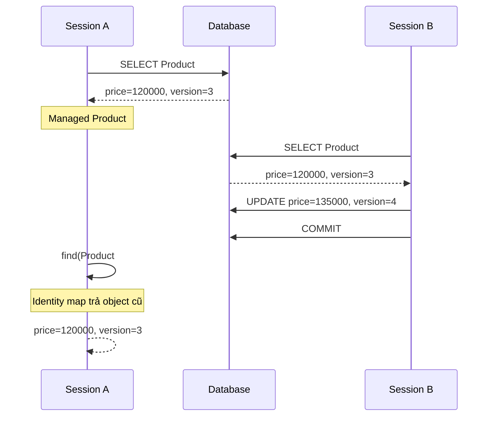

# Dữ liệu đang quản lý có thể khác với dữ liệu vừa đổi bên ngoài Session

## 1. Vấn đề: database đã đổi, vì sao entity vẫn giữ giá trị cũ?

Giả sử một nhân viên đang xem sản phẩm trên màn hình quản trị. Hibernate đã tải sản phẩm từ database vào `Session`:

```java
Product product = session.find(Product.class, 101L);
System.out.println(product.getPrice()); // 120000.00
```

Trong lúc Session này còn mở, một request khác hoặc một tiến trình khác cập nhật giá sản phẩm thành `135000.00` và commit. Ứng dụng ban đầu gọi lại:

```java
Product again = session.find(Product.class, 101L);
System.out.println(again.getPrice()); // Vẫn có thể là 120000.00
```

Điều này không nhất thiết là lỗi JDBC, lỗi transaction hay Hibernate “không truy vấn được” database. Nguyên nhân thường là **Persistence Context đang giữ một entity instance đã được quản lý**. Khi cùng entity được yêu cầu lần nữa, Hibernate có thể trả lại instance đó từ **first-level cache (identity map)**, thay vì chạy SQL và ghi đè các trường bằng kết quả mới.

Hai nguồn sự thật tạm thời có thể khác nhau:

```text
Persistence Context của Session A       Database đã commit
┌──────────────────────────────┐        ┌──────────────────────────────┐
│ Product#101                  │        │ products.id = 101            │
│ price = 120000.00            │        │ price = 135000.00            │
│ version = 3                  │        │ version = 4                  │
└──────────────────────────────┘        └──────────────────────────────┘
             │                                      ▲
             │ entity đã được tải trước đó          │
             └── Không tự đồng bộ tức thời ────────┘
```

Đây là chủ đề của bài: **dữ liệu của một managed entity trong Hibernate có thể khác với dữ liệu vừa bị thay đổi bên ngoài đường theo dõi của chính Persistence Context ấy**.

Sau bài này, bạn sẽ hiểu:

- Vì sao Session giữ object cũ dù hàng database đã thay đổi.
- Những nguồn thay đổi nào khiến Persistence Context không được cập nhật tự động.
- Sự khác biệt giữa `flush()`, `refresh()`, `clear()` và `detach()`.
- Vì sao truy vấn HQL trả entity có thể thấy dữ liệu cũ, trong khi truy vấn scalar có thể thấy giá trị database mới.
- Cách transaction isolation, optimistic locking `@Version` và cache ảnh hưởng tới tình huống này.
- Cách thiết kế đơn vị công việc và API để tránh đọc sai hoặc vô tình ghi đè dữ liệu mới.

> Các ví dụ sử dụng Hibernate ORM hiện đại với `jakarta.persistence.*` và `org.hibernate.Session`. Hành vi cụ thể về isolation, flush mode, bulk DML, cache và JDBC driver phụ thuộc môi trường triển khai; các ví dụ nêu rõ giả định khi cần.

## 2. Persistence Context quản lý object, không phải một bản sao đồng bộ thời gian thực của database

Một `Session` Hibernate chứa Persistence Context, thường có vòng đời gắn với một unit of work hoặc transaction. Khi Hibernate tải một entity, nó giữ một managed instance cùng trạng thái cần thiết để theo dõi thay đổi.

Ví dụ:

```java
Product first = session.find(Product.class, 101L);
Product second = session.find(Product.class, 101L);

System.out.println(first == second); // Thông thường true.
```

Hai biến Java trỏ tới cùng một managed instance, vì Hibernate duy trì **identity map**: trong một Persistence Context, một khóa gồm entity type và identifier tương ứng với một thực thể được quản lý.

### Vì sao Hibernate làm vậy?

Identity map có những lợi ích:

1. **Bảo đảm identity:** cùng một hàng không xuất hiện như hai object managed khác nhau với trạng thái mâu thuẫn trong cùng context.
2. **Giảm truy vấn lặp:** nhiều lần lấy cùng entity có thể tái sử dụng đối tượng đã có.
3. **Dirty checking:** Hibernate biết trạng thái managed nào đã bị thay đổi để ghi xuống database khi flush.
4. **Quản lý quan hệ:** các association tới cùng một entity có thể chia sẻ managed instance.
5. **Điều phối đơn vị công việc:** các thao tác liên quan trong một Session tạo thành một mô hình đối tượng nhất quán theo phạm vi context.

Nhưng identity map có hệ quả quan trọng: **Hibernate không liên tục theo dõi mọi thay đổi xảy ra bên ngoài Session để sửa những field của object đang managed**.

### First-level cache khác second-level cache

| Loại | Phạm vi | Đặc điểm |
|---|---|---|
| **First-level cache / Persistence Context** | Một `Session`/`EntityManager` | Luôn là phần cốt lõi của quản lý managed entities; cùng ID thường trả cùng instance |
| **Second-level cache** | Thường ở mức `SessionFactory`, nếu được cấu hình | Cache dữ liệu entity/collection giữa các Session theo vùng và chiến lược nhất quán |
| **Query cache** | Nếu được bật và query phù hợp | Cache kết quả định danh/giá trị truy vấn theo cơ chế Hibernate |
| **Database buffer cache** | Database | Cache trang dữ liệu/index; không đồng nghĩa Java entity đang managed được cập nhật |

**Tắt second-level cache không giải quyết chuyện object đã nằm trong first-level cache.** Ngay cả khi Hibernate không bật L2 cache hay query cache, một entity đã được tải vào Session vẫn có thể cũ so với database.

## 3. Những thay đổi nào nằm ngoài đường theo dõi của Session?

Hibernate chủ yếu biết các thay đổi được thực hiện **trên những managed entity** của chính Persistence Context đó. Nhiều thay đổi khác không đi qua cơ chế dirty checking của object đã tải.

| Nguồn thay đổi | Ví dụ | Vì sao entity managed có thể cũ? |
|---|---|---|
| **Session/transaction khác** | Request B sửa giá rồi commit | Session A không được thông báo để thay các giá trị của `Product#101` |
| **JDBC trực tiếp** | `PreparedStatement UPDATE products ...` | SQL thay hàng nhưng bỏ qua việc cập nhật managed object của Hibernate |
| **Native SQL DML** | `createNativeMutationQuery("update ...")` | Thay database trực tiếp, không sửa fields đã nằm trong Persistence Context |
| **JPQL/HQL bulk UPDATE/DELETE** | `update Product p set p.price = ...` | Bulk DML làm việc ở database, không đi qua dirty checking của từng instance |
| **Stored procedure/trigger** | Trigger cập nhật giá trị tính toán | Database có thể đổi cột mà entity đang giữ không được tự nạp lại |
| **Công cụ bên ngoài** | Import job, admin SQL, ETL | Hibernate Session không sở hữu thao tác ấy |
| **Read replica/caching khác** | Dữ liệu từ replica hoặc cache ứng dụng | Kết quả còn chịu tác động độ trễ đồng bộ và chính sách cache |

Điều quan trọng là phân biệt **“bên ngoài Session” theo nghĩa đơn vị công việc khác** với **“bên ngoài cơ chế managed-entity” dù vẫn dùng connection của cùng Session**. Cả hai đều có thể gây ra trạng thái managed không còn khớp giá trị hiện tại mà một truy vấn SQL đọc được.

## 4. Entity dùng trong các ví dụ

Giả sử hệ thống bán hàng có bảng `products`:

```sql
CREATE TABLE products (
    id BIGINT GENERATED BY DEFAULT AS IDENTITY PRIMARY KEY,
    sku VARCHAR(50) NOT NULL UNIQUE,
    name VARCHAR(120) NOT NULL,
    price NUMERIC(14, 2) NOT NULL,
    stock_quantity INTEGER NOT NULL,
    version BIGINT NOT NULL
);
```

Đây là DDL PostgreSQL minh họa; phần tạo ID, version và migration cần được thiết kế nhất quán với môi trường thực tế.

Entity:

```java
package com.example.inventory;

import jakarta.persistence.Column;
import jakarta.persistence.Entity;
import jakarta.persistence.GeneratedValue;
import jakarta.persistence.GenerationType;
import jakarta.persistence.Id;
import jakarta.persistence.Table;
import jakarta.persistence.Version;
import java.math.BigDecimal;

@Entity
@Table(name = "products")
public class Product {

    @Id
    @GeneratedValue(strategy = GenerationType.IDENTITY)
    private Long id;

    @Column(name = "sku", nullable = false, unique = true, length = 50)
    private String sku;

    @Column(name = "name", nullable = false, length = 120)
    private String name;

    @Column(name = "price", nullable = false, precision = 14, scale = 2)
    private BigDecimal price;

    @Column(name = "stock_quantity", nullable = false)
    private int stockQuantity;

    @Version
    @Column(name = "version", nullable = false)
    private long version;

    protected Product() {}

    public Product(
            String sku,
            String name,
            BigDecimal price,
            int stockQuantity) {
        this.sku = sku;
        this.name = name;
        this.price = price;
        this.stockQuantity = stockQuantity;
    }

    public Long getId() { return id; }
    public String getName() { return name; }
    public BigDecimal getPrice() { return price; }
    public int getStockQuantity() { return stockQuantity; }
    public long getVersion() { return version; }

    public void changePrice(BigDecimal newPrice) {
        if (newPrice == null || newPrice.signum() < 0) {
            throw new IllegalArgumentException("Invalid price");
        }
        this.price = newPrice;
    }

    public void rename(String newName) {
        this.name = newName;
    }
}
```

`@Version` được dùng để minh họa optimistic locking ở phần sau. Nó không khiến entity tự refresh khi hàng database thay đổi. Ví dụ giả định có một sản phẩm đã được lưu với ID `101`.

## 5. Trường hợp 1: hai Session cùng truy cập một sản phẩm

Giả sử Session A tải `Product#101` khi giá bằng 120.000. Session B cập nhật giá thành 135.000 và commit. Sau đó Session A lại yêu cầu entity bằng `find()`.

```java
import org.hibernate.Session;
import org.hibernate.SessionFactory;
import org.hibernate.Transaction;
import java.math.BigDecimal;

try (Session sessionA = sessionFactory.openSession();
     Session sessionB = sessionFactory.openSession()) {

    Transaction txA = sessionA.beginTransaction();
    try {
        Product productA = sessionA.find(Product.class, 101L);
        System.out.println(productA.getPrice()); // 120000.00

        Transaction txB = sessionB.beginTransaction();
        try {
            Product productB = sessionB.find(Product.class, 101L);
            productB.changePrice(new BigDecimal("135000.00"));
            txB.commit();
        } catch (RuntimeException ex) {
            if (txB.isActive()) {
                txB.rollback();
            }
            throw ex;
        }

        Product againA = sessionA.find(Product.class, 101L);
        System.out.println(productA == againA); // true

        // Dữ liệu trong managed entity của A chưa tự cập nhật.
        System.out.println(againA.getPrice()); // Có thể vẫn 120000.00

        txA.commit();
    } catch (RuntimeException ex) {
        if (txA.isActive()) {
            txA.rollback();
        }
        throw ex;
    }
}
```

Ví dụ này giả định transaction B có thể commit và không có khóa/xung đột khác ngăn cập nhật. Khi `find()` trong Session A được gọi lần nữa, Hibernate đã giữ instance của Product trong Persistence Context, nên thường trả về chính instance ấy.

### Điều gì xảy ra ở từng mốc?



Trong ví dụ, phiên bản database mới là `4` vì Session B thay đổi managed entity có `@Version` theo cơ chế optimistic locking. Session A vẫn có thể giữ `version=3` trong object đã load.

**Lưu ý về transaction isolation:** ngay cả khi Session A chủ động truy vấn lại SQL, việc có thấy commit của B hay không còn phụ thuộc isolation level. Ví dụ `READ COMMITTED` thường có thể thấy commit của B ở statement đọc sau đó; `REPEATABLE READ` hoặc snapshot isolation có thể tiếp tục thấy ảnh chụp cũ trong cùng transaction. Đó là một vấn đề **khác với first-level cache**, dù kết quả đều có vẻ “đọc dữ liệu cũ”.

## 6. Trường hợp 2: native SQL hoặc JDBC làm thay đổi hàng ngay trong cùng Session

Một Session có thể trực tiếp sử dụng JDBC connection để chạy câu `UPDATE`. Database được cập nhật, nhưng đối tượng Product đã managed vẫn giữ trạng thái trước đó vì câu SQL không đi qua setter/dirty checking của entity.

Ví dụ dùng `Session.doWork(...)`:

```java
try (Session session = sessionFactory.openSession()) {
    Transaction tx = session.beginTransaction();
    try {
        Product product = session.find(Product.class, 101L);
        System.out.println(product.getPrice()); // 120000.00

        session.doWork(connection -> {
            try (var statement = connection.prepareStatement(
                    "UPDATE products SET price = ? WHERE id = ?")) {
                statement.setBigDecimal(
                    1, new BigDecimal("135000.00")
                );
                statement.setLong(2, 101L);
                statement.executeUpdate();
            }
        });

        // Cùng transaction JDBC có thể đọc hàng đã đổi.
        // Nhưng managed object không được sửa tự động:
        System.out.println(product.getPrice()); // Vẫn 120000.00

        tx.commit();
    } catch (RuntimeException ex) {
        if (tx.isActive()) {
            tx.rollback();
        }
        throw ex;
    }
}
```

`Session.doWork` chạy JDBC trong connection mà Hibernate quản lý, phù hợp ví dụ minh họa native JDBC. Không tự đóng connection trong callback vì quyền sở hữu connection thuộc Hibernate/transaction manager.

Trong tình huống này, chính transaction đang dùng đã thay đổi hàng dữ liệu; vì thế không cần đợi một transaction B commit để xuất hiện sự khác biệt. **Dữ liệu trong object managed vẫn cũ vì Hibernate không biết phải gán lại field.**

### Native SQL cũng có vấn đề tương tự

```java
Product product = session.find(Product.class, 101L);

session.createNativeMutationQuery(
    "UPDATE products SET price = :price WHERE id = :id"
)
.setParameter("price", new BigDecimal("135000.00"))
.setParameter("id", 101L)
.executeUpdate();

System.out.println(product.getPrice()); // Có thể vẫn 120000.00
```

`createNativeMutationQuery(...)` là API Hibernate ORM 6.x. Khi làm việc qua `EntityManager` tiêu chuẩn, có thể dùng `createNativeQuery(...).executeUpdate()` trong transaction.

Ngay cả khi Hibernate **đã biết một native mutation tác động tới bảng nào** để phục vụ auto-flush hoặc cache invalidation trong trường hợp phù hợp, điều đó không có nghĩa mỗi managed entity liên quan được tải lại.

## 7. Trường hợp 3: JPQL/HQL bulk UPDATE và DELETE bỏ qua managed instances

JPQL/HQL cho phép cập nhật nhiều bản ghi trực tiếp bằng một câu bulk DML.

```java
Product product = session.find(Product.class, 101L);

int changed = session.createMutationQuery(
    "update Product p " +
    "set p.price = :newPrice " +
    "where p.id = :id"
)
.setParameter("newPrice", new BigDecimal("135000.00"))
.setParameter("id", 101L)
.executeUpdate();

System.out.println("Affected rows: " + changed);
System.out.println(product.getPrice()); // Giá managed vẫn có thể cũ.
```

**Bulk DML khác dirty checking của một managed entity**:

- Nó cập nhật database theo query, không phải gọi setter trên từng Java object đang managed.
- Nó có thể thực hiện thành một hoặc nhiều SQL statement, tùy loại mutation, inheritance và dialect.
- Nó không tự thay thế giá trị `product.price` trong những entity instance đã load.
- Những callback/logic mức entity thông thường không nên được giả định sẽ chạy cho từng hàng bị bulk UPDATE/DELETE.
- **Bulk update chuẩn JPA không tự tăng `@Version`** theo cùng cơ chế khi sửa managed entity; cần thiết kế versioning/concurrency riêng nếu cần.

### Sau bulk DELETE, managed entity có thể vẫn tồn tại trong context

```java
Product product = session.find(Product.class, 101L);

session.createMutationQuery(
    "delete from Product p where p.id = :id"
)
.setParameter("id", 101L)
.executeUpdate();

// Java object và tham chiếu 'product' vẫn tồn tại.
System.out.println(session.contains(product)); // Có thể vẫn true.
```

Mặc dù hàng database đã bị xóa, Hibernate không bắt buộc đánh dấu instance đã load thành `removed` bởi bulk DML. Truy cập object cũ không làm database tự tạo lại hàng, nhưng các thao tác tiếp theo trong Session có thể gặp lỗi hoặc làm sai giả định nghiệp vụ.

Vì thế sau bulk UPDATE/DELETE, nếu định tiếp tục làm việc với những entity bị ảnh hưởng, cần **chủ động xử lý trạng thái Persistence Context**.

## 8. Một truy vấn HQL mới có chắc trả giá trị mới không?

Câu trả lời phụ thuộc **loại kết quả** và trạng thái của context.

### Truy vấn trả entity

```java
Product old = session.find(Product.class, 101L);

// Giả sử một JDBC/native/bulk UPDATE đã đổi price trong database.
Product viaQuery = session.createQuery(
    "from Product p where p.id = :id",
    Product.class
)
.setParameter("id", 101L)
.getSingleResult();

System.out.println(viaQuery == old); // Thường true.
```

Dù Hibernate có thể đã chạy câu `SELECT`, khi ánh xạ hàng về một entity ID đang được quản lý, Hibernate thường **tái sử dụng managed instance**. Không nên coi việc chạy HQL trả entity là một phép refresh mặc nhiên.

### Truy vấn scalar/projection

```java
BigDecimal dbPrice = session.createQuery(
    "select p.price from Product p where p.id = :id",
    BigDecimal.class
)
.setParameter("id", 101L)
.getSingleResult();
```

Với một query scalar thực sự chạy tới database, kết quả có thể phản ánh giá trị hiện được nhìn thấy bởi transaction **ngay cả khi `old.getPrice()` vẫn cũ**. Nhưng điều này không bảo đảm luôn mới nhất trong mọi tình huống: transaction isolation, auto-flush, query cache và read replica vẫn có thể ảnh hưởng.

### Nguy cơ đặc biệt: lọc theo trạng thái mới nhưng object chứa trạng thái cũ

Ví dụ database có `price=135000` sau UPDATE và query:

```java
List<Product> matches = session.createQuery(
    "from Product p where p.price >= :minPrice",
    Product.class
)
.setParameter("minPrice", new BigDecimal("130000.00"))
.getResultList();
```

SQL có thể **chọn đúng hàng** vì database price đạt điều kiện, nhưng Java object tương ứng trong Persistence Context vẫn có thể giữ `price=120000`. Khi đó:

```text
Hàng thỏa WHERE price >= 130000 tại database
             ↓
Hibernate trả Product#101 managed đã có
             ↓
Product#getPrice() vẫn có thể là 120000
```

Đây là lý do không thể suy ra **“query đã chạy SQL” = “mọi thuộc tính của entity đã load được ghi đè bằng dữ liệu SQL mới”**.

## 9. refresh(): nạp lại trạng thái database vào entity đang managed

Để yêu cầu Hibernate đọc lại trạng thái của **một managed entity cụ thể**, dùng:

```java
session.refresh(product);
```

hoặc Jakarta Persistence:

```java
entityManager.refresh(product);
```

Ví dụ:

```java
Product product = session.find(Product.class, 101L);
System.out.println(product.getPrice()); // 120000.00

// Giả sử database đã đổi giá và transaction hiện tại nhìn thấy bản mới.
session.refresh(product);

System.out.println(product.getPrice()); // Có thể là 135000.00
```

`refresh()` yêu cầu Hibernate nạp lại dữ liệu từ database để cập nhật trạng thái của entity đang managed. Nó hữu ích khi dữ liệu đã thay đổi ngoài đường quản lý của Persistence Context, chẳng hạn bởi stored procedure, trigger hoặc transaction khác.

### Các điều kiện và giới hạn

1. **Entity phải managed** trong Persistence Context thích hợp. Refresh một object transient hoặc detached thường không hợp lệ.
2. **Transaction isolation vẫn áp dụng**: nếu transaction đang nhìn snapshot cũ, việc refresh không thể tùy ý vượt qua snapshot đó.
3. **Thay đổi chưa lưu trên cùng entity có thể bị mất** vì refresh ghi đè state của object bằng kết quả đọc từ database.
4. **Refresh không phải commit**, không đồng bộ tất cả entity trong Session và không giải quyết mọi loại cache ngoài Hibernate.
5. Nếu hàng không còn tồn tại, việc refresh có thể gây exception theo provider và hoàn cảnh, thay vì tạo một entity mới.

### Cảnh báo quan trọng: refresh có thể ghi đè thay đổi đang chờ

```java
Product product = session.find(Product.class, 101L);
product.rename("Tên tạm chưa lưu");

session.refresh(product);

// Tên tạm có thể bị thay bằng tên trong database.
```

Nếu bạn cố ý đổi tên sản phẩm nhưng sau đó refresh để xem giá mới, Hibernate không có nghĩa vụ “chỉ làm mới giá mà giữ nguyên mọi chỉnh sửa khác”. Hãy thiết kế rõ:

- Có cần **bỏ những chỉnh sửa chưa lưu** hay không?
- Có thể hoàn tất `flush()` hoặc commit các chỉnh sửa hợp lệ trước khi refresh không?
- Có nên tách thao tác đọc mới sang một transaction/Session khác?
- Có cần conflict detection bằng `@Version` thay vì làm mới một cách lặng lẽ?

Không dùng `refresh()` theo thói quen sau mọi query, vì nó phát thêm SQL và có nguy cơ làm mất trạng thái đang sửa.

## 10. clear(), detach(), evict(): bỏ trạng thái managed để lần sau đọc lại

Một nhóm giải pháp khác là **loại entity khỏi Persistence Context**, rồi truy vấn lại. Khi đó Hibernate không còn instance cũ để trả trực tiếp từ first-level cache.

### 10.1. clear(): xóa toàn bộ context

```java
session.clear();
Product fresh = session.find(Product.class, 101L);
```

`clear()` detach **tất cả** managed entities của Session và hủy các thay đổi đang chờ đồng bộ chưa được flush. Lần `find()` sau có thể thực hiện SQL mới, mặc dù vẫn chịu ảnh hưởng của transaction isolation và second-level cache nếu được cấu hình.

**Không tự ý gọi `clear()` giữa một transaction có nhiều thao tác chưa flush**. Có thể đánh mất những thay đổi Java mà ứng dụng tưởng sẽ được lưu ở commit.

### 10.2. detach(): loại một entity

```java
session.detach(product);

Product reloaded = session.find(Product.class, 101L);
```

`detach(product)` chỉ loại đối tượng được chỉ định khỏi context, theo các quy tắc cascade detach nếu có. Đối tượng `product` cũ vẫn tồn tại trong Java nhưng không còn managed. `reloaded` là một managed instance khác, nếu load thành công.

Không nên tiếp tục sửa `product` detached rồi mặc định Hibernate sẽ ghi nó. Muốn cập nhật, thao tác trên entity managed mới hoặc sử dụng `merge()` theo quy tắc thích hợp.

### 10.3. evict(): API Hibernate cho việc detach

```java
session.evict(product);
```

`Session.evict(...)` là API Hibernate; trong JPA chuẩn, `EntityManager.detach(...)` diễn đạt mục tiêu tương tự. Cả hai đều liên quan tới Persistence Context của Session hiện tại, **không phải xóa hàng database**.

### Bảng so sánh

| Thao tác | Đối tượng chịu tác động | Có chủ động nạp giá trị database mới? | Lưu ý |
|---|---|---|---|
| `refresh(product)` | Entity managed chỉ định | **Có**, theo dữ liệu transaction nhìn thấy | Có thể ghi đè thay đổi local |
| `detach(product)` | Một entity | Không, phải query lại | Object cũ trở thành detached |
| `evict(product)` | Một entity | Không, phải query lại | API Hibernate-specific |
| `clear()` | Tất cả entities của context | Không, phải query lại | Có thể mất pending changes chưa flush |
| Đóng Session, mở Session mới | Toàn bộ unit of work | Không tự động, query mới có thể đọc trạng thái mới | Cần transaction/caching/isolation phù hợp |

Nếu mục tiêu chỉ là lấy giá mới của một sản phẩm, `refresh(product)` hoặc một truy vấn projection rõ ràng thường dễ kiểm soát hơn `clear()` toàn bộ Session. Nếu mục tiêu là loại trạng thái managed cũ sau một bulk update rất lớn, `clear()` có thể hợp lý **sau khi đã xử lý các thay đổi đang chờ**.

## 11. flush() chỉ đẩy thay đổi đi, không kéo thay đổi mới về

Đây là phân biệt quan trọng nhất giữa hai thao tác:

```text
flush()
   Persistence Context  ───►  Database
   Đồng bộ pending INSERT/UPDATE/DELETE

refresh(entity)
   Persistence Context  ◄───  Database
   Nạp lại trạng thái được database trả về
```

### Ví dụ không nên nhầm

```java
Product product = session.find(Product.class, 101L);

// Một tiến trình khác đã đổi price trong database.
session.flush();

// flush không có nghĩa product.price đã được đọc lại.
System.out.println(product.getPrice());
```

Nếu Session không có thay đổi cần ghi, `flush()` có thể không phát DML nào. Nó không tự chạy `SELECT` để cập nhật tất cả managed entities.

Ngược lại, khi dùng bulk update trong cùng unit of work và cần đọc lại:

```java
session.flush(); // Đồng bộ những thay đổi managed còn đang chờ.

int affected = session.createMutationQuery(
    "update Product p " +
    "set p.price = :price where p.id = :id"
)
.setParameter("price", new BigDecimal("135000.00"))
.setParameter("id", 101L)
.executeUpdate();

session.clear(); // Chủ động loại state managed có thể cũ.

Product newView = session.find(Product.class, 101L);
```

Đây là một trình tự **thường hữu ích** khi bạn biết rõ bulk DML vừa cập nhật những hàng nào. Nó không thay thế yêu cầu quản lý transaction, versioning, cache hoặc các ràng buộc nghiệp vụ, và phải cân nhắc việc `clear()` làm detach mọi entity.

### Flush mode cũng không phải refresh mode

Hibernate có các flush mode như `AUTO`, `COMMIT`, `MANUAL` với semantics cụ thể. Chúng ảnh hưởng **khi nào Hibernate đồng bộ pending DML**, không quyết định rằng managed entity sẽ tự nạp lại sau khi database thay đổi ngoài ORM.

## 12. Transaction isolation: refresh rồi vẫn thấy dữ liệu cũ?

Một managed entity cũ không phải nguyên nhân duy nhất làm người dùng “không thấy cập nhật”. Khi đọc database, **transaction isolation** quyết định dữ liệu transaction được phép quan sát.

### READ COMMITTED

Với nhiều database ở `READ COMMITTED`, mỗi statement có thể đọc những thay đổi đã được transaction khác commit **trước thời điểm statement bắt đầu**.

Ví dụ:

```text
T1 / Session A: SELECT price => 120000
T2 / Session B: UPDATE price=135000; COMMIT
T1 / Session A: chạy SELECT mới => có thể thấy 135000
```

Nhưng nếu `Session A` vẫn giữ managed `Product#101`, gọi `session.find(...)` lần hai có thể không chạy `SELECT` mới. Phải **phân biệt dữ liệu transaction có thể nhìn thấy** và **Hibernate có thực sự nạp lại dữ liệu hay không**.

### REPEATABLE READ hoặc snapshot isolation

Trong transaction dùng snapshot ổn định, ngay cả một truy vấn mới sau commit của T2 cũng có thể tiếp tục nhìn trạng thái từ snapshot trước:

```text
T1: mở transaction + đọc snapshot price=120000
T2: đổi price=135000 + COMMIT
T1: SELECT lại trong cùng transaction
    => vẫn có thể thấy price=120000 theo isolation
```

Trong tình huống này, `refresh()` **không bảo đảm trả 135000** vì database có thể vẫn cung cấp ảnh chụp cũ cho transaction đang mở.

### Những tình huống khác

- **Transaction B chưa commit:** dưới isolation thông dụng, transaction A không thấy thay đổi chưa commit của B.
- **Đọc từ read replica:** dữ liệu có thể trễ hơn primary vì replication lag, kể cả trong Session mới.
- **Read-only snapshot/reporting transaction:** hệ thống có thể cố ý ưu tiên kết quả nhất quán tại một mốc thời gian, không phải dữ liệu mới nhất.
- **Cache ngoài database:** ứng dụng hoặc service có thể trả snapshot cũ vì TTL, invalidation hoặc asynchronous updates.

Do đó, trước khi chọn `refresh()`, phải hỏi: **database nào đang được truy vấn, transaction đang ở isolation nào, và giá trị mới đã commit/chấp nhận nhìn thấy hay chưa?**

## 13. @Version giúp phát hiện ghi đè, không tự cập nhật entity

Khi hai Session cùng sửa một hàng, câu hỏi không chỉ là “ai thấy giá trị mới?” mà còn là **ai được phép ghi đè giá trị của người khác?**

JPA cung cấp **optimistic locking** qua `@Version`:

```java
@Version
@Column(name = "version", nullable = false)
private long version;
```

Giả sử:

```text
Ban đầu: Product#101 price=120000, version=3

Session A tải version=3
Session B tải version=3

Session B đổi price=135000
Session B flush/commit thành công -> database version=4

Session A đổi name, muốn flush bằng version=3
=> Có thể gặp optimistic lock conflict vì version không còn khớp
```

Hibernate thường thực hiện một câu SQL cập nhật có điều kiện version, tương đương về mặt ý nghĩa:

```sql
UPDATE products
SET name = ?, version = 4
WHERE id = 101 AND version = 3;
```

Nếu số hàng bị cập nhật không đúng kỳ vọng do version đã đổi, ORM có thể báo optimistic locking exception thay vì âm thầm ghi đè.

### @Version không tự giải quyết việc đọc giá cũ

Sau khi B commit, `productA.getPrice()` vẫn có thể là 120000. `@Version` giúp **phát hiện xung đột khi ghi** thông qua phiên bản, không bảo đảm mọi entity đang managed tự thay đổi thành giá trị mới sau commit của B.

### Bulk DML và SQL ngoài ORM có thể bỏ qua version

Đây là một rủi ro:

```java
session.createMutationQuery(
    "update Product p set p.price = :price where p.id = :id"
)
.setParameter("price", new BigDecimal("135000.00"))
.setParameter("id", 101L)
.executeUpdate();
```

Một bulk JPQL/HQL update như vậy **không mặc nhiên tăng version theo cơ chế entity dirty checking chuẩn**. Nếu SQL trực tiếp hoặc stored procedure thay đổi dữ liệu nhưng không cập nhật version, một Session khác có thể không phát hiện xung đột chỉ dựa vào `@Version`.

Với numeric version, một thiết kế bulk update có chủ đích có thể tăng version trong cùng câu SQL:

```java
session.createMutationQuery(
    "update Product p " +
    "set p.price = :price, " +
    "    p.version = p.version + 1 " +
    "where p.id = :id"
)
.setParameter("price", new BigDecimal("135000.00"))
.setParameter("id", 101L)
.executeUpdate();
```

Trong thực tế phải kiểm tra cả **version predicate**, chính sách concurrency, mapping, kiểu version và số hàng bị ảnh hưởng; tăng version trong một bulk command không tự động tạo ra cơ chế optimistic locking đầy đủ cho mọi luồng ghi.

### Khi xảy ra optimistic locking exception

Thông thường ứng dụng phải rollback transaction đang lỗi, không tiếp tục thao tác như chưa có gì. Sau đó có thể:

1. Tải trạng thái mới bằng transaction/context mới.
2. Thông báo người dùng về xung đột.
3. Cho phép người dùng xem, hợp nhất hoặc áp lại thay đổi nếu nghiệp vụ phù hợp.
4. Chỉ retry tự động khi operation có tính idempotent và chính sách xung đột đã rõ.

Việc gọi `refresh()` để âm thầm bỏ dữ liệu cũ trước khi lưu có thể **che giấu xung đột** và làm mất ý định chỉnh sửa của người dùng.

## 14. Database trigger và giá trị được sinh bên ngoài Hibernate

Một database có thể thay đổi cột bằng:

- `DEFAULT` khi insert.
- Trigger `BEFORE INSERT` hoặc `AFTER UPDATE`.
- Computed/generated column.
- Stored procedure.
- Job bảo trì hoặc migration dữ liệu.

Ví dụ bảng có `updated_at` được trigger cập nhật:

```sql
UPDATE products
SET price = 135000.00
WHERE id = 101;

-- Trigger có thể sửa updated_at trong cùng statement/transaction.
```

Nếu Hibernate đã load `Product` trước khi trigger chạy, giá trị Java `updatedAt` có thể cũ. Khi mapping những cột **do database sinh**, có thể cân nhắc các tính năng Hibernate-specific hỗ trợ generated values, nếu phiên bản/dialect phù hợp. Hoặc refresh có chủ đích sau khi SQL đã chạy và trong transaction có thể quan sát giá trị cần thiết.

**Không giả định mọi trigger đều khiến Hibernate tự cập nhật mọi managed field.** Việc một column được ghi trong database khác với việc Hibernate đã thực hiện SELECT trả giá trị mới vào object.

## 15. Second-level cache, query cache và stale state qua nhiều Session

First-level cache là trọng tâm của bài, nhưng trong hệ thống thực tế còn có cache dùng chung.

### Second-level cache

Hibernate có thể cache trạng thái entity giữa các Session khi cấu hình entity cache và region phù hợp. Điều này giúp tránh SQL cho các lần đọc sau nhưng làm xuất hiện bài toán **cache invalidation** khi database bị sửa ngoài Hibernate.

Ví dụ một công cụ SQL sửa bảng `products` mà không đi qua Hibernate. Khi Session mới tải `Product#101`, nó **có thể** nhận giá trị cũ từ second-level cache nếu cache đã bật và không được invalidation thích hợp.

Tùy API/version, ứng dụng có thể chủ động evict cache entity:

```java
sessionFactory.getCache()
    .evictEntityData(Product.class, 101L);
```

Tuy nhiên, evict L2 cache **không sửa object Product đã managed trong Session A**. Muốn cập nhật instance ấy, vẫn cần refresh hoặc tạo context đọc mới theo trường hợp.

### Query cache

Query cache có thể lưu danh sách identifier hoặc dữ liệu kết quả của query theo cơ chế Hibernate. Nếu cache được sử dụng, cần xem chính sách invalidation, query spaces và những thao tác ghi bypass ORM.

### Các câu hỏi phân biệt cache

| Triệu chứng | Nghi vấn cần xét |
|---|---|
| Cùng Session gọi `find()` lần hai vẫn giá cũ | First-level cache / managed instance |
| Session mới vẫn đọc cũ dù transaction mới | L2/query cache, replica, transaction isolation, DB khác |
| Native SQL đổi dữ liệu nhưng managed object không đổi | DML bypass Persistence Context |
| Sau refresh vẫn cũ | Isolation/snapshot, DB target, commit hoặc cấu hình cache |
| Bulk UPDATE rồi entity query thấy field cũ | Identity map giữ entity đã load |

Không nên giải quyết tất cả bằng cách **tắt cache**, vì ngoài hiệu năng, nó cũng không xử lý được những nguyên nhân như isolation hoặc bulk DML bypass managed state.

## 16. Quy trình an toàn sau bulk UPDATE hoặc SQL trực tiếp

Giả sử yêu cầu tăng giá 5% cho một danh mục lớn. Bulk update thích hợp về hiệu năng, nhưng phải xác định sau đó ứng dụng làm gì với entity đã load.

### Phương án A: kết thúc unit of work sau bulk DML

```java
try (Session session = sessionFactory.openSession()) {
    Transaction tx = session.beginTransaction();
    try {
        session.createMutationQuery(
            "update Product p " +
            "set p.price = p.price * :multiplier " +
            "where p.id in :ids"
        )
        .setParameter("multiplier", new BigDecimal("1.05"))
        .setParameterList("ids", productIds)
        .executeUpdate();

        tx.commit();
    } catch (RuntimeException ex) {
        if (tx.isActive()) {
            tx.rollback();
        }
        throw ex;
    }
}
// Mở Session khác khi cần tải trạng thái sau bulk DML.
```

Ví dụ code Hibernate 6.x sử dụng `setParameterList` trên query hỗ trợ tham số danh sách. Trong sản phẩm thực tế phải xử lý danh sách ID rỗng, giới hạn kích thước IN-list của database, chính sách làm tròn, versioning và cách triển khai transaction.

Ưu điểm: tránh kéo dài một Persistence Context chứa nhiều entity đang bị bulk update làm cũ.

### Phương án B: flush rồi clear có chủ đích

```java
session.flush(); // Ghi pending state từ managed entities.

session.createMutationQuery(
    "update Product p set p.stockQuantity = 0 " +
    "where p.id in :ids"
)
.setParameterList("ids", productIds)
.executeUpdate();

session.clear(); // Bỏ managed state cũ.
```

Phương án này phù hợp khi cần tiếp tục cùng Session nhưng phải đọc lại những hàng vừa bị bulk update. Nó có hai điều kiện quan trọng:

- Các thay đổi đang chờ trước `clear()` phải được xử lý phù hợp; nếu không sẽ mất.
- Sau `clear()`, **mọi entity cũ đều detached**, kể cả entity không liên quan đến câu bulk DML.

### Phương án C: refresh một vài entity cụ thể

Nếu chỉ có một hoặc vài object đang managed bị ảnh hưởng, và không muốn detach mọi entity:

```java
Product product = session.find(Product.class, 101L);

session.createMutationQuery(
    "update Product p set p.stockQuantity = :stock " +
    "where p.id = :id"
)
.setParameter("stock", 15)
.setParameter("id", 101L)
.executeUpdate();

session.refresh(product);
```

Trong transaction có thể nhìn thấy kết quả cập nhật, `refresh` giúp đồng bộ lại object. Nhưng nó có thể ghi đè những thay đổi local chưa lưu trên entity này; cần chắc chắn không có dữ liệu đang chỉnh sửa cần giữ.

### Phương án D: chỉ query projection

Nếu chỉ cần cập nhật một con số trên dashboard, có thể tránh quản lý full entity và truy vấn giá trị cần thiết:

```java
Integer currentStock = session.createQuery(
    "select p.stockQuantity from Product p where p.id = :id",
    Integer.class
)
.setParameter("id", 101L)
.getSingleResult();
```

Phương án này giảm sự phụ thuộc vào trạng thái managed entity, nhưng không tự giải quyết isolation hoặc cache và không thay thế chính sách cập nhật đồng thời.

## 17. Thiết kế Session ngắn giúp giảm cửa sổ dữ liệu cũ

Một `Session` tồn tại quá lâu có thể giữ nhiều managed entities trong thời gian dài. Khi các request hoặc worker khác liên tục cập nhật database, các object đó càng có khả năng không còn phản ánh giá trị mà transaction mới nhìn thấy.

Mô hình thông thường cho ứng dụng web:

```text
HTTP request / application operation
          ↓
Mở transaction + Persistence Context phù hợp
          ↓
Tải entity, kiểm tra nghiệp vụ, áp thay đổi
          ↓
Flush/commit (hoặc rollback nếu lỗi)
          ↓
Kết thúc Session / context
          ↓
Trả DTO cho caller
```

Các lưu ý:

- Không chia sẻ một `Session` cho nhiều thread/request đồng thời; Hibernate Session không thread-safe.
- Không giữ managed entity như một cache ứng dụng lâu dài.
- Không gọi `find()` lặp lại vô hạn trong Session dài để “poll” database mới nhất.
- Với màn hình liên tục cập nhật, thực hiện các query/transaction mới hoặc cơ chế push/events được thiết kế riêng, có version/checkpoint rõ ràng.
- Khi dùng Open Session in View (OSIV), việc Session tồn tại qua tầng view không biến entity thành live object; nó có thể làm thêm SQL lazy và kéo dài phạm vi dữ liệu đang managed.

**Session ngắn giảm nguy cơ stale state, nhưng không thay thế transaction isolation, cache invalidation, version check hay cơ chế đồng bộ từ replica.**

## 18. Ví dụ Spring Data JPA: bulk update và clear Persistence Context

Trong ứng dụng Spring, repository có thể sử dụng `@Modifying` với JPQL bulk update:

```java
import org.springframework.data.jpa.repository.JpaRepository;
import org.springframework.data.jpa.repository.Modifying;
import org.springframework.data.jpa.repository.Query;
import org.springframework.data.repository.query.Param;

import java.math.BigDecimal;

public interface ProductRepository
        extends JpaRepository<Product, Long> {

    @Modifying(
        flushAutomatically = true,
        clearAutomatically = true
    )
    @Query(
        "update Product p " +
        "set p.price = :price " +
        "where p.id = :id"
    )
    int updatePrice(
        @Param("id") long id,
        @Param("price") BigDecimal price
    );
}
```

Ở đây:

- `flushAutomatically = true` hướng Spring Data JPA flush Persistence Context trước mutation query.
- `clearAutomatically = true` hướng Spring Data JPA clear context sau khi query chạy.
- Phương thức trả số hàng bị ảnh hưởng; đây **không phải managed Product** đã tự được cập nhật.

### Dùng trong service transaction

```java
import org.springframework.stereotype.Service;
import org.springframework.transaction.annotation.Transactional;

@Service
public class ProductPriceService {

    private final ProductRepository repository;

    public ProductPriceService(ProductRepository repository) {
        this.repository = repository;
    }

    @Transactional
    public void setPrice(long id, BigDecimal price) {
        int rows = repository.updatePrice(id, price);
        if (rows != 1) {
            throw new IllegalArgumentException(
                "Expected one product, affected: " + rows
            );
        }
    }
}
```

**Cẩn thận:** `clearAutomatically` detach **mọi managed entity** trong EntityManager hiện tại, không chỉ Product vừa được cập nhật. Trong transaction có nhiều entity đang chỉnh sửa, cờ này có thể tạo hành vi không mong muốn nếu không có `flushAutomatically` hoặc nếu code tiếp tục dùng reference cũ như thể nó vẫn managed.

Ngoài ra, bulk JPQL vẫn **không tự áp dụng @Version và lifecycle callback như update một managed entity**. Nếu nghiệp vụ cần optimistic locking, phải thiết kế câu update hoặc cơ chế khác có điều kiện version phù hợp.

## 19. Những hiểu nhầm phổ biến

### “Hibernate luôn đọc database mới nhất mỗi khi gọi find()”

Không. Trong cùng Persistence Context, entity đã managed có thể được trả trực tiếp từ identity map. Muốn đọc lại phải chọn refresh/clear/detach/new context phù hợp.

### “Đã commit ở Session B thì Session A tự thay các field”

Không. Commit ở nơi khác không làm Java object đang managed trong Session A thay đổi tức thì.

### “Query HQL select entity luôn nạp lại mọi field”

Không. Hibernate có thể chạy SQL nhưng vẫn tái sử dụng managed instance theo ID. Query scalar và query entity có semantics khác nhau.

### “flush() giải quyết dữ liệu cũ do transaction khác”

Không. Flush chủ yếu gửi pending changes **từ** Persistence Context **đến** database, không tự tải ngược thay đổi ở nơi khác.

### “refresh() chắc chắn đọc commit mới nhất”

Không nếu transaction hiện tại vẫn chỉ nhìn snapshot cũ, update chưa commit hoặc query đọc từ nguồn dữ liệu trễ. Refresh tuân theo khả năng nhìn thấy dữ liệu của transaction.

### “clear() chỉ xóa cache nên vô hại”

Không. Clear detach toàn bộ entity, có thể làm mất thay đổi chưa flush và khiến các reference Java cũ không còn managed.

### “@Version tự phát hiện mọi lần UPDATE bằng JDBC”

Không nếu câu SQL bên ngoài không cập nhật version hoặc không có cơ chế kiểm soát xung đột tương ứng. `@Version` hữu ích cho luồng cập nhật managed entity nhưng không thay thế kiểm soát tất cả đường ghi.

### “Tắt second-level cache thì không có stale data”

Không. First-level cache là một phần của mỗi Persistence Context; tắt L2 không loại bỏ managed instance đã load.

### “Bulk DELETE làm object cũ biến mất khỏi Java”

Không. Java reference vẫn tồn tại, và Persistence Context có thể vẫn giữ entity cũ cho đến khi được làm mới/detach/clear hoặc context kết thúc.

### “Mở Session mới luôn đọc ngay dữ liệu mới”

Không luôn đúng vì transaction isolation, second-level/query cache, replica lag hoặc việc ghi chưa commit ở nguồn dữ liệu khác vẫn có thể làm kết quả cũ.

## 20. Chẩn đoán tình huống “database đã đổi, entity chưa đổi”

Hãy kiểm tra lần lượt:

1. **Giá trị mới đã commit chưa?** Lệnh `UPDATE` có bị rollback, transaction còn mở hay đang đọc database khác?
2. **Entity có được tải trước khi update không?** Nếu có, Session hiện tại có đang giữ một managed instance với ID ấy không?
3. **UPDATE đi qua đường nào?** Managed entity của cùng Session, JDBC/native SQL, bulk HQL, trigger hay Session khác?
4. **Có thực sự chạy SQL đọc lại không?** `find()` có thể trả từ first-level cache; HQL entity query cũng có thể tái sử dụng instance.
5. **Transaction isolation là gì?** Với snapshot/repeatable read, SELECT mới vẫn có thể thấy snapshot cũ.
6. **Có bật L2/query cache không?** Nếu Session mới vẫn đọc cũ, kiểm tra các lớp cache và invalidation.
7. **Ứng dụng đang đọc primary hay replica?** Replica có thể chưa bắt kịp commit trên primary.
8. **Có cập nhật @Version khi ghi ngoài ORM không?** Nếu không, optimistic locking có thể không phát hiện xung đột.
9. **Có pending local changes không?** Refresh/clear có thể làm mất các chỉnh sửa chưa được lưu.
10. **Cần chiến lược nào?** Refresh một entity, clear có chủ đích, unit of work mới, projection query, hay conflict detection bằng version.

### Logging phục vụ điều tra

Với ứng dụng cấu hình kiểu Spring Boot, có thể bật tạm thời:

```properties
logging.level.org.hibernate.SQL=DEBUG
logging.level.org.hibernate.orm.jdbc.bind=TRACE
```

Quan sát SQL giúp trả lời “có SELECT mới không?” và “UPDATE đã phát ở lúc nào?”. Nhưng **SQL có chạy cũng chưa đủ để chứng minh managed entity bị ghi đè dữ liệu**, và log bind parameters có thể chứa thông tin nhạy cảm. Chỉ bật log chi tiết trong môi trường được kiểm soát.

## 21. Bài thực hành: nhìn thấy first-level cache và làm mới có chủ đích

Giả sử sản phẩm `Product#101` đã được tạo với giá 120.000 và `@Version` được bật.

### Phần A — Hai Session

1. Mở Session A, tải Product và giữ reference.
2. Mở Session B, tải cùng Product, đổi giá thành 135.000 rồi commit.
3. Trong Session A, gọi `find(Product.class, 101L)` lần nữa.
4. So sánh `==` giữa object lần đầu và lần sau; quan sát giá đang giữ.
5. Nếu isolation cho phép, gọi `refresh(product)` trong Session A và quan sát khác biệt.

Kết luận cần rút ra: **Session A không tự cập nhật object chỉ vì Session B commit**.

### Phần B — Bulk HQL trong cùng Session

1. Mở transaction, tải Product bằng `find()`.
2. Dùng HQL bulk `update Product p set p.price = ...`.
3. In `product.getPrice()` ngay sau `executeUpdate()`.
4. Truy vấn scalar `select p.price`; so sánh với giá trong object.
5. Gọi `refresh(product)` (khi không có pending local changes cần giữ) rồi đọc lại.

Kết luận: **bulk DML thay database nhưng không cập nhật object managed từng dòng**.

### Phần C — clear và detached

```java
Product original = session.find(Product.class, 101L);

session.clear();

System.out.println(session.contains(original)); // false

Product loadedAgain = session.find(Product.class, 101L);
System.out.println(original == loadedAgain); // Thường false.
```

Thử đổi `original` sau khi clear rồi commit, kiểm tra vì sao Hibernate không tự lưu thay đổi trên detached instance. Sau đó đổi `loadedAgain` trong transaction phù hợp để quan sát dirty checking.

### Phần D — Optimistic locking

1. Session A và B cùng tải Product ở version 3.
2. Session B cập nhật price rồi commit, version thành 4.
3. Session A đổi name trên entity version 3 và thử commit.
4. Quan sát xung đột optimistic locking nếu phiên bản đã được bảo vệ đúng.
5. Thử riêng một đường bulk/native update **không tăng version** và phân tích vì sao có nguy cơ không phát hiện xung đột.

### Câu hỏi tự kiểm tra

1. Vì sao `session.find()` lần thứ hai có thể không chạy SQL?
2. `@Version` có khiến giá cũ trong entity tự đổi sang giá vừa commit không?
3. Sau native SQL UPDATE trong cùng transaction, vì sao `product.getPrice()` vẫn có thể cũ?
4. `flush()` và `refresh()` khác nhau về hướng đồng bộ dữ liệu như thế nào?
5. Vì sao `session.clear()` khi còn pending changes có thể làm mất dữ liệu?
6. Dưới `REPEATABLE READ`, refresh có luôn thấy commit của transaction khác không?
7. Query `select p.price` có cùng semantics với query `select p` không?
8. Bulk UPDATE có tự tăng version/callback từng entity như dirty checking không?
9. Tắt second-level cache có làm first-level cache biến mất không?
10. Khi nào nên kết thúc Session để mở context mới thay vì gọi refresh liên tục?

**Gợi ý:** (1) identity map; (2) không; (3) JDBC/native SQL bỏ qua managed state; (4) flush đẩy DML, refresh nạp DB; (5) clear detach và bỏ pending state; (6) không; (7) không; (8) không mặc nhiên; (9) không; (10) khi kết thúc một unit of work và muốn đọc trạng thái mới với transaction/cache phù hợp.

## 22. Các nguyên tắc thiết kế cần nhớ

1. **Persistence Context là nơi quản lý entity instance và identity map, không phải một bản sao đồng bộ tức thời của database.**
2. **Cùng một Session, cùng entity ID thường nhận cùng managed instance.** Vì vậy gọi `find()` hoặc query entity lần nữa không mặc nhiên refresh.
3. **Thay đổi từ Session khác, JDBC, native SQL, HQL bulk DML, trigger hoặc công cụ ngoài ORM có thể làm dữ liệu database khác với object managed.**
4. **`flush()` gửi pending changes xuống database; `refresh()` nạp lại state cho một managed entity.** Hai thao tác không thay thế nhau.
5. **`clear()`, `detach()` và `evict()` loại state khỏi Persistence Context**, nhưng không tự làm mới object cũ và có thể làm mất thay đổi chưa flush.
6. **Transaction isolation quyết định dữ liệu nào một SELECT được phép nhìn thấy.** Refresh không thể vượt qua snapshot/isolation hay làm một transaction khác commit.
7. **`@Version` phát hiện nhiều dạng xung đột cập nhật, không tự đồng bộ các giá trị đã load.** Những đường ghi bypass ORM phải có chính sách versioning phù hợp.
8. **Bulk UPDATE/DELETE cần chính sách quản lý Persistence Context rõ ràng.** Đừng tiếp tục dùng managed entities cũ như thể chúng được cập nhật cùng SQL.
9. **First-level cache khác second-level và query cache.** Muốn xử lý dữ liệu cũ phải xác định đúng lớp gây ra tình trạng đó.
10. **Thiết kế unit of work ngắn, transaction rõ ràng và truy vấn có mục đích.** Khi cần dữ liệu mới, dùng refresh/new context/projection theo ngữ nghĩa nghiệp vụ thay vì giả định ORM tự sửa mọi managed object.

Điều cần nhớ nhất: **dữ liệu vừa được cập nhật trong database không đồng nghĩa một entity đã managed trong Session sẽ tự mang giá trị mới ấy**. Khi gặp khác biệt, hãy kiểm tra ranh giới Persistence Context, đường đi của lệnh ghi, thời điểm flush/commit, isolation level và các lớp cache trước khi quyết định tải lại hoặc giải quyết xung đột.

### Tài liệu tham khảo chính thức

- [Hibernate ORM User Guide — Persistence Context](https://docs.jboss.org/hibernate/orm/current/userguide/html_single/Hibernate_User_Guide.html#pc)
- [Hibernate ORM User Guide — Refresh entity state](https://docs.jboss.org/hibernate/orm/current/userguide/html_single/Hibernate_User_Guide.html#pc-refresh)
- [Hibernate ORM User Guide — Flushing](https://docs.jboss.org/hibernate/orm/current/userguide/html_single/Hibernate_User_Guide.html#flushing)
- [Hibernate ORM User Guide — Bulk mutation queries](https://docs.jboss.org/hibernate/orm/current/userguide/html_single/Hibernate_User_Guide.html#batch-bulk)
- [Hibernate ORM User Guide — Caching](https://docs.jboss.org/hibernate/orm/current/userguide/html_single/Hibernate_User_Guide.html#caching)
- [Hibernate ORM Javadocs — Session](https://docs.jboss.org/hibernate/orm/current/javadocs/org/hibernate/Session.html)
- [Jakarta Persistence Specification](https://jakarta.ee/specifications/persistence/)
