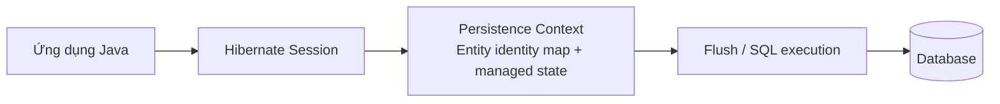
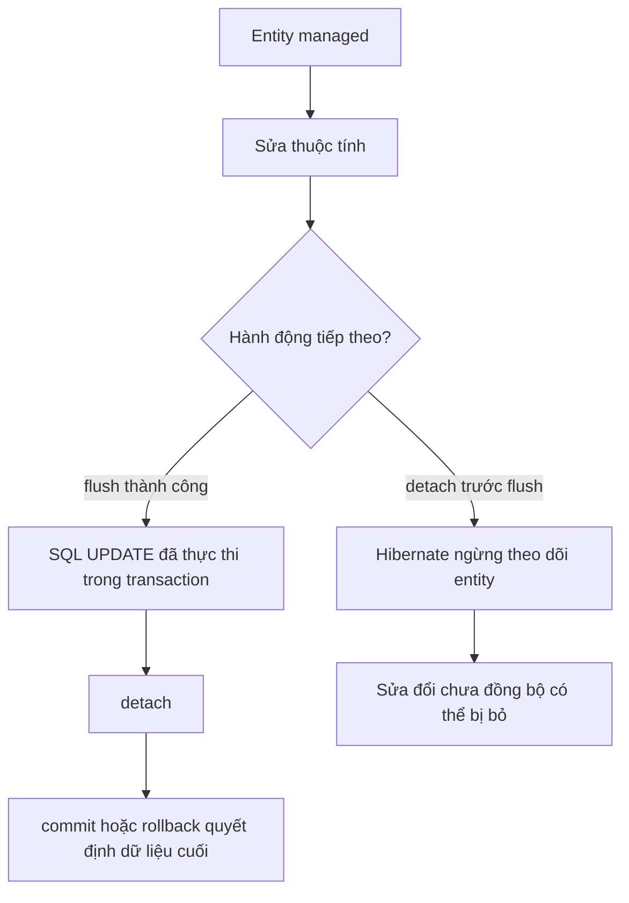
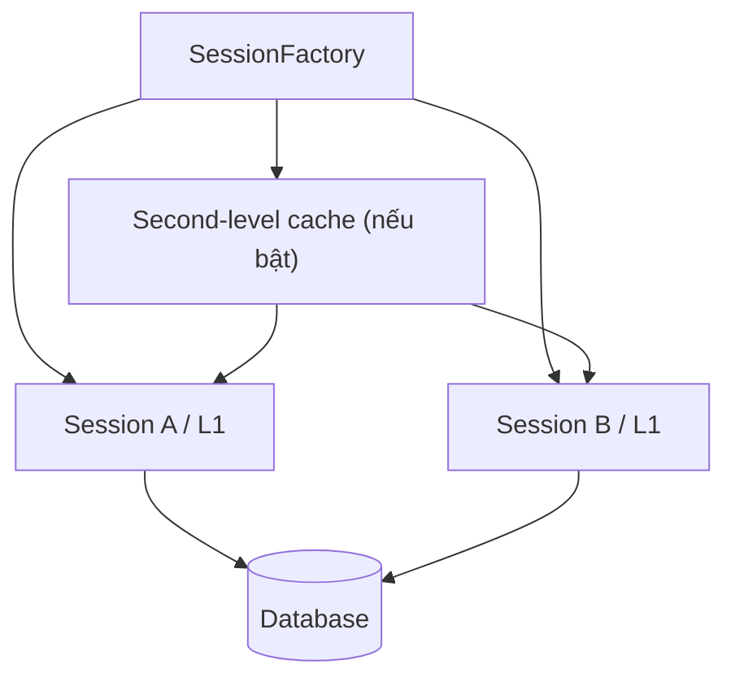
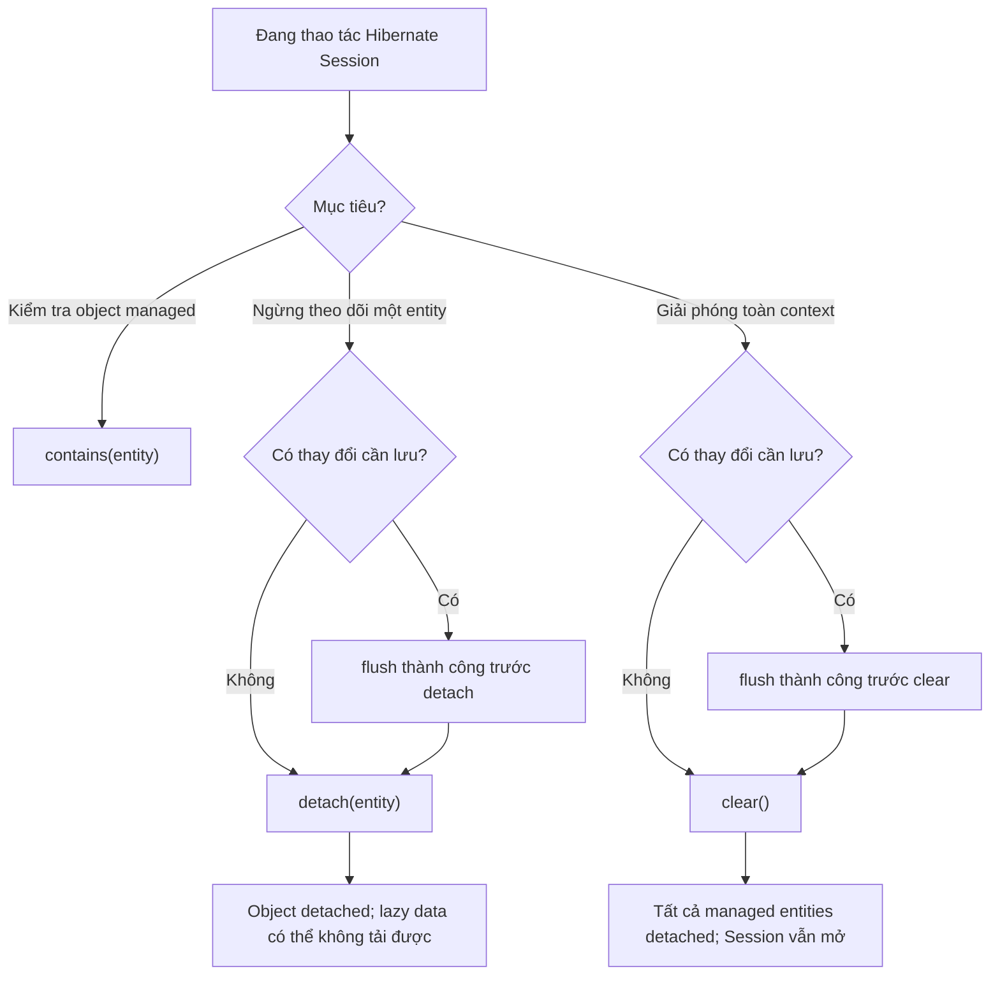

# contains, detach, clear và phạm vi ảnh hưởng trong Hibernate Persistence Context

Trong Hibernate ORM, một `Session` không chỉ là đối tượng dùng để gửi SQL. Nó còn chứa một **persistence context**: ngữ cảnh theo dõi các entity đang được quản lý, nhận diện chúng theo khóa chính, phát hiện những thay đổi cần đồng bộ và phối hợp các thao tác ghi trong một đơn vị công việc.

Ba API tưởng chừng đơn giản nhưng có ý nghĩa rất khác nhau:

- **`contains(entity)`:** hỏi một **Java object cụ thể** có thuộc persistence context hiện tại hay không.
- **`detach(entity)`:** loại **một entity** khỏi persistence context, kèm các association được cấu hình cascade DETACH theo quy tắc JPA/Hibernate.
- **`clear()`:** làm rỗng **toàn bộ persistence context**; tất cả managed entities trở thành detached và những thao tác chưa được flush có thể bị bỏ.

Cả ba đều là thao tác **trên ngữ cảnh quản lý đối tượng**, không phải cách trực tiếp để xóa dữ liệu, commit transaction hoặc hoàn tác SQL. Để sử dụng an toàn, cần hiểu rõ giới hạn giữa **bộ nhớ Java**, **hàng đợi thao tác ghi của Hibernate**, **JDBC transaction** và **trạng thái của database**.

Bài học giải thích từng API, cách chúng tương tác với dirty checking, lazy loading, proxy, cascade, cache và transaction; đồng thời minh họa các lỗi thực tế khi xử lý dữ liệu theo lô hoặc chuyển entity qua nhiều Session.

## 1. Persistence context là gì?

Persistence context là tập hợp các entity instances được ORM quản lý trong một phạm vi xác định. Với Hibernate native API, nó thường gắn với `org.hibernate.Session`. Với Jakarta Persistence API, nó được truy cập qua `jakarta.persistence.EntityManager`.

Khi một entity đang ở trạng thái **managed**, Hibernate có thể:

1. Nhận diện entity bằng loại entity và identifier.
2. Bảo đảm nhất quán Java identity cho cùng entity key **trong một persistence context**.
3. Theo dõi các thay đổi của persistent attributes.
4. Đồng bộ thay đổi xuống database tại `flush`.
5. Quản lý association, proxy và lazy collection theo mapping.
6. Lập kế hoạch `INSERT`, `UPDATE`, `DELETE` và xử lý các cascade được cấu hình.

Ví dụ:

```java
try (Session session = sessionFactory.openSession()) {
    Customer a = session.find(Customer.class, 42L);
    Customer b = session.find(Customer.class, 42L);

    System.out.println(a == b); // true nếu customer 42 tồn tại
}
```

Hai lần tìm cùng khóa chính trong một persistence context thường trả cùng managed instance nhờ identity map, không tạo một object mới cho từng truy vấn.

Sơ đồ:



**Persistence context không phải database.** Nó là ngữ cảnh Java/ORM giữ thông tin về các entity được tải hoặc tạo trong phiên làm việc. Vì thế:

- `detach` ảnh hưởng quan hệ giữa object và persistence context.
- `clear` ảnh hưởng toàn bộ managed state trong context.
- `flush` ảnh hưởng các câu SQL cần thực thi để đồng bộ thay đổi.
- `commit`/`rollback` do transaction quyết định.

Nhầm bốn hành động trên là nguồn gốc của nhiều lỗi mất thay đổi hoặc đọc dữ liệu cũ.

## 2. Một entity có thể ở những trạng thái nào?

Để hiểu `contains`, `detach` và `clear`, cần phân biệt các trạng thái vòng đời phổ biến:

| Trạng thái | Ý nghĩa | Được Hibernate theo dõi để dirty-check trong Session hiện tại? |
|---|---|---|
| **Transient / new** | Object mới tạo bằng `new`, chưa được persist | Không |
| **Managed / persistent** | Object thuộc persistence context | Có, theo mapping và flush mode |
| **Detached** | Object từng managed nhưng không còn thuộc context | Không |
| **Removed** | Entity được đánh dấu xóa trong persistence context | Có semantics riêng của remove/flush; không xem như một entity đang cập nhật bình thường |

Ví dụ:

```java
Customer customer = new Customer("CUS-001", "An");
// 1. Transient.

try (Session session = sessionFactory.openSession()) {
    Transaction tx = session.beginTransaction();

    session.persist(customer);
    // 2. Managed trong Session này.

    session.detach(customer);
    // 3. Detached, object Java vẫn tồn tại.

    tx.commit();
}
```

Lưu ý quan trọng: nếu `persist(customer)` được gọi rồi `detach(customer)` **trước khi Hibernate thực sự ghi INSERT**, thao tác ghi có thể không diễn ra như mong đợi. Với một số cơ chế tạo identifier, INSERT có thể đã xảy ra sớm; với cơ chế khác nó có thể vẫn nằm trong action queue. **Không dùng `detach` để bảo đảm “hủy INSERT”**. Muốn kiểm soát kết quả giao dịch, dùng transaction và rollback/commit đúng cách.

`detach` và `clear` biến object thành detached **mà không xóa nó khỏi Java heap**. Các biến Java vẫn tham chiếu object đó; chỉ mất quan hệ quản lý với persistence context.

## 3. Entity mẫu dùng xuyên suốt bài học

Giả sử ứng dụng quản lý khách hàng:

```java
package com.example.crm;

import jakarta.persistence.*;
import java.util.Objects;

@Entity
@Table(
    name = "customers",
    uniqueConstraints = @UniqueConstraint(
        name = "uk_customer_code",
        columnNames = "customer_code"
    )
)
public class Customer {

    @Id
    @GeneratedValue(strategy = GenerationType.SEQUENCE)
    private Long id;

    @Column(name = "customer_code", nullable = false, length = 32)
    private String customerCode;

    @Column(name = "name", nullable = false, length = 150)
    private String name;

    @Version
    private long version;

    protected Customer() {}

    public Customer(String customerCode, String name) {
        this.customerCode = Objects.requireNonNull(customerCode);
        this.name = Objects.requireNonNull(name);
    }

    public Long getId() { return id; }
    public String getCustomerCode() { return customerCode; }
    public String getName() { return name; }

    public void rename(String newName) {
        this.name = Objects.requireNonNull(newName);
    }
}
```

Hibernate có thể ánh xạ class này tới bảng:

```sql
create table customers (
    id bigint primary key,
    customer_code varchar(32) not null,
    name varchar(150) not null,
    version bigint not null,
    constraint uk_customer_code unique (customer_code)
);
```

Đây chỉ là DDL minh họa; `@GeneratedValue(SEQUENCE)` cần sequence hoặc generator được Hibernate/dialect cấu hình tương ứng. Tên sequence và SQL tạo sequence không cố định cho mọi DBMS.

Ở các ví dụ sau, giả định database đã có Customer có ID 42. Khi sử dụng code thực, cần thiết lập dữ liệu trước khi chạy.

## 4. `contains(entity)` trả lời câu hỏi gì?

`EntityManager.contains(Object entity)` và `Session.contains(Object entity)` được dùng để kiểm tra một object entity có đang được quản lý **bởi persistence context của đối tượng gọi** hay không.

```java
try (Session session = sessionFactory.openSession()) {
    Customer managed = session.find(Customer.class, 42L);

    System.out.println(session.contains(managed)); // true
}
```

Điểm dễ nhầm nhất: `contains` **không kiểm tra database có một hàng mang ID đó hay không**. Nó kiểm tra **chính Java instance truyền vào** có thuộc context hiện tại không.

Giả sử:

```java
Customer detached;

try (Session first = sessionFactory.openSession()) {
    detached = first.find(Customer.class, 42L);
}

try (Session second = sessionFactory.openSession()) {
    Customer managed = second.find(Customer.class, 42L);

    System.out.println(second.contains(managed));  // true
    System.out.println(second.contains(detached)); // false

    System.out.println(
        managed.getId().equals(detached.getId())
    ); // true
}
```

Cả hai có ID 42 nhưng chỉ `managed` thuộc context của `second`. `contains(detached)` trả false vì tham số là **instance khác** được tạo/tải trong Session trước.

### Các tình huống điển hình

| Object đưa vào | `session.contains(object)` | Lý do |
|---|---|---|
| Entity vừa được `find` trong cùng Session | Thường `true` | Entity được quản lý |
| Entity mới tạo bằng `new`, chưa persist | `false` | Transient |
| Entity vừa `persist` trong Session | `true` khi đã managed | Có thể INSERT chưa chạy |
| Entity vừa `detach` | `false` | Đã ra khỏi context |
| Entity tải từ Session khác | `false` | Context khác |
| Entity trả về từ `merge` | `true` | Kết quả merge là managed instance |
| Detached input của `merge` | `false` | Input không tự thành managed |
| Entity sau `clear()` | `false` | Context bị làm rỗng |
| Entity `remove` rồi hỏi `contains` | Không coi như managed thông thường; JPA semantics trả `false` cho removed entity | Đang ở removed state |

Đối tượng truyền vào phải là entity hợp lệ theo mapping. Với object không phải entity, các implementation có thể ném `IllegalArgumentException` theo contract API; không dùng `contains` như hàm tổng quát để hỏi “đây có phải POJO không?”.

### `contains` không kiểm tra entity còn tồn tại ở database

```java
Customer ref = session.getReference(Customer.class, 999999L);
boolean managed = session.contains(ref);
```

`getReference` có thể trả proxy/reference mà chưa query database ngay. Trong trường hợp đó `contains` có thể đúng về việc reference thuộc context, nhưng **không chứng minh hàng 999999 tồn tại**. Lỗi không tìm thấy có thể xuất hiện khi Hibernate cần khởi tạo proxy.

Muốn kiểm tra row tồn tại, hãy dùng query/find/existence strategy phù hợp với contract và transaction, chứ không dùng `contains`.

## 5. `contains` là “membership check”, không phải dirty check

Một entity có thể managed nhưng không có thay đổi:

```java
Customer customer = session.find(Customer.class, 42L);

boolean managed = session.contains(customer); // true
// Chưa sửa thuộc tính nào.
```

Một entity khác có thể managed và đã được sửa:

```java
customer.rename("Nguyễn An Mới");

boolean managed = session.contains(customer); // vẫn true
```

`contains` không nói entity có “dirty” hay không. Nó không thay thế:

- Hibernate dirty-checking khi flush.
- `@Version` cho optimistic locking.
- Query kiểm tra dữ liệu đã lưu.
- API kiểm tra trạng thái transaction.

Tương tự, `contains(customer) == true` **không đảm bảo UPDATE đã chạy**. Managed state và SQL được flush là hai thời điểm khác nhau.

```text
Managed object, no changes    → contains == true
Managed object, dirty changes → contains == true
Detached object, has ID       → contains == false
Transient object, no ID       → contains == false
```

Nếu nghiệp vụ chỉ cần biết “entity này đã có khóa chính chưa?”, hãy xem `getId()` theo contract của identifier generator; nhưng `getId() != null` vẫn không chứng minh object đang managed hoặc row đã commit.

## 6. `detach(entity)` tác động lên điều gì?

`detach(entity)` loại entity được chỉ định khỏi persistence context. Trong Hibernate, `Session.evict(entity)` là API native có mục tiêu gần tương đương ở mức evict một instance.

```java
Customer customer = session.find(Customer.class, 42L);

System.out.println(session.contains(customer)); // true

session.detach(customer);

System.out.println(session.contains(customer)); // false
```

Sau khi detach:

- Java variable `customer` vẫn trỏ tới object.
- Các scalar fields đã được khởi tạo vẫn có thể đọc bình thường.
- Entity không còn được Hibernate theo dõi dirty changes trong Session này.
- Việc sửa object detached **không tự được flush** như sửa managed entity.
- Các lazy associations chưa khởi tạo có thể không truy cập được nếu không còn Session phù hợp.
- Object có thể được dùng như một detached snapshot, DTO-like carrier hoặc đầu vào cho `merge` có kiểm soát.

**Detach không phải DELETE.** Bản ghi vẫn nằm trong database trừ khi một thao tác ghi khác đã xóa hoặc transaction thực thi xóa.

### Ví dụ: thay đổi sau khi detach không tự được lưu

```java
try (Session session = sessionFactory.openSession()) {
    Transaction tx = session.beginTransaction();

    Customer customer = session.find(Customer.class, 42L);
    session.detach(customer);

    customer.rename("Tên chỉ đổi trong Java");

    tx.commit(); // Không tự UPDATE tên vì customer đã detached.
}
```

Nếu không có thao tác khác gây UPDATE, thay đổi `rename` trên detached instance không được dirty checking của Session xử lý. Mở Session khác và tải lại sẽ thấy dữ liệu đã commit trước đó, không phải tên mới chỉ tồn tại trong object detached.

### Detach không tạo bản sao

```java
Customer a = session.find(Customer.class, 42L);
Customer b = a;

session.detach(a);

System.out.println(a == b); // true
```

`detach` không copy object. `a` và `b` vẫn là cùng Java reference; chỉ sự quản lý của Hibernate thay đổi.

## 7. Flush trước detach và thứ tự thao tác

Trong thực tế, trình tự **sửa → flush → detach** khác hoàn toàn **sửa → detach → flush**.

### Trường hợp A: sửa, flush, rồi detach

```java
try (Session session = sessionFactory.openSession()) {
    Transaction tx = session.beginTransaction();

    try {
        Customer customer = session.find(Customer.class, 42L);
        customer.rename("Tên đã flush");

        session.flush();
        session.detach(customer);

        tx.commit();
    } catch (RuntimeException ex) {
        if (tx.isActive()) tx.rollback();
        throw ex;
    }
}
```

`flush()` khiến Hibernate đồng bộ thay đổi managed state xuống database trong transaction hiện tại. Lúc detach, các thay đổi dự kiến đã được xử lý qua flush (giả sử flush thành công). `commit()` mới quyết định giao dịch được xác nhận.

**Flush không đồng nghĩa commit.** Nếu sau flush có exception hoặc rollback, SQL vừa chạy vẫn có thể bị database rollback.

### Trường hợp B: sửa, detach, rồi flush

```java
try (Session session = sessionFactory.openSession()) {
    Transaction tx = session.beginTransaction();

    Customer customer = session.find(Customer.class, 42L);
    customer.rename("Tên chưa flush");

    session.detach(customer);
    session.flush();
    tx.commit();
}
```

Thay đổi dirty `name` của entity đã detached **không còn nằm dưới cơ chế đồng bộ entity state** của context. Vì vậy không nên kỳ vọng SQL UPDATE cho `name`. Trong một số tình huống có action đã lên hàng đợi hoặc SQL đã chạy trước đó, kết quả phụ thuộc lifecycle và flush timing; đừng dùng detach làm rollback.

### Cách ghi nhớ



Nếu thay đổi phải được lưu, cách an toàn là **hoàn tất unit of work và commit** theo ranh giới transaction; không dùng detach như công cụ “lưu entity”. Nếu muốn hủy một transaction đã thực thi SQL, dùng `rollback`, không dùng `detach`.

## 8. Detach có tác động lên các entity liên quan không?

Đây là một điểm cần chú ý nhất của `detach`. Entity graph có thể có nhiều association:

```text
Customer (managed)
  |
  +-- Profile (managed?)
  |
  +-- Orders (collection)
        |
        +-- OrderLine (managed?)
```

Việc detach root entity **không mặc nhiên có nghĩa mọi object trong graph đều bị detach**. Jakarta Persistence hỗ trợ cascade `DETACH`; Hibernate native cũng có hành vi cascade tương ứng theo mapping.

Ví dụ:

```java
@Entity
class Customer {

    @Id
    private Long id;

    @OneToOne(
        mappedBy = "customer",
        cascade = CascadeType.DETACH
    )
    private CustomerProfile profile;
}
```

Khi gọi:

```java
session.detach(customer);
```

detach có thể được cascade tới `profile` theo cấu hình. `CascadeType.ALL` cũng bao gồm `DETACH`. Nếu association không có `DETACH` hoặc `ALL`, **không nên giả định** entity liên quan đang managed cũng tự bị detach.

### Ví dụ hai entity có context membership khác nhau

Giả sử đã load và quản lý cả parent và child:

```java
Customer customer = session.find(Customer.class, 42L);
CustomerProfile profile = session.find(CustomerProfile.class, 100L);

session.detach(customer);

// Nếu mapping không cascade DETACH tới profile:
session.contains(customer); // false
session.contains(profile);  // có thể vẫn true
```

Điều quan trọng là **lệnh detach nhắm vào object và các cascade mapping cụ thể**, không nhắm vào “mọi object từng được truy cập qua parent” theo ý tưởng đồ thị Java.

### Cascade DETACH và lazy associations

Cascade DETACH có thể tương tác với proxy/collection đã được khởi tạo hoặc chưa được khởi tạo. Đừng xem nó là cách duy nhất hoặc tuyệt đối để “đóng băng mọi object liên quan”. Nếu yêu cầu là một snapshot ổn định, hãy chủ động tải/chiếu ra DTO các field cần dùng rồi kết thúc Session.

### Đừng dùng cascade ALL theo phản xạ

`CascadeType.ALL` không chỉ gồm DETACH, mà còn `PERSIST`, `MERGE`, `REMOVE` và `REFRESH`. Nếu chỉ muốn propagate detach nhưng không muốn xóa child khi xóa parent, hãy thiết kế cascade có chọn lọc theo vòng đời nghiệp vụ.

## 9. `clear()` tác động lên toàn bộ persistence context

`clear()` loại **tất cả managed entities** khỏi persistence context của Session/EntityManager tương ứng.

```java
try (Session session = sessionFactory.openSession()) {
    Customer first = session.find(Customer.class, 42L);
    Customer second = session.find(Customer.class, 43L);

    System.out.println(session.contains(first));  // true
    System.out.println(session.contains(second)); // true

    session.clear();

    System.out.println(session.contains(first));  // false
    System.out.println(session.contains(second)); // false
}
```

Khác biệt với detach đơn:

```text
Trước:
Persistence Context:
  Customer#42 → managed A
  Customer#43 → managed B
  Order#100   → managed C

detach(Customer#42):
Persistence Context:
  Customer#43 → managed B
  Order#100   → managed C

clear():
Persistence Context:
  (rỗng)
```

Sau `clear()`, Session **vẫn mở** và có thể dùng tiếp để tải các entity khác. `clear()` không tương đương `close()`.

### `clear()` không làm gì?

Nó không:

- Xóa mọi hàng database.
- Commit transaction.
- Rollback transaction.
- Đóng JDBC connection theo contract.
- Tự động tạo một Session mới.
- Xóa Java objects khỏi bộ nhớ lập tức nếu biến ứng dụng vẫn giữ reference.
- Xóa toàn bộ second-level cache hoặc query cache thuộc `SessionFactory`.
- Ảnh hưởng trực tiếp tới persistence context của một Session khác.

Nói ngắn gọn, `clear()` có phạm vi **một persistence context cụ thể**, không có hiệu ứng toàn hệ thống.

## 10. `clear()` và các thay đổi chưa flush

Cảnh báo quan trọng nhất khi dùng `clear()`: **những thay đổi chưa được flush có thể bị mất khỏi kế hoạch đồng bộ ORM**.

Ví dụ:

```java
try (Session session = sessionFactory.openSession()) {
    Transaction tx = session.beginTransaction();

    Customer customer = session.find(Customer.class, 42L);
    customer.rename("Tên bị bỏ trước flush");

    session.clear();
    tx.commit();
}
```

Ở ví dụ này, việc đổi tên chỉ được thực hiện trên managed entity trước khi `clear`. Khi context bị làm rỗng, Hibernate không còn theo dõi entity đó để tạo UPDATE lúc commit. Kết quả mong muốn của `rename` có thể **không được lưu**.

Do vậy, quy tắc thường dùng trong batch processing là:

```java
session.flush();
session.clear();
```

Thứ tự **không được đảo** nếu các thay đổi managed state đang chờ đồng bộ.

### `flush(); clear();` cũng chưa phải commit

```text
UPDATE đã được JDBC gửi trong transaction
       ↓
session.clear()
       ↓
Transaction vẫn chưa commit
       ↓
commit → dữ liệu thành công
rollback → UPDATE bị DB hoàn tác
```

Nếu transaction được rollback sau đó, việc flush trước clear **không giúp giữ dữ liệu**. Với mục tiêu “lưu được”, cần kiểm tra việc commit thành công.

### Những thao tác ghi đã thực thi từ trước

Một số thao tác có thể khiến Hibernate gửi SQL sớm hơn cuối transaction: flush tự động trước query, gọi `flush()` tường minh, hoặc INSERT cần ID theo một số generator. `clear()` **không lấy lại SQL đã thực thi** trong transaction và cũng không đảo ngược dữ liệu đã commit. Nó chỉ làm rỗng context/quản lý các action chưa thực hiện theo semantics của Hibernate.

Vì vậy: không dùng `clear()` làm “undo” cho các thao tác ghi. Dùng transaction rollback và thiết kế idempotency/compensation phù hợp nếu dữ liệu đã commit.

## 11. `detach` với `clear`: so sánh trực tiếp

| Câu hỏi | `detach(entity)` | `clear()` |
|---|---|---|
| Phạm vi | Một entity và các association cascade DETACH phù hợp | Toàn bộ context |
| Có cần truyền object? | Có | Không |
| Sau lệnh, object còn trong Java? | Có | Có |
| SQL DELETE có được gửi vì lệnh? | Không | Không |
| Entity còn dirty-check tự động? | Không | Không |
| Những entity khác đang managed? | Có thể vẫn managed | Không còn managed |
| Session còn mở? | Có | Có |
| Transaction còn hoạt động? | Có thể vẫn còn | Có thể vẫn còn |
| Thay đổi chưa flush của đối tượng bị tách | Không được tin là còn được ghi | Không được tin là còn được ghi |
| Xóa L2 cache toàn cục? | Không | Không |
| Dùng trong batch để hạ kích thước context? | Có, nếu chọn lọc | Thường tiện khi xử lý theo đợt |

Một lựa chọn thông dụng: cần ngừng theo dõi **một entity lớn** nhưng vẫn giữ các entity khác trong context, dùng `detach`. Cần giải phóng hàng loạt managed entities giữa các đợt xử lý, dùng `flush(); clear()`.

## 12. `clear()` khác `close()`

`clear()` và `close()` đều ảnh hưởng tới managed entities, nhưng chúng có mục đích khác nhau:

| Thao tác | Persistence context | Khả năng tiếp tục sử dụng Session |
|---|---|---|
| `session.clear()` | Bị làm rỗng | Session còn mở, có thể dùng tiếp |
| `session.close()` | Session kết thúc; không còn quản lý entity như trước | Không dùng Session đã đóng để truy vấn/ghi |
| `session.detach(entity)` | Chỉ entity được tách (và cascade phù hợp) | Session còn quản lý các entity khác |

Ví dụ:

```java
try (Session session = sessionFactory.openSession()) {
    Customer a = session.find(Customer.class, 42L);

    session.clear();

    Customer b = session.find(Customer.class, 42L);

    System.out.println(a == b); // thường false
    System.out.println(session.contains(a)); // false
    System.out.println(session.contains(b)); // true
}
```

Sau `clear`, `a` vẫn tồn tại nhưng detached. Lần `find` tiếp theo có thể tạo một **managed instance khác** cho cùng database row.

Không gọi `close` rồi kỳ vọng `session.find(...)` vẫn hoạt động. Khi dùng try-with-resources, `close` được gọi tự động ở cuối block.

### Đóng Session không thay thế quản lý transaction

Nếu bạn tự mở transaction, cần commit hoặc rollback rõ ràng trước khi đóng Session. Đừng dựa vào việc đóng Session như một lệnh commit ngầm. Với Spring/Jakarta EE, framework thường quản lý ranh giới transaction và resource; hãy theo đúng contract của framework.

## 13. `detach` khác `remove`

Tên các API có thể khiến người mới học nhầm:

```java
session.detach(customer);
```

có nghĩa **Hibernate ngừng quản lý customer object**.

Trong khi:

```java
session.remove(customer);
```

có nghĩa **đánh dấu entity cần bị xóa khỏi database**, và SQL DELETE có thể được thực thi khi flush theo lifecycle/constraint/cascade.

So sánh:

| Thao tác | Tác động lên DB row |
|---|---|
| `detach(customer)` | Không yêu cầu xóa row |
| `clear()` | Không yêu cầu xóa rows |
| `remove(customer)` | Yêu cầu xóa entity theo persistence lifecycle |
| `delete from Customer` bằng HQL | Bulk database mutation, có semantics khác entity remove |
| SQL `DELETE` qua JDBC | Xóa tại DB trực tiếp |

Đặc biệt, một entity được mark removed rồi detach/clear trước flush có thể thay đổi việc DELETE đã được gửi hay chưa. Không dựa vào các lệnh context management để hủy xóa hoặc rollback. Hãy xác lập transaction semantics và kiểm tra kết quả commit.

## 14. `detach` khác `refresh`

`refresh(managedEntity)` yêu cầu Hibernate làm mới state của một managed entity từ database, theo transaction isolation và mapping.

```java
Customer customer = session.find(Customer.class, 42L);

// Một tiến trình khác có thể cập nhật hàng cùng ID...
session.refresh(customer);
```

`detach(customer)` thì ngược lại: **không làm mới dữ liệu**, mà ngừng quản lý.

| API | Mục tiêu |
|---|---|
| `refresh` | Đồng bộ state của managed entity từ database |
| `detach` | Ngừng theo dõi một entity |
| `clear` | Ngừng theo dõi toàn bộ managed entities |
| `flush` | Đẩy thay đổi từ context ra SQL theo transaction |

Trong transaction isolation giữ snapshot ổn định, `refresh` không nhất thiết nhìn thấy mọi commit của transaction khác ngay; phải xem DBMS/isolation. Nó cũng không phải biện pháp thay thế xử lý optimistic locking.

## 15. `detach` và `merge`: object truyền vào không tự thành managed

Sau detach, ứng dụng có thể sửa object:

```java
Customer detached = session.find(Customer.class, 42L);
session.detach(detached);

detached.rename("Tên sửa ngoài context");
```

Để áp dụng state vào một persistence context mới, JPA/Hibernate có `merge`:

```java
try (Session another = sessionFactory.openSession()) {
    Transaction tx = another.beginTransaction();

    try {
        Customer managedCopy = another.merge(detached);

        System.out.println(another.contains(detached));   // false
        System.out.println(another.contains(managedCopy)); // true

        tx.commit();
    } catch (RuntimeException ex) {
        if (tx.isActive()) tx.rollback();
        throw ex;
    }
}
```

**`merge` sao chép state vào managed instance và trả về managed instance đó.** Object detached truyền vào **không tự được gắn lại**.

Có thể có:

```java
managedCopy == detached // thường false
```

Ngay cả khi hai object có cùng `id`.

### Rủi ro khi merge một snapshot cũ

Giả sử Session A tải customer; sau đó Session B sửa dữ liệu và commit. Nếu đưa snapshot detached từ A vào `merge` một cách không kiểm soát, một số field cũ có thể được copy đè lên managed entity. `@Version` có thể phát hiện optimistic locking conflict khi phù hợp, nhưng `merge` **không phải cơ chế tự giải quyết xung đột nghiệp vụ**.

Với các thao tác cập nhật đơn giản, thường nên truyền DTO chứa ID và field được phép sửa, rồi trong transaction mới `find` managed entity và sửa đúng field đó.

## 16. First-level cache: trạng thái trước và sau `clear`

Cùng một Session, trước clear:

```java
Customer first = session.find(Customer.class, 42L);
Customer again = session.find(Customer.class, 42L);

System.out.println(first == again); // true
```

Sau clear:

```java
session.clear();

Customer reloaded = session.find(Customer.class, 42L);

System.out.println(first == reloaded); // thường false
System.out.println(
    first.getId().equals(reloaded.getId())
); // true nếu cùng persistent row
```

`clear` làm mất identity map trước đó trong Session. Entity `first` không bị hủy về mặt Java, nên hai object có thể cùng ID nhưng chỉ `reloaded` được quản lý.

Điều này đặc biệt quan trọng nếu code đang giữ entity trong:

- `HashSet` / `HashMap`.
- Collections của DTO hoặc view model.
- Biến trong service ngoài scope Session.
- Thread-local hoặc cache do ứng dụng tự tạo.
- Các object graph được truyền giữa transaction.

`clear` không cập nhật các tham chiếu Java đã lưu ở các nơi ấy. Nếu ứng dụng giữ quá nhiều reference, clear **không đảm bảo heap memory sẽ giảm ngay**; GC chỉ thu hồi object không còn reachable.

## 17. Clear không phải xóa second-level cache

Hibernate có thể dùng second-level cache (L2) cấp `SessionFactory` bên cạnh persistence context cấp Session.



`session.clear()` chỉ làm rỗng **L1 / persistence context của Session đó**. Nó không mặc nhiên evict mọi entity state trong L2 cache hay query cache.

Ví dụ:

```java
Customer first = session.find(Customer.class, 42L);
session.clear();
Customer second = session.find(Customer.class, 42L);
```

Lần find thứ hai có thể không cần SQL nếu L2 cache có dữ liệu hợp lệ. Nhưng `first` và `second` vẫn có thể là **hai Java object khác nhau**; L2 cache không biến hai object thành cùng reference.

Nếu cần vô hiệu hóa L2 cache, Hibernate có API cache management riêng, ví dụ qua `SessionFactory.getCache()` hoặc `EntityManagerFactory.getCache()` với phạm vi eviction được chỉ định. **Đừng dùng `clear()` để giải quyết mọi vấn đề stale cache cấp toàn hệ thống**.

## 18. Lazy loading sau `detach` hoặc `clear`

Một entity có thể chứa association lazy:

```java
@Entity
class Customer {
    @Id
    private Long id;

    @OneToMany(
        mappedBy = "customer",
        fetch = FetchType.LAZY
    )
    private List<PurchaseOrder> orders;
}
```

Giả sử `orders` chưa được khởi tạo:

```java
Customer customer = session.find(Customer.class, 42L);

session.detach(customer);

int size = customer.getOrders().size();
```

Sau detach, Hibernate có thể không còn Session gắn với lazy collection để tải dữ liệu, nên phép gọi có thể ném `LazyInitializationException`.

Tương tự:

```java
session.clear();
customer.getOrders().size(); // Có thể lỗi nếu collection chưa khởi tạo.
```

### Nếu dữ liệu lazy đã được tải trước detach?

```java
Customer customer = session.find(Customer.class, 42L);
customer.getOrders().size(); // Khởi tạo collection trong Session.

session.detach(customer);
int size = customer.getOrders().size();
```

Một collection **đã khởi tạo đầy đủ** thường vẫn có thể được duyệt như dữ liệu Java hiện có, nhưng những association bên trong từng phần tử chưa khởi tạo vẫn có thể gây lỗi. Và các thay đổi vào collection detached không tự được Hibernate flush.

### Cách dùng phù hợp trong service

Nếu cần đưa dữ liệu ra ngoài transaction, thường tốt hơn dùng DTO:

```java
public record CustomerSummary(
    Long customerId,
    String name,
    long orderCount
) {}
```

Truy vấn/projection lấy đủ dữ liệu cần thiết **trong transaction**, rồi trả DTO không phụ thuộc Session. Không nên bật `hibernate.enable_lazy_load_no_trans` như một giải pháp mặc định cho thiết kế thiếu fetch plan; cơ chế tải ngoài transaction có rủi ro về hiệu năng và tính nhất quán.

### Không cần load toàn bộ graph chỉ để detach

Nếu mục tiêu là giảm memory hoặc đóng context, chủ động chọn DTO/projection và fetch plan phù hợp. Việc initialize mọi association trước detach có thể tạo ra N+1 queries và tải rất nhiều dữ liệu không cần thiết.

## 19. Hibernate proxies và `contains`

`getReference` có thể tạo một reference lazy:

```java
Customer reference =
    session.getReference(Customer.class, 42L);
```

Trong các mapping sử dụng proxy, reference có thể được quản lý bởi Session dù một số thuộc tính chưa được load.

```java
boolean managed = session.contains(reference);
```

Điều này có ý nghĩa khác với `Hibernate.isInitialized(reference)` (API Hibernate để kiểm tra trạng thái khởi tạo).

```text
contains(reference)        → thuộc context hiện tại?
isInitialized(reference)   → proxy/association đã tải dữ liệu chưa?
```

Sau `detach(reference)`, reference không còn được quản lý. Nếu chưa initialized mà code truy cập một field cần database, có thể nhận `LazyInitializationException`.

`getReference` cũng không chứng minh row tồn tại ngay lập tức; nếu ID không tồn tại, lỗi có thể phát sinh khi reference được initialized.

**Không dùng `contains`, `getReference` và kiểm tra khởi tạo như ba phép kiểm tra tồn tại dữ liệu tương đương.**

## 20. Phạm vi ảnh hưởng của `clear`: một Session, không phải mọi Session

Hai Session khác nhau có persistence context độc lập:

```java
try (
    Session s1 = sessionFactory.openSession();
    Session s2 = sessionFactory.openSession()
) {
    Customer a = s1.find(Customer.class, 42L);
    Customer b = s2.find(Customer.class, 42L);

    s1.clear();

    System.out.println(s1.contains(a)); // false
    System.out.println(s2.contains(b)); // true
}
```

`clear` của `s1` không làm managed entity của `s2` bị detached. Cũng không hủy transaction của `s2` hoặc xóa L2 cache chung.

### Điều tương tự trong Spring

Với Spring `@Transactional` và injected `EntityManager`, thực tế persistence context có thể gắn với transaction đang chạy theo framework. Gọi `entityManager.clear()` trong một service **ảnh hưởng toàn bộ entities managed trong persistence context đó**, không chỉ những entity do chính service method vừa tải.

Ví dụ trong cùng transaction:

```java
@Transactional
public void process() {
    Customer customer = entityManager.find(Customer.class, 42L);

    // Một repository/service khác cũng đang dùng cùng
    // transaction-bound EntityManager.

    entityManager.clear();

    // customer bây giờ detached.
}
```

Không nên gọi `clear` trong helper repository dùng chung mà không thông báo contract của nó. Một caller có thể đã sửa entity khác chưa flush; helper vô tình bỏ các thay đổi ấy khỏi context.

### Extended persistence context

Jakarta Persistence còn có **extended persistence context** trong một số mô hình ứng dụng. Persistence context có thể sống qua nhiều transaction. Trong trường hợp đó, `clear` vẫn có nghĩa **detach mọi managed entity trong context đang xét**, nhưng tác động có thể vượt xa một transaction ngắn. Đây càng là lý do tránh clear không có chủ đích.

## 21. Dùng `flush(); clear();` khi xử lý dữ liệu lớn theo lô

Một Session giữ hàng chục nghìn managed entities có thể tốn bộ nhớ cho:

- Entity instances.
- Loaded-state snapshots.
- Identity map.
- Lazy collections/proxies.
- Pending actions và các cấu trúc quản lý thay đổi.

Một mẫu thường dùng cho batch insert:

```java
int batchSize = 50;

try (Session session = sessionFactory.openSession()) {
    Transaction tx = session.beginTransaction();

    try {
        for (int i = 1; i <= 10_000; i++) {
            ActivityLog log = new ActivityLog(
                "EVENT-" + i
            );

            session.persist(log);

            if (i % batchSize == 0) {
                session.flush();
                session.clear();
            }
        }

        // Đồng bộ phần cuối nếu số lượng không chia hết.
        session.flush();

        tx.commit();
    } catch (RuntimeException ex) {
        if (tx.isActive()) {
            tx.rollback();
        }
        throw ex;
    }
}
```

Giả định `ActivityLog` là một entity hợp lệ có constructor nhận event code và identifier generator phù hợp. Ví dụ dùng đúng ý nghĩa: cứ mỗi 50 entity, thực thi các SQL đang chờ rồi giải phóng managed state khỏi persistence context.

### Tại sao thứ tự phải là flush rồi clear?

```text
persist(entity #1 ... #50)
    ↓
flush() → SQL gửi tới DB trong transaction
    ↓
clear() → giải phóng managed tracking
    ↓
persist(entity #51 ... #100)
```

Nếu đảo ngược thành:

```java
session.clear();
session.flush();
```

các insert/update/delete chưa đồng bộ có thể bị bỏ, dẫn đến thiếu dữ liệu.

### Flush/clear không tự bật JDBC batching

Muốn Hibernate gom nhiều INSERT/UPDATE thành JDBC batches, cần cấu hình batching phù hợp, ví dụ:

```properties
hibernate.jdbc.batch_size=50
hibernate.order_inserts=true
hibernate.order_updates=true
```

Tuy nhiên, một số identifier strategies như `GenerationType.IDENTITY` có thể hạn chế khả năng batch insert của Hibernate vì cần lấy generated key khi insert. Flush/clear vẫn hữu ích cho quản lý persistence context nhưng **không tự bảo đảm JDBC batch được kích hoạt**.

### Một transaction rất lớn vẫn có chi phí

Nếu 10.000 insert trong một transaction, flush nhiều lần vẫn giữ transaction database mở cho tới commit cuối. Lock, log/undo và thời gian transaction có thể lớn. Khi nghiệp vụ cho phép các đợt commit độc lập, có thể chia thành nhiều transaction; điều đó thay đổi tính atomicity và yêu cầu retry/idempotency. Đây là quyết định transaction riêng, không do `clear` tự giải quyết.

## 22. Batch update và các tham chiếu detached giữa các đợt

Giả sử đang cập nhật 1.000 khách hàng:

```java
try (Session session = sessionFactory.openSession()) {
    Transaction tx = session.beginTransaction();

    try {
        for (int i = 0; i < customerIds.size(); i++) {
            Long id = customerIds.get(i);
            Customer customer = session.find(Customer.class, id);

            if (customer != null) {
                customer.rename("Đã xử lý");
            }

            if ((i + 1) % 50 == 0) {
                session.flush();
                session.clear();
            }
        }

        session.flush();
        tx.commit();
    } catch (RuntimeException ex) {
        if (tx.isActive()) tx.rollback();
        throw ex;
    }
}
```

Sau mỗi clear:

- Những entity đã tải từ các vòng trước trở thành detached.
- Các biến Java cũ giữ nguyên reference nhưng không còn managed.
- Nếu sau đó lại cần cùng ID, một `find` khác có thể tạo managed instance mới.
- Những thay đổi sau clear trên object cũ không tự được persist.

**Điều kiện quan trọng:** Các vòng lặp không nên giữ một graph với parent managed cũ rồi tiếp tục gắn child mới qua detached association mà không xử lý identity/cascade đúng. Có thể cần tra lại managed reference hoặc thiết kế batch theo ID/DTO.

### Ví dụ lỗi sau clear

```java
Customer customer = session.find(Customer.class, 42L);
session.flush();
session.clear();

customer.rename("Thay đổi sau clear");

// session.commit() không tự UPDATE customer đã detached.
```

Nếu cần sửa tiếp, hãy tải lại managed Customer bằng ID hoặc sử dụng `merge` với hiểu biết về state copying:

```java
Customer managedAgain =
    session.find(Customer.class, customer.getId());

managedAgain.rename("Thay đổi được theo dõi");
```

Không nên tự giả định biến `customer` được quản lý trở lại chỉ vì bạn gọi `session.find` với cùng ID; object trả về mới phải được dùng để tiếp tục thao tác.

## 23. Phạm vi của `detach` trong batch khi không muốn clear mọi thứ

Có lúc ứng dụng muốn giữ một số entity quản lý liên tục nhưng chỉ giải phóng các entity xử lý xong.

Ví dụ giữ `BatchJob` managed để ghi trạng thái tiến trình, còn các `ActivityLog` chỉ cần lưu rồi giải phóng:

```java
BatchJob job = session.find(BatchJob.class, jobId);

for (ActivityLog item : items) {
    session.persist(item);
    session.flush();
    session.detach(item);
}

job.markCompleted();
session.flush();
```

Ví dụ mang tính minh họa; `BatchJob`, `ActivityLog` và transaction cần được định nghĩa trong ứng dụng. `detach(item)` nhắm đúng item và không làm `job` bị detached trừ khi mapping cascade dẫn đến tác động khác. Tuy nhiên gọi `flush` từng item có thể tạo rất nhiều round trip, nên production thường nhóm thao tác theo đợt; cần đo hiệu năng thay vì áp dụng mẫu trên nguyên xi.

Nếu bạn cần tiếp tục quản lý một graph cố định nhưng muốn cắt bớt entity instances, detach chọn lọc có thể phù hợp hơn clear. Phải hiểu cascade DETACH, các association còn managed và ràng buộc vòng đời.

### Khi nào dùng `clear` thay `detach`?

Khi toàn bộ dữ liệu của một đợt đã hoàn tất và không cần giữ managed entity nào giữa các đợt, `clear` thường đơn giản hơn. Khi muốn giữ một số entity trong context, `detach` cụ thể có thể kiểm soát phạm vi tốt hơn.

## 24. Bulk HQL/JPQL và sự cần thiết của `clear`

Một nguồn gây stale state khác là **bulk update**:

```java
Customer customer = session.find(Customer.class, 42L);

int updated = session.createMutationQuery("""
    update Customer c
    set c.name = :newName
    where c.id = :id
    """)
    .setParameter("newName", "Tên mới từ bulk")
    .setParameter("id", 42L)
    .executeUpdate();
```

Bulk HQL DML thường thực thi theo cơ chế database mutation, **không cập nhật từng managed object trong persistence context theo dirty checking**. Do đó sau bulk update, `customer.getName()` có thể vẫn là tên cũ.

Một cách xử lý có chủ đích:

```java
session.flush(); // Đồng bộ những thay đổi managed khác trước bulk.
int updated = session.createMutationQuery("""
    update Customer c
    set c.name = :newName
    where c.id = :id
    """)
    .setParameter("newName", "Tên mới từ bulk")
    .setParameter("id", 42L)
    .executeUpdate();

session.clear();

Customer reloaded = session.find(Customer.class, 42L);
```

**Thứ tự cần được thiết kế phù hợp**: flush trước bulk nếu có managed changes không muốn mất; clear sau bulk để không giữ stale managed entities. `clear` tác động toàn context nên cũng làm detached những object khác; đừng dùng trong một repository method mà caller không biết.

Một lựa chọn khác là `refresh` một entity cụ thể, nhưng với nhiều entity đã bị bulk update, clear hoặc tách unit of work có thể đơn giản hơn.

### Bulk DML và optimistic locking

Bulk mutation có thể không áp dụng version checking theo cùng cách với từng managed entity. Nếu nghiệp vụ cần bảo vệ cạnh tranh bằng `@Version`, phải xem SQL thực được thực thi và cách update version; không chỉ dựa vào `clear` để giải quyết consistency.

## 25. Native SQL và JDBC ngoài Hibernate

Giả sử Session đang quản lý Customer#42:

```java
Customer customer = session.find(Customer.class, 42L);
```

Một đoạn SQL trực tiếp, có thể trong cùng transaction hoặc transaction khác, cập nhật hàng đó:

```sql
update customers
set name = 'Tên từ JDBC'
where id = 42;
```

Object `customer` trong persistence context không tự cập nhật mọi field chỉ vì database đã thay đổi. Hibernate không “nghe” mọi câu lệnh SQL từ mọi connection và sửa mọi managed object theo thời gian thực.

Nếu sau SQL trực tiếp muốn tải state mới trong Session:

```java
session.clear();

Customer refreshed = session.find(Customer.class, 42L);
```

hoặc refresh một managed entity phù hợp:

```java
session.refresh(customer);
```

Nhưng kết quả quan sát còn phụ thuộc transaction isolation và việc SQL thay đổi đã commit hay chưa. Nếu SQL chạy từ kết nối khác mà transaction chưa commit, Session hiện tại có thể không nhìn thấy theo isolation level.

### Không dùng clear để chữa cache toàn hệ thống

Nếu dữ liệu được sửa ngoài Hibernate, second-level cache có thể stale. `session.clear()` chỉ bỏ first-level context; truy vấn tiếp theo có thể lấy dữ liệu từ L2 cache tùy cấu hình. Khi cần, thiết kế invalidation/eviction L2 phù hợp và phối hợp transaction.

## 26. Session dirty checking và tầm ảnh hưởng của `clear`

Hibernate phát hiện thay đổi ở entity managed thông qua snapshot comparison, bytecode enhancement hoặc các cơ chế tương thích với mapping. Khi `clear` được gọi:

- Những managed instances không còn được kiểm tra trong context này.
- Loaded-state snapshots/identity map liên quan được giải phóng khỏi context.
- Những cập nhật chỉ tồn tại trong Java mà chưa flush không còn là việc Hibernate sẽ tự thực hiện.
- Những SQL đã được gửi xuống database không được rollback chỉ nhờ clear.

Điều này giải thích vì sao `clear` vừa là công cụ quan trọng để kiểm soát bộ nhớ, vừa là API nguy hiểm nếu được đặt sai vị trí.

### Ví dụ “thay đổi không được lưu” dù transaction commit

```java
try (Session session = sessionFactory.openSession()) {
    Transaction tx = session.beginTransaction();

    Customer c = session.find(Customer.class, 42L);
    c.rename("A");

    session.clear();

    // Transaction commit được, nhưng thay đổi c.rename("A")
    // trước clear không được bảo đảm đồng bộ vào DB.
    tx.commit();
}
```

Không nên dùng “transaction đã commit thành công” làm bằng chứng rằng mọi thay đổi Java trước đó đều đã được persist nếu code có detach/clear ở giữa.

## 27. Flush mode và sự khác biệt khi query tự kích hoạt flush

Hibernate có những flush modes như `AUTO`, `COMMIT`, `MANUAL` và các mode khác tùy API/phiên bản. Chúng quyết định thời điểm Hibernate tự flush trước query/commit và những thao tác liên quan.

Ví dụ `AUTO` có thể flush trước một query nếu cần bảo đảm query nhìn thấy state đồng bộ. Do đó:

```java
customer.rename("Tên A");
runSomeQuery(session);
session.detach(customer);
```

không nhất thiết tương đương với “rename chưa bao giờ được ghi” — vì query có thể đã khiến Hibernate flush trước detach, tùy flush mode và query spaces.

**Bài học:** Không suy luận kết quả `detach` hay `clear` chỉ từ vị trí chúng xuất hiện trong code mà bỏ qua những lần flush trước đó. Quan sát SQL thực tế, hiểu flush mode và transaction boundary.

Nếu cần đảm bảo một thay đổi đã được gửi SQL trước khi detach/clear, gọi `flush` tường minh trong transaction phù hợp. Nếu cần hoàn tác SQL, rollback transaction; đừng dựa vào context management.

## 28. `contains` trong Spring Data JPA và service layer

Trong Spring Data JPA, các repository methods thường tương tác với `EntityManager` do framework quản lý. Có thể lấy entity qua repository rồi hỏi:

```java
@Service
public class CustomerService {

    @PersistenceContext
    private EntityManager entityManager;

    private final CustomerRepository repository;

    public CustomerService(CustomerRepository repository) {
        this.repository = repository;
    }

    @Transactional(readOnly = true)
    public boolean isCurrentlyManaged(Long id) {
        Customer customer = repository.findById(id)
            .orElseThrow();

        return entityManager.contains(customer);
    }
}
```

Code minh họa giả định repository và dependency injection đã được cấu hình. Trong cùng transaction/persistence context, entity vừa load có thể managed. Nhưng:

- Bỏ transaction có thể làm repository method mở/đóng context khác tùy cấu hình.
- Spring Open Session in View có thể kéo dài context qua phần render web; không nên dựa vào điều đó để sửa logic transaction.
- `readOnly = true` ảnh hưởng semantics tối ưu/flush theo integration cụ thể; không dùng nó thay thế authorization hoặc kiểm tra dữ liệu.
- Nếu entity là projection/DTO thay vì JPA entity, `contains` không áp dụng như mong muốn.

### Dùng `entityManager.clear()` trong service có thể ảnh hưởng caller

Nếu method A và B đang tham gia cùng transaction:

```java
@Transactional
public void checkout() {
    Order order = entityManager.find(Order.class, orderId);
    order.markPaid();

    inventoryRepository.doSomethingThatCallsClear();

    // order có thể đã detached, markPaid có thể mất
    // nếu chưa được flush trước clear.
}
```

Đây là lý do helper/repository không nên tự gọi `clear` một cách “ẩn”. Một API làm thay đổi persistence context của transaction cần có contract rõ, nhất là khi code được tái sử dụng.

## 29. Khi nào nên tránh `detach`/`clear` hoàn toàn?

Trong một transaction nhỏ, chỉ xử lý vài entity, Hibernate tự quản lý persistence context khá hiệu quả. Gọi detach/clear thêm có thể làm code khó hiểu hơn:

- Phải tải lại entity vừa detach.
- Phải xử lý managed vs detached references.
- Có thể mất dirty changes.
- Có thể phát sinh SQL mới do mất first-level cache.
- Có thể gặp lazy loading lỗi ở vị trí bất ngờ.
- Cascade/association graph trở nên phức tạp.
- Bulk code khó suy luận vì một số object vẫn managed, một số đã detached.

Vì vậy, **không cần `clear` sau mỗi `find`** hoặc `detach` sau mỗi lần đọc để “giúp Hibernate sạch”. Hãy dùng chúng khi có một lý do cụ thể như batch processing, tránh stale state sau bulk DML, hoặc chủ động giới hạn phạm vi theo dõi entity.

Nếu chỉ cần đọc vài cột để xuất API, một DTO projection thường phù hợp hơn tải entity rồi detach ngay lập tức.

## 30. `StatelessSession` không có persistence context theo nghĩa thông thường

Hibernate có API `StatelessSession` cho những use case xử lý trực tiếp/hiệu năng đặc thù. Nó không vận hành giống `Session` có first-level identity map, automatic dirty checking và lifecycle/cascade semantics thông thường.

Điều này có nghĩa `contains`, `detach`, `clear` — vốn được hiểu trong ngữ cảnh persistence context stateful — **không nên được mang nguyên tư duy sang `StatelessSession`**. Với stateless operations, ứng dụng phải ý thức rõ việc đọc/ghi và các giới hạn về lifecycle/cache/cascade theo phiên bản Hibernate.

Nếu mục tiêu là import/export rất lớn, có thể cân nhắc `StatelessSession`, JDBC batching, bulk SQL hoặc streaming/projection. Nhưng đó là lựa chọn kiến trúc riêng, không phải “`clear` tự động chuyển Session thành stateless”.

## 31. Bộ test minh họa `contains`, `detach` và `clear`

Các đoạn sau là ý tưởng integration test JUnit 5; giả định đã có `SessionFactory`, dữ liệu Customer#42 và cơ chế isolation giữa tests.

### 31.1. `contains` xác nhận instance, không xác nhận ID

```java
@Test
void containsChecksInstanceMembership() {
    Customer detached;

    try (Session first = sessionFactory.openSession()) {
        detached = first.find(Customer.class, 42L);
    }

    try (Session second = sessionFactory.openSession()) {
        Customer managed = second.find(Customer.class, 42L);

        assertTrue(second.contains(managed));
        assertFalse(second.contains(detached));
        assertEquals(managed.getId(), detached.getId());
    }
}
```

Điểm kiểm thử: cùng identifier không khiến detached object từ Session khác trở thành managed.

### 31.2. `detach` dừng dirty checking

```java
@Test
void detachedChangesAreNotAutomaticallyFlushed() {
    try (Session session = sessionFactory.openSession()) {
        Transaction tx = session.beginTransaction();

        Customer customer = session.find(Customer.class, 42L);
        String oldName = customer.getName();

        session.detach(customer);
        assertFalse(session.contains(customer));

        customer.rename("Name only in memory");
        session.flush();
        tx.commit();

        try (Session verify = sessionFactory.openSession()) {
            Customer reloaded = verify.find(Customer.class, 42L);
            assertEquals(oldName, reloaded.getName());
        }
    }
}
```

Lưu ý kiểm thử thật cần đảm bảo không có transaction/song song khác thay row giữa các bước và dữ liệu được cleanup. Test này minh họa thay đổi **sau detach**, không khẳng định mọi dạng pending persistence operation đều có cùng hành vi.

### 31.3. `clear` detach tất cả

```java
@Test
void clearDetachesEveryManagedEntity() {
    try (Session session = sessionFactory.openSession()) {
        Customer a = session.find(Customer.class, 42L);
        Customer b = session.find(Customer.class, 43L);

        assertTrue(session.contains(a));
        assertTrue(session.contains(b));

        session.clear();

        assertFalse(session.contains(a));
        assertFalse(session.contains(b));
    }
}
```

### 31.4. `flush` trước `clear` giữ đường ghi đúng

```java
@Test
void flushThenClearAllowsUpdateToCommit() {
    try (Session session = sessionFactory.openSession()) {
        Transaction tx = session.beginTransaction();

        Customer customer = session.find(Customer.class, 42L);
        customer.rename("Đã cập nhật");

        session.flush();
        session.clear();

        assertFalse(session.contains(customer));

        tx.commit();
    }

    try (Session verify = sessionFactory.openSession()) {
        Customer dbValue = verify.find(Customer.class, 42L);
        assertEquals("Đã cập nhật", dbValue.getName());
    }
}
```

Bài test cần isolation/rollback cleanup tương ứng. Nó chứng minh flush+commit đưa thay đổi vào database; **clear không trực tiếp lưu dữ liệu**.

### 31.5. `clear` sau bulk update làm mất stale managed state

```java
@Test
void clearAfterBulkUpdateAllowsReload() {
    try (Session session = sessionFactory.openSession()) {
        Transaction tx = session.beginTransaction();

        Customer before = session.find(Customer.class, 42L);

        session.createMutationQuery("""
            update Customer c
            set c.name = :name
            where c.id = :id
        """)
        .setParameter("name", "Bulk name")
        .setParameter("id", 42L)
        .executeUpdate();

        session.clear();

        Customer after = session.find(Customer.class, 42L);

        assertNotSame(before, after);
        assertEquals("Bulk name", after.getName());

        tx.commit();
    }
}
```

Với entity có `@Version`, bulk mutation cần được đánh giá về versioning và concurrency; test này tập trung vào persistence context stale state sau bulk update.

**Theo phạm vi STEP 4 của tài liệu học, đây là các ví dụ minh họa kiến thức; không thay thế một test suite thực đã chạy trên dự án.**

## 32. Bảng triệu chứng và nguyên nhân

| Triệu chứng | Nguyên nhân phổ biến | Cách xử lý |
|---|---|---|
| `contains` trả false dù ID tồn tại | Object là detached/transient hoặc thuộc Session khác | Kiểm tra context, dùng managed instance |
| `contains` trả true nhưng chưa thấy row commit | Entity đang managed, SQL/transaction chưa commit | Phân biệt persist, flush, commit |
| Sau `detach` sửa field nhưng DB không đổi | Dirty checking không còn theo dõi | Sửa managed entity hoặc merge state có kiểm soát |
| Sau `clear` các cập nhật mất | Gọi clear trước flush | Flush trước clear nếu muốn lưu |
| `clear` rồi `find` trả object khác | L1 identity map đã bị xóa | Dùng object managed mới |
| Sau `clear` vẫn không thấy dữ liệu mới | L2 cache hoặc transaction isolation, DB commit timing | Kiểm tra cache/refresh/isolation |
| `LazyInitializationException` sau detach | Lazy association chưa được khởi tạo | Fetch cần thiết trong transaction hoặc DTO |
| Detach parent nhưng child vẫn thay đổi DB | Association không cascade DETACH; child vẫn managed | Kiểm tra mapping và membership từng entity |
| Batch xử lý tăng heap liên tục | Session giữ quá nhiều managed state | Flush/clear theo batch, hạn chế giữ Java references |
| `clear` không giảm heap như kỳ vọng | Ứng dụng vẫn giữ references, result list quá lớn | Dùng streaming/projection và bỏ references |
| `merge` xong input vẫn detached | Merge trả managed copy | Dùng entity trả về |
| HQL bulk update xong getter vẫn cũ | Bulk DML bỏ qua managed state trong L1 | Clear/refresh trong scope đúng |
| Dữ liệu bị rollback dù đã flush | Flush không commit | Xem transaction result |
| Đóng Session rồi không query được | `close` đã kết thúc lifecycle Session | Mở Session mới, thiết kế transaction scope |
| Repository gọi clear làm mất thay đổi của caller | Cùng transaction/persistence context | Không clear ngầm, thiết kế contract/flush |

## 33. Những hiểu lầm cần tránh

### “`contains(entity)` kiểm tra hàng đó có trong database.”

Không. Nó chỉ kiểm tra **object có thuộc persistence context hiện tại** hay không. Muốn kiểm tra tồn tại, dùng query theo identifier và ngữ nghĩa thích hợp.

### “Entity có `id != null` thì chắc chắn managed.”

Không. Entity detached vẫn có ID. Ngay cả entity mới có application-assigned ID cũng có thể chưa persist.

### “`detach` là cách xóa entity khỏi database.”

Không. `detach` chỉ tách quản lý, còn `remove` yêu cầu xóa entity theo lifecycle.

### “`clear()` tương đương rollback.”

Không. Clear không đảo ngược SQL đã thực thi hoặc commit. Muốn rollback phải gọi transaction rollback theo contract.

### “`flush(); clear();` nghĩa là dữ liệu đã commit.”

Không. `flush` gửi SQL, `clear` làm rỗng context; `commit` mới xác nhận giao dịch.

### “`clear` xóa toàn bộ Hibernate cache.”

Không. Nó chỉ làm rỗng first-level persistence context của Session đó, không xóa L2/query cache toàn cục.

### “Detach parent thì toàn bộ graph đều detached.”

Không mặc định. Cascade DETACH/ALL quyết định phạm vi lan truyền, và các entity liên quan có thể vẫn managed.

### “`clear()` đóng Session.”

Không. Có thể tiếp tục dùng Session và tải entity mới sau clear.

### “Sau merge, object input trở thành managed.”

Không. Merge trả về managed copy/instance; input detached vẫn detached.

### “Sau clear, Hibernate không còn có thể đọc dữ liệu đã flush.”

Không đúng. Nếu SQL đã flush trong transaction, query mới có thể đọc trạng thái database theo isolation và cache semantics; clear chỉ loại bỏ managed entities trước đó.

### “Clear sau mỗi query giúp tăng hiệu năng.”

Không nhất thiết. Nó phá lợi ích first-level cache, có thể dẫn tới tải lại và làm code phải quản lý detached objects. Chỉ dùng khi có mục tiêu rõ.

## 34. Quy trình ra quyết định thực tế

Khi có một entity và muốn thao tác persistence context, có thể tự hỏi:

**Bước 1: Tôi đang muốn kiểm tra điều gì?**

- Cần biết **object có managed**? Dùng `contains`.
- Cần biết **database có row**? Dùng query/find/existence phù hợp.
- Cần biết **entity đã thay đổi**? Xem dirty checking/change tracking, không dùng contains.

**Bước 2: Tôi muốn ngừng theo dõi bao nhiêu object?**

- Chỉ một entity (và cascade DETACH theo mapping): dùng `detach`.
- Toàn bộ managed instances: dùng `clear`.

**Bước 3: Có thay đổi nào chưa flush cần lưu không?**

- Có: thiết kế `flush` trước detach/clear hoặc hoàn tất transaction.
- Không: detach/clear có thể áp dụng mà không gây mất thay đổi mong muốn.

**Bước 4: Còn cần lazy associations không?**

- Có: fetch dữ liệu cần thiết trong transaction hoặc dùng DTO projection.
- Không: có thể tách entity rồi xử lý snapshot đã được load, nhưng không kỳ vọng lazy loading sau detach.

**Bước 5: Có cache/transaction isolation không?**

- Clear L1 không làm sạch L2.
- Flush không tự commit.
- Refresh/read có thể bị ảnh hưởng bởi isolation.

**Bước 6: Có người gọi khác dùng chung transaction-bound context không?**

- Nếu có, clear tác động đến managed state của cả người gọi ấy.
- Tránh side effect không được tài liệu hóa ở repository/helper.



Sơ đồ chỉ minh họa đường đi thường dùng. Với persistence operation đang pending hoặc SQL đã thực thi, cần xem transaction/flush mode thật; không phải mọi trường hợp đều có thể “thay đổi ý định” bằng một lệnh detach hay clear.

## 35. Tổng kết ba API và phạm vi ảnh hưởng

| API | Phạm vi trực tiếp | Tác động lên managed state | Tác động trực tiếp lên transaction/DB |
|---|---|---|---|
| `contains(entity)` | Một object được kiểm tra | Không thay đổi; trả boolean membership | Không commit, rollback, INSERT/UPDATE/DELETE vì bản thân phép kiểm tra |
| `detach(entity)` | Entity được chỉ định và cascade DETACH phù hợp | Ngừng quản lý đối tượng đó | Không phải lệnh xóa hay rollback |
| `clear()` | Toàn bộ persistence context | Detach mọi entity đang managed, bỏ những pending changes chưa đồng bộ | Không tự commit/rollback hoặc xóa DB |
| `flush()` (để đối chiếu) | Các thay đổi cần đồng bộ trong context | Gửi SQL tương ứng trong transaction | Có thể thực thi SQL nhưng chưa commit |
| `commit()` (để đối chiếu) | Transaction hiện tại | Kết thúc unit of work theo transaction manager | Xác nhận giao dịch khi thành công |
| `close()` (để đối chiếu) | Session lifecycle | Kết thúc việc sử dụng context | Không thay thế commit/rollback rõ ràng |

Hãy nhớ ba câu hỏi:

1. **“Object này có đang được Hibernate quản lý không?”** → `contains(entity)`.
2. **“Tôi muốn Hibernate thôi theo dõi một object cụ thể?”** → `detach(entity)`.
3. **“Tôi muốn dọn toàn bộ persistence context trong Session này?”** → `clear()`.

Và một nguyên tắc vận hành quan trọng: **Nếu dữ liệu cần được lưu, hãy kiểm soát flush và transaction trước khi tách entity; nếu dữ liệu cần hủy, hãy dùng rollback thích hợp chứ không dùng detach hoặc clear.**

Hiểu đúng phạm vi của ba API giúp xử lý batch có kiểm soát, tránh mất cập nhật âm thầm, giảm stale state sau bulk SQL và giữ ranh giới rõ ràng giữa object Java, persistence context, transaction và database.
