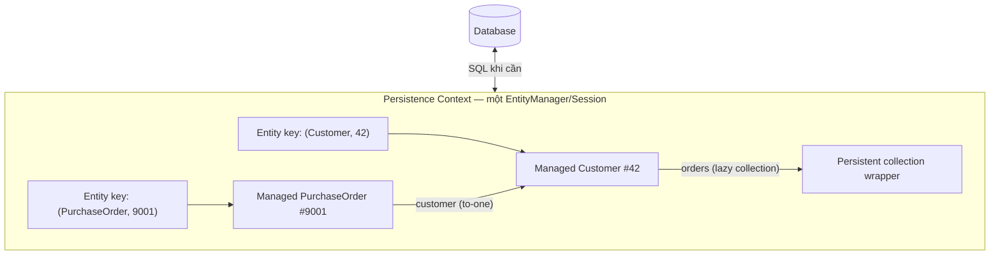
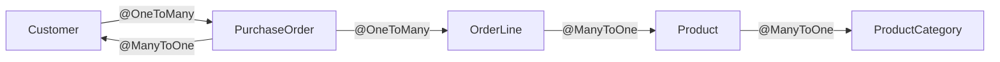
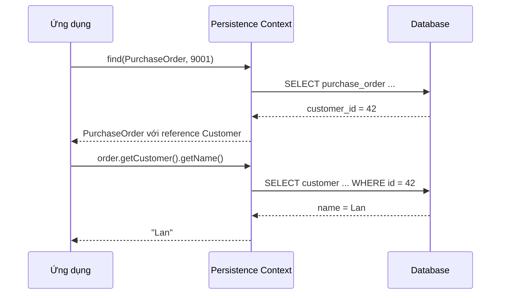
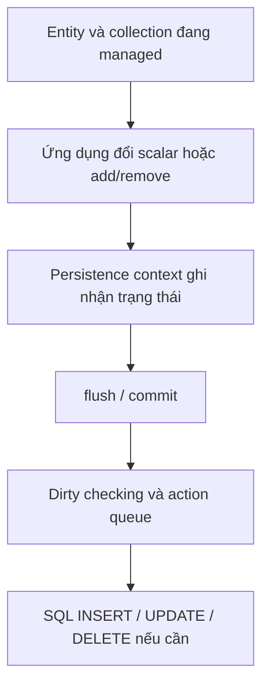

# Đồ thị đối tượng, tập hợp được quản lý và tham chiếu tới proxy trong Hibernate

Trong Hibernate, việc lấy một entity không chỉ là chuyển một hàng SQL thành một object Java. Entity đó có thể tham chiếu đến các entity khác, nắm giữ các tập hợp quan hệ và được thay bằng những đối tượng **proxy** để hoãn truy vấn. Tất cả diễn ra trong phạm vi **persistence context** do Hibernate `Session` hoặc JPA `EntityManager` quản lý.

Ba khái niệm cần hiểu cùng nhau là:

1. **Đồ thị đối tượng** (*object graph*): những entity và value object có thể đi tới từ một entity gốc qua các thuộc tính tham chiếu hoặc collection.
2. **Tập hợp được quản lý** (*persistent collection*): collection mà Hibernate gắn vào cơ chế lazy loading, snapshot và theo dõi thay đổi để đồng bộ với database.
3. **Proxy/tham chiếu trì hoãn** (*lazy reference*): đối tượng hoặc cơ chế trung gian đại diện cho một entity liên quan, có thể chưa tải đầy đủ trạng thái của entity đó.

Điểm đặc biệt là **đồ thị Java nhìn thấy không đồng nghĩa toàn bộ dữ liệu đã được đọc từ database**. Một thuộc tính `customer` có thể là proxy; một `orders` có thể là wrapper chưa khởi tạo; một entity khác có thể đã nằm sẵn trong persistence context nên Hibernate không cần truy vấn lại.

Hiểu các trạng thái này giúp dự đoán hành vi SQL, tránh `LazyInitializationException`, kiểm soát các thao tác thêm/xóa quan hệ và không vô tình tải cả đồ thị khi chỉ cần một phần dữ liệu.

## 1. Persistence context quản lý danh tính, không chỉ giữ kết quả truy vấn

Một persistence context là phạm vi theo dõi các entity **managed**. Trong phạm vi đó, Hibernate quản lý mối liên hệ giữa entity identifier và entity instance, cùng trạng thái phục vụ dirty checking, flush, cascade và lazy loading.

Ví dụ:

```java
Customer first = entityManager.find(Customer.class, 42L);
Customer second = entityManager.find(Customer.class, 42L);

System.out.println(first == second); // Thông thường true trong cùng persistence context
```

Trong tình huống trên, hai lần `find` cùng loại entity và cùng primary key thường trả về cùng managed instance. Hibernate không cần dựng hai `Customer` độc lập cho cùng một hàng trong cùng persistence context.

Có thể hình dung:



**Không nên nhầm identity map với cache dữ liệu toàn cục.** First-level cache/identity map gắn với từng persistence context; kết thúc hoặc xóa context là chấm dứt phạm vi theo dõi đó. Second-level cache của Hibernate, nếu được cấu hình, là một cơ chế khác.

### 1.1. Một hàng có thể xuất hiện qua nhiều đường đi

Nếu order `9001` thuộc customer `42`, ứng dụng có thể tới customer từ:

```java
Customer direct = entityManager.find(Customer.class, 42L);
PurchaseOrder order = entityManager.find(PurchaseOrder.class, 9001L);

Customer fromAssociation = order.getCustomer();
```

Trong cùng context, Hibernate phải duy trì ý nghĩa rằng cả hai tham chiếu liên quan đến **cùng entity identity**. Tuy vậy, do proxy hoặc bytecode enhancement, không nên mặc định mọi biểu thức so sánh reference bằng `==` luôn có hành vi giống nhau trong mọi đường tải; entity identity là ý nghĩa quan trọng hơn hình dạng Java runtime của tham chiếu.

## 2. Đồ thị object khác với đồ thị dữ liệu đã tải

Giả sử hệ thống bán hàng có các quan hệ:



Về mặt mô hình, `Customer` có thể đi tới mọi `PurchaseOrder`, rồi tới mọi `OrderLine` và `Product`. Nhưng trong một use case chỉ cần tên khách hàng:

```java
Customer customer = entityManager.find(Customer.class, 42L);
String name = customer.getName();
```

Hibernate có thể chỉ tải các cột của `customer`, chưa tải `orders`. Association được thể hiện trong Java nhưng dữ liệu đích có thể vẫn chưa được materialize.

Phân biệt:

| Khái niệm | Ý nghĩa |
|---|---|
| Object graph | Các quan hệ Java có thể truy cập về mặt mô hình |
| Loaded/fetched graph | Các entity/collection thực sự đã được tải trong lần xử lý hiện tại |
| Persistence context | Phạm vi theo dõi managed instance, trạng thái và association |
| Proxy | Đại diện một entity tham chiếu chưa nhất thiết tải đầy đủ |
| Persistent collection | Wrapper hỗ trợ lazy loading và theo dõi collection |
| Fetch plan | Quyết định association nào được tải ngay hoặc về sau |

Một câu truy vấn có `JOIN FETCH` hoặc `EntityGraph` có thể thay đổi **loaded graph**, nhưng không biến schema, quan hệ hay định danh của entity thành một mô hình khác.

## 3. Các trạng thái vòng đời của entity trong đồ thị

Đồ thị object có thể chứa các đối tượng ở các trạng thái khác nhau:

| Trạng thái | Mô tả | Hành vi liên quan |
|---|---|---|
| Transient/new | Entity do ứng dụng tạo, chưa gắn persistence context | Chưa tự động được ghi xuống DB chỉ vì reachable qua field |
| Managed | Entity đang được theo dõi bởi persistence context | Thay đổi có thể được flush vào DB |
| Detached | Entity đã từng được quản lý nhưng hiện không còn trong context đó | Đọc dữ liệu đã tải được; lazy association chưa tải có thể lỗi |
| Removed | Entity được đánh dấu xóa trong context hiện tại | Việc xóa được đồng bộ ở flush/commit theo quy tắc |

Ví dụ:

```java
Customer managed = entityManager.find(Customer.class, 42L);

entityManager.detach(managed);

// managed là detached; các collection chưa khởi tạo
// không còn được nạp tự do qua context vừa detach.
```

Một object Java vẫn tồn tại sau `detach`. Nó không biến mất, nhưng Hibernate không còn theo dõi thay đổi của instance đó trong context cũ.

Tương tự, nếu một entity mới được gán vào association của entity managed, **không phải lúc nào nó cũng tự thành managed**. Việc chuyển trạng thái phụ thuộc thao tác `persist`/`merge` và cascade được cấu hình. Reachability trong object graph và cascade là hai khái niệm liên quan nhưng khác nhau.

## 4. Mô hình ví dụ: Customer, PurchaseOrder và OrderLine

Các ví dụ trong bài sử dụng Jakarta Persistence. Với những dự án cũ, package có thể là `javax.persistence` thay vì `jakarta.persistence`.

DDL minh họa:

```sql
CREATE TABLE customer (
    id BIGINT PRIMARY KEY,
    name VARCHAR(150) NOT NULL
);

CREATE TABLE purchase_order (
    id BIGINT PRIMARY KEY,
    customer_id BIGINT NOT NULL REFERENCES customer(id),
    status VARCHAR(30) NOT NULL
);

CREATE TABLE order_line (
    id BIGINT PRIMARY KEY,
    order_id BIGINT NOT NULL REFERENCES purchase_order(id),
    sku VARCHAR(80) NOT NULL,
    quantity INTEGER NOT NULL
);
```

### 4.1. Entity chủ và collection quan hệ

```java
import jakarta.persistence.*;
import java.util.ArrayList;
import java.util.List;

@Entity
@Table(name = "customer")
public class Customer {

    @Id
    private Long id;

    @Column(name = "name", nullable = false)
    private String name;

    @OneToMany(mappedBy = "customer", fetch = FetchType.LAZY)
    private List<PurchaseOrder> orders = new ArrayList<>();

    protected Customer() {}

    public Customer(Long id, String name) {
        this.id = id;
        this.name = name;
    }

    public Long getId() { return id; }
    public String getName() { return name; }
    public List<PurchaseOrder> getOrders() { return orders; }

    public void addOrder(PurchaseOrder order) {
        if (!orders.contains(order)) {
            orders.add(order);
        }
        order.assignCustomer(this);
    }

    public void removeOrder(PurchaseOrder order) {
        if (orders.remove(order)) {
            order.assignCustomer(null);
        }
    }
}
```

Ở ví dụ cơ sở, `Customer.orders` **không** bật `orphanRemoval` hoặc `cascade`. Phương thức `removeOrder` chỉ làm rõ cách đồng bộ hai phía trong bộ nhớ; nếu quan hệ bắt buộc và không cho phép customer null, việc “gỡ order” cần được mô hình hóa thành **chuyển sang customer khác** hoặc **xóa order**, chứ không chỉ đặt foreign key thành `NULL`. Các phần sau sẽ trình bày trường hợp `orphanRemoval` riêng.

### 4.2. Entity con sở hữu foreign key

```java
import jakarta.persistence.*;

@Entity
@Table(name = "purchase_order")
public class PurchaseOrder {

    @Id
    private Long id;

    @ManyToOne(fetch = FetchType.LAZY, optional = false)
    @JoinColumn(name = "customer_id", nullable = false)
    private Customer customer;

    @Column(name = "status", nullable = false)
    private String status;

    @OneToMany(mappedBy = "order", fetch = FetchType.LAZY)
    private java.util.List<OrderLine> lines =
        new java.util.ArrayList<>();

    protected PurchaseOrder() {}

    public PurchaseOrder(Long id, String status) {
        this.id = id;
        this.status = status;
    }

    public Long getId() { return id; }
    public Customer getCustomer() { return customer; }
    public String getStatus() { return status; }
    public java.util.List<OrderLine> getLines() { return lines; }

    public void assignCustomer(Customer customer) {
        this.customer = customer;
    }

    public void changeStatus(String status) {
        this.status = status;
    }
}
```

`OrderLine` tham chiếu về `PurchaseOrder`:

```java
@Entity
@Table(name = "order_line")
public class OrderLine {

    @Id
    private Long id;

    @ManyToOne(fetch = FetchType.LAZY, optional = false)
    @JoinColumn(name = "order_id", nullable = false)
    private PurchaseOrder order;

    @Column(name = "sku", nullable = false)
    private String sku;

    @Column(name = "quantity", nullable = false)
    private int quantity;

    protected OrderLine() {}

    public PurchaseOrder getOrder() { return order; }
}
```

Các đoạn mã trên minh họa cấu trúc quan hệ; những thao tác thêm/xóa cần chính sách lifecycle tương ứng. Trong ứng dụng thực tế nên giới hạn setter, chuẩn hóa `equals/hashCode` và dùng helper domain tránh object graph bất nhất.

## 5. Collection trong entity không nhất thiết còn là `ArrayList`

Trong entity mới tạo:

```java
private List<PurchaseOrder> orders = new ArrayList<>();
```

`orders` ban đầu là một `ArrayList` Java thông thường. Nhưng khi Hibernate tải entity được quản lý và ánh xạ `@OneToMany`, field này thường được thay bằng một **wrapper riêng** của Hibernate, chẳng hạn kiểu thuộc họ `PersistentCollection`.

Hình dung:

```text
Customer.orders (kiểu khai báo List)
       |
       v
Hibernate PersistentCollection wrapper
  ├── Biết association/owner và context liên quan
  ├── Có thể chưa khởi tạo nội dung
  ├── Có thể giữ snapshot để đối chiếu thay đổi
  └── Hỗ trợ phát hiện add/remove, lazy loading, flush
```

Không nên viết:

```java
ArrayList<PurchaseOrder> orders =
    (ArrayList<PurchaseOrder>) customer.getOrders();
```

Cách ép kiểu có thể gây `ClassCastException` nếu Hibernate trả `PersistentBag` hoặc wrapper khác.

**Hãy khai báo bằng interface collection**, như `List`, `Set` hoặc `Collection`, theo semantics nghiệp vụ; không phụ thuộc lớp triển khai cụ thể mà Hibernate chọn.

### 5.1. Persistent collection không phải một entity riêng

Wrapper collection được quản lý như một phần mapping của entity sở hữu. Nó không có entity identifier như `PurchaseOrder.id`. Hibernate theo dõi thay đổi các phần tử và liên kết của collection để tạo SQL thích hợp.

Với `@ElementCollection`, các phần tử có thể là value object thay vì entity. Nhưng collection vẫn có vòng đời gắn với entity chủ và có thể được quản lý bằng persistent wrapper.

### 5.2. Wrapper có thể chưa chứa các phần tử

`Customer.orders` có thể là một đối tượng Java **khác null** nhưng vẫn **chưa được khởi tạo**. Vì vậy:

```java
customer.getOrders() != null
```

không chứng minh rằng các order đã được tải. Một wrapper lazy có thể tồn tại trước khi Hibernate truy vấn dữ liệu phần tử.

## 6. Lazy loading đối với collection

Với `@OneToMany(fetch = FetchType.LAZY)`, Hibernate cố gắng trì hoãn việc đọc các hàng con cho tới khi ứng dụng cần.

Ví dụ:

```java
Customer customer = entityManager.find(Customer.class, 42L);

// Chưa nhất thiết SELECT purchase_order.
System.out.println(customer.getName());

// Có thể khởi tạo collection và SELECT purchase_order.
for (PurchaseOrder order : customer.getOrders()) {
    System.out.println(order.getId());
}
```

SQL minh họa:

```sql
-- find Customer:
SELECT id, name
FROM customer
WHERE id = 42;

-- Khi khởi tạo orders:
SELECT id, customer_id, status
FROM purchase_order
WHERE customer_id = 42;
```

Thời điểm và hình dạng SQL thực tế phụ thuộc fetch plan, cache, batching và phiên bản Hibernate.

### 6.1. Những thao tác có thể khởi tạo collection

Trong cấu hình lazy collection thông thường:

- Duyệt bằng `for` hoặc `iterator()`.
- Gọi `stream()` rồi xử lý phần tử.
- Gọi `size()` để đếm.
- Gọi `contains()` hoặc một số phép kiểm tra phần tử.
- Log collection, gọi `toString()` hoặc serializer đi qua getter.
- Thực hiện logic nghiệp vụ cần xác định phần tử trong collection.

Một số cấu hình Hibernate đặc thù có thể thực hiện thao tác `size`, `contains` hoặc thao tác xếp hàng (queued operation) mà không tải hết collection. Không nên dựa vào tối ưu này nếu chưa biết mapping và phiên bản đang sử dụng.

### 6.2. `LAZY` không đồng nghĩa dữ liệu đã an toàn khỏi tải quá mức

Đoạn mã:

```java
List<PurchaseOrder> firstTen =
    customer.getOrders().stream().limit(10).toList();
```

không có nghĩa database chỉ lấy 10 order. Collection có thể phải được khởi tạo toàn bộ trước khi stream chạy.

Nếu cần 10 order mới nhất, nên query trực tiếp:

```java
List<PurchaseOrder> newest = entityManager.createQuery(
    "select o from PurchaseOrder o " +
    "where o.customer.id = :customerId " +
    "order by o.id desc",
    PurchaseOrder.class
)
.setParameter("customerId", 42L)
.setMaxResults(10)
.getResultList();
```

Đây là phân biệt quan trọng giữa **quan hệ Java có thể duyệt** và **truy vấn lấy tập dữ liệu cần thiết**.

## 7. Proxy đại diện cho một entity tham chiếu

Đối với quan hệ đơn trị như `@ManyToOne`, Hibernate có thể sử dụng một **proxy** để trì hoãn tải entity đích.

Ví dụ:

```java
PurchaseOrder order =
    entityManager.find(PurchaseOrder.class, 9001L);

Customer customer = order.getCustomer();
```

Nếu `customer` chưa được tải, trong một số cấu hình nó có thể là instance proxy mang identifier của `Customer`. Proxy biết cần đến entity nào nhưng chưa có mọi thuộc tính.



Đây là mô hình điển hình của proxy-based lazy loading. Với bytecode enhancement hoặc mapping khác, Hibernate có thể triển khai lazy loading bằng cơ chế không hoàn toàn giống proxy subclass; **không nên coi kiểu runtime cụ thể là một phần hợp đồng domain**.

### 7.1. Identifier có thể đã biết trước khi khởi tạo proxy

Với foreign key `customer_id = 42` trong hàng order, Hibernate đã biết ID của customer. Việc gọi getter ID trên proxy trong một số cấu hình thường không cần đọc thêm hàng customer:

```java
Long customerId = order.getCustomer().getId();
```

Nhưng hành vi tối ưu này phụ thuộc kiểu proxy, chiến lược truy cập và phiên bản Hibernate. Những method khác như `getName()` thường đòi hỏi trạng thái entity và có thể kích hoạt truy vấn.

Không nên thiết kế correctness dựa vào giả định rằng **mọi** lời gọi phương thức trên proxy đều không tải dữ liệu.

### 7.2. Proxy không chứng minh hàng đích tồn tại ngay lúc tạo tham chiếu

Một proxy có thể đại diện cho ID được biết đến mà chưa truy vấn bảng đích. Nếu foreign key không được bảo vệ đúng hoặc bản ghi đích đã bị xóa, lỗi có thể chỉ xuất hiện khi Hibernate thực sự truy cập entity đó.

Vì vậy, proxy là **một phương thức trì hoãn tải**, không phải bằng chứng rằng mọi constraint dữ liệu đã được kiểm tra ngay thời điểm lấy reference.

## 8. `getReference` và `find` khác nhau thế nào?

JPA cung cấp hai hướng truy cập quan trọng:

```java
Customer loaded = entityManager.find(Customer.class, 42L);

Customer reference = entityManager.getReference(
    Customer.class, 42L);
```

Về ý nghĩa:

- `find` yêu cầu tìm entity theo khóa. Nếu entity chưa có trong persistence context/cache thích hợp, thường cần truy cập dữ liệu.
- `getReference` cho phép lấy một reference đến entity theo khóa mà **không nhất thiết tải ngay mọi thuộc tính**.
- `getReference` có thể trả entity đang được quản lý nếu entity đó đã có trong persistence context.
- Provider có thể chọn kiểm tra sự tồn tại sớm hoặc trì hoãn đến lúc đọc trạng thái. Không nên coi `getReference` luôn là một thao tác không phát SQL.

Một use case:

```java
PurchaseOrder order = entityManager.find(
    PurchaseOrder.class, 9001L);

Customer customerRef = entityManager.getReference(
    Customer.class, 42L);

order.assignCustomer(customerRef);
```

Nếu chỉ cần thiết lập quan hệ theo khóa khách hàng có sẵn, việc dùng reference có thể tránh một lần đọc toàn bộ customer. Nhưng database vẫn phải có FK hợp lệ và ứng dụng cần kiểm tra quyền truy cập/tenant theo nghiệp vụ; **`getReference` không thay thế bước xác thực quyền hoặc kiểm tra tồn tại bắt buộc**.

### 8.1. Khi nào cần `find` thay vì `getReference`?

Dùng `find` nếu nghiệp vụ cần đọc thông tin khách hàng, kiểm tra điều kiện của khách hàng hoặc cần xác nhận sự tồn tại theo một chính sách rõ ràng trước khi tiếp tục.

Dùng `getReference` có thể hữu ích nếu ứng dụng đã biết một ID đáng tin cậy, chỉ cần tạo tham chiếu ORM và để constraint DB bảo đảm tính toàn vẹn ở lúc ghi.

Với update theo ID từ client không đáng tin cậy, không nên dùng reference để bỏ qua kiểm tra authorization. Nếu customer 42 thuộc tenant khác, reference vẫn không tự chặn việc gán sai tenant.

## 9. Kiểm tra entity và collection đã khởi tạo hay chưa

Hibernate cung cấp:

```java
import org.hibernate.Hibernate;

Customer customer = entityManager.find(Customer.class, 42L);

boolean ordersLoaded =
    Hibernate.isInitialized(customer.getOrders());
```

`Hibernate.isInitialized(...)` cho biết đối tượng proxy/persistent collection đã được khởi tạo hay chưa trong phạm vi API Hibernate hỗ trợ.

Đối với entity reference:

```java
Customer reference = entityManager.getReference(
    Customer.class, 42L);

boolean initialized = Hibernate.isInitialized(reference);
```

Cần lưu ý: nếu ID đã hiện diện trong context, `getReference` có thể trả entity đã được tải; vì vậy không khẳng định `initialized == false` ở mọi lần chạy.

### 9.1. Khởi tạo có chủ đích

```java
Hibernate.initialize(customer.getOrders());
```

Lệnh này yêu cầu khởi tạo collection khi có khả năng truy cập dữ liệu. Nó **không đặt giới hạn số phần tử** và không bảo đảm toàn bộ những quan hệ lồng bên trong từng order cũng được khởi tạo.

Ví dụ:

```java
Hibernate.initialize(customer.getOrders());

for (PurchaseOrder order : customer.getOrders()) {
    // order.getLines() vẫn có thể là collection LAZY chưa tải.
}
```

Vì vậy, `Hibernate.initialize` không phải giải pháp để “tải toàn bộ đồ thị” hay cách mặc định khắc phục serialization. Chỉ nên gọi khi use case thật sự cần collection đó và có transaction/Session thích hợp.

### 9.2. API chuẩn JPA

JPA có `PersistenceUnitUtil` để kiểm tra trạng thái load:

```java
PersistenceUnitUtil util =
    entityManager.getEntityManagerFactory()
                 .getPersistenceUnitUtil();

boolean ordersLoaded =
    util.isLoaded(customer, "orders");
```

`PersistenceUnitUtil.isLoaded` làm việc ở mức JPA, trong khi `Hibernate.isInitialized` là tiện ích riêng của Hibernate. Cả hai chủ yếu hỗ trợ quan sát/troubleshooting; không nên để logic nghiệp vụ quan trọng phụ thuộc vào việc dữ liệu vô tình đã được tải hay chưa.

## 10. Managed collection giúp Hibernate theo dõi thay đổi

Trong persistence context, Hibernate không chỉ đọc collection. Nó còn cần biết **những association nào đã thay đổi** để sinh SQL lúc flush.

Giả sử bảng `purchase_order` có cột `customer_id` và entity `Customer.orders` là phía inverse (`mappedBy`). Khi thêm một order:

```java
Customer customer = entityManager.find(Customer.class, 42L);

PurchaseOrder order = new PurchaseOrder(9002L, "CREATED");

customer.addOrder(order);

// Vì ví dụ cơ sở không khai báo cascade PERSIST:
entityManager.persist(order);
```

Helper `addOrder` thay đổi cả:

```java
customer.getOrders().add(order);
order.assignCustomer(customer);
```

Thông thường, Hibernate ghi hàng mới với `customer_id = 42` khi flush/commit:

```sql
INSERT INTO purchase_order (id, customer_id, status)
VALUES (9002, 42, 'CREATED');
```

Điểm chính:

- Collection của customer mô tả phía một-nhiều trong graph.
- Field `PurchaseOrder.customer` là **owning side** vì nó ánh xạ foreign key `customer_id`.
- `persist(order)` chuyển entity mới thành managed trong ví dụ không có cascade.
- Thay đổi collection và association chỉ được đồng bộ xuống database trong điều kiện transaction/persistence context phù hợp.

**Không đồng nhất “một object xuất hiện trong managed collection” với “Hibernate tự persist object mới”.** Cascade phải được cấu hình hoặc `persist` phải được gọi theo vòng đời đúng.

## 11. Dirty checking đối với scalar và collection

Với managed entity:

```java
PurchaseOrder order =
    entityManager.find(PurchaseOrder.class, 9001L);

order.changeStatus("PAID");
```

Hibernate có thể phát hiện thay đổi `status` khi flush và sinh `UPDATE`.

Đối với collection, Hibernate dùng cơ chế collection management/snapshot và theo dõi thao tác để biết phần tử/association có thay đổi hay không. Cách phát hiện cụ thể có thể dựa vào dirty flags, snapshots, enhanced tracking và loại collection.



**Không phải mỗi lần gọi `add` là lập tức có `INSERT`.** Hibernate thường hoãn đồng bộ đến flush, trừ khi một operation hoặc cơ chế sinh khóa cần SQL sớm hơn.

Đồng thời, loại SQL phụ thuộc loại association:

| Mapping | Nơi chứa liên kết vật lý | Một thay đổi có thể dẫn tới |
|---|---|---|
| `@OneToMany(mappedBy = ...)` | FK ở entity con | `INSERT`/`UPDATE`/`DELETE` ở bảng con theo owning side và lifecycle |
| `@ManyToMany` | Join table | Thêm/xóa hàng join table |
| `@ElementCollection` | Collection table | Thêm/xóa/cập nhật hàng giá trị nhúng tùy mapping |
| `@OneToMany` dùng `@JoinTable` | Join table | Thay đổi hàng join table |
| `@OneToOne` sở hữu FK | FK ở owning entity | `UPDATE` FK hoặc thao tác lifecycle phù hợp |

Không suy từ việc field Java là `List` hay `Set` rằng Hibernate sẽ luôn sinh cùng SQL.

## 12. Owning side và inverse side quyết định cập nhật liên kết

Trong quan hệ hai chiều:

```java
// Customer:
@OneToMany(mappedBy = "customer")
private List<PurchaseOrder> orders;

// PurchaseOrder:
@ManyToOne(fetch = FetchType.LAZY)
@JoinColumn(name = "customer_id")
private Customer customer;
```

`PurchaseOrder.customer` là owning side; `Customer.orders` là inverse side.

Nếu chỉ làm:

```java
customer.getOrders().add(order);
```

mà không gán `order.customer`, object graph Java trở nên bất nhất. Hibernate có thể không ghi foreign key mong muốn chỉ dựa trên thay đổi ở inverse side.

Cách an toàn hơn là helper quản lý **hai chiều**:

```java
public void addOrder(PurchaseOrder order) {
    if (!orders.contains(order)) {
        orders.add(order);
    }
    order.assignCustomer(this);
}
```

Nếu chuyển một order giữa hai customer, cần bỏ nó khỏi collection cũ và thêm vào collection mới, rồi đảm bảo owning side trỏ đến customer mới. Không nên thay đổi bất kỳ phía nào tùy hứng ở các service khác nhau.

### 12.1. Collection là biểu diễn quan hệ, không phải nguồn tạo FK ở mọi mapping

Với `@OneToMany(mappedBy = "customer")`, cột `customer_id` thuộc bảng order. Nhưng với `@ManyToMany`, owning side thường quản lý join table qua `@JoinTable`. Vì vậy phải đọc metadata quan hệ cụ thể trước khi kết luận thay collection tạo SQL gì.

Một cách trình bày domain tốt là **giấu thao tác sửa collection đằng sau method có ý nghĩa nghiệp vụ**, tránh trả collection có thể sửa tùy tiện cho mọi caller.

## 13. Đừng thay reference của managed collection một cách tùy tiện

Một anti-pattern phổ biến:

```java
Customer customer = entityManager.find(Customer.class, 42L);

// Rủi ro: thay wrapper mà Hibernate đang theo dõi.
customer.setOrders(new ArrayList<>(incomingOrders));
```

Khi Hibernate đã gắn một persistent collection wrapper vào field, việc thay cả field bằng collection khác có thể làm mất reference đến wrapper cũ. Với những mapping có `orphanRemoval` hoặc cascading đặc biệt, Hibernate có thể báo lỗi kiểu:

```text
A collection with cascade="all-delete-orphan"
was no longer referenced by the owning entity instance
```

Không phải mọi tình huống thay collection đều ném lỗi, nhưng đây là hành động dễ tạo SQL khác mong đợi hoặc làm hỏng chính sách lifecycle.

### 13.1. Nên cập nhật các phần tử trong collection đang được quản lý

Nếu mục tiêu là cập nhật tập phần tử, hãy dùng domain methods để tính chênh lệch:

```java
Customer customer = entityManager.find(Customer.class, customerId);

for (PurchaseOrder orderToRemove : ordersToRemove) {
    customer.removeOrder(orderToRemove);
}

for (PurchaseOrder orderToAdd : ordersToAdd) {
    customer.addOrder(orderToAdd);
}
```

Đoạn này mô tả thao tác trong bộ nhớ; chính sách persist/delete và constraint phải được xử lý theo mapping. Đặc biệt, với quan hệ bắt buộc, remove đơn thuần không thể biến FK thành null hợp lệ.

Nếu muốn thay toàn bộ nội dung nhưng vẫn giữ wrapper, có thể thiết kế logic `clear`/`addAll` trên collection **khi quy tắc cascade/orphanRemoval, số lượng dữ liệu và side effect được hiểu rõ**. Không dùng `clear` cho collection hàng trăm nghìn phần tử chỉ để đồng bộ một phần nhỏ.

### 13.2. Nhận biết wrapper không có nghĩa phải gọi API nội bộ

Có thể quan sát kiểu runtime khi debug, nhưng business code nên làm việc qua `List`, `Set` và helper domain. Không ép service phụ thuộc trực tiếp vào `PersistentBag`/`PersistentSet` vì loại wrapper cụ thể có thể khác theo Hibernate version, mapping hoặc cách fetch.

## 14. `orphanRemoval` khác `CascadeType.REMOVE`

Hai cơ chế này thường dễ bị nhầm khi quản lý collection.

- `CascadeType.REMOVE`: khi xóa **entity cha**, thao tác remove có thể được lan sang entity con qua association được cấu hình.
- `orphanRemoval = true`: khi một entity con bị **loại khỏi quan hệ sở hữu của cha**, Hibernate có thể xem nó là orphan cần được xóa.

Ví dụ một `PurchaseOrder` sở hữu vòng đời các dòng chi tiết, trong đó một `OrderLine` không có ý nghĩa tồn tại độc lập:

```java
@OneToMany(
    mappedBy = "order",
    cascade = CascadeType.ALL,
    orphanRemoval = true
)
private List<OrderLine> lines = new ArrayList<>();
```

Helper minh họa:

```java
public void addLine(OrderLine line) {
    lines.add(line);
    line.assignOrder(this);
}

public void removeLine(OrderLine line) {
    if (lines.remove(line)) {
        line.assignOrder(null);
    }
}
```

Các method `assignOrder` cần được bổ sung vào `OrderLine` trong mapping thực tế. Khi loại một dòng khỏi `lines` của managed order, Hibernate có thể phát lệnh `DELETE` cho dòng đó ở flush, theo semantics orphan removal.

**Không tự động dùng `orphanRemoval = true` cho mọi collection.** Chỉ sử dụng khi parent thực sự sở hữu vòng đời của child. Với `Customer.orders`, một order có thể cần được giữ lại vì kế toán/lịch sử, nên hành vi xóa order chỉ vì gỡ liên kết với customer thường không phù hợp.

### 14.1. Orphan removal và việc chuyển con sang cha khác

Chuyển một child từ parent A sang parent B có thể phức tạp nếu association ở A dùng orphan removal. Việc gỡ child khỏi A có thể khiến Hibernate lên lịch xóa child thay vì chuyển FK, tùy trạng thái và thứ tự thao tác.

Nếu nghiệp vụ cần chuyển child giữa parent thường xuyên, hãy xem lại xem `orphanRemoval = true` có đúng lifecycle không. Đừng coi một child đã bị đánh dấu orphan là object có thể tái sử dụng tự do trong cùng transaction.

## 15. Collection `List`, `Set`, `Map` và vấn đề equality

Hibernate hỗ trợ nhiều loại collection, nhưng Java semantics vẫn quan trọng.

- `List` cho phép phần tử trùng và có thứ tự duyệt; thứ tự lưu bền vững cần mapping phù hợp, chẳng hạn `@OrderColumn` hoặc `@OrderBy` theo ngữ nghĩa.
- `Set` dùng `equals/hashCode` để quản lý phần tử và tránh trùng theo equality của Java.
- `Map` dùng key để truy cập phần tử; key có thể là thuộc tính hoặc mapping riêng.
- `Collection` không cam kết vị trí hay uniqueness bằng giao diện.

### 15.1. `Set` chứa entity với hash thay đổi

Nếu entity con có `hashCode` dựa trên ID được sinh sau `persist`, việc đưa nó vào `HashSet` trước khi có ID có thể gây vấn đề:

```java
Set<PurchaseOrder> set = new HashSet<>();
PurchaseOrder order = new PurchaseOrder(/* dữ liệu */);

set.add(order);
entityManager.persist(order);

// Nếu hashCode đổi khi ID được gán:
boolean found = set.contains(order); // Có thể false.
```

Cách xử lý không chỉ là thay `Set` bằng `List`; cần chính sách `equals/hashCode` ổn định cho entity. Với `@OneToMany` và `@ManyToMany` có Set, điều này liên quan trực tiếp đến hành vi add/remove và dirty checking của collection.

### 15.2. Không đưa collection vào `equals/hashCode/toString` entity

Nếu `Customer.hashCode()` duyệt `orders`, rồi mỗi `PurchaseOrder.hashCode()` lại xét `customer`, có thể xảy ra vòng đệ quy hoặc lazy loading ngoài ý muốn.

Với entity Hibernate:

- Equality nên phản ánh **định danh thực sự**, không phải toàn bộ object graph.
- Hash không nên thay đổi vì một child được thêm vào collection.
- `toString` nên ngắn, tránh đi qua association.
- Các annotation sinh tự động như Lombok `@Data` cần được dùng rất thận trọng trên entity.

Đồ thị đối tượng có thể có vòng. Các utility method không được tự động duyệt vòng đó.

## 16. Proxy và `equals/hashCode/getClass`

Một proxy do Hibernate sinh có thể là subclass runtime của entity, do đó:

```java
customer.getClass() == reference.getClass()
```

không phải lúc nào cũng trả `true` dù cả hai đại diện cùng entity type/ID.

Tương tự, dùng `equals/hashCode` sinh tự động dựa trên mọi field của entity có thể:

- Khởi tạo proxy để đọc state.
- Chạm collection lazy.
- Đánh giá hai entity khác nhau chỉ vì một trường mutable thay đổi.
- Sai khi so sánh entity transient có ID `null`.
- Làm hash đổi sau khi khóa sinh bởi database được gán.

Một chính sách phổ biến với entity có generated ID:

1. Cùng object reference thì bằng nhau.
2. Hai instance transient khác nhau với ID null không mặc nhiên bằng nhau.
3. Entity đã có ID và cùng persistent type/ID có thể được coi là cùng danh tính.
4. Hash phải ổn định trong thời gian entity được sử dụng trong collection băm.
5. Không xét collection, proxy state chưa tải hoặc dữ liệu nghiệp vụ mutable chỉ để tính identity.

Việc triển khai policy phải xét Hibernate proxy, bytecode enhancement và inheritance model. Không có một biểu thức `getClass` hoặc `instanceof` phù hợp tuyệt đối với mọi mô hình kế thừa và cấu hình provider.

### 16.1. Không mặc định `toString` trên proxy là vô hại

Một lệnh:

```java
log.debug("Customer: {}", order.getCustomer());
```

có thể khiến formatter gọi `toString()` của proxy/target. Nếu `toString` truy cập các thuộc tính khác ID, Hibernate có thể tải entity hoặc gây `LazyInitializationException` nếu context đã đóng.

Trong log, nên dùng ID hoặc giá trị đã được lấy một cách có chủ đích:

```java
log.debug("Order {}, customerId={}",
    order.getId(),
    order.getCustomer().getId());
```

Ngay cả việc đọc ID trên proxy cũng cần hiểu cơ chế runtime của phiên bản Hibernate. Nếu yêu cầu log không được phát SQL trong mọi trường hợp, có thể chọn projection hoặc giữ giá trị FK đơn giản trong dữ liệu truy vấn thay vì dựa vào proxy.

## 17. Session đóng rồi: cái gì còn truy cập được?

Đây là điểm thường gây nhầm nhất.

Trong transaction:

```java
Customer customer = entityManager.find(Customer.class, 42L);
String name = customer.getName();
```

Nếu context đóng ngay sau đó:

- `customer.getName()` thường vẫn đọc được vì giá trị basic đã được tải.
- `customer.getOrders()` có thể vẫn trả wrapper Java.
- **Duyệt wrapper chưa khởi tạo** thường gây `LazyInitializationException`.
- Một proxy `PurchaseOrder.customer` chưa khởi tạo cũng có thể lỗi khi đọc thuộc tính cần SQL.
- Những collection/association **đã khởi tạo đầy đủ** trước khi detach vẫn có thể được đọc từ dữ liệu trong bộ nhớ, nhưng các liên kết sâu hơn chưa khởi tạo vẫn có thể thất bại.

Ví dụ:

```java
Customer detachedCustomer;

try (Session session = sessionFactory.openSession()) {
    detachedCustomer = session.find(Customer.class, 42L);
}

// Session đã đóng:
String name = detachedCustomer.getName(); // Thường truy cập được.

// Nếu orders chưa initialized:
detachedCustomer.getOrders().size(); // Có thể LazyInitializationException.
```

Điểm cần tránh là cách hiểu “entity detached thì không đọc được gì”. Thực ra **dữ liệu đã materialize vẫn nằm trong object Java**; chỉ có các truy vấn bổ sung qua lazy proxy/collection không còn context hỗ trợ.

### 17.1. `LazyInitializationException` không phải dấu hiệu DB đã hỏng

Đây thường là lỗi **ranh giới tải dữ liệu và vòng đời Session**. Những cách giải quyết có chủ đích:

- Fetch association cần dùng ngay trong service/transaction.
- Dùng DTO projection để trả đúng dữ liệu cho controller.
- Query collection riêng có filter/pagination.
- Với một object cần toàn bộ collection có giới hạn tự nhiên, dùng fetch join hoặc `Hibernate.initialize` khi context mở.
- Không bật `EAGER` hàng loạt chỉ để tránh lỗi.

Không dựa vào việc mở transaction vô hạn hoặc để serializer vô tình phát truy vấn để thay cho thiết kế fetch plan.

## 18. `detach`, `clear` và sự tồn tại của graph trong bộ nhớ

JPA cung cấp:

```java
entityManager.detach(customer);
entityManager.clear();
```

- `detach(customer)` yêu cầu tháo entity đó khỏi context. Những quan hệ được cấu hình `cascade = DETACH` có thể làm thao tác detach lan đến các entity liên quan theo quy tắc.
- `clear()` tháo toàn bộ entity khỏi persistence context hiện tại, làm các thay đổi chưa flush không còn được quản lý.
- Object Java, proxy và collection wrapper có thể tiếp tục tồn tại trong heap nếu ứng dụng vẫn giữ reference tới chúng.
- Các object detached không được context cũ dirty-check tiếp cho đến khi được reattach/merge theo cơ chế phù hợp.

**`clear()` không có nghĩa xóa object graph khỏi RAM ngay lập tức**, và cũng không tự hủy mọi reference do code ứng dụng giữ. Nó chỉ xóa trạng thái quản lý của context.

### 18.1. Cẩn trọng với các thay đổi chưa flush

```java
Customer customer = entityManager.find(Customer.class, 42L);
// Có thể thay đổi name hoặc một collection ở đây.

entityManager.clear();
```

Nếu thay đổi chưa được flush theo ranh giới transaction, việc `clear` có thể khiến các thay đổi đó không được đồng bộ vào database. Không dùng `clear` tùy tiện để “tiết kiệm bộ nhớ” khi còn công việc cần persist.

Trong batch processing, có thể `flush()`/`clear()` theo từng chunk sau khi xác định rõ transaction và lifecycle. Đây là kỹ thuật kiểm soát kích thước persistence context, không phải một thao tác sửa lỗi graph tùy tiện.

## 19. `merge` của detached graph không phải “gắn lại đúng object cũ”

JPA `EntityManager.merge(detachedEntity)` sao chép trạng thái của entity detached sang **managed instance** tương ứng và trả về managed instance đó.

Ví dụ:

```java
Customer detached = loadCustomerInAnotherUnitOfWork();

// Trong một EntityManager/transaction mới:
Customer managed = entityManager.merge(detached);

// Không giả định managed == detached.
// Tiếp tục thao tác trên managed nếu cần.
```

Đặc biệt, `merge` không tự động hợp thức hóa mọi đối tượng được tham chiếu trong graph. Cascade `MERGE` quyết định phần nào được lan truyền; các association khác có cơ chế tham chiếu và kiểm tra riêng.

### 19.1. Detached collection có thể chứa dữ liệu không đầy đủ

Một endpoint chỉ trả 10 đơn mới nhất cho người dùng không có nghĩa `Customer.orders` trong database chỉ có 10 phần tử. Nếu ứng dụng tạo một detached entity mới với collection chỉ chứa 10 phần tử rồi `merge` nó như thể đó là toàn bộ graph, các mapping có orphan removal/cascade có thể diễn giải sự vắng mặt của phần tử thành yêu cầu thay đổi hoặc xóa quan hệ.

Vì vậy, **không dùng entity graph rút gọn làm DTO cập nhật một phần** rồi merge hàng loạt. Nên:

1. Đọc managed entity cần chỉnh trong transaction.
2. Phân biệt field không được gửi với field được gửi giá trị `null` hoặc danh sách rỗng.
3. Áp dụng thay đổi cụ thể bằng domain method.
4. Để Hibernate flush những thay đổi đã được biểu diễn rõ ràng.

Đây là điểm khác nhau giữa “đồ thị đủ cho mục đích hiển thị” và “đồ thị biểu diễn trạng thái cần đồng bộ”.

### 19.2. Detached proxy và collection sau merge

Không nên giả định một lazy collection chưa khởi tạo ở detached graph sẽ tự trở thành collection đã tải chỉ vì gọi `merge`. Những dữ liệu được merge và tải phụ thuộc state, mapping, cascade và provider. Nếu ứng dụng cần collection cho use case mới, hãy có fetch plan rõ ràng trong context mới.

## 20. Persistence context không an toàn để chia sẻ giữa thread

Một Hibernate `Session` hoặc JPA `EntityManager` thường được thiết kế cho một **unit of work**, không phải một đối tượng chia sẻ đồng thời giữa nhiều thread.

Không làm:

```java
// Tránh chia sẻ cùng EntityManager/Session instance
// cho các tác vụ chạy đồng thời rồi sửa cùng managed graph.
executor.submit(() -> customer.getOrders().add(orderA));
executor.submit(() -> customer.getOrders().add(orderB));
```

Rủi ro gồm:

- Wrapper collection và trạng thái Session không thread-safe.
- Cùng một object graph bị thay đổi đồng thời.
- Dirty checking/flush không có thứ tự rõ ràng.
- Lazy loading xảy ra ở thread không còn transaction/context thích hợp.

Với tác vụ chạy song song, mỗi tác vụ nên có ranh giới transaction/persistence context riêng hoặc chuyển dữ liệu bất biến/DTO giữa thread. Khi nhiều transaction cùng sửa một entity, cần chiến lược concurrency như optimistic locking bằng `@Version` hoặc khóa database theo nghiệp vụ.

**Identity map chỉ bảo đảm danh tính trong phạm vi context; nó không bảo đảm tính nhất quán giữa các transaction đồng thời.**

## 21. First-level cache, second-level cache và proxy là ba thứ khác nhau

Một số hành vi dễ nhầm:

| Cơ chế | Phạm vi/ý nghĩa | Không nên hiểu là |
|---|---|---|
| Persistence context / first-level cache | Managed instances và trạng thái trong một `Session`/`EntityManager` | Cache chia sẻ toàn hệ thống |
| Second-level cache | Cache tùy cấu hình dùng giữa các context | Một managed graph dùng chung giữa các Session |
| Query cache | Cache kết quả/định danh truy vấn theo cấu hình Hibernate | Tự động đưa mọi association vào memory |
| Proxy | Reference trì hoãn tải một entity | Một entity khác với identity độc lập |
| Persistent collection | Wrapper có thể trì hoãn tải và theo dõi collection | Một `List` Java luôn đã có đủ phần tử |

Nếu một entity có trong second-level cache, Hibernate có thể không cần SQL để materialize một số state. Nhưng entity trở thành **managed** ở persistence context hiện tại theo vòng đời riêng, không phải cùng object Java managed của một Session khác.

Bật cache không tự giải quyết việc vô tình duyệt một collection quá lớn; khi graph đã được tải vào một unit of work, vẫn có chi phí bộ nhớ và xử lý.

## 22. Fetch plan, `JOIN FETCH` và `EntityGraph`

Cần phân biệt **đồ thị object theo domain** với **JPA EntityGraph dùng để điều khiển fetch**.

Ví dụ truy vấn một order cùng customer:

```java
PurchaseOrder order = entityManager.createQuery(
    "select o from PurchaseOrder o " +
    "join fetch o.customer " +
    "where o.id = :id",
    PurchaseOrder.class
)
.setParameter("id", 9001L)
.getSingleResult();
```

`join fetch` yêu cầu nạp association `customer` trong query, thay vì chờ tới lúc gọi `order.getCustomer().getName()`.

Hoặc dùng JPA `EntityGraph`:

```java
EntityGraph<PurchaseOrder> graph =
    entityManager.createEntityGraph(PurchaseOrder.class);

graph.addAttributeNodes("customer");

PurchaseOrder order = entityManager.find(
    PurchaseOrder.class,
    9001L,
    java.util.Map.of("jakarta.persistence.fetchgraph", graph)
);
```

Đây là **fetch plan**: quyết định association được yêu cầu tải ở thao tác cụ thể. Nó không xác lập rằng mọi `Customer.orders` hay `PurchaseOrder.lines` đều được tải.

### 22.1. Fetch collection nhiều phần tử có thể phình kết quả

```java
List<Customer> customers = entityManager.createQuery(
    "select distinct c from Customer c " +
    "left join fetch c.orders",
    Customer.class
).getResultList();
```

Nếu một customer có 100 order, phép join có thể trả nhiều hàng SQL lặp lại customer. Hibernate phải tổng hợp thành managed instances/collection.

Nếu fetch đồng thời nhiều collection như `orders` và `addresses`, số hàng có thể tăng theo tích các kích thước collection. Không nên dùng `JOIN FETCH` như cách “luôn tải hết graph chỉ trong một query”.

### 22.2. Pagination và fetch join collection

Phân trang root trong query có `JOIN FETCH` collection có thể khiến Hibernate phải xử lý limit trong bộ nhớ hoặc báo lỗi/cảnh báo, vì giới hạn hàng SQL sau join không tương ứng chính xác với số root entity.

Hướng an toàn hơn nếu thực sự cần cả root và collection:

1. Lấy trang root ID trước bằng query không fetch collection.
2. Fetch association cho đúng những root ID này nếu tổng số child có giới hạn phù hợp.
3. Nếu một collection tự nó rất lớn, phân trang entity con bằng query riêng.

Khi UI chỉ cần số phần tử, dùng `COUNT` thay vì initialize persistent collection.

## 23. Batch fetching và subselect fetching làm thay đổi cách tải, không thay đổi graph

Hibernate có các chiến lược giảm số lần truy vấn khi nhiều collection hoặc to-one proxy được khởi tạo.

Batch fetching:

```java
@org.hibernate.annotations.BatchSize(size = 16)
@OneToMany(mappedBy = "customer", fetch = FetchType.LAZY)
private List<PurchaseOrder> orders;
```

hoặc cấu hình:

```properties
hibernate.default_batch_fetch_size=16
```

Hibernate có thể gom nhiều ID vào một truy vấn thay vì phát riêng một SELECT cho từng customer. Nhưng nếu ứng dụng truy cập 100 collection lớn, batch fetch vẫn có thể tải tất cả phần tử của các collection đó.

Subselect fetching:

```java
@org.hibernate.annotations.Fetch(
    org.hibernate.annotations.FetchMode.SUBSELECT
)
@OneToMany(mappedBy = "customer", fetch = FetchType.LAZY)
private List<PurchaseOrder> orders;
```

Có thể giúp lấy collection của nhiều root theo một truy vấn con tùy tình huống. Đây là tính năng riêng Hibernate, không phải cách bảo đảm giới hạn bộ nhớ.

**Fetch strategy trả lời “tải bằng mấy query và khi nào”; query filter/pagination trả lời “tải những bản ghi nào”.** Không thay thế câu hỏi thứ hai bằng câu hỏi thứ nhất.

## 24. Giới hạn vòng đời transaction và API response

Một anti-pattern trong web application:

```java
@GetMapping("/customers/{id}")
public Customer getCustomer(@PathVariable Long id) {
    return repository.findById(id).orElseThrow();
}
```

Trả trực tiếp entity có thể khiến JSON serializer:

- Đi vào `customer.orders` và tải cả collection.
- Đi ngược về `order.customer` và gặp vòng tham chiếu.
- Phát nhiều SQL sau khi service tưởng đã xong.
- Gặp `LazyInitializationException` khi context đóng.
- Trả dữ liệu không nên công khai như field nội bộ của entity.

Một response DTO rõ ràng:

```java
public record CustomerSummaryResponse(
    Long id,
    String name,
    long orderCount
) {}
```

Lấy `orderCount` bằng aggregate query:

```java
Long count = entityManager.createQuery(
    "select count(o) from PurchaseOrder o " +
    "where o.customer.id = :customerId",
    Long.class
)
.setParameter("customerId", 42L)
.getSingleResult();
```

Đây là cách tránh khởi tạo `customer.orders` chỉ để biết số lượng đơn.

### 24.1. Open Session in View

Trong Spring, Open Session in View/Open EntityManager in View có thể kéo dài persistence context tới giai đoạn render response. Tính năng này giúp một số lazy association còn truy cập được, nhưng có thể che khuất query phát sinh ở serializer/view.

Dù OSIV bật hay tắt, service nên kiểm soát:

- Tập dữ liệu trả về.
- Những association cần fetch.
- Số lượng phần tử tối đa.
- Ranh giới transaction.
- Thông tin nào được phép serialize.

Không để trạng thái “Session vẫn đang mở” trở thành lý do tải vô hạn object graph.

## 25. Đồ thị bị thay đổi ngoài ý muốn bởi logger, mapper và debugger

Không chỉ code nghiệp vụ trực tiếp mới kích hoạt lazy loading.

### 25.1. Logging

```java
log.info("Customer={}", customer);
```

Nếu `Customer.toString()` in `orders`, logger có thể kích hoạt tải collection, gọi `PurchaseOrder.toString()` rồi quay lại customer và gây vòng đệ quy.

An toàn hơn:

```java
log.info("Customer id={}, name={}",
    customer.getId(),
    customer.getName());
```

Chỉ in những thuộc tính đã được chọn và không chứa dữ liệu nhạy cảm.

### 25.2. Object mapper

Một utility tự chuyển entity sang DTO bằng reflection hoặc tự động mapping toàn bộ property có thể đi qua association chưa tải. DTO vẫn là cách tốt để giới hạn dữ liệu, **nhưng DTO phải được tạo từ dữ liệu được query có chủ đích**, không phải từ việc duyệt mọi getter entity rồi bỏ bớt field ở cuối.

### 25.3. Debugger

Một IDE có thể đánh giá `toString()` hoặc getter để hiển thị biến. Nếu getter chạm proxy/collection, việc inspect biến có thể gây SQL. Vì thế nên thiết kế `toString` đơn giản và không phụ thuộc trạng thái lazy trong logic quan trọng.

## 26. Phân biệt persistence context và database state trong transaction

Giả sử:

```java
PurchaseOrder order =
    entityManager.find(PurchaseOrder.class, 9001L);

order.changeStatus("PAID");
```

Khi chưa flush, object Java đang có status mới, nhưng hàng database có thể vẫn giữ status cũ cho tới khi SQL được thực thi. Nếu code query hoặc flush, Hibernate có thể đồng bộ state theo flush mode và điều kiện truy vấn.

Điều tương tự với collection:

- Collection trong bộ nhớ đã chứa child mới.
- Child có thể chưa được insert.
- Foreign key có thể chưa được update.
- Một query SQL trực tiếp từ kết nối khác có thể chưa thấy thay đổi chưa commit.

**Persistence context quản lý trạng thái làm việc**, không cam kết mọi thay đổi Java ngay lập tức xuất hiện ở database.

### 26.1. `refresh` không đồng nghĩa khởi tạo mọi collection

`entityManager.refresh(entity)` tải lại trạng thái entity theo cơ chế JPA và có thể chịu ảnh hưởng cascade `REFRESH`. Không được hiểu rằng nó tự fetch toàn bộ graph hoặc luôn là cách giải quyết association đang bất nhất.

Nếu ứng dụng đã sửa managed entity chưa flush, refresh có thể ghi đè trạng thái đang có bằng giá trị database. Không dùng tùy tiện như “cập nhật tất cả”.

### 26.2. Không dùng `clear`/`evict` như cách sửa mapping sai

Nếu object graph hai chiều không nhất quán, lỗi gốc thường là helper method chỉ sửa inverse side hoặc entity thiếu cascade/constraint phù hợp. Xóa persistence context rồi load lại chỉ có thể che triệu chứng, đồng thời làm mất thay đổi chưa flush.

Sửa mapping và quy tắc cập nhật association, không dùng lifecycle API để né sự bất nhất.

## 27. Bài thực hành: cập nhật đơn hàng và đọc tập hợp an toàn

Giả sử yêu cầu nghiệp vụ:

- Khi xem customer `42`, chỉ hiển thị tên và **5 đơn mới nhất**.
- Khi tạo một order mới, order phải tham chiếu customer `42`.
- Khi xem chi tiết order `9001`, cần 20 dòng đầu tiên, không tải mọi line.
- Không để JSON serializer vô tình đi qua `Customer.orders`.
- Khi xóa một order line khỏi order, chỉ xóa line nếu domain thực sự sở hữu vòng đời line.

### 27.1. Phân tích cách làm sai

```java
Customer customer = entityManager.find(Customer.class, 42L);

// Sai mục tiêu giới hạn dữ liệu:
List<PurchaseOrder> lastFive =
    customer.getOrders().stream()
        .limit(5)
        .toList();
```

Vấn đề: `stream()` trên persistent collection có thể khởi tạo **toàn bộ** orders; `limit` chỉ giới hạn stream Java, không chắc giới hạn query SQL.

### 27.2. Đọc 5 order có thứ tự rõ ràng

```java
List<PurchaseOrder> latest = entityManager.createQuery(
    "select o from PurchaseOrder o " +
    "where o.customer.id = :customerId " +
    "order by o.id desc",
    PurchaseOrder.class
)
.setParameter("customerId", 42L)
.setMaxResults(5)
.getResultList();
```

Ở đây giới hạn được áp dụng trên query. Thứ tự theo ID chỉ là ví dụ cho “mới nhất”; nếu nghiệp vụ dùng thời điểm tạo, nên có field `createdAt` và sắp xếp theo `createdAt desc, id desc`.

### 27.3. Tạo order trỏ customer theo reference

```java
Customer customerRef =
    entityManager.getReference(Customer.class, 42L);

PurchaseOrder created =
    new PurchaseOrder(9002L, "CREATED");

created.assignCustomer(customerRef);
entityManager.persist(created);
```

Trong một transaction hợp lệ, Hibernate có thể sử dụng FK customer 42 để ghi order. Ví dụ không có cascade từ order đến customer; child được persist tường minh. Nếu ID 42 không tồn tại hoặc không được phép truy cập, ứng dụng cần chính sách kiểm tra tương ứng, không mặc định reference đồng nghĩa đã xác minh.

### 27.4. Lấy 20 line của một order

```java
List<OrderLine> lines = entityManager.createQuery(
    "select l from OrderLine l " +
    "where l.order.id = :orderId " +
    "order by l.id",
    OrderLine.class
)
.setParameter("orderId", 9001L)
.setMaxResults(20)
.getResultList();
```

Không cần khởi tạo `order.getLines()` để có trang đầu. Nếu trả API, chuyển `OrderLine` thành DTO chỉ chứa trường cần thiết.

### 27.5. Xóa line với ownership rõ ràng

Nếu mỗi line chỉ thuộc một order và không có lifecycle độc lập, có thể dùng `orphanRemoval = true` trên collection và helper cập nhật hai phía. Nhưng nếu line được dùng làm bản ghi lịch sử bất biến, xóa vật lý có thể không phù hợp; cần quyết định theo nghiệp vụ trước khi chọn annotation.

### 27.6. Câu hỏi tự kiểm tra

1. `customer.getOrders() != null` có chứng minh collection đã được tải không?
2. `getReference(Customer.class, 42L)` có bắt buộc phát SQL ngay không?
3. Vì sao thêm order vào `customer.orders` mà không gán `order.customer` có thể không ghi được FK đúng?
4. Nếu entity detached vẫn có `orders` đã được khởi tạo, có đọc được phần tử của collection đó không?
5. Vì sao một object detached graph chỉ có 5 order không nên được merge như trạng thái đầy đủ của customer?
6. Vì sao `@BatchSize(16)` không bảo đảm chỉ tải 16 order?
7. Khi nào `orphanRemoval = true` phù hợp hơn việc chỉ sửa foreign key?
8. `@EntityGraph` có phải tên gọi khác của graph object domain không?

**Gợi ý trả lời:**

1. Không; persistent wrapper có thể khác null nhưng chưa initialized.
2. Không nhất thiết; provider có thể trì hoãn nhưng hành vi cụ thể phụ thuộc context.
3. Vì phía owning `PurchaseOrder.customer` quản lý FK; inverse collection không thay thế việc cập nhật owning side.
4. Có thể đọc dữ liệu đã materialize; nhưng những proxy/collection sâu hơn còn lazy có thể lỗi.
5. Vì các phần tử không có trong graph rút gọn chưa chắc phải bị xóa khỏi DB; đặc biệt nguy hiểm với orphan removal/cascade.
6. Batch size nhóm việc khởi tạo association, không giới hạn số child của một collection.
7. Khi child thực sự phụ thuộc vòng đời của parent và bị gỡ ra thì cần bị xóa.
8. Không; JPA EntityGraph là một phương tiện biểu đạt fetch plan cho truy vấn, không phải bản thân toàn bộ graph quan hệ của domain.

## 28. Các nguyên tắc triển khai cốt lõi

1. **Một persistence context quản lý entity identity và trạng thái trong một unit of work.** Không coi đây là graph dữ liệu luôn được tải đầy đủ.
2. **Entity graph là các quan hệ có thể đi tới; loaded graph chỉ là phần đã fetch.** Proxy và persistent collection có thể đại diện cho dữ liệu chưa tải.
3. **Proxy dùng để trì hoãn tải một entity liên quan.** `getReference` có thể hữu ích cho việc gán association theo ID nhưng không thay thế kiểm tra nghiệp vụ.
4. **Persistent collection không phải lúc nào cũng là `ArrayList` hoặc một collection đã có dữ liệu.** Dùng interface Java và tránh cast sang kiểu triển khai cụ thể.
5. **Thay đổi managed collection phải tuân theo owning side và lifecycle.** Dùng helper cập nhật quan hệ hai chiều, cascade và orphan removal có chủ đích.
6. **Không thay wrapper collection tùy tiện**, đặc biệt khi mapping có orphan removal và Hibernate đang theo dõi instance cũ.
7. **`LAZY` chỉ trì hoãn, không giới hạn kích thước dữ liệu.** Query trực tiếp có filter/pagination khi chỉ cần tập con.
8. **Fetch join/EntityGraph/Batch fetching giải quyết cách tải dữ liệu, không thay thế thiết kế giới hạn dữ liệu đầu ra.**
9. **Detached entity vẫn giữ trạng thái đã tải, nhưng không tự nạp lazy state mới.** `merge` trả managed instance và không có nghĩa reattach nguyên trạng instance cũ.
10. **Không chia sẻ `Session`/`EntityManager` giữa các thread** hoặc giữ một persistence context quá lâu.
11. **Không để logger, serializer hay mapper tự mở rộng graph.** Dùng DTO và các thuộc tính được lựa chọn rõ ràng.
12. **Persistence context và database đồng bộ ở flush/commit theo quy tắc transaction.** Một thay đổi trong graph không đồng nghĩa SQL đã chạy ngay.

Điểm mấu chốt: **Hibernate quản lý danh tính và trạng thái của các entity; proxy và persistent collection giúp trì hoãn việc tải; mapping sở hữu quan hệ quyết định cách đồng bộ thay đổi.** Khi biết ranh giới giữa *object đã tồn tại trong Java*, *dữ liệu đã được tải*, *entity đang managed* và *thay đổi đã flush xuống database*, bạn có thể kiểm soát đồ thị đối tượng một cách chính xác, tránh lazy-loading bất ngờ và giữ cho các quan hệ luôn nhất quán.
