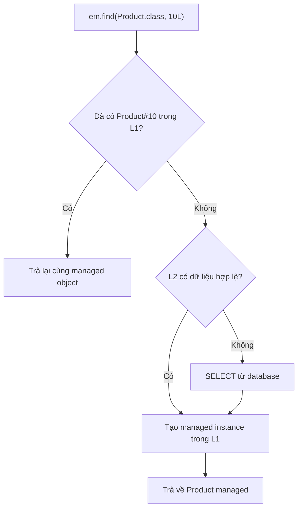

# Phân biệt làm mới, xóa khỏi context và làm rỗng bộ nhớ đệm cấp hai trong Hibernate

Trong Hibernate, một entity đã được tải có thể tiếp tục giữ **giá trị cũ** ngay cả khi bản ghi trong database đã bị cập nhật bởi một transaction khác, một câu native SQL hoặc một hệ thống bên ngoài. Người mới học thường thử gọi `refresh()`, `detach()`, `clear()` hoặc `evict()` để “xóa cache”. Tuy nhiên, bốn thao tác này **không tương đương**: chúng tác động lên những đối tượng và phạm vi khác nhau.

Cần tách bạch hai lớp lưu giữ trạng thái:

- **Persistence Context / first-level cache (L1):** gắn với một `EntityManager` hoặc Hibernate `Session` stateful; giữ các entity đang được quản lý (*managed entities*), danh tính đối tượng và dữ liệu phục vụ dirty checking.
- **Second-level cache (L2):** tùy chọn, thường được chia sẻ giữa nhiều session của cùng `SessionFactory`; lưu dữ liệu cache theo entity/collection và các chính sách đã cấu hình. L2 **không** biến entity của nhiều session thành cùng một Java object.

Quy tắc nhanh:

| Muốn làm gì? | API thường phù hợp | Phạm vi tác động |
| --- | --- | --- |
| Đọc lại trạng thái mới nhất *có thể nhìn thấy trong transaction* của một entity đang managed | `EntityManager.refresh(entity)` | Entity managed được chỉ định; có thể cascade nếu mapping yêu cầu |
| Ngừng quản lý một entity cụ thể trong session hiện tại | `EntityManager.detach(entity)` | Một entity trong L1; có thể cascade DETACH |
| Xóa toàn bộ các entity đang được quản lý khỏi Persistence Context hiện tại | `EntityManager.clear()` | Toàn bộ L1 của `EntityManager` đó |
| Xóa một bản ghi hoặc một vùng entity trong L2 | `EntityManagerFactory.getCache().evict(...)` | Cache cấp hai dùng chung |
| Xóa tất cả **entity** khỏi JPA L2 cache | `EntityManagerFactory.getCache().evictAll()` | Các entity L2 được provider quản lý |
| Xóa các vùng cache khác bằng API đặc thù Hibernate | `SessionFactory.getCache().evict...` | Vùng entity, collection, query cache tùy API |

**Điểm mấu chốt:** làm rỗng L2 không xóa entity đang nằm trong L1; ngược lại, `clear()` không làm rỗng L2. Còn `refresh()` chủ yếu là *làm mới giá trị của một entity managed*, chứ không phải “tắt toàn bộ cache”.

## 1. Bức tranh tổng thể: nơi một entity được lấy ra

Giả sử ứng dụng quản lý sản phẩm có bản ghi `Product#10`. Khi gọi `find(Product.class, 10L)` trong một Persistence Context, Hibernate có thể:

1. Kiểm tra xem entity đã có trong **L1** của session hiện tại chưa.
2. Nếu chưa, xem dữ liệu có thể lấy từ **L2** đã cấu hình hay không.
3. Nếu không có cache hit phù hợp, lấy dữ liệu từ **database**.
4. Tạo hoặc khôi phục một managed entity trong L1.



Đây là **mô hình khái niệm**. SQL thực tế còn phụ thuộc fetch plan, transaction, `CacheMode`, JPA cache hints, khóa, proxy và các quy tắc của provider.

### Ví dụ một entity

```java
import java.math.BigDecimal;

import jakarta.persistence.Entity;
import jakarta.persistence.Id;
import jakarta.persistence.Table;
import jakarta.persistence.Version;

@Entity
@Table(name = "products")
public class Product {

    @Id
    private Long id;

    private String name;

    private BigDecimal price;

    @Version
    private Long version;

    protected Product() {}

    public Long getId() { return id; }
    public String getName() { return name; }
    public BigDecimal getPrice() { return price; }
    public Long getVersion() { return version; }

    public void rename(String newName) {
        this.name = newName;
    }

    public void changePrice(BigDecimal newPrice) {
        this.price = newPrice;
    }
}
```

Giả sử database ban đầu chứa:

```sql
INSERT INTO products(id, name, price, version)
VALUES (10, 'Mechanical Keyboard', 100.00, 0);
```

Từ đây, chúng ta so sánh các thao tác khi dữ liệu của `Product#10` đổi.

## 2. L1 không phải L2: phạm vi và quyền sở hữu

Một `EntityManager` có Persistence Context riêng. Khi entity được tải, Hibernate giữ object cùng trạng thái đã đọc; những thay đổi của managed entity được phát hiện nhờ dirty checking.

```java
Product a = em.find(Product.class, 10L);
Product b = em.find(Product.class, 10L);

System.out.println(a == b); // true trong cùng Persistence Context.
```

Đây là **identity guarantee** của Persistence Context đối với cùng entity identity, không phải một đặc tính của L2. Dù L2 bị tắt, hai lần `find` trong cùng context thường vẫn trả về một tham chiếu Java.

Trong hai context độc lập:

```java
Product a = em1.find(Product.class, 10L);
Product b = em2.find(Product.class, 10L);

System.out.println(a == b); // Thường false.
```

Ngay cả khi cả hai tải dữ liệu từ L2, mỗi context vẫn có managed object của riêng mình.

| Đặc điểm | L1 / Persistence Context | L2 |
| --- | --- | --- |
| Phạm vi | Một `EntityManager` / `Session` | Thường một `EntityManagerFactory` / `SessionFactory` |
| Bật mặc định | Gắn liền với stateful context | Tùy cấu hình và provider/cache region |
| Chứa managed Java object | Có | Không được hiểu là cùng managed instance Java |
| Dirty checking | Có | Không |
| Đảm bảo cùng object khi tìm lại trong cùng context | Có | Không |
| Có thể giữ trạng thái cũ sau DB update bên ngoài | Có | Có thể |
| Xóa bằng `clear()` | Có | Không |
| Xóa bằng `Cache.evict()` của JPA | Không | Có |

Một số hệ thống còn có **query cache**, cache của Spring, Redis/CDN, cache trong trình duyệt hoặc cache do ứng dụng tự viết. Các cache ấy là những phạm vi khác nữa; thao tác xóa L1/L2 không mặc nhiên xóa chúng.

## 3. `refresh()`: làm mới một entity đang được quản lý

`EntityManager.refresh(entity)` yêu cầu provider **lấy lại trạng thái của entity từ database**, và **ghi đè trạng thái hiện tại** của managed entity bằng giá trị đã đọc.

```java
Product product = em.find(Product.class, 10L);

// Bản ghi có thể đã đổi ở một transaction khác.
em.refresh(product);

System.out.println(product.getName());
```

Điểm quan trọng:

- Đối tượng truyền vào cần là **managed entity** của context hiện hành.
- Hibernate làm mới **trạng thái entity đó**, không detach nó.
- Java reference vẫn là object managed đang được sử dụng.
- Những thay đổi trong bộ nhớ **chưa được lưu** trên entity được refresh có thể bị ghi đè.
- Thao tác refresh có thể lan sang association đã khai báo cascade `REFRESH` hoặc `ALL` theo mapping; không nhất thiết chỉ đúng một object trong mọi trường hợp.
- Kết quả quan sát phụ thuộc **transaction isolation** và commit của transaction khác.

### Ví dụ trạng thái cũ và `refresh`

Giả sử ứng dụng đã tải:

```java
Product p = em.find(Product.class, 10L);

// Ở thời điểm tải: p.name = "Mechanical Keyboard".
```

Một kết nối/transaction khác commit:

```sql
UPDATE products
SET name = 'Wireless Keyboard'
WHERE id = 10;
```

Trong `EntityManager` cũ:

```java
Product again = em.find(Product.class, 10L);

System.out.println(again == p); // true.
System.out.println(again.getName()); // Có thể vẫn là tên cũ từ L1.
```

Khi gọi:

```java
em.refresh(p);

System.out.println(p.getName());
// Có thể là "Wireless Keyboard" nếu transaction nhìn thấy
// cập nhật đã commit của kết nối khác.
```

`refresh` khác `detach` ở chỗ object `p` **tiếp tục managed**. Hibernate không yêu cầu tạo object mới sau refresh.

### Refresh có mất thay đổi chưa flush không?

**Có thể có, và đây là rủi ro cần nhớ.**

```java
Product p = em.find(Product.class, 10L);

p.rename("Tên sửa trên màn hình"); // Chưa flush.

em.refresh(p); // Đọc lại từ database, ghi đè trạng thái local.

System.out.println(p.getName()); // Không còn chắc là tên vừa sửa.
```

Nếu muốn giữ thay đổi, hãy xác định ý định nghiệp vụ trước khi refresh. `flush` các thay đổi cần giữ vào database trong transaction là một khả năng, nhưng `flush` có thể chạy SQL và sinh conflict; đồng thời **flush không phải commit**. Nếu thực ra muốn từ bỏ thay đổi local, `refresh` có thể đúng mục đích, nhưng không nên dùng bừa để “giải quyết cache”.

### Entity detached có refresh trực tiếp được không?

Theo mô hình JPA, `refresh` yêu cầu entity đang managed. Gọi `em.refresh(detachedEntity)` có thể ném `IllegalArgumentException`. Hãy tải một managed instance đúng context trước rồi làm mới instance đó nếu cần:

```java
Product managed = em.find(Product.class, detached.getId());
em.refresh(managed);
```

Không giả định object detached ban đầu cũng được đổi giá trị theo; nó là tham chiếu khác.

### Transaction isolation ảnh hưởng thế nào?

Lấy lại từ database không đồng nghĩa với “thấy mọi giá trị mới nhất ngoài hệ thống bất chấp transaction”.

Ở một transaction isolation dùng snapshot/repeatable-read, transaction hiện tại có thể vẫn quan sát snapshot cũ. Với READ COMMITTED, một truy vấn mới thường có thể thấy dữ liệu mà transaction khác đã commit trước thời điểm đọc, tùy DBMS.

Vì vậy, cần xác định:

- Transaction bên ngoài đã **commit** chưa?
- Transaction đang đọc sử dụng isolation level nào?
- Có lock hoặc version policy nào ảnh hưởng không?
- Có cơ chế routing đọc replica làm dữ liệu chưa đồng bộ không?

`refresh` không phải cách vượt qua mọi quy tắc nhất quán của database.

### Khi nào refresh phù hợp?

- Biết rõ một bản ghi vừa được **thay đổi bên ngoài Hibernate** và cần đồng bộ entity managed.
- Một stored procedure/trigger cập nhật cột mà ứng dụng muốn đọc lại.
- Một workflow có chủ ý muốn **bỏ thay đổi local** và lấy lại trạng thái database.
- Cần lấy giá trị mới cho một entity đang được giữ trong Persistence Context dài, đồng thời chấp nhận chi phí đọc lại và quy tắc transaction.

Nếu transaction có thể kết thúc rồi mở transaction mới/context mới, đôi khi việc không giữ entity managed lâu là cách thiết kế đơn giản hơn.

## 4. `detach()`: đưa một entity ra khỏi Persistence Context

`EntityManager.detach(entity)` làm entity **ngừng được quản lý** bởi context hiện tại. Object Java vẫn tồn tại, dữ liệu của nó vẫn ở bộ nhớ Java, nhưng Hibernate không còn theo dõi thay đổi đối với object đó trong context này.

```java
Product p = em.find(Product.class, 10L);

System.out.println(em.contains(p)); // true.

em.detach(p);

System.out.println(em.contains(p)); // false.

p.rename("Tên chỉ thay đổi trên detached object");
```

Thay đổi sau `detach` không tự động được đồng bộ bằng dirty checking của context đã detach nó.

### Phạm vi của detach

- Chủ yếu tác động tới **một entity** trong L1 hiện tại.
- Không làm rỗng toàn bộ L1.
- Không tự xóa bản ghi database.
- Không tự xóa L2 cache.
- Có thể cascade sang các entity liên quan nếu mapping khai báo `CascadeType.DETACH` hoặc `ALL`; phạm vi thực tế cần xem association mapping.

### Có phải detach là “xóa entity khỏi database”?

**Không.** Hai khái niệm thường bị nhầm:

```java
em.detach(p); // Ngừng theo dõi object p trong context.

em.remove(p); // Lập lịch xóa bản ghi entity theo lifecycle JPA.
```

`remove` có ngữ nghĩa xóa dữ liệu persistence và có thể dẫn tới `DELETE` khi flush. `detach` chỉ tách object khỏi context, không phải câu lệnh xóa row.

### Thay đổi chưa flush có thể bị mất

```java
Product p = em.find(Product.class, 10L);

p.rename("Local draft");
em.detach(p); // Thay đổi chưa flush không còn được context theo dõi.
```

Nếu trước detach chưa flush, thay đổi đó thường **không được persistence context đồng bộ tiếp** sau khi detach.

Tuy nhiên, nếu trước đó Hibernate đã flush một `UPDATE` xuống database trong cùng transaction, `detach` không tự đảo ngược SQL đã chạy. Muốn bỏ một thay đổi đã flush có thể cần **rollback transaction** hoặc một thao tác khôi phục dữ liệu hợp lệ, không phải detach.

### Khi nào detach hữu ích?

- Muốn bỏ quản lý **một entity** mà vẫn giữ các entity khác trong context.
- Cần xử lý một object như DTO/snapshot tạm, không muốn sửa tiếp làm dirty checking.
- Muốn giảm số entity đang managed trong một transaction dài mà không clear toàn bộ.
- Cần chủ động tách object trước khi truyền qua một ranh giới vòng đời, với hiểu biết rằng lazy associations chưa khởi tạo có thể không tải được sau đó.

Nhưng detach không tự làm object thành deep copy hoặc dữ liệu “đóng băng”; mã Java vẫn có thể sửa field và collection. Nếu cần một snapshot bất biến để gửi ra API, DTO/value object riêng thường phù hợp hơn.

## 5. `clear()`: làm rỗng toàn bộ Persistence Context hiện tại

`EntityManager.clear()` **detach toàn bộ entity đang managed** trong context hiện tại.

```java
Product p1 = em.find(Product.class, 10L);
Product p2 = em.find(Product.class, 11L);

System.out.println(em.contains(p1)); // true.
System.out.println(em.contains(p2)); // true.

em.clear();

System.out.println(em.contains(p1)); // false.
System.out.println(em.contains(p2)); // false.
```

Nói ngắn gọn: `clear()` **xóa các entry khỏi L1**, chứ không xóa dữ liệu ở DB và cũng không làm rỗng L2.

### So sánh detach và clear

| Thao tác | Entity nào thôi được quản lý? | Các entity khác trong context |
| --- | --- | --- |
| `detach(p1)` | `p1`, cộng cascade nếu có | Vẫn managed |
| `clear()` | Toàn bộ managed entities | Không còn managed trong context này |

### Sau clear, gọi find có được object mới không?

```java
Product before = em.find(Product.class, 10L);

em.clear();

Product after = em.find(Product.class, 10L);

System.out.println(before == after); // Thường false.
```

Lần `find` sau phải khôi phục một managed instance mới cho context. Nhưng dữ liệu có thể đến từ **L2** nếu L2 được bật và entry còn hợp lệ, không nhất thiết truy vấn database.

Vì vậy, **clear không đảm bảo đọc dữ liệu trực tiếp từ DB**.

### Nguy cơ lớn: thay đổi chưa flush bị bỏ

```java
Product p = em.find(Product.class, 10L);

p.changePrice(new BigDecimal("120.00"));

em.clear(); // Bỏ quản lý p và thay đổi còn đang pending ở L1.
```

Nếu chưa flush trước đó, thay đổi giá thường không được lưu khi commit; trạng thái `p` chỉ còn là detached object ở bộ nhớ Java.

Mẫu phổ biến trong batch processing:

```java
for (int i = 0; i < products.size(); i++) {
    Product product = products.get(i);
    em.persist(product);

    if ((i + 1) % 50 == 0) {
        em.flush(); // Gửi các thay đổi đang chờ xuống DB.
        em.clear(); // Giải phóng context khỏi entity managed.
    }
}

em.flush();
em.clear();
```

Ví dụ giả định các `Product` là entity mới, mapping/generator phù hợp và transaction đã được mở bởi tầng điều phối. `flush` không commit; transaction vẫn có thể rollback. Mục tiêu của `clear` trong batch là giảm kích thước L1, không phải xóa L2.

### Clear không phải rollback

Hãy tách ba câu hỏi:

- **Muốn bỏ dữ liệu chưa flush trong L1?** `clear` có thể khiến các thay đổi pending không còn được theo dõi, nhưng đây không phải cơ chế khôi phục transaction an toàn cho mọi trường hợp.
- **Muốn hủy toàn bộ giao dịch?** Dùng `rollback` theo transaction manager.
- **Muốn lấy lại dữ liệu database?** Dùng `refresh` với managed entity hoặc một cách tải lại phù hợp.

Nếu đã flush `DELETE` hoặc `UPDATE`, `clear` không hoàn tác câu SQL đó. Transaction vẫn có thể commit thay đổi đã flush.

## 6. `Cache.evict()`: làm rỗng một phần cache cấp hai

Trong JPA, `EntityManagerFactory.getCache()` trả về giao diện `jakarta.persistence.Cache` để quản lý cache cấp hai của các entity được cache theo provider.

Ví dụ:

```java
EntityManagerFactory emf = em.getEntityManagerFactory();

// Xóa entry L2 cho Product có primary key 10.
emf.getCache().evict(Product.class, 10L);

// Xóa tất cả entry L2 của entity Product.
emf.getCache().evict(Product.class);

// Xóa toàn bộ entity data trong JPA L2 cache.
emf.getCache().evictAll();
```

Đây là các thao tác trên **cache dùng chung**, không phải trên một `EntityManager` cụ thể.

### Evict entry L2 không làm detached entity hiện tại

Giả sử:

```java
Product p = em.find(Product.class, 10L);

// Object p hiện managed trong L1 của em.
emf.getCache().evict(Product.class, 10L);

System.out.println(em.contains(p)); // Vẫn true.
```

Nếu sau đó gọi:

```java
Product again = em.find(Product.class, 10L);
System.out.println(again == p); // true.
```

Hibernate có thể trả từ L1, dù entry L2 đã bị evict. Vì vậy, nếu mục tiêu là buộc **context hiện tại** đọc lại dữ liệu, evict L2 **một mình** không đủ.

### Evict L2 không xóa row trong database

```java
emf.getCache().evict(Product.class, 10L);
```

Lệnh này không có ý nghĩa `DELETE FROM products WHERE id=10`. Nó chỉ loại bỏ dữ liệu cached tương ứng, để lượt tải sau có thể phải tìm dữ liệu từ nguồn khác.

Ngay cả sau evict, một query từ context khác cũng có thể nạp và đưa dữ liệu trở lại cache. Eviction không phải việc khóa cache vĩnh viễn hoặc bảo đảm một entry không được tái tạo.

### Evict có hữu ích nếu L2 chưa được bật không?

Khi không cấu hình L2, thao tác evict có thể không có tác động đáng kể vì không có entry để xóa. L1 vẫn hoạt động bình thường. Vì vậy, không cần thêm lời gọi evict trong mọi service chỉ để “đảm bảo dữ liệu mới”.

### Thao tác nào xóa một key, một entity type, tất cả?

| JPA API | Phạm vi |
| --- | --- |
| `cache.evict(Product.class, id)` | Entry L2 cho entity type/key cụ thể |
| `cache.evict(Product.class)` | Các entry L2 của entity type đó |
| `cache.evictAll()` | Các entity L2 do JPA Cache quản lý |
| `cache.contains(Product.class, id)` | Kiểm tra thông tin entry L2 theo API/provider |

`Cache.contains(...)` kiểm tra cache cấp hai, **không** thay `em.contains(entity)`. Hai tên method giống nhau về ý tưởng “contains” nhưng đối tượng được hỏi hoàn toàn khác nhau.

## 7. Hibernate native API: `Session.evict` và `SessionFactory.getCache()`

Ngoài JPA, Hibernate có API native.

### `Session.evict(entity)` tác động lên L1

```java
Session session = entityManager.unwrap(Session.class);

Product p = session.get(Product.class, 10L);

session.evict(p); // Tương tự detach khỏi Session.
```

Trong Hibernate, tên `evict` xuất hiện ở hai phạm vi:

- **`Session.evict(entity)`:** đưa entity ra khỏi **Persistence Context của session**.
- **`SessionFactory.getCache().evictEntityData(...)`:** loại entry khỏi **second-level cache** của factory.

Chữ `evict` giống nhau, nhưng **đối tượng nhận lệnh** mới quyết định cache nào bị tác động.

### Hibernate Cache API và các vùng khác

Một số API thường gặp trong Hibernate hiện đại:

```java
SessionFactory sessionFactory = // do ứng dụng/container sở hữu
    obtainSessionFactory();

org.hibernate.Cache cache = sessionFactory.getCache();

// Xóa một entity entry trong L2.
cache.evictEntityData(Product.class, 10L);

// Xóa vùng entity cache cho Product.
cache.evictEntityData(Product.class);

// Xóa dữ liệu collection cache thuộc role cụ thể, nếu có.
cache.evictCollectionData("com.example.Product.tags");

// Xóa các vùng query cache, nếu bật và API/provider hỗ trợ.
cache.evictQueryRegions();

// Xóa tất cả vùng cache được API Hibernate quản lý.
cache.evictAllRegions();
```

Tên collection role `"com.example.Product.tags"` chỉ là minh họa; trong dự án thực phải dùng **role mapping chính xác**. Các method và hành vi quản lý cache region có thể thay đổi theo phiên bản Hibernate và provider cache. Đừng viết lệnh xóa toàn bộ region nếu chỉ một entry entity bị ảnh hưởng.

### Vì sao JPA `evictAll()` và Hibernate `evictAllRegions()` không nên coi là đồng nghĩa?

Theo API JPA, `Cache.evictAll()` nói về **các entity** trong second-level cache. Hibernate có thêm các loại region như collection cache và query cache tùy cấu hình, với API riêng để evict.

Một lời gọi mang tên “all” không nhất thiết có cùng phạm vi khi nó thuộc **hai API khác nhau**. Nếu cần loại entry trong query cache hoặc collection cache, xác định chính xác loại cache và API Hibernate/provider tương ứng.

## 8. Bảng đối chiếu đầy đủ các thao tác

| API | Có đọc database ngay không? | Thay đổi trạng thái entity Java? | Ảnh hưởng L1? | Ảnh hưởng L2? |
| --- | --- | --- | --- | --- |
| `em.refresh(p)` | Thường có, để lấy trạng thái | Có: ghi đè state của managed `p` | Cập nhật trạng thái entity trong context | Không phải lệnh evict toàn L2; xử lý entry tùy provider |
| `em.detach(p)` | Không vì mục đích detach | Không tự sửa field | Bỏ quản lý `p` và cascade nếu có | Không |
| `em.clear()` | Không vì mục đích clear | Không tự sửa field; object trở thành detached | Loại toàn bộ managed entities | Không |
| `session.evict(p)` | Không vì mục đích evict | Không tự sửa field | Bỏ quản lý `p` trong session | Không |
| `emf.getCache().evict(Product.class,id)` | Không | Không | Không | Xóa entry entity L2 tương ứng |
| `emf.getCache().evict(Product.class)` | Không | Không | Không | Xóa dữ liệu entity type khỏi L2 |
| `emf.getCache().evictAll()` | Không | Không | Không | Xóa entity L2 theo JPA Cache API |
| `sessionFactory.getCache().evictAllRegions()` | Không | Không | Không | Xóa các vùng cache mà Hibernate API quản lý |
| `em.flush()` | Có thể gửi INSERT/UPDATE/DELETE, không phải một phép read bắt buộc | Không tự detach | Giữ managed state, đồng bộ pending SQL | Có thể cập nhật/invalidate cache theo cơ chế ghi |
| `em.remove(p)` | Có thể dẫn tới DELETE khi flush | Entity chuyển trạng thái removed | Có | Có thể làm invalidation cache theo quy tắc ORM |

Cụm “thường có” của `refresh` cần hiểu cùng transaction isolation và fetching. Bảng diễn đạt **mục đích và phạm vi chính của từng API**, không khẳng định số SQL chính xác cho mọi Hibernate version/cache provider.

## 9. Tình huống A: transaction khác đã cập nhật database

Giả sử hai request độc lập đọc `Product#10`:

```text
T0: Database name = "Old"
T1: Request A mở EM-A, find Product#10 -> "Old" ở L1-A
T2: Request B mở EM-B, sửa name = "New", commit
T3: Request A gọi find lại Product#10
    -> thường vẫn "Old" từ L1-A
T4: Request A cần dữ liệu mới
```

Tại T4:

- Gọi `emA.refresh(productA)`: hợp lý nếu muốn đọc lại trạng thái của **managed productA**, và isolation cho phép thấy cập nhật mới.
- Gọi `emA.detach(productA)` rồi `emA.find(...)`: có thể tạo managed instance mới, nhưng **L2 có thể vẫn chứa dữ liệu cũ** nếu invalidation không được quản lý đúng.
- Gọi `emA.clear()` rồi `emA.find(...)`: cũng có khả năng đọc từ L2, không mặc nhiên đi thẳng tới DB.
- Gọi `emf.getCache().evict(Product.class, 10L)` mà không xử lý L1-A: `emA.find(...)` vẫn có thể trả `productA` cũ từ L1.
- Khi cập nhật do chính Hibernate thực hiện và cache provider được cấu hình đúng, hệ thống có thể tự cập nhật/invalidate L2 theo cache concurrency strategy; không nên evict thủ công như một phản xạ cho mọi transaction.

**Kết luận tình huống:** nếu mục tiêu là làm mới **object hiện đang managed**, `refresh` biểu đạt ý định rõ ràng nhất.

## 10. Tình huống B: một job JDBC ngoài Hibernate cập nhật bảng

Giả sử dịch vụ dùng cùng database nhưng có một batch job ghi SQL trực tiếp:

```sql
UPDATE products
SET price = 125.00
WHERE id = 10;
```

Nếu Hibernate đang giữ bản ghi ở L1 hoặc L2 mà không biết về thay đổi ngoài ORM, ứng dụng có thể tiếp tục đọc dữ liệu cũ.

Một kế hoạch cần cân nhắc:

1. Đảm bảo transaction của job đã commit.
2. Nếu có cached entry L2 có thể stale, **evict entry/region liên quan** theo chính sách của ứng dụng/cache provider.
3. Với các entity **đang managed** ở những context cần sử dụng tiếp, làm mới chúng bằng `refresh` hoặc kết thúc context cũ và mở unit of work mới phù hợp.
4. Đánh giá transaction isolation; ngay cả refresh cũng có thể thấy snapshot cũ.
5. Nếu job ảnh hưởng nhiều hàng, tránh vòng lặp evict/refresh thiếu kiểm soát; xác định phạm vi cache, số lượng entry và chi phí.
6. Nếu môi trường có nhiều application instance với cache riêng, cần cơ chế invalidation đồng bộ giữa các instance hoặc cache provider hỗ trợ clustering.

Ví dụ yêu cầu làm mới một entity:

```java
EntityManagerFactory emf = em.getEntityManagerFactory();

// Nếu SQL ngoài Hibernate vừa thay đổi Product#10:
emf.getCache().evict(Product.class, 10L);

// Đối với entity đã managed trong EM hiện tại:
Product managed = em.find(Product.class, 10L);
em.refresh(managed);
```

Đây là ví dụ về ý nghĩa hai bước; nó **không phải công thức luôn bắt buộc**. Nếu chỉ cần current managed entity mới, `refresh` thường đủ cho ý định đọc lại; nếu những session mở sau cũng không được gặp entry L2 stale do writer ngoài Hibernate, eviction bổ sung có ý nghĩa.

### Vì sao thứ tự thao tác cần được hiểu?

Evict entry L2 không hủy giá trị đã có trong L1. Nếu làm `clear()` trước nhưng L2 chưa bị invalidate, `find()` sau đó có thể dùng lại L2 stale. Nếu làm evict L2 rồi không xử lý L1, `find()` trong context cũ cũng có thể cũ.

Hai cache cần được xử lý theo **đúng phạm vi cần đồng bộ**, không đơn thuần “xóa cache hết là xong”.

## 11. Tình huống C: dùng JPQL bulk UPDATE hoặc DELETE

JPQL bulk DML thực hiện thao tác trên database mà không cập nhật từng object managed như một lần sửa field bình thường.

Ví dụ:

```java
Product p = em.find(Product.class, 10L);

int updated = em.createQuery(
        "update Product p set p.price = :newPrice " +
        "where p.id = :id")
    .setParameter("newPrice", new BigDecimal("150.00"))
    .setParameter("id", 10L)
    .executeUpdate();

// p đang managed có thể vẫn giữ giá cũ.
```

Sau bulk UPDATE, các entity đã managed có thể **không tự đồng bộ** trạng thái. Vì vậy:

- Nếu chỉ cần đồng bộ `p`, có thể `em.refresh(p)`.
- Nếu transaction tiếp theo cần context mới, có thể `flush` thay đổi thích hợp rồi `clear` hoặc kết thúc transaction/context.
- Với các query bulk lớn, nên có chiến lược invalidate cache thích hợp. Hibernate có thể thực hiện các bước invalidation cho cache do ORM quản lý trong một số loại bulk HQL, nhưng **không được suy ra mọi đường DML hoặc native SQL đều được xử lý như nhau**.
- Nếu đang có thay đổi chưa flush ở entity khác, `clear` có thể làm mất thay đổi; xác định ý định trước khi gọi.

### Spring Data JPA và `@Modifying`

Spring Data JPA hỗ trợ các tùy chọn liên quan bulk operation, ví dụ:

```java
@Modifying(
    flushAutomatically = true,
    clearAutomatically = true
)
@Query(
    "update Product p set p.price = :price where p.id = :id"
)
int updatePrice(
    @Param("id") Long id,
    @Param("price") BigDecimal price
);
```

`flushAutomatically` yêu cầu flush context trước khi thực thi modifying query; `clearAutomatically` clear context sau. Chúng giúp tránh giữ managed entities stale trong một số workflow, nhưng **clear không làm rỗng L2** và có thể khiến các đối tượng đang dùng trở thành detached.

Đây là tính năng **Spring Data JPA**, không phải thuộc tính của `EntityManager.refresh()` hay Hibernate cache API. Cần cân nhắc transaction boundaries trước khi dùng.

## 12. Tình huống D: batch processing làm Persistence Context quá lớn

Một tiến trình import 100.000 bản ghi bằng một `EntityManager` có thể khiến L1 giữ nhiều managed entity, tiêu tốn bộ nhớ và làm dirty checking nặng hơn.

Cách dùng `flush()/clear()`:

```java
@Transactional
public void importProducts(List<Product> items) {
    for (int i = 0; i < items.size(); i++) {
        em.persist(items.get(i));

        if ((i + 1) % 100 == 0) {
            em.flush();
            em.clear();
        }
    }

    em.flush();
    em.clear();
}
```

Điều này:

- Không yêu cầu tắt hoặc xóa L2.
- Không chủ định đọc lại các entity từ database.
- Giải phóng managed state trong L1 sau từng đợt.
- Không commit từng đợt nếu toàn bộ method vẫn nằm trong một transaction.
- Cần cân nhắc generator ID, cascade, lỗi giữa batch và việc không dùng tiếp những object đã detached mà tưởng vẫn managed.

Nếu ứng dụng không cần managed state khi nhập nhiều dữ liệu, có thể cân nhắc JDBC batching hoặc Hibernate `StatelessSession` theo nhu cầu, nhưng đó là lựa chọn thiết kế rộng hơn và có các đánh đổi về lifecycle/cascade/dirty checking.

## 13. Tình huống E: chỉ muốn bỏ thay đổi local của một entity

Giả sử user mở màn hình chỉnh sửa sản phẩm, thực hiện thay đổi rồi nhấn “Hủy”.

Có hai phạm vi cần phân biệt.

### Hủy thay đổi chưa flush trong cùng managed entity

```java
Product p = em.find(Product.class, 10L);

p.rename("Bản nháp chưa lưu");

// Người dùng hủy sửa; muốn quay lại trạng thái DB.
em.refresh(p);
```

Khi refresh, giá trị local chưa được lưu bị ghi đè. Cần biết dữ liệu ở database hiện tại có thể đã đổi bởi transaction khác, vì “hủy local” đôi khi mong muốn quay về snapshot ban đầu chứ không nhất thiết phiên bản mới nhất.

### Chỉ ngừng theo dõi một object

```java
Product p = em.find(Product.class, 10L);
em.detach(p);

p.rename("Chỉ sửa detached object");
```

Thay đổi sau detach không tự flush. Nhưng `p` vẫn mang những dữ liệu cũ đang có; detach không tự khôi phục field về giá trị database.

**Không dùng detach thay cho refresh** nếu mục tiêu là “lấy lại giá trị DB”.

### Không thay thế rollback

Nếu trong cùng transaction đã flush những thay đổi khác, refresh một entity hoặc clear context không có nghĩa toàn transaction được hoàn tác. Khi cần hủy transaction, dùng rollback qua transaction manager.

## 14. Tình huống F: muốn giải phóng RAM của một Session dài

Nếu chỉ một entity lớn không còn cần theo dõi:

```java
Product p = em.find(Product.class, 10L);

// Xử lý xong và không muốn theo dõi p nữa.
em.detach(p);
```

Nếu toàn bộ đợt xử lý xong và chuẩn bị tải đợt khác:

```java
em.flush(); // Chỉ khi có thay đổi cần đồng bộ.
em.clear();
```

Nếu chỉ muốn làm giảm footprint của một context dài, **không có lý do mặc định để gọi `emf.getCache().evictAll()`**; việc xóa L2 có thể gây nhiều cache miss cho các request khác và làm hiệu năng toàn ứng dụng xấu đi.

Ngược lại, nếu sử dụng service/container quản lý transaction theo request, kết thúc đơn vị công việc và đóng EntityManager/Session đúng lúc thường đơn giản hơn giữ một context dài rồi liên tục detach/clear.

## 15. Cấp độ cache và đối tượng bị ảnh hưởng

Hãy giả sử một ứng dụng có hai request đang hoạt động:

```text
EntityManager A (L1-A):
    Product#10 (name = Old)
    Product#11 (name = Other)

EntityManager B (L1-B):
    Product#10 (name = Old)

SessionFactory (L2 chung):
    Product#10 -> Old
    Product#11 -> Other

Database:
    Product#10 -> New
    Product#11 -> Other
```

Phạm vi sau mỗi thao tác:

### `emA.refresh(product10A)`

- Làm mới trạng thái `product10A` dựa trên DB mà transaction A nhìn thấy.
- `product11A` vẫn managed như trước.
- `product10B` ở L1-B không tự bị viết lại chỉ vì A refresh.
- L2 có thể được provider xử lý theo cơ chế của nó; không nên suy ra A đã evict mọi region.

### `emA.detach(product10A)`

- `product10A` trở thành detached.
- `product11A` vẫn managed.
- `product10B` vẫn managed trong B.
- L2 không bị xóa.

### `emA.clear()`

- `product10A` và `product11A` đều detached.
- L1-B không bị ảnh hưởng.
- L2 không bị xóa.

### `emf.getCache().evict(Product.class, 10L)`

- Entry L2 cho Product#10 bị loại.
- `product10A` và `product10B` đang managed **không bị detach**.
- L1-A và L1-B có thể tiếp tục trả các object cũ.
- `Product#11` không phải mục tiêu của lệnh evict key 10.

### `emf.getCache().evictAll()`

- Các entry entity trong JPA L2 bị evict theo provider.
- L1-A và L1-B vẫn giữ managed entities.
- Dữ liệu database không bị xóa.
- Những request sau có thể phải nạp lại dữ liệu vào L2.

Đây là lý do nói “tôi đã clear cache rồi” là thiếu thông tin. Hãy chỉ rõ **cache nào, session nào, entity nào, và dữ liệu nào cần được làm mới**.

## 16. Cấu hình L2: không phải entity nào cũng được cache

L2 không mặc định hoạt động cho mọi entity chỉ vì Hibernate tồn tại. Nó cần:

- Cấu hình provider/vùng cache phù hợp.
- Chính sách cache concurrency thích hợp.
- Entity/collection được khai báo tham gia cache theo cấu hình và shared-cache mode.
- Cách invalidation tương thích với luồng cập nhật dữ liệu.

Ví dụ khái niệm với JPA/Hibernate:

```java
import jakarta.persistence.Cacheable;
import jakarta.persistence.Entity;
import jakarta.persistence.Id;

@Entity
@Cacheable
@org.hibernate.annotations.Cache(
    usage = org.hibernate.annotations.CacheConcurrencyStrategy.READ_WRITE
)
public class CachedProduct {

    @Id
    private Long id;

    private String name;
}
```

`@Cacheable` là annotation JPA, còn `org.hibernate.annotations.Cache` là cấu hình riêng của Hibernate. Ví dụ này **không tự hoàn thành cấu hình cache**: cần provider cache được kết nối và cài đặt thực tế phù hợp phiên bản Hibernate và dependency của dự án.

Các concurrency strategy thường có lựa chọn như read-only, read-write hoặc các chính sách khác tùy provider. Chọn sai chiến lược có thể gây stale reads, lỗi khi sửa entity hoặc hiệu năng kém.

Nếu một entity không được đưa vào L2, gọi `cache.evict(Entity.class, id)` không tạo ra lợi ích thực tế.

### L2 và mô hình đa tenant

Với multi-tenancy, cache key và cơ chế invalidation phải phân biệt tenant đúng theo mapping. Entity ID số 10 ở tenant A không được nhầm với ID 10 ở tenant B khi chúng thuộc các namespace khác nhau.

Nếu ứng dụng tự xây cache bên ngoài Hibernate, phải thiết kế key đầy đủ `(tenantId, entityType, id)` khi ID chỉ duy nhất trong tenant. Lời gọi xóa L2 của Hibernate không tự xóa Redis key do một service khác quản lý.

## 17. Query cache và collection cache là những lớp khác

Hibernate có thể lưu:

- **Entity cache:** dữ liệu entity theo khóa chính.
- **Collection cache:** các entry liên quan tới collection role của entity.
- **Query cache:** kết quả hoặc danh tính kết quả của một truy vấn đã đánh dấu cacheable.
- **Natural-id cache:** phép ánh xạ natural key sang primary key khi được cấu hình.
- **Cache riêng của ứng dụng:** ngoài Hibernate.

Chúng không đồng nghĩa. Ví dụ xóa một entity entry:

```java
emf.getCache().evict(Product.class, 10L);
```

không nên được mô tả là “đã xóa tất cả kết quả mọi query liên quan đến Product”. Provider có thể invalidate query cache theo những quy tắc riêng, nhưng phạm vi API gọi là **entity entry**.

Nếu vấn đề nằm ở kết quả query cacheable, cần xem cấu hình query cache và chính sách invalidation tương ứng, ví dụ Hibernate API:

```java
sessionFactory.getCache().evictQueryRegions();
```

Nếu vấn đề nằm ở một cached collection như `Order.lines`, cần xem cache của collection role phù hợp, không chỉ entry của `Order`.

**Khuyến nghị:** trước khi evict rộng, xác định thật sự dữ liệu stale đến từ L1, L2 entity region, collection cache, query cache hay một lớp cache ngoài Hibernate.

## 18. JPA Cache và cache hints: yêu cầu theo từng truy cập

Không phải mọi thao tác muốn dữ liệu mới đều cần evict toàn L2. JPA hỗ trợ các chính sách retrieve/store cache cho những query hoặc `find` cụ thể qua hints, tùy provider.

Ví dụ:

```java
import java.util.Map;
import jakarta.persistence.CacheRetrieveMode;
import jakarta.persistence.CacheStoreMode;

Map<String, Object> hints = Map.of(
    "jakarta.persistence.cache.retrieveMode",
    CacheRetrieveMode.BYPASS,
    "jakarta.persistence.cache.storeMode",
    CacheStoreMode.REFRESH
);

Product p = em.find(Product.class, 10L, hints);
```

Đây là API Jakarta Persistence hiện đại; ứng dụng dùng namespace `javax.persistence` cũ có tên hint tương ứng theo phiên bản.

Ý nghĩa chung:

- `CacheRetrieveMode.BYPASS`: yêu cầu không lấy kết quả từ L2 cho lượt truy cập thích hợp.
- `CacheStoreMode.REFRESH`: yêu cầu làm mới dữ liệu L2 theo quy tắc provider.

Nhưng một lưu ý rất quan trọng: **nếu entity đã managed trong L1**, `find` có thể trả lại chính instance từ L1; cache hints không phải là lệnh detach/clear/refresh entity đang được quản lý. Muốn làm mới managed object, `refresh` diễn đạt ý định rõ hơn.

Cache hints cũng không bảo đảm vượt qua isolation của database. Chúng giúp kiểm soát **cách provider dùng L2 trong truy cập**, không thay thế quản lý transaction.

## 19. Spring: EntityManager proxy và transaction boundaries

Trong Spring Data JPA hoặc Spring Boot, service thường là singleton nhưng `EntityManager` được tiêm qua `@PersistenceContext` thường là một **proxy định tuyến đến persistence context gắn với giao dịch hiện tại**.

Ví dụ:

```java
import jakarta.persistence.EntityManager;
import jakarta.persistence.EntityManagerFactory;
import jakarta.persistence.PersistenceContext;
import org.springframework.stereotype.Service;
import org.springframework.transaction.annotation.Transactional;

@Service
public class ProductService {

    @PersistenceContext
    private EntityManager em;

    private final EntityManagerFactory emf;

    public ProductService(EntityManagerFactory emf) {
        this.emf = emf;
    }

    @Transactional
    public void refreshProduct(Long id) {
        Product p = em.find(Product.class, id);
        if (p != null) {
            em.refresh(p);
        }
    }

    @Transactional
    public void stopTrackingProduct(Long id) {
        Product p = em.find(Product.class, id);
        if (p != null) {
            em.detach(p);
        }
    }

    @Transactional
    public void clearCurrentContext() {
        em.flush(); // Chỉ nếu muốn giữ những thay đổi đang chờ.
        em.clear();
    }

    public void evictProductFromL2(Long id) {
        emf.getCache().evict(Product.class, id);
    }
}
```

Đọc code theo phạm vi:

- `refreshProduct` tác động entity được quản lý trong transaction hiện tại.
- `stopTrackingProduct` chỉ detach entity của context transaction đó.
- `clearCurrentContext` xóa L1 transaction hiện tại; method có thể ảnh hưởng tất cả entity managed của cùng unit of work.
- `evictProductFromL2` dùng `EntityManagerFactory`, tác động tới cache chia sẻ; nó không cần một `EntityManager` cụ thể.

Cẩn trọng khi gọi `clear()` trong service có nhiều repository cùng dùng transaction: các entity đã được nạp bởi repository trước đó cũng có thể trở thành detached. Không nên thêm `clear()` bên trong helper như một hành vi ẩn khiến caller mất managed state.

### `@Transactional(readOnly = true)` có ngăn refresh không?

Không nên dùng nhận định đơn giản rằng annotation read-only luôn cấm hoặc luôn cho phép mọi thao tác. Spring có thể thiết lập flush mode hoặc hint read-only khác nhau theo provider. `refresh` vẫn có chi phí và semantics riêng, còn transaction database có thể được cấu hình read-only ở tầng JDBC. Xác định chính sách dữ liệu mới/transaction rõ ràng trước khi gọi API.

### Open EntityManager in View

Một ứng dụng có thể cấu hình mở persistence context xuyên qua phần xử lý web view. Điều này mở rộng vòng đời L1; có thể khiến dữ liệu đã tải tiếp tục nằm trong L1 ở phần còn lại của request.

Không nên dựa vào `refresh`/`clear` để “chữa” mọi vấn đề của một context sống quá lâu. Thường cần xem lại ranh giới transaction và kiến trúc tải DTO.

## 20. Một thực nghiệm có ba lớp: L1, L2 và database

Giả sử L2 đã bật đúng cho `Product`, dữ liệu DB ban đầu:

```text
Product#10.name = "Before"
```

Trong `EntityManager A`:

```java
Product p = emA.find(Product.class, 10L);
// p.getName() == "Before"
```

Một job độc lập commit:

```sql
UPDATE products
SET name = 'After'
WHERE id = 10;
```

Kịch bản quan sát:

| Thao tác trên EM-A / cache | Kết quả cần hiểu |
| --- | --- |
| `emA.find(Product.class,10L)` lại | Thường lấy cùng `p` trong L1, có thể vẫn `Before` |
| `emf.getCache().evict(Product.class,10L)` | Evict L2, nhưng `p` trong L1 vẫn có thể `Before` |
| `emA.refresh(p)` | Làm mới `p` theo giá trị DB transaction nhìn thấy, có thể thành `After` |
| `emA.detach(p)` | `p` không còn managed, nhưng field của `p` không tự đổi |
| `emA.clear()` | L1-A rỗng; object `p` detached |
| `emA.find(Product.class,10L)` sau clear | Lấy managed instance mới; có thể dùng L2 nếu entry còn |
| `emf.getCache().evictAll()` | Loại entity L2; không sửa object hiện tại của EM-A hoặc EM-B |

Để quan sát rõ đường đọc thực sự, có thể kết hợp:

- Log SQL Hibernate.
- Kiểm tra đối tượng managed bằng `em.contains(p)`.
- Kiểm tra cache cấp hai bằng `emf.getCache().contains(Product.class,10L)` theo hỗ trợ provider.
- Tạo hai transaction với commit rõ ràng.
- Đọc native SQL ở transaction mới khi cần xác nhận giá trị vật lý trong DB.

Kết quả cache có thể khác theo concurrency strategy và provider; mục đích của bài thực nghiệm là phân biệt phạm vi, không khẳng định một chuỗi SQL cố định.

## 21. Ví dụ mã minh họa sự khác biệt của L1

Một đoạn đơn giản không cần bật L2:

```java
@Transactional
public void demonstrateFirstLevelCache(Long id) {
    Product first = em.find(Product.class, id);
    if (first == null) {
        return;
    }

    Product second = em.find(Product.class, id);
    System.out.println(first == second); // true.

    em.detach(first);
    System.out.println(em.contains(first)); // false.

    Product third = em.find(Product.class, id);
    System.out.println(first == third); // Thường false.

    em.clear();
    System.out.println(em.contains(third)); // false.
}
```

Điểm thấy được:

1. `find` hai lần trong cùng L1 dùng cùng managed instance.
2. `detach(first)` chỉ bỏ `first` khỏi L1.
3. `find` tiếp theo có thể tạo managed instance mới, nhưng vẫn lấy dữ liệu từ L2 hoặc DB theo cấu hình.
4. `clear` bỏ tất cả managed entries.

Không có bước nào ở đây yêu cầu xóa L2.

## 22. So sánh với `close()`, `remove()`, `flush()` và `rollback()`

Các API khác cũng dễ bị gộp chung vào “quản lý trạng thái”.

| API | Câu hỏi nó giải quyết |
| --- | --- |
| `refresh(p)` | Làm mới trạng thái một managed entity từ DB |
| `detach(p)` | Ngừng theo dõi một entity cụ thể |
| `clear()` | Ngừng theo dõi tất cả managed entities trong context |
| `close()` | Kết thúc vòng đời EntityManager/Session theo quyền sở hữu |
| `remove(p)` | Đánh dấu entity managed để xóa khỏi persistence khi flush/commit |
| `flush()` | Đồng bộ thay đổi pending xuống DB trong transaction |
| `rollback()` | Hủy transaction theo cơ chế DB/transaction manager |
| `emf.getCache().evict(...)` | Loại dữ liệu khỏi L2, không xóa entity DB |
| `emf.getCache().evictAll()` | Loại entity entries khỏi L2 theo JPA API |

### Clear vs close

`clear()` chỉ làm rỗng Persistence Context; `EntityManager` vẫn có thể được dùng tiếp nếu còn mở và hợp lệ.

`close()` kết thúc vòng đời của một `EntityManager` **do ứng dụng sở hữu**. Trong Spring/container, không tự gọi close trên proxy EntityManager do framework quản lý, vì container có trách nhiệm giải phóng nó.

### Detach vs remove

`detach` không xóa dòng; `remove` có thể dẫn tới `DELETE`. Hai tên này không thay thế cho nhau.

### Refresh vs rollback

`refresh` đọc lại entity nhưng không đảo ngược mọi thao tác đã flush trong transaction. Muốn hủy transaction đang thực hiện, dùng rollback qua transaction manager.

### Clear vs flush

`flush` đẩy thay đổi xuống DB; `clear` làm context thôi quản lý entity. Kết hợp `flush(); clear();` là mẫu batch khi cần xử lý nhiều entity mà không giữ toàn bộ trong L1. Đảo thứ tự có thể bỏ mất các thay đổi chưa được flush.

## 23. Khi nào phải cân nhắc cả cache và transaction isolation?

Giả sử một giao dịch A đọc `Product#10`; giao dịch B cập nhật và commit. Sau đó A gọi `refresh`.

Trong database có MVCC và isolation như REPEATABLE READ, giao dịch A có thể **tiếp tục quan sát snapshot** được thiết lập trước đó. Trong READ COMMITTED, A có thể thấy giá trị commit mới theo quy tắc DB.

Tương tự, nếu hệ thống đọc từ replica chưa bắt kịp primary, việc xóa L1 và L2 vẫn không biến replica thành nhất quán tức thời. “Dữ liệu cũ” có thể đến từ:

- Persistence Context L1.
- L2 entity cache hoặc collection cache.
- Query cache.
- Cache ứng dụng.
- Transaction snapshot.
- Database replica lag.
- Một job chưa commit.
- Client giữ DTO cũ.
- Tranh chấp optimistic locking.

**Chẩn đoán nguồn stale state trước khi evict.** Nếu vấn đề là replica lag, xóa L2 sẽ tăng tải đọc mà không giải quyết gốc rễ.

### Optimistic locking với `@Version`

`@Version` giúp phát hiện nhiều trường hợp update dựa trên trạng thái cũ:

```java
@Version
private Long version;
```

Khi transaction B commit cập nhật và tăng version, transaction A sửa entity phiên bản cũ có thể gặp optimistic locking conflict khi flush. `refresh` có thể cập nhật entity A lên version mới, nhưng đồng thời **ghi đè các sửa đổi local** của A.

Vì thế, không nên tự động gọi refresh để “né optimistic lock” mà không giải quyết conflict nghiệp vụ; đôi khi UI phải cho người dùng chọn giữ thay đổi, tải phiên bản mới hoặc merge theo quy tắc domain.

## 24. Hiệu năng: đừng lạm dụng xóa cache

Cache giúp giảm số lần truy cập database khi dữ liệu phù hợp để cache. Nếu mỗi lần đọc đều gọi:

```java
emf.getCache().evictAll();
```

ứng dụng có thể vô hiệu hóa phần lớn lợi ích L2, tăng số SQL, làm giảm throughput và tạo cache stampede khi nhiều request cùng phải nạp lại dữ liệu.

Tương tự, gọi `em.refresh(p)` sau **mọi** `em.find(...)` thường làm tăng round-trip không cần thiết và khiến ứng dụng mất lợi ích L1 cho lượt truy cập ấy.

Một chiến lược tốt hơn:

1. Xác định entity nào cần dữ liệu nhất quán chặt và entity nào có thể chịu stale nhỏ.
2. Dùng transaction boundaries ngắn, tránh giữ Persistence Context lâu không cần thiết.
3. Chọn cache concurrency strategy và eviction policy theo dữ liệu.
4. Khi writer ngoài Hibernate thay đổi dữ liệu, invalidate **những entry/region liên quan** thay vì xóa toàn hệ thống nếu có thể.
5. Với dữ liệu phải luôn đọc từ DB, có thể không cache entity đó hoặc dùng cache hints phù hợp.
6. Đánh giá cache hit/miss, số SQL, latency và DB load khi tối ưu.

Xóa cache là thao tác vận hành có tác động đến những request khác; đừng coi nó là phương thức “làm mới” miễn phí.

## 25. Các lỗi thường gặp

### Lỗi 1: gọi `clear()` rồi tin rằng đã xóa L2

`clear` chỉ làm rỗng L1 hiện tại. Lượt `find` sau có thể lấy dữ liệu từ L2 nếu cache được bật.

**Khắc phục:** xác định có thực sự cần evict L2 không; dùng `Cache.evict` phù hợp hoặc `refresh` nếu cần làm mới managed entity.

### Lỗi 2: gọi `Cache.evict(...)` nhưng object vẫn cũ

Vì object đang nằm trong L1, `em.find` trả lại cùng tham chiếu.

**Khắc phục:** dùng `refresh` trên managed entity hoặc kết thúc/tái tạo context phù hợp; eviction L2 không tự đồng bộ L1.

### Lỗi 3: nghĩ `refresh` là cách “chỉ đọc lại mà không đụng local changes”

`refresh` ghi đè state của managed entity. Sửa đổi chưa flush có thể bị mất.

**Khắc phục:** quyết định trước điều gì là nguồn dữ liệu đúng; không refresh khi còn thay đổi local cần giữ mà chưa xử lý.

### Lỗi 4: detach entity rồi mong nó tự cập nhật từ DB

`detach` chỉ ngừng quản lý, không nạp dữ liệu. Detached object giữ các field hiện tại.

**Khắc phục:** tìm managed object mới và refresh/tải lại khi có nhu cầu dữ liệu mới.

### Lỗi 5: gọi `em.refresh(detached)`

Đối tượng không còn managed có thể làm JPA ném `IllegalArgumentException`.

**Khắc phục:** refresh đúng managed instance trong context, không refresh một DTO hoặc entity detached.

### Lỗi 6: dùng `clear()` để hủy một cập nhật đã flush

`clear` không rollback SQL đã được flush trong transaction.

**Khắc phục:** dùng transaction rollback nếu muốn hủy cả giao dịch.

### Lỗi 7: gọi `clear()` trước `flush()` trong batch

Thay đổi pending có thể bị bỏ, khiến dữ liệu không được lưu như dự định.

**Khắc phục:** nếu muốn ghi các thay đổi, flush trước khi clear và commit transaction ở ranh giới đúng.

### Lỗi 8: dùng `Session.evict` nhưng nghĩ đang evict L2

`Session.evict(entity)` làm entity detached khỏi L1; `SessionFactory.getCache().evictEntityData(...)` mới nhắm tới L2.

**Khắc phục:** đọc đúng **đối tượng nhận method**.

### Lỗi 9: dùng `Cache.evictAll()` như xóa tất cả mọi loại cache

JPA Cache API tập trung vào cache entity; query cache, collection cache hoặc Redis ứng dụng có thể cần API riêng.

**Khắc phục:** xác định tên cache region và chính sách invalidation cụ thể.

### Lỗi 10: bật L2 rồi không xử lý writer ngoài Hibernate

Một job SQL trực tiếp làm DB đổi nhưng cached entries vẫn cũ.

**Khắc phục:** xây cơ chế invalidation khi dữ liệu đổi ngoài ORM, có tính tới clustering và các luồng truy cập khác.

### Lỗi 11: clear trong service phụ làm caller mất managed entities

Một method nội bộ gọi `em.clear()` trong cùng transaction, khiến các entity mà caller đang xử lý thành detached ngoài dự kiến.

**Khắc phục:** kiểm soát rõ ownership của Persistence Context; không clear ẩn trong helper dùng chung.

### Lỗi 12: tin rằng refresh luôn thấy transaction khác vừa ghi

Nếu transaction kia chưa commit hoặc isolation hiện tại giữ snapshot cũ, refresh có thể chưa thấy thay đổi.

**Khắc phục:** kiểm tra commit, isolation và read replica trước khi đổ lỗi cho cache.

### Lỗi 13: xóa toàn L2 để giải quyết N+1

Evict cache không xử lý mẫu truy vấn N+1 và thậm chí có thể làm nhiều SELECT hơn.

**Khắc phục:** phân tích fetch plan, entity graph, batch fetching và projections.

### Lỗi 14: tưởng `Cache.evict(...)` xóa dữ liệu ở DB

Evict cache không phải `DELETE`.

**Khắc phục:** dùng `remove` hoặc repository delete trong transaction nếu nghiệp vụ thật sự muốn xóa bản ghi.

### Lỗi 15: làm mới entity nhưng quên association

Refresh có phạm vi entity và cascade mapping; collection/association lazy hoặc cache riêng có thể cần xử lý khác.

**Khắc phục:** xem các quan hệ, cascade REFRESH và loại cache đang stale; không giả định refresh một object luôn đồng bộ toàn bộ aggregate.

### Lỗi 16: xóa cache khi nguồn stale là phía client

Backend có thể đã có dữ liệu đúng nhưng UI đang giữ DTO hoặc HTTP cache cũ.

**Khắc phục:** kiểm tra timestamp, request/network, response và mọi lớp cache trước khi làm việc tốn chi phí ở DB.

## 26. Bài thực hành tư duy

### Bài 1: chỉ một entity thay đổi ngoài Hibernate

Bạn đã tải `Product#10` và `Product#11` trong một `EntityManager`. Một stored procedure vừa cập nhật `Product#10`, còn bạn muốn tiếp tục sử dụng cả hai entity trong cùng context.

**Lựa chọn:** `em.refresh(product10)` có ý nghĩa trực tiếp nhất nếu bạn muốn giữ `Product#11` managed, với điều kiện transaction thấy dữ liệu mới. Không dùng `clear()` nếu không muốn detach `Product#11`.

### Bài 2: chỉ muốn ngừng dirty checking cho một entity

Bạn không cần chỉnh sửa thêm `Product#10` nhưng vẫn cần theo dõi `Product#11`.

**Lựa chọn:** `em.detach(product10)`. Không evict L2 vì yêu cầu không liên quan cache dùng chung.

### Bài 3: import 50.000 entity

Bạn muốn giới hạn bộ nhớ L1 sau mỗi 100 entity được persist.

**Lựa chọn:** `em.flush(); em.clear();` ở các mốc thích hợp. Transaction vẫn phải được commit sau khi xử lý thành công.

### Bài 4: một batch job cập nhật bảng trực tiếp

L2 đang bật; job vừa thay đổi hàng nghìn entity nhưng các request mới có thể nhận dữ liệu cũ.

**Lựa chọn:** thiết kế invalidation của L2 tương ứng với phạm vi hàng bị thay đổi, phối hợp xử lý các Persistence Context đang sống nếu cần. Không mặc định chỉ gọi `clear` ở một request là đủ.

### Bài 5: đã evict Product#10 khỏi L2, nhưng `em.find` vẫn trả tên cũ

**Giải thích:** `Product#10` đã ở trong L1 của EntityManager hiện tại. L1 được ưu tiên cho identity và managed state.

### Bài 6: một màn hình sửa dữ liệu có thay đổi chưa lưu

User đổi `price` rồi ứng dụng gọi `refresh` và nhận lại giá cũ.

**Giải thích:** refresh ghi đè state từ DB. Đây là hành vi có chủ ý của API, không phải lỗi dirty checking.

## 27. Câu hỏi tự kiểm tra

**1. `refresh(p)` và `detach(p)` khác nhau căn bản ở đâu?**

`refresh` đọc lại trạng thái DB vào entity managed; `detach` ngừng quản lý entity và không đọc lại giá trị.

**2. `clear()` có xóa mọi entry L2 không?**

Không. Nó xóa L1 của EntityManager hiện tại.

**3. Sau `Cache.evict(Product.class,10L)`, EntityManager đã tải `Product#10` có tự nhận giá mới không?**

Không mặc nhiên. Managed object trong L1 vẫn tồn tại.

**4. `Session.evict(product)` tác động ở đâu?**

Ở L1 của Session, tương tự detach. Muốn evict L2 dùng Cache API thuộc SessionFactory/EntityManagerFactory.

**5. `EntityManagerFactory.getCache().evictAll()` có xóa record khỏi bảng không?**

Không. Nó là thao tác cache, không phải SQL DELETE.

**6. Vì sao `refresh` có thể làm mất dữ liệu người dùng vừa sửa?**

Vì refresh lấy lại trạng thái từ DB và ghi đè những thay đổi trên managed entity chưa được đồng bộ phù hợp.

**7. Vì sao `flush(); clear();` thường xuất hiện trong batch processing?**

Flush gửi pending SQL xuống DB, còn clear giải phóng managed entities khỏi L1 để tránh context tăng quá lớn. Commit là thao tác riêng của transaction.

**8. Nếu một bulk JPQL UPDATE vừa thay đổi hàng, vì sao object managed có thể vẫn cũ?**

Vì bulk DML không cập nhật từng object managed như dirty checking thông thường. Cần refresh/clear phù hợp để đồng bộ context.

**9. Refresh có luôn thấy bản ghi mới nhất từ transaction khác không?**

Không. Nó còn phụ thuộc transaction kia đã commit chưa, isolation, read replica và các quy tắc database.

**10. Nếu muốn xóa query cache của Hibernate, có nên mặc định gọi JPA `Cache.evictAll()` là đủ không?**

Không. Query cache có API/vùng riêng trong Hibernate; cần xác định phạm vi thật sự cần invalidation.

**11. Nếu entity detached bị sửa sau `detach`, Hibernate có tự flush thay đổi đó khi transaction commit không?**

Không. Entity ấy không còn managed trong context hiện tại; muốn lưu phải có thao tác persistence hợp lệ trong một context phù hợp.

**12. Nếu L2 bị tắt, gọi `clear` rồi `find` có nhất thiết luôn thấy cập nhật của transaction khác không?**

Chưa chắc. Query có thể đọc DB nhưng transaction isolation vẫn giới hạn dữ liệu nhìn thấy.

## 28. Quy trình lựa chọn thao tác đúng

Trước khi chọn một lời gọi, hãy trả lời ba câu hỏi:

**Câu hỏi 1 — Bạn muốn thay đổi giá trị, trạng thái quản lý hay bộ nhớ đệm?**

- Muốn giá trị Java cập nhật theo database: xem `refresh`.
- Muốn entity ngừng managed: xem `detach`.
- Muốn tất cả entities không còn managed: xem `clear`.
- Muốn entry không còn trong L2 dùng chung: xem `Cache.evict`.

**Câu hỏi 2 — Phạm vi tác động là gì?**

- Một entity của một context?
- Toàn context của một transaction?
- Một entry entity trong cache dùng chung?
- Một cache region, toàn bộ L2 hoặc cả query/collection caches?

Không chọn thao tác có phạm vi rộng hơn cần thiết nếu không có lý do vận hành rõ.

**Câu hỏi 3 — Có dữ liệu chưa flush hoặc transaction đang mở không?**

- `refresh` có thể ghi đè thay đổi local.
- `detach`/`clear` có thể làm bỏ pending changes chưa flush.
- `flush` không commit.
- `rollback` mới là cơ chế hủy transaction.
- Cache eviction không thay đổi transaction isolation và không xóa object đang managed.

## 29. Ghi nhớ cốt lõi

- **`refresh(entity)`:** làm mới trạng thái của **managed entity** từ database theo khả năng nhìn thấy của transaction; có thể ghi đè sửa đổi chưa flush.
- **`detach(entity)` / `Session.evict(entity)`:** ngừng quản lý **một entity** trong L1; không xóa DB và không làm mới field.
- **`clear()`:** ngừng quản lý **toàn bộ entity** trong Persistence Context hiện tại; không xóa L2 và không rollback SQL đã flush.
- **`EntityManagerFactory.getCache().evict(...)`:** xóa entry/region **L2 dùng chung**; không làm các entity đã managed trong L1 tự thay đổi.
- **`Cache.evictAll()`:** xóa entity data khỏi JPA L2; query cache, collection cache và cache ứng dụng có thể cần API riêng.
- **`flush()` khác `commit()` và `rollback()`:** không dùng một thao tác cache để thay thế quản lý transaction.
- **Dữ liệu cũ không nhất thiết do cache:** isolation, transaction chưa commit, replica lag và client cache cũng có thể là nguyên nhân.

Khi xử lý một giá trị stale trong Hibernate, điều quan trọng nhất là **xác định nó đang nằm ở đâu và ai đang sở hữu nó**. Làm mới đối tượng đã managed, detach một đối tượng, clear Persistence Context và evict L2 là bốn hành động khác nhau. Chọn đúng API theo phạm vi sẽ giúp bảo toàn thay đổi chưa lưu, tránh mất dữ liệu không mong muốn và hạn chế chi phí truy vấn database không cần thiết.
