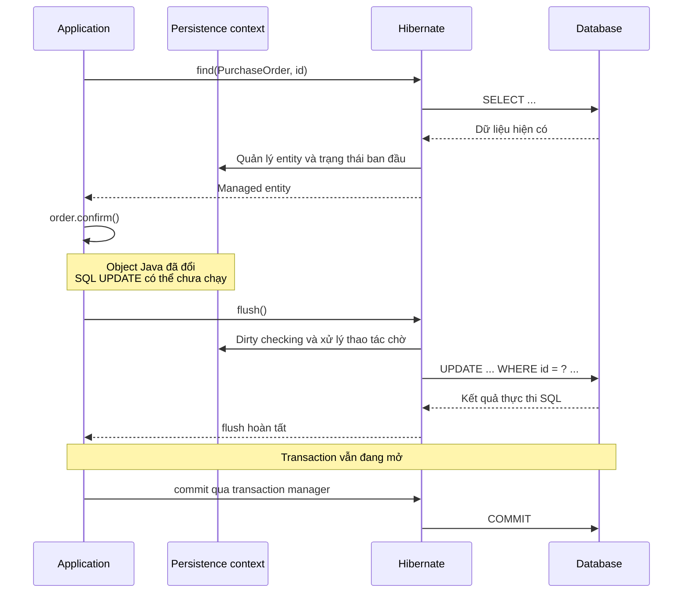
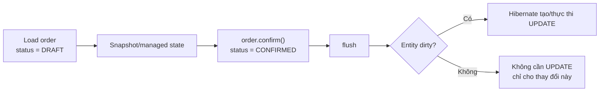
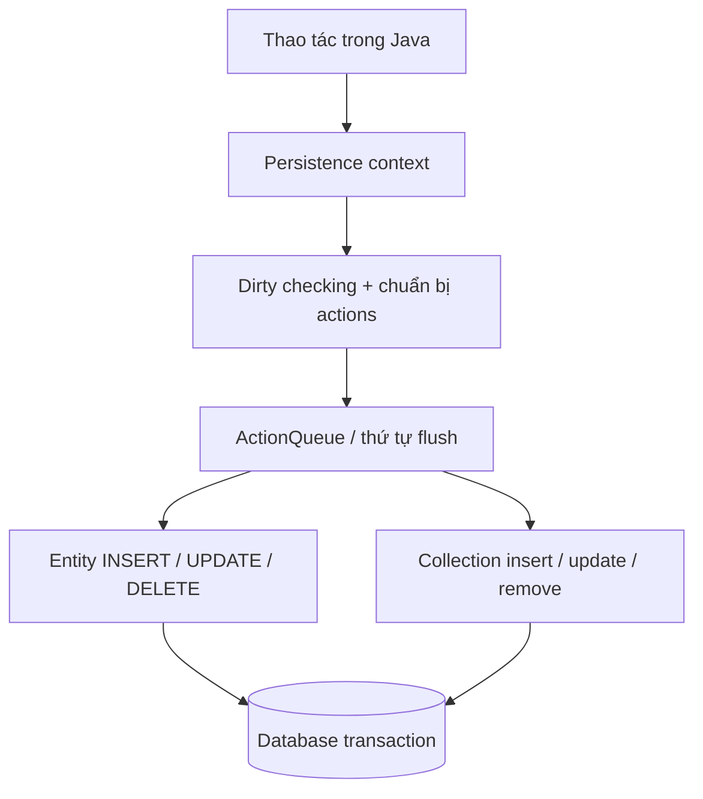

# Flush chuyển các thay đổi đang chờ thành SQL trong Hibernate

Một trong những đặc điểm quan trọng của Hibernate là **thay đổi object Java không nhất thiết tạo câu lệnh SQL ngay tại thời điểm thay đổi**. Khi entity được quản lý (*managed*) trong một persistence context, ứng dụng có thể gọi phương thức nghiệp vụ, gán thuộc tính, thêm phần tử vào collection hoặc đánh dấu xóa. Hibernate ghi nhận trạng thái cần đồng bộ, rồi **flush** để đưa những thay đổi đang chờ xuống cơ sở dữ liệu bằng các lệnh `INSERT`, `UPDATE` và `DELETE` thích hợp.

Ví dụ:

```java
@Transactional
public void confirmOrder(Long orderId) {
    PurchaseOrder order =
        entityManager.find(PurchaseOrder.class, orderId);

    order.confirm();       // Trạng thái Java đã thay đổi.

    entityManager.flush(); // Hibernate đồng bộ SQL tới database.

    // Chưa phải commit: transaction vẫn có thể rollback.
}
```

Ở ví dụ này, `order.confirm()` thay đổi trạng thái của **managed entity**. Hibernate không cần ứng dụng viết `UPDATE purchase_orders ...` bằng tay; cơ chế *dirty checking* xác định dữ liệu nào đổi và *flush* là thời điểm ORM đồng bộ các thao tác vào database.

Điều quan trọng nhất cần hiểu là:

> **Flush đồng bộ persistence context với database trong phạm vi transaction; flush không đồng nghĩa commit và không bảo đảm dữ liệu đã bền vững đối với các transaction khác.**

Bài học này giải thích cơ chế flush, thứ tự thao tác trong action queue, các chế độ flush, mối quan hệ với dirty checking và transaction, tác động lên khóa ngoại, collection, generated value, version, truy vấn, batch processing và những lỗi thường gặp.

## 1. Đặt flush trong chuỗi xử lý của Hibernate

Hãy xét một transaction sửa một đơn hàng. Quá trình có thể chia thành những giai đoạn sau:



Có ba lớp trạng thái cần phân biệt:

| Lớp | Đang chứa gì? | Khi nào thay đổi được quan sát? |
|---|---|---|
| **Object Java** | Các field của entity managed | Ngay khi method/setter cập nhật field |
| **Persistence context của Hibernate** | Các managed entities, snapshot và công việc chờ đồng bộ | Khi entity được tải, persist, sửa, remove hoặc thay đổi collection |
| **Database transaction** | Các lệnh SQL đã thực thi nhưng có thể chưa commit | Sau khi SQL chạy; transaction khác nhìn thấy theo isolation/commit |

**Không phải mọi thay đổi chờ đều là một câu SQL đã được tạo sẵn ngay khi setter chạy.** Với entity managed, Hibernate thường xác định dirty state trong quá trình flush rồi lên kế hoạch/gửi SQL. Với thao tác khác như persist hoặc remove, ORM có thể đã đăng ký các action cần thiết để thực thi khi thích hợp.

### 1.1. Định nghĩa ngắn gọn

`EntityManager.flush()` yêu cầu persistence provider đồng bộ trạng thái của persistence context với database. Trong Hibernate, công việc có thể bao gồm:

- Chèn entity mới đã được persist.
- Cập nhật entity managed có thuộc tính dirty.
- Xóa entity đã được đánh dấu removed.
- Đồng bộ các thay đổi collection/bảng nối theo mapping.
- Xử lý một số thao tác liên quan đến cascade, orphan removal và generated values.
- Thực thi SQL theo thứ tự mà Hibernate cần để phù hợp với mapping, identity và ràng buộc phụ thuộc.

**Flush không dọn sạch persistence context**. Sau flush, các entity thường vẫn managed, trừ khi có thao tác/lifecycle khác làm chúng bị detach hoặc remove. Để tách entity khỏi context, JPA dùng `detach` hoặc `clear`, không dùng `flush`.

### 1.2. Flush không phải lệnh UPDATE một entity cụ thể

`entityManager.flush()` đồng bộ **các thay đổi đang chờ trong persistence context**, không phải chỉ object gần nhất mà code vừa sửa. Nếu transaction đã thay đổi 10 entity thuộc các bảng khác nhau, lệnh flush có thể đẩy SQL cho cả 10 entity.

```java
Customer customer =
    entityManager.find(Customer.class, customerId);
PurchaseOrder order =
    entityManager.find(PurchaseOrder.class, orderId);

customer.rename("Tên mới");
order.confirm();

entityManager.flush();
// Có thể đồng bộ cả customer lẫn order.
```

Do đó không nên đặt flush trong một helper rồi giả định nó chỉ tác động một phần dữ liệu. Hibernate có những API và cơ chế riêng liên quan query spaces/flush mode, nhưng JPA `EntityManager.flush()` là một yêu cầu đồng bộ cấp persistence context.

## 2. Dirty checking và flush phối hợp ra sao?

**Dirty checking** trả lời câu hỏi “trạng thái hiện tại có khác trạng thái được Hibernate biết trước đó không?”. **Flush** trả lời câu hỏi “đã đến lúc biến những thay đổi hợp lệ này thành thao tác database chưa?”.

Ví dụ entity:

```java
import jakarta.persistence.*;
import java.time.Instant;

@Entity
@Table(name = "purchase_orders")
public class PurchaseOrder {

    @Id
    @GeneratedValue(
        strategy = GenerationType.SEQUENCE,
        generator = "purchase_order_seq"
    )
    @SequenceGenerator(
        name = "purchase_order_seq",
        sequenceName = "purchase_order_seq",
        allocationSize = 1
    )
    private Long id;

    @Version
    @Column(name = "row_version", nullable = false)
    private long version;

    @Enumerated(EnumType.STRING)
    @Column(name = "status", nullable = false, length = 20)
    private OrderStatus status;

    @Column(name = "delivery_note", length = 500)
    private String deliveryNote;

    @Column(name = "updated_at", nullable = false)
    private Instant updatedAt;

    protected PurchaseOrder() {}

    public PurchaseOrder(String deliveryNote) {
        this.status = OrderStatus.DRAFT;
        changeDeliveryNote(deliveryNote);
        this.updatedAt = Instant.now();
    }

    public void confirm() {
        if (status != OrderStatus.DRAFT) {
            throw new IllegalStateException(
                "Only draft orders may be confirmed");
        }
        status = OrderStatus.CONFIRMED;
        updatedAt = Instant.now();
    }

    public void changeDeliveryNote(String newNote) {
        if (newNote != null && newNote.length() > 500) {
            throw new IllegalArgumentException("Note too long");
        }
        deliveryNote = newNote;
    }

    public Long getId() { return id; }
    public long getVersion() { return version; }
    public OrderStatus getStatus() { return status; }
    public String getDeliveryNote() { return deliveryNote; }
}

public enum OrderStatus {
    DRAFT, CONFIRMED, CANCELLED
}
```

Với `GenerationType.SEQUENCE`, Hibernate có thể yêu cầu giá trị từ sequence trước câu `INSERT`. Ví dụ này giả định DBMS hỗ trợ sequence tương ứng và schema đã được migration chuẩn bị. Với `IDENTITY`, thời điểm insert để lấy ID có thể khác.

### 2.1. Một managed entity đổi trạng thái

```java
PurchaseOrder order =
    entityManager.find(PurchaseOrder.class, orderId);

order.confirm();

// order.getStatus() hiện là CONFIRMED trong RAM.
// Database chưa nhất thiết có UPDATE.
```

Khi `find` tải entity, Hibernate có thể giữ bản chụp trạng thái gốc (*loaded state*) hoặc dùng những chiến lược tracking tương ứng. Sau khi `confirm` đổi field, Hibernate xác định khác biệt và lên lịch update ở thời điểm flush.



Với `@Version`, update của entity thường bao gồm điều kiện optimistic locking:

```sql
UPDATE purchase_orders
SET status = ?,
    delivery_note = ?,
    updated_at = ?,
    row_version = ?
WHERE id = ?
  AND row_version = ?;
```

Đây là ví dụ minh họa. Số cột và thứ tự tham số phụ thuộc mapping, `@DynamicUpdate`, Hibernate version và Dialect. Điều cần giữ là Hibernate **không phát UPDATE chỉ vì getter được gọi**; nó dựa vào trạng thái được quản lý và sự kiện flush.

### 2.2. Không có thay đổi thì có thể không có SQL UPDATE

```java
PurchaseOrder order =
    entityManager.find(PurchaseOrder.class, orderId);

order.changeDeliveryNote(order.getDeliveryNote());

entityManager.flush();
```

Nếu giá trị hiện tại bằng trạng thái trước đó theo mapping/tracking tương ứng, Hibernate có thể không lên lịch update cho entity. Không giả định “cứ gọi setter là sinh SQL”.

Ngược lại, nếu có custom mutable value mà snapshot/equality không đúng, Hibernate có thể **bỏ sót cập nhật** hoặc phát update không cần thiết. Đó là vấn đề dirty checking; gọi flush nhiều lần không sửa được một mapping nhận diện dirty state sai.

### 2.3. Bytecode enhancement không thay đổi ý nghĩa flush

Hibernate có thể dùng bytecode enhancement để hỗ trợ dirty tracking trực tiếp trên entity. Cách nhận diện field dirty có thể khác so với snapshot comparison, nhưng điểm đồng bộ SQL vẫn chịu ảnh hưởng của flush mode và transaction.

Đặc biệt, sửa nội dung sâu trong một object mutable như JSON/map không nhất thiết giống gán lại field entity. Mutability metadata, deep copy và equality vẫn có thể quan trọng; đừng xem enhancement là lời hứa phát hiện mọi nested mutation.

## 3. Những thao tác nào đang chờ được flush?

Một persistence context có thể chứa nhiều loại công việc chờ đồng bộ:

| Thao tác Java | Công việc Hibernate có thể cần thực hiện khi flush | Ví dụ SQL |
|---|---|---|
| `persist(newEntity)` | Chèn entity mới | `INSERT INTO ...` |
| Thay field của managed entity | Dirty checking, cập nhật bản ghi | `UPDATE ... WHERE id = ...` |
| `remove(managedEntity)` | Xóa bản ghi, xét cascade/ràng buộc | `DELETE FROM ... WHERE id = ...` |
| Thêm entity vào collection có cascade | Chèn entity con và cập nhật quan hệ | `INSERT`, `UPDATE` |
| Xóa entity con khỏi collection có orphan removal | Xóa entity con theo mapping | `DELETE` |
| Thay `@ManyToOne` owning side | Cập nhật khóa ngoại | `UPDATE ... SET department_id = ...` |
| Thay `@ManyToMany` | Đồng bộ bảng nối | `INSERT/DELETE` trên join table |
| Thay `@ElementCollection` | Đồng bộ bảng lưu phần tử | `INSERT/UPDATE/DELETE` tùy mapping |

**Không phải Java operation nào cũng tương ứng đúng một SQL statement.** Hibernate có thể gộp nhiều thay đổi trước khi flush, bỏ qua thay đổi đã bị hoàn tác, hoặc cần nhiều lệnh để duy trì quan hệ. Mapping và chiến lược ID cũng ảnh hưởng thời điểm SQL.

### 3.1. Hai lần sửa cùng một field trước flush

```java
order.changeDeliveryNote("Giao thứ Hai");
order.changeDeliveryNote("Giao thứ Tư");
entityManager.flush();
```

Nếu không có flush/SQL trung gian và các yếu tố lifecycle khác, database thường chỉ cần nhận **trạng thái cuối cùng** `"Giao thứ Tư"` cho lần đồng bộ đó. Hibernate không phải chạy hai câu UPDATE tương ứng với hai lời gọi method.

Điều này cũng giải thích vì sao tránh flush sau từng setter giúp giảm round-trip.

### 3.2. Thay đổi rồi khôi phục giá trị ban đầu

```java
String original = order.getDeliveryNote();

order.changeDeliveryNote("Tạm sửa");
order.changeDeliveryNote(original);

entityManager.flush();
```

Trong mô hình so sánh trạng thái thông thường, Hibernate có thể thấy giá trị cuối bằng snapshot và không cần UPDATE chỉ vì các bước trung gian. Tuy nhiên, nếu code đã flush sau bước đầu, Hibernate đã gửi SQL cho trạng thái tạm thời; việc trả về giá trị cũ có thể cần thêm một UPDATE khác.

Đừng dùng flush giữa những bước chưa hoàn tất của một nghiệp vụ trừ khi có chủ đích.

### 3.3. Persist và remove trước một lần flush

Thứ tự gọi Java không đồng nghĩa số lượng hoặc thứ tự SQL cuối cùng. Hibernate có thể tối ưu/điều phối các thao tác theo trạng thái entity, khóa và quan hệ. Với identifier generator yêu cầu SQL sớm, một số câu INSERT có thể đã chạy trước lời gọi flush tường minh. Cần xem SQL thực tế nếu nghiệp vụ dựa vào số statements hoặc ràng buộc database.

## 4. ActionQueue: vì sao Hibernate không chạy SQL theo đúng thứ tự setter?

Hibernate tổ chức nhiều thao tác thay đổi thành các action nội bộ, thường được nhắc đến qua **ActionQueue**. Khi flush, ORM xử lý các action thuộc các nhóm như entity insert, update, delete và collection actions.

Ví dụ ứng dụng:

```java
order.addLine("SKU-001", 2);
order.changeDeliveryNote("Ưu tiên");
order.removeLine(oldLine);

entityManager.flush();
```

Người đọc không nên suy rằng SQL sẽ luôn xuất hiện theo thứ tự “INSERT line → UPDATE order → DELETE old line”. Hibernate có cơ chế sắp xếp công việc theo loại thao tác, dependency và cấu hình để duy trì referential integrity và tối ưu batching.



### 4.1. Vì sao thứ tự SQL khác thứ tự code?

- Quan hệ có khóa ngoại có thể cần entity cha được insert trước entity con.
- Hibernate phân loại thao tác insert/update/delete và thao tác collection.
- Cấu hình như `hibernate.order_inserts`/`hibernate.order_updates` có thể ảnh hưởng cách sắp xếp một số câu SQL.
- JDBC batching muốn gom các statement cùng SQL shape lại.
- Orphan removal, unique constraint và cascade có thể tạo nhiều action khác với mong đợi từ một method.

Cách tổ chức ActionQueue có thể thay đổi giữa Hibernate releases; không nên dựa vào một danh sách thứ tự nội bộ để viết quy tắc nghiệp vụ thay cho database constraints.

### 4.2. Cảnh báo về unique constraint khi thay quan hệ

Giả sử một bảng có khóa ngoại duy nhất, chỉ cho phép một nhân viên sử dụng một chỗ đỗ. Trong một transaction:

```java
oldEmployee.releaseParkingSpot();
newEmployee.assignParkingSpot(spot);
entityManager.flush();
```

Trạng thái object graph có thể hợp lệ ở cuối hai lời gọi, nhưng SQL do Hibernate phát có thể khiến **ràng buộc UNIQUE bị vi phạm ở thời điểm thực thi trung gian** nếu thứ tự update không giải phóng khóa ngoại trước khi gán mới.

Một số thiết kế cần flush trung gian:

```java
oldEmployee.releaseParkingSpot();
entityManager.flush(); // FK cũ được gỡ trong DB transaction.

newEmployee.assignParkingSpot(spot);
entityManager.flush();
```

Tuy nhiên, flush trung gian là quyết định có chi phí và ảnh hưởng tới atomicity quan sát được bên trong transaction. Nó **không commit**; cả hai bước vẫn có thể rollback cùng nhau. Cũng có thể cần thiết kế schema/transaction/locking khác thay vì thêm flush tùy tiện.

Không suy luận database sẽ hoãn mọi unique/FK constraint tới commit; nhiều constraint được kiểm tra ở thời điểm statement. Một số DBMS có deferred constraints nhưng phải cấu hình và kiểm chứng riêng.

## 5. Flush, commit và rollback khác nhau ở đâu?

Ba khái niệm không được đánh đồng:

- **Dirty state:** object đã đổi trong bộ nhớ.
- **Flush:** gửi SQL cần thiết tới DB trong transaction đang diễn ra.
- **Commit:** xác nhận transaction thành công.
- **Rollback:** hủy các thay đổi database của transaction chưa commit.

Ví dụ:

```java
entityManager.getTransaction().begin();

PurchaseOrder order =
    entityManager.find(PurchaseOrder.class, orderId);

order.confirm();
entityManager.flush(); // UPDATE đã được thực thi.

entityManager.getTransaction().rollback(); // Hủy UPDATE.
```

Đoạn code minh họa **resource-local transaction**. Trong Spring hoặc môi trường JTA/container-managed, transaction thường do transaction manager điều phối; không gọi `getTransaction().begin()` và `commit()` thủ công trên một container-managed `EntityManager`.

### 5.1. Sau flush, dữ liệu có nhìn thấy ở DB chưa?

SQL đã thực thi trong database transaction. Vì vậy một truy vấn phù hợp trong **cùng transaction** có thể quan sát dữ liệu do chính transaction vừa ghi.

Một transaction khác có thấy hay không còn tùy commit và isolation level. Thông thường với `READ COMMITTED`, transaction khác không thấy dữ liệu chưa commit. Không dùng flush thay cho commit để “thông báo cho hệ thống khác” rằng thay đổi đã hoàn tất.

```text
Transaction T1:
  order.confirm()
  flush() ---------> UPDATE ở DB (chưa commit)
  ...
  commit() --------> xác nhận thay đổi

Transaction T2:
  Truy vấn trước commit T1: có thể thấy dữ liệu cũ
  Truy vấn sau commit T1: còn phụ thuộc isolation/snapshot
```

### 5.2. Flush có thể thành công nhưng commit vẫn thất bại

Một flush trả về không có exception **không bảo đảm** transaction cuối cùng sẽ commit. Các nguyên nhân có thể bao gồm:

- Ràng buộc trì hoãn (*deferred constraint*) chỉ được xác minh muộn.
- Xung đột concurrency hoặc deadlock.
- Kết nối/database gặp lỗi trước commit.
- Transaction bị framework đánh dấu rollback-only.
- Một thao tác SQL khác sau lần flush hiện tại thất bại.
- Logic của application chủ động rollback.

Vì vậy, tránh phát event tới message broker, gửi email “đã lưu” hoặc thực hiện side effect bên ngoài không thể hoàn tác chỉ vì `flush()` thành công. Nếu cần phối hợp sự kiện với giao dịch, cân nhắc transactional outbox hoặc cơ chế after-commit phù hợp.

### 5.3. Sau rollback, object Java có tự trở về trạng thái cũ không?

Không thể mặc định. Hibernate có thể đã cập nhật field Java/identifier/version hoặc trạng thái quản lý trước khi transaction rollback. Sau transaction lỗi, persistence context có thể không còn trạng thái đáng tin cậy để tiếp tục làm việc như bình thường.

Thực hành an toàn thường là kết thúc transaction, đóng/bỏ persistence context bị lỗi theo framework và tải lại entity trong transaction mới khi cần xác nhận dữ liệu.

## 6. Các chế độ flush và việc Hibernate tự flush

Không phải ứng dụng nào cũng gọi `entityManager.flush()` tường minh. Hibernate thường tự flush tại những điểm phù hợp theo **flush mode**.

### 6.1. AUTO: chế độ thông dụng

Với `FlushModeType.AUTO` của Jakarta Persistence, provider bảo đảm các truy vấn thấy những thay đổi liên quan theo contract JPA trong phạm vi transaction. Hibernate có thể quyết định flush khi truy vấn cần dữ liệu mới từ các bảng bị thay đổi.

Ví dụ:

```java
PurchaseOrder order =
    entityManager.find(PurchaseOrder.class, orderId);

order.confirm();

Long count = entityManager.createQuery(
        """
        select count(o)
        from PurchaseOrder o
        where o.status = :status
        """,
        Long.class
    )
    .setParameter("status", OrderStatus.CONFIRMED)
    .getSingleResult();
```

Hibernate có thể flush trước `SELECT COUNT` vì thay đổi `PurchaseOrder` đang chờ có liên quan tới dữ liệu truy vấn. Nhưng khi query không dùng các bảng liên quan hoặc truy vấn dùng hình thức khác, cơ chế flush trước query có thể khác.

**Điều cần nhớ là tính nhất quán theo query/flush mode, không phải quy tắc “mọi SELECT đều flush” hay “SELECT không bao giờ flush”.**

### 6.2. COMMIT: thường dời việc đồng bộ tới commit

```java
entityManager.setFlushMode(FlushModeType.COMMIT);
```

Với JPA `COMMIT`, provider thường trì hoãn flush cho tới khi transaction commit, trừ khi ứng dụng gọi flush tường minh. Theo JPA, ảnh hưởng của những thay đổi chưa flush lên truy vấn chạy trước commit có thể không được quy định theo cùng cách như AUTO.

Điều này có nghĩa một query trực tiếp tới database trong transaction có thể không phản ánh field Java mới thay đổi nếu SQL chưa được đồng bộ. Không dùng `COMMIT` làm cách “cải thiện hiệu năng” một cách máy móc khi code vừa sửa managed state vừa query các bảng liên quan.

### 6.3. Hibernate Session còn có ALWAYS và MANUAL

Ngoài hai chế độ chuẩn JPA, Hibernate `Session` có các chế độ flush riêng, bao gồm những tên thường gặp:

| Hibernate FlushMode | Ý nghĩa khái quát |
|---|---|
| `ALWAYS` | Flush trước các query theo cách chặt hơn AUTO; có thể tốn nhiều SQL/round-trip |
| `AUTO` | Hibernate quyết định tự flush ở những thời điểm cần thiết, bao gồm trước commit và những query liên quan |
| `COMMIT` | Ưu tiên đồng bộ tại commit; mức độ hiển thị pending changes trước query phụ thuộc contract/cấu hình |
| `MANUAL` | Không tự flush trong luồng thông thường; ứng dụng cần điều khiển việc flush |

Ví dụ dùng Hibernate API:

```java
Session session = entityManager.unwrap(Session.class);
session.setHibernateFlushMode(FlushMode.MANUAL);
```

Khi dùng API này cần import `org.hibernate.Session` và `org.hibernate.FlushMode` tương ứng. `MANUAL` là tính năng riêng của Hibernate, không phải giá trị của `jakarta.persistence.FlushModeType`. Việc bật MANUAL cho transaction có thao tác ghi rồi quên flush có thể khiến thay đổi không được gửi như mong đợi.

Chỉ chọn flush mode khác mặc định khi có lý do rõ, hiểu cách tích hợp Spring/JTA và quan sát behavior trên đúng Hibernate release.

### 6.4. Native query có thể làm thời điểm flush khác đi

Khi thực hiện native SQL qua `EntityManager`, Hibernate có thể flush trước query trong AUTO theo integration/contract tương ứng. Khi dùng Hibernate `Session` trực tiếp, hành vi có thể phụ thuộc việc khai báo query spaces/entity synchronization hoặc API được gọi.

Vì vậy, không kết luận từ một ví dụ HQL rằng mọi native `SELECT` đều có cùng hành vi auto-flush. Nếu tính đúng đắn phụ thuộc SQL vừa sửa, gọi `flush()` tường minh hoặc khai báo synchronization theo cơ chế Hibernate phù hợp.

## 7. Vì sao find() có thể không tạo SQL dù dữ liệu chưa flush?

`EntityManager.find` thường ưu tiên managed entity đã có trong persistence context.

```java
PurchaseOrder order =
    entityManager.find(PurchaseOrder.class, orderId);

order.confirm();

PurchaseOrder same =
    entityManager.find(PurchaseOrder.class, orderId);

System.out.println(order == same); // true
System.out.println(same.getStatus()); // CONFIRMED
```

Ví dụ này có thể không cần SQL UPDATE hay SELECT thứ hai trước flush. `same.getStatus()` trả dữ liệu **trong object Java managed**, không phải kết quả chứng minh database đã nhận trạng thái mới.

Nếu muốn xác nhận dữ liệu sau flush bằng một lần tải mới trong cùng transaction, có thể:

```java
entityManager.flush();
entityManager.clear();

PurchaseOrder reloaded =
    entityManager.find(PurchaseOrder.class, orderId);
```

`clear()` tách toàn bộ managed entities khỏi context, vì vậy chỉ dùng ở vị trí có chủ đích. Nó **không commit**, và nếu gọi trước flush có thể bỏ qua những thay đổi chưa đồng bộ.

## 8. Flush khi persist entity mới

Với entity mới, ứng dụng gọi:

```java
PurchaseOrder order =
    new PurchaseOrder("Giao buổi chiều");

entityManager.persist(order);

// order được quản lý, nhưng INSERT có thể chờ.
entityManager.flush();
```

Hibernate cần đưa trạng thái entity vào database. Tuy nhiên, **chiến lược sinh ID có thể làm SQL chạy sớm**.

### 8.1. SEQUENCE có thể lấy ID trước INSERT

```java
@Id
@GeneratedValue(
    strategy = GenerationType.SEQUENCE,
    generator = "purchase_order_seq"
)
@SequenceGenerator(
    name = "purchase_order_seq",
    sequenceName = "purchase_order_seq",
    allocationSize = 1
)
private Long id;
```

Hibernate có thể yêu cầu sequence cấp ID ngay khi persist rồi chờ đến flush mới phát `INSERT`. Như vậy:

```text
persist(order)
   ↓ có thể SELECT NEXTVAL(...) để lấy ID
order.id != null
   ↓ INSERT chưa nhất thiết xảy ra
flush()
   ↓ INSERT purchase_orders ...
```

ID đã có **không chứng minh** row đã insert hay transaction đã commit. Sequence cũng có thể tạo khoảng trống ID khi transaction rollback.

### 8.2. IDENTITY thường cần INSERT để biết ID

Với:

```java
@Id
@GeneratedValue(strategy = GenerationType.IDENTITY)
private Long id;
```

Database sinh ID khi thực thi `INSERT`. Vì Hibernate cần ID cho persistence context và quan hệ, nó có thể phải phát insert sớm hơn một lần flush thông thường. Hành vi cụ thể còn phụ thuộc session/transaction và provider.

Do đó, câu “mọi câu SQL chỉ chạy tại flush” là **sai**. SELECT để tải entity, lấy sequence, identity insert và query trực tiếp có thể chạy ở những thời điểm khác.

### 8.3. Cascade PERSIST và thứ tự insert

Ví dụ một đơn hàng có nhiều dòng:

```java
@Entity
@Table(name = "purchase_orders")
public class PurchaseOrder {
    @Id
    @GeneratedValue(strategy = GenerationType.SEQUENCE)
    private Long id;

    @OneToMany(
        mappedBy = "order",
        cascade = CascadeType.ALL,
        orphanRemoval = true
    )
    private List<OrderLine> lines = new ArrayList<>();

    public void addLine(String sku, int quantity) {
        OrderLine line = new OrderLine(this, sku, quantity);
        lines.add(line);
    }
}
```

```java
@Entity
@Table(name = "order_lines")
public class OrderLine {
    @Id
    @GeneratedValue(strategy = GenerationType.SEQUENCE)
    private Long id;

    @ManyToOne(fetch = FetchType.LAZY, optional = false)
    @JoinColumn(name = "order_id", nullable = false)
    private PurchaseOrder order;

    @Column(name = "sku", nullable = false)
    private String sku;

    @Column(name = "quantity", nullable = false)
    private int quantity;

    protected OrderLine() {}

    public OrderLine(PurchaseOrder order, String sku, int quantity) {
        if (quantity <= 0) {
            throw new IllegalArgumentException("quantity <= 0");
        }
        this.order = java.util.Objects.requireNonNull(order);
        this.sku = java.util.Objects.requireNonNull(sku);
        this.quantity = quantity;
    }
}
```

Ví dụ hai đoạn class trên minh họa một mapping riêng, không phải yêu cầu gộp chúng với entity `PurchaseOrder` ở phần trước thành cùng một file. Khi gọi:

```java
PurchaseOrder order = new PurchaseOrder();
order.addLine("SKU-001", 2);
order.addLine("SKU-002", 3);

entityManager.persist(order);
entityManager.flush();
```

Hibernate cần chèn order và các line, giải quyết ID/FK theo mapping. Không nên kỳ vọng một lời gọi `persist` tạo đúng một câu INSERT cho cả graph. Cũng không nên tự chỉ định thứ tự SQL bằng cách đặt code `persist(line)` trước `persist(order)` khi có cascade/ownership.

## 9. Flush khi UPDATE một managed entity

Trường hợp cập nhật thường không cần gọi `merge` hay `save` lần nữa:

```java
@Transactional
public void changeNote(Long orderId, String note) {
    PurchaseOrder order =
        entityManager.find(PurchaseOrder.class, orderId);

    if (order == null) {
        throw new NoSuchElementException("Order not found");
    }

    order.changeDeliveryNote(note);

    // Hibernate dirty checking sẽ xử lý khi flush.
}
```

Sau khi `find` trả managed entity:

1. Application thay đổi một hoặc nhiều trường hợp lệ.
2. Hibernate nhận diện thuộc tính dirty theo cơ chế mapping.
3. Khi flush, Hibernate tạo và thực thi `UPDATE` nếu cần.
4. DB kiểm tra constraint, trigger và optimistic version condition.
5. Transaction được commit hoặc rollback sau đó.

### 9.1. @Version và optimistic locking ở flush

Nếu entity có `@Version`:

```java
@Version
@Column(name = "row_version", nullable = false)
private long version;
```

một câu UPDATE có thể chứa `WHERE id = ? AND row_version = ?`. Nếu transaction khác đã thay cùng bản ghi và tăng version, UPDATE có thể ảnh hưởng 0 hàng và Hibernate thông báo conflict, thường bằng `OptimisticLockException` hoặc exception framework tương ứng.

Lỗi có thể xuất hiện **khi flush hoặc commit**, không nhất thiết khi gọi `order.changeDeliveryNote(...)`. Không tự chỉnh `version++` trong code nghiệp vụ; Hibernate quản lý version theo mapping.

### 9.2. @DynamicUpdate ảnh hưởng SQL tại flush

Theo mặc định, Hibernate có thể sinh UPDATE bao gồm nhiều cột updatable để giữ SQL shape ổn định. Annotation Hibernate `@DynamicUpdate` yêu cầu dùng câu UPDATE theo tập field dirty khi phù hợp:

```java
@Entity
@DynamicUpdate
@Table(name = "purchase_orders")
public class PurchaseOrder {
    // Các trường mapping...
}
```

Với chỉ `deliveryNote` thay đổi, SQL có thể gọn hơn. Nhưng `@DynamicUpdate` **không bật dirty checking**; nó thay cách biểu diễn SQL dựa trên thông tin dirty có sẵn. SQL động có thể làm tăng số biến thể câu lệnh và giảm prepared statement reuse trong một số workload.

Dùng khi có lý do như bảng rộng, cột cập nhật ít, trigger theo cột hoặc chi phí ghi cao; đo hiệu năng trên DB thật trước khi áp dụng hàng loạt.

## 10. Flush khi REMOVE và orphanRemoval

`EntityManager.remove` đánh dấu một managed entity để xóa, nhưng không đồng nghĩa SQL DELETE luôn chạy ngay khi gọi.

```java
PurchaseOrder order =
    entityManager.find(PurchaseOrder.class, orderId);

entityManager.remove(order);

// Hibernate lên lịch xóa theo lifecycle.
entityManager.flush();
```

Tại flush, Hibernate có thể gửi `DELETE` và các thao tác liên quan theo cascade/orphanRemoval và FK constraints.

### 10.1. Cascade REMOVE

Nếu quan hệ sở hữu vòng đời con:

```java
@OneToMany(
    mappedBy = "order",
    cascade = CascadeType.ALL,
    orphanRemoval = true
)
private List<OrderLine> lines;
```

xóa order có thể lan sang các line theo cấu hình. Không dùng cascade remove giữa các entity có vòng đời độc lập, ví dụ từ Order sang Customer, vì điều đó có thể dẫn đến xóa dữ liệu không mong muốn.

### 10.2. orphanRemoval khi bỏ phần tử khỏi collection

```java
order.removeLine(line);
entityManager.flush();
```

Nếu method cập nhật collection và phía sở hữu đúng, `orphanRemoval=true` có thể khiến Hibernate xóa dòng OrderLine ở DB, **không chỉ null hóa FK**. Với collection không có orphanRemoval, hành vi phụ thuộc sở hữu quan hệ, nullable FK và mapping.

### 10.3. Bulk DELETE không giống remove

```java
entityManager.createQuery(
        "delete from PurchaseOrder o where o.status = :status")
    .setParameter("status", OrderStatus.CANCELLED)
    .executeUpdate();
```

Đây là **bulk JPQL mutation** thực thi trực tiếp qua query, không phải gọi `remove` cho từng managed entity. Nó không chạy JPA lifecycle callbacks/cascade trên từng entity như thao tác remove thông thường và có thể khiến persistence context giữ trạng thái cũ. SQL bulk có thời điểm thực thi và hệ quả riêng, không nên lẫn với ActionQueue flush của từng entity.

## 11. Flush với quan hệ, khóa ngoại và bảng nối

### 11.1. Owning side quyết định FK

Ví dụ:

```java
@Entity
public class Employee {
    @Id
    private Long id;

    @ManyToOne(fetch = FetchType.LAZY)
    @JoinColumn(name = "department_id")
    private Department department;

    public void moveTo(Department next) {
        department = next;
    }
}
```

Khi một Employee managed đổi `department`, Hibernate có thể cập nhật `employees.department_id` lúc flush. Nếu `Department` có `@OneToMany(mappedBy = "department")`, collection phía inverse cũng nên được đồng bộ trong object graph bằng helper, nhưng **FK vẫn được ghi theo owning side**.

### 11.2. Thay collection không nhất thiết tương đương một UPDATE

Với `@ManyToMany`, thêm/xóa một phần tử thường liên quan bảng join. Với `@ElementCollection`, có thể có câu INSERT/DELETE trên collection table. Với `@OneToMany` dùng foreign key, ORM có thể cần update FK. Không suy diễn từ một thao tác `list.add(...)` rằng SQL là `UPDATE` trên bảng parent.

### 11.3. Thay reference collection tùy tiện có thể gây lỗi

Với Hibernate persistent collection wrappers, code:

```java
this.lines = new ArrayList<>(incomingLines);
```

có thể phá sự theo dõi collection hoặc gây lỗi khi orphan removal nếu thay nguyên collection reference. Các helper thêm/xóa phần tử theo đúng ownership thường rõ nghĩa hơn:

```java
public void removeLine(OrderLine line) {
    if (lines.remove(line)) {
        line.detachFromOrder();
    }
}
```

Ví dụ giả định `OrderLine.detachFromOrder()` được thiết kế phù hợp với mapping nullable FK/orphan removal; không phải mọi domain đều cho phép một line tồn tại không có order. Mấu chốt là quản lý quan hệ bằng hành vi nghiệp vụ, rồi để Hibernate đồng bộ ở flush.

## 12. Flush và dữ liệu do database sinh

Database có thể tự điền giá trị khi INSERT/UPDATE:

- IDENTITY ID.
- `DEFAULT CURRENT_TIMESTAMP`.
- `updated_at` từ trigger.
- Cột generated/computed.
- Giá trị được database chuẩn hóa hoặc tính từ các trường khác.

`flush()` giúp đảm bảo SQL tạo giá trị đã chạy, nhưng **không tự bảo đảm mọi field Java được đọc lại đúng giá trị database sinh**.

Ví dụ nếu database có trigger cập nhật `updated_at`, Hibernate cần biết field nào do database sinh và sau sự kiện nào để đồng bộ. Có thể khai báo cơ chế `@Generated` thích hợp:

```java
@Generated(event = {
    EventType.INSERT,
    EventType.UPDATE
})
@Column(
    name = "updated_at",
    insertable = false,
    updatable = false
)
private Instant updatedAt;
```

Trong Hibernate 6, ví dụ dùng `org.hibernate.annotations.Generated` và `org.hibernate.generator.EventType`. Database vẫn phải có default/trigger thật; annotation không tự tạo trigger trên schema production.

Nếu mapping không hướng dẫn ORM đọc lại, ứng dụng có thể cần:

```java
entityManager.flush();
entityManager.refresh(order);
```

`refresh` tải lại trạng thái managed entity từ DB, nhưng có thể tốn thêm query và ghi đè các thay đổi Java chưa flush. Khi `@Generated` đã làm đúng việc đồng bộ, không nhất thiết phải refresh lần nữa.

## 13. Vì sao một lần flush có thể tạo nhiều SQL statements?

Ví dụ một nghiệp vụ:

```java
PurchaseOrder order = new PurchaseOrder("Giao sáng");
order.addLine("SKU-01", 2);
order.addLine("SKU-02", 1);

entityManager.persist(order);

Customer customer =
    entityManager.find(Customer.class, customerId);
customer.rename("Công ty ABC");

entityManager.flush();
```

Tùy mapping và generator, flush có thể dẫn đến:

```sql
-- Ví dụ minh họa, không phải thứ tự được Hibernate bảo đảm:
INSERT INTO purchase_orders (...) VALUES (...);

INSERT INTO order_lines (order_id, sku, quantity)
VALUES (?, 'SKU-01', 2);

INSERT INTO order_lines (order_id, sku, quantity)
VALUES (?, 'SKU-02', 1);

UPDATE customers SET name = ? WHERE id = ?;
```

Hibernate có thể đã yêu cầu sequence trước flush hoặc sắp xếp các statements theo nhóm. Với JDBC batching, nhiều lần thực thi statement có thể được gửi theo batch; **một lần gọi flush không có nghĩa một SQL statement hoặc một network round-trip**.

### 13.1. JDBC batching khác flush

`hibernate.jdbc.batch_size` cho phép Hibernate batch những statement thích hợp theo JDBC và driver. Cấu hình minh họa:

```properties
spring.jpa.properties.hibernate.jdbc.batch_size=30
spring.jpa.properties.hibernate.order_inserts=true
spring.jpa.properties.hibernate.order_updates=true
```

Mục đích có thể là giảm số lượt trao đổi với database khi flush nhiều entities. Tuy nhiên:

- Batching phụ thuộc SQL shape, identifier strategy và JDBC driver.
- IDENTITY inserts có thể hạn chế batching insert.
- SQL khác nhau về cột hoặc điều kiện có thể không batch được.
- Batch size không có nghĩa một transaction nên giữ vô hạn entity managed.
- Không bật order/batching khi chưa đo throughput và bảo đảm semantics với constraints.

### 13.2. Không để persistence context phình quá lớn

Nếu persist 100.000 entities trong một transaction mà không có điểm xử lý, ORM có thể giữ nhiều object/snapshot/actions trong bộ nhớ. Một chiến lược xử lý theo batch:

```java
final int batchSize = 50;

for (int i = 0; i < inputs.size(); i++) {
    PurchaseOrder order =
        createOrderFrom(inputs.get(i));

    entityManager.persist(order);

    if ((i + 1) % batchSize == 0) {
        entityManager.flush();
        entityManager.clear();
    }
}

entityManager.flush();
entityManager.clear();
```

Mẫu này chỉ minh họa kỹ thuật; cần đảm bảo không còn dùng các entity vừa bị `clear` làm detached, không phụ thuộc các quan hệ chưa đồng bộ và xử lý lỗi/rollback theo transaction đúng. Một transaction rất lớn vẫn có rủi ro lock và rollback cost dù có flush/clear theo batch.

**Flush theo batch không commit từng batch.** Nếu muốn các batch được commit độc lập, phải tổ chức nhiều transaction có chủ đích, không chỉ thêm `flush()`.

## 14. Flush tự động trước query và query spaces

Một khái niệm hữu ích trong Hibernate là **query spaces**: ORM có thể biết query phụ thuộc những bảng nào, đối chiếu với những thay đổi đang chờ để quyết định có cần auto-flush trước query không.

Giả sử thay đổi Order nhưng query Customer:

```java
order.confirm();

List<Customer> customers =
    entityManager.createQuery(
        "select c from Customer c",
        Customer.class
    ).getResultList();
```

Nếu Hibernate xác định truy vấn Customer không liên quan những bảng Order đang chờ thay đổi, một số hình thức query trong `AUTO` có thể không kích hoạt flush trước SELECT đó. Ngược lại, query đếm những Order `CONFIRMED` có liên quan nên có thể cần flush để kết quả phản ánh thay đổi.

Không dùng quy tắc query spaces như sự đảm bảo cho mọi native SQL: provider có thể không suy ra dependency đầy đủ, nhất là view, `@Subselect` hoặc query đặc biệt.

### 14.1. @Synchronize với @Subselect

Với Hibernate-specific mapping `@Subselect`, có thể khai báo các bảng nền bằng `@Synchronize`:

```java
@Entity
@Immutable
@Subselect("""
    select customer_id, count(*) as order_count
    from purchase_orders
    group by customer_id
    """)
@Synchronize("purchase_orders")
public class CustomerOrderCounts {
    @Id
    @Column(name = "customer_id")
    private Long customerId;

    @Column(name = "order_count")
    private Long orderCount;
}
```

`@Synchronize` giúp Hibernate biết query entity này liên quan bảng `purchase_orders` để thực hiện auto-flush khi thích hợp. Nhưng nó không tự refresh một instance `CustomerOrderCounts` đã managed hoặc vượt qua transaction isolation/second-level cache.

### 14.2. Query DML trực tiếp không đi qua dirty checking

Một câu:

```java
entityManager.createQuery(
        "update PurchaseOrder o set o.status = :status " +
        "where o.id = :id")
    .setParameter("status", OrderStatus.CANCELLED)
    .setParameter("id", orderId)
    .executeUpdate();
```

thực hiện bulk mutation trực tiếp vào database; nó không tạo ra `order.cancel()` trên mọi entity managed đã tải. Trước DML, pending ORM changes có thể cần flush theo mode và kiểu query; sau DML, các entity managed có thể **stale**.

Nếu trộn hai cơ chế, phải thiết kế thứ tự:

```java
entityManager.flush();     // Đồng bộ ORM pending changes trước.

int affected = entityManager.createQuery(
        "update PurchaseOrder o " +
        "set o.status = :status where o.id = :id")
    .setParameter("status", OrderStatus.CANCELLED)
    .setParameter("id", orderId)
    .executeUpdate();

entityManager.clear();     // Tách các managed objects có thể stale.
```

`clear` chỉ nên dùng khi không còn pending work cần giữ và đã hiểu ảnh hưởng của việc detach tất cả entities. Với một entity cụ thể, `refresh` có thể phù hợp hơn.

## 15. Phân biệt flush, clear, refresh, detach và commit

| API / thao tác | Mục đích | Có gửi pending DML xuống DB? | Có làm entity mất managed state? |
|---|---|---|---|
| `entityManager.flush()` | Đồng bộ những thay đổi đang chờ | **Có**, khi có công việc cần làm | Không tự detach |
| `entityManager.clear()` | Làm trống persistence context | **Không tự flush** | Có, tất cả managed entities thành detached |
| `entityManager.detach(entity)` | Tách một entity | Không tự flush | Có, với entity được chỉ định |
| `entityManager.refresh(entity)` | Tải lại state từ DB | Có thể có query SELECT; không phải “save” | Không, entity vẫn managed nếu hợp lệ |
| Transaction `commit` | Xác nhận giao dịch | Có thể kích hoạt flush trước khi commit | Lifecycle context phụ thuộc kiểu EntityManager |
| Transaction `rollback` | Hủy thay đổi DB chưa commit | Không phải công cụ đồng bộ state Java | Context/state sau lỗi cần xử lý theo framework |

### 15.1. clear trước flush có thể làm mất thay đổi

```java
PurchaseOrder order =
    entityManager.find(PurchaseOrder.class, id);

order.confirm();
entityManager.clear(); // Không tự thực hiện UPDATE.

// Những thay đổi chưa flush có thể không được lưu.
```

Muốn lưu trước khi dọn persistence context:

```java
order.confirm();
entityManager.flush();
entityManager.clear();
```

Sau `clear`, `order` là detached; sửa tiếp object này không tự được Hibernate theo dõi trong context hiện tại.

### 15.2. refresh trước flush có thể ghi đè thay đổi Java

```java
order.changeDeliveryNote("Ghi chú mới");

entityManager.refresh(order);
// Trạng thái DB có thể ghi đè ghi chú chưa flush.
```

Dùng refresh khi mục tiêu là **tải lại** dữ liệu từ DB, không phải gửi thay đổi Java xuống DB.

### 15.3. merge không phải flush

```java
PurchaseOrder managed =
    entityManager.merge(detachedOrder);
```

`merge` sao chép state vào instance managed (có thể kèm SELECT/cascade); nó không có nghĩa transaction đã commit hay tất cả SQL của context đã được gửi. Sau merge, dùng instance trả về và để flush/commit xử lý pending insert/update theo lifecycle.

## 16. Spring @Transactional và chuyện ai gọi flush?

Trong ứng dụng Spring Boot với Spring Data JPA, transaction manager thường điều phối commit/rollback, còn Hibernate quyết định flush theo flush mode.

```java
@Service
public class PurchaseOrderService {
    @PersistenceContext
    private EntityManager entityManager;

    @Transactional
    public void confirm(Long id) {
        PurchaseOrder order =
            entityManager.find(PurchaseOrder.class, id);

        if (order == null) {
            throw new NoSuchElementException("Order not found");
        }

        order.confirm();

        // Đến lúc transaction commit, Hibernate thường flush
        // nếu đang dùng flush mode phù hợp.
    }
}
```

Trong trường hợp này, không cần gọi `repository.save(order)` chỉ để “kích hoạt” dirty checking vì `order` đã managed.

### 16.1. saveAndFlush không phải commit

Spring Data JPA cung cấp `saveAndFlush(entity)`. Về ý nghĩa, nó thực hiện thao tác lưu theo semantics của repository rồi flush, nhưng **không cam kết transaction tại thời điểm đó**.

Cần phân biệt:

- `save`: tùy entity mới hay đã tồn tại mà Spring Data có thể gọi `persist` hoặc `merge`.
- `saveAndFlush`: thêm việc flush ngay theo API repository.
- `EntityManager.flush`: đồng bộ persistence context hiện tại.
- `@Transactional`: xác định transaction boundary được Spring quản lý, và commit/rollback khi phương thức hoàn tất theo quy tắc transaction manager.

### 16.2. @Transactional(readOnly = true) có thể ảnh hưởng flush

```java
@Transactional(readOnly = true)
public void mistakenlyUpdate(Long id) {
    PurchaseOrder order =
        entityManager.find(PurchaseOrder.class, id);

    order.confirm();
}
```

Đây là thiết kế mâu thuẫn: method cần ghi nhưng transaction được khai read-only. Tùy integration, Spring/Hibernate có thể điều chỉnh flush mode và read-only state khiến thay đổi không tự được đồng bộ như transaction đọc-ghi.

`readOnly=true` thường là **hint/tùy chọn tối ưu**, không phải rào chắn tuyệt đối chống mọi DML trên mọi DBMS. Use case ghi nên dùng transaction đọc-ghi và quyền DB thích hợp; use case chỉ đọc thì projection/DTO hoặc read-only session phù hợp hơn.

### 16.3. Transaction propagation ảnh hưởng ranh giới flush

Nếu application service gọi nhiều repository methods trong **cùng một transaction**, chúng có thể dùng chung persistence context; flush trong một method có thể gửi pending changes từ method trước.

Ngược lại, nếu mở transaction mới theo propagation phù hợp hoặc sử dụng context khác, phạm vi entity managed/pending changes có thể khác. Vì vậy, vị trí đặt `flush()` nên được xem trong **transaction tổng thể**, không chỉ ở một method helper.

## 17. Khi nào nên gọi flush() tường minh?

Trong phần lớn transaction CRUD đơn giản, để Hibernate tự flush khi commit/query phù hợp là đủ. Tuy nhiên, flush tường minh có các lý do chính đáng.

### 17.1. Cần phát hiện constraint error trước bước tiếp theo

Ví dụ cần tạo bản ghi có unique business key trước khi thực hiện thêm những thao tác trong cùng transaction:

```java
entityManager.persist(newOrder);
entityManager.flush(); // Có thể phát hiện UNIQUE/NOT NULL sớm.
```

Nếu DB kiểm tra ràng buộc ngay ở thời điểm SQL, lỗi có thể xuất hiện tại flush. Nhưng một số constraint bị trì hoãn tới commit, nên flush không đảm bảo mọi lỗi constraint đã lộ.

Sau lỗi flush, transaction thường không nên tiếp tục như bình thường. Hãy rollback/để framework rollback và xử lý lỗi ở ranh giới transaction phù hợp.

### 17.2. Cần dữ liệu do database sinh để thực hiện phép tiếp theo

Ví dụ:

```java
entityManager.persist(order);
entityManager.flush();

// SQL cần thiết đã chạy.
// Nếu field DB-generated có mapping readback phù hợp,
// ứng dụng có thể dùng nó tại đây.
```

Nếu chỉ cần ID của chiến lược SEQUENCE, có thể không cần flush vì ID có thể đã được cấp trước insert. Nếu cần default/trigger/generated column, cần xét mapping `@Generated` và thời điểm Hibernate đọc lại.

### 17.3. Cần query phụ thuộc thay đổi vừa thực hiện

Với query có semantics đặc biệt hoặc native SQL mà auto-flush có thể không nhận diện dependency đầy đủ:

```java
order.confirm();
entityManager.flush();

BigDecimal total = readAggregateUsingNativeSql(order.getId());
```

Flush thể hiện rõ ý định “SQL ghi phải chạy trước truy vấn kế tiếp”. Tuy nhiên transaction isolation và cache vẫn ảnh hưởng tính mới của kết quả, đặc biệt với materialized view hoặc nguồn được cập nhật bất đồng bộ.

### 17.4. Cần chia xử lý batch để quản lý bộ nhớ

`flush` kết hợp `clear` theo batch giúp tránh giữ quá nhiều managed entities. Cần hiểu `clear` làm detached tất cả và không commit mỗi batch.

### 17.5. Cần kiểm soát thứ tự thao tác để tránh constraint

Trong một số tình huống chuyển quan hệ có UNIQUE FK, flush sau khi gỡ liên kết cũ trước khi gắn liên kết mới có thể tránh vi phạm constraint tạm thời. Nhưng không nên biến flush thành giải pháp cho schema/transaction design thiếu đúng đắn.

## 18. Khi nào không nên gọi flush()?

### 18.1. Sau mọi setter

```java
order.changeDeliveryNote("A");
entityManager.flush();

order.changeDeliveryNote("B");
entityManager.flush();
```

Mẫu này có thể tạo hai UPDATE thay vì một UPDATE với trạng thái cuối. Nó tăng round-trip và làm giảm cơ hội batching.

### 18.2. Trong getter hoặc entity domain helper

```java
public void confirm() {
    status = OrderStatus.CONFIRMED;
    // Không nên tự gọi EntityManager.flush() tại đây.
}
```

Entity domain method nên thể hiện quy tắc nghiệp vụ, không tự lấy `EntityManager` hoặc điều khiển transaction tùy tiện. Ranh giới flush thuộc application service/transaction orchestration.

### 18.3. Để “ép commit”

`flush` không kết thúc transaction. Nếu yêu cầu dữ liệu được công bố cho hệ thống khác, phải dùng commit/outbox/after-commit mechanism phù hợp.

### 18.4. Để sửa lỗi entity detached

Nếu object đã detached, `entityManager.flush()` không tự đưa những thay đổi trên object đó vào persistence context. Cần tải entity managed và áp dụng changes, hoặc merge có chủ đích.

### 18.5. Để bù cho mapping dirty checking sai

Nếu mutable custom type có `MutabilityPlan`/equality lỗi hoặc cập nhật sai phía sở hữu quan hệ, flush lặp lại không giải quyết nguyên nhân. Phải sửa mapping/tracking/ownership.

## 19. Quan sát SQL để hiểu thời điểm flush

Một cách học Hibernate hữu ích là **bật SQL logging trong môi trường phát triển** và so sánh thời điểm ứng dụng gọi method với thời điểm SQL xuất hiện.

Với Spring Boot và Hibernate 6, ví dụ logger:

```properties
logging.level.org.hibernate.SQL=DEBUG

# Chỉ bật TRACE bind khi có nhu cầu debug phù hợp:
logging.level.org.hibernate.orm.jdbc.bind=TRACE
```

Logger bind parameters có thể lộ dữ liệu cá nhân/bảo mật; không bật TRACE bừa bãi trên production.

Thử một luồng:

```java
PurchaseOrder order =
    entityManager.find(PurchaseOrder.class, id);

System.out.println("A - loaded");

order.changeDeliveryNote("Giao sau 17h");
System.out.println("B - changed in Java");

entityManager.flush();
System.out.println("C - flushed");
```

SQL log có thể cho thấy `SELECT` khi `find` và `UPDATE` ở flush; không nhất thiết có `UPDATE` ngay khi in marker B.

### 19.1. Dùng Hibernate Statistics khi cần

Có thể bật:

```properties
spring.jpa.properties.hibernate.generate_statistics=true
```

Hibernate `Statistics` có thể cung cấp các chỉ số như số entity inserts, updates, deletes, flushes và prepared statements theo release/API phù hợp. Cần phân biệt counter của Hibernate với **số round-trip JDBC thực tế** khi batching được bật.

Thống kê và SQL logging là công cụ quan sát hiệu năng; chúng không thay thế việc hiểu transaction semantics.

### 19.2. Điều gì khiến thấy INSERT trước flush?

Có thể là `GenerationType.IDENTITY` hoặc thao tác SQL được ORM buộc thực thi sớm. Điều gì khiến thấy SELECT sau persist? Có thể là sequence allocation, validation/query hoặc lazy loading. Hibernate không hứa chỉ phát SQL khi gọi flush.

## 20. Ví dụ tích hợp: flush và clear để nhìn thấy trạng thái database

Giả sử transaction đang hoạt động và có một bản ghi ở trạng thái DRAFT.

```java
@Test
@Transactional
void flushSynchronizesManagedState() {
    PurchaseOrder order =
        entityManager.find(PurchaseOrder.class, orderId);

    assertNotNull(order);
    assertTrue(entityManager.contains(order));

    order.confirm();
    assertEquals(
        OrderStatus.CONFIRMED,
        order.getStatus()
    );

    entityManager.flush();
    entityManager.clear();

    PurchaseOrder reloaded =
        entityManager.find(PurchaseOrder.class, orderId);

    assertEquals(
        OrderStatus.CONFIRMED,
        reloaded.getStatus()
    );
}
```

Đoạn mã là phần lõi của integration test, giả định fixture, import JUnit/JPA và transaction được thiết lập. Nếu test framework rollback transaction mặc định sau test, điều đó không mâu thuẫn với việc flush/reload đã thấy thay đổi bên trong transaction.

### 20.1. Phân biệt flush với rollback

```java
// Pseudocode theo transaction manager của ứng dụng:
beginTransaction();

PurchaseOrder order = findOrder(id);
order.confirm();

entityManager.flush(); // DB đã nhận UPDATE trong transaction.

rollbackTransaction();

// Transaction tiếp theo tải lại DB:
// Trạng thái CONFIRMED chưa được commit sẽ không tồn tại.
```

Không yêu cầu test vừa rollback xong tiếp tục dùng managed object cũ để kết luận trạng thái database.

### 20.2. Kiểm tra không có SQL UPDATE khi entity không dirty

```java
PurchaseOrder order =
    entityManager.find(PurchaseOrder.class, orderId);

order.changeDeliveryNote(order.getDeliveryNote());

entityManager.flush();
```

Có thể quan sát SQL/Statistics thay vì chỉ so sánh getter. Kết quả thực tế phụ thuộc cách tracking và mapping, nên kiểm tra trên đúng Hibernate release/DBMS của dự án.

### 20.3. Kiểm tra UPDATE có @Version

Dùng hai `EntityManager`/transactions độc lập, tải cùng một bản ghi với version cũ, cho transaction thứ nhất update+commit rồi cho transaction thứ hai update+flush. Nếu optimistic locking được cấu hình đúng, transaction cập nhật sau bằng version cũ sẽ gặp conflict theo semantics tương ứng.

Một test chạy tất cả trong **cùng persistence context** không mô phỏng được đầy đủ xung đột giữa hai transaction.

## 21. Lỗi flush thường gặp và cách suy luận

### “Sửa object rồi SELECT lại không thấy UPDATE trong log”

Có thể entity chưa managed, đang trong read-only session, chưa có flush phù hợp, mapping field `updatable=false`, `@Immutable` hoặc thực tế giá trị không dirty. Nếu dùng `find` lần nữa trong cùng context, có thể chỉ đọc từ RAM.

### “Không gọi save nhưng dữ liệu vẫn được cập nhật”

Đó là hành vi bình thường của managed entity và dirty checking. `persist` dành cho new entity, `merge` cho sao chép detached state; chúng không phải lệnh bắt buộc sau mọi setter.

### “Gọi flush mà DB chưa commit”

Đúng theo thiết kế: flush không phải commit. Transaction khác có thể vẫn đọc trạng thái cũ; transaction hiện tại vẫn có thể rollback.

### “Constraint violation chỉ xảy ra khi kết thúc method”

Hibernate có thể trì hoãn SQL tới flush/commit. Lỗi constraint, optimistic locking, FK hoặc unique có thể xuất hiện ở thời điểm đó, thay vì ở nơi gọi setter.

### “Gọi flush liên tục nhưng custom JSON vẫn không lưu”

Nếu Hibernate không nhận diện nested change vì mutability/equality mapping sai, flush không tự phát hiện điều mà tracking không biết. Cần xem `JavaType`/`MutabilityPlan`, snapshot và cách cập nhật value.

### “Thêm phần tử vào collection inverse nhưng FK không đổi”

Sửa collection inverse mà không cập nhật owning side không đủ để tạo FK theo mô hình quan hệ hai chiều. Dùng helper đồng bộ hai phía rồi flush.

### “Vừa xóa bản ghi cũ vừa thêm bản ghi mới thì UNIQUE bị lỗi”

Hibernate có thể tổ chức thứ tự SQL khác thứ tự code, còn DB kiểm tra constraint ở từng statement. Cần xem SQL, dependency, transaction, constraints và chiến lược đổi quan hệ. Có thể cần flush trung gian có chủ đích hoặc thiết kế lại.

### “Gọi clear trước flush nhưng thay đổi biến mất”

`clear` làm detached mọi managed entities và không tự flush. Muốn giữ pending changes, đồng bộ trước khi clear.

### “Sau bulk UPDATE object Java vẫn là giá trị cũ”

Bulk DML làm việc trực tiếp với database, không sửa trạng thái managed entity từng hàng. Dùng refresh/clear hoặc transaction mới phù hợp.

### “Bật batch_size nhưng vẫn thấy nhiều SQL”

JDBC batching gom những lần thực thi tương thích; không biến nhiều SQL khác nhau thành một statement duy nhất. IDENTITY, SQL shape, thứ tự flush và driver có thể hạn chế batching.

### “Flush sớm rồi gửi email báo thành công, nhưng sau đó transaction rollback”

Đây là lỗi đặt side effect trước commit. Dùng cơ chế transaction-aware/outbox thay vì xem flush như commit.

### “MANUAL flush mode khiến ứng dụng mất thay đổi”

Nếu không có auto-flush ở thời điểm dự kiến, pending changes không nhất thiết được gửi. Hãy dùng mode phù hợp với luồng ghi hoặc gọi flush đúng điểm khi cố tình chọn MANUAL.

## 22. Checklist tư duy trước khi thêm flush()

Trước khi thêm `entityManager.flush()` vào code, hãy tự trả lời:

1. **Entity có đang managed không?** Hay đây là object detached/DTO mà flush không giúp gì?
2. **Đang có pending INSERT/UPDATE/DELETE nào trong cùng context?** Flush sẽ xử lý nhiều hơn một object chứ?
3. **Vì sao cần SQL chạy ngay lúc này?** Lấy generated value, kiểm tra constraint, query phụ thuộc, thứ tự FK hay batch boundary?
4. **Transaction có đang hoạt động không?** Đơn vị công việc do ai quản lý, sẽ commit hay rollback lúc nào?
5. **Có thể để AUTO flush xử lý không?** Nếu không, điểm đồng bộ tường minh có giải thích được rõ ràng không?
6. **Thứ tự SQL có ảnh hưởng constraint không?** Đã xét unique/FK, cascade/orphan removal?
7. **Có bulk/native SQL trong cùng transaction không?** Đã có chiến lược stale persistence context?
8. **Có read-only mode hoặc @Immutable không?** Những field này có thực sự được phép ghi không?
9. **Có cần refresh dữ liệu do DB sinh không?** Mapping có hỗ trợ generated-value readback không?
10. **Flush thêm có tốn batching/round-trip không?** Đã xem SQL log và thực tế workload chưa?
11. **Nếu flush lỗi, transaction được xử lý thế nào?** Có rollback và không tiếp tục dùng context hỏng không?
12. **Có side effect bên ngoài không?** Không gửi thông báo “đã commit” trước commit.

Mục tiêu không phải gọi flush càng ít càng tốt bằng mọi giá, cũng không phải gọi nó sau mọi thao tác. Mục tiêu là **đặt ranh giới SQL đúng nơi dữ liệu và nghiệp vụ thật sự cần**.

## 23. Quy tắc thực hành trong application service

Một cấu trúc service đơn giản:

```java
@Service
public class OrderCommandService {
    @PersistenceContext
    private EntityManager entityManager;

    @Transactional
    public void confirm(Long orderId) {
        PurchaseOrder order =
            entityManager.find(PurchaseOrder.class, orderId);

        if (order == null) {
            throw new NoSuchElementException("Order not found");
        }

        // Kiểm tra quyền ở tầng service/security phù hợp.
        order.confirm();

        // Với use case đơn giản, không cần flush tường minh.
        // Hibernate đồng bộ khi transaction hoàn tất.
    }

    @Transactional
    public void confirmAndRunDatabaseCheck(Long orderId) {
        PurchaseOrder order =
            entityManager.find(PurchaseOrder.class, orderId);

        if (order == null) {
            throw new NoSuchElementException("Order not found");
        }

        order.confirm();

        // Chỉ gọi khi bước tiếp theo thực sự cần
        // các pending DML đã chạy trên DB.
        entityManager.flush();

        checkDatabaseSideInvariant(orderId);
    }

    private void checkDatabaseSideInvariant(Long orderId) {
        // Ví dụ minh họa nơi thực thi query/procedure cần dữ liệu mới.
        // Triển khai thật phụ thuộc use case và DBMS.
    }
}
```

Phương thức đầu để framework quản lý flush ở transaction boundary. Phương thức thứ hai thể hiện rõ **lý do cần flush sớm** trước một thao tác phụ thuộc trạng thái database. Không nên biến phần minh họa thành quy tắc rằng mọi validation nghiệp vụ đều phải hỏi lại database sau flush; nhiều quy tắc nên được kiểm tra trước khi ghi và được ràng buộc database bảo vệ khi cần.

## 24. Kết luận

**Flush là cầu nối từ trạng thái Java do Hibernate quản lý sang các câu lệnh SQL được thực thi trong database transaction.** Khi ứng dụng gọi `persist`, sửa managed entity, thay đổi collection hoặc `remove`, Hibernate có thể giữ công việc đang chờ. Ở điểm flush phù hợp, ORM thực hiện dirty checking, tổ chức action queue và gửi các lệnh `INSERT`, `UPDATE`, `DELETE` theo mapping, khóa và ràng buộc.

Ba điều cần nhớ:

1. **Sửa entity không đồng nghĩa đã có SQL.** Managed state có thể đổi ngay trong RAM, còn SQL được gửi ở flush hoặc thời điểm Hibernate cần thực thi sớm.
2. **Flush không đồng nghĩa commit.** Dữ liệu đã ghi trong transaction vẫn có thể rollback, và transaction khác chỉ nhìn thấy theo isolation/commit.
3. **Flush không sửa được mọi vấn đề mapping.** Detached entity, phía inverse của quan hệ, mutable value có snapshot sai, bulk DML và stale persistence context cần cách xử lý riêng.

Trong transaction CRUD thông thường, để Hibernate tự flush khi cần thường là đủ. Hãy gọi `flush()` tường minh khi phải đồng bộ trước một bước phụ thuộc dữ liệu DB, cần kiểm tra constraint sớm, giải quyết thứ tự SQL hoặc xử lý batch có kiểm soát. Khi làm như vậy, luôn xét phạm vi **toàn persistence context**, hiệu năng, database constraints và khả năng rollback.

### Tài liệu tham khảo

- [Hibernate ORM User Guide](https://docs.jboss.org/hibernate/orm/current/userguide/html_single/Hibernate_User_Guide.html) — các mục flushing, persistence context, dirty checking, batch processing, locking và entity lifecycle.
- [Jakarta Persistence Specification](https://jakarta.ee/specifications/persistence/) — contract của `EntityManager.flush`, `FlushModeType`, managed entities và transaction.
- [Hibernate ORM Javadocs](https://docs.jboss.org/hibernate/orm/current/javadocs/) — các API `Session`, `FlushMode` và annotation Hibernate-specific.
- [Spring Framework Transaction Management](https://docs.spring.io/spring-framework/reference/data-access/transaction.html) — ranh giới transaction, read-only hint và propagation.
- [Spring Data JPA Reference](https://docs.spring.io/spring-data/jpa/reference/) — `saveAndFlush` và interaction với transaction/repository.

Khi triển khai vào dự án, hãy đối chiếu đúng Hibernate release, Jakarta Persistence, Spring transaction integration và DBMS/Dialect đang sử dụng: thứ tự SQL, khả năng batching, generated IDs và flush trước native query có thể khác nhau theo phiên bản và cấu hình.
