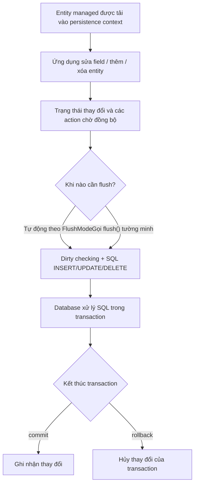

# FlushMode và các chế độ hỗ trợ theo API Hibernate hoặc Jakarta Persistence

Trong Hibernate, **dirty checking** giúp phát hiện những thay đổi đối với entity đang được quản lý, còn **flush** là quá trình đồng bộ những thay đổi có thể ghi được từ persistence context xuống cơ sở dữ liệu thông qua SQL. Một câu hỏi quan trọng xuất hiện ngay sau đó: **Hibernate nên flush vào thời điểm nào?**

Câu trả lời chịu ảnh hưởng của **flush mode** (*chế độ flush*). Jakarta Persistence (JPA) định nghĩa hai chế độ chuẩn là `AUTO` và `COMMIT`. Hibernate có các chế độ chi tiết hơn, gồm `ALWAYS`, `AUTO`, `COMMIT` và `MANUAL`. Việc lựa chọn không chỉ ảnh hưởng hiệu năng; nó còn ảnh hưởng thời điểm query quan sát dữ liệu vừa sửa, thời điểm constraint SQL được kiểm tra và trách nhiệm gọi `flush()` của ứng dụng.

Điểm phải nhớ từ đầu:

> **Flush không phải commit.** Flush có thể gửi `INSERT`, `UPDATE` hoặc `DELETE` vào database trong transaction hiện tại; chỉ khi transaction commit thành công những thay đổi đó mới trở thành kết quả đã xác nhận theo quy tắc transaction. Rollback vẫn có thể hủy SQL đã được flush.

Bài này giải thích các chế độ theo đúng API sử dụng, so sánh ảnh hưởng lên query và transaction, đồng thời đưa ra ví dụ để nhận biết khi nào nên dùng flush mặc định và khi nào cần điều khiển tường minh.

## 1. Bối cảnh: persistence context, dirty checking và flush

Giả sử một entity đơn giản:

```java
import jakarta.persistence.Column;
import jakarta.persistence.Entity;
import jakarta.persistence.Id;
import jakarta.persistence.Table;

@Entity
@Table(name = "customer")
public class Customer {

    @Id
    private Long id;

    @Column(name = "full_name", nullable = false)
    private String fullName;

    protected Customer() {}

    public Customer(Long id, String fullName) {
        this.id = id;
        this.fullName = fullName;
    }

    public Long getId() {
        return id;
    }

    public String getFullName() {
        return fullName;
    }

    public void rename(String newName) {
        this.fullName = newName;
    }
}
```

Trong một transaction:

```java
Customer customer = entityManager.find(Customer.class, 42L);
customer.rename("Nguyen An");
```

Khi `customer` là **managed entity**, Hibernate có thể phát hiện rằng `fullName` đã thay đổi so với trạng thái theo dõi. Tuy nhiên, ngay sau `rename` không nhất thiết có câu SQL `UPDATE` được gửi xuống database.

Có thể hình dung quá trình:



Hibernate không chỉ làm dirty checking với các field cơ bản. Những thao tác như `persist`, `remove`, thay đổi quan hệ và collection được quản lý cũng có thể tạo các hành động cần đồng bộ khi flush. Chi tiết SQL phụ thuộc chiến lược sinh khóa, cascade, mapping và cách Hibernate xử lý action queue.

### 1.1. Ba thời điểm không nên đánh đồng

| Thời điểm | Điều xảy ra | Điều chưa chắc đã xảy ra |
|---|---|---|
| Sửa field Java | Managed object mang giá trị mới | Chưa chắc có SQL `UPDATE` |
| Flush | Hibernate đồng bộ thay đổi phù hợp vào database trong transaction | Chưa có commit |
| Commit | Transaction được xác nhận nếu thành công | Không có nghĩa mọi query trước commit đã thấy cùng kết quả nếu flush mode hạn chế |

Ví dụ:

```java
customer.rename("Nguyen An");  // Thay đổi trạng thái Java.
entityManager.flush();         // Có thể chạy UPDATE ngay.
transaction.commit();          // Xác nhận transaction.
```

Lệnh `flush()` còn có thể phát hiện lỗi constraint sớm hơn thời điểm commit. Nhưng sau flush, transaction vẫn có thể thất bại và rollback; không nên xuất thông báo “đã lưu thành công vĩnh viễn” chỉ vì `flush()` không ném exception.

## 2. FlushMode điều khiển điều gì và không điều khiển điều gì?

**Flush mode** điều khiển chính sách **tự động đồng bộ persistence context** tại những điểm Hibernate cho là phù hợp, đặc biệt trước khi thực thi query và ở ranh giới transaction.

Flush mode **không** quyết định:

- Một entity là managed hay detached.
- Query phải dùng `JOIN` hay `SELECT` riêng cho quan hệ.
- Transaction được commit hay rollback.
- JDBC connection có `autoCommit = true` hay không.
- Có bao nhiêu row trong database thỏa query.
- Một collection có được lazy-load hay không.
- Quyền cập nhật dữ liệu hoặc constraint nghiệp vụ.
- Việc gọi `flush()` tường minh có được thay bằng commit hay không.

Một flush mode “ít flush hơn” cũng **không phải chế độ read-only về nghiệp vụ**. Nó chỉ thay đổi thời điểm đồng bộ; quyền ghi vẫn cần được bảo vệ bằng kiến trúc ứng dụng, transaction, validation và database.

## 3. Hai tầng API: Jakarta Persistence và Hibernate

Ứng dụng Hibernate thường tương tác qua một trong hai API:

**Jakarta Persistence:**

```java
import jakarta.persistence.EntityManager;
import jakarta.persistence.FlushModeType;
```

**Hibernate native:**

```java
import org.hibernate.Session;
import org.hibernate.FlushMode;
```

Chúng có tên gần giống nhưng **không phải cùng một enum**.

| API | Kiểu enum | Những chế độ chính |
|---|---|---|
| Jakarta Persistence | `jakarta.persistence.FlushModeType` | `AUTO`, `COMMIT` |
| Hibernate | `org.hibernate.FlushMode` | `ALWAYS`, `AUTO`, `COMMIT`, `MANUAL` |

Hai chế độ `AUTO` và `COMMIT` có thể được cấu hình theo JPA hoặc Hibernate; còn `ALWAYS` và `MANUAL` là những lựa chọn mở rộng thuộc API Hibernate, không nằm trong `FlushModeType` chuẩn.

Một dự án có thể dùng `EntityManager` cho phần lớn nghiệp vụ nhưng `unwrap(Session.class)` tại vị trí đặc biệt để sử dụng các tùy chọn Hibernate. Cách này gắn ứng dụng vào một implementation cụ thể và cần được ghi nhận như một quyết định kiến trúc.

### 3.1. Không import nhầm enum

Hai đoạn khác nhau:

```java
entityManager.setFlushMode(FlushModeType.COMMIT);
```

```java
session.setHibernateFlushMode(FlushMode.MANUAL);
```

Không viết `entityManager.setFlushMode(FlushMode.MANUAL)`: method JPA nhận `FlushModeType`, không nhận `org.hibernate.FlushMode`. Tương tự, API Hibernate-specific dùng kiểu Hibernate.

## 4. `FlushModeType.AUTO` theo Jakarta Persistence

`AUTO` là chế độ flush mặc định theo mô hình JPA thông dụng, trừ khi được cấu hình khác.

```java
entityManager.setFlushMode(FlushModeType.AUTO);
```

Ở mức ngữ nghĩa JPA, khi một query được thực thi trong transaction, provider phải bảo đảm kết quả query phản ánh những cập nhật trong persistence context **có thể ảnh hưởng đến kết quả query đó**. Provider có thể đạt được điều này bằng flush hoặc bằng cơ chế khác; chuẩn không bắt buộc mỗi query đều phải phát SQL ngay.

Hibernate thường thực hiện cơ chế **auto-flush khi cần**. Đặc biệt, với JPQL/HQL, nó có thể kiểm tra xem các bảng liên quan đến query có giao với các bảng đang có thay đổi chờ đồng bộ hay không.

### 4.1. Ví dụ query nhìn thấy thay đổi đang chờ

```java
Customer customer = entityManager.find(Customer.class, 42L);
customer.rename("Nguyen An");

// Query trên Customer có thể yêu cầu auto-flush.
List<Customer> result = entityManager.createQuery(
    "select c from Customer c " +
    "where c.fullName = :name",
    Customer.class
)
.setParameter("name", "Nguyen An")
.getResultList();
```

Từ góc nhìn nghiệp vụ, query được thực hiện trong transaction với flush mode `AUTO` cần có semantics phản ánh thay đổi đang managed có liên quan. Hibernate có thể flush `UPDATE customer` trước query, thay vì để database vẫn lọc theo tên cũ.

Không nên biến ví dụ này thành giả định rằng query `SELECT` nào cũng gây `UPDATE` trước đó. Điều kiện **ảnh hưởng đến kết quả query** mới quan trọng.

### 4.2. Query không liên quan có thể không kích hoạt flush

Thêm entity:

```java
@Entity
@Table(name = "audit_event")
public class AuditEvent {

    @Id
    private Long id;

    @Column(name = "message")
    private String message;

    protected AuditEvent() {}
}
```

Trong một transaction, nếu ứng dụng chỉ sửa `Customer` rồi query `AuditEvent`:

```java
Customer customer = entityManager.find(Customer.class, 42L);
customer.rename("Nguyen An");

List<AuditEvent> events = entityManager.createQuery(
    "select a from AuditEvent a",
    AuditEvent.class
).getResultList();
```

Các bảng `customer` và `audit_event` không có sự giao nhau theo mapping đơn giản này. Hibernate `AUTO` thường có thể bỏ qua flush trước query sự kiện, rồi đồng bộ thay đổi customer ở thời điểm khác, ví dụ trước commit.

Đây là tối ưu về hành vi Hibernate, không phải hợp đồng rằng mọi JPQL query không join customer sẽ **không bao giờ** flush trong mọi mapping phức tạp.

## 5. `FlushModeType.COMMIT` theo Jakarta Persistence

`COMMIT` thiên về việc trì hoãn đồng bộ cho đến khi transaction commit, thay vì bắt buộc xử lý mỗi query như ở `AUTO`.

```java
entityManager.setFlushMode(FlushModeType.COMMIT);
```

Điểm đặc biệt cần thuộc: **chuẩn Jakarta Persistence không xác định rõ ảnh hưởng của những thay đổi đang chờ flush lên kết quả query ở chế độ `COMMIT`**. Nói cách khác, không được viết logic phụ thuộc vào việc query chắc chắn thấy hoặc chắc chắn không thấy thay đổi chưa được flush.

Ví dụ:

```java
Customer customer = entityManager.find(Customer.class, 42L);
customer.rename("Nguyen An");

List<Customer> matches = entityManager.createQuery(
    "select c from Customer c where c.fullName = :name",
    Customer.class
)
.setParameter("name", "Nguyen An")
.getResultList();
```

Với `FlushModeType.COMMIT`, kết quả query liên quan thay đổi chưa flush **không được bảo đảm giống như `AUTO` theo chuẩn**. Provider hoặc tình huống cụ thể có thể cho kết quả khác nhau.

Ngoài ra cần phân biệt hai kiểu truy cập:

- `entityManager.find(Customer.class, 42L)` có thể trả chính managed instance đang có tên mới trong persistence context.
- JPQL filter theo tên chạy tại database có thể chưa nhìn thấy giá trị mới nếu SQL `UPDATE` chưa được flush.

Vì vậy, đừng suy luận từ một lần `find` ra kết luận rằng mọi query `WHERE` cũng sẽ quan sát trạng thái mới tương tự.

### 5.1. Trường hợp cần kết quả query chắc chắn được đồng bộ

Nếu quy trình dùng `COMMIT` nhưng sau khi sửa entity cần query phải nhìn thấy các thay đổi của transaction theo database semantics, hãy gọi flush tường minh khi thích hợp:

```java
customer.rename("Nguyen An");
entityManager.flush();

List<Customer> result = entityManager.createQuery(
    "select c from Customer c where c.fullName = :name",
    Customer.class
)
.setParameter("name", "Nguyen An")
.getResultList();
```

Sau `flush()` thành công, SQL liên quan đã được gửi trong transaction, nên query sau đó trên cùng transaction thường thấy tác động của các lệnh ghi ấy theo isolation/ràng buộc DB. Tuy nhiên, điều này **không đồng nghĩa transaction đã commit** hoặc các transaction khác đã nhìn thấy dữ liệu.

## 6. Các chế độ `org.hibernate.FlushMode`

Hibernate cung cấp bốn chế độ thường dùng:

| Hibernate `FlushMode` | Hành vi khái quát | Mục đích |
|---|---|---|
| `ALWAYS` | Flush trước mỗi query theo chính sách Hibernate, ngoài các điểm flush khác | Muốn đồng bộ trước mọi query, chấp nhận chi phí cao |
| `AUTO` | Flush ở commit và khi cần trước query để bảo đảm tính nhất quán phù hợp | Lựa chọn mặc định cân bằng đúng đắn và hiệu năng |
| `COMMIT` | Chủ yếu flush trước commit; hạn chế auto-flush trước query | Giảm flush trước query khi semantics cho phép |
| `MANUAL` | Chỉ flush theo yêu cầu tường minh của ứng dụng trong các tình huống thông thường | Kiểm soát đặc biệt, thường dùng trong một số luồng đọc hoặc batch có chủ đích |

Đây là bản tóm lược để định hướng thiết kế. Mức flush chính xác còn phụ thuộc API truy vấn, transaction, mapping, generated IDs, bulk operations và Hibernate version.

### 6.1. `FlushMode.ALWAYS`

`ALWAYS` yêu cầu Hibernate chủ động flush trước query theo chính sách của mode này, dù query không trực tiếp liên quan bảng đang có thay đổi.

```java
Session session = entityManager.unwrap(Session.class);
session.setHibernateFlushMode(FlushMode.ALWAYS);
```

Ví dụ:

```java
Customer customer = session.find(Customer.class, 42L);
customer.rename("Nguyen An");

// Query trên AuditEvent dù không liên quan Customer.
List<AuditEvent> events = session.createQuery(
    "from AuditEvent", AuditEvent.class
).getResultList();
```

Với `ALWAYS`, Hibernate có thể tiến hành flush ngay trước query trên `AuditEvent`, khiến những thay đổi đang chờ ở `Customer` được đồng bộ sớm hơn so với `AUTO`.

**Đánh đổi:** mỗi query có thêm cơ hội phải dirty-check/flush, tăng chi phí CPU, SQL và thời điểm gặp constraint. `ALWAYS` hiếm khi là lựa chọn mặc định tốt cho một ứng dụng CRUD thông thường.

### 6.2. `FlushMode.AUTO`

Đây là lựa chọn Hibernate phổ biến nhất, tương ứng với ý định mặc định của JPA. Hibernate tự flush trước commit và trước những truy vấn có khả năng cần đồng bộ, phụ thuộc query spaces và hình thức truy vấn.

```java
session.setHibernateFlushMode(FlushMode.AUTO);
```

Ưu điểm là không cần ứng dụng gọi `flush()` sau mọi `persist` hoặc setter, đồng thời tránh flush vô ích trong nhiều tình huống đọc không liên quan.

### 6.3. `FlushMode.COMMIT`

```java
session.setHibernateFlushMode(FlushMode.COMMIT);
```

Hibernate chủ yếu đồng bộ khi transaction chuẩn bị commit. Do đó, query thực hiện trước commit có thể chưa phản ánh những thay đổi pending khi xử lý ở database. Một số tình huống đặc thù vẫn có thể thực hiện SQL sớm hoặc flush theo quy tắc riêng; không diễn đạt mode này thành lời hứa “Hibernate tuyệt đối không phát SQL trước commit”.

### 6.4. `FlushMode.MANUAL`

```java
session.setHibernateFlushMode(FlushMode.MANUAL);
```

Trong chế độ `MANUAL`, Hibernate không tự động flush ở những điểm thông thường; ứng dụng phải **chủ động gọi `flush()`** khi muốn đồng bộ. Đặc biệt, không được giả định `Transaction.commit()` sẽ tự flush toàn bộ thay đổi như ở `AUTO`.

Ví dụ:

```java
try (Session session = sessionFactory.openSession()) {
    Transaction tx = session.beginTransaction();

    session.setHibernateFlushMode(FlushMode.MANUAL);

    Customer customer = session.find(Customer.class, 42L);
    customer.rename("Nguyen An");

    session.flush(); // Quan trọng nếu muốn ghi thay đổi.
    tx.commit();
}
```

Nếu bỏ `session.flush()` khi dùng `MANUAL`, thay đổi field managed có thể **không được đồng bộ vào database** trước khi transaction kết thúc. Không dùng `MANUAL` như một thủ thuật tối ưu chung cho các luồng ghi nếu code không kiểm soát rất rõ thời điểm flush.

### 6.5. `MANUAL` không đồng nghĩa transaction read-only tuyệt đối

Một số lệnh có thể cần SQL ngay do cách sinh ID, truy vấn/bulk operation hoặc thao tác JDBC trực tiếp; việc đặt `MANUAL` không phải tường lửa chặn mọi ghi SQL. Muốn bảo vệ read-only ở mức hệ thống phải dùng quy tắc transaction, quyền DB và kiến trúc ứng dụng thích hợp.

## 7. So sánh `AUTO`, `COMMIT`, `ALWAYS` và `MANUAL` trên cùng một tình huống

Giả sử transaction có các bước:

1. Đọc `Customer #42`.
2. Sửa `fullName`.
3. Query `AuditEvent` (bảng không liên quan).
4. Query `Customer` lọc bằng `fullName`.
5. Kết thúc transaction.

Bảng dưới mô tả hành vi Hibernate điển hình khi không có flush tường minh và không có cấu hình đặc biệt:

| Thời điểm | `ALWAYS` | `AUTO` | `COMMIT` | `MANUAL` |
|---|---|---|---|---|
| Ngay sau setter | Thường chưa flush | Thường chưa flush | Thường chưa flush | Thường chưa flush |
| Trước query `AuditEvent` | Flush | Thường không cần flush | Thường không auto-flush | Không auto-flush |
| Trước query `Customer` liên quan thay đổi | Flush | Có thể flush vì query overlap | Không bảo đảm tự flush | Không auto-flush |
| Tại commit | Những gì còn pending được xử lý theo lifecycle | Thường flush | Thường flush | Không mặc định tự flush |
| Muốn buộc flush tại một điểm cụ thể | Gọi `flush()` | Gọi `flush()` | Gọi `flush()` | **Phải gọi `flush()`** |

Bảng không có nghĩa Hibernate **luôn** phát một SQL `UPDATE` tại mọi điểm ghi “Flush”. Nếu không có thay đổi thực tế hoặc những action cần đồng bộ đã được xử lý, flush có thể không tạo SQL ghi nào.

## 8. Cách đặt flush mode trên `EntityManager`

API JPA:

```java
import jakarta.persistence.EntityManager;
import jakarta.persistence.FlushModeType;

entityManager.setFlushMode(FlushModeType.AUTO);
// hoặc
entityManager.setFlushMode(FlushModeType.COMMIT);

FlushModeType configured = entityManager.getFlushMode();
```

Flush mode đặt ở `EntityManager` làm chính sách cơ sở cho những thao tác query/flush trong phạm vi context đó, trừ khi query có override riêng hoặc provider/framework thiết lập khác.

Đối với container-managed hoặc transaction-scoped `EntityManager` trong framework, cần hiểu ai tạo, ai đóng và ai áp dụng cấu hình. Không tự mở/đóng EntityManager bằng tay trong một service đã dùng dependency injection nếu framework đang sở hữu lifecycle.

### 8.1. Đặt flush mode trên một query JPA

```java
TypedQuery<Customer> query = entityManager.createQuery(
    "select c from Customer c where c.fullName = :name",
    Customer.class
);

query.setFlushMode(FlushModeType.AUTO);
query.setParameter("name", "Nguyen An");

List<Customer> customers = query.getResultList();
```

Flush mode ở query cho phép chỉ định chính sách áp dụng khi **query đó thực thi**, thay vì thay đổi cấu hình mặc định của toàn bộ persistence context.

Một query có `FlushModeType.COMMIT` có thể hạn chế việc auto-flush trước chính query đó; tuy nhiên transaction vẫn cần flush/commit đúng đắn và các thao tác khác có thể sử dụng mode khác. Không nghĩ rằng query-level override sẽ thay đổi vĩnh viễn flush mode của cả EntityManager.

### 8.2. Phạm vi áp dụng nên nhỏ và rõ ràng

Nếu chỉ có một query đặc biệt cần semantics `AUTO` hoặc muốn hạn chế auto-flush, ưu tiên query-level setting thay vì đổi flush mode toàn bộ EntityManager rồi quên khôi phục.

Ví dụ use case có luồng thao tác chung:

```java
// Chính sách toàn context vẫn AUTO.
entityManager.setFlushMode(FlushModeType.AUTO);

TypedQuery<AuditEvent> query = entityManager.createQuery(
    "select a from AuditEvent a order by a.id",
    AuditEvent.class
);

query.setFlushMode(FlushModeType.COMMIT);
List<AuditEvent> events = query.getResultList();
```

Cần đánh giá query thực tế có thể nhìn thấy dữ liệu pending nào. Nếu một query dựa vào những thay đổi chưa flush, `COMMIT` có thể không phù hợp.

## 9. Cách đặt flush mode qua `Session` của Hibernate

Khi dùng native API:

```java
import org.hibernate.FlushMode;
import org.hibernate.Session;

Session session = entityManager.unwrap(Session.class);

session.setHibernateFlushMode(FlushMode.MANUAL);

FlushMode current = session.getHibernateFlushMode();
```

`setHibernateFlushMode` diễn đạt rõ kiểu enum Hibernate mà ứng dụng đang đặt. Một số phiên bản còn có API `setFlushMode` hoặc tên method khác phục vụ tương thích; khi viết mã mới nên theo API hiện hành của đúng phiên bản Hibernate đang dùng.

### 9.1. Flush mode trên query Hibernate

Một số Hibernate Query API cung cấp tùy chọn flush mode riêng:

```java
import org.hibernate.query.Query;

Query<Customer> query = session.createQuery(
    "from Customer c where c.fullName = :name",
    Customer.class
);

query.setHibernateFlushMode(FlushMode.ALWAYS);
query.setParameter("name", "Nguyen An");

List<Customer> result = query.getResultList();
```

`setHibernateFlushMode` ở query là phần mở rộng Hibernate: cho phép dùng `ALWAYS` hoặc `MANUAL` ở phạm vi truy vấn nếu API/phiên bản hỗ trợ. Các method và kiểu query có thể thay đổi theo Hibernate major version; cần căn cứ dependency thực tế thay vì trộn API của Hibernate 5 với Hibernate 6.

### 9.2. Cần chú ý khi đổi mode tạm thời

Một service có thể dùng cùng persistence context để thực hiện nhiều việc. Nếu tự chuyển Session từ `AUTO` sang `MANUAL` rồi quên khôi phục, những thao tác ghi sau đó có thể không được flush như mong đợi.

Ví dụ khung quản lý:

```java
Session session = entityManager.unwrap(Session.class);

FlushMode previous = session.getHibernateFlushMode();
try {
    session.setHibernateFlushMode(FlushMode.MANUAL);

    // Đọc dữ liệu hoặc thao tác có kiểm soát.
    // Nếu có ghi cần lưu, phải flush tường minh.
} finally {
    session.setHibernateFlushMode(previous);
}
```

Đặt lại mode trong `finally` giúp không vô tình duy trì thay đổi cấu hình sau khi kết thúc khối mã. Tuy vậy, **khôi phục mode không tự flush những thay đổi đang chờ**; ứng dụng vẫn phải quyết định khi nào flush/rollback.

Không nên thay đổi flush mode tùy tiện trên EntityManager/Session đang được các thành phần khác của framework quản lý nếu không hiểu rõ ranh giới transaction.

## 10. Auto-flush với JPQL/HQL và query spaces

Một nét đặc trưng của Hibernate là khả năng xác định **query spaces** — các bảng có thể bị truy vấn ảnh hưởng hoặc tham gia vào kết quả — để quyết định liệu cần auto-flush trước HQL/JPQL query hay không trong chế độ `AUTO`.

Ví dụ hai entity riêng:

```text
Customer      -> bảng customer
AuditEvent    -> bảng audit_event
```

Một transaction sửa customer:

```java
Customer customer = session.find(Customer.class, 42L);
customer.rename("Nguyen An");
```

Query trên bảng không liên quan:

```java
session.createQuery(
    "from AuditEvent", AuditEvent.class
).getResultList();
```

Hibernate có thể không flush vì query không phụ thuộc bảng `customer`.

Query trên bảng liên quan:

```java
session.createQuery(
    "from Customer c where c.fullName = :name",
    Customer.class
)
.setParameter("name", "Nguyen An")
.getResultList();
```

Hibernate có thể flush trước query vì pending `UPDATE customer` giao với query spaces chứa `customer`.

### 10.1. Không đồng nhất query space với một bảng duy nhất

Một entity có thể ánh xạ nhiều bảng do inheritance, secondary table hoặc collection. Một HQL query có join/fetch hoặc subquery cũng có thể chạm nhiều bảng. Do đó, cơ chế quyết định auto-flush thực tế có thể phức tạp hơn ví dụ hai bảng đơn.

Không xây dựng logic nghiệp vụ phụ thuộc vào việc “query A nhất định không flush” chỉ vì nhìn tên entity trong câu HQL. Khi correctness yêu cầu đồng bộ tại thời điểm cụ thể, gọi `flush()` có chủ đích.

### 10.2. Query đã đọc managed instance không đồng nghĩa SQL đã flush

Nếu query trả `Customer #42` vốn đang managed, Hibernate có thể trả object trong identity map với state mới. Nhưng điều kiện `WHERE` và kết quả `COUNT`/`SUM` có thể được tính ở database.

Vì vậy:

- “Giá trị field của object trả về” là một câu hỏi.
- “Bản ghi nào thỏa điều kiện SQL khi query chạy” là câu hỏi khác.

Flush mode đặc biệt quan trọng cho câu hỏi thứ hai.

## 11. Native SQL: khác biệt thường gặp giữa `EntityManager` và `Session`

Native query là một tình huống cần chú ý vì Hibernate không phải lúc nào cũng suy ra bảng nào bị query ảnh hưởng chỉ từ chuỗi SQL.

Với Jakarta Persistence `EntityManager` ở chế độ `AUTO`, native query thường được xử lý sao cho trạng thái cần thiết được đồng bộ trước khi query, theo semantics JPA.

```java
Customer customer = entityManager.find(Customer.class, 42L);
customer.rename("Nguyen An");

Object count = entityManager.createNativeQuery(
    "select count(*) from customer"
).getSingleResult();
```

Tùy provider, native query thông qua `EntityManager` có thể kích hoạt flush, kể cả khi framework không phân tích toàn bộ bảng trong SQL.

Với Hibernate native `Session`, auto-flush trước native SQL có thể khác. Nếu Hibernate không biết query space có liên quan đến bảng `customer`, một số cấu hình/version có thể không flush pending change trước native query khi dùng `AUTO`.

### 11.1. Đăng ký bảng/entity được native query sử dụng

Hibernate native query có API khai báo vùng đồng bộ:

```java
import org.hibernate.query.NativeQuery;

NativeQuery<?> query = session.createNativeQuery(
    "select count(*) from customer"
);

query.addSynchronizedEntityClass(Customer.class);

Object count = query.getSingleResult();
```

`addSynchronizedEntityClass(Customer.class)` cho Hibernate metadata về entity/table mà native query liên quan, giúp cơ chế auto-flush/invalidation hoạt động phù hợp hơn.

Có những API đồng bộ theo query space hoặc entity name tùy phiên bản. Ý tưởng là **khai báo sự phụ thuộc của SQL với trạng thái ORM**, thay vì phó mặc Hibernate đoán từ một chuỗi SQL tự do.

### 11.2. Khi cần chắc chắn, flush tường minh

```java
customer.rename("Nguyen An");
session.flush();

Object count = session.createNativeQuery(
    "select count(*) from customer"
).getSingleResult();
```

Lúc này pending state đã được đồng bộ theo transaction trước query. Hãy cân nhắc loại query, dialect, isolation và hiệu năng; không dùng `flush()` sau mọi setter một cách máy móc.

### 11.3. Đừng khái quát một behavior cho mọi API

Câu “native SQL luôn flush trước khi chạy” hoặc “native SQL không bao giờ auto-flush” đều quá tuyệt đối. Hành vi phụ thuộc **EntityManager so với Session, flush mode, query synchronization và Hibernate version**.

Đối với use case quan trọng, xác định mode và API thực sự đang dùng. Đừng dựa vào một ví dụ chạy thử với JPA `EntityManager` rồi suy ra nó đúng nguyên xi với Hibernate `Session` native query.

## 12. Flush với transaction commit, rollback và lỗi SQL

Ví dụ transaction resource-local JPA:

```java
EntityTransaction tx = entityManager.getTransaction();

try {
    tx.begin();

    Customer customer = entityManager.find(Customer.class, 42L);
    customer.rename("Nguyen An");

    // Khi flush mode AUTO, provider thường flush tại commit.
    tx.commit();
} catch (RuntimeException ex) {
    if (tx.isActive()) {
        tx.rollback();
    }
    throw ex;
}
```

Ví dụ này áp dụng cho resource-local `EntityManager`; với JTA/Spring-managed transaction, không tự gọi `begin/commit` mà để transaction manager điều phối.

### 12.1. SQL đã được flush vẫn có thể bị rollback

```java
tx.begin();

Customer customer = entityManager.find(Customer.class, 42L);
customer.rename("Nguyen An");

entityManager.flush(); // UPDATE có thể đã chạy.

tx.rollback(); // Transaction hủy thay đổi đã flush.
```

Nếu một connection khác ở isolation thông thường truy vấn trước khi transaction commit, nó không nhất thiết thấy thay đổi chưa commit. Quy tắc nhìn thấy dữ liệu phụ thuộc isolation level và DBMS.

**Flush là đồng bộ trong transaction, không phải điểm commit.**

### 12.2. Flush có thể phát hiện constraint exception sớm

```java
Customer customer = entityManager.find(Customer.class, 42L);
customer.rename(null);

entityManager.flush(); // Có thể ném exception do NOT NULL.
```

Nếu cột `full_name` là `NOT NULL`, SQL `UPDATE` có thể bị database từ chối tại flush. Không có flush tường minh, lỗi có thể chỉ xuất hiện trước hoặc trong commit.

Lưu ý rằng constraint có thể được database cấu hình **deferred**, nên một số vi phạm vẫn chỉ xuất hiện tại commit dù đã gọi flush. Tương tự, deadlock hoặc lỗi commit có thể phát sinh muộn hơn.

### 12.3. Sau exception lúc flush, không tiếp tục dùng Session như bình thường

Khi flush thất bại vì lỗi persistence/JDBC, transaction có thể đã ở trạng thái không thể tiếp tục hợp lệ. Cách xử lý an toàn thường là:

1. Ngừng thao tác trong unit of work đó.
2. Rollback transaction nếu còn cần và có thể rollback.
3. Đóng hoặc giải phóng `Session`/`EntityManager` theo lifecycle framework.
4. Tạo unit of work mới nếu nghiệp vụ cần thử lại sau khi xử lý nguyên nhân.

Không đổi flush mode từ `AUTO` sang `MANUAL` rồi tiếp tục ghi để “né” exception. Điều đó chỉ trì hoãn hoặc che lỗi; trạng thái của persistence context sau lỗi có thể không đáng tin cậy.

## 13. `MANUAL` trong công việc batch: lợi ích và trách nhiệm

Một số luồng xử lý dữ liệu lớn muốn kiểm soát khi nào gửi SQL và lúc nào giải phóng entity khỏi first-level cache.

Ví dụ dùng Hibernate Session và transaction:

```java
try (Session session = sessionFactory.openSession()) {
    Transaction tx = session.beginTransaction();

    session.setHibernateFlushMode(FlushMode.MANUAL);

    try {
        int batchSize = 100;

        for (int i = 0; i < customers.size(); i++) {
            session.persist(customers.get(i));

            if ((i + 1) % batchSize == 0) {
                session.flush();
                session.clear();
            }
        }

        session.flush(); // Phần tử cuối chưa đủ batch.
        session.clear();

        tx.commit();
    } catch (RuntimeException ex) {
        tx.rollback();
        throw ex;
    }
}
```

Ví dụ minh họa cách điều khiển rõ ràng:

- `flush()` gửi các thay đổi cần thiết xuống database trong transaction.
- `clear()` tháo các managed entity khỏi context để giảm bộ nhớ theo dõi.
- `commit()` xác nhận transaction.
- `MANUAL` yêu cầu gọi `flush()`, kể cả cho batch cuối không đủ số lượng.

**`flush()` và `clear()` không phải một cặp có thể hoán đổi.** Nếu gọi `clear()` trước khi flush, có nguy cơ các thay đổi chưa đồng bộ bị mất khỏi trạng thái managed.

### 13.1. Batching JDBC và flush mode là hai cơ chế khác nhau

Cấu hình như:

```properties
hibernate.jdbc.batch_size=50
```

liên quan tới JDBC statement batching. Nó không tự quyết định khi nào persistence context flush. Ngược lại, gọi `flush()` sau mỗi entity có thể phá lợi ích gom batch và làm tăng round-trip.

Khi tối ưu batch, phải xem:

- Hibernate flush mode.
- Kích thước batch JDBC.
- Chiến lược sinh ID (`IDENTITY` có thể hạn chế insert batching).
- Thời điểm `flush/clear`.
- Kích thước transaction, lock và retry.
- Các collection/cascade được quản lý trong cùng context.

Không nên đổi `MANUAL` chỉ vì thấy nó “ít SQL hơn”; số SQL và thời điểm flush là hai vấn đề khác nhau.

## 14. Chế độ `MANUAL` trong các luồng đọc của Spring

Trong một số cấu hình Spring + Hibernate, `@Transactional(readOnly = true)` có thể khiến framework điều chỉnh flush behavior, ví dụ sử dụng Hibernate `MANUAL` để tránh dirty checking/auto-flush không cần thiết trong transaction chỉ đọc.

```java
@Service
public class CustomerQueryService {

    private final CustomerRepository customers;

    public CustomerQueryService(CustomerRepository customers) {
        this.customers = customers;
    }

    @Transactional(readOnly = true)
    public CustomerSummary findSummary(Long id) {
        Customer customer = customers.findById(id).orElseThrow();
        return new CustomerSummary(
            customer.getId(),
            customer.getFullName()
        );
    }
}
```

`CustomerSummary` trong ví dụ là một DTO/record do ứng dụng định nghĩa.

Tuy nhiên:

- `readOnly = true` là một **hint/cấu hình transaction** được transaction manager và provider diễn giải theo ngữ cảnh.
- Không được giả định mọi phiên bản Spring, mọi transaction manager và mọi JPA provider đều chuyển Hibernate Session sang đúng cùng một flush mode.
- Nó **không phải cơ chế phân quyền ngăn UPDATE ở database**.
- Không nên lén sửa entity trong transaction read-only rồi mong thay đổi chắc chắn được lưu hoặc chắc chắn bị chặn.

Nếu một service cần ghi dữ liệu, hãy thiết kế transaction ghi rõ ràng và sử dụng flush mode phù hợp. Nếu service chỉ cần dữ liệu đọc, projection/DTO và transaction read-only có thể hữu ích nhưng không thay thế truy vấn được giới hạn đúng.

### 14.1. Không can thiệp flush mode trên context do framework quản lý nếu chưa hiểu transaction

Một Session gắn với Spring transaction có thể được framework cấu hình flush mode và khôi phục khi transaction kết thúc. Việc tự đổi mode giữa chừng rồi giữ trạng thái đó có thể làm các repository hoặc service khác trong cùng transaction hoạt động bất ngờ.

Nếu cần dùng Hibernate-specific mode, khoanh vùng ở service/repository có chủ đích, tài liệu hóa lý do và tránh thay đổi session đang chia sẻ cho các thao tác không liên quan.

## 15. FlushMode và `@GeneratedValue`: có SQL xảy ra trước flush không?

Có. Flush mode không đồng nghĩa với việc **mọi** SQL ghi đều chờ tới flush.

Ví dụ:

```java
@Id
@GeneratedValue(strategy = GenerationType.IDENTITY)
private Long id;
```

Với `IDENTITY`, database thường phải thực hiện `INSERT` để sinh giá trị khóa chính. Hibernate có thể cần gửi SQL sớm khi `persist` hoặc tại một thời điểm đặc biệt, thay vì đợi một flush tổng quát.

Do đó:

```java
entityManager.persist(newCustomer);
```

có thể kích hoạt SQL sớm tùy generator, transaction và provider. Không kết luận rằng mode `COMMIT` hoặc `MANUAL` ngăn toàn bộ `INSERT` trước commit.

Tương tự, một thao tác JDBC trực tiếp hoặc một bulk query dùng API riêng có thể thực thi SQL tại thời điểm gọi. Flush mode chủ yếu điều khiển **đồng bộ tự động của trạng thái ORM đang chờ**, không phải lịch chạy của tất cả lệnh SQL trong ứng dụng.

### 15.1. `flush()` không cấp ID theo một quy tắc duy nhất

Một số generator cấp ID trước khi SQL `INSERT` thực sự được gửi. Generator khác cần database sinh ID. Vì vậy, việc thấy `entity.getId() != null` không chứng minh transaction đã commit, và việc chưa gọi `flush()` không chứng minh chưa có SQL.

Nếu ứng dụng cần kiểm tra dữ liệu đã được lưu bền vững, hãy dựa trên kết quả transaction commit và constraint, không chỉ trạng thái field ID.

## 16. FlushMode và bulk JPQL/HQL, native DML

Giả sử ứng dụng sửa một managed `Customer` rồi chạy bulk update:

```java
Customer customer = entityManager.find(Customer.class, 42L);
customer.rename("Nguyen An");

int count = entityManager.createQuery(
    "update Customer c " +
    "set c.fullName = :newName " +
    "where c.id = :id"
)
.setParameter("newName", "Nguyen Binh")
.setParameter("id", 42L)
.executeUpdate();
```

Bulk JPQL/HQL thường **thực thi SQL trực tiếp** và không đồng bộ ngược mọi managed instance với kết quả bulk update. Vì thế có thể xuất hiện bất đồng giữa `customer.fullName` đang nằm trong memory và giá trị database sau bulk operation.

Đây không phải chỉ là vấn đề FlushMode; nó là khác biệt giữa:

- Thay đổi managed entity qua dirty checking.
- Thao tác bulk tác động trực tiếp nhiều hàng SQL.

Nếu trộn hai cơ chế trong cùng transaction, cần xác định thứ tự flush và xử lý persistence context sao cho không dùng state cũ để ghi đè kết quả bulk.

Một quy trình thường gặp:

```java
entityManager.flush();  // Đồng bộ state ORM đang chờ.
entityManager.clear();  // Chỉ dùng khi phù hợp: detach managed entities.

entityManager.createQuery(
    "update Customer c set c.fullName = :name " +
    "where c.id = :id"
)
.setParameter("name", "Nguyen Binh")
.setParameter("id", 42L)
.executeUpdate();
```

Sau `clear`, reference `customer` cũ là detached; muốn xem state mới nên tìm lại entity trong context mới/hiện tại. Không dùng `clear()` một cách máy móc nếu trong context còn thay đổi hợp lệ chưa đồng bộ hoặc các entity mà code phía sau dựa vào.

## 17. Query-level `COMMIT` không phải cách tối ưu mọi query

Một câu hỏi thường gặp: “Nếu `AUTO` có thể flush trước query, có nên đặt mọi query thành `COMMIT` để nhanh hơn?”

Không nên, vì:

1. Nếu query cần thấy thay đổi pending, `COMMIT` có thể cho kết quả không như nghiệp vụ mong đợi.
2. SQL được dồn tới lúc commit, khiến lỗi constraint xuất hiện muộn hơn.
3. Transaction có thể tạo nhiều thay đổi nhưng query ngay sau đó cần aggregate dựa trên state mới.
4. Hiệu năng không chỉ nằm ở số flush; còn có SQL count, execution plan, network và locks.
5. `AUTO` của Hibernate thường tránh flush trước query không liên quan, nên không mặc nhiên flush trên mọi `SELECT`.

Thay vì đổi mode trên diện rộng, trước tiên xác định query nào gây flush, vì sao flush xảy ra và liệu business logic yêu cầu đồng bộ hay không.

### 17.1. Trường hợp `COMMIT` có thể hữu ích

Một unit of work thực hiện nhiều phép sửa, nhưng chỉ chạy các query chắc chắn không cần quan sát thay đổi đang chờ và sẽ commit ở cuối. Nếu các query này gây flush không cần thiết, `COMMIT` có thể là lựa chọn cân nhắc.

Điều kiện là code không phụ thuộc query trả trạng thái mới trước commit; các thao tác ghi và constraint được xử lý đúng; và tác động hiệu năng được đo trong bối cảnh thực tế.

### 17.2. Trường hợp `ALWAYS` có thể hữu ích

Một số công việc đặc thù với native query/kiểm tra ràng buộc yêu cầu mọi query đi sau trạng thái ORM đã được đồng bộ. `ALWAYS` có thể đơn giản hóa behavior, nhưng tăng chi phí so với `AUTO`. Thông thường, dùng `flush()` ở một điểm nghiệp vụ rõ ràng sẽ dễ kiểm soát hơn là đặt toàn Session thành `ALWAYS`.

## 18. Ví dụ timeline với hai query và một transaction

Giả sử bảng `customer` hiện có:

```text
id = 42, full_name = "Lan"
```

Trong một transaction:

```java
Customer customer = entityManager.find(Customer.class, 42L);
customer.rename("Lan Nguyen");

Long numberOfLanNguyen = entityManager.createQuery(
    "select count(c) from Customer c " +
    "where c.fullName = :name",
    Long.class
)
.setParameter("name", "Lan Nguyen")
.getSingleResult();
```

Query `COUNT` được database đánh giá, nên hành vi có liên quan trực tiếp đến flush mode.

```mermaid
sequenceDiagram
    participant App as Ứng dụng
    participant PC as Persistence Context
    participant DB as Database
    App->>PC: find(Customer, 42)
    PC->>DB: SELECT customer
    DB-->>PC: full_name = "Lan"
    App->>PC: rename("Lan Nguyen")
    Note over PC: Dirty state; SQL UPDATE có thể chưa chạy
    App->>PC: JPQL COUNT tên "Lan Nguyen"
    alt AUTO và query có liên quan thay đổi
        PC->>DB: UPDATE customer
        PC->>DB: SELECT COUNT(...)
        DB-->>PC: count phản ánh update trong transaction
    else COMMIT hoặc MANUAL, chưa flush
        PC->>DB: SELECT COUNT(...)
        DB-->>PC: Kết quả có thể chưa phản ánh pending update
    end
    App->>PC: commit / flush theo mode
```

Với `AUTO`, Hibernate thường cần flush trước query `COUNT` liên quan bảng `customer`. Với `COMMIT`, query result đối với pending update không có bảo đảm đồng nhất theo JPA. Với `MANUAL`, đừng mong auto-flush để query nhìn thấy state mới; cần gọi `flush()` nếu nghiệp vụ yêu cầu.

Từ đó có một nguyên tắc thực dụng: **khi kết quả của một query quyết định bước nghiệp vụ tiếp theo và kết quả ấy phụ thuộc vào các thay đổi vừa thực hiện, hãy thiết kế rõ ràng ranh giới flush thay vì phó mặc vào suy đoán.**

## 19. Một số sai lầm khi dùng FlushMode

| Suy nghĩ sai | Vì sao sai | Cách tiếp cận |
|---|---|---|
| “`flush()` là commit” | SQL đã chạy trong transaction vẫn có thể rollback | Phân biệt đồng bộ và xác nhận transaction |
| “`AUTO` flush trước mọi query” | Hibernate có thể kiểm tra query spaces/overlap | Quan sát SQL thực tế, giữ mặc định nếu phù hợp |
| “`COMMIT` đảm bảo query không thấy pending changes” | JPA không xác định rõ tác động query ở mode này | Không phụ thuộc kết quả chưa flush; gọi flush nếu cần |
| “`MANUAL` vẫn tự lưu khi commit” | Hibernate MANUAL không mặc định auto-flush | Gọi `flush()` ở điểm cần ghi |
| “`MANUAL` là chế độ read-only an toàn” | Không khóa mọi loại SQL hoặc quyền ghi | Dùng transaction policy và DB privileges |
| “`setFlushMode` và `setHibernateFlushMode` nhận cùng enum” | JPA và Hibernate có hai kiểu enum khác nhau | Import và dùng đúng API |
| “Native query luôn có behavior giống JPQL” | Query spaces và đường API có thể khác | Đồng bộ native query hoặc flush tường minh |
| “Gọi `flush` sau mỗi setter để chắc ăn” | Tăng chi phí, phá batching và phát hiện lỗi quá sớm không cần thiết | Flush theo unit-of-work boundary hoặc nhu cầu query |
| “`clear` sau flush là commit” | `clear` detach state, không xác nhận transaction | Vẫn cần commit transaction |
| “Có ID nghĩa là đã lưu bền vững” | ID có thể cấp trước commit | Dựa vào kết quả transaction |
| “Đổi flush mode sẽ sửa lỗi constraint” | Constraint vẫn có hiệu lực khi SQL chạy | Sửa dữ liệu/mapping và rollback khi lỗi |
| “Spring read-only luôn = Hibernate MANUAL” | Phụ thuộc framework/provider/version | Kiểm tra cấu hình transaction thực tế |

## 20. Chẩn đoán khi SQL xảy ra sớm hoặc muộn hơn mong đợi

Nếu Hibernate ghi SQL trước một query khiến ứng dụng bất ngờ, hãy phân biệt:

- SQL phát sinh do **auto-flush**.
- SQL bắt buộc để **sinh khóa `IDENTITY`**.
- SQL của chính query, bulk update/delete hoặc native DML.
- SQL do lazy loading association, không nhất thiết là flush.
- SQL được trigger bởi một thao tác gọi `flush()` tường minh ở framework/service khác.

Những thông tin hữu ích cần kiểm tra trong quá trình điều tra:

1. Flush mode hiện hành trên `EntityManager` hoặc `Session`.
2. Query-level flush mode có override hay không.
3. Query là JPQL/HQL, Criteria hay native SQL.
4. Những bảng nào có action pending và query phụ thuộc bảng nào.
5. Cấu hình transaction manager, `@Transactional` và `readOnly`.
6. Có gọi `flush`, `saveAndFlush` hoặc thay đổi context trong repository không.
7. ID generator, cascade và batch configuration có bắt buộc SQL sớm không.
8. Lỗi SQL phát sinh khi flush, khi commit hay khi query chạy.
9. Transaction đã rollback hay persistence context vẫn đang giữ state lỗi.
10. Số query, số hàng ghi và thời gian thực thi thực tế.

Nếu bật Hibernate SQL logging và bind parameter logging để điều tra, cần bảo vệ dữ liệu nhạy cảm và tránh bật log mức cao bừa bãi trên production.

### 20.1. Các API hỗ trợ quan sát

```java
FlushModeType jpaMode = entityManager.getFlushMode();

Session session = entityManager.unwrap(Session.class);
FlushMode hibernateMode = session.getHibernateFlushMode();
```

Có thể bật thống kê Hibernate nếu cần:

```properties
hibernate.generate_statistics=true
```

Nhưng thống kê là công cụ đo lường, không phải bộ giải thích tự động toàn bộ nguyên nhân SQL. Một lần flush không nhất thiết đồng nghĩa một lệnh ghi, và số lần flush không nói hết lượng dữ liệu đã được truyền.

## 21. Bài thực hành A: sự khác nhau giữa `AUTO` và `COMMIT`

Bài toán: trong một transaction, service đổi tên customer từ `"Lan"` thành `"Lan Nguyen"` và ngay sau đó chạy JPQL `COUNT` lọc tên mới.

```java
entityManager.setFlushMode(FlushModeType.AUTO);

Customer c = entityManager.find(Customer.class, 42L);
c.rename("Lan Nguyen");

Long count = entityManager.createQuery(
    "select count(x) from Customer x " +
    "where x.fullName = :name",
    Long.class
)
.setParameter("name", "Lan Nguyen")
.getSingleResult();
```

**Câu hỏi:**

1. Vì sao Hibernate có thể flush trước query `COUNT`?
2. Nếu đổi mode thành `FlushModeType.COMMIT`, có thể mặc định `count` sẽ giống ở `AUTO` không?
3. Nếu ứng dụng cần query chắc chắn dựa trên dữ liệu vừa cập nhật ở DB, thao tác nào diễn đạt rõ ý định?

**Đáp án:**

1. Query `COUNT` phụ thuộc bảng `customer`, nơi đang có thay đổi pending.
2. Không. Ở mode `COMMIT`, JPA không xác định rõ ảnh hưởng của pending state tới query result.
3. Gọi `entityManager.flush()` trong transaction trước query, rồi thực thi query với đúng isolation/semantics DB, hoặc giữ `AUTO` khi đó là hợp đồng phù hợp.

## 22. Bài thực hành B: lỗi mất thay đổi khi dùng `MANUAL`

Cho đoạn mã Hibernate:

```java
try (Session session = sessionFactory.openSession()) {
    Transaction tx = session.beginTransaction();
    session.setHibernateFlushMode(FlushMode.MANUAL);

    Customer c = session.find(Customer.class, 42L);
    c.rename("New Name");

    tx.commit();
}
```

**Câu hỏi:** Có thể khẳng định DB đã có tên mới sau commit không? Nếu không, sửa thế nào?

**Đáp án:** Không. `MANUAL` không mặc định auto-flush trước commit. Nếu không có SQL ghi khác xảy ra sớm, thay đổi từ dirty checking có thể không được đồng bộ.

Sửa bằng flush tường minh:

```java
try (Session session = sessionFactory.openSession()) {
    Transaction tx = session.beginTransaction();
    session.setHibernateFlushMode(FlushMode.MANUAL);

    try {
        Customer c = session.find(Customer.class, 42L);
        c.rename("New Name");

        session.flush();
        tx.commit();
    } catch (RuntimeException ex) {
        tx.rollback();
        throw ex;
    }
}
```

Trong nhiều use case ghi thông thường, phương án đơn giản hơn là **giữ `AUTO`** và để Hibernate flush theo unit of work, thay vì dùng `MANUAL` rồi phải nhớ gọi flush khắp nơi.

## 23. Bài thực hành C: JPQL và native SQL

Giả sử có pending update cho `Customer`, rồi service chạy:

```java
Object count = entityManager.createNativeQuery(
    "select count(*) from customer"
).getSingleResult();
```

Tiếp đó một module khác chạy SQL tương tự qua Hibernate `Session`:

```java
Session session = entityManager.unwrap(Session.class);

Object count2 = session.createNativeQuery(
    "select count(*) from customer"
).getSingleResult();
```

**Câu hỏi:**

1. Có nên giả định hai API luôn có đúng cùng auto-flush behavior không?
2. Với Hibernate native query, metadata nào có thể giúp framework biết query phụ thuộc `Customer`?
3. Khi business rule đòi kết quả luôn dựa trên pending change đã đồng bộ, cách làm ít mơ hồ nhất là gì?

**Đáp án:**

1. Không. Hibernate phân biệt các đường thực thi native query tùy JPA `EntityManager`/native `Session`, mode và phiên bản.
2. Dùng `addSynchronizedEntityClass(Customer.class)` hoặc query-space synchronization phù hợp.
3. Gọi `flush()` tường minh trước query trong transaction phù hợp, nếu cần thiết và chấp nhận chi phí.

## 24. Bài thực hành D: flush sớm để phát hiện lỗi, nhưng chưa commit

Giả sử tên customer không được null theo schema:

```sql
CREATE TABLE customer (
    id BIGINT PRIMARY KEY,
    full_name VARCHAR(150) NOT NULL
);
```

Trong transaction:

```java
Customer c = entityManager.find(Customer.class, 42L);
c.rename(null);
entityManager.flush();
```

**Câu hỏi:**

1. Lỗi có thể xuất hiện ở `flush()` hay chỉ ở commit?
2. Nếu flush ném exception, có thể đổi flush mode rồi sửa field và tiếp tục dùng cùng persistence context như bình thường không?
3. Nếu flush thành công nhưng sau đó rollback, dữ liệu có được lưu vĩnh viễn không?

**Đáp án:**

1. Constraint `NOT NULL` thông thường có thể bị kiểm tra ngay ở thời điểm SQL `UPDATE` được flush; một số loại constraint deferred có thể lỗi muộn.
2. Không nên. Rollback, giải phóng Session/EntityManager lỗi theo lifecycle và tạo unit of work mới nếu cần.
3. Không. Rollback hủy thay đổi thuộc transaction chưa commit.

## 25. Hướng dẫn chọn chế độ trong ứng dụng thực tế

| Bối cảnh | Chế độ hoặc cách tiếp cận phù hợp | Lý do |
|---|---|---|
| CRUD JPA/Hibernate thông thường | `AUTO` | Cân bằng đồng bộ và chi phí tự động |
| Query phải phản ánh các thay đổi pending liên quan | `AUTO` hoặc `flush()` tường minh | Bảo đảm semantics rõ ràng |
| Nhiều query không liên quan xen giữa các thay đổi và cuối cùng commit | Cân nhắc `COMMIT` sau khi kiểm tra semantics | Có thể giảm flush không cần thiết |
| Batch ghi rất lớn với flush theo chunk | Có thể dùng `MANUAL`, `flush/clear` có kiểm soát | Chủ động thời điểm đồng bộ và giới hạn context |
| Luồng chỉ đọc do Spring quản lý | `@Transactional(readOnly = true)` và projection phù hợp | Để framework quản lý, không tự giả định mode |
| Native query phụ thuộc pending state | Đồng bộ query-space hoặc `flush()` | Tránh khác biệt JPA vs Session |
| Muốn flush trước mọi query dù không liên quan | Chỉ cân nhắc `ALWAYS` nếu có lý do đặc biệt | Tăng chi phí, ít khi là mặc định tối ưu |
| Query chỉ cần đọc dữ liệu cũ, không phụ thuộc pending state | Có thể để AUTO; tối ưu khi chứng minh cần | Hibernate có thể bỏ qua flush không liên quan |
| Có lỗi flush/constraint | Rollback và unit of work mới | Không dùng flush mode để che lỗi |

Đây là gợi ý thiết kế, không phải một “công thức” cứng. Điều đúng đắn cuối cùng cần được quyết định theo transaction isolation, dữ liệu được cập nhật, loại query và behavior của Hibernate version trong hệ thống.

## 26. Nguyên tắc ghi nhớ

1. **Dirty checking phát hiện thay đổi; flush đồng bộ thay đổi; commit xác nhận transaction.** Ba việc liên quan nhưng không tương đương.
2. **Jakarta Persistence định nghĩa `FlushModeType.AUTO` và `FlushModeType.COMMIT`.** Hibernate mở rộng thêm `FlushMode.ALWAYS` và `FlushMode.MANUAL`.
3. **`AUTO` là lựa chọn mặc định đáng tin cậy cho đa số CRUD.** Với HQL/JPQL, Hibernate thường flush khi query spaces giao với những thay đổi pending.
4. **`COMMIT` không bảo đảm query thấy trạng thái chưa flush.** Chuẩn JPA không xác định rõ ảnh hưởng ấy.
5. **`ALWAYS` làm tăng khả năng flush trước query không liên quan**, đổi lại có thể tốn tài nguyên.
6. **`MANUAL` đòi hỏi gọi `flush()` có chủ đích.** Không coi `commit()` là sự thay thế flush tự động khi đã chọn mode này.
7. **Flush mode không ngăn mọi SQL chạy sớm.** Generated identifiers, bulk statements và direct JDBC có thể có hành vi riêng.
8. **Native query cần chú ý API đang dùng.** `EntityManager` và Hibernate `Session` có thể có chính sách auto-flush khác nhau; khi cần, đồng bộ query spaces hoặc flush rõ ràng.
9. **Query-level flush mode chỉ điều khiển query cụ thể**, không thay thế chính sách transaction hoặc quyền ghi.
10. **Sau lỗi flush nghiêm trọng, rollback và bỏ unit of work lỗi.** Không dùng `MANUAL` để che exception.
11. **`flush/clear` trong batch phải đi đúng thứ tự**, cùng transaction có giới hạn và kiểm soát dữ liệu còn cần persist.
12. **Chọn mode dựa trên correctness trước, hiệu năng sau.** Quan sát SQL, transaction và số lần flush trong môi trường thực tế.

Trong Hibernate, flush mode là công cụ để quyết định **khi nào trạng thái do persistence context quản lý cần được đồng bộ với database**, chứ không phải công tắc “có lưu dữ liệu hay không”. Nắm rõ ranh giới giữa API JPA và API Hibernate, giữa pending state và query result, giữa flush và commit sẽ giúp viết transaction dễ dự đoán, tránh mất thay đổi hoặc quan sát dữ liệu không nhất quán, đồng thời chỉ flush khi thật sự có lý do.
