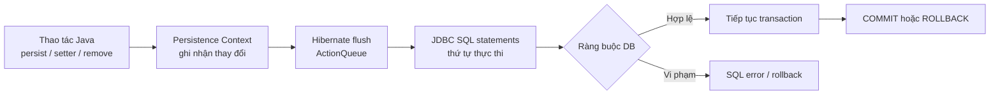

# Ràng buộc cơ sở dữ liệu khiến thứ tự SQL trở nên quan trọng

## 1. Vì sao thứ tự gọi phương thức Java chưa chắc là thứ tự SQL?

Trong Hibernate ORM, lập trình viên thường thao tác trên **đối tượng đang được quản lý** thay vì phát SQL ngay:

```java
session.remove(oldProduct);
session.persist(newProduct);
```

Nhìn theo thứ tự Java, ta có cảm giác bản ghi cũ sẽ được xóa trước, rồi bản ghi mới được thêm. Nhưng trong mô hình **write-behind** của Hibernate, nhiều thao tác được ghi nhận trong **Persistence Context** và **ActionQueue**; đến thời điểm **flush**, Hibernate mới sắp xếp và thực thi SQL theo những nhóm hành động phù hợp với mapping và dependency.

Thứ tự SQL vì vậy **không đồng nhất với thứ tự các lời gọi `persist()`, `remove()` và setter**. Nếu hai bản ghi cùng dùng một giá trị được bảo vệ bằng `UNIQUE`, một `INSERT` phát trước `DELETE` có thể khiến database từ chối, dù sau khi hoàn tất tất cả thay đổi thì trạng thái mong muốn không còn trùng lặp.

Ví dụ một bảng có ràng buộc duy nhất trên `sku`:

```text
Trạng thái ban đầu:
  Product#10  sku = "BOOK-001"

Ý định của ứng dụng:
  remove(Product#10)
  persist(Product#20, sku = "BOOK-001")

Thứ tự SQL có thể diễn ra khi flush:
  INSERT Product#20, sku = "BOOK-001"   <-- lỗi UNIQUE
  DELETE Product#10                     <-- chưa chạy
```

Đây là lý do bài học **Dirty Checking và Flush** phải xem xét các ràng buộc database. Mỗi SQL statement được database kiểm tra theo quy tắc transaction và constraint tương ứng, chứ không phải chỉ kiểm tra ảnh chụp “trạng thái cuối cùng mà lập trình viên muốn đạt tới”.

### Sau bài này, bạn sẽ hiểu

- Hibernate tích lũy thay đổi trước `flush()` và tại sao ActionQueue cần thứ tự hành động riêng.
- Foreign key, `NOT NULL`, `UNIQUE`, primary key và `CHECK` ảnh hưởng tới lịch chạy SQL như thế nào.
- Vì sao **insert-before-delete**, hoán đổi giá trị unique và cập nhật vị trí list dễ thất bại.
- Cách cascade, `orphanRemoval`, collection và quan hệ hai chiều liên quan tới thứ tự SQL.
- Khi nào **flush tường minh**, thay đổi mô hình nghiệp vụ hoặc **deferrable constraints** là lựa chọn phù hợp.
- Những rủi ro của việc xem `hibernate.order_inserts`, `hibernate.order_updates` hoặc JDBC batching như công cụ “sửa thứ tự” cho mọi trường hợp.

> Ví dụ hướng đến Hibernate ORM hiện đại với namespace `jakarta.persistence.*`, chủ yếu Hibernate ORM 6.x. Những chi tiết nội bộ ActionQueue có thể thay đổi theo phiên bản, nhưng nguyên lý “thứ tự thao tác Java không phải hợp đồng thứ tự SQL” luôn đáng được ghi nhớ.

## 2. Ba tầng quyết định một thay đổi có thành công không

Trước khi đi vào ví dụ, hãy phân biệt:

| Tầng | Trách nhiệm | Điều không nên giả định |
|---|---|---|
| **Java/domain model** | Kiểm tra yêu cầu nghiệp vụ, thay đổi trạng thái object | Setter thành công nghĩa là DB sẽ chấp nhận |
| **Hibernate Persistence Context và ActionQueue** | Dirty checking, cascade, tổ chức INSERT/UPDATE/DELETE lúc flush | Thực thi SQL theo thứ tự câu lệnh Java |
| **Database** | Thực thi statement và constraint trên dữ liệu thực tế | Chỉ kiểm tra tính hợp lệ sau cùng của toàn transaction |

Một thay đổi có thể hoàn toàn hợp lệ trong bộ nhớ nhưng bị từ chối bởi database do **trạng thái trung gian** khi từng statement được thực thi.



### Cần phân biệt flush và commit

```java
session.persist(entity); // Chuyển entity mới sang managed state.
session.flush();          // Đồng bộ các thay đổi đang chờ xuống JDBC.
tx.commit();              // Xác nhận transaction nếu mọi việc thành công.
```

`flush()` **không phải commit**. Nó có thể khiến database phát hiện vi phạm constraint trước khi commit; transaction vẫn chưa được xác nhận. Một số constraint được phép trì hoãn tới commit trên những database hỗ trợ cơ chế deferrable, nhưng không phải ràng buộc nào cũng hoạt động như vậy.

## 3. Hibernate ActionQueue không đơn giản là hàng đợi theo thời gian

Hibernate có cơ chế **transactional write-behind**. Khi bạn gọi `persist()`, thay đổi một managed entity hoặc `remove()`, ORM có thể đăng ký một hoặc nhiều hành động cần chạy về sau.

Ví dụ:

```java
Product a = session.find(Product.class, 10L);
session.remove(a);

Product b = new Product("BOOK-001", "New book");
session.persist(b);

// SQL chưa chắc đã được phát hết tại từng lời gọi trên.
session.flush();
```

Một cách nhìn khái quát các nhóm hành động mà Hibernate cần xử lý:

1. Xử lý orphan removal ở những mapping áp dụng.
2. Thực thi những INSERT entity đang chờ.
3. Thực thi UPDATE entity được dirty checking phát hiện.
4. Xử lý những thao tác liên quan collection, chẳng hạn remove/update/recreate.
5. Thực thi DELETE entity.

Trong tài liệu Hibernate 6.x, thứ tự chi tiết của những executable actions có thể được diễn đạt qua các nhóm như `OrphanRemovalAction`, `EntityInsertAction`, `EntityUpdateAction`, `CollectionRemoveAction`, `CollectionUpdateAction`, `CollectionRecreateAction` và `EntityDeleteAction`. Các nhóm khác cũng tồn tại tùy kiểu mutation và phiên bản.

**Không biến danh sách nhóm trên thành API hoặc hợp đồng bất biến cho mọi phiên bản.** Đây là cách giải thích tại sao Hibernate phải sắp xếp SQL để hỗ trợ cascade, quan hệ và batching, chứ không chạy mọi statement theo thứ tự setter Java.

### Vì sao ORM không cứ chạy ngay từng câu?

- Hibernate cần **gom thay đổi** để đồng bộ theo đơn vị công việc.
- Entity có quan hệ **parent–child**, có thể phải INSERT parent trước child và DELETE child trước parent.
- JDBC batching hữu ích khi có nhiều mutation cùng cấu trúc.
- Hibernate cần phối hợp collection tables, foreign keys, identifier generation và dirty checking.
- Một transaction có thể thay đổi cùng entity nhiều lần trước flush; ORM có thể chỉ phát SQL chứa trạng thái cuối cùng cần lưu.

Tối ưu trình tự và dependency không có nghĩa Hibernate có thể suy ra mọi **ràng buộc nghiệp vụ đặc biệt** như “trước khi chèn một hàng có mã X, phải xóa mọi hàng cũ dùng mã X”.

## 4. Trường hợp 1: UNIQUE constraint và INSERT trước DELETE

Giả sử bảng `catalog_items`:

```sql
CREATE TABLE catalog_items (
    id BIGINT GENERATED BY DEFAULT AS IDENTITY PRIMARY KEY,
    sku VARCHAR(64) NOT NULL,
    display_name VARCHAR(150) NOT NULL,
    CONSTRAINT uk_catalog_item_sku UNIQUE (sku)
);
```

Ràng buộc `UNIQUE (sku)` bảo đảm tại một thời điểm phù hợp với cơ chế kiểm tra của database, không có hai hàng khác nhau cùng mã SKU.

### 4.1. Entity

```java
package com.example.catalog;

import jakarta.persistence.Column;
import jakarta.persistence.Entity;
import jakarta.persistence.GeneratedValue;
import jakarta.persistence.GenerationType;
import jakarta.persistence.Id;
import jakarta.persistence.Table;

@Entity
@Table(name = "catalog_items")
public class CatalogItem {

    @Id
    @GeneratedValue(strategy = GenerationType.SEQUENCE)
    private Long id;

    @Column(name = "sku", nullable = false,
            unique = true, length = 64)
    private String sku;

    @Column(name = "display_name", nullable = false, length = 150)
    private String displayName;

    protected CatalogItem() {}

    public CatalogItem(String sku, String displayName) {
        this.sku = sku;
        this.displayName = displayName;
    }
}
```

Ví dụ mapping `SEQUENCE` và DDL IDENTITY phía trên **chỉ được dùng để minh họa các khía cạnh độc lập**; trong một dự án chạy thật, phải cấu hình generator đồng nhất với schema (hoặc đổi ID DDL sang sequence mapping, hoặc đổi entity sang `IDENTITY`). Phân tích UNIQUE dưới đây không phụ thuộc kiểu sinh ID.

### 4.2. Xóa rồi thêm trong cùng flush

```java
CatalogItem oldItem =
    session.find(CatalogItem.class, oldItemId);

session.remove(oldItem);

CatalogItem replacement =
    new CatalogItem("BOOK-001", "Phiên bản mới");
session.persist(replacement);

// Đến đây, hai yêu cầu đã được đăng ký.
session.flush();
```

Nếu `oldItem` có SKU `BOOK-001`, database có thể nhận INSERT của `replacement` **trước** khi nhận DELETE của `oldItem`. Khi constraint kiểm tra ngay, INSERT bị từ chối vì vẫn còn SKU trùng.

Ứng dụng có thể nghĩ “sau cùng chỉ còn một hàng BOOK-001”, nhưng database không thể chấp nhận một statement vi phạm unique constraint chỉ vì Hibernate dự kiến xóa hàng cũ về sau.

### 4.3. Một cách xử lý: tách thành hai pha flush trong cùng transaction

Nếu nghiệp vụ thực sự bắt buộc **xóa hàng cũ rồi tạo hàng mới**:

```java
Transaction tx = session.beginTransaction();
try {
    CatalogItem oldItem =
        session.find(CatalogItem.class, oldItemId);

    session.remove(oldItem);
    session.flush(); // Đẩy DELETE cũ xuống DB trước.

    CatalogItem replacement =
        new CatalogItem("BOOK-001", "Phiên bản mới");
    session.persist(replacement);

    tx.commit(); // Flush tiếp nếu cần, rồi commit.
} catch (RuntimeException ex) {
    if (tx.isActive()) {
        tx.rollback();
    }
    throw ex;
}
```

`flush()` đầu **không commit**; hai pha vẫn nằm trong cùng transaction. Nếu INSERT sau đó thất bại và transaction rollback, DELETE trước đó cũng được rollback theo ngữ nghĩa database.

**Điều kiện:** không có foreign key khác cản trở xóa `oldItem`. Nếu hàng cũ đang được các bảng khác tham chiếu, phải xử lý quan hệ và ràng buộc của chúng theo thiết kế, không dùng flush như cách “vượt FK”.

### 4.4. Một cách khác thường tốt hơn: cập nhật đúng entity cũ

Nếu SKU định danh cùng một sản phẩm qua nhiều phiên bản, có thể không cần xóa rồi insert. Thay vào đó:

```java
CatalogItem item = session.find(CatalogItem.class, itemId);
item.rename("Phiên bản mới"); // Giả định entity có method này.
```

Hibernate dirty checking sẽ cập nhật hàng đang có. Khóa chính, các foreign key trỏ tới sản phẩm và lịch sử tham chiếu được giữ ổn định.

**Câu hỏi thiết kế:** “Thay thế hàng” thực sự là tạo một thực thể nghiệp vụ khác, hay chỉ sửa thuộc tính của cùng thực thể? Việc làm rõ identity có thể loại bỏ hoàn toàn xung đột DELETE/INSERT.

## 5. Trường hợp 2: khóa ngoại đòi hỏi parent tồn tại trước child

Giả sử bảng đơn hàng và dòng hàng:

```sql
CREATE TABLE orders (
    id BIGINT GENERATED BY DEFAULT AS IDENTITY PRIMARY KEY,
    order_number VARCHAR(40) NOT NULL UNIQUE
);

CREATE TABLE order_lines (
    id BIGINT GENERATED BY DEFAULT AS IDENTITY PRIMARY KEY,
    order_id BIGINT NOT NULL,
    product_code VARCHAR(40) NOT NULL,
    quantity INTEGER NOT NULL,
    CONSTRAINT fk_line_order
        FOREIGN KEY (order_id) REFERENCES orders(id)
);
```

`order_lines.order_id` có cả **`NOT NULL`** và **FOREIGN KEY**:

- Không được `NULL`.
- Nếu khác `NULL` thì phải tham chiếu tới một `orders.id` hợp lệ.

### 5.1. Mapping quan hệ hai chiều

```java
@Entity
@Table(name = "orders")
public class Order {
    @Id
    @GeneratedValue(strategy = GenerationType.IDENTITY)
    private Long id;

    @Column(name = "order_number", nullable = false, unique = true)
    private String orderNumber;

    @OneToMany(
        mappedBy = "order",
        cascade = CascadeType.PERSIST
    )
    private List<OrderLine> lines = new ArrayList<>();

    protected Order() {}

    public Order(String orderNumber) {
        this.orderNumber = orderNumber;
    }

    public void addLine(String productCode, int quantity) {
        lines.add(new OrderLine(this, productCode, quantity));
    }
}
```

Entity child:

```java
@Entity
@Table(name = "order_lines")
public class OrderLine {
    @Id
    @GeneratedValue(strategy = GenerationType.IDENTITY)
    private Long id;

    @ManyToOne(fetch = FetchType.LAZY, optional = false)
    @JoinColumn(name = "order_id", nullable = false)
    private Order order;

    @Column(name = "product_code", nullable = false)
    private String productCode;

    @Column(name = "quantity", nullable = false)
    private int quantity;

    protected OrderLine() {}

    public OrderLine(Order order, String productCode, int quantity) {
        this.order = Objects.requireNonNull(order);
        this.productCode = productCode;
        this.quantity = quantity;
    }
}
```

Các đoạn code này tập trung vào mapping; trong class thật cần các import tương ứng (`jakarta.persistence.*`, `java.util.List`, `java.util.ArrayList`, `java.util.Objects`).

### 5.2. Persist aggregate

```java
Order order = new Order("ORD-2026-001");
order.addLine("SKU-A", 2);
order.addLine("SKU-B", 1);

session.persist(order);
```

Vì `Order.lines` có cascade persist và mỗi `OrderLine` trỏ tới owner, Hibernate có đủ thông tin lập kế hoạch lưu những entity mới. Với IDENTITY, INSERT parent có thể chạy sớm để lấy ID; trong trường hợp khác, ActionQueue có thể sắp xếp INSERT theo dependency.

Thứ tự SQL hợp lệ về mặt logic là:

```sql
INSERT INTO orders (...) VALUES (...);
INSERT INTO order_lines (order_id, ...) VALUES (...);
INSERT INTO order_lines (order_id, ...) VALUES (...);
```

**Không cố ép Hibernate INSERT child trước parent** khi FK chưa có hàng đích, cũng không giả định cascade sẽ sửa được mọi mapping sai.

### 5.3. Chỉ thêm child vào collection inverse là chưa đủ

Với quan hệ hai chiều, `OrderLine.order` là **phía sở hữu FK**. Nếu làm:

```java
order.getLines().add(new OrderLine(null, "SKU-A", 2));
```

nhưng không gán `child.order`, Hibernate có thể không có giá trị `order_id` để insert child. `nullable = false` sẽ khiến lỗi bị phát hiện trước hoặc tại database.

Một helper như `order.addLine(...)` nên duy trì cả collection của parent và reference `order` của child.

### 5.4. Circular dependency: cả hai phía đều NOT NULL

Nếu bảng A có FK `a.b_id NOT NULL` và bảng B có FK `b.a_id NOT NULL`, cùng cần tạo mới, database có thể rơi vào thế kẹt:

```text
INSERT A cần B đã tồn tại.
INSERT B cần A đã tồn tại.
```

Không có một thứ tự INSERT đơn giản nào thỏa cả hai FK kiểm tra ngay. Cách xử lý có thể là:

- Chỉnh lại **mô hình quan hệ**, bỏ FK thừa hoặc xác định một phía thật sự sở hữu.
- Dùng một FK nullable rồi cập nhật ở pha sau nếu domain cho phép.
- Dùng shared primary key `@MapsId` cho một-một phụ thuộc identity khi phù hợp.
- Sử dụng FK deferrable trên database hỗ trợ, kèm mapping và quy trình transaction tương thích.

Đây là vấn đề **thiết kế schema**, không thể giải quyết chỉ bằng thứ tự gọi `persist()`.

## 6. Trường hợp 3: xóa parent trước child vi phạm FOREIGN KEY

Với cùng schema, nếu đơn hàng `Order#10` còn hai `OrderLine`, SQL trực tiếp:

```sql
DELETE FROM orders WHERE id = 10;
```

sẽ bị database từ chối nếu FK từ `order_lines` vẫn đang tham chiếu và constraint không có `ON DELETE CASCADE`.

Để xóa an toàn, phải xử lý các child trước:

```sql
DELETE FROM order_lines WHERE order_id = 10;
DELETE FROM orders WHERE id = 10;
```

### Cascade REMOVE và orphanRemoval

Với entity con **thực sự thuộc vòng đời của owner**, có thể khai báo:

```java
@OneToMany(
    mappedBy = "order",
    cascade = {CascadeType.PERSIST, CascadeType.REMOVE},
    orphanRemoval = true
)
private List<OrderLine> lines = new ArrayList<>();
```

Khi gọi:

```java
Order order = session.find(Order.class, orderId);
session.remove(order);
```

Hibernate có thể đăng ký các hành động xóa child và parent, thực thi theo trình tự cần thiết để đáp ứng FK. Nhưng cần nhớ:

- `cascade = REMOVE` chỉ nên dùng khi child thuộc về owner về mặt nghiệp vụ.
- `orphanRemoval = true` chủ yếu áp dụng khi child bị gỡ khỏi association và không nên còn tồn tại độc lập.
- `@ManyToOne` tới entity dùng chung như `Customer` hoặc `Product` thường **không nên cascade REMOVE**.
- Nếu dùng bulk HQL/native DELETE hoặc SQL ngoài Hibernate, đừng giả định cascade JPA chạy cho từng entity.

### ON DELETE CASCADE của database

Một FK có thể được khai báo:

```sql
CONSTRAINT fk_line_order
    FOREIGN KEY (order_id)
    REFERENCES orders(id)
    ON DELETE CASCADE
```

Khi đó database có thể tự xóa rows child khi xóa parent trực tiếp. Đây là **chính sách schema**, khác với cascade ORM. Một số mapping Hibernate có hỗ trợ annotation chuyên biệt liên quan cascade ở database, nhưng phải kiểm tra DDL và hành vi thực tế; không nên mặc định tất cả SQL DELETE đi qua Hibernate cùng một cách.

## 7. Trường hợp 4: UNIQUE trên vị trí list và thao tác hoán đổi

Ứng dụng quản lý danh sách việc cần làm với thứ tự do người dùng kéo thả. Database có cột:

```sql
CREATE TABLE board_tasks (
    id BIGINT PRIMARY KEY,
    board_id BIGINT NOT NULL,
    position INTEGER NOT NULL,
    title VARCHAR(200) NOT NULL,
    CONSTRAINT uq_board_position UNIQUE (board_id, position),
    CONSTRAINT ck_board_position CHECK (position >= 0)
);
```

Ban đầu:

```text
id     board_id     position     title
10     1            0            A
11     1            1            B
```

Ứng dụng muốn hoán đổi A và B:

```java
taskA.setPosition(1);
taskB.setPosition(0);
```

Sau cùng, mỗi vị trí vẫn chỉ có một task. Nhưng nếu Hibernate phát:

```sql
UPDATE board_tasks SET position = 1 WHERE id = 10;
UPDATE board_tasks SET position = 0 WHERE id = 11;
```

statement đầu đã xung đột với B đang giữ `position=1`. Đảo thứ tự UPDATE cũng không giúp: lúc đổi B từ 1 về 0, A đang giữ 0.

### 7.1. Dùng vị trí tạm còn trống

Nếu business model cho phép quản lý vị trí bằng một field riêng, có thể thực hiện **ba pha** trong cùng transaction:

```sql
-- Giả định position=2 chưa được sử dụng trên board 1.
UPDATE board_tasks SET position = 2 WHERE id = 10;
UPDATE board_tasks SET position = 0 WHERE id = 11;
UPDATE board_tasks SET position = 1 WHERE id = 10;
```

Mỗi statement bảo đảm unique constraint không bị vi phạm. Nếu ứng dụng dùng managed entities và cần thực thi theo pha, có thể set vị trí tạm, gọi `flush()`, rồi cập nhật vị trí tiếp theo theo một quy trình kiểm soát rõ.

**Không chọn `-1` làm vị trí tạm** khi bảng có `CHECK(position >= 0)`. Nếu dùng `MAX(position)+1`, phải tính đến đồng thời và khả năng người khác cũng dùng cùng vị trí tạm; cần transaction/locking phù hợp.

### 7.2. @OrderColumn có thể gặp vấn đề tương tự

Với:

```java
@OneToMany(mappedBy = "board")
@OrderColumn(name = "position")
private List<BoardTask> tasks = new ArrayList<>();
```

Hibernate quản lý cột vị trí theo semantics của list. Khi đảo/chèn/xóa phần tử, nó có thể cần cập nhật nhiều vị trí. Nếu schema áp unique ngay trên `(board_id, position)`, **chuỗi UPDATE trung gian** có thể vi phạm constraint dù danh sách cuối cùng hợp lệ.

Trong thực tế, vị trí của `@OrderColumn` có thể nằm trên bảng child hoặc bảng liên kết tùy mapping. Khi có `mappedBy` và phía sở hữu FK, cần kiểm tra chính xác cách Hibernate 6.x xử lý list index trên mapping tương ứng, không chỉ thêm annotation rồi giả định mọi phần cập nhật vị trí đều như nhau.

### 7.3. Các chiến lược cho reorder

| Phương án | Ý tưởng | Đổi lại |
|---|---|---|
| Vị trí tạm và flush theo pha | Không tạo trùng lặp tại từng statement | Nhiều SQL/flush, cần điều phối concurrency |
| Deferrable unique constraint | Cho phép thay đổi trung gian, kiểm tra ở thời điểm muộn | DB-specific; cần migration và transaction setup |
| Sort key có khoảng trống | Di chuyển bằng cách đổi key của ít phần tử | Phải xử lý hết khoảng trống/renumber/concurrency |
| Xóa rồi chèn lại link rows | Tạo lại thứ tự trên join table | Có thể tốn SQL; cần tránh phá các FK/identity |
| Đổi mô hình quan hệ | Đưa thứ tự thành dữ liệu có semantics rõ | Thay đổi domain/schema/API |

Một giải pháp ứng dụng chạy tốt với danh sách 10 phần tử chưa chắc phù hợp khi một board có 100.000 task và người dùng liên tục reorder.

## 8. Deferrable constraints: database có thể hoãn kiểm tra, nhưng không phải mặc định

Thông thường, nhiều ràng buộc như UNIQUE và FOREIGN KEY được kiểm tra ở thời điểm statement thực thi theo quy tắc database. Một số hệ quản trị hỗ trợ **deferrable constraints**: việc kiểm tra constraint được lùi tới một thời điểm muộn hơn, chẳng hạn cuối transaction.

Ví dụ PostgreSQL với unique constraint:

```sql
CREATE TABLE board_tasks (
    id BIGINT PRIMARY KEY,
    board_id BIGINT NOT NULL,
    position INTEGER NOT NULL,
    CONSTRAINT uq_board_position
        UNIQUE (board_id, position)
        DEFERRABLE INITIALLY IMMEDIATE
);
```

Trong transaction:

```sql
BEGIN;
SET CONSTRAINTS uq_board_position DEFERRED;

UPDATE board_tasks SET position = 1 WHERE id = 10;
UPDATE board_tasks SET position = 0 WHERE id = 11;

COMMIT;
```

Nếu đến thời điểm kiểm tra cuối cùng mỗi `(board_id, position)` là duy nhất, database có thể chấp nhận các trạng thái trung gian mà constraint immediate sẽ từ chối.

**Những điều không được nhầm:**

- `DEFERRABLE` là **khả năng của constraint trong database**, không phải một tính năng có sẵn từ mọi annotation JPA.
- Không phải mọi constraint hoặc mọi database hỗ trợ trì hoãn. Trên PostgreSQL, `NOT NULL` và `CHECK` không được hoãn giống một UNIQUE/FK constraint deferrable.
- Việc tạo constraint deferrable thường cần **migration SQL tường minh**; `@Column(unique = true)` hay `@UniqueConstraint` không tự bảo đảm sinh cú pháp đó.
- Nếu transaction kết thúc với dữ liệu vi phạm, **commit vẫn thất bại**.
- Constraint bị hoãn có thể tác động tới locking, tranh chấp và cách dùng làm mục tiêu của những tính năng database khác; cần xem tài liệu DB.

### Có cần deferrable trong mọi ứng dụng?

Không. Với mô hình CRUD thông thường, viết thao tác theo các pha hợp lệ, dùng parent–child mapping chuẩn và thiết kế các khóa đúng thường đủ. Deferrable constraints nên là **quyết định schema có chủ đích** cho các ca phải vượt qua trạng thái trung gian, được kiểm tra với database production.

## 9. NOT NULL và CHECK: thứ tự UPDATE cũng có thể gây lỗi

### 9.1. Chuyển một quan hệ bắt buộc sang entity khác

Giả sử `invoice.customer_id NOT NULL`. Ứng dụng không nên “gỡ customer cũ trước, rồi gán customer mới” qua hai lần flush:

```java
invoice.setCustomer(null);
session.flush(); // Có thể lỗi NOT NULL.
invoice.setCustomer(newCustomer);
```

Nếu kết quả mong muốn chỉ là **đổi tham chiếu**, hãy gán trực tiếp entity đích hợp lệ:

```java
invoice.setCustomer(newCustomer);
// Flush sau cùng khi invoice.customer khác null.
```

Nếu đặt `null` rồi gán lại **trước một lần flush**, Hibernate có thể chỉ ghi trạng thái cuối cùng. Nhưng nếu một truy vấn kích hoạt auto-flush giữa hai thao tác hoặc ứng dụng gọi flush tường minh, trạng thái trung gian sẽ bị database từ chối.

### 9.2. CHECK constraint và thao tác nhiều bước

Giả sử bảng ví:

```sql
balance NUMERIC(14,2) NOT NULL
    CHECK (balance >= 0)
```

Một transaction dự tính chuyển tiền vào rồi rút tiền ở nhiều thao tác. Nếu một UPDATE trung gian làm số dư âm, database sẽ từ chối ngay ở constraint immediate, dù ứng dụng nghĩ bước sau sẽ bù lại.

Tương tự, nếu `CHECK (end_time > start_time)`, cập nhật `start_time` và `end_time` qua nhiều flush có thể tạo trạng thái tạm vi phạm. Tốt hơn là cập nhật các giá trị liên quan thành một **trạng thái hợp lệ trước flush**, hoặc dùng một câu SQL atomic phù hợp khi cần.

**Đừng coi Hibernate là công cụ trì hoãn mọi constraint tới trạng thái cuối cùng.** ORM không thay thế việc thiết kế các bước cập nhật có hợp lệ tại database.

## 10. Tác động của cascade, orphanRemoval và collection operations

Một lời gọi Java có thể tạo ra **nhiều hành động SQL** trong ActionQueue:

```java
Order order = session.find(Order.class, orderId);
order.removeLine(line);
order.addLine(newLine);
```

Tùy mapping, Hibernate có thể cần:

- Xóa entity con bị orphan.
- INSERT entity con mới.
- UPDATE foreign key.
- DELETE/INSERT hàng của collection table hoặc join table.
- Điều chỉnh `@OrderColumn` nếu danh sách có vị trí.

### Orphan removal khác xóa entity thủ công

Với:

```java
@OneToMany(
    mappedBy = "order",
    cascade = CascadeType.ALL,
    orphanRemoval = true
)
private List<OrderLine> lines;
```

gỡ child khỏi collection có thể đăng ký thao tác **orphan removal**, vốn có vị trí xử lý đặc thù trong ActionQueue. Nó không nhất thiết có lịch SQL giống:

```java
session.remove(line);
```

Khi cần thay thế một child mang giá trị unique theo owner, hai cách “gỡ để orphan” và “remove entity thủ công” có thể dẫn tới lịch SQL khác nhau. Không nên dựa vào khác biệt không được bảo đảm này như một phương án thay thế cho thiết kế constraint đúng.

### @ManyToMany và bảng liên kết

Giả sử `students` và `courses` dùng bảng `student_courses`. Xóa một `Student` khi vẫn còn link rows cần xử lý các bản ghi trong join table trước khi database cho phép xóa student, trừ khi FK được thiết kế cascade ở database.

Thao tác:

```java
student.getCourses().clear();
session.remove(student);
```

có thể sinh collection DELETE và entity DELETE. Nhưng nếu dùng **native SQL DELETE student** ngoài ORM, không được mặc định Hibernate tự xóa join rows. Hãy xác định ownership/cascade/schema tương ứng.

### Collection bag và DELETE/INSERT nhiều hàng

Một collection không có khóa ổn định cho từng hàng có thể khiến Hibernate xóa rồi dựng lại cả tập hợp khi thay đổi một phần tử. Khi bảng ấy có unique constraint hoặc foreign key phức tạp, số SQL và thứ tự DELETE/INSERT có thể tác động mạnh đến tính hợp lệ cũng như hiệu năng.

Nếu một phần tử cần cập nhật độc lập và có identity nghiệp vụ, cân nhắc **entity con có ID riêng** thay vì cố buộc mọi thay đổi vào value collection/bag.

## 11. Hibernate có bảo đảm SQL đúng thứ tự phụ thuộc FK không?

Với mapping entity thông thường và cascade chính xác, Hibernate có nhiều thông tin để sắp xếp các hành động theo dependency. Chẳng hạn:

- Entity cha được INSERT trước những child cần khóa ngoại trỏ tới cha.
- Khi xóa một aggregate được cascade đúng, các hàng tham chiếu có thể được xóa trước khi xóa parent.
- Collection tables/join tables được xử lý theo mapping.

Tuy nhiên, đừng diễn giải thành **“Hibernate có thể tự tìm ra thứ tự hợp lệ cho mọi constraint trên schema”**:

1. ORM chỉ hiểu đầy đủ những quan hệ được **mapping**; trigger, constraint đặc biệt hay SQL bên ngoài có thể không được mô hình hóa.
2. **UNIQUE** trên một natural key không tự nói cho Hibernate rằng “DELETE hàng cũ trước INSERT hàng mới dùng key ấy”.
3. Các **vòng FK bắt buộc** có thể không có một thứ tự statement hợp lệ.
4. **Native SQL** và **bulk mutation** không cùng lifecycle/cascade như từng managed entity.
5. **Constraint được quản lý ngoài Hibernate** có thể khác metadata annotation.
6. Thứ tự statement còn bị ảnh hưởng bởi generator IDENTITY, batching và flush mode.

Khi gặp lỗi constraint, đừng chỉ đảo vị trí các lệnh Java rồi hy vọng ActionQueue sẽ đảo SQL theo. Hãy tìm **statement nào đang vi phạm constraint ở trạng thái database tại thời điểm ấy**.

## 12. order_inserts, order_updates và JDBC batching không phải công cụ ép lịch nghiệp vụ

Hibernate hỗ trợ những setting để tối ưu việc sắp xếp SQL cho batching:

```properties
hibernate.jdbc.batch_size=30
hibernate.order_inserts=true
hibernate.order_updates=true
```

### Tác động điển hình

- `hibernate.jdbc.batch_size`: cho phép Hibernate gom một số statement tương thích thành JDBC batch.
- `hibernate.order_inserts`: sắp xếp các INSERT phù hợp để có nhiều cơ hội batching.
- `hibernate.order_updates`: sắp xếp UPDATE theo entity type/primary key để cải thiện batching và trong một số workload giảm nguy cơ deadlock.

Nhưng:

- Các setting này **không bảo đảm `DELETE` sẽ chạy trước `INSERT`** khi cùng natural key.
- Chúng **không tạo thêm giá trị FK**, không thay đổi nullability hay unique constraint.
- Batching không cho phép database bỏ qua constraint của từng statement/transaction.
- Không phải mọi thao tác đều batch được; IDENTITY thường có hạn chế do ID phải lấy từ INSERT.
- Thứ tự và kích thước batch thực tế tùy mapping, driver và phiên bản Hibernate.

### Ví dụ: hiệu năng không sửa được tính đúng

Ứng dụng thực hiện:

```java
session.remove(existingProduct);
session.persist(replacementWithSameSku);
```

Nếu flush dự kiến INSERT trước DELETE, bật `order_inserts=true` có thể thay đổi thứ tự giữa những INSERT, nhưng **không phải cơ chế bảo đảm DELETE của natural key cũ xảy ra trước**. Đây là bài toán nghiệp vụ/ràng buộc, không phải bài toán chỉ tối ưu batch.

## 13. Auto-flush có thể làm lộ trạng thái trung gian

Không phải ứng dụng chỉ flush khi gọi `session.flush()`. Với `FlushMode.AUTO`, Hibernate có thể auto-flush trước những truy vấn cần dữ liệu liên quan đang chờ đồng bộ.

Ví dụ:

```java
Invoice invoice = session.find(Invoice.class, invoiceId);
invoice.setCustomer(null); // Tạm thời vi phạm NOT NULL.

// Một query liên quan có thể khiến Hibernate auto-flush:
long count = session.createQuery(
    "select count(i) from Invoice i",
    Long.class
).getSingleResult();

invoice.setCustomer(newCustomer);
```

Nếu query kích hoạt flush trước khi code gán `newCustomer`, Hibernate có thể gửi UPDATE chứa `customer_id = NULL` và database từ chối.

### Cách thiết kế tốt hơn

- Giữ entity **hợp lệ tại những điểm có thể flush**.
- Đổi từ tham chiếu cũ sang mới bằng **một thao tác gán hợp lệ** nếu có thể.
- Đừng trì hoãn việc thiết lập các thuộc tính bắt buộc rồi chen truy vấn vào giữa.
- Hiểu các tác vụ gọi repository, JPQL và native query có thể ảnh hưởng thời điểm flush trong một transaction.
- Khi cần nhiều bước tạo trạng thái trung gian, sử dụng transaction và pha SQL rõ ràng, đồng thời bảo đảm constraint tương thích.

**Không nên chuyển toàn bộ ứng dụng sang `FlushMode.MANUAL` chỉ để tránh lỗi constraint.** Nếu quên flush, dữ liệu có thể không được đồng bộ như mong đợi; trạng thái nghiệp vụ không hợp lệ vẫn chưa được giải quyết.

## 14. Lỗi constraint có thể xuất hiện tại flush hoặc commit

Giả sử:

```java
session.persist(new CatalogItem("BOOK-001", "Sản phẩm trùng"));
System.out.println("Sau persist");

tx.commit();
```

Console có thể in `"Sau persist"` rồi transaction mới thất bại tại commit, do INSERT được trì hoãn tới flush trước commit. Điều đó không có nghĩa `persist()` đã lưu thành công.

Với generator `IDENTITY` hoặc auto-flush, lỗi có thể xuất hiện sớm hơn ngay trong `persist()` hoặc truy vấn trước commit. Không thiết kế exception handling dựa trên một thời điểm cố định.

### Một transaction mẫu xử lý lỗi

```java
try (Session session = sessionFactory.openSession()) {
    Transaction tx = session.beginTransaction();
    try {
        doBusinessWork(session);
        tx.commit();
    } catch (RuntimeException ex) {
        if (tx.isActive()) {
            tx.rollback();
        }
        throw ex;
    }
}
```

Sau lỗi JDBC/constraint làm transaction thất bại, thông thường phải rollback và đóng Session, không tiếp tục dùng cùng Persistence Context như thể những queued actions, snapshots và state đã được khôi phục an toàn.

### Exception thường gặp

| Dạng lỗi | Nguồn gốc có thể | Hướng điều tra |
|---|---|---|
| `ConstraintViolationException` của Hibernate SQL layer | DB từ chối UNIQUE/FK/CHECK/NOT NULL | Xem SQL statement, constraint name, SQLState/vendor code |
| `PropertyValueException` | Giá trị null hoặc transient association không hợp lệ theo mapping | Xem optional/nullable và phía sở hữu quan hệ |
| `TransientPropertyValueException` | Association tham chiếu entity transient chưa lưu | Xem cascade, thứ tự persist và FK |
| `DataIntegrityViolationException` của Spring | Exception được translate từ tầng persistence | Xem cause gốc từ Hibernate/JDBC |
| Optimistic locking exception | Version hoặc số hàng UPDATE không khớp | Kiểm tra `@Version` và các luồng ghi đồng thời |

**Lưu ý:** `jakarta.validation.ConstraintViolationException` thuộc Bean Validation là loại khác với `org.hibernate.exception.ConstraintViolationException` do JDBC constraint. Không kết luận chỉ từ tên ngắn mà cần xem package và nguyên nhân gốc.

## 15. Thứ tự SQL trong hệ thống đồng thời và nguy cơ deadlock

Ngay cả khi mọi statement riêng lẻ hợp lệ, **hai transaction khóa những hàng theo thứ tự khác nhau** có thể gây deadlock.

Ví dụ:

```text
Transaction T1:
  UPDATE account A
  UPDATE account B

Transaction T2:
  UPDATE account B
  UPDATE account A

T1 giữ lock A, chờ B.
T2 giữ lock B, chờ A.
=> Database chọn một transaction làm nạn nhân deadlock.
```

Hibernate `hibernate.order_updates=true` có thể giúp **một số workload** cập nhật entity theo thứ tự ID ổn định hơn, nhưng không phải giải pháp chung cho deadlock:

- Database còn có row/page/index locks khác.
- FK checks, unique indexes và triggers có thể tạo lock không hiển nhiên.
- Native SQL/stored procedure và các service khác có thể khóa theo thứ tự khác.
- Hai transaction có thể cùng chèn giá trị unique hoặc cùng thay đổi một danh sách có thứ tự.

### Chiến lược giảm rủi ro

1. **Thiết kế thứ tự truy cập tài nguyên nhất quán** giữa các luồng nghiệp vụ.
2. **Giữ transaction ngắn** và giảm thao tác không cần thiết khi đang giữ lock.
3. **Index phù hợp** cho FK và các truy vấn cập nhật/xóa.
4. Sử dụng optimistic locking `@Version` hoặc pessimistic locking khi yêu cầu nghiệp vụ phù hợp.
5. **Retry transaction** chỉ với thao tác idempotent hoặc có cơ chế chống ghi lặp; luôn tạo transaction/Session mới sau deadlock.
6. Theo dõi metrics deadlock/lock waits trên database thật; đừng suy luận tất cả từ thứ tự Java.

Deadlock khác với unique constraint violation: một bên là **tranh chấp khóa giữa transaction**, bên kia là **vi phạm quy tắc dữ liệu**. Cả hai đều có thể chịu ảnh hưởng từ thứ tự SQL, nhưng cách xử lý khác nhau.

## 16. Cách quan sát thứ tự SQL thực tế

Khi điều tra vấn đề, hãy nhìn **SQL Hibernate thực sự phát** và lỗi do database trả về.

### 16.1. Logging trong ứng dụng Spring Boot

Ví dụ:

```properties
logging.level.org.hibernate.SQL=DEBUG
logging.level.org.hibernate.orm.jdbc.bind=TRACE

# Chỉ bật khi cần quan sát/đo trong môi trường phù hợp:
hibernate.show_sql=false
hibernate.format_sql=true
```

Trong Spring Boot, những thuộc tính Hibernate thường được truyền qua `spring.jpa.properties.hibernate.*`; đoạn `hibernate.*` phía trên biểu diễn **tên setting Hibernate** chứ không cam kết đây là toàn bộ cấu hình Spring Boot có thể copy nguyên vẹn. Logging category của JDBC bind phụ thuộc phiên bản Hibernate (trong Hibernate 6 thường dùng `org.hibernate.orm.jdbc.bind`).

### 16.2. Xem statement chứ không chỉ xem entity method

Ví dụ log:

```text
Application: remove(old)
Application: persist(new)
Application: flush()

Hibernate SQL: insert into catalog_items (...)
Database: ERROR duplicate key value violates unique constraint
Hibernate SQL: delete from catalog_items ...  -- chưa được phát
```

Ở đây nguyên nhân không phải do `remove()` không được gọi, mà là **constraint kiểm tra khi INSERT trước DELETE**.

### 16.3. Sử dụng kiểm tra schema

Đối chiếu các ràng buộc thật:

- Bảng nào có FK tới bảng đang xóa?
- FK có `ON DELETE CASCADE` hay `ON DELETE SET NULL` không?
- Unique constraint thuộc một cột hay tổ hợp cột?
- Ràng buộc có deferrable không; khi transaction chạy đang immediate hay deferred?
- Cột có `NOT NULL`/`CHECK` không?
- Có trigger làm phát sinh mutation khác không?
- Khóa chính/sequence có phù hợp generator Hibernate không?

**Annotation chỉ biểu đạt mapping.** Nếu schema do Flyway/Liquibase hoặc DBA quản lý, chính cấu trúc database hiện có mới quyết định statement được chấp nhận.

### 16.4. Log không thay thế phân tích transaction

Một lệnh SQL UPDATE nhìn thấy trong log **không có nghĩa đã commit**. Sau lỗi constraint, Hibernate có thể rollback transaction và database không giữ những SQL đã chạy trước đó.

Log bind parameters có thể lộ dữ liệu nhạy cảm. Chỉ bật tạm thời ở môi trường thử nghiệm được kiểm soát.

## 17. Quy trình xử lý khi transaction lỗi do thứ tự SQL

Nếu gặp lỗi `UNIQUE`, `FOREIGN KEY` hoặc `NOT NULL` ở `flush()` hoặc `commit()`, có thể đi theo thứ tự điều tra:

**Bước 1 — Xác định statement bị từ chối.** Đừng chỉ xem dòng Java gây exception; có thể lỗi từ action đã được ghi nhận trước đó.

**Bước 2 — Đọc chính xác tên constraint.** Xác định bảng, cột và quy tắc bị vi phạm trong database.

**Bước 3 — Xác định trạng thái database ngay trước statement.** Một hàng cũ dùng unique key còn tồn tại? Child còn trỏ parent? Một giá trị tạm vi phạm CHECK?

**Bước 4 — Liệt kê các thao tác đang chờ flush.** Có entity INSERT, UPDATE, DELETE hoặc collection changes nào được phát cùng đợt?

**Bước 5 — Phân biệt vấn đề mapping với vấn đề thứ tự.** Ví dụ child FK null là lỗi thiết lập phía sở hữu, không chỉ lỗi thứ tự; unique natural key khi replace mới thường là vấn đề thứ tự hoặc thiết kế identity.

**Bước 6 — Chọn giải pháp mức domain/schema.** Cập nhật entity cũ, tạo hai pha flush, đổi mô hình quan hệ, thêm sort key, dùng deferrable constraint nếu phù hợp, hoặc tái cấu trúc transaction.

**Bước 7 — Xem tác động đồng thời.** Giải pháp chạy trong một Session không bảo đảm an toàn khi hai transaction cập nhật cùng natural key, index vị trí hoặc danh sách.

**Bước 8 — Chốt phạm vi rollback và retry.** Khi constraint thất bại, rollback/đóng Session đúng cách; không retry một nửa quy trình với Persistence Context đã bị lỗi.

### Mẫu suy nghĩ đúng

```text
Ý định Java hợp lệ?
        ↓
Mapping có phản ánh đúng quan hệ và quyền sở hữu FK?
        ↓
ActionQueue có thể phát SQL theo thứ tự nào?
        ↓
Tại thời điểm từng statement chạy, constraint nào được kiểm tra?
        ↓
Có cần thay đổi trình tự flush hay thay đổi thiết kế?
        ↓
Transaction có còn nhất quán khi chạy đồng thời?
```

## 18. Bài thực hành 1: thay sản phẩm giữ nguyên mã SKU

Cho bảng `catalog_items` có `UNIQUE (sku)` và hàng:

```text
id=10, sku="COURSE-JAVA", display_name="Java cơ bản"
```

Yêu cầu thay bằng một hàng mới cùng SKU:

```java
CatalogItem old = session.find(CatalogItem.class, 10L);
session.remove(old);

CatalogItem replacement =
    new CatalogItem("COURSE-JAVA", "Java nâng cao");
session.persist(replacement);
```

**Câu hỏi:**

1. Vì sao thứ tự Java `remove` rồi `persist` không bảo đảm `DELETE` chạy trước `INSERT`?
2. Khi nào constraint `UNIQUE (sku)` có thể từ chối?
3. Nếu muốn xóa thật rồi tạo mới trong một transaction, một điểm `flush()` hợp lý nằm ở đâu?
4. Nếu có bảng `enrollments` tham chiếu `catalog_items.id=10`, tại sao xóa bản ghi cũ có thể gặp thêm lỗi FK?
5. Nếu sản phẩm thực chất vẫn là cùng thực thể nghiệp vụ, vì sao `UPDATE display_name` có thể là lựa chọn tốt hơn?

**Hướng giải:** quyết định rõ identity; nếu thực sự xóa và tạo mới, xử lý FK rồi flush DELETE trước khi persist replacement; bảo đảm rollback và concurrency. Không chỉ đảo thứ tự lệnh Java.

## 19. Bài thực hành 2: hoán đổi hai vị trí có UNIQUE

Bảng:

```sql
CREATE TABLE cards (
    id BIGINT PRIMARY KEY,
    board_id BIGINT NOT NULL,
    sort_position INTEGER NOT NULL CHECK (sort_position >= 0),
    CONSTRAINT uq_card_position UNIQUE (board_id, sort_position)
);
```

Dữ liệu:

```text
Card 100: board=8, sort_position=0
Card 101: board=8, sort_position=1
```

Yêu cầu hoán đổi trong một transaction. Một lời giải dùng giá trị tạm `2`:

```sql
BEGIN;
UPDATE cards SET sort_position=2 WHERE id=100;
UPDATE cards SET sort_position=0 WHERE id=101;
UPDATE cards SET sort_position=1 WHERE id=100;
COMMIT;
```

Tự phân tích:

- Vì sao `2` phải chưa có trong cùng board?
- Có cần khóa board hoặc kiểm soát version nếu hai người reorder đồng thời?
- Nếu muốn dùng `DEFERRABLE UNIQUE`, phải sửa constraint và transaction như thế nào?
- Với `@OrderColumn` ORM-managed, tại sao việc tự can thiệp vào cột vị trí bằng SQL đòi phải đồng bộ lại Persistence Context?

### Bài thực hành 3: parent–child và NOT NULL

Cho `OrderLine.order_id NOT NULL REFERENCES orders(id)`. Tạo một đơn mới có hai dòng, sau đó xóa đơn trong transaction khác. Hãy xác định:

1. Entity nào sở hữu FK?
2. Cascade PERSIST và cascade REMOVE có thực sự phù hợp với quan hệ nghiệp vụ không?
3. Phải xử lý child hay parent trước khi xóa?
4. `ON DELETE CASCADE` khác `CascadeType.REMOVE` như thế nào?
5. Điều gì thay đổi nếu xóa bằng native SQL/bulk HQL thay vì `session.remove(order)`?

**Kết luận thực hành:** constraint không chỉ “kiểm tra dữ liệu cuối”, mà định hình các bước SQL hợp lệ trong suốt transaction.

## 20. Những điều dễ nhầm

### “Gọi remove trước persist thì DELETE sẽ chạy trước INSERT”

Không được bảo đảm. Hibernate tổ chức SQL bằng ActionQueue và có thể thực thi entity INSERT trước entity DELETE trong cùng flush.

### “Bật JDBC batching sẽ bỏ qua UNIQUE tạm thời”

Không. Batching là tối ưu giao tiếp JDBC; constraint vẫn do database kiểm tra.

### “Chỉ cần thêm CascadeType.ALL sẽ hết lỗi FK”

Không. Cascade có thể làm phát sinh thêm thao tác persist/remove, nhưng quan hệ sở hữu FK phải đúng và không có bảo đảm cho mọi vòng dependency. `ALL` còn có thể xóa entity dùng chung ngoài ý muốn.

### “flush() là commit nên không thể flush thành nhiều pha”

Sai. Có thể flush nhiều lần trong một transaction; mọi thay đổi vẫn có thể rollback. Tuy vậy, nhiều flush làm tăng chi phí và cần hiểu trạng thái managed entity.

### “@Column(unique=true) đảm bảo database đã có constraint”

Chỉ khi schema thực sự đã được tạo/đồng bộ đúng. Nếu migration quản lý schema, phải kiểm tra unique constraint thật.

### “Hibernate phải biết tất cả constraint nên sẽ tự xếp đúng”

Không. Hibernate biết metadata mapping, nhưng database có thể có trigger, unique phức tạp, constraint ngoài ORM hoặc quan hệ được ghi bằng native SQL.

### “Đổi thứ tự Java UPDATE là đủ để hoán đổi unique values”

Không luôn đúng. Với hai giá trị đang bị chiếm, bất kể đổi A hay B trước đều có thể đụng unique constraint. Cần trạng thái tạm hợp lệ hoặc deferral phù hợp.

### “NOT NULL chỉ bị kiểm tra tại commit”

Không. Trong những database thông dụng, `NOT NULL` bị kiểm tra khi statement có hiệu lực; không nên trông chờ giá trị `null` tạm thời rồi sửa ở câu sau.

### “Lỗi nằm ở dòng persist()”

Có thể exception xuất hiện ở flush/commit vì Hibernate phát SQL muộn. Phải đọc SQL bị từ chối và cause gốc.

### “Thêm flush liên tục là giải pháp tốt nhất”

Không. Flush tường minh hữu ích để thiết lập ranh giới SQL có chủ đích, nhưng lạm dụng làm mất cơ hội batching và có thể khiến trạng thái trung gian vi phạm constraint xuất hiện sớm hơn.

## 21. Các nguyên tắc thiết kế cần ghi nhớ

1. **Dirty checking và write-behind tách thao tác Java khỏi thời điểm SQL chạy.** Thứ tự gọi method không phải hợp đồng thứ tự statement.
2. **ActionQueue tổ chức INSERT, UPDATE, collection changes và DELETE theo các quy tắc riêng**, nhằm quản lý dependency và batching, không chỉ dựa vào thứ tự setter.
3. **Database kiểm tra constraint trên trạng thái mà từng statement tạo ra** theo cơ chế immediate/deferred của constraint, không chỉ theo trạng thái lý tưởng cuối transaction.
4. **UNIQUE + thay thế hàng:** INSERT trước DELETE có thể tạo trùng key. Cân nhắc UPDATE cùng entity hoặc flush DELETE trong pha riêng nếu thực sự phải replace.
5. **FOREIGN KEY + NOT NULL:** parent–child phải có ownership và cascade đúng; xóa parent khi child còn tham chiếu có thể bị từ chối.
6. **UNIQUE trên list position:** reorder có thể vi phạm constraint ở bước trung gian. Vị trí tạm, deferrable unique hoặc sort key thưa cần được lựa chọn có chủ đích.
7. **`flush()` không phải commit** và có thể dùng để tạo ranh giới SQL trong một transaction, nhưng không thay thế thiết kế dữ liệu hợp lệ.
8. **Tối ưu batching khác giải quyết ràng buộc.** `order_inserts` và `order_updates` không phải công cụ để ép mọi thao tác đúng thứ tự nghiệp vụ.
9. **Concurrency có thể thêm deadlock hoặc unique conflict.** Một chuỗi SQL đúng trong một transaction không tự an toàn khi nhiều transaction cùng chạy.
10. **Đọc log SQL và schema thật khi debug.** Xác định constraint, statement vi phạm, trạng thái trung gian và đường đi ORM/bulk/native, sau đó mới sửa mô hình hay lịch flush.

Khi một transaction Hibernate thất bại dù code Java trông hợp lý, hãy tự hỏi: **“Database đang kiểm tra ràng buộc nào ở chính thời điểm statement này chạy, và Hibernate đã sắp xếp các mutation theo thứ tự nào?”** Trả lời được hai câu hỏi ấy sẽ giúp phân biệt lỗi mapping, lỗi thiết kế identity, lỗi thứ tự flush và xung đột đồng thời.

### Tài liệu tham khảo chính thức

- [Hibernate ORM User Guide — Flushing](https://docs.jboss.org/hibernate/orm/current/userguide/html_single/Hibernate_User_Guide.html#flushing)
- [Hibernate ORM User Guide — Flush operation order](https://docs.jboss.org/hibernate/orm/current/userguide/html_single/Hibernate_User_Guide.html#flushing-order)
- [Hibernate ORM User Guide — JDBC batching](https://docs.jboss.org/hibernate/orm/current/userguide/html_single/Hibernate_User_Guide.html#batch)
- [Hibernate ORM User Guide — Associations](https://docs.jboss.org/hibernate/orm/current/userguide/html_single/Hibernate_User_Guide.html#associations)
- [Hibernate ORM User Guide — Cascading](https://docs.jboss.org/hibernate/orm/current/userguide/html_single/Hibernate_User_Guide.html#pc-cascade)
- [Hibernate ORM Javadocs — ActionQueue](https://docs.jboss.org/hibernate/orm/current/javadocs/org/hibernate/engine/spi/ActionQueue.html)
- [PostgreSQL Documentation — SET CONSTRAINTS](https://www.postgresql.org/docs/current/sql-set-constraints.html)
- [Jakarta Persistence Specification](https://jakarta.ee/specifications/persistence/)
