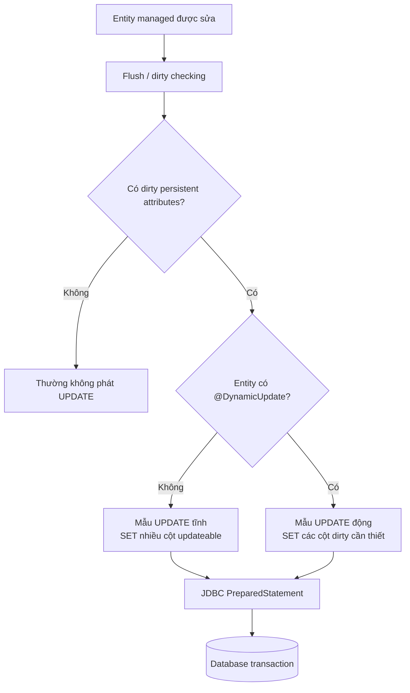
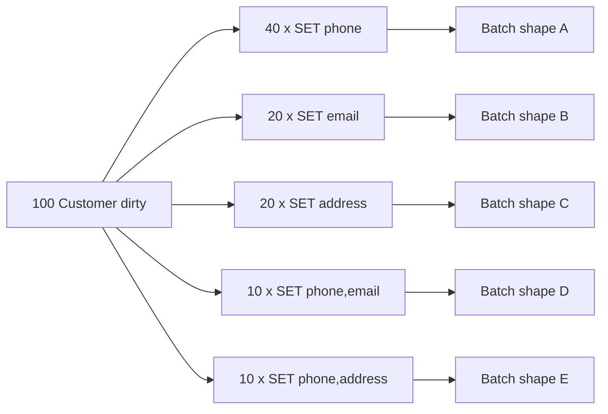
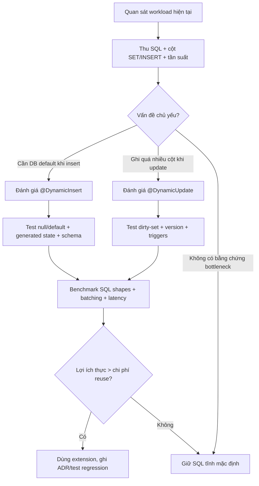

# @DynamicInsert, @DynamicUpdate và đánh đổi với khả năng tái sử dụng câu lệnh trong Hibernate

Trong Hibernate ORM, **dirty checking** quyết định một entity managed có thay đổi cần ghi xuống database hay không, còn **flush** quyết định thời điểm Hibernate đồng bộ những thay đổi đó bằng SQL. Tuy nhiên, việc nhận ra entity “đã thay đổi” chưa nói hết **câu INSERT hoặc UPDATE sẽ chứa những cột nào**.

Mặc định, Hibernate thường ưu tiên các **mẫu SQL ổn định** (*static SQL statements*) cho từng entity/table: cùng một kiểu INSERT hoặc UPDATE có danh sách cột tương đối cố định. Cách này thuận tiện cho việc tái sử dụng prepared statement, cache kế hoạch thực thi và gom nhiều câu lệnh thành JDBC batch.

Hai annotation thuộc Hibernate:

- `@DynamicInsert`: xây dựng câu **INSERT** theo những thuộc tính được ánh xạ có giá trị phù hợp để đưa vào câu lệnh, đặc biệt là **bỏ những cột có giá trị Java `null`** thay vì truyền `NULL` tường minh.
- `@DynamicUpdate`: xây dựng câu **UPDATE** dựa trên những thuộc tính Hibernate nhận thấy **đã thay đổi** (*dirty properties*) thay vì luôn đưa tất cả cột có thể cập nhật vào mệnh đề `SET`.

Từ đó hình thành một đánh đổi quan trọng:

> **SQL động có thể ghi ít cột hơn, nhưng làm tăng số hình dạng câu SQL khác nhau; càng nhiều hình dạng, cơ hội tái sử dụng prepared statement và batching càng có thể giảm.**

Bài học giải thích chính xác phạm vi của hai annotation, cách chúng tương tác với dirty checking, flush, default của database, optimistic locking, JDBC batching và những rủi ro nghiệp vụ. Các ví dụ SQL dưới đây mang tính minh họa; SQL thực có thể khác tùy Hibernate version, JDBC driver, identifier generator và database dialect.

## 1. Từ entity thay đổi tới câu SQL

Giả sử ứng dụng có entity `Customer` gồm các cột `name`, `email`, `phone`, `address` và `status`. Trong transaction, code sửa duy nhất `phone`:

```java
Customer customer = session.find(Customer.class, 42L);
customer.setPhone("0901234567");
```

Có **hai quyết định tách biệt**:

1. **Có cần UPDATE không?** Hibernate so sánh trạng thái managed entity với snapshot hoặc sử dụng cơ chế dirty tracking phù hợp. Nếu `phone` thay đổi, entity có thể bị coi là dirty.
2. **Nếu cần UPDATE thì SET những cột nào?** Mặc định Hibernate thường sử dụng SQL có một tập cột updateable ổn định. Với `@DynamicUpdate`, Hibernate có thể thu hẹp `SET` về những cột thực sự dirty.



**`@DynamicUpdate` không phải cơ chế bật dirty checking.** Hibernate vốn đã thực hiện dirty checking cho entity managed. Annotation chủ yếu thay đổi **hình dạng câu UPDATE** khi cần cập nhật.

Tương tự, `@DynamicInsert` không tự khiến entity được persist. Nó chỉ ảnh hưởng danh sách cột trong INSERT do Hibernate phát sinh khi lifecycle yêu cầu tạo hàng mới.

## 2. Mặc định: SQL tĩnh thường có hình dạng cố định

Xét mapping rút gọn:

```java
import jakarta.persistence.*;

@Entity
@Table(name = "customers")
public class Customer {

    @Id
    private Long id;

    @Column(name = "name", nullable = false)
    private String name;

    @Column(name = "email")
    private String email;

    @Column(name = "phone")
    private String phone;

    @Column(name = "address")
    private String address;

    @Column(name = "status")
    private String status;

    @Version
    private long version;

    protected Customer() {}

    public void setPhone(String phone) {
        this.phone = phone;
    }
}
```

Với kiểu cập nhật tĩnh thông thường, khi `phone` thay đổi, SQL có thể có hình dạng tương tự:

```sql
update customers
set
    name = ?,
    email = ?,
    phone = ?,
    address = ?,
    status = ?,
    version = ?
where id = ?
  and version = ?;
```

Ở lần khác chỉ sửa `address`, Hibernate vẫn có thể dùng chính mẫu UPDATE đó. Các placeholder nhận giá trị khác nhau, nhưng **SQL text giữ nguyên**.

Điều này dễ gây câu hỏi: “Nếu chỉ sửa phone, tại sao lại SET cả name và email?”

Câu trả lời nằm ở đánh đổi:

- Một mẫu SQL cố định giúp Hibernate/JDBC/DBMS có cơ hội tái sử dụng câu lệnh đã chuẩn bị.
- Nhiều entity cùng loại có thể được gom batch nếu SQL và cấu hình tương thích.
- ORM không phải xây mới một hình dạng SQL theo từng tổ hợp cột dirty.
- Tuy nhiên, database nhận UPDATE đề cập tới nhiều cột hơn mức ứng dụng đã thực sự sửa.

**Không nên suy luận rằng mặc định Hibernate luôn cập nhật mọi cột có trong bảng.** Những cột có `updatable = false`, cột sinh bởi database, cột thuộc mapping đặc biệt hoặc các ràng buộc của phiên bản/dialect có thể được xử lý khác. Cách nói đúng là: **mặc định Hibernate thường dùng một SQL UPDATE tĩnh với tập cột mà mapping cho phép cập nhật**.

## 3. `@DynamicUpdate`: chỉ đưa dirty properties vào SET

Khai báo annotation ở **cấp entity class**:

```java
import jakarta.persistence.*;
import org.hibernate.annotations.DynamicUpdate;

@Entity
@Table(name = "customers")
@DynamicUpdate
public class Customer {

    @Id
    private Long id;

    private String name;
    private String email;
    private String phone;
    private String address;
    private String status;

    @Version
    private long version;

    protected Customer() {}

    public void setPhone(String phone) {
        this.phone = phone;
    }
}
```

Nếu chỉ `phone` dirty, SQL có thể là:

```sql
update customers
set phone = ?, version = ?
where id = ?
  and version = ?;
```

Nếu chỉ `email` dirty:

```sql
update customers
set email = ?, version = ?
where id = ?
  and version = ?;
```

Nếu cả `email` và `phone` dirty:

```sql
update customers
set email = ?, phone = ?, version = ?
where id = ?
  and version = ?;
```

Ba lần cập nhật có **ba hình dạng SQL khác nhau**. Bản chất của `@DynamicUpdate` là đánh đổi một câu UPDATE “rộng nhưng ổn định” lấy các câu UPDATE “hẹp nhưng biến thiên theo tập thuộc tính dirty”.

### `@DynamicUpdate` không có nghĩa UPDATE luôn xảy ra

```java
Customer customer = session.find(Customer.class, 42L);
session.flush();
```

Nếu không có dirty persistent state, Hibernate thường không cần gửi UPDATE chỉ vì entity gắn `@DynamicUpdate`.

Tương tự:

```java
customer.setPhone(customer.getPhone());
session.flush();
```

Nếu giá trị thực chất không đổi theo cơ chế so sánh state của Hibernate, không nhất thiết có UPDATE. Việc setter được gọi **không tự đồng nghĩa với một SQL UPDATE**.

### Những gì vẫn có thể xuất hiện dù không phải “field người dùng vừa sửa”

Mệnh đề UPDATE thực tế còn phụ thuộc:

- Cột `@Version` cần tăng để hỗ trợ optimistic locking.
- Cột được Hibernate quản lý theo timestamp/generation mapping.
- Các cột version hoặc discriminator/optimistic-lock restriction trong `WHERE`.
- Component/embedded attribute, converter hoặc custom type được xem là dirty.
- Cột FK tham gia association thay đổi.
- Entity mapping trải nhiều bảng hoặc inheritance strategy.
- SQL expression/custom update mapping và khả năng của dialect.

Vì vậy, “chỉ cập nhật dirty fields” là **nguyên tắc chính**, không phải lời hứa rằng mọi UPDATE sẽ chứa đúng một cột duy nhất nếu người dùng sửa một property.

## 4. `@DynamicInsert`: bỏ cột null khỏi INSERT

Mặc định, một INSERT của entity thường dùng tập cột insertable đã xác định ở mapping.

Giả sử database có bảng:

```sql
create table support_tickets (
    id bigint primary key,
    title varchar(200) not null,
    priority varchar(20) default 'NORMAL',
    source varchar(50) default 'WEB',
    notes varchar(1000)
);
```

Một entity không có `@DynamicInsert` có thể phát sinh INSERT như:

```sql
insert into support_tickets
    (id, title, priority, source, notes)
values
    (?, ?, ?, ?, ?);
```

Nếu Java object chưa gán `priority`, `source` và `notes`, Hibernate thường bind `NULL` cho chúng. **Database default không được dùng khi một cột được chỉ định rõ với giá trị SQL NULL**, trừ các cơ chế đặc thù DBMS hoặc trigger có semantics riêng.

Ví dụ:

```sql
insert into support_tickets
    (id, title, priority, source, notes)
values
    (101, 'Không đăng nhập được', null, null, null);
```

Dù bảng định nghĩa `priority default 'NORMAL'` và `source default 'WEB'`, câu INSERT trên yêu cầu lưu `NULL`, không yêu cầu dùng default.

### Mapping có `@DynamicInsert`

```java
import jakarta.persistence.*;
import org.hibernate.annotations.DynamicInsert;

@Entity
@Table(name = "support_tickets")
@DynamicInsert
public class SupportTicket {

    @Id
    private Long id;

    @Column(name = "title", nullable = false, length = 200)
    private String title;

    @Column(name = "priority", length = 20)
    private String priority;

    @Column(name = "source", length = 50)
    private String source;

    @Column(name = "notes", length = 1000)
    private String notes;

    protected SupportTicket() {}

    public SupportTicket(Long id, String title) {
        this.id = id;
        this.title = title;
    }

    public void setPriority(String priority) {
        this.priority = priority;
    }
}
```

Tạo ticket:

```java
SupportTicket ticket =
    new SupportTicket(101L, "Không đăng nhập được");

session.persist(ticket);
```

Với `@DynamicInsert`, SQL có thể được rút gọn:

```sql
insert into support_tickets (id, title)
values (?, ?);
```

Hai cột `priority` và `source` **bị bỏ khỏi danh sách INSERT**, nên database có cơ hội áp dụng default `NORMAL` và `WEB`. Cột `notes` cũng bị bỏ; nếu không có default, giá trị lưu thường là `NULL` nếu schema cho phép.

### Quy tắc cần nhớ

- `@DynamicInsert` chủ yếu xét **giá trị `null`** của các thuộc tính phù hợp tại thời điểm INSERT.
- Nó **không tự phân biệt** “người dùng chưa nhập” và “người dùng cố tình nhập null” nếu cả hai đều biểu diễn bằng Java `null`.
- Nó **không tự bỏ giá trị `0`, `false` hoặc chuỗi rỗng `""`**. Các giá trị đó không phải `null`.
- Nó **không tự tạo DEFAULT trong database**: default phải có trong DDL/migration hoặc do cơ chế DB khác quản lý.
- Nó **không tự đồng bộ lại** giá trị database-generated vào field Java sau INSERT trong mọi mapping.

## 5. Khác biệt giữa “bỏ cột” và “ghi NULL”

Đây là kiến thức SQL nền tảng cần hiểu trước khi chọn `@DynamicInsert`.

Giả sử:

```sql
create table notifications (
    id bigint primary key,
    enabled boolean default true,
    channel varchar(20) default 'EMAIL'
);
```

Ba câu SQL có semantics khác nhau:

**A — Bỏ cột khỏi INSERT:**

```sql
insert into notifications (id)
values (1);
```

Database dùng defaults cho các cột được bỏ, theo quy tắc DBMS/schema.

**B — Truyền NULL rõ ràng:**

```sql
insert into notifications (id, enabled, channel)
values (2, null, null);
```

Cột nhận SQL NULL nếu schema cho phép; default thông thường không thay thế giá trị NULL tường minh.

**C — Truyền giá trị rõ ràng:**

```sql
insert into notifications (id, enabled, channel)
values (3, false, 'SMS');
```

Database lưu `false` và `SMS` theo yêu cầu, không dùng default.

`@DynamicInsert` thường giúp ORM đi từ trường hợp B sang A đối với **những property Java null**. Nó không quyết định default nào hợp lý cho nghiệp vụ; đó là trách nhiệm schema và domain model.

### Dùng Java primitive không cho phép “chưa có giá trị”

```java
private boolean enabled;
```

Ngay sau khi tạo object, Java khởi tạo `enabled = false`. Hibernate nhìn thấy một giá trị non-null theo kiểu primitive. Vì vậy `@DynamicInsert` **không tự bỏ cột boolean này** để database áp dụng default `true`.

Nếu thực sự cần trạng thái “chưa chỉ định”, dùng wrapper:

```java
private Boolean enabled; // Có thể null.
```

Nhưng wrapper nullable cũng mang ý nghĩa nghiệp vụ và kiểm soát null khác primitive. Nếu giá trị luôn phải có, thiết kế domain có thể đơn giản hơn khi gán default trong Java:

```java
private boolean enabled = true;
```

Thay vì phụ thuộc vào default DB và cơ chế đọc lại.

## 6. `@ColumnDefault` liên quan gì tới `@DynamicInsert`?

Hibernate cung cấp annotation `@ColumnDefault` để diễn đạt **SQL default expression trong metadata DDL**.

```java
import org.hibernate.annotations.ColumnDefault;
import org.hibernate.annotations.DynamicInsert;

@Entity
@DynamicInsert
@Table(name = "support_tickets")
public class SupportTicket {

    @Id
    private Long id;

    @Column(nullable = false)
    private String title;

    @ColumnDefault("'NORMAL'")
    @Column(name = "priority", length = 20)
    private String priority;
}
```

Vai trò khác nhau:

| Cơ chế | Giải quyết điều gì? |
|---|---|
| `@ColumnDefault("'NORMAL'")` | Mô tả default khi Hibernate tạo DDL phù hợp |
| `@DynamicInsert` | Có thể bỏ cột null khỏi INSERT để DB áp dụng default |
| Java field initializer/constructor | Đặt giá trị ngay trong object Java |
| `@Generated` / refresh | Cho ORM biết hoặc yêu cầu đọc lại giá trị DB đã tạo |
| Migration Flyway/Liquibase | Tạo/duy trì default thực trên DB production |

**`@ColumnDefault` không tự gán `priority = "NORMAL"` trong Java.** Nó cũng không tự khiến Hibernate bỏ cột null khỏi mọi INSERT.

Nếu ứng dụng dùng migrations và tắt Hibernate schema generation, phải có DDL tương đương trong migration thật. Annotation đơn lẻ không sửa một database production đã triển khai.

### Giá trị Java sau INSERT có thể vẫn null

Giả sử:

```java
SupportTicket ticket =
    new SupportTicket(101L, "Đăng nhập lỗi");

session.persist(ticket);
session.flush();

System.out.println(ticket.getPriority());
```

Ngay cả khi DB đã lưu `priority = 'NORMAL'`, object `ticket` có thể **vẫn giữ null** nếu mapping không khai báo và thực hiện cơ chế đọc lại generated value. Hibernate không nhất thiết tự biết DB đã điền gì cho cột mà nó bỏ khỏi INSERT.

Để nhận giá trị chính xác từ database:

```java
session.refresh(ticket);
System.out.println(ticket.getPriority()); // Có thể nhận "NORMAL".
```

`refresh` yêu cầu nạp lại state từ DB, với điều kiện entity đang managed và transaction/flush/isolation phù hợp.

Trong Hibernate hiện đại có những mapping để thông báo field được database sinh (ví dụ `@Generated(event = EventType.INSERT)` khi đúng contract và version). Nếu cấu hình đúng, Hibernate có thể đọc generated value qua SQL RETURNING hoặc SELECT bổ sung tùy dialect. Nhưng đây là tính năng **riêng** với `@DynamicInsert` và cần kiểm thử trên version/DBMS mục tiêu.

## 7. `nullable = false` và database default: đừng nhầm hợp đồng

Một tình huống thường gây bất ngờ:

- Cột DB có `NOT NULL DEFAULT 'NORMAL'`.
- Java field `priority` là null.
- Mapping lại khai báo `@Column(nullable = false)`.
- Ứng dụng dự định dựa vào `@DynamicInsert` để bỏ cột và kích hoạt DB default.

Tùy Hibernate mapping/validation và đường thực thi, **kiểm tra nullability phía ORM có thể từ chối giá trị Java null trước khi SQL được gửi**, dù database có default hợp lệ nếu cột bị bỏ.

Vì thế không nên khẳng định “chỉ cần thêm `@DynamicInsert` là mọi field `nullable=false` với DB default sẽ được lưu thành công”. Cần thiết kế nhất quán:

1. Xác định default do **Java domain model** hay **database** sở hữu.
2. Nếu Java sở hữu, gán giá trị trong constructor/field initializer và giữ mapping non-null rõ ràng.
3. Nếu database sở hữu, dùng mapping generated/default phù hợp với ORM version và kiểm thử đường INSERT với giá trị chưa chỉ định.
4. Đảm bảo database thực có `DEFAULT` và các constraint đúng.
5. Kiểm tra giá trị object sau flush, sau refresh và sau reload bằng Session mới.

**NULL và OMITTED là hai trạng thái SQL khác nhau.** Thiết kế mapping phải chủ động thể hiện sự khác biệt ấy.

## 8. `@DynamicInsert` không thay thế `insertable = false`

Nếu một cột **luôn** được database quản lý, có thể đặt:

```java
@Column(name = "created_at", insertable = false, updatable = false)
private Instant createdAt;
```

Điều này bảo Hibernate không đưa cột vào INSERT hoặc UPDATE theo mapping đó, bất kể giá trị Java. Trong khi `@DynamicInsert` chỉ thay đổi theo giá trị tại runtime đối với các thuộc tính insertable phù hợp.

So sánh:

| Tình huống | `@DynamicInsert` | `insertable = false` |
|---|---|---|
| Property null | Có thể bỏ khỏi INSERT | Luôn bỏ khỏi INSERT |
| Property non-null | Có thể đưa vào INSERT | Vẫn bỏ khỏi INSERT |
| Cột DB tự sinh | Có thể phù hợp nếu dùng thêm generated mapping | Thường phù hợp với DB-owned field |
| SQL shape ổn định? | Phụ thuộc tổ hợp null | Ổn định hơn vì cột luôn bị loại |
| Có tự đọc DB default về Java? | Không | Không, cần cơ chế đọc lại nếu cần |

Nếu một cột **không bao giờ** do Java ghi, `insertable=false, updatable=false` thường diễn đạt đúng contract hơn. Nếu đôi khi Java cho giá trị explicit và đôi khi muốn DB default, `@DynamicInsert` có thể phù hợp nhưng số hình dạng SQL sẽ tăng.

## 9. `@DynamicUpdate` và dirty checking: mối liên hệ chính xác

Hibernate dùng persistence context để biết trạng thái entity đã load và có thể so sánh với state tại flush:

```text
Snapshot khi load:
  name = "An"
  email = "an@example.com"
  phone = "0900"

Object hiện tại:
  name = "An"
  email = "an@example.com"
  phone = "0911"

Dirty set:
  {phone}
```

Với `@DynamicUpdate`, Hibernate có thể tạo:

```sql
update customers
set phone = ?, version = ?
where id = ? and version = ?;
```

Không có `@DynamicUpdate`, Hibernate có thể dùng SQL tĩnh chứa nhiều cột updateable.

### Một setter được gọi không đồng nghĩa field dirty

```java
customer.setPhone("0900");
```

Nếu snapshot cũng chứa `0900`, Hibernate có thể xác định không có thay đổi thực chất. Cơ chế so sánh phụ thuộc Java type, custom type mutability, attribute converter và bytecode enhancement.

### Mutable value object cần chú ý

Với mutable properties như collections, mutable embeddables hoặc custom user types, dirty checking có thể dựa trên snapshot/deep copy và cách type khai báo equality/mutability. Nếu Hibernate không nhận diện đúng thay đổi, `@DynamicUpdate` **không thể tự khôi phục thông tin dirty bị thiếu**.

Ngược lại, nếu custom type luôn bị xem là dirty do implementation không đúng, dynamic update có thể phát sinh UPDATE không cần thiết. Do đó, muốn tối ưu `@DynamicUpdate`, điều kiện đầu tiên là dirty checking chính xác.

### Bytecode enhancement có thể hỗ trợ, nhưng không thay thế kiến trúc

Hibernate có bytecode enhancement cho một số cơ chế tracking và lazy attribute handling. Enhancement có thể thay đổi cách nhận biết dirty fields và chi phí kiểm tra, nhưng không biến `@DynamicUpdate` thành SQL chuẩn toàn DBMS hoặc bảo đảm hiệu năng tăng. Cần kiểm thử trên Hibernate/build configuration thật của ứng dụng.

## 10. So sánh hai annotation theo vòng đời

| Khía cạnh | `@DynamicInsert` | `@DynamicUpdate` |
|---|---|---|
| Áp dụng khi nào? | Entity cần INSERT | Managed entity cần UPDATE |
| Tiêu chí chọn cột chủ yếu | Thuộc tính insertable có giá trị non-null phù hợp | Thuộc tính được xác định dirty và có thể cập nhật |
| Hữu ích cho DB default? | Có, bằng cách bỏ cột null | Không, UPDATE thường không kích hoạt INSERT default |
| Có thay thế dirty checking? | Không liên quan quyết định dirty update | Không; dựa trên dirty tracking |
| Câu SQL thay đổi theo | Tổ hợp giá trị null/non-null lúc insert | Tổ hợp dirty properties lúc flush |
| Rủi ro chính | Nhiều mẫu INSERT; Java state không nhận default DB | Nhiều mẫu UPDATE; batch/plan reuse kém; trigger semantics |
| Có đảm bảo ít round trip hơn? | Không | Không |
| Có tự tạo constraint/default DB? | Không | Không |
| Có tự xử lý lost update? | Không | Không; cần concurrency control |

Cả hai annotation đều là **Hibernate-specific extensions**. Nếu chuyển sang JPA provider khác, cần kiểm tra lại semantics vì Jakarta Persistence không chuẩn hóa hai annotation này.

## 11. “Hình dạng câu SQL” là gì?

Hai câu SQL có giá trị bind khác nhau nhưng cùng danh sách cột và cùng cấu trúc thường được xem là một hình dạng:

```sql
update customers
set phone = ?
where id = ?;
```

Lần chạy A:

```text
phone = "0901", id = 42
```

Lần chạy B:

```text
phone = "0912", id = 43
```

Chúng có thể dùng cùng SQL text với các bind parameters khác nhau.

Nhưng câu:

```sql
update customers
set email = ?
where id = ?;
```

là **SQL text khác**, dù vẫn là UPDATE cùng bảng. Một cache đánh dấu câu lệnh theo SQL text thường xem đây là một entry khác.

Tương tự:

```sql
insert into support_tickets (id, title)
values (?, ?);
```

và:

```sql
insert into support_tickets (id, title, priority)
values (?, ?, ?);
```

là hai hình dạng INSERT khác nhau.

### SQL tĩnh và khả năng tái sử dụng

Một mẫu SQL có hình dạng ổn định có thể được tận dụng ở nhiều tầng:

- Hibernate có thể tái sử dụng metadata và kế hoạch mutation phù hợp mapping.
- JDBC driver hoặc connection pool có thể cache prepared statements theo SQL text/connection.
- Database server có thể cache parsed statement hoặc execution plan theo cơ chế riêng.
- Hibernate JDBC batching có thể gom các câu cùng SQL shape nếu các điều kiện khác cũng phù hợp.
- Monitoring dễ nhóm các query theo một fingerprint ít biến thể.

**Không có một “cache SQL duy nhất” áp dụng giống nhau trên mọi DBMS.** PostgreSQL, Oracle, SQL Server, MySQL và từng JDBC driver/connection pool có cơ chế chuẩn bị/cache/plan khác nhau. Cách diễn đạt đúng là **SQL ít biến thể làm tăng cơ hội tái sử dụng**, không phải bảo đảm mọi câu UPDATE tĩnh luôn chỉ parse một lần trong toàn hệ thống.

## 12. Vì sao SQL động có thể làm giảm khả năng tái sử dụng?

Giả sử entity có ba field tùy chọn: `email`, `phone`, `address`.

Với `@DynamicUpdate`, tổ hợp field dirty có thể là:

| Dirty fields | Mẫu SET |
|---|---|
| email | `email = ?` |
| phone | `phone = ?` |
| address | `address = ?` |
| email + phone | `email = ?, phone = ?` |
| email + address | `email = ?, address = ?` |
| phone + address | `phone = ?, address = ?` |
| email + phone + address | `email = ?, phone = ?, address = ?` |

Đã có tối đa **7 mẫu UPDATE** chỉ từ ba field; thêm `@Version` không làm các tập dirty biến mất, mà thường thêm một cột version/predicate chung cho mỗi mẫu.

Với `n` field cập nhật độc lập, số tập con dirty khác rỗng có giới hạn lý thuyết:

\[
2^n - 1
\]

Ví dụ:

| Số field độc lập `n` | Số tập dirty khác rỗng tối đa |
|---:|---:|
| 3 | 7 |
| 5 | 31 |
| 8 | 255 |
| 10 | 1.023 |
| 15 | 32.767 |

**Đây là giới hạn tổ hợp, không phải dự đoán số SQL thực Hibernate sẽ phát ra.** Trong thực tế, nhiều field luôn đi cùng nhau, một số field `updatable=false`, một số field không được sửa, và mapping có thể gộp attributes vào cùng một cột hoặc có restrictions. Nhưng bảng cho thấy vì sao một entity “rất rộng” với nhiều field độc lập có thể tạo nhiều SQL shapes.

### Tương tự cho DynamicInsert

Với `n` cột tùy chọn có thể là `null` hoặc non-null, lý thuyết có tối đa:

\[
2^n
\]

tổ hợp có/không trong INSERT, trước khi xét các cột bắt buộc luôn có và mapping restrictions.

Nếu 8 trường tùy chọn có thể được điền độc lập, tối đa 256 hình dạng INSERT tương ứng các tổ hợp null/non-null. Khi phần lớn object được tạo với cùng subset field, số mẫu thực có thể thấp; khi API cho phép patch-like create với nhiều biến thể, số mẫu có thể lớn hơn nhiều.

### Vì sao nhiều mẫu SQL có thể tốn chi phí?

- Driver/connection pool phải quản lý nhiều prepared statement keys.
- Plan cache database có thể chứa nhiều execution plans giống mục tiêu nhưng khác SQL text.
- Các statements cùng bảng nhưng khác danh sách cột **không nhất thiết được gom cùng JDBC batch**.
- Query logs/monitoring có nhiều fingerprints hơn.
- Việc chuẩn bị SQL tại runtime có thêm chi phí tạo statement/binding metadata.
- Cache capacity hữu hạn có thể làm những statement ít dùng bị evict.

Không nên từ đó kết luận dynamic SQL “luôn chậm”. Nếu số mẫu thực tế ít và lợi ích ghi ít cột lớn, dynamic SQL có thể rất phù hợp.

## 13. PreparedStatement reuse: hiểu đúng từng tầng

### 13.1. Tầng Hibernate

Hibernate phải tạo và thực thi SQL phù hợp với entity mapping. Với SQL tĩnh, kế hoạch mutation theo entity thường dễ ổn định hơn. Với dynamic SQL, Hibernate cần chọn cột theo state runtime.

Tùy version và configuration, Hibernate có các cơ chế tái sử dụng metadata/statement khác nhau. Không nên giả định mọi phiên bản lưu chính xác một cache SQL theo cùng chiến lược.

### 13.2. Tầng JDBC và connection pool

Driver có thể cache prepared statements trên từng physical connection. Nếu 100 UPDATE có cùng SQL text, connection có thể hưởng lợi từ việc tái sử dụng.

Nếu 100 UPDATE được chia thành 25 hình dạng SQL, cache sẽ có nhiều keys hơn. Tuy nhiên, mức độ ảnh hưởng phụ thuộc:

- Driver hỗ trợ và cấu hình prepare/cache.
- Connection pool có cache hay không.
- Số connections trong pool.
- Thời gian sống và tần suất sử dụng từng câu SQL.
- Database có server-side prepare hay client-side emulation.
- Chính sách eviction và độ lớn cache.

Do đó, **đếm SQL shapes** là một chỉ báo hữu ích nhưng không thay thế đo CPU, parse time và latency thực.

### 13.3. Tầng database plan cache

Một số hệ quản trị có cơ chế reuse kế hoạch theo normalized SQL, bind types, session settings và nhiều yếu tố khác. Hai câu cùng SQL text thường có cơ hội chia sẻ kế hoạch tốt hơn hai câu khác cột SET, nhưng caching behavior không đồng nhất giữa DBMS.

Ngoài ra, một query plan bị cache không có nghĩa kế hoạch luôn tối ưu với mọi phân phối dữ liệu. Các hiện tượng parameter sensitivity/plan instability còn phụ thuộc DBMS và truy vấn. Tối ưu phải dựa trên workload của chính ứng dụng.

## 14. Tác động lên JDBC batching

**JDBC batching** giúp Hibernate gom nhiều mutation SQL trước khi gửi xuống database, giảm network round trips và chi phí chuẩn bị câu lệnh.

Giả sử có 100 Customer được cập nhật, tất cả chỉ đổi `phone`.

Với `@DynamicUpdate`, cả 100 có thể dùng cùng mẫu:

```sql
update customers
set phone = ?, version = ?
where id = ? and version = ?;
```

Nếu cấu hình batching phù hợp, đây vẫn là nhóm câu lệnh có cơ hội batch tốt. **`@DynamicUpdate` không tự tắt batching.**

Nhưng nếu 100 Customer được cập nhật theo các nhóm:

```text
40 entities: chỉ phone
20 entities: chỉ email
20 entities: chỉ address
10 entities: phone + email
10 entities: phone + address
```

sẽ có ít nhất năm mẫu SQL UPDATE. Hibernate không thể gộp tất cả chúng vào **một batch duy nhất dựa trên một PreparedStatement có cùng SQL text**. Mỗi mẫu cần xử lý riêng; thứ tự flush và ordering configuration cũng ảnh hưởng việc gom nhóm thực tế.

### Minh họa số nhóm



Với SQL tĩnh, cùng 100 entity có thể phát một mẫu SET chứa nhiều cột updateable; khả năng nhóm batch đơn giản hơn (vẫn phụ thuộc thứ tự action, entity/table, versioning, khóa, driver và dialect).

### Cấu hình Hibernate thường liên quan

```properties
hibernate.jdbc.batch_size=50
hibernate.order_updates=true
hibernate.order_inserts=true
```

Các tùy chọn này có thể giúp sắp xếp và gom mutations, nhưng **không thể hợp nhất những PreparedStatements có SQL text khác nhau thành một statement duy nhất**.

Một số trường hợp như identifier generation bằng `IDENTITY` có thể hạn chế batching INSERT. Với optimistic locking, tùy dialect/driver và Hibernate version, khả năng batch versioned data hoặc đánh giá row count cũng cần xác minh. Không coi việc bật ba property trên là bằng chứng batching đã xảy ra.

## 15. Ví dụ đầy đủ cho DynamicUpdate và JDBC batching

Giả sử entity:

```java
@Entity
@Table(name = "customers")
@DynamicUpdate
public class Customer {

    @Id
    @GeneratedValue(strategy = GenerationType.SEQUENCE)
    private Long id;

    private String name;
    private String email;
    private String phone;
    private String address;

    @Version
    private long version;

    protected Customer() {}

    public void changePhone(String newPhone) {
        phone = newPhone;
    }

    public void changeAddress(String newAddress) {
        address = newAddress;
    }
}
```

Đoạn service:

```java
try (Session session = sessionFactory.openSession()) {
    Transaction tx = session.beginTransaction();

    try {
        List<Customer> customers =
            session.createSelectionQuery(
                "from Customer c order by c.id",
                Customer.class
            ).setMaxResults(100).getResultList();

        for (int i = 0; i < customers.size(); i++) {
            Customer customer = customers.get(i);

            if (i % 2 == 0) {
                customer.changePhone("NEW-" + i);
            } else {
                customer.changeAddress("ADDR-" + i);
            }
        }

        session.flush();
        tx.commit();
    } catch (RuntimeException ex) {
        if (tx.isActive()) {
            tx.rollback();
        }
        throw ex;
    }
}
```

Với dynamic update, có thể quan sát hai shapes:

```sql
update customers
set phone = ?, version = ?
where id = ? and version = ?;

update customers
set address = ?, version = ?
where id = ? and version = ?;
```

Nếu Hibernate phát các câu xen kẽ, cấu hình `order_updates` có thể giúp ở một số trường hợp nhưng không nên giả định mọi câu sẽ được gom tối ưu theo dirty-set. Việc batching có thể khác theo phiên bản và mutation executor. Cách duy nhất để biết kết quả là **đo SQL/driver batching thực tế**.

### Thử nghiệm đối chứng

Chạy cùng workload với ba cấu hình:

1. Không `@DynamicUpdate`, cùng mapping và dữ liệu.
2. Có `@DynamicUpdate`, mỗi entity sửa một field giống nhau.
3. Có `@DynamicUpdate`, mỗi entity sửa tập fields khác nhau.

Đo:

- Số UPDATE statements.
- Số SQL shapes khác nhau.
- Số batches/round trips (nếu có metric phù hợp).
- Độ trễ flush và toàn transaction.
- CPU/parse/plan cache của DB nếu quan sát được.
- DB write load, index maintenance, trigger behavior.
- Correctness và optimistic locking failures.

**Không chỉ đo số cột trong SET** và suy ra nhanh/chậm.

## 16. UPDATE ít cột hơn có luôn ghi ít dữ liệu vật lý hơn không?

Không nhất thiết.

Một câu:

```sql
update customers
set phone = ?
where id = ?;
```

có ít cột trong SQL hơn:

```sql
update customers
set name=?, email=?, phone=?, address=?
where id = ?;
```

Nhưng database có thể:

- Ghi phiên bản row mới theo MVCC.
- Cập nhật index và write-ahead log theo engine/kiểu row/column thực tế.
- Khóa hàng cần update bất kể số cột SET.
- Thực thi triggers cho UPDATE.
- Kiểm tra constraints trên dữ liệu liên quan.
- Ghi log hoặc audit theo cách không tỷ lệ tuyến tính với số cột SET.

Vì vậy, câu “DynamicUpdate giảm kích thước SET” **không đồng nghĩa** “giảm byte ghi đĩa tương ứng” hoặc “giảm row lock”.

### Khi cột SET vẫn có ý nghĩa

Có những tình huống ghi ít cột mang lại lợi ích rõ:

- Cột lớn như JSON/text/blob không cần được bind lại nếu không đổi.
- Một số database triggers được khai báo cho UPDATE của các cột cụ thể.
- Mỗi cột có logic mã hóa/transform hoặc write side effect.
- Một số cơ chế index/storage có thể tránh công việc khi các cột được đánh giá không đổi.
- Thao tác concurrency trên các cột độc lập có thể giảm dạng overwrite không mong muốn khi không có versioning.

Dù vậy, mức tiết kiệm phụ thuộc DBMS và dữ liệu. Phải kiểm tra execution plan, transaction logs, triggers và hiệu năng thực, không chỉ đọc SQL text.

## 17. Triggers là lý do cần xem kỹ sự khác nhau giữa static và dynamic UPDATE

Giả sử database có trigger kiểu:

```sql
-- Pseudocode phụ thuộc DBMS:
CREATE TRIGGER audit_email_change
AFTER UPDATE OF email ON customers
...
```

Một trigger “UPDATE OF email” có thể được kích hoạt dựa trên **cột có xuất hiện trong mệnh đề SET**, tùy semantics DBMS; không nhất thiết chỉ dựa trên việc giá trị cuối có khác nhau.

Với UPDATE tĩnh:

```sql
update customers
set email = ?, phone = ?, address = ?
where id = ?;
```

Trigger liên quan `email` có thể được xét ngay cả khi ứng dụng chỉ thật sự sửa `phone`.

Với `@DynamicUpdate`:

```sql
update customers
set phone = ?
where id = ?;
```

Cột `email` không nằm trong SET, có thể tránh side effect của các trigger khai báo theo cột.

**Lưu ý:** SQL trigger behavior khác nhau giữa PostgreSQL, SQL Server, Oracle và DBMS khác. Triggers dạng AFTER UPDATE chung vẫn có thể chạy ở cả hai trường hợp. Nếu ứng dụng phụ thuộc hành vi của trigger, hãy kiểm thử trên database thật với data/trigger thực, không dựa trên suy đoán từ annotation.

### Audit timestamp

Nếu DB có trigger cập nhật `updated_at` khi bất kỳ UPDATE nào xảy ra, dynamic update **không tự ngăn trigger đó** nếu entity có ít nhất một dirty field. Ngược lại, nếu không có UPDATE vì entity không dirty, trigger sẽ không chạy. Phải tách:

- Có SQL UPDATE hay không?
- Những cột nào nằm trong `SET`?
- Trigger được định nghĩa theo statement/table/column thế nào?

## 18. DynamicUpdate và lost update: lợi ích có giới hạn

Xét hai transaction đọc cùng customer:

```text
Ban đầu:
name = "An"
phone = "0900"

Transaction A: muốn đổi name = "Nguyễn An"
Transaction B: muốn đổi phone = "0911"
```

Nếu mỗi transaction có snapshot ban đầu và ORM dùng UPDATE tĩnh chứa cả `name` lẫn `phone`, một transaction ghi sau có thể ghi lại **giá trị cũ của cột mà transaction kia vừa thay đổi** nếu không có concurrency control phù hợp.

Mô phỏng ý tưởng:

```sql
-- A ghi trước:
update customers
set name='Nguyễn An', phone='0900'
where id=42;

-- B ghi sau, mang snapshot name cũ:
update customers
set name='An', phone='0911'
where id=42;
```

Kết quả `name` có thể bị mất cập nhật từ A.

Với `@DynamicUpdate`, nếu A chỉ sửa `name` và B chỉ sửa `phone`:

```sql
update customers
set name='Nguyễn An'
where id=42;

update customers
set phone='0911'
where id=42;
```

Hai câu không ghi đè cột độc lập của nhau. Đây là **một lợi ích tiềm năng** khi update động dùng đúng tập dirty fields.

### Nhưng DynamicUpdate không phải optimistic locking

Nếu cả A và B cùng sửa `phone`, transaction ghi sau vẫn có thể ghi đè transaction ghi trước. Nếu có bất biến nghiệp vụ liên quan **nhiều cột** (ví dụ `balance + reserved <= limit`), cập nhật các cột độc lập không đảm bảo invariant được bảo vệ trước race condition.

Vì thế:

> **`@DynamicUpdate` có thể giảm dạng ghi đè cột không thay đổi, nhưng không giải quyết bài toán kiểm soát đồng thời nói chung.**

Khi ứng dụng cần phát hiện cạnh tranh ghi, sử dụng `@Version`, khóa pessimistic, isolation hoặc cơ chế concurrency phù hợp.

## 19. `@Version` và DynamicUpdate

Với entity:

```java
@Entity
@DynamicUpdate
class Customer {

    @Id
    private Long id;

    private String name;
    private String phone;

    @Version
    private long version;
}
```

Khi sửa `phone`, SQL có thể tương tự:

```sql
update customers
set phone = ?, version = ?
where id = ?
  and version = ?;
```

Giả sử hai transaction cùng đọc version 3. A cập nhật và commit thành version 4. B thử UPDATE với `where version = 3`; khi row count không như mong đợi, Hibernate có thể phát hiện stale object và báo optimistic locking failure.

Điểm quan trọng:

- `@Version` là cơ chế phát hiện concurrent mutation theo version.
- `@DynamicUpdate` thay đổi tập cột trong SET.
- Hai cơ chế **bổ sung cho nhau**, không phải phiên bản thay thế của nhau.
- Với `@Version`, ngay cả thay đổi ở hai cột độc lập vẫn có thể dẫn đến optimistic locking conflict; đó thường là chủ ý để bảo vệ consistency của entity.
- `@DynamicUpdate` không khiến câu UPDATE bỏ `version` nếu versioning cần cập nhật.

### Tránh “tối ưu” bằng cách xóa @Version tùy tiện

Nếu chỉ vì thấy nhiều optimistic locking exceptions mà bỏ version để dynamic update “cho phép” hai cập nhật độc lập, bạn có thể đưa vào hệ thống nguy cơ lost update và vi phạm business invariant. Nếu domain thật sự cần đồng thời chỉnh các phần độc lập, hãy thiết kế transaction và object boundary thích hợp, ví dụ tách aggregate hoặc column-level concurrency rule có chủ đích.

## 20. `@OptimisticLocking(type = DIRTY)` và DynamicUpdate

Hibernate còn có những chiến lược optimistic locking đặc thù không nhất thiết dùng cột `@Version`, ví dụ so sánh state cũ của các thuộc tính dirty trong `WHERE`.

Ý tưởng SQL:

```sql
update customers
set phone = ?
where id = ?
  and phone = ?; -- Giá trị cũ tại thời điểm load.
```

Nhờ điều kiện trên cột dirty, database chỉ chấp nhận update nếu giá trị phone chưa thay đổi so với snapshot theo semantics của mapping.

Hibernate có extension `@OptimisticLocking` với các kiểu như `DIRTY` và `ALL`. Với một số mapping dùng `DIRTY`, tài liệu Hibernate yêu cầu hoặc khuyến nghị kết hợp `@DynamicUpdate`; nếu reattach detached entity bằng native API cụ thể có thể cần `@SelectBeforeUpdate` để xác định dirty state.

**Đây là tính năng nâng cao, phụ thuộc version và mapping**, không nên sao chép một annotation mà bỏ qua điều kiện:

- Entity có hay không `@Version`.
- Snapshot state có đầy đủ không?
- Null-safe comparison được tạo thế nào?
- Loại property và custom type có thể được dùng trong optimistic predicate không?
- HQL bulk update/native SQL có tuân thủ quy tắc này không?
- Database isolation và concurrency requirements là gì?

Nếu use case không cần tối ưu xung đột ở mức thuộc tính, `@Version` thường là mô hình dễ hiểu và dễ kiểm chứng hơn.

## 21. Detached entity, `merge()` và giới hạn dirty tracking

`@DynamicUpdate` hoạt động rõ ràng nhất khi entity **đang managed trong một persistence context có snapshot/state theo dõi**.

Ví dụ chuẩn:

```java
try (Session session = sessionFactory.openSession()) {
    Transaction tx = session.beginTransaction();

    try {
        Customer customer = session.find(Customer.class, 42L);
        customer.setPhone("0911");

        tx.commit();
    } catch (RuntimeException ex) {
        if (tx.isActive()) tx.rollback();
        throw ex;
    }
}
```

Hibernate biết snapshot trước thay đổi và có thể xác định `phone` dirty.

### Detached entity không có cùng ngữ cảnh dirty tracking

```java
Customer detached;

try (Session first = sessionFactory.openSession()) {
    detached = first.find(Customer.class, 42L);
}

detached.setPhone("0911");
```

Object đã detached không được Session cũ tự flush nữa.

Trong Session khác:

```java
try (Session second = sessionFactory.openSession()) {
    Transaction tx = second.beginTransaction();

    try {
        Customer managedCopy = second.merge(detached);
        tx.commit();
    } catch (RuntimeException ex) {
        if (tx.isActive()) tx.rollback();
        throw ex;
    }
}
```

`merge` sao chép state vào một managed instance và trả về instance đó; input detached không tự trở thành managed. Hibernate có thể xác định dirty state của managed copy từ việc tải/so sánh state, nhưng **không nên suy luận rằng DynamicUpdate chỉ ghi đúng những setter đã được gọi khi object detached**. Merge có thể copy nhiều thuộc tính, bao gồm những giá trị cũ, nếu graph không được quản lý chặt.

### Rủi ro với DTO → entity mới → merge

Ví dụ client chỉ gửi:

```json
{
  "id": 42,
  "phone": "0911"
}
```

Nếu code tạo một entity mới có `id=42`, `phone="0911"`, các trường khác null rồi `merge`:

```java
Customer partial = new Customer();
partial.setId(42L);
partial.setPhone("0911");
session.merge(partial);
```

thì null của các property còn lại có thể bị hiểu là state cần sao chép. `@DynamicUpdate` không tự phân biệt “field chưa được gửi trong request” với “field muốn đặt thành null”.

**Đối với PATCH API**, nên tải managed entity trong transaction rồi áp dụng đúng các field được phép sửa. Đừng dùng dynamic update như một cơ chế vá thiếu field ở tầng HTTP/DTO.

## 22. `@DynamicUpdate` và `@SelectBeforeUpdate`: khi nào cần?

`@SelectBeforeUpdate` là extension Hibernate yêu cầu ORM SELECT snapshot trước khi UPDATE trong những đường xử lý nhất định. Trong các tài liệu/ví dụ Hibernate về reattachment detached entities bằng API `Session.update`, việc kết hợp `@DynamicUpdate` với `@SelectBeforeUpdate` từng được nhắc tới để Hibernate biết chính xác field nào dirty.

Điểm chính cần hiểu:

- **Managed entity** thông thường đã có state từ persistence context để dirty check.
- **Detached entity** đã rời context; Hibernate không tự có snapshot cũ của instance đó trong Session mới.
- Một API reattachment có thể cần SELECT hoặc chiến lược khác để xác định dirty state nếu muốn UPDATE theo subset.
- `merge`, native `update` và các API lifecycle không có semantics y hệt nhau.
- Một số API native cũ thay đổi availability hoặc bị deprecate ở các Hibernate versions mới.

Do đó, với Hibernate hiện tại, cần đọc đúng tài liệu phiên bản nếu định sử dụng `@SelectBeforeUpdate` và reattach detached instance. Không nên suy luận:

```text
@DynamicUpdate
    => mọi detached update luôn biết field nào đã đổi
```

Nhiều ứng dụng có thể tránh bài toán này bằng cách **load managed entity rồi chỉnh sửa trong transaction**, đồng thời sử dụng DTO cho dữ liệu từ bên ngoài.

## 23. UPDATE tĩnh không có nghĩa Hibernate bỏ qua dirty checking

Một nhầm lẫn phổ biến:

> “Không dùng `@DynamicUpdate` thì Hibernate sẽ UPDATE mọi entity vào mỗi lần commit.”

Sai.

Dù không có `@DynamicUpdate`, Hibernate vẫn thường dirty-check entity managed. Nếu không có dirty changes, nó không cần phát UPDATE chỉ để “ghi lại” các giá trị cũ.

Điểm khác biệt là **khi Hibernate đã quyết định phải UPDATE**, mặc định nó thường sử dụng static SQL có nhiều cột updateable.

Ví dụ:

```java
Customer a = session.find(Customer.class, 42L);
Customer b = session.find(Customer.class, 43L);

a.setPhone("0911");
session.flush();
```

Nếu chỉ a dirty:

- Hibernate phát UPDATE cho a (nếu flush thành công và mapping yêu cầu).
- Không nhất thiết phát UPDATE cho b.
- SQL của a có thể chứa nhiều cột SET nếu entity không có dynamic update.

Tương tự, `@DynamicInsert` không làm Hibernate tạo INSERT cho entity không được persist/cascade persist.

## 24. `@DynamicInsert` và DB default trong nghiệp vụ thực

Có ba cách phổ biến để quản lý default một field.

### Cách A — Default trong Java domain

```java
@Entity
class Ticket {

    @Id
    private Long id;

    @Column(nullable = false)
    private String priority = "NORMAL";
}
```

Lợi ích:

- Object Java biết priority ngay khi tạo.
- Không cần refresh chỉ để đọc default.
- Entity validation và domain behavior nhìn cùng giá trị.
- SQL INSERT có thể ổn định, dễ batch.

Giới hạn:

- Những đường ghi trực tiếp bằng JDBC/ETL không tự dùng default Java.
- Phải bảo vệ default ở DB nếu đây là invariant quan trọng.

### Cách B — Default trong database

```sql
priority varchar(20) default 'NORMAL'
```

Lợi ích:

- Nhiều clients cùng hưởng default khi bỏ cột INSERT.
- Database là nguồn quyết định giá trị mặc định.

Giới hạn:

- Hibernate có thể gửi NULL tường minh nếu không dùng cấu hình omission.
- Object Java có thể giữ null cho tới khi được reload hoặc generated state được đồng bộ.
- SQL shape thay đổi nếu có object điền priority, object khác bỏ trống.

### Cách C — Default ở cả Java và database

```java
private String priority = "NORMAL";
```

và:

```sql
priority varchar(20) not null default 'NORMAL'
```

Lợi ích:

- Java object nhất quán ngay khi tạo.
- DB có fallback cho clients không ghi cột.

Giới hạn:

- **Hai nơi định nghĩa phải đồng bộ**. Khi đổi default từ NORMAL sang HIGH, migration và Java code phải đổi có kiểm soát.
- Không dùng `@DynamicInsert` chỉ vì tồn tại DB default nếu thực tế mọi insert Java đều đã có giá trị và một SQL ổn định là tốt hơn.

Không có lựa chọn mặc định luôn tốt nhất; phải nhìn vào ownership của rule và các đường ghi dữ liệu.

## 25. DynamicInsert và việc dùng giá trị null có chủ ý

Một use case phức tạp hơn: ứng dụng phân biệt:

1. Field **không được cung cấp** → dùng DB default.
2. Field được cung cấp **null có chủ ý** → lưu SQL NULL.
3. Field được cung cấp giá trị → lưu giá trị đó.

Một Java entity field đơn thuần kiểu `String` chỉ có hai trạng thái biểu diễn trực tiếp: `null` và non-null. `@DynamicInsert` thường xử lý `null` như “bỏ cột”, nên **không thể biểu đạt khác nhau giữa trạng thái 1 và 2 chỉ bằng field null**.

Nếu yêu cầu nghiệp vụ thật sự cần ba trạng thái, cần thiết kế ở tầng API/domain:

- DTO có presence marker (field có được gửi hay không).
- Command object với cờ “specified”.
- SQL INSERT riêng hoặc quy tắc lưu rõ cho từng tình huống.
- Domain model phân biệt “chưa chỉ định” với “chỉ định null” khi có ý nghĩa.

`@DynamicInsert` là công cụ hình thành SQL theo state, **không phải cơ chế PATCH semantics tổng quát**.

## 26. DynamicUpdate với embeddable và association

Một entity có thể chứa các thuộc tính phức tạp:

```java
@Embeddable
public class Address {
    private String street;
    private String city;
    private String postalCode;
}

@Entity
@DynamicUpdate
class Customer {

    @Id
    private Long id;

    @Embedded
    private Address address;

    @ManyToOne(fetch = FetchType.LAZY)
    @JoinColumn(name = "region_id")
    private Region region;
}
```

Khi đổi `address.city`, Hibernate cần xác định component/attribute dirty theo mapping và có thể tạo UPDATE cho những cột tương ứng. Với embeddable, một thay đổi trong component có thể ảnh hưởng việc Hibernate xem các subproperties cùng nhóm cần ghi thế nào tùy enhancement và mapping.

Khi đổi `region`, FK column `region_id` là persistent state cần đồng bộ. Tuy nhiên, thay đổi **thuộc tính của Region entity** không đồng nghĩa Customer entity dirty:

```java
customer.getRegion().setName("Miền Nam");
```

Ở đây entity `Region` có thể dirty, nhưng `Customer.region_id` không đổi. Hibernate cập nhật entity nào phụ thuộc dirty checking của **entity sở hữu thuộc tính thực sự bị sửa**, không phải do gọi method qua object graph.

### Với entity trải nhiều bảng

`@SecondaryTable`, inheritance `JOINED` và mapping nhiều bảng có thể tạo hơn một SQL statement cho cùng một entity. `@DynamicUpdate` có thể làm tập cột cập nhật thay đổi trên từng bảng liên quan. Do đó không nhất thiết có **một** SQL UPDATE cho toàn entity, dù người dùng sửa một property.

Khi đánh giá reuse/batching, nhóm câu lệnh theo **bảng, SQL shape và action type** thay vì chỉ đếm “mỗi entity một UPDATE”.

## 27. Custom types, converters và dirty properties

Ví dụ entity lưu JSON:

```java
@Entity
@DynamicUpdate
class UserSettings {

    @Id
    private Long id;

    @JdbcTypeCode(SqlTypes.JSON)
    private Map<String, Object> preferences;
}
```

Nếu code sửa `preferences.put("theme", "dark")`, Hibernate phải nhận diện sự thay đổi trên mutable map theo mapping và mutability plan. Với JSON value được lưu trong **một cột SQL**, ngay cả khi chỉ một key bên trong JSON thay đổi, SQL thường vẫn cập nhật **toàn bộ cột JSON**:

```sql
update user_settings
set preferences = ?
where id = ?;
```

`@DynamicUpdate` không tự tạo JSON patch expression cho từng key. Nó chọn **cột persistent dirty**, không tự biết nên sử dụng `jsonb_set`, `JSON_SET` hoặc một operator riêng DBMS để cập nhật một phần document.

Nếu custom type khai báo equality/mutability không chính xác, Hibernate có thể bỏ sót thay đổi hoặc liên tục đánh dấu dirty. Cần kiểm thử round-trip, dirty tracking và SQL thực trước khi tối ưu annotation.

`AttributeConverter` của JPA cũng không tự thay đổi sự thật này. Converter xử lý representation giữa Java và JDBC column; cách Hibernate nhận diện dirty state vẫn phụ thuộc value semantics và type system.

## 28. DynamicUpdate có thể giảm chi phí bind cột lớn nhưng không bảo đảm IO giảm tương ứng

Một entity có trường lớn:

```java
@Lob
@Column(name = "description")
private String description;

@Lob
@Column(name = "terms_document")
private String termsDocument;
```

Nếu UPDATE tĩnh luôn bind lại các trường lớn dù chỉ sửa `status`, chi phí chuyển dữ liệu qua JDBC có thể tăng. `@DynamicUpdate` có thể giúp SQL chỉ SET `status`, tránh gửi lại payload lớn qua network khi ORM không cần ghi các cột ấy.

Tuy nhiên:

- DB có thể vẫn tạo row version mới theo MVCC.
- Các trigger/audit có thể chạy.
- Nếu payload là LOB được lưu ngoài hàng, hành vi viết lại phụ thuộc engine và statement.
- Prepared statement/batching reuse có thể giảm nếu field dirty đa dạng.
- Một số driver xử lý LOB binding đặc biệt.

Vì vậy, nếu entity có nhiều cột LOB/JSON lớn và thường chỉ sửa trạng thái nhỏ, `@DynamicUpdate` có thể là ứng viên tốt **sau khi đo workload thật**.

Một lựa chọn thiết kế khác là tách phần dữ liệu lớn thành entity/bảng phụ với lifecycle khác để tránh lặp tải/ghi không cần thiết. Đó là quyết định data model có thể mang lợi ích rõ hơn việc thêm annotation.

## 29. Phân biệt dynamic entity SQL với HQL bulk UPDATE

`@DynamicUpdate` tác động đến **entity state synchronization** khi Hibernate flush managed entities. Nó không được hiểu là một bộ lọc tự động viết lại mọi SQL UPDATE của ứng dụng.

Ví dụ bulk HQL:

```java
int count = session.createMutationQuery("""
    update Customer c
    set c.status = :status
    where c.id in :ids
    """)
    .setParameter("status", "ACTIVE")
    .setParameterList("ids", customerIds)
    .executeUpdate();
```

HQL bulk mutation đã nêu rõ field SET là `status`. Hibernate dịch query đó theo ngữ nghĩa bulk DML, không cần nhìn vào dirty property set của từng managed Customer.

Tương tự:

```sql
update customers
set status = 'ACTIVE'
where id in (1, 2, 3);
```

chạy qua JDBC/native SQL không được Hibernate `@DynamicUpdate` biến đổi.

### Bulk DML có những khác biệt khác

- Không tự duyệt từng entity như setter + dirty checking.
- Có thể làm managed objects đang tồn tại trong persistence context bị stale.
- Cần hiểu optimistic locking/version behavior riêng của bulk mutation.
- Entity listeners/callbacks không nhất thiết chạy như từng entity UPDATE.
- Transaction và cache invalidation phải được thiết kế phù hợp.

Nếu ứng dụng đã dùng bulk HQL để cập nhật một cột cho hàng nghìn rows, thêm `@DynamicUpdate` vào entity **không phải nguyên nhân chính khiến bulk SQL hẹp hơn**.

## 30. Tác động của `@DynamicInsert` tới identifier generation

Cách tạo identifier quyết định nhiều thứ trong INSERT:

- Với `@GeneratedValue(strategy = IDENTITY)`, DB thường sinh khóa khi INSERT; Hibernate có thể cần nhận generated key ngay, ảnh hưởng khả năng JDBC insert batching.
- Với `SEQUENCE`, Hibernate có thể lấy ID trước và đưa nó vào INSERT, tùy generator/optimizer.
- Với application-assigned ID, ứng dụng cung cấp giá trị ID trước khi persist.

`@DynamicInsert` **không thay đổi cơ chế sinh identifier**. Nó có thể thay đổi danh sách các cột insertable khác, còn cột ID được xử lý theo identifier strategy.

Ví dụ:

```java
@Id
@GeneratedValue(strategy = GenerationType.IDENTITY)
private Long id;
```

SQL có thể cần phương thức lấy generated ID phù hợp dialect. Bỏ các cột null nhờ `@DynamicInsert` không làm hạn chế do IDENTITY đối với batching biến mất.

Khi đo dynamic insert và batching, phải giữ identifier strategy giống nhau giữa các lần benchmark, nếu không rất dễ quy sai kết quả cho annotation.

## 31. Annotation này có tác động tới DELETE không?

Không trực tiếp.

- `@DynamicInsert` ảnh hưởng INSERT.
- `@DynamicUpdate` ảnh hưởng UPDATE của entity state synchronization.
- `DELETE` được tạo theo lifecycle remove và mapping riêng.

Nếu nghiệp vụ dùng soft delete thông qua cột `deleted`, một số phiên bản Hibernate hỗ trợ `@SoftDelete` hoặc custom SQL delete mapping. Những cơ chế này có semantics riêng; không suy luận rằng `@DynamicUpdate` tự chuyển DELETE thành UPDATE, hoặc tự làm soft-delete SQL chỉ có một cột.

Nếu soft delete được triển khai bằng **sửa field**:

```java
customer.setDeleted(true);
```

thì đó là managed entity UPDATE thông thường, và `@DynamicUpdate` có thể ảnh hưởng hình dạng SET. Nếu soft delete dùng custom DELETE SQL/ORM extension, cần xem contract riêng.

## 32. Hibernate SQL logging để xem danh sách cột thực tế

Muốn biết annotation có ảnh hưởng gì trên ứng dụng, hãy quan sát SQL thật.

Với Hibernate ORM 6+ trong ứng dụng Spring Boot, có thể bật:

```properties
logging.level.org.hibernate.SQL=DEBUG
logging.level.org.hibernate.orm.jdbc.bind=TRACE
```

Logger bind có thể khác trên Hibernate version cũ. Không bật TRACE bừa bãi ở production vì bind parameters có thể chứa email, token, tài liệu hoặc PII.

Một số thông tin cần ghi nhận:

- Có bao nhiêu câu INSERT/UPDATE?
- Mỗi câu chứa những cột nào?
- Có SQL UPDATE khi object không dirty không?
- Giá trị null được bind hay cột bị omitted?
- SQL text có bao nhiêu mẫu khác nhau?
- Có version predicate và version increment đúng không?
- Batch execution có thực sự xảy ra không?

### SQL count không đủ

Nếu hai phương án đều phát 100 câu UPDATE, điều đó chưa chứng minh cùng chi phí. Một phương án có thể gom được 2 JDBC batches, phương án khác phải xử lý 20 nhóm SQL khác nhau. Ngược lại, phương án dynamic có thể truyền ít LOB data hơn nhiều.

Cần đọc cả **shape, batching, bind payload, latency và database metrics**.

## 33. Capture SQL với `StatementInspector`

Hibernate có interface `StatementInspector` để quan sát SQL text trước khi gửi tới JDBC:

```java
import org.hibernate.resource.jdbc.spi.StatementInspector;
import java.util.ArrayList;
import java.util.List;

public final class SqlCapture implements StatementInspector {

    private final List<String> sqls = new ArrayList<>();

    @Override
    public String inspect(String sql) {
        sqls.add(sql);
        return null; // Không sửa SQL.
    }

    public List<String> statements() {
        return List.copyOf(sqls);
    }
}
```

Trong một test sử dụng một Session tuần tự:

```java
SqlCapture capture = new SqlCapture();

try (Session session = sessionFactory
        .withOptions()
        .statementInspector(capture)
        .openSession()) {

    Transaction tx = session.beginTransaction();

    Customer customer = session.find(Customer.class, 42L);
    customer.setPhone("0911");

    session.flush();
    tx.commit();
}

for (String sql : capture.statements()) {
    System.out.println(sql);
}
```

`StatementInspector` cho SQL text, **không tự cung cấp bind values, JDBC batch execution count hay server execution plan**. Nếu inspector được đăng ký cấp SessionFactory và gọi đồng thời từ nhiều threads, ví dụ `ArrayList` trên không thread-safe; nên thiết kế collector theo test/session hoặc concurrent collection phù hợp.

### Đếm hình dạng SQL

Trong một bài đo thực tế, có thể normalize các SQL UPDATE cùng bảng thành nhóm theo text; SQL do Hibernate tạo thường có placeholders nên hai câu với bind values khác nhau có cơ hội cùng string.

Tuy nhiên, SQL text có thể khác do whitespace, aliases, comments, clause ordering hoặc dialect. Khi làm test ổn định, nên chuẩn hóa chi tiết không quan trọng và tập trung vào **tập cột SET** hoặc một fingerprint hợp lý, thay vì so sánh byte-for-byte mọi câu SQL từ một Hibernate version cố định.

## 34. Kiểm thử DynamicInsert: default thật được dùng?

Một integration test tốt cần chạy database thật hoặc môi trường đủ tương thích, áp dụng migrations và mở persistence context mới khi kiểm tra DB value.

Ví dụ khung JUnit:

```java
@Test
void dynamicInsertShouldAllowDatabaseDefault() {
    Long ticketId = 101L;

    try (Session session = sessionFactory.openSession()) {
        Transaction tx = session.beginTransaction();

        SupportTicket ticket =
            new SupportTicket(ticketId, "Đăng nhập lỗi");

        session.persist(ticket);
        tx.commit();
    }

    try (Session verify = sessionFactory.openSession()) {
        SupportTicket stored =
            verify.find(SupportTicket.class, ticketId);

        assertNotNull(stored);
        assertEquals("NORMAL", stored.getPriority());
        assertEquals("WEB", stored.getSource());
    }
}
```

Khung test giả định entity có getter tương ứng, database migration đúng và mỗi test có dữ liệu cô lập. Nếu dùng assigned ID, phải tránh trùng với dữ liệu khác.

**Tại sao mở Session mới?** Nếu đọc ngay entity vừa persist trong cùng Session, có thể chỉ nhận field Java còn null, không biết database đã áp dụng default gì. Test round-trip thật giúp phân biệt DB state với managed state chưa refresh.

### Test tình huống explicit value

```java
ticket.setPriority("HIGH");
session.persist(ticket);
```

Kỳ vọng SQL INSERT bao gồm cột `priority` và DB lưu HIGH.

### Test explicit NULL nếu nghiệp vụ cần

Nếu người dùng **cố tình muốn lưu SQL NULL** trong khi cột có DEFAULT, `@DynamicInsert` với Java null có thể không đáp ứng đúng yêu cầu vì sẽ omit column. Khi đó phải thiết kế API/SQL contract khác; không coi test này thất bại của Hibernate.

### Test constraint

Nếu DB column `priority` là NOT NULL, kiểm tra khi không cung cấp giá trị Hibernate có thực sự gửi SQL cho phép default không, và liệu ORM nullability validation có can thiệp trước. Không chỉ dựa vào DDL đã đọc mà phải chạy đúng đường entity persist.

## 35. Kiểm thử DynamicUpdate: cột nào xuất hiện trong SET?

Một test có thể:

1. Setup Customer#42 với các cột có giá trị ổn định.
2. Mở Session mới, load entity managed.
3. Chỉ sửa `phone`.
4. Flush.
5. Capture SQL UPDATE của bảng `customers`.
6. Kiểm tra `phone` xuất hiện trong SET; `email`, `address` không bị SET ngoài ý muốn.
7. Mở Session mới để xác nhận phone đã đổi và field khác giữ nguyên.
8. Khi có `@Version`, xác minh version tăng và concurrent update đúng contract.

Pseudo-assert:

```java
@Test
void dynamicUpdateShouldLimitSetColumns() {
    SqlCapture capture = new SqlCapture();

    try (Session session = sessionFactory
            .withOptions()
            .statementInspector(capture)
            .openSession()) {

        Transaction tx = session.beginTransaction();

        Customer customer = session.find(Customer.class, 42L);
        customer.setPhone("0911");

        session.flush();
        tx.commit();
    }

    // Chọn statement UPDATE customers từ capture.
    // Phân tích riêng phần SET, không chỉ tìm token
    // "email" trong cả câu SQL (nó có thể có ở WHERE
    // đối với một số optimistic-lock strategy).
    //
    // Assert phone thuộc SET.
    // Assert email/address không thuộc SET.
}
```

**Không kiểm tra SQL bằng snapshot alias tuyệt đối** như `c1_0` hoặc thứ tự cột quá chặt nếu mục tiêu chỉ là xác minh dynamic SET. Hibernate upgrade có thể thay alias/format mà semantics vẫn đúng.

Với entity có secondary table, nên xác định statement mục tiêu theo từng table.

## 36. Đo statement reuse và batching bằng benchmark có kiểm soát

Một benchmark hữu ích phải phân biệt **dữ liệu input**, **SQL shape**, **transaction/flush behavior** và **database configuration**.

### Thiết kế các kịch bản

| Scenario | Annotation | Kiểu thay đổi | Điều muốn đo |
|---|---|---|---|
| A | Không dynamic | Mọi entity chỉ đổi `phone` | Baseline SQL tĩnh |
| B | `@DynamicUpdate` | Mọi entity chỉ đổi `phone` | Lợi ích SET hẹp khi một shape |
| C | `@DynamicUpdate` | Các entity đổi nhiều subset fields | Chi phí nhiều shapes/batches |
| D | Không dynamic insert | INSERT nhiều field null | Default DB không được dùng nếu gửi NULL |
| E | `@DynamicInsert` | Cùng null pattern | Lợi ích omission mà shape ổn định |
| F | `@DynamicInsert` | Nhiều null patterns | Chi phí nhiều INSERT shapes |

Giữ giống nhau:

- Hibernate version và dialect.
- JDBC driver, connection pool, statement cache configuration.
- Database engine/version và schema/indexes.
- Identifier strategy.
- Transaction size và flush mode.
- JDBC batch size.
- Số lượng rows, phân phối cột và kích thước payload.
- Cache warming và cách reset test data.
- Số client threads và độ đồng thời.

### Các metric cần thu

- Tổng thời gian transaction/flush.
- P50/P95/P99 nếu có workload phân phối thời gian.
- Số JDBC statements và SQL shapes.
- Số batch executions/round trips, nếu driver/tool hỗ trợ.
- Số lần statement prepare/cache hit/miss.
- Database parse/plan CPU nếu có metric.
- Bytes truyền qua JDBC/network.
- Database lock/wait và log write.
- Correctness: row count, unique constraints, optimistic lock exceptions.

### Những sai lệch benchmark thường gặp

- Dùng H2 trong test nhưng production là PostgreSQL.
- Warm cache ở phương án A nhưng cold cache ở B.
- Thay đổi batch size đồng thời với annotation.
- Dùng `IDENTITY` ở một test và `SEQUENCE` ở test khác.
- Chạy test “dynamic” khi hầu hết entity thực tế có cùng dirty-set, rồi tổng quát hóa cho workload khác.
- Chỉ đo Java execution time mà không đo DB load.
- Không commit/rollback đúng, khiến kết quả không có ý nghĩa.

Kết luận hiệu năng nên là một phát biểu có điều kiện như: “Với workload 90% chỉ đổi status, DBMS X và Hibernate Y, DynamicUpdate giảm bind payload và cải thiện P95, trong khi batching gần như giữ nguyên”, thay vì “DynamicUpdate luôn nhanh hơn”.

## 37. Khi nào nên chọn `@DynamicInsert`?

`@DynamicInsert` đáng cân nhắc nếu:

- Có những cột nullable ở Java nhưng **database default** là nguồn giá trị có chủ đích.
- Có nhiều field tùy chọn, phần lớn khi insert bị bỏ trống.
- Cột lớn không cần gửi SQL NULL tường minh.
- Mapping generated/default và Java state refresh được thiết kế rõ.
- Số null patterns trong workload không quá đa dạng hoặc overhead vẫn chấp nhận được.
- Các đường ghi khác cũng tuân thủ schema default.

Nên thận trọng nếu:

- Hầu hết field luôn có giá trị từ Java.
- Cần một INSERT shape ổn định để batch hàng loạt.
- API cần phân biệt explicit NULL với “không gửi”.
- Field `NOT NULL` có validation/mapping không phù hợp khi Java value null.
- DB default không tồn tại trong migration thực.
- Object Java phải biết generated value ngay, nhưng mapping không hỗ trợ read-back.

**Nếu chỉ muốn một default không đổi trong domain**, việc đặt mặc định ngay ở constructor có thể đơn giản và dễ kiểm thử hơn dùng dynamic insert.

## 38. Khi nào nên chọn `@DynamicUpdate`?

`@DynamicUpdate` có thể phù hợp khi:

- Entity rất rộng nhưng mỗi thao tác chỉ sửa một hoặc vài field.
- Có cột text/LOB/JSON lớn, tránh bind lại nếu không đổi là lợi ích đáng kể.
- DB có trigger/audit phụ thuộc vào những cột xuất hiện trong UPDATE.
- Các field thay đổi tương đối theo nhóm ổn định, giúp không có quá nhiều SQL shapes.
- Cần hạn chế ghi đè những cột khác không được sửa, nhưng vẫn có concurrency control đúng.
- Benchmark trên DBMS thật cho thấy lợi ích vượt overhead.

Nên thận trọng nếu:

- Entity nhỏ và thường thay đổi gần như tất cả fields.
- Có nhiều tổ hợp dirty-set ngẫu nhiên, dẫn tới nhiều SQL shapes.
- JDBC batching/statement cache reuse là yếu tố quyết định throughput.
- Hệ thống đã được tối ưu quanh static prepared statements.
- Cần update high-frequency mà mỗi transaction thay nhiều field khác nhau.
- Đang cố dùng annotation để chữa lỗi về detached merge, lost update hoặc transaction boundaries.

Không có quy tắc “entity hơn 10 cột thì luôn dùng DynamicUpdate”. Số cột chỉ là một yếu tố; **tần suất và mẫu thay đổi thực tế** mới quyết định lợi ích.

## 39. Phương án thiết kế khác trước khi bật dynamic SQL

Hai annotation hữu ích, nhưng không phải giải pháp duy nhất.

### 39.1. Chia entity theo vòng đời cập nhật

Nếu một entity có 80 columns, trong đó 60 cột mô tả dữ liệu ít đổi còn 20 cột trạng thái cập nhật liên tục, có thể cân nhắc tách thành hai entity/bảng phù hợp:

```text
CustomerCore
- id
- profile fields
- static metadata

CustomerRuntimeState
- customer_id
- status
- last_seen_at
- operational fields
```

Khi đó UPDATE lên `CustomerRuntimeState` vốn đã hẹp và có shape ổn định. Nhưng phân tách bảng làm tăng JOIN, transaction và mapping complexity; không nên tách chỉ vì mục tiêu giảm SQL SET mà chưa xét domain.

### 39.2. Sử dụng `updatable = false` cho field bất biến

```java
@Column(name = "created_at", updatable = false)
private Instant createdAt;
```

Nếu field thật sự không bao giờ cần cập nhật, loại nó khỏi static UPDATE luôn, không cần dynamic update cho field ấy.

### 39.3. Dùng bulk HQL cho tác vụ hàng loạt một cột

```hql
update Customer c
set c.status = :status
where c.lastLoginAt < :cutoff
```

Đây có thể là phương án hiệu quả hơn khi cần cập nhật nhiều rows cùng rule. Nhưng phải quản lý persistence context stale state, lifecycle callbacks và versioning semantics.

### 39.4. Dùng DTO commands và managed entity

Đối với HTTP PATCH, tải managed entity trong transaction rồi sửa đúng properties được phép; đừng dùng `merge` một entity bán phần. Cách này giúp dirty checking chính xác, dù có hay không `@DynamicUpdate`.

### 39.5. Dùng DB-generated values có contract rõ

Nếu muốn DB quản lý timestamps/defaults, dùng DDL/migrations và mapping read-back phù hợp, thay vì phụ thuộc tình cờ vào Java null. Cột không do Java ghi có thể đặt `insertable=false`/`updatable=false`.

### 39.6. Tối ưu JDBC driver/statement cache

Nếu các measurements cho thấy bottleneck là parse/prepare, cần xem driver, pool, plan cache và SQL shapes chứ không chỉ đổi annotation. Một entity tối ưu mệnh đề SET nhưng làm cache miss tăng mạnh có thể không giúp throughput.

## 40. Các hiểu lầm phổ biến

| Nhận định | Cách hiểu đúng |
|---|---|
| “Không có DynamicUpdate thì Hibernate UPDATE mọi entity mỗi commit.” | Hibernate vẫn dirty-check; thường chỉ UPDATE entity có thay đổi cần đồng bộ. |
| “DynamicUpdate bật dirty checking.” | Dirty checking vốn đã tồn tại; annotation đổi hình dạng SET. |
| “DynamicUpdate chắc chắn chỉ SET đúng field có setter vừa gọi.” | Hibernate quyết định dirty attributes theo persistent state, mapping/type và flush. |
| “DynamicUpdate luôn nhanh hơn vì SET ít cột.” | Nhiều SQL shapes có thể giảm reuse/batching; DB vẫn có chi phí row-level. |
| “DynamicUpdate tự giải quyết lost update.” | Có thể tránh ghi đè cột không đổi ở một số tình huống, nhưng không thay thế version/locking. |
| “DynamicUpdate loại bỏ row locks.” | UPDATE vẫn thường phải khóa/ghi row theo DBMS; số cột SET không quyết định hoàn toàn. |
| “DynamicInsert bỏ mọi giá trị mặc định Java.” | Chủ yếu xét null; `0`, `false`, `""` không phải null. |
| “DynamicInsert tự tạo DB DEFAULT.” | Không; default phải tồn tại ở schema/DB hoặc cơ chế generation khác. |
| “NULL và OMIT column giống nhau.” | DB default thường chỉ áp dụng khi cột bị omit hoặc dùng DEFAULT expression, không phải khi truyền SQL NULL. |
| “ColumnDefault tự gán field Java.” | Nó chủ yếu mô tả DDL default; object có thể vẫn null sau insert. |
| “Có DynamicInsert thì nullable=false với Java null luôn ổn.” | ORM nullability checks có thể thất bại trước SQL; cần mapping và test phù hợp. |
| “DynamicInsert tự xử lý explicit NULL khác giá trị thiếu.” | Cùng Java null có thể bị hiểu là omit; cần presence semantics ở tầng API/domain. |
| “DynamicUpdate tự sửa entity detached khi commit.” | Detached không được dirty-check; cần managed state hoặc merge có kiểm soát. |
| “Merge entity PATCH bán phần được cứu bởi DynamicUpdate.” | Merge có thể copy null/old values; annotation không biết field nào client không gửi. |
| “Dynamic SQL luôn phá JDBC batching.” | Các mutations có **cùng** SQL shape vẫn có thể batch; vấn đề là biến thể nhiều. |
| “Statement reuse chỉ phụ thuộc Hibernate.” | Còn có JDBC driver, pool và DBMS plan cache; mỗi tầng khác nhau. |
| “JDBC batch_size=50 bảo đảm 50 updates một batch.” | SQL shape, ordering, driver/dialect, versioning và generator ảnh hưởng batching thực. |
| “HQL bulk update dùng DynamicUpdate để chọn SET columns.” | Bulk HQL tự chỉ định SET, không dựa dirty-set từng managed entity. |
| “@DynamicUpdate tự tạo JSON patch khi đổi một key.” | Một JSON property thường là một cột; update có thể ghi cả document. |
| “Chỉ xem SQL log là đủ kết luận performance.” | Cần query count, batch metrics, DB plan, latency và correctness. |

## 41. Checklist quyết định trong dự án

Trước khi thêm một trong hai annotation, tự trả lời những câu hỏi sau:

**Đối với `@DynamicInsert`:**

1. Field nào thường null khi tạo entity?
2. Null có nghĩa “không cung cấp” hay “muốn lưu SQL NULL”?
3. Default tương ứng đã được tạo trong DB production bằng migration chưa?
4. Có field primitive khiến giá trị luôn là `false`/`0` nên không được omit?
5. Có field `nullable=false` làm ORM chặn giá trị null trước INSERT?
6. Java object có cần biết DB default ngay sau persist?
7. Có cần `@Generated`/refresh để đồng bộ giá trị từ DB?
8. Số null patterns thực tế có làm INSERT shapes quá đa dạng không?
9. Identifier generator và JDBC batching có phù hợp workload?
10. Test round-trip trên DBMS thật đã chứng minh default áp dụng đúng chưa?

**Đối với `@DynamicUpdate`:**

1. Entity thường bị sửa những field nào và theo những tổ hợp nào?
2. Có cột lớn/đắt khiến update tĩnh truyền dữ liệu thừa?
3. SQL UPDATE tĩnh có tạo side effects ở triggers hay audit không?
4. Có `@Version` hoặc concurrency strategy phù hợp chưa?
5. Dirty tracking của custom/embedded types có chính xác không?
6. Số distinct UPDATE SQL shapes là bao nhiêu trên workload đại diện?
7. JDBC batch size và prepared statement cache có được dùng thực tế không?
8. Benchmark cho thấy latency/throughput cải thiện không?
9. Code có dùng detached merge, bulk HQL hoặc native SQL không?
10. Có phương án mapping/thiết kế data model đơn giản hơn không?

## 42. Quy trình đo và chọn phương án



Quy trình gợi ý:

1. **Chụp baseline.** Không thay annotation đồng thời với batch size hoặc data model.
2. **Nêu mục tiêu.** Giảm bytes bind, tận dụng DB defaults, tránh trigger side effect hay cải thiện throughput?
3. **Bật annotation có chủ đích** trên entity mục tiêu.
4. **Kiểm thử semantics**: INSERT/UPDATE/defaults/optimistic locking.
5. **Capture SQL thực**, nhóm theo shape và bảng.
6. **Đo reuse/batching** với JDBC/DB metrics có sẵn.
7. **So sánh hiệu năng** trên database và dữ liệu đại diện.
8. **Giữ hoặc gỡ annotation** dựa trên bằng chứng, không dựa theo số cột trong SQL.
9. **Đặt regression tests** cho những hành vi quan trọng và xem lại sau nâng Hibernate/DB driver.

## 43. Tổng kết bằng hai ví dụ ngắn

### Với `@DynamicInsert`

**Không dynamic:**

```sql
insert into support_tickets
    (id, title, priority, source, notes)
values
    (?, ?, null, null, null);
```

**Có dynamic, các property tùy chọn null:**

```sql
insert into support_tickets (id, title)
values (?, ?);
```

Hệ quả: database defaults có cơ hội được áp dụng, nhưng SQL shape khác tùy các field null/non-null, và Java field có thể chưa nhận giá trị DB default nếu không refresh/generated handling.

### Với `@DynamicUpdate`

**Không dynamic, entity có phone dirty:**

```sql
update customers
set name=?, email=?, phone=?, address=?, version=?
where id=? and version=?;
```

**Có dynamic, chỉ phone dirty:**

```sql
update customers
set phone=?, version=?
where id=? and version=?;
```

Hệ quả: ít cột trong SET, nhưng nếu lần sau dirty `email` hay `address` thì Hibernate phải dùng SQL shape khác; khả năng reuse PreparedStatement và batching có thể giảm.

**Nguyên tắc cuối cùng:**

- **Dirty checking** trả lời *entity có thay đổi cần ghi không?*
- **`@DynamicInsert`** trả lời *cột nào cần xuất hiện trong INSERT của instance này?*
- **`@DynamicUpdate`** trả lời *cột nào cần xuất hiện trong UPDATE theo dirty state?*
- **Flush** quyết định thời điểm Hibernate gửi các SQL đã được lên kế hoạch.
- **Prepared statement reuse/JDBC batching** hưởng lợi khi câu SQL có hình dạng ổn định.
- **Database defaults, triggers và optimistic locking** phải được hiểu và kiểm thử như những hợp đồng độc lập.

Hai annotation không nên được bật theo phản xạ. Với một số workload, **ghi ít cột** là lợi thế thật; với workload khác, **giữ SQL ổn định để tái sử dụng câu lệnh và gom batch** mới là yếu tố quyết định. Chỉ khi đo cả semantics và hiệu năng trên môi trường đại diện, ứng dụng mới có thể chọn đúng giữa SQL động và SQL tĩnh trong Hibernate.
