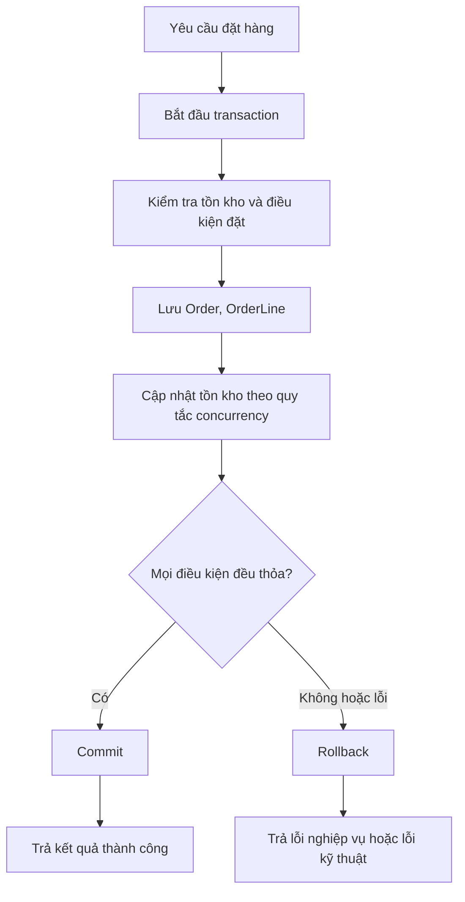
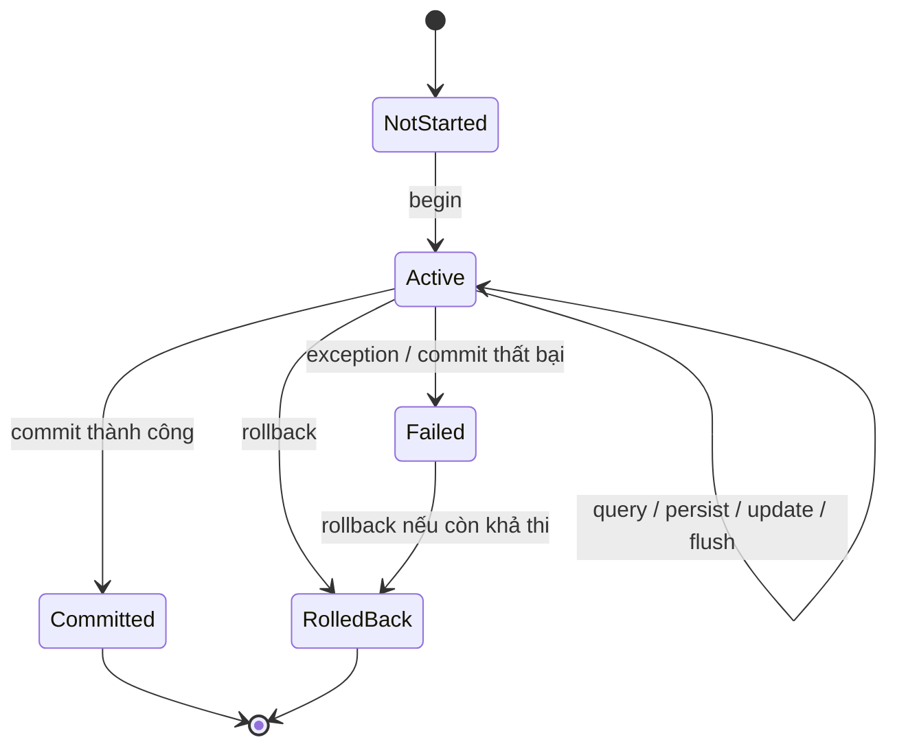
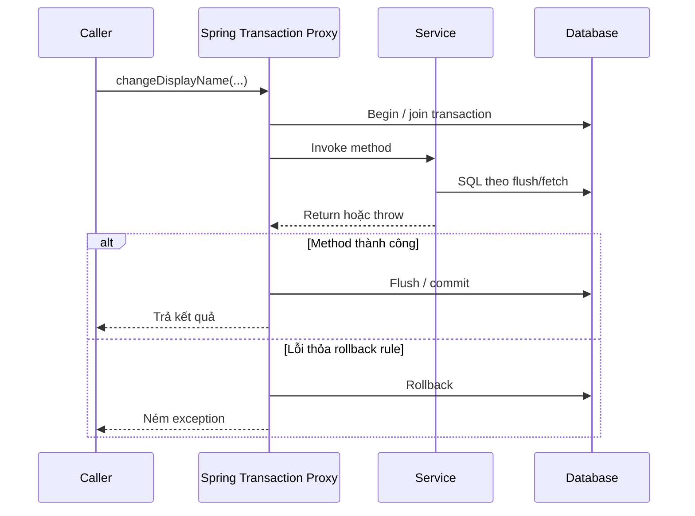

# Bắt đầu, commit, rollback và xử lý lỗi đúng ranh giới trong Hibernate

Một ứng dụng Hibernate không chỉ đọc và ghi từng bản ghi riêng lẻ. Nhiều thao tác thường phải được thực hiện như **một đơn vị công việc có tính nhất quán**: tạo đơn hàng và các dòng hàng; trừ tiền một tài khoản và cộng tiền tài khoản khác; đặt chỗ và cập nhật tồn kho; đổi trạng thái giao dịch cùng lúc ghi lịch sử. Nếu một bước thất bại, các bước còn lại không được để database ở trạng thái dang dở.

**Transaction (giao dịch)** là ranh giới giúp kết hợp các thao tác cần thành công hoặc thất bại cùng nhau. Trong Hibernate/JPA, một luồng điển hình là:

1. Xác định **đơn vị công việc** và mở một transaction khi cần ghi dữ liệu.
2. Thao tác trên các entity và thực hiện các truy vấn.
3. **Commit** khi toàn bộ bất biến nghiệp vụ đã thỏa mãn.
4. **Rollback** khi lỗi xảy ra hoặc nghiệp vụ quyết định hủy.
5. Giải phóng `Session`/`EntityManager` và những tài nguyên thuộc quyền sở hữu của luồng hiện tại.

Quan trọng hơn cú pháp gọi `begin()` hay `commit()` là việc **đặt đúng ranh giới giao dịch**, không nuốt lỗi, không tiếp tục dùng persistence context có trạng thái không còn đáng tin sau lỗi và không nhầm giao dịch database với giao dịch mạng/dịch vụ bên ngoài.

Bài học giải thích đầy đủ cơ chế trong Hibernate native, Jakarta Persistence và Spring `@Transactional`, từ transaction lifecycle, `flush`, rollback-only, exception, transaction propagation cho tới concurrency và xử lý side effect.

---

## 1. Transaction là đơn vị công việc, không phải một câu SQL

Ví dụ một lệnh chuyển 100.000 đồng từ tài khoản A sang tài khoản B:

```text
A.balance = 500.000
B.balance = 200.000

Chuyển 100.000:
    A.balance = 400.000
    B.balance = 300.000
```

Nếu chương trình trừ tiền A thành công rồi lỗi trước khi cộng cho B, dữ liệu sai. Hai cập nhật phải nằm trong cùng một transaction của database:

```sql
BEGIN;

UPDATE bank_accounts
SET balance = balance - 100000
WHERE id = 1;

UPDATE bank_accounts
SET balance = balance + 100000
WHERE id = 2;

COMMIT;
```

Nếu điều kiện nghiệp vụ hoặc thao tác database thất bại, phải `ROLLBACK` thay vì `COMMIT`.

Ở mức khái niệm, transaction hỗ trợ các thuộc tính ACID:

| Thuộc tính | Ý nghĩa |
| --- | --- |
| **Atomicity** | Các thao tác thuộc transaction được commit cùng nhau hoặc rollback theo khả năng của hệ quản trị |
| **Consistency** | Dữ liệu sau giao dịch phải tuân thủ constraint và các bất biến mà ứng dụng/database thực thi |
| **Isolation** | Tác động của nhiều transaction đồng thời được điều phối theo isolation level |
| **Durability** | Sau commit thành công, database đảm bảo độ bền dữ liệu theo cơ chế của nó |

ACID không có nghĩa database sẽ tự hiểu mọi bất biến nghiệp vụ. Ví dụ tổng số dư hai tài khoản phải không đổi là quy tắc mà ứng dụng phải triển khai chính xác, phối hợp locking/version/constraint phù hợp.

### Transaction nên bao trùm những gì?

Một transaction nên bao trùm **các thao tác đọc và ghi phải nhìn thấy nhau nhất quán để hoàn thành một use case**. Không nên chia mỗi câu SQL thành transaction riêng nếu chúng cùng tạo một quyết định nghiệp vụ. Ngược lại, cũng không nên giữ transaction mở trong suốt lúc người dùng nhập form, chờ HTTP API bên ngoài hoặc xử lý một tác vụ nền kéo dài nhiều phút nếu không có nhu cầu nhất quán thật sự.

Ví dụ ranh giới:



Sơ đồ chỉ mô tả luồng chung. Đối với ghi sự kiện hoặc gọi dịch vụ bên ngoài, cần xem các phần về **outbox và idempotency**; một transaction database không thể tự rollback một email đã gửi hoặc một HTTP call đã thành công.

## 2. Phân biệt EntityManager/Session, Persistence Context và transaction

Ba khái niệm liên quan nhưng không đồng nghĩa:

- **`SessionFactory`/`EntityManagerFactory`:** thành phần thường sống lâu, tạo Session hoặc EntityManager; có thể được chia sẻ giữa nhiều luồng theo hợp đồng API.
- **`Session`/`EntityManager`:** đơn vị làm việc với persistence, chứa **Persistence Context (L1)** và quản lý những entity đang ở trạng thái managed. Đây không phải đối tượng thread-safe để chia sẻ tùy tiện.
- **Transaction:** ranh giới commit/rollback của những thay đổi database trong một đơn vị công việc.

Một Persistence Context có thể được gắn với transaction theo cấu hình và môi trường. Bản thân việc entity được managed **không chứng minh dữ liệu đã được commit**.

```text
SessionFactory / EntityManagerFactory
    ├── Session A / Persistence Context A
    │       └── Transaction A: begin -> work -> commit/rollback
    └── Session B / Persistence Context B
            └── Transaction B: begin -> work -> commit/rollback
```

### Đừng nhầm `persist` với commit

```java
entityManager.persist(order);
```

Dòng này yêu cầu JPA đưa entity mới vào Persistence Context và lên lịch/tiến hành các thao tác phù hợp; nó **không mặc nhiên có nghĩa transaction đã commit**.

Ngay cả khi Hibernate đã gửi `INSERT` xuống database để lấy ID của `GenerationType.IDENTITY`, nếu transaction vẫn chưa commit thì dữ liệu vẫn có thể rollback. Phải phân biệt các mốc:

| Mốc | Điều gì đã xảy ra? |
| --- | --- |
| `new Order(...)` | Tạo object Java, chưa managed |
| `persist(order)` | Entity trở thành managed theo lifecycle JPA |
| `flush()` | Đồng bộ các thay đổi pending xuống database bằng SQL |
| `commit()` | Yêu cầu xác nhận transaction; Hibernate thường flush những thay đổi còn pending trước khi hoàn tất |
| `rollback()` | Hủy transaction theo cơ chế quản lý transaction/database |

`flush` **không** phải commit. Nếu SQL đã được gửi trong transaction nhưng sau đó rollback, database hủy những thay đổi chưa commit theo semantics của transaction.

## 3. Vòng đời cơ bản: begin → work → commit hoặc rollback

Một transaction được sử dụng theo mô hình:



**Không nên viết mã giả định sau khi transaction thất bại vẫn có thể tiếp tục thao tác trên cùng Session như chưa có gì xảy ra.** Tùy loại lỗi, Hibernate persistence context có thể giữ những snapshot/entity state không còn nhất quán với database. Sau lỗi persistence nghiêm trọng, cách an toàn thường là rollback và kết thúc đơn vị công việc, đóng Session/EntityManager thuộc quyền sở hữu rồi bắt đầu một context mới cho yêu cầu tiếp theo.

### Mẫu tư duy an toàn

```text
Mở persistence context
    Bắt đầu transaction
        Thực hiện use case
        Commit nếu không có lỗi
    Nếu có lỗi:
        Rollback khi transaction còn có thể rollback
        Giữ nguyên nguyên nhân lỗi ban đầu
    Cuối cùng:
        Đóng context do mình sở hữu
```

Trong Spring, transaction manager thường chịu trách nhiệm begin/commit/rollback nên mã service **không** gọi các phương thức này bằng tay. Phân biệt hai kiểu sở hữu transaction là bước quan trọng tiếp theo.

## 4. Jakarta Persistence resource-local: mẫu code đầy đủ

Trong một ứng dụng Java SE dùng **resource-local transaction**, có thể sử dụng `EntityManagerFactory`, `EntityManager` và `EntityTransaction`:

```java
import jakarta.persistence.EntityManager;
import jakarta.persistence.EntityManagerFactory;
import jakarta.persistence.EntityTransaction;

public class OrderCommandService {

    private final EntityManagerFactory entityManagerFactory;

    public OrderCommandService(EntityManagerFactory emf) {
        this.entityManagerFactory = emf;
    }

    public Long createOrder(String customerCode) {
        EntityManager em = entityManagerFactory.createEntityManager();
        EntityTransaction tx = em.getTransaction();

        try {
            tx.begin();

            Order order = new Order(customerCode);
            em.persist(order);

            tx.commit();
            return order.getId();
        } catch (RuntimeException original) {
            if (tx.isActive()) {
                try {
                    tx.rollback();
                } catch (RuntimeException rollbackFailure) {
                    original.addSuppressed(rollbackFailure);
                }
            }
            throw original;
        } finally {
            em.close();
        }
    }
}
```

Đoạn code minh họa một entity `Order` có constructor `Order(String)`, `@Id` và cơ chế sinh ID tương ứng với schema. Trong chương trình thực, cần cài đặt entity hợp lệ và tạo `EntityManagerFactory` ở cấp ứng dụng.

### Đọc từng dòng theo trách nhiệm

1. `emf.createEntityManager()` tạo context riêng cho use case.
2. `em.getTransaction()` lấy transaction API của persistence unit dùng resource-local.
3. `tx.begin()` mở transaction; thao tác cần nhất quán bắt đầu sau bước này.
4. `em.persist(order)` đưa entity vào Persistence Context.
5. `tx.commit()` xác nhận toàn bộ thao tác hoặc ném lỗi nếu không thể commit.
6. `catch` xử lý rollback **nếu transaction còn active**.
7. Lỗi rollback được gắn thành suppressed exception để **không che nguyên nhân gốc**.
8. `finally` giải phóng EntityManager dù commit thành công hay thất bại.

Điểm đặc biệt quan trọng: **`commit()` cũng có thể ném exception**. Không đặt nó ngoài `try` rồi giả định chỉ phần xử lý business mới có lỗi.

### Vì sao dùng `RuntimeException`?

Các exception persistence thường là unchecked, chẳng hạn `PersistenceException` và nhiều loại lỗi Hibernate. Ví dụ chủ yếu xử lý kiểu lỗi này.

Nếu phương thức use case của ứng dụng có **checked exception**, phải quyết định policy commit/rollback và có nhánh xử lý phù hợp, hoặc tạo helper có hợp đồng rõ ràng. Không nên thêm `catch (Exception)` rồi nuốt lỗi hoặc đổi lỗi thành một giá trị “thành công giả”.

### `EntityManager.close()` có thay cho rollback không?

Không. Đóng EntityManager giải phóng tài nguyên của persistence context; **rollback phải được thực hiện theo transaction manager khi cần**. Nếu transaction còn active mà chỉ close, hành vi cuối cùng còn tùy provider/tích hợp và không nên dựa vào đó để bảo vệ nghiệp vụ.

### Có dùng `getTransaction()` trong Spring/JTA được không?

Không dùng mẫu resource-local này khi transaction được quản lý bởi **JTA hoặc Spring container transaction manager**. Đối với container-managed EntityManager, thao tác `em.getTransaction().begin()` có thể bị cấm hoặc trái mô hình quản lý. Trong Spring, dùng `@Transactional` ở tầng service và để transaction manager điều phối.

## 5. Hibernate native Session: bắt đầu và kết thúc đúng cách

Nếu dùng API Hibernate trực tiếp:

```java
import org.hibernate.Session;
import org.hibernate.SessionFactory;
import org.hibernate.Transaction;

public class CatalogCommandService {

    private final SessionFactory sessionFactory;

    public CatalogCommandService(SessionFactory sessionFactory) {
        this.sessionFactory = sessionFactory;
    }

    public void updateName(Long productId, String newName) {
        try (Session session = sessionFactory.openSession()) {
            Transaction tx = session.beginTransaction();

            try {
                Product product =
                    session.get(Product.class, productId);

                if (product == null) {
                    throw new IllegalArgumentException(
                        "Product không tồn tại");
                }

                product.rename(newName);
                tx.commit();
            } catch (RuntimeException original) {
                if (tx.isActive()) {
                    try {
                        tx.rollback();
                    } catch (RuntimeException rollbackFailure) {
                        original.addSuppressed(rollbackFailure);
                    }
                }
                throw original;
            }
        }
    }
}
```

Với Hibernate native:

- `session.beginTransaction()` bắt đầu transaction gắn với session theo cấu hình hiện hành.
- Session quản lý entity đã tải và thực hiện dirty checking.
- `tx.commit()` yêu cầu đồng bộ và xác nhận transaction.
- Nếu có lỗi, rollback khi thích hợp và **không tiếp tục dùng session để thực hiện một nghiệp vụ khác sau lỗi persistence**.
- `try-with-resources` bảo đảm đóng Session vì Hibernate `Session` hỗ trợ `AutoCloseable`.

### Khác gì với JPA?

| Khía cạnh | JPA resource-local | Hibernate native |
| --- | --- | --- |
| Context | `EntityManager` | `Session` |
| Transaction | `EntityTransaction` | `Transaction` |
| Bắt đầu | `tx.begin()` | `session.beginTransaction()` hoặc transaction API tương ứng |
| Xác nhận | `tx.commit()` | `tx.commit()` |
| Hủy | `tx.rollback()` | `tx.rollback()` |
| Giải phóng | `em.close()` | `session.close()` |
| Tính portable | Chuẩn Jakarta Persistence | API riêng Hibernate |

Về nghiệp vụ, cả hai đều phải tôn trọng cùng một ranh giới atomicity. Khác biệt chính là API và việc ứng dụng/framework sở hữu transaction như thế nào.

## 6. Chọn ranh giới transaction theo use case

Một quy tắc hữu ích là đặt transaction ở **application service xử lý một lệnh nghiệp vụ hoàn chỉnh**, thay vì để mỗi repository tự tạo một transaction độc lập.

### Ví dụ đặt hàng

```text
placeOrder(customerId, cartItems)
    -> kiểm tra customer
    -> tạo Order
    -> tạo OrderLine
    -> xác nhận/điều chỉnh tồn kho
    -> ghi một sự kiện outbox nếu cần
    -> commit
```

Nếu `createOrder` tự commit rồi `updateStock` tự commit ở transaction thứ hai, thao tác thứ hai thất bại có thể để lại một Order thiếu tồn kho. Cần đưa các bước bắt buộc nhất quán vào cùng transaction khi chúng nằm trong **cùng một database và transaction manager**.

### Repository không nên tự commit tùy tiện

Một repository đơn giản có thể biểu diễn:

```java
@Repository
public class OrderRepository {

    @PersistenceContext
    private EntityManager em;

    public void persist(Order order) {
        em.persist(order);
    }

    public Order getById(Long id) {
        return em.find(Order.class, id);
    }
}
```

Application service chịu ranh giới:

```java
@Service
public class OrderApplicationService {

    private final OrderRepository orders;
    private final InventoryService inventory;

    public OrderApplicationService(
            OrderRepository orders,
            InventoryService inventory) {
        this.orders = orders;
        this.inventory = inventory;
    }

    @Transactional
    public void placeOrder(CreateOrderCommand command) {
        Order order = Order.from(command);
        orders.persist(order);

        inventory.reserveFor(order); // Tham gia cùng transaction
                                     // nếu cùng manager và propagation phù hợp.
    }
}
```

Ví dụ giả định `Order.from`, `CreateOrderCommand` và `InventoryService` được định nghĩa hợp lệ. Nếu inventory thực chất là **HTTP service khác**, nó **không** tự tham gia transaction database hiện tại: cần mô hình xử lý phân tán hoặc thông điệp, không dựa vào một annotation.

### Transaction quá ngắn và quá dài

| Ranh giới | Nguy cơ |
| --- | --- |
| Một transaction riêng cho mỗi repository call | Use case nhiều bước có thể commit một phần |
| Transaction chứa user input/HTTP call lâu | Giữ lock/connection lâu, dễ timeout, tăng contention |
| Transaction bao trùm toàn bộ batch hàng triệu dòng | Persistence Context và transaction log lớn, rollback tốn kém |
| Transaction đặt ở application use case gọn | Thường dễ diễn đạt atomicity và xử lý lỗi |
| Nhiều bước thực sự độc lập | Có thể tách transaction, nhưng phải xác định trạng thái trung gian hợp lệ |

Ranh giới tối ưu cần xét lock duration, isolation, tốc độ SQL, độ tin cậy dịch vụ và khả năng rollback. Không có công thức “mọi controller chỉ có một transaction” đúng cho mọi hệ thống.

## 7. Spring `@Transactional`: framework quản lý begin/commit/rollback

Trong Spring, `@Transactional` thường được áp dụng thông qua transaction interceptor/proxy. Khi lời gọi đi qua cơ chế được Spring quản lý, framework bắt đầu hoặc tham gia transaction trước method và commit/rollback sau khi method kết thúc theo quy tắc.

```java
import org.springframework.stereotype.Service;
import org.springframework.transaction.annotation.Transactional;

@Service
public class AccountService {

    private final AccountRepository accounts;

    public AccountService(AccountRepository accounts) {
        this.accounts = accounts;
    }

    @Transactional
    public void changeDisplayName(Long accountId, String displayName) {
        Account account = accounts.findRequired(accountId);
        account.rename(displayName);
        // Entity managed -> Hibernate dirty checking lúc flush/commit.
        // Không gọi EntityTransaction.begin()/commit() ở đây.
    }
}
```

Luồng khái quát:



Chi tiết khi nào SQL thật sự chạy do Hibernate, JDBC, flush mode và transaction manager quyết định. Sơ đồ không mô tả mọi cơ chế JTA/distributed transaction.

### Những điều cần hiểu

- Đặt `@Transactional` **trên method application service** thường làm ranh giới rõ ràng.
- Spring Data JPA repository có hành vi giao dịch riêng theo method; nhưng use case nhiều repository vẫn nên có transaction bọc ngoài.
- Trong Spring-managed transaction, không tự gọi `em.getTransaction().begin()`/`commit()`.
- Exception có thể xuất hiện **khi method kết thúc và commit/flush**, không chỉ ở `em.persist` hoặc `repository.save`.
- Trạng thái rollback-only có thể làm commit thất bại dù code method cuối cùng không ném ra exception.

### Self-invocation có thể không đi qua proxy

```java
@Service
public class ReportService {

    public void generate() {
        persistSnapshot(); // Lời gọi trực tiếp trong cùng object.
    }

    @Transactional
    public void persistSnapshot() {
        // ...
    }
}
```

Trong cơ chế Spring proxy thông thường, `this.persistSnapshot()` không đi qua transaction proxy nên annotation trên method đích có thể **không được áp dụng**. Nếu `generate()` cũng chưa có transaction, `persistSnapshot` có thể chạy mà không có transaction như kỳ vọng.

Cách rõ ràng là để caller gọi một bean/method qua Spring proxy, hoặc đặt ranh giới transaction ngay tại method entrypoint thực sự. Spring có cơ chế weaving/AspectJ trong cấu hình riêng, nên không phải mọi môi trường đều giống nhau; cần biết cơ chế đang sử dụng.

### Phạm vi method và thread

Transaction context trong Spring thông thường gắn với luồng đang xử lý. Gửi tác vụ sang `@Async` hoặc thread mới **không làm transaction hiện tại tự lan sang thread đó**. Cần mở transaction riêng cho tác vụ async nếu nó thao tác database.

## 8. Quy tắc rollback của Spring: unchecked và checked exception

Mặc định, với cơ chế declarative transaction thông thường, Spring rollback khi method ném:

- `RuntimeException` hoặc subclass.
- `Error` hoặc subclass.

**Checked exception** (lớp kế thừa `Exception` nhưng không phải `RuntimeException`) thường **không tự kích hoạt rollback theo mặc định**, trừ khi cấu hình rollback rules khác.

Ví dụ:

```java
public class PaymentPolicyException extends Exception {
    public PaymentPolicyException(String message) {
        super(message);
    }
}
```

Nếu muốn rollback khi loại checked exception này xảy ra:

```java
@Transactional(rollbackFor = PaymentPolicyException.class)
public void confirmOrder(Order order)
        throws PaymentPolicyException {

    // Thay đổi một số entity managed.

    if (!order.canBeConfirmed()) {
        throw new PaymentPolicyException(
            "Order chưa đủ điều kiện xác nhận");
    }
}
```

Cấu hình `rollbackFor` làm ý định rõ ràng ngay ở method boundary.

### Không giả định tất cả checked exceptions được commit

Default là một chính sách có thể cấu hình. Spring hỗ trợ `rollbackFor`, `noRollbackFor` và các cấu hình transaction rule cấp ứng dụng, và một số phiên bản cho phép điều chỉnh default rollback policy. Khi nghiệp vụ phụ thuộc kết quả, kiểm tra cấu hình thực tế thay vì dựa vào tên exception.

### `noRollbackFor` cần dùng thận trọng

Có trường hợp một exception chỉ mang nghĩa “không tìm thấy trạng thái cần trả về” mà các thay đổi trước đó vẫn phải được commit. Spring cho phép:

```java
@Transactional(noRollbackFor = CertainBusinessNotice.class)
```

Nhưng đây là **chính sách transaction có chủ đích**, không phải mẹo để làm lỗi biến mất. Nếu exception làm thao tác ghi trước đó không còn nhất quán, commit là sai. Chỉ dùng khi sau khi exception được ném, database vẫn ở trạng thái nghiệp vụ hợp lệ.

## 9. Nuốt exception: lỗi ranh giới thường gặp nhất

Xét method sau:

```java
@Transactional
public void placeOrder(CreateOrderCommand command) {
    Order order = Order.from(command);
    orderRepository.save(order);

    try {
        inventoryRepository.reserve(command.items());
    } catch (RuntimeException ex) {
        log.warn("Reserve inventory failed", ex);
    }

    // Method kết thúc bình thường.
}
```

Lỗi `reserve` đã bị bắt và không ném ra ngoài. Với Spring proxy, method có thể được coi là **thành công** và transaction có thể được commit (trừ khi transaction đã bị đánh dấu rollback-only hoặc tài nguyên báo lỗi).

Kết quả nguy hiểm: Order đã được ghi nhưng tồn kho chưa được giữ.

### Cách xử lý đúng nếu phải rollback toàn bộ

```java
@Transactional
public void placeOrder(CreateOrderCommand command) {
    Order order = Order.from(command);
    orderRepository.save(order);

    try {
        inventoryRepository.reserve(command.items());
    } catch (RuntimeException ex) {
        log.error("Cannot reserve inventory for order", ex);
        throw ex; // Cho transaction interceptor quyết định rollback.
    }
}
```

Nếu cần chuyển exception sang lỗi nghiệp vụ:

```java
catch (RuntimeException ex) {
    throw new OrderPlacementException(
        "Không thể hoàn tất đơn hàng", ex);
}
```

`OrderPlacementException` nên là `RuntimeException` nếu muốn rollback theo mặc định hoặc được khai báo phù hợp trong `rollbackFor`.

**Đừng nuốt exception rồi trả về HTTP 200 “thành công” khi transaction chưa hoàn thành trọn vẹn.**

### Bắt exception mà vẫn có thể commit hợp lệ

Không phải mọi exception được bắt đều phải rollback. Chẳng hạn một bước **không bắt buộc** như tạo nội dung hiển thị gợi ý có thể thất bại mà không làm hỏng bất biến dữ liệu. Nhưng khi ấy nên thiết kế tách khỏi transaction, hoặc biểu đạt rõ rằng đây là một phần tùy chọn với outcome riêng.

Điểm cốt lõi là **quy tắc nghiệp vụ**, không phải số lượng khối `try-catch`.

## 10. Rollback-only: transaction đã bị đánh dấu không thể commit

Trong một số trường hợp, một phần bên trong đã đánh dấu transaction **rollback-only**. Method gọi bên ngoài có thể bắt exception và tiếp tục chạy, nhưng tới lúc commit framework phát hiện transaction phải rollback.

Ví dụ với hai service cùng tham gia một transaction thông qua propagation mặc định `REQUIRED`:

```java
@Service
public class CheckoutService {

    private final InventoryService inventory;

    public CheckoutService(InventoryService inventory) {
        this.inventory = inventory;
    }

    @Transactional
    public void checkout() {
        try {
            inventory.reserveRequiredItems();
        } catch (RuntimeException ex) {
            // Lỗi đã được bắt, nhưng transaction bên trong
            // có thể đã bị đánh dấu rollback-only.
        }

        // Method kết thúc; commit có thể thất bại.
    }
}
```

Và:

```java
@Service
public class InventoryService {

    @Transactional
    public void reserveRequiredItems() {
        throw new IllegalStateException("Out of stock");
    }
}
```

Nếu `InventoryService` là bean khác và lời gọi đi qua Spring proxy, interceptor bên trong có thể đánh dấu transaction chia sẻ là rollback-only. Khi `CheckoutService.checkout()` kết thúc bình thường, interceptor bên ngoài cố commit nhưng nhận thấy transaction đã bị đánh dấu rollback-only và có thể ném **`UnexpectedRollbackException`**.

Đây không phải lỗi do `catch` “không bắt đủ”. Nó là dấu hiệu rằng code đã cố tiếp tục/commit một giao dịch không còn được phép commit.

### Khi nào tự đánh dấu rollback-only?

Trong Spring, nếu code bắt lỗi rồi muốn trả về một kết quả nghiệp vụ thay vì ném exception, có thể đánh dấu transaction rollback-only một cách có chủ đích:

```java
import org.springframework.transaction.interceptor.TransactionAspectSupport;

@Transactional
public OperationResult performOperation() {
    try {
        updateRequiredData();
        return OperationResult.success();
    } catch (BusinessFailure ex) {
        TransactionAspectSupport.currentTransactionStatus()
            .setRollbackOnly();
        return OperationResult.failed(ex.getMessage());
    }
}
```

Đây là **API đặc thù Spring**, chỉ hoạt động khi có transaction aspect context phù hợp. Nếu method đang tham gia transaction do caller khác sở hữu, việc đánh dấu rollback-only ảnh hưởng cả transaction bên ngoài.

Mặc dù kỹ thuật này tồn tại, **ném exception qua transaction boundary thường đơn giản và dễ đọc hơn**. Hãy dùng kết quả trả về cộng rollback-only chỉ khi API/use case đòi hỏi rõ và biết chính xác semantics của caller.

## 11. Điều gì xảy ra nếu lỗi xuất hiện tại `flush()` hoặc `commit()`?

Một lỗi database không nhất thiết nổ ra tại câu lệnh sửa entity.

Ví dụ:

```java
@Transactional
public void registerUser(String email) {
    User user = new User(email);
    em.persist(user);

    // Có thể chưa có INSERT nào được gửi ở đây.

    // SQL/unique constraint có thể được kiểm tra
    // lúc flush hoặc lúc commit.
}
```

Nếu hai request cùng tạo email và bảng có unique constraint, một transaction có thể thất bại tại `flush` hoặc `commit`.

### Mốc ném lỗi

| Thời điểm | Lỗi có thể xuất hiện |
| --- | --- |
| `persist` | Entity state không hợp lệ, một số generator/cascade cần SQL |
| `flush` | Constraint, SQL syntax, lock timeout, deadlock, optimistic conflict |
| `commit` | Flush còn pending, constraint deferred, transaction failure |
| `rollback` | Kết nối hỏng, lỗi transaction manager; cần giữ nguyên nguyên nhân chính |
| `close` | Lỗi giải phóng tài nguyên hiếm gặp, cần logging phù hợp |

Không được kết luận “`save()` không ném exception nên dữ liệu chắc chắn đã được lưu” nếu transaction vẫn chưa kết thúc.

### Vì sao commit có thể thất bại ngoài try của nghiệp vụ?

Trong Spring, proxy thực hiện commit **sau khi method `@Transactional` trả về**. Một `try-catch` bao toàn bộ body của method không chắc bắt được lỗi từ commit do interceptor thực hiện sau đó.

```java
@Transactional
public void createUser(String email) {
    try {
        em.persist(new User(email));
    } catch (RuntimeException ex) {
        // Không bao trùm lỗi commit diễn ra sau khi method return.
    }
}
```

Lớp gọi bên ngoài transaction boundary (controller, message handler, job coordinator) có thể nhận exception từ proxy sau khi commit thất bại. Đó là nơi phù hợp để ánh xạ lỗi thành phản hồi API, log và quyết định retry, **không phải giả định có thể bắt tất cả lỗi persistence bên trong method**.

### `flush` chủ động có giúp phát hiện sớm?

Có. Trong một use case cần phát hiện lỗi constraint trước khi tiếp tục bước khác, có thể:

```java
em.persist(user);
em.flush();
```

Tuy nhiên:

- `flush` không commit.
- Constraint deferred có thể vẫn chỉ được kiểm tra ở commit.
- SQL lỗi tại flush thường làm transaction trở nên không phù hợp để tiếp tục; cần rollback.
- Flush sớm có thêm chi phí và có thể tăng thời gian giữ lock, không nên gọi mọi nơi như thói quen.

## 12. Sau lỗi persistence: rollback và bỏ context đang lỗi

Đây là quy tắc an toàn quan trọng với Hibernate: **sau một exception khiến thao tác persistence thất bại, không tiếp tục sử dụng Session/EntityManager như thể transaction vẫn khỏe mạnh**.

Ví dụ sai về ý tưởng:

```java
try {
    em.persist(duplicateUser);
    em.flush(); // Vi phạm unique constraint.
} catch (PersistenceException ex) {
    log.warn("Duplicate ignored", ex);
}

em.persist(anotherUser); // Nguy hiểm: transaction/context có thể lỗi.
```

Một số database, ví dụ PostgreSQL, chuyển transaction sang trạng thái failed sau lỗi SQL và yêu cầu rollback trước khi thực hiện phần lớn SQL tiếp theo. Ngay cả nếu database khác cho phép một số thao tác tiếp, Hibernate Persistence Context vẫn có thể giữ những trạng thái/queue không còn đáng tin.

**Mẫu đúng khi lỗi nghiêm trọng:** rollback, đóng/bỏ context đang lỗi và mở transaction mới ở cấp điều phối nếu quyết định retry.

```text
DB constraint error
    -> giữ thông tin lỗi
    -> rollback transaction
    -> không reuse Session lỗi để thử tiếp
    -> tạo unit of work mới nếu cần
```

### Không cần rollback để xử lý mọi tình huống nghiệp vụ

Nếu trước khi ghi bạn tự kiểm tra một điều kiện như “số lượng = 0” rồi quyết định không thực hiện giao dịch, bạn có thể trả kết quả hoặc ném business exception theo policy mà không khiến JDBC vào trạng thái lỗi.

Khác biệt lớn là **một lỗi đã xảy ra trong persistence/SQL** so với **một nhánh nghiệp vụ có chủ đích trước khi ghi**. Dù vậy, nếu đã thay đổi các entity managed trước khi quyết định hủy, phải bảo đảm rollback theo semantics của use case.

## 13. Đóng tài nguyên và không che exception gốc

Trong mã resource-local, việc rollback cũng có thể ném exception. Nếu đơn giản viết:

```java
catch (RuntimeException ex) {
    tx.rollback(); // Nếu dòng này lỗi, exception gốc bị che.
    throw ex;
}
```

thì lỗi rollback có thể thay thế lỗi chính, khiến việc chẩn đoán khó hơn.

Mẫu bảo toàn nguyên nhân:

```java
catch (RuntimeException original) {
    if (tx.isActive()) {
        try {
            tx.rollback();
        } catch (RuntimeException rollbackFailure) {
            original.addSuppressed(rollbackFailure);
        }
    }
    throw original;
}
```

Trong một số môi trường, `tx.isActive()` sau commit thất bại có thể không cho biết chắc outcome của transaction. Nếu kết nối bị mất đúng thời điểm commit, **kết quả commit có thể không xác định từ góc nhìn client**; không được tự tin tuyên bố “database chắc chắn rollback” hay “chắc chắn commit”.

Nếu rơi vào tình huống commit outcome không rõ, cần cơ chế kiểm tra kết quả bằng idempotency key/transaction identifier và quy trình đối soát, không chỉ retry mù.

### Close lỗi cũng có thể che lỗi chính

Với `try-with-resources`, Java gắn lỗi close làm suppressed exception khi đã có exception trong body. Với `EntityManager` đóng thủ công ở `finally`, nếu ứng dụng muốn bảo toàn lỗi chính trong mọi trường hợp, có thể dùng helper quản lý close có chủ đích và log/cộng suppressed theo exception policy.

Tuy nhiên, tránh biến mỗi use case thành nhiều tầng xử lý exception phức tạp. Nếu Spring quản lý EntityManager và transaction, hãy để container sở hữu việc close/rollback.

## 14. Transfer tiền trong một transaction: ví dụ domain đầy đủ

Xét bảng:

```sql
CREATE TABLE accounts (
    id BIGINT PRIMARY KEY,
    balance DECIMAL(18, 2) NOT NULL,
    version BIGINT NOT NULL,
    CONSTRAINT chk_balance_nonnegative CHECK (balance >= 0)
);
```

Entity:

```java
import java.math.BigDecimal;
import java.util.Objects;

import jakarta.persistence.Column;
import jakarta.persistence.Entity;
import jakarta.persistence.Id;
import jakarta.persistence.Table;
import jakarta.persistence.Version;

@Entity
@Table(name = "accounts")
public class Account {

    @Id
    private Long id;

    @Column(nullable = false, precision = 18, scale = 2)
    private BigDecimal balance;

    @Version
    private Long version;

    protected Account() {}

    public BigDecimal getBalance() {
        return balance;
    }

    public void debit(BigDecimal amount) {
        validatePositive(amount);

        if (balance.compareTo(amount) < 0) {
            throw new InsufficientFundsException(
                "Số dư không đủ");
        }

        balance = balance.subtract(amount);
    }

    public void credit(BigDecimal amount) {
        validatePositive(amount);
        balance = balance.add(amount);
    }

    private static void validatePositive(BigDecimal amount) {
        Objects.requireNonNull(amount);

        if (amount.signum() <= 0) {
            throw new IllegalArgumentException(
                "Amount must be positive");
        }
    }
}
```

Exception nghiệp vụ:

```java
public class InsufficientFundsException
        extends RuntimeException {

    public InsufficientFundsException(String message) {
        super(message);
    }
}
```

Service:

```java
import java.math.BigDecimal;
import jakarta.persistence.EntityManager;
import jakarta.persistence.PersistenceContext;
import org.springframework.stereotype.Service;
import org.springframework.transaction.annotation.Transactional;

@Service
public class TransferService {

    @PersistenceContext
    private EntityManager em;

    @Transactional
    public void transfer(
            Long fromAccountId,
            Long toAccountId,
            BigDecimal amount) {

        if (fromAccountId.equals(toAccountId)) {
            throw new IllegalArgumentException(
                "Không chuyển vào cùng tài khoản");
        }

        Account from =
            em.find(Account.class, fromAccountId);
        Account to =
            em.find(Account.class, toAccountId);

        if (from == null || to == null) {
            throw new IllegalArgumentException(
                "Tài khoản không tồn tại");
        }

        from.debit(amount);
        to.credit(amount);
    }
}
```

Hai thay đổi managed entity được flush và commit cùng transaction. Nếu `debit` ném `InsufficientFundsException`, transaction theo mặc định bị rollback vì đây là unchecked exception.

### Vì sao vẫn cần `@Version` hoặc locking?

`@Transactional` tạo tính nguyên tử cho hai thay đổi, nhưng **không tự giải quyết mọi tranh chấp đồng thời**.

Hai transaction có thể cùng đọc một số dư và cùng tính toán dựa trên giá trị cũ. `@Version` giúp Hibernate phát hiện nhiều trường hợp lost update qua optimistic locking; một transaction có thể phải rollback vì version conflict.

Với yêu cầu khóa hàng ngay khi đọc, có thể dùng `LockModeType.PESSIMISTIC_WRITE` theo database/dialect:

```java
Account from = em.find(
    Account.class,
    fromAccountId,
    LockModeType.PESSIMISTIC_WRITE
);
```

Nếu khóa hai tài khoản cùng lúc, nên cân nhắc thứ tự khóa nhất quán để giảm nguy cơ deadlock. Với hệ thống thanh toán thật, cần thêm yêu cầu về ledger, idempotency, audit, hạn mức và đối soát; ví dụ chỉ minh họa **transaction boundary**.

### Constraint database vẫn quan trọng

Ngay cả khi `debit` kiểm tra số dư không âm, constraint `CHECK(balance >= 0)` giúp ngăn dữ liệu sai từ các đường ghi khác; optimistic/pessimistic locking giúp giải quyết concurrency. **Transaction, validation, constraints và locking bổ sung cho nhau**, không thay thế hoàn toàn lẫn nhau.

## 15. Isolation và lỗi đồng thời ảnh hưởng ranh giới giao dịch

Một transaction không hoạt động trong môi trường cô lập tuyệt đối trừ khi isolation và database bảo đảm điều đó theo mức đã chọn.

Các hiện tượng thường được học:

- **Dirty read:** đọc thay đổi chưa commit của transaction khác.
- **Non-repeatable read:** đọc lại cùng một dòng thấy giá trị khác do transaction khác đã commit.
- **Phantom read:** truy vấn cùng điều kiện thấy tập hàng khác do transaction khác commit.
- **Lost update/Write skew:** tranh chấp có thể phá bất biến nếu không có locking/version/constraint phù hợp.

Các isolation level như READ COMMITTED, REPEATABLE READ, SERIALIZABLE có hành vi thực tế phụ thuộc DBMS và cơ chế MVCC/locking. Không nên tuyên bố một isolation level luôn loại bỏ mọi anomaly trên mọi database.

Ví dụ Spring cấu hình mức cách ly:

```java
@Transactional(isolation = Isolation.SERIALIZABLE)
public void processCriticalOperation() {
    // ...
}
```

Mức cách ly cao hơn có thể giảm các anomaly nhưng tăng tranh chấp, deadlock hoặc serialization failure; hệ thống có thể cần **retry toàn bộ transaction**. Không tăng isolation toàn hệ thống mà không xác định vấn đề cần giải quyết.

### Transaction timeout

```java
@Transactional(timeout = 15)
public void reserveInventory() {
    // ...
}
```

Timeout là công cụ giới hạn thời gian theo transaction manager/resource, không bảo đảm mọi API hoặc query được ngắt đúng 15 giây trong mọi cấu hình. Nếu thao tác bị timeout, transaction có thể bị đánh dấu rollback-only hoặc ném exception. Không cố tiếp tục commit sau khi timeout như chưa có lỗi.

### Read-only transaction

```java
@Transactional(readOnly = true)
public ProductView getProduct(Long id) {
    // ...
}
```

Trong Spring, `readOnly = true` thường là hint/tối ưu cho transaction manager và Hibernate flush behavior, **không phải một cơ chế phân quyền hay bảo đảm tuyệt đối cấm ghi mọi database**. Nếu use case cần cập nhật dữ liệu, hãy khai báo ranh giới read-write phù hợp.

## 16. Propagation: tham gia transaction nào?

Spring hỗ trợ các propagation mode. Mặc định thường là `Propagation.REQUIRED`: nếu caller đã có transaction thì method tham gia transaction đó; nếu chưa, tạo mới.

| Propagation | Ý nghĩa chính | Lưu ý |
| --- | --- | --- |
| `REQUIRED` | Tham gia transaction hiện có, nếu chưa có thì tạo | Phù hợp phần lớn application service |
| `REQUIRES_NEW` | Tạm ngưng transaction hiện có và dùng transaction độc lập | Commit/rollback độc lập, cần thêm connection/resource |
| `SUPPORTS` | Dùng transaction nếu có; không có vẫn chạy | Không phù hợp cho write cần atomicity chắc chắn |
| `MANDATORY` | Yêu cầu caller đang có transaction | Báo lỗi nếu không có |
| `NOT_SUPPORTED` | Chạy ngoài transaction, tạm ngưng transaction hiện có | Hữu ích cho bước không cần transaction |
| `NEVER` | Báo lỗi nếu có transaction hiện hành | Chỉ dùng khi policy đặc biệt |
| `NESTED` | Dùng savepoint trong transaction hiện có khi manager hỗ trợ | Không tương đương transaction độc lập |

### `REQUIRES_NEW` không phải rollback cùng cha

Giả sử service ngoài tạo Order rồi service con ghi audit bằng `REQUIRES_NEW`. Audit transaction có thể commit thành công; sau đó Order transaction rollback. Khi ấy audit record vẫn tồn tại nếu được ghi độc lập như thiết kế.

Đây có thể là mong muốn đúng khi cần ghi nhật ký thất bại, nhưng cũng có thể làm dữ liệu mâu thuẫn nếu nghĩ mọi bước vẫn atomic. Cần hỏi:

> Dữ liệu của bước con có được phép tồn tại nếu bước cha rollback không?

Nếu câu trả lời là **không**, `REQUIRES_NEW` có thể không phù hợp.

### `NESTED` và savepoint

Propagation `NESTED` có thể dùng savepoint để rollback một phần bên trong transaction hiện tại nếu transaction manager hỗ trợ. Nó **không** tạo một commit độc lập có thể tồn tại khi outer transaction rollback.

Hỗ trợ savepoint phụ thuộc JDBC, transaction manager và tích hợp JPA/Hibernate; không giả định mọi `JpaTransactionManager`/JTA đều hỗ trợ nested transaction giống nhau.

### Self-invocation cũng ảnh hưởng propagation

Nếu một method `@Transactional(REQUIRES_NEW)` được gọi trực tiếp từ method khác trong cùng instance bằng `this.method()`, lời gọi có thể bỏ qua proxy và **không tạo transaction mới** như mong đợi. Đặt bước đó ở một Spring bean riêng hoặc sử dụng cơ chế transaction programmatic rõ ràng nếu cần.

## 17. Những lỗi cần retry và những lỗi không nên retry

Không phải mọi exception từ database đều thích hợp để thử lại.

### Có thể retry trong một số điều kiện

- Deadlock victim hoặc serialization failure.
- Lock acquisition timeout, khi policy cho phép.
- Lỗi kết nối tạm thời và **biết rõ** transaction trước chưa commit, hoặc có cơ chế idempotency để xử lý outcome chưa rõ.
- Optimistic locking conflict, nếu use case có thể tải state mới và tính lại đúng nghiệp vụ.

### Thường không retry y nguyên

- Vi phạm unique constraint do người dùng nhập mã trùng.
- Foreign key/reference không tồn tại.
- Dữ liệu vi phạm CHECK/NOT NULL.
- Lỗi validation nghiệp vụ không phụ thuộc timing.
- SQL syntax/mapping sai.
- Lỗi cấu hình datasource hoặc quyền truy cập không được khắc phục.

| Lỗi | Cách ứng xử thường phù hợp |
| --- | --- |
| `OptimisticLockException` | Rollback, nạp state mới, đối chiếu hoặc retry có giới hạn |
| Deadlock/serialization failure | Rollback và retry **cả đơn vị công việc** với backoff nếu an toàn |
| Duplicate key | Trả lỗi nghiệp vụ hoặc xử lý idempotency/lookup theo quy tắc |
| Timeout | Rollback và xem nguyên nhân tải/locking, có thể retry có kiểm soát |
| Data mapping bug | Sửa code/migration, không retry liên tục |
| Commit outcome không xác định | Kiểm tra transaction identifier/idempotency, tránh lặp tác động |

### Vì sao phải retry với transaction mới?

Khi transaction bị rollback do lỗi database, Persistence Context đang dùng có thể không còn đúng để tiếp tục. Một lượt retry phải tạo **một transaction/Persistence Context sạch** và thường phải đọc lại dữ liệu trước khi tính toán.

Không nên viết:

```java
@Transactional
public void retryInsideSameTransaction() {
    for (int attempt = 0; attempt < 3; attempt++) {
        try {
            performDatabaseWork();
            return;
        } catch (RuntimeException ex) {
            // Sai ý tưởng: dùng lại transaction có thể đã rollback-only.
        }
    }
}
```

Thay vì vậy, đặt vòng retry **bên ngoài** transactional method và mỗi attempt gọi một method qua transaction proxy hoặc `TransactionTemplate` để mở transaction riêng.

### Mẫu kiến trúc retry

```text
RetryCoordinator (không giữ transaction xuyên các lần thử)
    -> attempt 1: Transaction A -> rollback
    -> backoff
    -> attempt 2: Transaction B -> commit
```

Retry không được làm lặp side effect ngoài database. Nếu gửi email hoặc gọi payment gateway trong attempt 1 rồi sau đó rollback DB, attempt 2 có thể gửi hai lần. Cần idempotency hoặc outbox ở bước phù hợp.

## 18. Idempotency khi nhận lại cùng yêu cầu

Trong hệ thống HTTP/message queue, một request có thể được gửi lại vì client timeout hoặc message delivery là at-least-once.

Ví dụ:

```text
POST /orders
Idempotency-Key: req-0088
```

Nếu server đã commit Order nhưng response bị mất trên đường truyền, client retry không nên tạo **Order thứ hai**.

Một cách tiếp cận là lưu idempotency key có unique constraint trong cùng database transaction:

```sql
CREATE TABLE order_requests (
    idempotency_key VARCHAR(100) PRIMARY KEY,
    order_id BIGINT,
    status VARCHAR(30) NOT NULL
);
```

Trong transaction, service cần phối hợp kiểm tra/tạo request record và order theo một giao thức an toàn concurrency. Unique constraint bảo vệ việc hai request cùng key được xử lý đồng thời; khi gặp xung đột, phải đọc kết quả của request trước hoặc chờ/đối soát theo policy.

**Không coi `SELECT rồi nếu chưa có thì INSERT` là cơ chế idempotency đủ an toàn** dưới nhiều transaction. Database constraint và xử lý conflict là phần thiết yếu.

### Lỗi sau commit nhưng trước khi client nhận response

Đây là một tình huống quan trọng:

```text
Server: commit thành công
Mạng: response bị mất
Client: nghĩ request thất bại, gửi lại
```

Rollback không thể giúp nữa vì transaction đã commit. Chỉ một chính sách idempotency và kiểm tra kết quả đã ghi mới giúp tránh tạo duplicate.

## 19. Transaction database không bao trùm HTTP, email hoặc message broker

Một lỗi kiến trúc thường gặp:

```java
@Transactional
public void payInvoice(Long invoiceId) {
    Invoice invoice = invoices.getRequired(invoiceId);

    invoice.markPaid();
    emailSender.sendPaymentConfirmation(invoice);
}
```

Nếu email được gửi thành công nhưng transaction database commit thất bại, người dùng nhận email “đã thanh toán” dù trạng thái DB chưa commit. Nếu gửi email thất bại nhưng code nuốt lỗi, transaction có thể commit trong khi người dùng không được thông báo.

**`@Transactional` của datasource không tự rollback email, HTTP call hoặc thông điệp đã gửi ra hệ thống khác**.

### Cách 1: thực hiện side effect sau commit

Spring có cơ chế callback transaction, ví dụ `@TransactionalEventListener(phase = AFTER_COMMIT)`:

```java
public record InvoicePaidEvent(Long invoiceId) {}

@Service
public class InvoicePaymentService {

    private final ApplicationEventPublisher events;

    public InvoicePaymentService(ApplicationEventPublisher events) {
        this.events = events;
    }

    @Transactional
    public void markPaid(Invoice invoice) {
        invoice.markPaid();
        events.publishEvent(new InvoicePaidEvent(invoice.getId()));
    }
}

@Component
public class InvoiceEmailListener {

    @TransactionalEventListener(
        phase = TransactionPhase.AFTER_COMMIT
    )
    public void onPaid(InvoicePaidEvent event) {
        // Gửi thông báo sau khi DB transaction đã commit.
    }
}
```

Đây là một ví dụ khái niệm, giả định imports Spring và việc entity có managed state hợp lệ. Nó tránh gửi trước commit, **nhưng vẫn có rủi ro mất sự kiện** nếu tiến trình chết ngay sau commit và trước khi listener hoàn thành. Nếu gửi email thất bại sau commit, transaction DB đã thành công và không thể rollback bằng listener.

### Cách 2: transactional outbox

Để trao đổi event đáng tin hơn, ghi **bản ghi outbox trong cùng transaction** với thay đổi nghiệp vụ:

```text
Transaction:
    UPDATE invoices SET status='PAID'
    INSERT INTO outbox_events (...)
    COMMIT

Worker độc lập:
    đọc outbox đã commit
    -> publish event / gọi dịch vụ ngoài
    -> đánh dấu đã xử lý
```

Vì invoice và outbox cùng database transaction, chúng commit hoặc rollback cùng nhau. Worker có thể retry publish; consumer cần xử lý duplicate thông qua idempotency, vì cơ chế outbox thường hỗ trợ **at-least-once delivery**, không mặc nhiên exactly-once end-to-end.

Cách này không làm HTTP/email trở thành một phần của database transaction; nó chuyển vấn đề thành quy trình đáng tin có thể retry.

## 20. Xử lý rollback cho lỗi nghiệp vụ và lỗi hệ thống

Hai loại lỗi cần phân biệt:

### Lỗi nghiệp vụ

Ví dụ không đủ tồn kho, hạn mức chuyển tiền không hợp lệ, đơn hàng đã đóng. Nếu bất biến không thỏa, service cần dừng transaction theo policy và trả kết quả dễ hiểu cho caller.

```java
@Transactional
public void reserve(Long productId, int quantity) {
    Product product = productRepository.getRequired(productId);

    if (quantity <= 0) {
        throw new InvalidQuantityException(quantity);
    }

    if (!product.canReserve(quantity)) {
        throw new OutOfStockException(productId);
    }

    product.reserve(quantity);
}
```

Các exception nghiệp vụ minh họa nên có rollback rule rõ nếu transaction đã có thay đổi. Không phải vì exception thuộc lớp nghiệp vụ mà Spring mặc định rollback nếu nó là checked exception.

### Lỗi kỹ thuật

Ví dụ kết nối DB mất, deadlock, SQL mapping sai, constraint violation ngoài dự kiến. Những lỗi này thường cần rollback, log/monitor và xử lý ở boundary ứng dụng.

Không nên trả nguyên thông tin stack trace/SQL chứa dữ liệu riêng tư ra HTTP response. Nên ánh xạ thành mã lỗi có kiểm soát và correlation ID để quan sát.

### Lỗi nào phải log ở đâu?

Một lỗi thường đi qua nhiều lớp:

```text
Repository -> Service -> Transaction Proxy -> Controller Advice
```

Nếu mỗi lớp đều log full stack trace, hệ thống có thể tạo log trùng lặp. Cách thường dễ quản lý là:

- Repository chuyển/để exception lan truyền theo policy, không nuốt.
- Service thêm ngữ cảnh nghiệp vụ khi thật sự hữu ích.
- Transaction boundary quyết định rollback.
- Boundary ngoài cùng ghi log/metrics và trả kết quả giao tiếp phù hợp.

Tuy nhiên, logging policy là lựa chọn của tổ chức; quan trọng nhất là **không làm mất nguyên nhân gốc và không biến thất bại thành thành công giả**.

## 21. Đọc dữ liệu có cần transaction không?

Tùy nhu cầu và môi trường, JPA có thể cho phép một số thao tác đọc không cần transaction resource-local. Nhưng trong hệ thống có quan hệ lazy, nhất quán nhiều truy vấn và transaction-scoped persistence context, đọc trong transaction có thể mang lại ngữ nghĩa rõ ràng hơn.

Ví dụ:

```java
@Transactional(readOnly = true)
public OrderDetailsView getDetails(Long orderId) {
    Order order = orders.getRequired(orderId);
    return OrderDetailsView.from(order);
}
```

Lợi ích có thể là:

- Một ranh giới nhất quán cho việc đọc và truy cập association cần thiết.
- Dễ xác định vòng đời Persistence Context.
- Kích hoạt các hint/tối ưu read-only phù hợp với Spring/Hibernate.
- Tạo DTO trước khi transaction/session kết thúc, tránh lazy-loading bất ngờ ở tầng web.

Tuy nhiên, `readOnly = true` không tự bảo đảm snapshot nhất quán nếu có nhiều câu SELECT ở READ COMMITTED; điều này phụ thuộc isolation/DB. Nếu đọc nhiều dữ liệu cần nhất quán theo cùng một thời điểm, phải thiết kế transaction/isolation phù hợp.

## 22. Hibernate flush mode và thời điểm thực thi SQL

Hibernate có các flush mode; JPA cung cấp `FlushModeType.AUTO` và `FlushModeType.COMMIT`.

`AUTO` cho phép provider flush ở những điểm cần để giữ ngữ nghĩa query/transaction phù hợp; `COMMIT` tập trung đồng bộ gần commit, và tác động của thay đổi pending lên một số query trước commit có thể không được bảo đảm theo cùng cách.

Ví dụ:

```java
Order order = em.find(Order.class, orderId);
order.changeStatus(OrderStatus.CONFIRMED);

// Có thể có SQL lúc query hoặc lúc commit,
// tùy flush mode và loại query.
List<Order> confirmed = em.createQuery(
    "select o from Order o where o.status = :status",
    Order.class
)
.setParameter("status", OrderStatus.CONFIRMED)
.getResultList();
```

Không suy rằng “không thấy SQL UPDATE trong log ngay sau setter” nghĩa là transaction chưa có thay đổi. Hibernate có thể giữ pending dirty state trong L1.

### Flush có thể làm nhiều entity cùng được ghi

`em.flush()` không nhất thiết chỉ flush entity vừa gọi `persist`. Nó có thể đồng bộ **nhiều thay đổi đang chờ trong Persistence Context**. Nếu cần phát hiện unique conflict của một entity mà context đang chứa hàng loạt thay đổi khác, hãy biết rằng `flush` có thể kích hoạt SQL của những thay đổi kia.

### Clear sau lỗi không thay thế rollback

Nếu flush ném exception, `em.clear()` không sửa transaction đã thất bại. Hãy rollback và xử lý unit of work mới.

## 23. Nested workflow và vấn đề transaction lớn

Một use case có thể cần nhiều bước độc lập:

```text
Import:
    1. Đọc file
    2. Chuẩn hóa dữ liệu
    3. Lưu từng lô 500 bản ghi
    4. Tổng hợp báo cáo
```

Không phải toàn bộ các bước phải nằm trong một transaction database kéo dài.

- Đọc file và chuẩn hóa dữ liệu có thể làm **ngoài transaction**.
- Mỗi lô 500 bản ghi có thể sử dụng transaction riêng nếu nghiệp vụ chấp nhận một số lô đã commit trước khi lô sau lỗi.
- Nếu yêu cầu **all-or-nothing cho toàn file**, chia transaction thành các lô commit riêng không thỏa yêu cầu; có thể dùng staging tables, validation trước, hoặc chiến lược atomic swap có kiểm soát.
- Báo cáo kết quả chỉ được xem là hoàn tất sau khi biết những transaction liên quan đã commit thành công.

Không chọn boundary theo tiện lợi lập trình nếu nó trái với invariant nghiệp vụ.

### Batch một transaction nhưng clear theo đợt

```java
@Transactional
public void importBatch(List<Product> products) {
    for (int i = 0; i < products.size(); i++) {
        em.persist(products.get(i));

        if ((i + 1) % 100 == 0) {
            em.flush();
            em.clear();
        }
    }
    em.flush();
}
```

Đây vẫn là **một transaction** nếu method chạy trong cùng transaction proxy và không có các transaction lồng độc lập. Nếu lỗi cuối cùng khiến rollback, các INSERT đã flush nhưng chưa commit cũng được rollback theo DB. `clear()` chỉ giải phóng managed entities, không xác nhận dữ liệu.

## 24. Quản lý transaction đa nguồn dữ liệu

Một transaction local thường kiểm soát **một datasource/connection resource** theo transaction manager cụ thể. Nếu service thao tác hai database độc lập:

```text
Database A: UPDATE orders
Database B: UPDATE balances
```

thì một `@Transactional` gắn với datasource A **không tự bảo đảm** database B tham gia cùng một atomic transaction. Các lựa chọn có thể gồm:

- Transaction manager JTA/XA phù hợp với tài nguyên tham gia, cùng những đánh đổi vận hành.
- Thiết kế saga với trạng thái và compensation.
- Outbox, asynchronous workflow và idempotency.
- Tổ chức lại dữ liệu để những thay đổi cần atomicity nằm cùng một nguồn transactional.

**Compensation không giống rollback database.** Một thao tác hoàn tiền sau thanh toán thất bại không có ngữ nghĩa giống việc SQL rollback giao dịch chưa commit; nó là một hành động nghiệp vụ mới, có thể thất bại và cần được theo dõi.

Nếu triển khai nhiều transaction managers trong Spring, phải cấu hình rõ transaction manager được `@Transactional` chọn; không giả định mọi repository trong project tự động dùng một coordinator chung.

## 25. Nơi xử lý lỗi ở HTTP/controller layer

Service transaction nên tập trung bảo vệ invariant database. Controller thường chịu trách nhiệm chuyển kết quả/exception thành response.

Ví dụ:

```java
@RestController
@RequestMapping("/transfers")
public class TransferController {

    private final TransferService transfers;

    public TransferController(TransferService transfers) {
        this.transfers = transfers;
    }

    @PostMapping
    public ResponseEntity<Void> transfer(
            @RequestBody TransferRequest request) {

        transfers.transfer(
            request.fromId(),
            request.toId(),
            request.amount()
        );

        return ResponseEntity.noContent().build();
    }
}
```

Các class request/DTO được giả định hợp lệ. Nếu `transfers.transfer(...)` gọi qua Spring proxy và commit thành công, controller mới trả response thành công. Nếu commit thất bại hoặc use case ném lỗi, exception sẽ lan ra để handler xử lý.

Ví dụ handler:

```java
@RestControllerAdvice
public class ApiErrorHandler {

    @ExceptionHandler(InsufficientFundsException.class)
    public ResponseEntity<ErrorBody> insufficientFunds(
            InsufficientFundsException ex) {

        return ResponseEntity
            .status(HttpStatus.CONFLICT)
            .body(new ErrorBody("INSUFFICIENT_FUNDS"));
    }
}
```

Đoạn code này mang tính minh họa; tên DTO, cấu trúc error và mã HTTP cần thống nhất theo API contract.

Cần tránh pattern:

```java
@PostMapping("/transfers")
@Transactional
public ResponseEntity<?> transfer(...) {
    // Gọi API mạng, parse dữ liệu lớn, gửi email, và SQL
    // trong cùng một transaction ở controller.
}
```

Controller có thể hoạt động được, nhưng transaction boundary ở application service thường dễ tái sử dụng, dễ kiểm thử và giữ transaction ngắn hơn.

## 26. Tại sao không nên mở transaction ở tầng view?

Một trang web có thể mất vài giây để render, serialize JSON, truy vấn API khác hoặc chờ streaming response. Nếu để transaction database giữ mở suốt quá trình đó, ứng dụng có thể:

- Giữ connection trong pool lâu.
- Giữ lock/snapshot lâu hơn cần thiết.
- Tăng khả năng timeout hoặc deadlock.
- Làm ranh giới lỗi/commit khó dự đoán.
- Gây khó khăn khi lazy loading phát sinh ngoài vùng service đã chuẩn bị dữ liệu.

Một hướng thiết kế là thực hiện database work trong application service transaction, dựng DTO đầy đủ rồi kết thúc transaction trước khi trả response.

Tuy nhiên, có những ứng dụng với streaming/batch pipeline cần transaction boundaries đặc biệt; khi đó phải thiết kế rõ lifecycle và resource ownership chứ không dùng mặc định “một transaction cho toàn request”.

## 27. Một số ngộ nhận phổ biến

### “Đã gọi `save` thì đã commit”

Sai. `save`/`persist` thường chỉ là một phần của transaction. Commit có thể xảy ra sau khi service method trả về trong Spring.

### “`flush` tương đương commit”

Sai. Flush đồng bộ SQL pending; transaction vẫn có thể rollback.

### “Rollback đưa Java object về đúng trạng thái ban đầu”

Không tự động. Database rollback hủy thay đổi đã ghi trong transaction, nhưng các Java object có thể vẫn mang field đã sửa, ID đã sinh hoặc snapshot trong một Persistence Context không còn phù hợp. Sau rollback, đừng tái sử dụng state của session lỗi như thể vừa được khôi phục.

### “Bắt exception rồi log là transaction tự rollback”

Không luôn đúng. Trong Spring, nếu exception bị bắt và method kết thúc bình thường, transaction có thể commit trừ khi đã rollback-only hoặc rule khác áp dụng.

### “Checked exception luôn rollback”

Không theo default rollback rules phổ biến của Spring. Cần `rollbackFor` hoặc cấu hình tương ứng.

### “Một method `@Transactional` luôn có transaction dù gọi nội bộ”

Không trong Spring proxy-based mode nếu lời gọi không đi qua proxy. Cần xét self-invocation và cấu hình.

### “`REQUIRES_NEW` sẽ rollback cùng transaction cha”

Không. Nó dùng transaction độc lập, có thể commit dù outer rollback.

### “Một transaction DB có thể rollback email hoặc HTTP call”

Không. Cần after-commit, outbox, saga hoặc idempotency tùy yêu cầu.

### “Retry một SQL lỗi ngay trong cùng transaction là đủ”

Không, đặc biệt sau lỗi làm transaction rollback-only hoặc DB transaction failed. Retry phải tạo unit of work mới khi phù hợp.

### “`@Transactional` tự tránh lost update”

Không. Cần version/locking/isolation/constraint theo invariant cụ thể.

## 28. Các tình huống lỗi và cách lựa chọn boundary

| Tình huống | Ranh giới/chiến lược |
| --- | --- |
| Tạo Order + OrderLine cùng database | Một transaction cho toàn bộ use case |
| Trừ/cộng tiền trong cùng DB | Một transaction; kèm locking/version và audit đúng yêu cầu |
| Tồn kho không đủ trước ghi | Ném lỗi nghiệp vụ hoặc kết quả rollback có chủ đích |
| Unique constraint lỗi lúc flush | Rollback; context mới; trả lỗi conflict hoặc xử lý idempotency |
| Commit timeout hoặc mất kết nối | Không tự suy outcome; kiểm tra trạng thái bằng key/đối soát |
| Gửi email xác nhận | Sau commit hoặc outbox, không coi email là thành phần rollback DB |
| Deadlock khi xử lý đơn | Rollback, retry nguyên use case có giới hạn và idempotent |
| Báo cáo chỉ đọc | Transaction read-only tùy consistency/fetch plan |
| Batch rất lớn | Chọn atomicity theo lô/toàn job; flush/clear không phải commit |
| Hai database độc lập | JTA/XA nếu thật sự phù hợp, hoặc saga/outbox |
| Service con bắt lỗi nhưng caller muốn rollback | Re-throw hoặc rollback-only có ý định |
| Cần ghi log thất bại dù nghiệp vụ rollback | Cân nhắc giao dịch độc lập hoặc kênh log ngoài DB, nhận rõ semantics |

### Nhận diện ranh giới bằng câu hỏi

Trước khi thêm `@Transactional`, hãy hỏi:

1. **Nếu một bước thất bại, những bước nào bắt buộc phải bị hủy?**
2. **Những bước ấy có thuộc cùng transactional resource không?**
3. **Ai đang sở hữu transaction: mã thủ công, Spring hay JTA container?**
4. **Exception nào thực sự làm use case thất bại?**
5. **Có tác động ngoài database cần idempotency/outbox không?**
6. **Có thao tác kéo dài/đợi network khiến transaction giữ lock quá lâu không?**
7. **Nếu commit thất bại hoặc outcome không rõ, caller sẽ làm gì?**

Trả lời những câu hỏi này thường quan trọng hơn việc nhớ tên annotation.

## 29. Ví dụ đối chiếu: code sai và code đúng

### Sai: hai transaction rời cho một nghiệp vụ atomic

```java
public void placeOrder(...) {
    orderService.createAndCommit(...); // Transaction 1.
    inventoryService.reserveAndCommit(...); // Transaction 2.
}
```

Nếu reserve thất bại, Order đã commit. Không còn rollback đơn giản cho transaction 1.

**Đúng nếu cùng DB và cần atomicity:**

```java
@Transactional
public void placeOrder(...) {
    orderRepository.persist(...);
    inventoryRepository.reserve(...);
}
```

Hai repository cần tham gia cùng manager/transaction thực sự.

### Sai: bắt lỗi rồi trả thành công

```java
@Transactional
public void placeOrder(...) {
    try {
        saveOrderAndStock();
    } catch (RuntimeException ex) {
        log.error("Failed", ex);
    }
}
```

**Đúng nếu không thể hoàn tất use case:**

```java
@Transactional
public void placeOrder(...) {
    try {
        saveOrderAndStock();
    } catch (RuntimeException ex) {
        log.error("Failed to place order", ex);
        throw ex;
    }
}
```

Hoặc để exception lan truyền trực tiếp, không bắt chỉ để log nếu tầng ngoài đã ghi log đầy đủ.

### Sai: thao tác persistence sau SQL failure

```java
@Transactional
public void importRecord(...) {
    try {
        em.persist(record);
        em.flush();
    } catch (PersistenceException ex) {
        em.clear();
        em.persist(otherRecord); // Không làm transaction hết lỗi.
    }
}
```

**Đúng về kiến trúc:** kết thúc unit of work với rollback; caller điều phối một transaction mới nếu được phép tiếp tục với bản ghi khác.

### Sai: gửi email trước commit và nghĩ rollback sẽ hủy email

```java
@Transactional
public void approve(...) {
    record.approve();
    email.sendApproved(...);
}
```

**Tốt hơn:** phát event sau commit, hoặc ghi outbox cùng transaction nếu cần độ tin cậy cao.

## 30. Câu hỏi tự kiểm tra

**Câu 1.** Vì sao `em.persist(entity)` không đủ để nói bản ghi đã commit?

**Đáp án:** Vì `persist` liên quan entity lifecycle/persistence context. SQL có thể chưa chạy hoặc đã chạy nhưng transaction chưa commit; rollback vẫn có thể hủy.

**Câu 2.** `flush` và `commit` khác nhau thế nào?

**Đáp án:** Flush gửi thay đổi pending xuống DB trong transaction; commit xác nhận transaction. Flush không bảo đảm dữ liệu đã bền vững hoặc không thể rollback.

**Câu 3.** Trong JPA resource-local, nên đặt `commit()` ở đâu?

**Đáp án:** Trong `try` bao toàn bộ unit of work để lỗi tại commit cũng được xử lý, cùng `catch` rollback khi còn active và `finally` close EntityManager do ứng dụng sở hữu.

**Câu 4.** Một method `@Transactional` bắt `RuntimeException` rồi kết thúc bình thường. Transaction có chắc rollback không?

**Đáp án:** Không. Nó có thể commit nếu chưa bị rollback-only và không có rule/exception khác. Muốn rollback, cần ném exception phù hợp hoặc đánh dấu rollback-only có chủ đích.

**Câu 5.** Tại sao checked exception cần đặc biệt lưu ý?

**Đáp án:** Spring mặc định thường rollback với unchecked exception và `Error`, không tự rollback cho mọi checked exception. Dùng `rollbackFor` theo nghiệp vụ hoặc cấu hình policy tương ứng.

**Câu 6.** `UnexpectedRollbackException` thường báo điều gì?

**Đáp án:** Transaction bên ngoài cố commit nhưng transaction đã bị đánh dấu rollback-only, thường do lỗi ở một boundary tham gia transaction trước đó.

**Câu 7.** Lỗi unique constraint ném ra trong `flush`. Có nên `clear` rồi tiếp tục `persist` trong cùng transaction không?

**Đáp án:** Không. Transaction hoặc persistence context có thể không còn ở trạng thái hợp lệ. Rollback và mở context/transaction mới cho lượt tiếp theo khi thích hợp.

**Câu 8.** `@Transactional(propagation = REQUIRES_NEW)` có commit độc lập với transaction ngoài không?

**Đáp án:** Có, khi được áp dụng qua transaction infrastructure phù hợp. Nó có thể commit dù outer transaction sau đó rollback.

**Câu 9.** Một method `@Transactional` gọi method `@Transactional` khác trong cùng class bằng `this.method()` có luôn áp dụng annotation của method con không?

**Đáp án:** Không trong cấu hình Spring proxy-based phổ biến vì self-invocation bỏ qua proxy.

**Câu 10.** Nếu DB commit Order nhưng email gửi thất bại, có rollback được Order bằng cùng transaction không?

**Đáp án:** Không sau khi commit. Cần một quy trình gửi/retry có thể quan sát, thường dùng after-commit hoặc outbox.

**Câu 11.** Tại sao retry deadlock nên tạo transaction mới?

**Đáp án:** Lỗi có thể làm transaction hiện tại rollback-only hoặc DB failed. Lượt retry cần state và snapshot mới, tính lại nghiệp vụ thay vì tiếp tục trong context lỗi.

**Câu 12.** `@Transactional` tự ngăn lost update không?

**Đáp án:** Không. Isolation, optimistic `@Version`, pessimistic locking hoặc câu SQL atomic và constraint phải được chọn theo invariant.

**Câu 13.** Nếu client không nhận response sau khi server commit, nên làm gì để tránh tạo đơn hàng lặp?

**Đáp án:** Dùng idempotency key và database constraint/quy trình kiểm tra kết quả của request trước; không retry mù.

**Câu 14.** Phải xử lý lỗi từ `commit()` ở đâu trong Spring?

**Đáp án:** Transaction interceptor có thể ném lỗi sau khi method service đã return. Caller/boundary bên ngoài Spring proxy cần xử lý theo API/worker policy.

**Câu 15.** `clear()` có rollback SQL đã flush không?

**Đáp án:** Không. Clear làm entity detached khỏi Persistence Context, rollback thuộc transaction manager/database.

## 31. Ghi nhớ khi triển khai giao dịch Hibernate

- **Đặt transaction theo một use case phải nhất quán**, không theo từng câu SQL hoặc tùy tiện từng repository method.
- **Phân biệt ownership:** JPA resource-local/Hibernate native cần begin/commit/rollback/close thủ công khi ứng dụng sở hữu; Spring/JTA thường quản lý hộ.
- **Commit và flush có thể ném lỗi.** Đặt commit trong phạm vi xử lý lỗi phù hợp và không coi `save` là đã commit.
- **Không nuốt lỗi khiến use case thất bại.** Spring có rollback rules; checked exception và self-invocation cần được xử lý có chủ đích.
- **Sau exception persistence nghiêm trọng, rollback và kết thúc unit of work.** Không reuse transaction/session lỗi để tiếp tục ghi.
- **Rollback database không khôi phục mọi Java object và không undo side effect ngoài DB.** Dùng transaction boundaries, outbox, idempotency hoặc saga tùy kiến trúc.
- **`REQUIRES_NEW` không atomic với transaction cha**, còn `NESTED` không phải commit độc lập.
- **Concurrency không biến mất chỉ vì có transaction.** Dùng `@Version`, locking, isolation, constraint và retry có giới hạn đúng bài toán.
- **Giữ transaction ngắn, đủ phạm vi và dễ quan sát**, tránh chờ network hoặc user input trong khi giữ tài nguyên DB.
- **Một kết quả thành công chỉ nên được công bố khi biết transaction cần thiết đã commit**; nếu outcome không rõ, phải đối soát thay vì giả định.

Ranh giới giao dịch đúng là nơi **một quyết định nghiệp vụ được bảo vệ trọn vẹn bởi khả năng commit hoặc rollback**. Trong Hibernate, gọi đúng `begin`, `commit` và `rollback` mới là bước đầu; thiết kế tốt còn phải xác định ai sở hữu transaction, ngoại lệ nào làm nó thất bại, state nào còn hợp lệ sau lỗi và tác động ngoài database được xử lý ra sao. Khi các quyết định ấy nhất quán, persistence code vừa dễ bảo trì, vừa tránh những trạng thái dữ liệu nửa thành công rất khó sửa.
