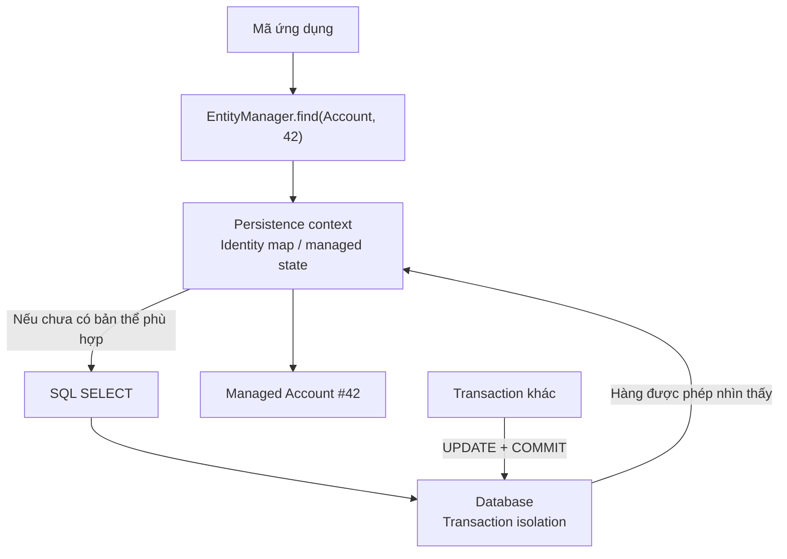
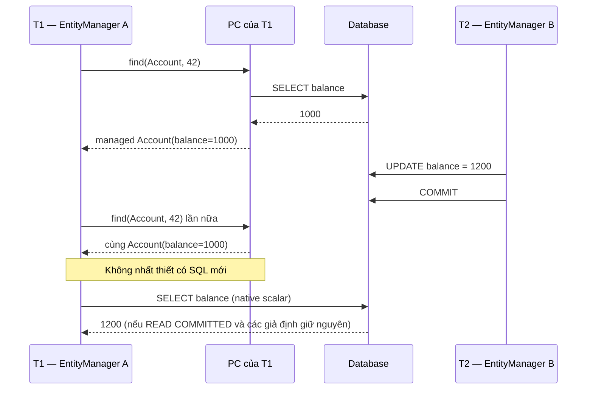
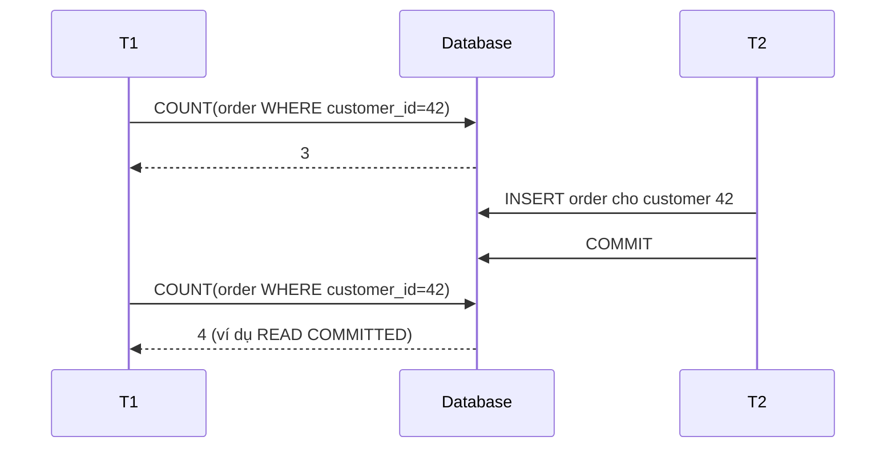
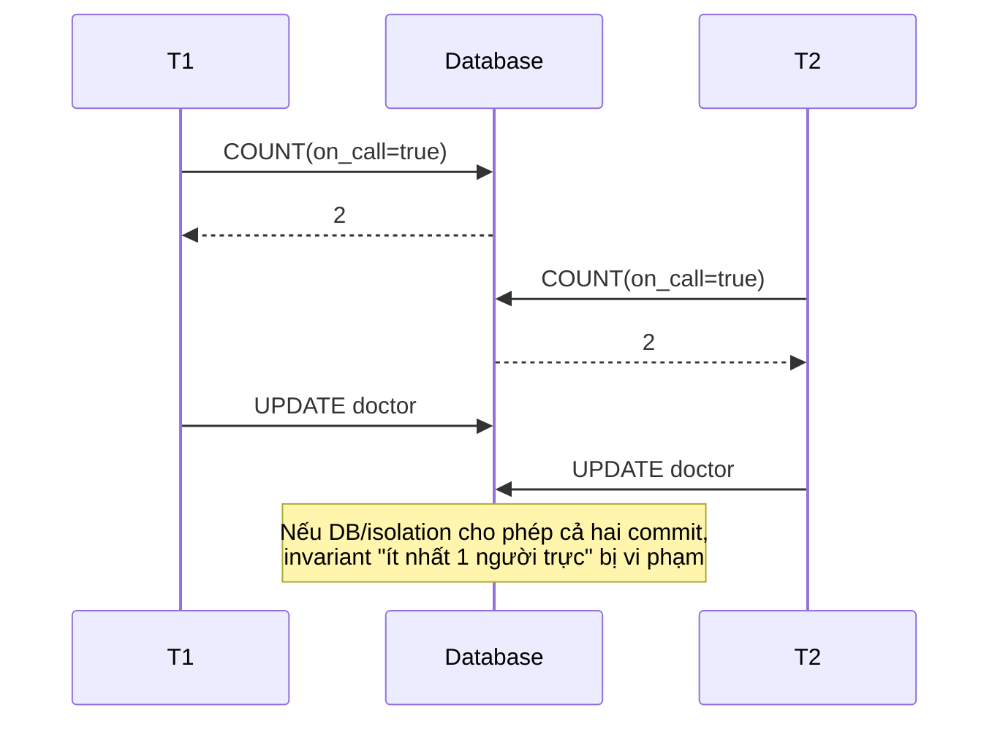

# Đọc lặp lại trong context không đồng nghĩa với mọi bảo đảm cô lập ở cơ sở dữ liệu

Trong Hibernate/JPA, một entity đang được quản lý bởi **persistence context** thường được trả về dưới **cùng một instance Java** khi ứng dụng tìm lại cùng loại entity và cùng khóa chính. Điều này có thể tạo cảm giác rằng đọc lặp lại dữ liệu luôn ổn định:

```java
Account first = entityManager.find(Account.class, 42L);
Account second = entityManager.find(Account.class, 42L);

System.out.println(first == second); // Thường true trong cùng persistence context.
```

Nhưng từ quan sát đó **không thể kết luận** rằng transaction đang chạy ở mức cô lập `REPEATABLE_READ`, rằng mọi câu SQL sẽ trả cùng một kết quả, hay rằng dữ liệu đã được bảo vệ khỏi cập nhật đồng thời. Hibernate giữ một bản thể entity trong bộ nhớ; database áp dụng quy tắc **transaction isolation** cho các thao tác SQL. Đây là hai lớp bảo đảm khác nhau.

Bài học thuộc phần **Giao dịch** của Hibernate, tập trung làm rõ sự khác biệt giữa:

- Tính nhất quán về **danh tính và trạng thái của managed entity** trong một persistence context.
- Những gì một **SELECT ở database** được phép quan sát khi có transaction khác thay đổi dữ liệu.
- Cơ chế bảo vệ thao tác ghi đồng thời bằng **optimistic locking**, **pessimistic locking** và các ràng buộc của database.
- Hành vi của `find`, JPQL/HQL, native SQL, `flush`, `refresh`, `clear` khi dữ liệu bên ngoài thay đổi.

Một nguyên tắc xuyên suốt: **first-level cache không phải transaction isolation; repeated entity lookup không phải bằng chứng về repeatable read ở database.**

## 1. Ba tầng phải phân biệt: object Java, persistence context và database

Giả sử có tài khoản ngân hàng với ID 42 và số dư ban đầu 1.000. Trong một ứng dụng Hibernate, dữ liệu này tồn tại đồng thời dưới ba hình thức:

1. **Object Java**: một `Account` với field `balance` đang bằng 1.000.
2. **Persistence context**: biết `(Account, 42)` tương ứng với managed object nào; theo dõi trạng thái và những thay đổi pending.
3. **Database transaction**: khi chạy `SELECT` hoặc `UPDATE`, DBMS quyết định dữ liệu nào được nhìn thấy, có phải chờ khóa hay bị phát hiện xung đột hay không.



**Persistence context quyết định bản thể Java nào được trả về. Database isolation quyết định kết quả những thao tác SQL được chạy trong transaction.** Khi `find` được thỏa từ identity map, một câu SQL mới có thể **không hề được thực thi**, nên chưa có cơ hội áp dụng quy tắc nhìn thấy dữ liệu mới từ database.

### 1.1. Những thuật ngữ dễ bị dùng lẫn

| Thuật ngữ | Ý nghĩa chính | Không đồng nghĩa với |
|---|---|---|
| Identity map / first-level cache | Một entity identity được biểu diễn nhất quán trong persistence context | Snapshot transaction của database |
| Managed entity | Instance đang được `EntityManager`/`Session` theo dõi | Mỗi lần đọc đều truy vấn DB |
| Dirty checking | Phát hiện trạng thái của managed entity thay đổi | Ngăn transaction khác cập nhật cùng hàng |
| Flush | Đồng bộ thay đổi đang chờ thành SQL trong transaction | Commit |
| Transaction isolation | Quy tắc DBMS cho phép transaction quan sát/ghi dữ liệu khi có concurrency | Entity cache của Hibernate |
| Optimistic locking | Phát hiện xung đột cập nhật theo phiên bản hoặc điều kiện phù hợp | Cấp độ `SERIALIZABLE` cho mọi nghiệp vụ |
| Pessimistic locking | Yêu cầu DBMS khóa theo phạm vi được hỗ trợ | Khóa mọi hàng liên quan trong graph Java |

Muốn hiểu đúng một hành vi đọc, phải xác định **đang lấy object từ context hay đang yêu cầu database đánh giá một truy vấn**.

## 2. Mô hình dữ liệu dùng trong bài

Ví dụ một bảng tài khoản:

```sql
CREATE TABLE account (
    id           BIGINT PRIMARY KEY,
    owner_name   VARCHAR(150) NOT NULL,
    balance      NUMERIC(15, 2) NOT NULL,
    version      BIGINT NOT NULL
);
```

Định nghĩa entity:

```java
import jakarta.persistence.Column;
import jakarta.persistence.Entity;
import jakarta.persistence.Id;
import jakarta.persistence.Table;
import jakarta.persistence.Version;
import java.math.BigDecimal;

@Entity
@Table(name = "account")
public class Account {

    @Id
    private Long id;

    @Column(name = "owner_name", nullable = false)
    private String ownerName;

    @Column(name = "balance", nullable = false,
            precision = 15, scale = 2)
    private BigDecimal balance;

    @Version
    @Column(name = "version", nullable = false)
    private long version;

    protected Account() {
    }

    public Long getId() {
        return id;
    }

    public String getOwnerName() {
        return ownerName;
    }

    public BigDecimal getBalance() {
        return balance;
    }

    public long getVersion() {
        return version;
    }

    public void rename(String name) {
        this.ownerName = name;
    }

    public void changeBalance(BigDecimal nextBalance) {
        this.balance = nextBalance;
    }
}
```

Ở đây:

- `id` là khóa chính để Hibernate nhận diện account.
- `balance` là dữ liệu nghiệp vụ có thể được đọc và cập nhật.
- `version` phục vụ optimistic locking, được phân tích ở phần sau.
- Mỗi transaction phải tuân thủ quy tắc nghiệp vụ về số dư; chỉ có `@Version` không tự bảo đảm số dư không âm hay một phép chuyển tiền cân bằng.

Giả sử dữ liệu ban đầu:

```sql
INSERT INTO account(id, owner_name, balance, version)
VALUES (42, 'Lan', 1000.00, 0);
```

Các ví dụ concurrency sau giả định hai transaction độc lập dùng các persistence context riêng và chạy trên một DBMS được cấu hình như mô tả.

## 3. Đọc lặp lại bằng `find`: Hibernate có thể không truy vấn lại

Trong một persistence context:

```java
Account first = entityManager.find(Account.class, 42L);

// Những thao tác Java khác...

Account second = entityManager.find(Account.class, 42L);

System.out.println(first == second);     // Thường true.
System.out.println(second.getBalance()); // Giá trị ở managed instance.
```

Khi `first` vẫn managed trong cùng context, lệnh `find` thứ hai thường lấy object đã được theo dõi. Đây là đặc tính **first-level cache/identity map**.

Có hai hệ quả:

- Query lần hai **không chứng minh** database vẫn giữ nguyên hàng 42.
- Nếu một transaction khác đã cập nhật và commit, managed instance có thể vẫn giữ giá trị đã đọc ban đầu.

### 3.1. Hai lần `find` giống nhau không kiểm chứng isolation level

Giả sử connection của transaction đang dùng `READ_COMMITTED`. Transaction thứ hai cập nhật account rồi commit ngay giữa hai lệnh `find`.

Nếu `find` thứ hai không chạy SQL, kết quả Java vẫn có thể giống lần đầu. Điều này **không biến `READ_COMMITTED` thành `REPEATABLE_READ`**; đơn giản là Hibernate chưa hỏi DB lần thứ hai.

Phân biệt rõ:

```text
find(Account, 42) lần 1:
  Persistence context chưa có Account #42
  -> SELECT account ...
  -> tạo managed instance balance = 1000

find(Account, 42) lần 2:
  Persistence context đã có Account #42
  -> trả managed instance balance = 1000
  -> có thể không SELECT
```

Không nên suy từ việc in ra hai số 1.000 mà kết luận database không cho phép non-repeatable read.

### 3.2. Identity map chỉ có hiệu lực trong context liên quan

Nếu hai `EntityManager` độc lập cùng load `Account #42`:

```java
Account a = em1.find(Account.class, 42L);
Account b = em2.find(Account.class, 42L);
```

`a == b` thông thường là `false`, dù chúng đại diện cùng khóa chính. Hibernate quản lý mỗi instance trong context của nó. Các isolation rule của database vẫn phụ thuộc transaction và connection tương ứng.

Một context mới cũng có thể có snapshot database khác context cũ; nhưng context mới **không tự quyết định isolation level**. Không thể chỉ so sánh object reference để suy ra tình trạng transaction.

## 4. Hai transaction: ví dụ phản chứng ở `READ_COMMITTED`

Xét hai transaction:

- **T1**: một request đang đọc số dư account 42.
- **T2**: một request khác thay đổi số dư account 42 từ 1.000 thành 1.200 và commit.

Giả sử DBMS dùng mức `READ_COMMITTED`, nơi một câu SELECT ở T1 có thể nhìn thấy dữ liệu mà T2 đã commit trước khi câu SELECT ấy được thực thi.



T1 có thể quan sát hai kết quả khác nhau tùy đường truy cập:

| Thao tác trong T1 | Giá trị ví dụ | Vì sao |
|---|---:|---|
| `em.find(Account.class, 42L).getBalance()` lần đầu | 1.000 | Đọc từ DB lúc T2 chưa commit |
| `em.find(Account.class, 42L).getBalance()` lần hai | 1.000 | Trả managed instance cũ |
| Native SQL chọn scalar `balance` sau T2 commit | 1.200 | Một SQL mới được DB đánh giá theo `READ_COMMITTED` |
| `em.refresh(account)` sau T2 commit | Có thể trở thành 1.200 | Yêu cầu đọc lại state theo isolation hiện hành |

Số liệu trên là minh họa với điều kiện không có pending update khác ở T1, không có khóa cản trở và không sử dụng cơ chế làm khác ngữ nghĩa query. **`refresh` cũng không “vượt qua” isolation của database**; ở mức snapshot mạnh hơn, refresh có thể vẫn thấy snapshot cũ hoặc gặp xung đột tùy DBMS.

Điểm mấu chốt: **kết quả ổn định của `find` có thể che khuất non-repeatable read mà database cho phép**.

## 5. Query JPQL có thể chạy SQL nhưng vẫn trả managed instance cũ

Một tình huống tinh tế hơn: ứng dụng chạy lại **JPQL query** chứ không dùng `find`.

Giả sử T1 đã load account 42 với `ownerName = "Lan"`. Sau đó T2 đổi tên thành `"Lan Nguyen"` và commit.

T1 chạy:

```java
List<Account> accounts = entityManager.createQuery(
    "select a from Account a " +
    "where a.ownerName = :name",
    Account.class
)
.setParameter("name", "Lan Nguyen")
.getResultList();
```

Ở mức `READ_COMMITTED`, database có thể dùng tên mới khi đánh giá điều kiện `WHERE`. Nhưng nếu account 42 **đã được quản lý trong persistence context của T1**, Hibernate thường tái sử dụng chính managed instance thay vì tự động ghi đè mọi field của nó bằng giá trị trả về từ query.

Khi đó có thể xuất hiện kết quả tưởng nghịch lý:

```java
Account account = accounts.get(0);

System.out.println(account.getOwnerName());
// Có thể vẫn là "Lan", dù SQL WHERE chọn "Lan Nguyen".
```

Đây là sự kết hợp của hai cơ chế:

1. **Database** quyết định hàng nào khớp điều kiện truy vấn tại thời điểm query.
2. **Persistence context** quyết định instance nào đại diện cho entity identity của hàng đó, và không tự coi mỗi query là `refresh`.

Vì vậy, “câu query đã chạy lại” không đảm bảo “mọi thuộc tính trên những entity trả về đều được làm mới”. Kết quả dạng entity và kết quả scalar/projection phải được hiểu khác nhau.

### 5.1. Query scalar không nhất thiết dùng state của managed entity

Truy vấn:

```java
BigDecimal actualBalance = entityManager.createQuery(
    "select a.balance from Account a where a.id = :id",
    BigDecimal.class
)
.setParameter("id", 42L)
.getSingleResult();
```

thường lấy giá trị scalar được database đánh giá, không đơn giản là gọi `getBalance()` trên managed object đã có trong context.

Với isolation `READ_COMMITTED` và nếu T2 đã commit, giá trị scalar có thể mới hơn state của entity trong T1. Với `REPEATABLE_READ`/snapshot semantics, database có thể vẫn cho giá trị thuộc snapshot cũ.

Điều này cho thấy phải hỏi rõ: **đọc lại bằng entity lookup, query trả entity, hay query trả scalar?**

## 6. Transaction isolation: các bảo đảm thuộc về database

SQL transaction isolation định nghĩa cách những transaction đồng thời ảnh hưởng đến khả năng đọc/ghi lẫn nhau. Những mức thường gặp gồm:

- `READ_UNCOMMITTED`
- `READ_COMMITTED`
- `REPEATABLE_READ`
- `SERIALIZABLE`

Đây là khái niệm của DBMS và transaction manager, không phải thuộc tính của `@Entity` hay vòng đời managed entity.

### 6.1. Các anomaly cần nhận diện

**Dirty read:** T1 đọc thay đổi của T2 khi T2 chưa commit. Nếu T2 rollback, T1 đã nhìn thấy dữ liệu không bao giờ được xác nhận.

**Non-repeatable read:** T1 thực hiện hai lần đọc cùng một hàng bằng các truy vấn DB; giữa hai lần, T2 commit thay đổi khiến giá trị khác nhau.

**Phantom read:** T1 lặp lại một truy vấn theo điều kiện; giữa hai lần, transaction khác thêm/xóa/sửa bản ghi khiến **tập hàng thỏa điều kiện** thay đổi.

**Lost update:** Hai transaction cùng đọc một trạng thái rồi ghi đè kết quả của nhau, dẫn tới một thay đổi nghiệp vụ bị mất.

**Write skew:** Hai transaction đọc cùng một điều kiện tổng thể và cập nhật **những hàng khác nhau**; mỗi update riêng có thể hợp lệ nhưng kết quả kết hợp vi phạm invariant xuyên nhiều hàng.

### 6.2. Bảng định hướng các mức cô lập

| Mức isolation | Dirty read | Non-repeatable read | Phantom/serialization anomaly |
|---|---|---|---|
| `READ_UNCOMMITTED` | Có thể cho phép theo chuẩn | Có thể xảy ra | Có thể xảy ra |
| `READ_COMMITTED` | Ngăn dirty read | Có thể xảy ra | Có thể xảy ra |
| `REPEATABLE_READ` | Ngăn dirty read | Theo định nghĩa chuẩn, ngăn non-repeatable read đối với hàng đã đọc | Phantom và write-skew phụ thuộc DBMS/triển khai |
| `SERIALIZABLE` | Ngăn dirty read | Ngăn non-repeatable read | Mục tiêu là hành vi tương đương thứ tự tuần tự; có thể cần retry khi xung đột |

Bảng nhằm giúp phân biệt khả năng bảo vệ, **không thay thế tài liệu của DBMS đang dùng**. Chẳng hạn:

- PostgreSQL coi yêu cầu `READ_UNCOMMITTED` thực tế như `READ_COMMITTED`, và `REPEATABLE_READ` có semantics snapshot mạnh hơn mô tả SQL tối thiểu.
- MySQL/InnoDB có quy tắc khác nhau giữa consistent read và locking read; không nên diễn giải mọi `SELECT` như nhau.
- SQL Server có các tùy chọn READ COMMITTED dựa trên locking hoặc row versioning, cùng các chế độ snapshot riêng.

Tên isolation giống nhau không có nghĩa mọi loại query/lock đều có hành vi giống nhau trên mọi DBMS.

### 6.3. Isolation không tự sửa code nghiệp vụ

Ngay cả ở mức cô lập mạnh, transaction cần quản lý lỗi serialization/deadlock và retry ở cấp unit of work khi phù hợp. Không thể thay thế constraint, định danh entity và validation bằng một dòng cấu hình isolation level.

## 7. Non-repeatable read: context có thể che đi vấn đề

Giả sử DB ở `READ_COMMITTED`:

```text
T1: SELECT balance FROM account WHERE id = 42  -> 1000
T2: UPDATE account SET balance = 1200 WHERE id = 42
T2: COMMIT
T1: SELECT balance FROM account WHERE id = 42  -> 1200
```

Đây là ví dụ **non-repeatable read ở tầng database**.

Nhưng ứng dụng T1 dùng:

```java
Account a = em.find(Account.class, 42L);
// ... T2 commit ...
Account b = em.find(Account.class, 42L);
```

có thể vẫn in 1.000 ở cả hai lần vì `a` và `b` là một managed instance.

**Không thể lấy hai lần `find` thành công làm phép thử isolation của DB.** Muốn quan sát non-repeatable read, phải dùng **những thao tác SQL thực tế** trong hai transaction có thứ tự được điều phối rõ ràng. Ví dụ có thể dùng native scalar query hoặc JDBC trên cùng transaction/connection của T1, không chỉ lặp lại tìm entity đã quản lý.

### 7.1. Vì sao sự khác biệt này ảnh hưởng nghiệp vụ?

Một service đọc account, giữ object managed và sau đó kiểm tra lại số dư bằng chính `find` có thể tưởng rằng dữ liệu chưa bị ai sửa. Thực chất nó có thể chỉ đang quan sát bản thể trong persistence context.

Nếu logic phụ thuộc trạng thái hiện thời để quyết định một thao tác tiền tệ, tồn kho hoặc phân quyền, cần chiến lược concurrency phù hợp: optimistic version, locking read, atomic SQL hoặc isolation mạnh hơn, không chỉ “đọc lần hai”.

## 8. Phantom read: first-level cache không bảo vệ tập kết quả

Xét bảng `purchase_order`:

```sql
CREATE TABLE purchase_order (
    id BIGINT PRIMARY KEY,
    customer_id BIGINT NOT NULL,
    status VARCHAR(20) NOT NULL
);
```

Trong T1:

```java
Long firstCount = em.createQuery(
    "select count(o) from PurchaseOrder o " +
    "where o.customer.id = :customerId",
    Long.class
)
.setParameter("customerId", 42L)
.getSingleResult();
```

T2 thêm một order cho customer 42 rồi commit. T1 chạy lại cùng query:

```java
Long secondCount = em.createQuery(
    "select count(o) from PurchaseOrder o " +
    "where o.customer.id = :customerId",
    Long.class
)
.setParameter("customerId", 42L)
.getSingleResult();
```

Với `READ_COMMITTED`, `secondCount` có thể lớn hơn `firstCount`. T1 vẫn có thể giữ cùng một managed `Customer #42` từ đầu đến cuối; identity map của Customer **không khóa tập hàng `purchase_order` thỏa điều kiện**.



Phantom có thể xảy ra do insert, delete hoặc thay đổi field khiến hàng đi vào/ra tập kết quả. Không phải chỉ do “có một entity mới xuất hiện trong bộ nhớ”.

### 8.1. Collection đã load cũng không phải một khóa phạm vi

Nếu T1 đã khởi tạo `customer.getOrders()`, collection đó có thể tiếp tục biểu diễn các phần tử đã được tải, kể cả sau khi T2 tạo order mới. Nhưng điều này không chứng minh DB đang ngăn insert hoặc rằng query `COUNT` phải giữ nguyên.

Ngược lại, nếu một request mới mở persistence context mới, collection mới có thể chứa order đã được T2 commit. Bản thân việc một collection đã initialized không tạo **predicate/range lock** ở database.

## 9. Lost update: giữ entity trong context không tránh ghi đè

Giả sử hai transaction cùng muốn cộng thêm một khoản vào số dư:

```text
Ban đầu: balance = 1000

T1 đọc 1000, định cộng 100 -> muốn ghi 1100
T2 đọc 1000, định cộng 200 -> muốn ghi 1200
```

Nếu cả hai chỉ dùng read-modify-write mà không có cơ chế phát hiện xung đột:

```text
T1: SELECT balance = 1000
T2: SELECT balance = 1000
T1: UPDATE balance = 1100; COMMIT
T2: UPDATE balance = 1200; COMMIT
```

Kết quả là 1.200 thay vì 1.300: thay đổi của T1 đã bị ghi đè. Đây là **lost update**.

Một persistence context giữ identity cho `Account #42` **không biết tự động rằng một context khác cũng đang cập nhật object đó**. Hai context có thể cùng giữ object Java với trạng thái đã đọc cũ.

Tùy DBMS/isolation, một số mô hình transaction có thể tự chặn hoặc phát hiện những write conflict này. Nhưng muốn bảo vệ ứng dụng Hibernate một cách có chủ đích, đừng mặc định first-level cache hoặc `READ_COMMITTED` đủ chống lost update.

## 10. `@Version`: optimistic locking ngăn nhiều xung đột cập nhật cùng entity

Trong entity `Account` ở mục 2 có:

```java
@Version
@Column(name = "version", nullable = false)
private long version;
```

Hibernate thường cập nhật row với điều kiện bao gồm phiên bản đã đọc:

```sql
-- Minh họa logic optimistic version checking.
UPDATE account
SET balance = 1100.00,
    version = 1
WHERE id = 42
  AND version = 0;
```

Nếu T1 ghi thành công và tăng version từ 0 lên 1, T2 vẫn giữ version 0 sẽ không thể cập nhật cùng row bằng điều kiện cũ:

```sql
UPDATE account
SET balance = 1200.00,
    version = 1
WHERE id = 42
  AND version = 0;
-- Số hàng cập nhật = 0 nếu version hiện tại đã là 1.
```

Hibernate phát hiện optimistic locking conflict và báo exception thích hợp, ví dụ `OptimisticLockException` ở API JPA hoặc lỗi Hibernate tương ứng. Exception có thể xuất hiện lúc flush hoặc commit, tùy thời điểm SQL được gửi.

**`@Version` không đảm bảo transaction nào “tự động thắng đúng”.** Nó giúp nhận ra một cập nhật dựa trên version cũ không còn hợp lệ. Ứng dụng phải rollback unit of work lỗi, phản hồi conflict hoặc retry **toàn bộ nghiệp vụ** trên trạng thái mới theo chính sách có giới hạn.

### 10.1. Cách dùng trong service

```java
@Transactional
public void increaseBalance(Long accountId, BigDecimal amount) {
    Account account = entityManager.find(Account.class, accountId);

    BigDecimal next = account.getBalance().add(amount);
    account.changeBalance(next);

    // Hibernate sẽ kiểm tra @Version khi UPDATE được flush.
}
```

Đây là ví dụ đơn giản về cơ chế optimistic locking, không phải implementation chuyển tiền hoàn chỉnh. Với nghiệp vụ tài chính thật cần thêm kiểm tra số dư, tính idempotent, transaction liên quan nhiều tài khoản và audit ledger.

### 10.2. Không cần gọi `find` lần hai để được kiểm tra version

Optimistic locking dựa trên việc Hibernate đưa **version** vào SQL update (hoặc lock request phù hợp), không dựa trên `find` hai lần trong context.

Điều này đặc biệt hữu ích vì lần `find` thứ hai có thể trả lại cùng object cũ. Với `@Version`, khi T1 cố flush trên version đã lỗi thời, Hibernate có cơ chế phát hiện conflict thay vì im lặng ghi đè như mô hình không version.

### 10.3. Trường hợp nào `@Version` chưa đủ?

`@Version` thường bảo vệ việc cập nhật cùng một entity đã versioned. Nhưng nó **không tự đảm bảo** mọi invariant giữa nhiều hàng hoặc nhiều bảng. Chẳng hạn hai transaction cập nhật hai entity khác nhau, mỗi entity có version riêng, có thể không tạo conflict dù tổng thể dữ liệu vi phạm quy tắc liên hàng.

Đó là lý do vẫn cần hiểu isolation, predicate locking, unique/check constraints hoặc chiến lược lock đúng phạm vi nghiệp vụ.

## 11. Write skew: không phải mọi xung đột đều cùng một row

Xét lịch trực bệnh viện: ít nhất một bác sĩ phải đang trực.

```text
doctor_on_call
id=1, on_call=true
id=2, on_call=true
```

Hai transaction chạy đồng thời:

- T1 kiểm tra có hai bác sĩ đang trực, rồi chuyển bác sĩ 1 sang `on_call=false`.
- T2 cũng kiểm tra có hai bác sĩ đang trực, rồi chuyển bác sĩ 2 sang `on_call=false`.

Nếu cả hai đọc cùng snapshot ban đầu nhưng cập nhật **hai hàng khác nhau**, cuối cùng cả hai bác sĩ có thể không trực. Mỗi hàng có `@Version` riêng vẫn có thể được update thành công vì không transaction nào thay đổi cùng một hàng với transaction còn lại.



Đây là **write skew**. Nó cho thấy vì sao:

- Identity map của Hibernate không giải quyết bài toán.
- Optimistic version trên từng row chưa đủ nếu hai transaction sửa các row khác nhau.
- Một transaction ở mức snapshot isolation có thể vẫn cho phép một số write-skew scenario.
- Cần cơ chế bảo vệ **invariant trên tập dữ liệu**, chẳng hạn transaction `SERIALIZABLE` với retry, khóa phù hợp cho phạm vi quyết định, một hàng “guard” được cập nhật có kiểm soát hoặc thiết kế constraint/schema khác.

Không phải mọi DBMS xử lý `REPEATABLE_READ` hoặc `SERIALIZABLE` theo cùng cơ chế; cần kiểm tra khả năng của DBMS và transaction manager cụ thể.

## 12. `refresh`: yêu cầu đồng bộ entity từ database nhưng không vượt isolation

JPA có:

```java
Account account = entityManager.find(Account.class, 42L);

// Một transaction khác thay đổi account và commit...

entityManager.refresh(account);
```

`refresh` yêu cầu provider làm mới trạng thái entity managed bằng dữ liệu hiện hành mà **transaction đang chạy được phép đọc**. Đây là cách phù hợp khi ứng dụng biết object có thể lỗi thời và muốn truy vấn lại.

Nhưng cần phân biệt:

- Ở `READ_COMMITTED`, một SELECT mới trong T1 có thể thấy thay đổi T2 đã commit.
- Ở các mức isolation có snapshot, refresh có thể vẫn quan sát snapshot cũ của T1.
- Nếu transaction hoặc DBMS đang áp dụng lock, refresh có thể chờ, lỗi hoặc quan sát kết quả theo chính sách cụ thể.
- Refresh có thể ghi đè trạng thái chưa flush trên managed entity bằng trạng thái từ DB. Phải xác định điều này có đúng nghiệp vụ không.

**`refresh()` không nâng isolation lên `SERIALIZABLE`, không tự khóa một tập hàng và không bảo đảm tránh lost update.**

### 12.1. `refresh` với lock mode

JPA hỗ trợ các overload dùng lock mode, chẳng hạn:

```java
entityManager.refresh(
    account,
    LockModeType.PESSIMISTIC_WRITE
);
```

Đây là yêu cầu tải lại kèm chiến lược khóa phù hợp; behavior thực tế tùy DBMS và transaction. Không nên dùng vô điều kiện trên mọi entity, vì lock có thể làm tăng chờ, giảm throughput và tạo deadlock.

## 13. `clear` và `detach`: loại khỏi cache không đổi isolation level

Nếu muốn không tiếp tục nhận managed instance cũ:

```java
entityManager.clear();

Account reread = entityManager.find(Account.class, 42L);
```

Sau `clear`, context không còn theo dõi các entity đã managed trước đó. Lệnh `find` tiếp theo có thể phải tải entity lại. Tuy nhiên:

- `clear` **không commit hoặc rollback** transaction.
- `clear` có thể làm mất việc đồng bộ các thay đổi chưa flush vì entities bị detach.
- Một SELECT mới vẫn tuân theo **isolation của transaction hiện tại**. Nếu transaction đang đọc cùng snapshot, query mới không bắt buộc thấy commit của T2.
- Second-level cache hoặc các chính sách cache khác có thể ảnh hưởng SQL thực sự được phát, tùy cấu hình.

```java
Account account = entityManager.find(Account.class, 42L);
account.changeBalance(new BigDecimal("1300.00"));

entityManager.clear(); // Nguy cơ bỏ mất thay đổi chưa flush.
```

Đừng dùng `clear` như một thủ thuật “làm mới dữ liệu” mà không xét trạng thái pending.

Với `detach(account)`, chỉ instance được detach theo quy tắc liên quan; các entity khác có thể vẫn managed. Cả hai API đều thay đổi **phạm vi quản lý của context**, không đổi mức cô lập của connection hoặc transaction.

## 14. EntityManager mới chưa chắc là transaction mới

Trong framework, vòng đời persistence context và transaction thường gắn với nhau, nhưng về khái niệm là hai phạm vi khác nhau.

Ví dụ:

- **Transaction-scoped persistence context** thường gắn với transaction/unit of work hiện tại.
- **Extended persistence context** có thể sống qua nhiều transaction theo mô hình JPA được hỗ trợ.
- `Session` Hibernate trong một số ứng dụng có thể được tái sử dụng qua các transaction nếu lifecycle được lập trình như vậy.
- Spring-managed `EntityManager` thường là proxy gắn với context hiện hành, không nhất thiết là một object độc lập mỗi khi lấy bean.

Do đó, việc tạo hoặc tham chiếu một `EntityManager` trong code **không đủ** để khẳng định đang bắt đầu một transaction mới với snapshot mới.

Nếu nhiệm vụ cần một transaction mới, phải dùng ranh giới transaction đúng theo framework. Nhưng **một transaction mới** có thể đọc state mới hơn không có nghĩa persistence context cũ tự biến mất hoặc được refresh.

### 14.1. `@Transactional` và việc tham gia transaction đang có

Ví dụ Spring:

```java
@Transactional
public void serviceA() {
    // Gọi một service khác cũng @Transactional
}
```

Với propagation mặc định `REQUIRED`, một method `@Transactional` được gọi qua proxy Spring có thể **tham gia transaction hiện tại** thay vì tạo transaction mới. Annotation ở method con không tự chứng minh có một snapshot database độc lập.

Đối với những quy trình cần transaction mới thực sự, phải thiết kế propagation và bean invocation phù hợp, đồng thời xét tài nguyên connection, lock và failure handling.

## 15. Thiết lập isolation ở tầng transaction, không phải ở entity

JPA `EntityManager` không cung cấp một property chuẩn để đặt isolation level của mọi DBMS cho mọi transaction. Isolation thường được điều khiển ở **transaction manager, DataSource/JDBC connection hoặc cấu hình database**.

Ví dụ trong Spring:

```java
import org.springframework.stereotype.Service;
import org.springframework.transaction.annotation.Isolation;
import org.springframework.transaction.annotation.Transactional;

@Service
public class AccountReadService {

    @Transactional(
        readOnly = true,
        isolation = Isolation.REPEATABLE_READ
    )
    public BigDecimal readBalance(Long accountId) {
        Account account = entityManager.find(Account.class, accountId);
        return account.getBalance();
    }
}
```

Cần lưu ý:

- `Isolation.REPEATABLE_READ` yêu cầu mức isolation ở **transaction** nếu transaction manager/driver/DBMS hỗ trợ.
- Nếu method **tham gia transaction đã mở sẵn** thì isolation của transaction bên ngoài có thể tiếp tục áp dụng; tùy cấu hình, khai báo khác ở method con có thể không được thực thi như mong đợi.
- `readOnly = true` không có nghĩa “có database snapshot bất biến” và không tương đương mức isolation riêng.
- Vẫn cần đánh giá hành vi DBMS cụ thể và đảm bảo transaction đủ ngắn.
- Với Spring proxy-based AOP, lời gọi nội bộ `this.someTransactionalMethod()` có thể không đi qua proxy, khiến annotation transaction không được áp dụng như người viết tưởng.

Đừng thay một phép kiểm tra transaction isolation bằng việc gọi `find` hai lần rồi thấy cùng object.

### 15.1. JDBC isolation

Tại tầng JDBC có các hằng số như:

```java
Connection.TRANSACTION_READ_COMMITTED;
Connection.TRANSACTION_REPEATABLE_READ;
Connection.TRANSACTION_SERIALIZABLE;
```

Isolation thuộc về connection/transaction theo cơ chế của DBMS và transaction manager. Khi dùng Spring/Hibernate, thường nên để **transaction manager quản lý connection** thay vì tự thay isolation giữa transaction bằng cách lấy connection và sửa thủ công.

Một số DBMS có isolation mang tên hoặc cơ chế riêng, ví dụ snapshot isolation. Chúng cần được cấu hình theo tài liệu của hệ quản trị cụ thể.

## 16. Optimistic lock và pessimistic lock giải quyết các bài toán khác nhau

JPA cung cấp `LockModeType`, trong đó có các mode:

- `OPTIMISTIC`
- `OPTIMISTIC_FORCE_INCREMENT`
- `PESSIMISTIC_READ`
- `PESSIMISTIC_WRITE`
- `PESSIMISTIC_FORCE_INCREMENT`

Các mode này không đồng nghĩa với isolation level của toàn transaction. Chúng là yêu cầu kiểm soát concurrency khi truy cập hoặc cập nhật entity theo ngữ nghĩa JPA và khả năng DBMS.

### 16.1. Optimistic locking

`@Version` kết hợp với những thao tác cập nhật/lock thích hợp giúp phát hiện thay đổi trên cùng entity giữa lần đọc và lúc cập nhật/kiểm tra version.

```java
Account account = entityManager.find(
    Account.class,
    42L,
    LockModeType.OPTIMISTIC
);
```

Ứng dụng có thể yêu cầu kiểm tra version ngay cả khi mục tiêu không phải thay đổi field của entity. Tuy vậy, thời điểm phát hiện conflict và chi tiết SQL phụ thuộc provider.

**Optimistic lock không chặn transaction khác sửa entity ngay lập tức**; nó giúp phát hiện conflict để rollback hoặc retry.

### 16.2. Pessimistic locking

Nếu nghiệp vụ cần giữ độc quyền cập nhật một hàng trong transaction:

```java
Account account = entityManager.find(
    Account.class,
    42L,
    LockModeType.PESSIMISTIC_WRITE
);
```

Hibernate/DBMS có thể dùng dạng SQL giống `SELECT ... FOR UPDATE` hoặc cơ chế khóa khác. Transaction khác muốn sửa/khóa cùng hàng có thể phải chờ hoặc gặp timeout/deadlock, tùy database.

```sql
-- Dạng ý tưởng, không phải SQL Hibernate bảo đảm sinh:
SELECT id, balance, version
FROM account
WHERE id = 42
FOR UPDATE;
```

Khóa pessimistic thường giữ đến hết transaction theo semantics DBMS. Nó có thể làm giảm concurrency, vì vậy không dùng bừa bãi cho mọi request đọc.

### 16.3. Lock một hàng không khóa toàn bộ điều kiện nghiệp vụ

Nếu cần bảo đảm “không có hơn 100 order chưa xử lý”, khóa riêng một entity `Customer` không tự động có nghĩa mọi transaction đều bị chặn khi insert order mới. Muốn dùng một “guard row”, **mọi đường ghi có liên quan phải thống nhất khóa row đó** và transaction phải kiểm tra/ghi dưới ranh giới phù hợp.

Tương tự, optimistic `@Version` của một customer không tự tăng khi một order mới được insert ở bảng khác, trừ khi ứng dụng/mapping có cơ chế làm version customer thay đổi. Bảo vệ invariant liên hàng thường cần thiết kế có chủ đích.

## 17. Flush và commit không thay thế isolation

Hibernate có thể giữ state mới trong persistence context mà SQL chưa chạy:

```java
Account account = entityManager.find(Account.class, 42L);
account.changeBalance(new BigDecimal("1100.00"));
```

Khi `flush`:

```java
entityManager.flush();
```

Hibernate đồng bộ pending state phù hợp vào database trong transaction hiện hành. Nhưng:

- Transaction khác chưa chắc thấy thay đổi vì chưa commit.
- Transaction hiện tại vẫn tuân theo isolation của DBMS.
- Flush không ngăn T2 thay đổi cùng hàng về sau nếu không có cơ chế concurrency phù hợp.
- Constraint SQL có thể bị kiểm tra ở flush hoặc commit (có loại constraint deferred).

```java
entityManager.flush();
entityManager.getTransaction().rollback(); // Mẫu resource-local JPA.
```

Nếu rollback, thay đổi đã flush của transaction bị hủy theo transaction semantics. `flush()` không phải thao tác “publish dữ liệu”.

### 17.1. Flush mode ảnh hưởng câu query sau khi sửa entity

Ở chế độ `FlushModeType.AUTO`, Hibernate có thể tự flush trước JPQL/HQL query nếu pending state có thể ảnh hưởng kết quả. Ở `FlushModeType.COMMIT`, tác động của pending update lên query result không được JPA bảo đảm tương đương `AUTO`.

Vì thế khi giải thích query trong cùng transaction, có **hai loại thay đổi** cần phân biệt:

1. Thay đổi **của chính T1** đang nằm trong persistence context nhưng chưa flush.
2. Thay đổi **của T2** đã commit nhưng T1 có thể thấy hoặc không theo DB isolation.

Không quy mọi khác biệt giữa hai lần query về non-repeatable read; có thể query thấy pending update đã được auto-flush, hoặc entity đã có state mới trong context dù SQL chưa chạy.

## 18. Bulk JPQL/HQL và native SQL có thể làm state trong context lỗi thời

Xét thao tác bulk:

```java
Account account = entityManager.find(Account.class, 42L);

int updated = entityManager.createQuery(
    "update Account a " +
    "set a.ownerName = :name " +
    "where a.id = :id"
)
.setParameter("name", "Lan Nguyen")
.setParameter("id", 42L)
.executeUpdate();
```

Bulk JPQL/HQL cập nhật trực tiếp ở database và **không đồng bộ tự động mọi managed entity đã có** theo cách sửa setter/dirty checking thông thường. Có thể xuất hiện:

```java
account.getOwnerName(); // Có thể vẫn là giá trị cũ.
```

Dù bulk update chạy trong **chính transaction T1**, object Java vẫn có thể không phản ánh SQL vừa thực hiện.

Đây là thêm một lý do tại sao:

> “Đọc lại cùng entity trong context” không chứng minh dữ liệu hiện hành ở database, ngay cả khi không có transaction thứ hai.

### 18.1. Bulk update và `@Version`

Không nên giả định mọi bulk JPQL update tự động kiểm tra/tăng version giống một lần update managed entity. Các thao tác bulk thường bỏ qua quy tắc quản lý version theo từng entity, trừ khi query và cơ chế được thiết kế đặc biệt.

Nếu bulk update phải bảo vệ optimistic concurrency, hãy xác định rõ:

- Có cần điều kiện `WHERE version = :expectedVersion` không?
- Có cần tăng version tường minh không?
- Số row cập nhật có đúng kỳ vọng không?
- Context chứa entity cũ có cần clear/refresh không?

Đừng trộn bulk update với managed entity thay đổi trong cùng context mà không hiểu thứ tự flush và khả năng ghi đè.

## 19. Second-level cache và query cache không phải isolation

Ngoài first-level cache, Hibernate có thể được cấu hình:

- Second-level cache cho entity/collection.
- Query result cache cho kết quả truy vấn thích hợp.
- Các cache do ứng dụng tự quản lý.

Những cơ chế này nhằm tối ưu hiệu năng và có chiến lược nhất quán/invalidation riêng. Chúng **không nâng isolation level** của DBMS lên `REPEATABLE_READ` hoặc `SERIALIZABLE`.

Ví dụ, một entity có thể được đọc từ cache rồi trở thành managed instance trong context hiện hành. Nhưng sự tồn tại của cache không:

- Ngăn transaction khác cập nhật trực tiếp bằng JDBC ngoài Hibernate.
- Bảo vệ invariant liên hàng.
- Thay thế optimistic version hoặc database locking.
- Bảo đảm query count/aggregate phản ánh đúng thời điểm nghiệp vụ mong muốn.

Nếu hệ thống có nhiều tác nhân ghi dữ liệu, cần hiểu chiến lược cache eviction/expiration và đường cập nhật ngoài ORM. Không được lấy việc “cache trả cùng giá trị” làm bằng chứng rằng transaction có snapshot ổn định.

## 20. Một vấn đề riêng: entity graph đã load và collection thay đổi ở DB

Giả sử `Customer #42` có collection `orders`:

```java
Customer customer = entityManager.find(Customer.class, 42L);
int countInMemory = customer.getOrders().size();
```

Khi `size()` kích hoạt khởi tạo collection thông thường, Hibernate lấy tập hàng phù hợp lúc đó. Sau đó T2 thêm một order và commit.

Nếu T1 tiếp tục dùng collection đã khởi tạo:

```java
int countAgain = customer.getOrders().size();
```

kết quả có thể không thay đổi vì Hibernate đang làm việc với collection trong bộ nhớ, **không phải SELECT COUNT(*) mới**.

Nhưng một JPQL count chạy trong T1:

```java
Long actualCount = entityManager.createQuery(
    "select count(o) from PurchaseOrder o " +
    "where o.customer.id = :customerId",
    Long.class
)
.setParameter("customerId", 42L)
.getSingleResult();
```

có thể thấy phần tử mới ở isolation `READ_COMMITTED`.

Vì vậy cả entity đơn và collection đã initialized đều có thể tạo **ảo giác ổn định**; chúng không thay thế database predicate/range isolation.

### 20.1. Không dùng collection đã load để kiểm tra invariant đồng thời

Ví dụ nghiệp vụ: “khách hàng không được có hơn 5 đơn `PENDING`”. Nếu T1 khởi tạo `customer.orders` và đếm trong Java, T2 có thể insert thêm order, khiến điều kiện của T1 đã lỗi thời.

Nếu nhiều transaction đồng thời tạo order, cần cơ chế bảo vệ đồng bộ ở DB hoặc protocol concurrency, chẳng hạn:

- Một row/quota counter được update có version hoặc khóa.
- Isolation `SERIALIZABLE` và retry transaction khi conflict.
- Constraint DB phù hợp nếu quy tắc có thể biểu đạt được.
- Transaction lock chiến lược áp dụng **nhất quán cho mọi đường ghi**.

Không chỉ gọi `Hibernate.initialize(customer.getOrders())` rồi coi tập đó bất biến cho cả hệ thống.

## 21. Đọc lặp lại và tính nhất quán của API response

Một request có thể thực hiện:

1. Đọc `Account` như entity.
2. Gọi repository thống kê tổng giao dịch bằng một query aggregate.
3. Đọc lại account bằng `find`.
4. Trả JSON chứa số dư và tổng giao dịch.

Nếu có transaction khác cập nhật trong lúc request chạy, và transaction đọc ở `READ_COMMITTED`, response có thể kết hợp các mốc thời gian khác nhau:

- Số dư từ managed entity được load lúc đầu.
- Số giao dịch từ câu aggregate chạy sau đó.
- Trạng thái entity lần đọc cuối vẫn là object đã load lúc đầu.

Tính nhất quán của một response báo cáo nhiều query cần được thiết kế:

- Dùng transaction isolation phù hợp nếu muốn một ảnh chụp nhất quán.
- Dùng một query projection/aggregate nếu có thể tính trong cùng SQL statement.
- Dùng version/cursor hoặc timestamp nghiệp vụ nếu cần thể hiện “as of”.
- Tách read model và write model nếu dữ liệu phục vụ báo cáo khác với workflow giao dịch.
- Kiểm soát cache và transaction boundary.

Không mặc định rằng vì mọi method cùng dùng một `EntityManager` thì response đã có nhất quán theo snapshot.

## 22. Ví dụ chạy hai EntityManager độc lập

Có thể dựng một tình huống thủ công với JPA resource-local để quan sát sự khác biệt giữa entity cache và SELECT scalar. **Điều kiện quan trọng:** DataSource/DBMS phải được cấu hình isolation `READ_COMMITTED` và hai transaction được thực thi đan xen như code, sử dụng những connection/transaction độc lập.

```java
EntityManager em1 = emf.createEntityManager();
EntityManager em2 = emf.createEntityManager();

try {
    em1.getTransaction().begin(); // T1

    Account t1Account = em1.find(Account.class, 42L);
    String firstName = t1Account.getOwnerName();

    em2.getTransaction().begin(); // T2

    Account t2Account = em2.find(Account.class, 42L);
    t2Account.rename("Lan Nguyen");
    em2.getTransaction().commit(); // T2 commit.

    // T1 vẫn đang mở.
    Account sameManaged = em1.find(Account.class, 42L);

    String repeatedName = sameManaged.getOwnerName();

    String scalarName = (String) em1.createNativeQuery(
        "select owner_name from account where id = 42"
    ).getSingleResult();

    System.out.println(firstName);
    System.out.println(repeatedName);
    System.out.println(scalarName);

    em1.getTransaction().rollback(); // Kết thúc T1 trong demo.
} finally {
    if (em2.getTransaction().isActive()) {
        em2.getTransaction().rollback();
    }
    if (em1.getTransaction().isActive()) {
        em1.getTransaction().rollback();
    }
    em2.close();
    em1.close();
}
```

Trong một hệ thống `READ_COMMITTED` điển hình, có thể nhận:

```text
Lan
Lan
Lan Nguyen
```

T2 update entity có `@Version` một cách hợp lệ; T1 chỉ đọc nên không có conflict update riêng. Kết quả này minh họa **first-level cache giữ managed state cũ, trong khi scalar SQL mới quan sát commit của T2**.

Không xem output là hằng số trên mọi database:

- Ở `REPEATABLE_READ`/snapshot semantics, scalar SELECT của T1 có thể vẫn thấy `Lan`.
- Một cache, lock hoặc cấu hình đặc biệt có thể thay đổi đường thực thi.
- Nếu trước đó T1 đã sửa `Account`, auto-flush có thể ảnh hưởng kết quả.
- Nếu T2 commit thất bại hoặc không thực sự dùng transaction riêng, timeline không còn như ví dụ.

### 22.1. Điều cần đo trong thử nghiệm

Muốn phân biệt nguyên nhân, hãy ghi lại:

- ID context/transaction và isolation level thực sự.
- Lệnh SQL phát sinh tại mỗi bước, nhất là có SELECT lần hai hay không.
- Giá trị từ `find`, query entity và query scalar.
- Thời điểm T2 commit.
- Version trước/sau cập nhật.
- Việc T1 có pending dirty state hoặc auto-flush hay không.

Không chỉ chụp màn hình hai dòng log cùng giá trị rồi kết luận “Hibernate bảo đảm repeatable read”.

## 23. Kiểm thử concurrency phải điều phối thứ tự transaction

Một unit test chạy tuần tự:

```java
Account first = em.find(Account.class, 42L);
Account second = em.find(Account.class, 42L);
assertSame(first, second);
```

chỉ xác nhận một khía cạnh của identity map. Nó không kiểm tra concurrency hoặc isolation.

Để thử trường hợp có T2 commit giữa hai lần đọc, test cần:

1. Hai persistence context và hai transaction độc lập.
2. Một cơ chế điều phối xác định lúc T1 đã đọc lần đầu.
3. T2 thực hiện update/insert rồi commit.
4. T1 chạy lệnh đọc thứ hai như `find`, scalar query hoặc `refresh`.
5. Assertions phù hợp mức isolation đã cấu hình và DBMS thật.

Có thể dùng `CountDownLatch` trong integration test đa thread, nhưng không chia sẻ cùng `EntityManager` giữa hai thread. EntityManager/Session không được thiết kế cho truy cập đồng thời.

**Không nên dùng H2 hoặc DBMS test mặc định để khẳng định hoàn toàn behavior concurrency của PostgreSQL/MySQL/SQL Server production**, vì locking, MVCC và isolation implementation có thể khác. Khi quy tắc quan trọng, integration test trên DBMS mục tiêu là cần thiết.

### 23.1. Test query scalar và entity riêng

Một test tốt không chỉ đoán output, mà xác định **chính đường đọc**:

```text
A. em.find(Account, 42)               -> managed entity identity
B. em.find(Account, 42) lần hai       -> cache của context
C. JPQL select a from Account a ...  -> SQL + identity resolution
D. JPQL select a.balance ...         -> scalar query
E. native SELECT balance ...         -> database query
F. em.refresh(a)                      -> làm mới entity theo isolation
```

Việc so sánh A–F cho thấy “đọc lặp lại” là một cụm từ không đủ cụ thể nếu không nói rõ API và transaction.

## 24. Khi nào chọn `READ_COMMITTED`, `REPEATABLE_READ` hay `SERIALIZABLE`?

Không có một mức isolation tối ưu cho mọi workload. Cần xuất phát từ **invariant và mức chấp nhận retry/độ trễ**.

| Use case | Vấn đề cần kiểm soát | Công cụ cần cân nhắc |
|---|---|---|
| Hiển thị trang hồ sơ người dùng | Chấp nhận dữ liệu mới xuất hiện giữa request | `READ_COMMITTED`, DTO/projection, cache có chính sách |
| Sửa một entity đã load | Lost update giữa hai request | `@Version` và xử lý optimistic conflict |
| Kiểm tra và trừ tồn kho | Tránh tồn âm và bán vượt số lượng | Atomic conditional update, lock/version, constraint |
| Báo cáo nhiều SELECT phải nhất quán theo snapshot | Hai query đọc ở thời điểm khác nhau | Isolation/snapshot transaction phù hợp |
| Quy tắc trên nhiều hàng như giới hạn số order | Write skew, phantom, race tạo dữ liệu | `SERIALIZABLE` + retry, guard lock hoặc thiết kế constraint |
| Cập nhật liên quan nhiều entity | Deadlock/lost update/partial write | Transaction đúng phạm vi, lock ordering, optimistic/pessimistic locking |
| Batch đọc và xuất dữ liệu lớn | Transaction kéo dài và dữ liệu thay đổi | Thiết kế snapshot/cursor/chunk theo yêu cầu, giới hạn tài nguyên |

Mức `SERIALIZABLE` cung cấp mục tiêu cô lập mạnh nhưng có thể tạo **serialization failure** hoặc tăng cạnh tranh tài nguyên; ứng dụng phải thiết kế retry có giới hạn và idempotency khi phù hợp. Không đơn giản bật mức cao nhất cho mọi request rồi bỏ qua monitoring.

## 25. Atomic SQL có thể phù hợp hơn read-modify-write trên entity

Nếu nghiệp vụ chỉ cần trừ số dư với điều kiện đủ tiền, một phép update có điều kiện có thể tránh việc đọc số dư cũ rồi ghi đè giá trị tính ở Java.

Ví dụ SQL minh họa:

```sql
UPDATE account
SET balance = balance - 100.00
WHERE id = 42
  AND balance >= 100.00;
```

Ứng dụng kiểm tra số hàng được cập nhật:

- `1`: câu update đã áp dụng vào một row phù hợp trong transaction.
- `0`: không có row phù hợp hoặc điều kiện số dư không thỏa ở thời điểm database xử lý.

Điều này có thể bảo vệ phép trừ đơn hàng tốt hơn một vòng lặp `find → getBalance → setBalance` không có locking. Tuy nhiên, các rủi ro về quản lý tiền tệ, transfer hai tài khoản, idempotency và audit vẫn cần giải quyết riêng.

Nếu update đi qua native SQL hoặc JPQL bulk, state `Account` đang managed có thể trở thành stale; cần `refresh`, `clear` hoặc thiết kế luồng không dùng cùng managed instance sau bulk update. Nếu entity có `@Version`, bulk SQL phải phối hợp phiên bản đúng cách để không phá cơ chế optimistic locking của các đường ghi khác.

**Atomic update là một chiến lược concurrency ở database, không phải hệ quả tự động của persistence context.**

## 26. Những anti-pattern dễ gây nhầm lẫn

### 26.1. “Hai lần `find` cùng giá trị nghĩa là database đang `REPEATABLE_READ`”

Sai. Hibernate có thể trả object từ first-level cache mà không chạy SQL lần thứ hai.

### 26.2. “Đã cùng một `EntityManager` thì mọi câu JPQL đều dùng cùng snapshot”

Sai. Identity map quyết định object identity; các SELECT scalar/aggregate vẫn được DB đánh giá theo isolation và có thể nhìn thấy commit mới ở `READ_COMMITTED`.

### 26.3. “`refresh` sẽ luôn nhìn thấy commit mới nhất”

Không đúng. `refresh` chỉ được phép thấy dữ liệu mà transaction/DB isolation cho phép; snapshot hoặc khóa có thể khiến kết quả khác kỳ vọng.

### 26.4. “`clear` làm transaction thành transaction mới”

Không. `clear` detach managed entities; không đổi isolation, không commit, không mở snapshot độc lập.

### 26.5. “`@Version` tương đương `SERIALIZABLE`”

Không. `@Version` phát hiện conflict update theo version của entity; nó không bảo vệ mọi invariant trên tập nhiều hàng.

### 26.6. “Transaction `readOnly` ngăn mọi thay đổi”

Không nên suy luận như vậy. `readOnly` có thể ảnh hưởng provider/transaction manager, nhưng không mặc định là chính sách khóa hoặc phân quyền toàn diện ở database.

### 26.7. “Flush xong thì transaction khác sẽ thấy”

Không. Flush và commit khác nhau; khả năng nhìn thấy dữ liệu còn phụ thuộc DB isolation.

### 26.8. “Dùng `PESSIMISTIC_WRITE` trên một entity là khóa cả collection”

Không nhất thiết. Lock thường tập trung vào row hoặc phạm vi được DBMS hỗ trợ, không tự bảo vệ mọi hàng có thể được insert vào một predicate/collection liên quan.

### 26.9. “Bulk JPQL vẫn tự cập nhật managed entity trong context”

Không. Bulk DML có thể để lại state cũ trong persistence context; cần chiến lược đồng bộ có chủ đích.

### 26.10. “Một test không có hai transaction đủ để chứng minh concurrency”

Không. Test identity map và test isolation là hai loại thử nghiệm khác nhau.

## 27. Bài thực hành A — Phân biệt entity cache với SELECT

Giả sử ban đầu `account.balance = 1000`. T1 bắt đầu ở `READ_COMMITTED` và chạy:

```java
Account first = em1.find(Account.class, 42L);
```

Sau đó T2 cập nhật balance thành 1.500 và commit. T1 chạy:

```java
Account second = em1.find(Account.class, 42L);

BigDecimal dbValue = em1.createQuery(
    "select a.balance from Account a where a.id = :id",
    BigDecimal.class
)
.setParameter("id", 42L)
.getSingleResult();
```

**Câu hỏi:**

1. `first == second` thường là gì?
2. `second.getBalance()` có bắt buộc bằng 1.500 không?
3. `dbValue` có thể là 1.500 không?
4. Ví dụ này chứng minh DB có repeatable read hay không?

**Đáp án:**

1. Thường là `true` vì identity map của một persistence context.
2. Không; instance đã managed có thể vẫn mang 1.000.
3. Có thể, ở `READ_COMMITTED` khi SQL scalar được đánh giá sau commit của T2.
4. Không. Hai lần `find` không phải hai phép SELECT DB độc lập.

## 28. Bài thực hành B — `refresh` và transaction isolation

Giả sử T1 đã load account, T2 cập nhật/commit. T1 gọi:

```java
em1.refresh(first);
```

**Câu hỏi:**

1. Vì sao sau refresh ở `READ_COMMITTED` tên account có thể đổi?
2. Vì sao không thể bảo đảm kết quả tương tự trong mọi transaction `REPEATABLE_READ`?
3. Nếu T1 đã sửa `balance` nhưng chưa flush, rủi ro gì khi refresh?

**Đáp án:**

1. Vì refresh yêu cầu load lại state bằng SQL, và `READ_COMMITTED` thường cho phép nhìn thấy commit trước đó.
2. Vì DBMS có thể cố định snapshot trong transaction; refresh không phá isolation boundary.
3. Refresh có thể ghi đè thay đổi chưa flush trên managed entity. Cần xác định intent, không gọi làm mới một cách vô điều kiện.

## 29. Bài thực hành C — Lost update và `@Version`

Hai transaction cùng đọc:

```text
balance = 1000
version = 0
```

T1 muốn ghi balance 1.100; T2 muốn ghi 1.200. T1 flush/commit thành công trước. T2 sau đó cố flush.

**Câu hỏi:**

1. Nếu không có cơ chế concurrency phù hợp, có thể xuất hiện lỗi gì?
2. Khi entity có `@Version` và Hibernate update theo expected version, T2 sẽ ra sao?
3. Sau optimistic conflict, có nên gọi `flush()` lần nữa trên cùng Session lỗi không?

**Đáp án:**

1. Lost update: thay đổi của một transaction bị ghi đè.
2. T2 có thể gặp optimistic lock conflict vì `version=0` không còn khớp.
3. Không; rollback unit of work lỗi, xử lý conflict hoặc retry từ transaction mới với state mới.

## 30. Bài thực hành D — Đếm collection không đồng nghĩa khóa tập hàng

Một cửa hàng cho mỗi khách có tối đa 5 đơn hàng chưa thanh toán. Hai request cùng đọc `count = 4` rồi cùng tạo một order `PENDING`.

**Câu hỏi:**

1. Nếu mỗi request giữ cùng một managed `Customer` xuyên suốt transaction của nó, quy tắc có tự được bảo vệ không?
2. Nếu `Customer` có `@Version` nhưng chỉ insert `PurchaseOrder`, version của Customer có nhất thiết đổi không?
3. Có thể cân nhắc những cơ chế nào?

**Đáp án:**

1. Không; first-level cache không ngăn transaction khác insert hàng phù hợp predicate.
2. Không nhất thiết. Việc thêm child vào bảng khác không tự bảo đảm version parent tăng trong mọi mapping/tình huống.
3. Cần bảo vệ invariant ở DB hoặc giao thức concurrency: `SERIALIZABLE` + retry, guard/quota row có lock hoặc version, hoặc schema constraint phù hợp. Mọi đường tạo order phải tuân theo cùng quy tắc.

## 31. Một checklist tư duy cho luồng giao dịch Hibernate

Khi gặp một kết quả “đọc lại vẫn cũ” hoặc “hai truy vấn không nhất quán”, hãy trả lời lần lượt:

1. **Có bao nhiêu transaction?** Chúng có thật sự độc lập không?
2. **Có bao nhiêu persistence context?** Entity đang managed, detached hay được refresh?
3. **Lần đọc thứ hai có chạy SQL không?** `find` có thể dùng first-level cache.
4. **Query trả entity hay scalar/DTO?** Entity query có thể tái dùng managed instance cũ.
5. **DBMS và isolation level thực sự là gì?** Đừng suy từ tên method/service.
6. **Transaction khác đã commit chưa?** Flush ở transaction khác không phải commit.
7. **T1 có pending updates không?** Auto-flush có thể ảnh hưởng query sau.
8. **Có second-level/query cache không?** Cache có thể làm khác đường truy cập, nhưng không nâng isolation.
9. **Có version hoặc locking phù hợp không?** Đặc biệt khi nhiều transaction cập nhật.
10. **Invariant nằm trên một hàng hay nhiều hàng?** Một `@Version` trên một entity có thể không đủ cho write skew.
11. **Có bulk SQL/JPA query làm managed state stale không?** Kiểm tra refresh/clear và thứ tự flush.
12. **Có cần retry khi optimistic/serialization failure không?** Retry phải có giới hạn và giữ semantics nghiệp vụ.

Đây là những câu hỏi về cấu trúc transaction và database, không thể trả lời chỉ bằng cách xem `entityManager.find` có trả cùng object hay không.

## 32. Tổng kết

**Đọc lặp lại cùng entity trong một Hibernate persistence context là một hành vi của identity map**, giúp Hibernate giữ một managed instance nhất quán về identity trong phạm vi quản lý. Hành vi đó hữu ích cho hiệu năng và dirty checking, nhưng có thể khiến ứng dụng **không nhìn thấy ngay** những thay đổi đã commit ở transaction khác.

Trong khi đó, **transaction isolation là cơ chế của database** quyết định kết quả các phép SQL và ảnh hưởng concurrency. `READ_COMMITTED`, `REPEATABLE_READ`, `SERIALIZABLE` có các bảo đảm và đánh đổi khác nhau; triển khai cụ thể phụ thuộc DBMS. Một lệnh `find` thứ hai không phải phép kiểm chứng các bảo đảm này.

Các quy tắc thực hành quan trọng:

- Không đồng nhất first-level cache với transaction snapshot.
- Phân biệt `find`, query entity, query scalar, `refresh` và `clear`.
- Không tin rằng một collection đã initialized đại diện cho mọi hàng còn tồn tại ở DB.
- Dùng `@Version`, locking, atomic SQL hoặc isolation/constraint phù hợp với loại xung đột cần tránh.
- Hiểu `flush` khác `commit` và bulk DML có thể làm entity đang managed bị stale.
- Kiểm thử concurrency bằng các transaction độc lập trên DBMS mục tiêu, không chỉ lặp `find` trong một context.

Khi cần quyết định một luồng Hibernate có an toàn trước thay đổi đồng thời hay không, hãy hỏi: **database đã được yêu cầu bảo vệ điều kiện nghiệp vụ nào, bằng constraint/lock/isolation gì, và ứng dụng sẽ phản ứng thế nào khi conflict xuất hiện?** Sự ổn định của object Java trong persistence context không thể thay cho câu trả lời đó.
