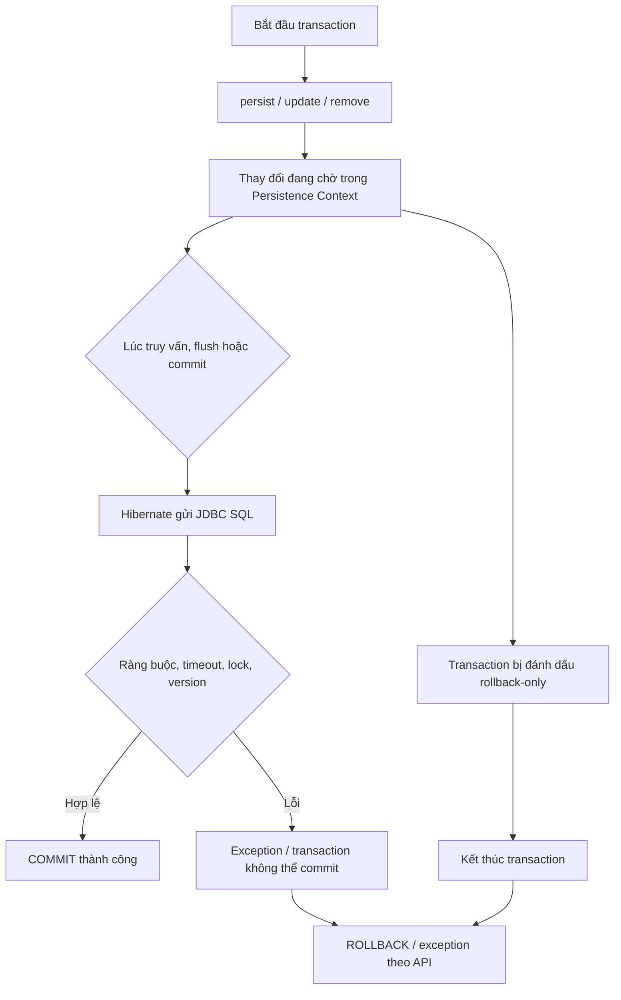
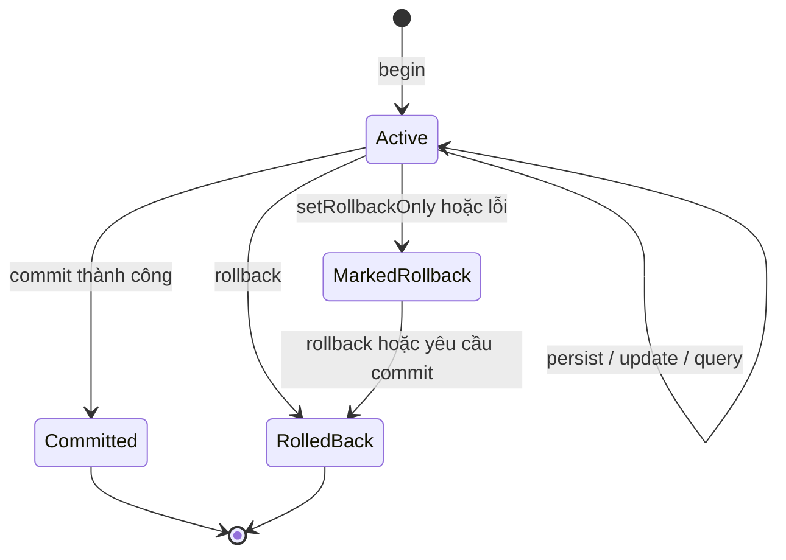
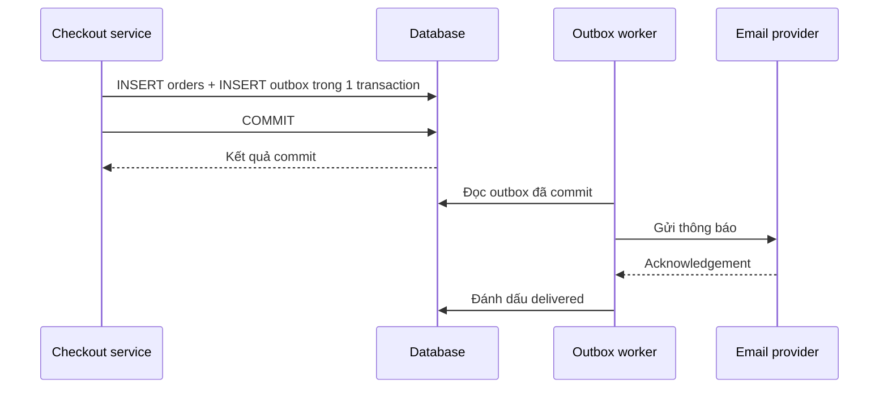

# Timeout, trạng thái chỉ được rollback và lỗi xuất hiện tại commit

## 1. Vì sao một transaction “chạy hết code” vẫn có thể thất bại?

Giả sử ứng dụng tạo một đơn hàng:

```java
entityManager.persist(order);
order.addLine(product, 2);

System.out.println("Đã xử lý xong nghiệp vụ");
// Sau đó transaction manager mới commit.
```

Thông báo `"Đã xử lý xong nghiệp vụ"` xuất hiện **không bảo đảm** dữ liệu đã được lưu thành công. Hibernate có thể chưa gửi hết `INSERT` và `UPDATE` xuống database; một truy vấn có thể đã vượt thời gian cho phép; hoặc transaction đã bị đánh dấu **chỉ được rollback** (*rollback-only*) do lỗi xảy ra trước đó.

Ba tình huống phổ biến:

1. **Timeout:** một giới hạn thời gian bị vượt, khiến thao tác SQL hoặc cả giao dịch không được phép tiếp tục bình thường.
2. **Rollback-only:** transaction vẫn có thể tồn tại trong phạm vi code, nhưng đã được đánh dấu rằng kết quả cuối cùng **phải là rollback**, không được commit.
3. **Lỗi muộn ở commit:** một thay đổi được đưa vào Persistence Context trước đó, nhưng chỉ bị database/Hibernate từ chối khi flush ở cuối transaction hoặc khi database kiểm tra constraint tại commit.

Sơ đồ:



Bài học này tập trung vào **Hibernate ORM và quản lý transaction**. Chúng ta sẽ phân biệt timeout ở các tầng, hiểu trạng thái rollback-only, xác định lỗi xuất hiện tại `flush()`/`commit()` và thiết kế cách xử lý an toàn.

## 2. Năm khái niệm cần tách biệt

| Khái niệm | Ý nghĩa | Có xác nhận dữ liệu? |
|---|---|---|
| **Persistence Context** | Quản lý entity, dirty checking và những thay đổi chờ đồng bộ | Không |
| **Flush** | Hibernate đồng bộ các thao tác INSERT/UPDATE/DELETE đang chờ sang database | Không; vẫn có thể rollback |
| **Commit** | Yêu cầu xác nhận transaction theo cơ chế database/transaction manager | Có nếu thực sự thành công |
| **Rollback** | Hủy những thay đổi chưa được commit thuộc transaction | Không |
| **Rollback-only** | Đánh dấu rằng transaction **không được commit**, dù code chưa gọi rollback vật lý | Không |

Thứ tự phổ biến:

```text
beginTransaction()
       │
       ├── persist(entity)     -> entity được quản lý
       ├── sửa entity managed  -> dirty checking
       ├── truy vấn             -> có thể auto-flush
       ├── lỗi / timeout       -> có thể mark rollback-only
       │
       └── commit()
                ├── flush SQL nếu cần
                ├── database kiểm tra constraint
                ├── transaction manager quyết định commit/rollback
                └── trả thành công hoặc ném lỗi
```

**Quan trọng:** `flush()` và `commit()` không phải hai lệnh đồng nghĩa. Một transaction có thể flush nhiều lần trước commit, và mỗi lần flush đều có thể làm phát lộ lỗi SQL/constraint.

## 3. Timeout không chỉ có một loại

Từ “timeout” trong ứng dụng Hibernate có thể chỉ những giới hạn rất khác nhau.

| Loại timeout | Giới hạn điều gì? | Thường đặt ở đâu? | Khi hết hạn có thể thấy gì? |
|---|---|---|---|
| **Transaction timeout** | Thời gian tối đa cho đơn vị giao dịch theo transaction manager | Spring `@Transactional(timeout=...)`, JTA `UserTransaction`, Hibernate transaction API | Transaction bị hủy hoặc rollback-only; lỗi trong SQL hoặc khi commit |
| **Query timeout** | Thời gian cho một câu query/statement | Hibernate `Query#setTimeout`, JPA query hint, JDBC `Statement#setQueryTimeout` | Query cancellation/timeout exception |
| **Lock timeout** | Thời gian chờ lấy lock | JPA lock hint, SQL/database settings | Lock acquisition timeout, statement bị từ chối |
| **Database statement timeout** | Thời gian chạy statement theo server | Ví dụ PostgreSQL `statement_timeout` | Database hủy statement, có thể khiến transaction không tiếp tục được |
| **JDBC socket/network timeout** | Thời gian chờ I/O kết nối giữa app và DB | Driver, datasource, network | JDBC connection/communication exception; có thể không biết commit đã thành công chưa |
| **Connection acquisition timeout** | Thời gian chờ lấy connection từ pool | HikariCP hoặc pool tương ứng | Không lấy được connection; có thể chưa bắt đầu SQL |
| **Application/request timeout** | Thời gian HTTP/gRPC client/server chờ phản hồi | Web server, gateway, client | Request hết hạn nhưng transaction phía server chưa chắc đã dừng |

Đây là những **đồng hồ khác nhau**. Cấu hình một loại không tự động thay thế các loại còn lại.

Ví dụ: HTTP client timeout sau 2 giây **không chứng minh** transaction của server đã rollback. Server có thể tiếp tục xử lý, gửi SQL và commit sau khi client không còn chờ.

## 4. Đơn vị thời gian: giây và mili giây rất dễ nhầm

Một số API minh họa:

| API hoặc setting | Đơn vị thường dùng |
|---|---|
| Spring `@Transactional(timeout = 10)` | **Giây** |
| Hibernate `Query#setTimeout(10)` | **Giây** |
| JDBC `Statement#setQueryTimeout(10)` | **Giây** |
| Jakarta Persistence `jakarta.persistence.query.timeout` | **Mili giây**, ví dụ `2000` |
| Jakarta Persistence `jakarta.persistence.lock.timeout` | **Mili giây**, ví dụ `1000` |
| JTA `UserTransaction#setTransactionTimeout(10)` | **Giây** |

Không viết:

```java
query.setHint("jakarta.persistence.query.timeout", 5);
```

rồi kỳ vọng giới hạn là 5 giây; giá trị trên diễn đạt **5 mili giây** theo hint Jakarta Persistence.

Ngay cả khi đơn vị đúng, **mức độ hỗ trợ có thể khác nhau giữa persistence provider, dialect và JDBC driver**. Query/lock timeout thường là yêu cầu provider cố gắng thực hiện, không phải cam kết tuyệt đối rằng Java thread sẽ bị ngắt đúng một mili giây nào đó.

## 5. Transaction timeout khác query timeout như thế nào?

Giả sử service cần thực hiện ba thao tác:

```text
1. Đọc tồn kho                2 giây
2. Ghi đơn hàng               2 giây
3. Cập nhật số dư            3 giây
-----------------------------------
Tổng thời gian               7 giây
```

Nếu chỉ cấu hình **query timeout = 5 giây**, ba statement riêng lẻ đều có thể chạy xong dù cả transaction kéo dài hơn 5 giây.

Nếu transaction manager áp dụng **transaction timeout = 5 giây** cho toàn giao dịch, tổng thời gian của unit of work có thể vượt giới hạn. Transaction manager có thể đánh dấu rollback-only, phát lỗi ở thao tác JDBC tiếp theo hoặc khi kết thúc transaction.

### Không nhầm timeout với thời gian chạy Java code

```java
@Transactional(timeout = 5)
public void process() {
    performCpuIntensiveCalculation();
    // Chạy Java thuần trong thời gian dài.
}
```

Không có bảo đảm `@Transactional(timeout=5)` sẽ **interrupt** `performCpuIntensiveCalculation()` ngay ở giây thứ 5. Tùy transaction manager, timeout được kiểm tra khi lấy connection, phát statement, hoặc lúc commit; cơ chế hủy một thread Java đang chạy là chuyện khác.

Muốn giới hạn một tác vụ CPU, RPC hoặc HTTP call, cần deadline/cancellation của chính tác vụ ấy. Transaction timeout bảo vệ tài nguyên giao dịch nhưng **không thay thế timeout của mọi I/O bên ngoài database**.

## 6. Thiết lập timeout với Hibernate Session

Với transaction resource-local được Hibernate quản lý, API `org.hibernate.Transaction` có hỗ trợ thiết lập timeout theo phiên bản sử dụng. Một cách khai báo trong Hibernate ORM 6.x:

```java
import org.hibernate.Session;
import org.hibernate.Transaction;

try (Session session = sessionFactory.openSession()) {
    Transaction tx = session.getTransaction();

    // Thiết lập trước khi bắt đầu transaction.
    tx.setTimeout(10); // Giây.
    tx.begin();

    try {
        createOrder(session);
        tx.commit();
    } catch (RuntimeException ex) {
        if (tx.isActive()) {
            tx.rollback();
        }
        throw ex;
    }
}
```

Đây là ví dụ dùng **Hibernate native API**. Khả năng timeout thực tế còn phụ thuộc transaction coordinator, driver và database. Không suy luận rằng tất cả JTA containers sẽ xử lý `Transaction#setTimeout` giống resource-local.

### Query timeout trên một câu truy vấn

```java
List<Order> orders = session.createQuery(
    "from Order o where o.status = :status",
    Order.class
)
.setParameter("status", "NEW")
.setTimeout(3) // Hibernate Query: giây.
.getResultList();
```

Query timeout giới hạn câu truy vấn theo mức hỗ trợ của Hibernate/JDBC/DB. Nó **không đồng nghĩa** transaction timeout; một transaction có thể thực hiện nhiều query, mỗi query có timeout riêng.

### Jakarta Persistence API

```java
List<Order> orders = entityManager
    .createQuery(
        "select o from Order o where o.status = :status",
        Order.class
    )
    .setParameter("status", "NEW")
    .setHint("jakarta.persistence.query.timeout", 3000)
    .getResultList();
```

Giá trị `3000` là **3.000 mili giây**. Khi dùng Hibernate/Jakarta Persistence 2.x cũ, namespace hint có thể là `javax.persistence.query.timeout` và import sử dụng `javax.persistence.*`.

## 7. Transaction timeout trong Spring

Trong ứng dụng Spring:

```java
import org.springframework.stereotype.Service;
import org.springframework.transaction.annotation.Transactional;

@Service
public class CheckoutService {

    private final OrderRepository orderRepository;

    public CheckoutService(OrderRepository orderRepository) {
        this.orderRepository = orderRepository;
    }

    @Transactional(timeout = 10)
    public void checkout(NewOrderCommand command) {
        Order order = Order.from(command);
        orderRepository.save(order);
        // Những thao tác DB khác trong transaction...
    }
}
```

`timeout = 10` diễn đạt giới hạn **10 giây** cho transaction mà Spring tạo/quản lý theo cấu hình transaction manager.

### Những lưu ý thường bị bỏ qua

- Timeout của `@Transactional` áp dụng chủ yếu khi lời gọi **thực sự khởi tạo transaction mới**. Một method `PROPAGATION_REQUIRED` tham gia transaction đang tồn tại thường chịu timeout của transaction bên ngoài, không tự đặt lại đồng hồ bằng annotation bên trong.
- Spring sử dụng cơ chế proxy/AOP trong cấu hình thường gặp. **Self-invocation** (method cùng class gọi trực tiếp method khác của chính nó) có thể không đi qua transaction interceptor.
- Timeout không nhất thiết cắt ngang Java code đang tính toán hoặc một HTTP request bên ngoài.
- Thời điểm lỗi được báo và khả năng cancel statement tùy transaction manager, persistence provider và JDBC driver.
- Method trả về không đồng nghĩa commit đã thành công; interceptor quản lý transaction **sau khi** method kết thúc có thể ném lỗi.

Nếu framework quản lý transaction, đừng trộn tùy tiện `entityManager.getTransaction().begin()` với `@Transactional`. Với container-managed/JTA EntityManager, việc gọi API resource-local transaction có thể không hợp lệ.

## 8. Lock timeout: chờ khóa khác với chạy query quá lâu

Hai transaction có thể tranh chấp cùng một hàng:

```text
Transaction A:
  SELECT ... FOR UPDATE hàng Product#101
  Giữ lock khi xử lý.

Transaction B:
  Cũng muốn SELECT ... FOR UPDATE Product#101
  Phải chờ A nhả lock.
```

Ứng dụng B có thể muốn **đợi tối đa 1 giây để lấy lock**, thay vì cho phép chờ vô hạn hoặc vài chục giây.

Với Jakarta Persistence:

```java
import jakarta.persistence.LockModeType;
import java.util.Map;

Product product = entityManager.find(
    Product.class,
    101L,
    LockModeType.PESSIMISTIC_WRITE,
    Map.of("jakarta.persistence.lock.timeout", 1000)
);
```

Hint `lock.timeout` dùng **mili giây** theo Jakarta Persistence. Việc provider/database hỗ trợ thời gian chờ cụ thể, chế độ no-wait hoặc bỏ qua locked rows cần được xác minh trên dialect thực tế.

### PostgreSQL có timeout ở cấp server

Trong transaction PostgreSQL, có thể sử dụng:

```sql
SET LOCAL lock_timeout = '1s';
SET LOCAL statement_timeout = '5s';
```

- `lock_timeout` tập trung vào **thời gian chờ lock**.
- `statement_timeout` giới hạn **thời gian của statement**.
- `SET LOCAL` có phạm vi transaction theo PostgreSQL, không phải một API Hibernate/JPA portable.

Không giả định `lock_timeout` đảm bảo mọi operation kết thúc đúng một giây; còn những bước khác như execution, network hoặc transaction management.

## 9. Timeout có làm transaction thành rollback-only không?

**Có thể, nhưng không nên suy luận từ mỗi chữ “timeout”.** Tùy loại timeout và môi trường:

1. Transaction manager có thể đánh dấu transaction đã hết hạn là **rollback-only**.
2. Database có thể hủy statement, khiến transaction hiện tại không thể tiếp tục thực thi statement bình thường cho đến khi rollback; PostgreSQL thường rơi vào trạng thái *transaction aborted* sau nhiều loại SQL error.
3. JPA/Hibernate có thể ném `QueryTimeoutException`, `LockTimeoutException`, `PersistenceException` hoặc exception khác tùy lỗi và khả năng phân loại.
4. Một lock timeout được đặc tả là thất bại ở mức statement có thể **không bắt buộc** rollback toàn transaction trong một số môi trường, trong khi timeout/exception khác khiến toàn giao dịch thất bại.
5. JDBC socket timeout có thể làm connection không còn sử dụng được và khiến **kết quả commit trở nên không rõ ràng** nếu lỗi xảy ra đúng lúc giao tiếp với database.

Vì thế, sau khi gặp timeout, cần kiểm tra **exception thực tế, transaction status và hành vi database**. Không tiếp tục truy vấn/ghi trong cùng transaction khi đã bị đánh dấu rollback-only hoặc database đang ở trạng thái lỗi.

### Mọi query timeout không giống nhau

JPA phân biệt các ngoại lệ như:

- `jakarta.persistence.QueryTimeoutException`: mô tả tình huống query timeout ở mức statement theo hợp đồng JPA.
- `jakarta.persistence.LockTimeoutException`: mô tả lock timeout với tác động ở mức statement.
- `jakarta.persistence.PessimisticLockException`: có thể liên quan thất bại lấy lock ảnh hưởng transaction.
- Các `PersistenceException` khác hoặc exception tầng JDBC/transaction manager: ngữ nghĩa tùy nguyên nhân.

**Đừng bắt tất cả exception rồi quyết định transaction vẫn có thể commit**. Khi database trả lỗi khiến transaction aborted hoặc transaction manager đã đánh dấu rollback-only, chỉ còn rollback là con đường an toàn.

## 10. Rollback-only nghĩa là gì?

Một transaction **đang active** có thể vẫn được đánh dấu rằng nó **không được phép commit thành công**.

Hình dung:



**Marked rollback-only** không đồng nghĩa database đã thực hiện `ROLLBACK` tại chính thời điểm đánh dấu. Nó thể hiện quyết định rằng transaction **không được kết thúc bằng commit thành công**.

Trong JTA, một transaction có thể có trạng thái như `STATUS_ACTIVE` hoặc `STATUS_MARKED_ROLLBACK`; transaction manager quyết định các bước kết thúc. Trong JPA resource-local, ứng dụng có các phương thức `setRollbackOnly()` và `getRollbackOnly()` trên `EntityTransaction`.

### Trạng thái ở các tầng không hoàn toàn đồng nhất

- **JPA EntityTransaction:** có cờ rollback-only của giao dịch resource-local.
- **JTA:** transaction manager có mô hình trạng thái `STATUS_MARKED_ROLLBACK` cùng những trạng thái chuẩn khác.
- **Spring:** `TransactionStatus` và transaction interceptor phối hợp rollback rules, propagation và transaction manager.
- **Database connection:** có trạng thái transaction riêng; ví dụ lỗi PostgreSQL có thể khiến transaction aborted.

Không lấy tên enum hoặc trạng thái ở một tầng để suy đoán chắc chắn tình trạng của mọi tầng còn lại.

## 11. Đánh dấu rollback-only trong JPA resource-local

Ví dụ:

```java
import jakarta.persistence.EntityManager;
import jakarta.persistence.EntityTransaction;

EntityTransaction tx = entityManager.getTransaction();
tx.begin();

try {
    Order order = new Order();
    entityManager.persist(order);

    if (!businessRulesSatisfied(order)) {
        tx.setRollbackOnly();
    }

    if (tx.getRollbackOnly()) {
        tx.rollback();
    } else {
        tx.commit();
    }
} catch (RuntimeException ex) {
    if (tx.isActive()) {
        tx.rollback();
    }
    throw ex;
}
```

Ví dụ này giả định `EntityManager` **resource-local**. `getTransaction()` không phải API dành cho EntityManager do JTA/container quản lý.

Ý nghĩa:

- `setRollbackOnly()` ghi nhận quyết định transaction không được commit.
- `getRollbackOnly()` giúp kiểm tra cờ trước khi kết thúc trong hoàn cảnh thích hợp.
- `rollback()` kết thúc transaction bằng hủy các thay đổi chưa commit.
- Nếu code vẫn gọi `commit()` sau khi transaction bị đánh dấu rollback-only, JPA có thể ném `RollbackException` hoặc báo lỗi tương ứng theo provider.

### Rollback-only không xóa tác động ngoài database

Nếu trước khi mark rollback-only, service đã gửi email, gọi REST API bên thứ ba hoặc ghi file ngoài transaction, những tác động ấy **không tự bị hoàn tác** khi database rollback. Khi nghiệp vụ cần tính nhất quán giữa DB và hệ thống ngoài, phải thiết kế outbox, idempotency hoặc quy trình bù trừ thích hợp.

## 12. Đánh dấu rollback-only trong JTA

Trong ứng dụng quản lý transaction qua JTA, `UserTransaction` có thể được dùng ở những môi trường phù hợp:

```java
import jakarta.transaction.UserTransaction;

// userTransaction do container/cấu hình ứng dụng cung cấp.
userTransaction.setTransactionTimeout(10); // Giây.
userTransaction.begin();

try {
    doWork();

    if (shouldCancelBusinessOperation()) {
        userTransaction.setRollbackOnly();
    }

    userTransaction.commit();
} catch (Exception ex) {
    try {
        userTransaction.rollback();
    } catch (Exception rollbackFailure) {
        ex.addSuppressed(rollbackFailure);
    }
    throw ex;
}
```

Đây là sơ đồ code minh họa JTA; môi trường EJB/container-managed transaction có thể **không cho phép ứng dụng tự điều khiển `UserTransaction`** theo cách trên. Hơn nữa, sau lời gọi `commit()` thất bại transaction có thể đã được rollback/kết thúc; không phải lúc nào một lời gọi rollback tiếp theo cũng hợp lệ. Vì vậy cần kiểm tra trạng thái và hợp đồng của transaction manager thực tế.

`UserTransaction#setTransactionTimeout(...)` thông thường cần được thiết lập **trước khi bắt đầu transaction** mà bạn muốn áp timeout. Đặc tính phạm vi áp dụng và giá trị mặc định do transaction manager quản lý.

Ở ứng dụng Spring dùng `@Transactional`, thường không cần quản lý `UserTransaction` thủ công trong service.

## 13. Vì sao Spring thường báo UnexpectedRollbackException ở bên ngoài?

Một tình huống phổ biến trong Spring là method bên trong làm transaction trở thành rollback-only, nhưng method bên ngoài **bắt và nuốt exception**, rồi tưởng mọi việc đã ổn.

### Hai service cùng tham gia một transaction

```java
@Service
public class PaymentService {

    @Transactional
    public void charge(Long orderId) {
        // Ví dụ kiểm tra nghiệp vụ rồi phát sinh lỗi.
        throw new IllegalStateException("Payment failed");
    }
}
```

Service bên ngoài:

```java
@Service
public class OrderService {

    private final PaymentService paymentService;
    private final OrderRepository orderRepository;

    public OrderService(
            PaymentService paymentService,
            OrderRepository orderRepository) {
        this.paymentService = paymentService;
        this.orderRepository = orderRepository;
    }

    @Transactional
    public void placeOrder(Order order) {
        orderRepository.save(order);

        try {
            paymentService.charge(order.getId());
        } catch (IllegalStateException ex) {
            // Bắt lỗi nhưng không khôi phục được transaction.
            logPaymentFailure(ex);
        }

        // Method có thể kết thúc mà không ném exception.
    }
}
```

Giả sử:

- Cả hai method được gọi qua **Spring proxies** hợp lệ.
- `@Transactional` dùng propagation mặc định `REQUIRED`.
- `PaymentService.charge()` ném runtime exception đi qua transaction interceptor của service bên trong.

Khi exception đi ra khỏi `charge()`, transaction interceptor có thể đánh dấu transaction chung là **rollback-only**. `placeOrder()` sau đó bắt exception, tiếp tục chạy và kết thúc bình thường. Nhưng lúc interceptor bên ngoài chuẩn bị commit, transaction manager phát hiện rollback-only và **rollback thay vì commit**.

Khi đó caller có thể nhận:

```text
org.springframework.transaction.UnexpectedRollbackException:
Transaction rolled back because it has been marked as rollback-only
```

Thông điệp cụ thể khác nhau giữa Spring version/transaction manager, nhưng nguyên nhân chung là **code bên ngoài kỳ vọng commit, trong khi transaction bên trong đã bị đánh dấu không được commit**.

### Vì sao “catch lỗi” không tự xóa rollback-only?

Bắt Java exception chỉ thay đổi **luồng điều khiển của Java**. Nó không tua ngược trạng thái transaction mà interceptor, JPA provider hoặc database đã đặt trước đó.

**Không nên “cố commit” một transaction rollback-only.** Quyết định đúng là xem lỗi bên trong có phải lỗi cho phép hủy toàn bộ đơn vị công việc hay không, rồi thiết kế propagation và xử lý exception theo quy tắc nghiệp vụ.

## 14. Cách xử lý tình huống rollback-only trong Spring

### Cách 1: Để lỗi lan ra và rollback toàn bộ

Nếu thanh toán thất bại thì đơn hàng cũng không được lưu:

```java
@Transactional
public void placeOrder(Order order) {
    orderRepository.save(order);
    paymentService.charge(order.getId());
    // Nếu charge thất bại, exception lan ra, transaction rollback.
}
```

Cách này rõ ràng khi cả hai thay đổi bắt buộc thành công cùng nhau trong một transaction.

### Cách 2: Tách transaction độc lập bằng REQUIRES_NEW khi thực sự cần

Nếu ghi audit thất bại cần tách khỏi transaction chính, có thể thiết kế service riêng:

```java
@Service
public class AuditService {

    @Transactional(
        propagation = Propagation.REQUIRES_NEW
    )
    public void recordFailure(String message) {
        auditRepository.save(new AuditEvent(message));
    }
}
```

`REQUIRES_NEW` tạo transaction vật lý riêng khi transaction manager hỗ trợ, thường tạm treo transaction bên ngoài. Nếu transaction audit commit, việc transaction ngoài rollback **không tự rollback phần audit đã commit**.

Nhưng:

- Dùng `REQUIRES_NEW` có thể cần **connection thứ hai** khi outer transaction vẫn đang giữ connection; pool nhỏ có thể cạn.
- Transaction độc lập không giải quyết tự động tính nhất quán của một hoạt động nghiệp vụ vốn yêu cầu atomicity.
- Nếu lỗi do một SQL statement đã làm transaction ngoài bị aborted, gọi service mới trên connection khác không đồng nghĩa transaction ngoài đã phục hồi.
- Đối với hệ thống phát sự kiện, outbox hoặc kiến trúc phù hợp thường tốt hơn việc nhồi `REQUIRES_NEW` vào mọi bước.

### Cách 3: NESTED/savepoint khi hạ tầng hỗ trợ

Spring `Propagation.NESTED` có thể dùng savepoint bên trong cùng transaction vật lý ở những transaction manager/hạ tầng hỗ trợ. Nó **khác** `REQUIRES_NEW`. Khả năng triển khai với JPA/JTA không được bảo đảm như JDBC savepoint thuần.

Không giả định `NESTED` có ở mọi cấu hình Hibernate và không dùng nó để khôi phục một transaction mà database đã bị lỗi ở trạng thái không thể tiếp tục nếu chưa rollback về savepoint hợp lệ.

### Cách 4: Đánh dấu rollback-only minh bạch

Khi ứng dụng chủ động quyết định không thể tiếp tục:

```java
import org.springframework.transaction.interceptor.TransactionAspectSupport;

@Transactional
public void processOrder(Order order) {
    if (!eligible(order)) {
        TransactionAspectSupport
            .currentTransactionStatus()
            .setRollbackOnly();
        return;
    }

    repository.save(order);
}
```

Đoạn này phụ thuộc Spring transaction context hiện hành. Nếu muốn caller **biết việc nghiệp vụ bị từ chối**, thường tốt hơn là trả một result thất bại rõ ràng hoặc ném exception nghiệp vụ phù hợp, thay vì chỉ mark rollback-only rồi trả về như thành công.

## 15. Spring rollback rules: runtime và checked exception

Với cấu hình Spring mặc định thông dụng:

- `RuntimeException` và `Error` thường khiến transaction rollback khi exception đi ra khỏi method được interceptor quản lý.
- Checked exception (`Exception` nhưng không phải `RuntimeException`) thường **không** kích hoạt rollback mặc định, trừ khi cấu hình rollback rules hoặc transaction manager/provider đã đánh dấu lỗi.

Ví dụ:

```java
@Transactional(rollbackFor = IOException.class)
public void importOrders() throws IOException {
    writeOrders();
    readExternalFile();
}
```

Ở đây `rollbackFor = IOException.class` chủ động yêu cầu rollback nếu checked `IOException` thoát khỏi method.

**Không suy ra rằng cứ exception bị bắt ở bất kỳ đâu thì transaction an toàn.** Spring transaction interceptor nhìn thấy exception theo ranh giới proxy method, trong khi database/Hibernate có thể đã đặt transaction vào trạng thái lỗi độc lập với rollback rules của Spring.

## 16. Lỗi có thể xuất hiện ở persist, flush, query hoặc commit

Hibernate thường áp dụng **write-behind**: `persist()` đăng ký entity mới, còn SQL INSERT có thể chạy khi flush hoặc sớm hơn theo identifier generator.

| Thời điểm | Ví dụ lỗi | Vì sao xuất hiện lúc ấy? |
|---|---|---|
| `persist()` | IDENTITY INSERT thất bại | Database phải tạo ID sớm, khiến SQL chạy ngay |
| `flush()` | UNIQUE/FK/NOT NULL, optimistic locking | Hibernate vừa gửi queued SQL và database/ORM kiểm tra |
| Trước một query | Auto-flush dẫn tới lỗi pending DML | Hibernate cần đồng bộ các bảng liên quan trước truy vấn |
| `commit()` phía ORM | Flush cuối transaction phát hiện constraint | Đến lúc commit mới có SQL chưa được phát trước đó |
| `commit()` phía database | Constraint deferred, serialization failure | Database kiểm tra ở thời điểm hoàn tất transaction |
| Transaction completion | Rollback-only | Transaction manager từ chối commit hoặc rollback với exception thích hợp |
| JDBC commit/network I/O | Connection lost | Có thể không chắc DB đã commit hay chưa |

Một exception xảy ra ở `tx.commit()` **không cho biết ngay nguyên nhân là database COMMIT statement bị lỗi**. Lỗi có thể đến từ **flush INSERT/UPDATE/DELETE được Hibernate thực hiện ngay trước khi gọi commit ở JDBC**.

Để phân biệt, cần quan sát SQL log, root cause, SQLState, transaction status và cơ chế constraint.

## 17. Ví dụ lỗi UNIQUE chỉ lộ ra ở commit

Giả sử entity:

```java
@Entity
@Table(name = "customers")
public class Customer {
    @Id
    @GeneratedValue(strategy = GenerationType.SEQUENCE)
    private Long id;

    @Column(name = "email", nullable = false, unique = true)
    private String email;

    protected Customer() {}

    public Customer(String email) {
        this.email = email;
    }
}
```

Database đã có email `lan@example.test` với UNIQUE constraint thực sự.

```java
try (Session session = sessionFactory.openSession()) {
    Transaction tx = session.beginTransaction();
    try {
        Customer duplicate = new Customer("lan@example.test");
        session.persist(duplicate);

        System.out.println("persist() đã trả về");

        tx.commit(); // INSERT có thể được flush tại đây.
    } catch (RuntimeException ex) {
        if (tx.isActive()) {
            tx.rollback();
        }
        throw ex;
    }
}
```

Với `SEQUENCE`, ID có thể đã được cấp nhưng INSERT được giữ chờ. `persist()` có thể trả về bình thường; database chỉ phát hiện duplicate email khi INSERT chạy tại flush trong `commit()`.

Vì thế:

- Log trước commit **không chứng minh bản ghi đã được lưu**.
- ID khác null **không chứng minh INSERT thành công**.
- Cần kiểm tra exception tại ranh giới transaction, không chỉ quanh `persist()`.
- Sau lỗi constraint, rollback/đóng Session; không tiếp tục ghi trong cùng Persistence Context như thể chưa có gì xảy ra.

Nếu chủ động gọi `session.flush()` trước `commit()`, lỗi có thể xuất hiện sớm hơn. Nhưng thêm flush chỉ đổi **thời điểm lỗi được phát hiện**, không sửa giá trị email trùng hoặc quy tắc unique.

## 18. Lỗi xuất hiện đúng ở database COMMIT: deferred constraints

Một số database hỗ trợ constraint có thể trì hoãn việc kiểm tra đến cuối transaction. Ví dụ PostgreSQL:

```sql
CREATE TABLE seat_reservations (
    id BIGINT PRIMARY KEY,
    flight_id BIGINT NOT NULL,
    seat_number VARCHAR(10) NOT NULL,
    CONSTRAINT uq_flight_seat
        UNIQUE (flight_id, seat_number)
        DEFERRABLE INITIALLY DEFERRED
);
```

Trong cùng transaction:

```sql
BEGIN;

INSERT INTO seat_reservations
    (id, flight_id, seat_number)
VALUES (1, 100, '12A');

INSERT INTO seat_reservations
    (id, flight_id, seat_number)
VALUES (2, 100, '12A');

-- Các INSERT có thể chưa báo lỗi UNIQUE deferred.
COMMIT; -- Bị từ chối vì dữ liệu cuối transaction vẫn trùng.
```

Với constraint `DEFERRABLE INITIALLY DEFERRED`, việc phát SQL thành công trước đó chưa chắc transaction có thể commit. Tại commit, database kiểm tra invariant và rollback nếu vi phạm.

**Không phải mọi constraint đều deferrable.** Trên PostgreSQL, `NOT NULL` và `CHECK` không được trì hoãn giống UNIQUE/FK deferrable. Cú pháp và khả năng của từng DB khác nhau.

### Tình huống dễ nhầm

```text
Hibernate: flush() hoàn tất mà không thấy lỗi.
Ứng dụng: ghi log "SQL đã gửi".
Database: đến COMMIT mới kiểm tra UNIQUE deferred.
Database: từ chối COMMIT.
```

Không thể sửa bằng cách gọi `flush()` thêm lần nữa nếu constraint vẫn được hoãn và trạng thái cuối vẫn sai. Phải sửa dữ liệu hoặc quy trình nghiệp vụ để transaction kết thúc hợp lệ.

## 19. Optimistic locking cũng có thể báo lỗi muộn

Giả sử entity có:

```java
@Version
private long version;
```

Hai transaction cùng đọc `Order#101` ở version 3:

```text
Transaction A                 Transaction B
--------------------------    ---------------------------
Đọc Order#101 version=3       Đọc Order#101 version=3
                               Đổi trạng thái và commit
                               DB version=4
Đổi trạng thái trong Java
commit()
  flush UPDATE với version=3
  UPDATE ảnh hưởng 0 hàng
  -> optimistic locking error
```

Ứng dụng A có thể không gặp lỗi ở dòng `order.setStatus(...)`. Hibernate chỉ kiểm tra hiệu lực cập nhật khi phát SQL lúc flush.

Ngoại lệ có thể xuất hiện dưới dạng `OptimisticLockException`, `StaleObjectStateException` hoặc exception được framework translate, tùy API. Trong Spring, có thể gặp các exception thuộc họ `ObjectOptimisticLockingFailureException`.

### Đừng retry mù quáng

Sau optimistic locking conflict:

1. Rollback transaction lỗi.
2. Tải dữ liệu mới trong context/transaction khác.
3. Xem thay đổi nào đã được người khác commit.
4. Quyết định báo xung đột, merge có kiểm soát hoặc retry nếu thao tác idempotent và chính sách cho phép.

Không dùng `refresh()` vô điều kiện để ghi đè ý định sửa của người dùng hoặc lặp retry không giới hạn.

## 20. Một lỗi JDBC có thể khiến database transaction không thể tiếp tục

Trên PostgreSQL, khi một câu SQL lỗi trong transaction (ví dụ vi phạm UNIQUE immediate), transaction thường chuyển sang trạng thái **aborted**. Các statement tiếp theo thường nhận thông báo tương đương:

```text
ERROR: current transaction is aborted,
commands ignored until end of transaction block
```

Ví dụ:

```sql
BEGIN;

INSERT INTO customers(email)
VALUES ('lan@example.test');
-- Vi phạm UNIQUE, statement lỗi.

SELECT COUNT(*) FROM customers;
-- Có thể bị từ chối do transaction đang aborted.

ROLLBACK;
```

Trong Java, việc bắt exception rồi chạy query tiếp không khôi phục được trạng thái database:

```java
try {
    session.flush(); // SQL thất bại.
} catch (RuntimeException ex) {
    // Chỉ bắt exception không sửa transaction.
}

// Tiếp tục sử dụng session/transaction này là nguy hiểm.
```

**Quy tắc an toàn:** khi một lỗi persistence/JDBC nghiêm trọng xảy ra trong unit of work, rollback và đóng Session/EntityManager theo vòng đời phù hợp. Nếu cần làm lại, dùng transaction và Persistence Context mới.

Trên database có savepoint, một số lỗi có thể được xử lý bằng `ROLLBACK TO SAVEPOINT` nếu transaction và framework được thiết kế rõ ràng cho mục đích đó. Không tự giả định mọi Session có thể phục hồi bằng cách bắt exception và tiếp tục.

## 21. Vì sao rollback-only đôi khi chỉ bị phát hiện ở commit?

Một transaction manager có thể đánh dấu rollback-only **ngay khi lỗi đi qua một ranh giới nội bộ**, nhưng code gọi bên ngoài không kiểm tra trạng thái ấy.

```text
Begin transaction
    |
    +-- Outer service save(order)
    |
    +-- Inner service throws RuntimeException
    |      |
    |      +-- Interceptor marks rollback-only
    |
    +-- Outer catches exception and returns normally
    |
    +-- Transaction interceptor attempts commit
            |
            +-- Detect rollback-only
            +-- Perform rollback
            +-- Report UnexpectedRollbackException
```

Điểm then chốt là **thời điểm transaction bị đánh dấu** khác **thời điểm caller được thông báo rằng commit không thể thành công**.

### Vì sao Spring ném UnexpectedRollbackException?

Spring cố tránh làm caller tin rằng transaction đã commit khi thực tế đã rollback. Nếu outer scope không chủ động quyết định rollback nhưng inner scope đã buộc toàn bộ transaction rollback, framework có thể ném `UnexpectedRollbackException` lúc kết thúc để thông báo kết quả thực tế.

Kết quả cụ thể phụ thuộc:

- Phạm vi transaction vật lý và logical transaction scopes.
- Propagation (`REQUIRED`, `REQUIRES_NEW`, `NESTED`).
- Cách rollback-only được đánh dấu.
- Transaction manager, cấu hình và nơi exception xảy ra.

Không nên viết logic dựa trên việc `UnexpectedRollbackException` luôn xuất hiện ở cùng một dòng trong mọi cấu hình.

## 22. Bảng phân biệt các dấu hiệu dễ nhầm

| Quan sát | Có thể là | Điều cần kiểm tra |
|---|---|---|
| Method service trả bình thường rồi caller nhận lỗi | Transaction interceptor thất bại khi commit | Stack trace tại commit, rollback-only, flush |
| `persist()` không lỗi nhưng commit lỗi duplicate key | INSERT được flush muộn | SQL log, UNIQUE constraint |
| Query chạy quá lâu rồi transaction không thể commit | Transaction/query timeout | Timeout loại nào, DB error, rollback-only |
| Inner method lỗi, outer đã catch nhưng vẫn rollback | Participating transaction bị marked rollback-only | Propagation, proxy boundary, rollback rules |
| `flush()` chạy được, commit lỗi UNIQUE | Deferred constraint hoặc lỗi commit-time khác | Constraint deferrability và SQLState |
| Hai request sửa một entity, commit cuối lỗi | Optimistic locking conflict | `@Version` và số hàng UPDATE |
| Commit báo mất kết nối, không biết kết quả | Ambiguous commit outcome | Connection/network logs, đối soát DB bằng business key |
| Thấy `TransactionRequiredException` | Không có transaction thích hợp | Transaction boundary / EntityManager type |
| Cố truy vấn tiếp sau JDBC error và lại lỗi | DB transaction aborted / Persistence Context lỗi | Rollback + đóng context |

Không được chẩn đoán chỉ dựa vào **tên method cuối cùng trong stack trace**. Một `commit()` bao gồm nhiều bước: flush ORM, JDBC execution, database constraints và transaction completion.

## 23. Xử lý exception và rollback cho Hibernate resource-local

Một mẫu đơn vị công việc:

```java
import org.hibernate.Session;
import org.hibernate.Transaction;

public Long createOrder(SessionFactory factory, NewOrderData data) {
    try (Session session = factory.openSession()) {
        Transaction tx = session.beginTransaction();
        try {
            Order order = new Order(data);
            session.persist(order);

            tx.commit(); // Có thể flush và ném lỗi tại đây.
            return order.getId();
        } catch (RuntimeException ex) {
            if (tx.isActive()) {
                try {
                    tx.rollback();
                } catch (RuntimeException rollbackFailure) {
                    ex.addSuppressed(rollbackFailure);
                }
            }
            throw ex;
        }
    }
}
```

Trong ví dụ:

- **Commit nằm bên trong `try`**, không đặt ngoài khối bắt lỗi.
- Nếu thất bại khi flush/commit, code cố rollback khi transaction còn active.
- Nếu rollback cũng lỗi, giữ lại exception gốc và ghi nhận lỗi rollback dưới dạng suppressed exception.
- `try-with-resources` đóng Session khi method kết thúc.
- Không sử dụng lại Session sau exception.

### Một lưu ý quan trọng

Nếu lỗi xảy ra do **mất kết nối ngay lúc COMMIT**, có thể không xác định được chắc chắn database đã commit hay chưa. Một lời gọi `rollback()` sau đó có thể thất bại hoặc không đảo ngược được một commit đã xảy ra. Vì vậy, **rollback trong catch là thực hành xử lý tài nguyên, không phải bằng chứng chắc chắn rằng mọi thao tác phía database chưa từng commit**.

## 24. Lỗi kết nối tại commit: kết quả có thể không xác định

Đây là tình huống nguy hiểm hơn một constraint violation thông thường:

```text
Application                   Database
-----------                   --------
Gửi COMMIT  ----------------> Nhận COMMIT
                                Commit thành công
               X kết nối đứt
Không nhận được phản hồi
Application thấy timeout/IOException
```

Ở phía ứng dụng, exception nói rằng **không nhận được xác nhận**. Nhưng database có thể đã commit thành công. Nếu app ngay lập tức retry toàn bộ nghiệp vụ, có thể tạo **đơn hàng trùng, thanh toán trùng hoặc phát sự kiện hai lần**.

### Nguyên tắc xử lý commit outcome không rõ

1. Không kết luận mọi `commit()` exception đều đồng nghĩa **chắc chắn rollback**.
2. Thiết kế **idempotency key** hoặc **business key duy nhất** cho các thao tác có thể retry.
3. Đối soát trạng thái bằng transaction mới và key nghiệp vụ khi connection đã khôi phục.
4. Phân biệt lỗi duplicate key do retry với lỗi nghiệp vụ thực sự.
5. Với thanh toán hoặc tác vụ bên ngoài, dùng API idempotent và trạng thái giao dịch có thể truy vấn lại.

Ví dụ:

```sql
CREATE TABLE payments (
    id BIGINT PRIMARY KEY,
    request_key VARCHAR(80) NOT NULL UNIQUE,
    amount NUMERIC(14, 2) NOT NULL,
    status VARCHAR(20) NOT NULL
);
```

Nếu một request với `request_key = 'checkout-abc-123'` bị mất phản hồi tại commit, lần retry nên kiểm tra/áp dụng cùng key theo quy tắc idempotency được bảo đảm bằng unique constraint và transaction đúng, thay vì tự sinh một payment mới không liên hệ tới request ban đầu.

## 25. Timeout, rollback-only và hoạt động bên ngoài transaction

Giả sử một service:

```java
@Transactional
public void checkout(Order order) {
    orderRepository.save(order);
    emailClient.sendConfirmation(order); // Gửi email ngay.
}
```

Nếu `emailClient.sendConfirmation(...)` thành công nhưng database commit sau đó thất bại, người dùng đã nhận email xác nhận cho đơn hàng **không được commit**.

Ngược lại, nếu gửi email thất bại và exception bị catch, transaction có thể đã rollback-only ở một tầng, hoặc không bị rollback tùy cách code và cấu hình. Dù sao, **email/RPC không nằm trong transaction database** chỉ vì được gọi bên trong method `@Transactional`.

### Transactional outbox

Khi cần phát thông báo sau khi commit dữ liệu nghiệp vụ, một phương án phổ biến:

1. Trong cùng database transaction, lưu đơn hàng và một bản ghi **outbox event**.
2. Commit transaction.
3. Worker đọc outbox đã commit và gửi email/event.
4. Đánh dấu xử lý thành công, retry có kiểm soát; consumer phải xử lý duplicate/idempotency.



Outbox giúp gắn **ý định phát sự kiện** với transaction nghiệp vụ. Nó không có nghĩa hệ thống ngoài được commit cùng một database transaction; vẫn cần retry và chống gửi trùng.

## 26. Cách điều tra một lỗi xuất hiện ở commit

Thứ tự điều tra có thể là:

**Bước 1 — Xác định transaction manager.** Đang dùng Hibernate resource-local, Spring `JpaTransactionManager`, Spring `DataSourceTransactionManager` hay JTA? Các API/status khác nhau.

**Bước 2 — Xác định lỗi gốc.** Xem root cause, SQLState, tên constraint, lỗi optimistic lock, timeout, connection hoặc transaction rollback-only; không dừng ở một exception wrapper.

**Bước 3 — Đọc SQL đã phát.** Lệnh `INSERT`/`UPDATE` nào chạy khi commit? Có query trước commit tự kích hoạt flush không?

**Bước 4 — Xem thời điểm hết hạn.** Timeout áp ở transaction, statement, lock, pool hay HTTP gateway? Đơn vị thời gian giây hay mili giây?

**Bước 5 — Tìm nơi mark rollback-only.** Có inner Spring method ném runtime exception? Có code gọi `setRollbackOnly()`? JTA transaction manager có báo `STATUS_MARKED_ROLLBACK`?

**Bước 6 — Xem schema thật.** UNIQUE/FK/NOT NULL/CHECK có áp dụng, có DEFERRABLE không? Dữ liệu đã commit có cạnh tranh không?

**Bước 7 — Kiểm tra concurrency.** Có `@Version`, lock wait, deadlock, serialization failure hoặc nhiều request cập nhật cùng bản ghi không?

**Bước 8 — Phân biệt kết quả commit.** Constraint failure rõ ràng khác với mất kết nối lúc COMMIT; trường hợp sau cần đối soát trước retry.

**Bước 9 — Rollback và đóng Persistence Context lỗi.** Không tiếp tục reuse Session sau lỗi persistence nghiêm trọng.

**Bước 10 — Cập nhật thiết kế hoặc chính sách retry.** Sửa invariant, transaction boundary, timeout, idempotency hoặc mô hình outbox theo nguyên nhân, không chỉ tăng timeout.

### Logging phục vụ điều tra

Trong ứng dụng Spring Boot dùng Hibernate ORM 6.x:

```properties
logging.level.org.hibernate.SQL=DEBUG
logging.level.org.hibernate.orm.jdbc.bind=TRACE
logging.level.org.springframework.transaction=TRACE
```

Kết hợp với log JDBC/database, các logger này có thể giúp thấy statement nào đã chạy và transaction bắt đầu/kết thúc ở đâu. Trong production, **không bật bind logging tùy tiện** vì có thể lộ thông tin cá nhân, thông tin thanh toán hoặc secrets.

Nên ghi **correlation ID**, transaction/business ID, thời gian bắt đầu, loại timeout, exception chain và SQLState (khi an toàn) để đối soát.

## 27. Kiểm soát transaction dài và áp lực tài nguyên

Một transaction quá dài có thể:

- Giữ connection và database locks lâu.
- Tăng cơ hội deadlock hoặc lock timeout.
- Tăng số entity managed trong Persistence Context.
- Tích lũy nhiều pending SQL đến flush, khiến commit chậm và khó tìm nguồn lỗi.
- Kéo dài vòng đời snapshot/MVCC và áp lực database tùy hệ quản trị.
- Chạm transaction timeout dù từng statement riêng lẻ không quá chậm.

### Những chiến lược thường hữu ích

**Thu nhỏ transaction boundary:** tính toán Java hoặc gọi API ngoài trước transaction nếu an toàn về mặt nghiệp vụ; chỉ giữ trong transaction những phần cần tính nguyên tử.

**Dùng batch/chunk có kiểm soát:** job nhập hàng triệu bản ghi có thể chia transaction thành nhiều chunk nếu nghiệp vụ chấp nhận. Thỉnh thoảng `flush()/clear()` giúp quản lý bộ nhớ, nhưng mỗi chunk cần chính sách retry/idempotency.

**Tạo index cho truy vấn khóa:** lock wait lâu có thể do câu UPDATE/DELETE tìm hàng kém hiệu quả, không chỉ do timeout đặt thấp.

**Chọn timeout dựa trên số đo:** quan sát p95/p99 query latency, lock waits và độ dài transaction. Tăng timeout vô hạn có thể che đậy deadlock hoặc query plan xấu.

**Giữ transaction ngắn khi dùng pessimistic lock:** không giữ database lock trong lúc chờ email, HTTP call hoặc người dùng tương tác.

### Không coi “tăng timeout” là sửa mọi lỗi

Nếu câu SQL luôn đụng UNIQUE constraint, tăng timeout chỉ khiến transaction thất bại muộn hơn (nếu có chờ). Nếu optimistic locking báo version mismatch, tăng timeout cũng không giải quyết xung đột dữ liệu.

## 28. Ví dụ bài tập: timeout và rollback-only trong một luồng thanh toán

Giả sử ứng dụng có:

- `orders` lưu đơn hàng.
- `payments` lưu yêu cầu thanh toán với `request_key UNIQUE`.
- `outbox_events` lưu sự kiện thông báo.
- `CheckoutService` có transaction timeout 8 giây.

Tình huống:

1. Checkout bắt đầu và persist Order.
2. Service bên trong kiểm tra giới hạn thanh toán, phát hiện tài khoản không đủ tiền và ném runtime exception.
3. Outer service bắt exception và ghi log nhưng không ném lại.
4. Transaction interceptor bên ngoài chuẩn bị commit.

**Câu hỏi 1:** Vì sao caller vẫn có thể nhận `UnexpectedRollbackException`?

Gợi ý: inner service tham gia cùng transaction `REQUIRED` và đánh dấu rollback-only khi runtime exception đi qua interceptor; outer bắt exception không xóa dấu rollback-only.

**Câu hỏi 2:** Nếu muốn ghi một audit event về lần thanh toán bị từ chối dù đơn hàng rollback, nên xem xét điều gì?

Gợi ý: một transaction audit độc lập khi chính sách cho phép, outbox cho sự kiện gắn với transaction đã commit, hoặc một luồng audit có trách nhiệm tách biệt. Chọn theo yêu cầu atomicity và nguồn dữ liệu thực tế.

**Câu hỏi 3:** Nếu database báo connection lost ngay sau lời gọi `commit()`, có nên retry tạo Payment với `request_key` mới không?

Không nên. Kết quả commit có thể chưa rõ; dùng cùng request key để đối soát và bảo đảm idempotency.

**Câu hỏi 4:** Nếu query lấy lock mất 2 giây nhưng transaction timeout là 8 giây, có chắc mọi thứ đều hợp lệ?

Không. Tổng thời gian của các bước khác còn lại có thể vượt 8 giây; lock timeout còn là một giới hạn độc lập.

**Câu hỏi 5:** Nếu UNIQUE constraint được định nghĩa `DEFERRABLE INITIALLY DEFERRED`, việc `flush()` không báo lỗi đã chứng minh transaction commit được chưa?

Chưa. Database có thể từ chối tại `COMMIT`.

## 29. Bài thực hành với Hibernate resource-local

### Phần A — Quan sát lỗi muộn

1. Tạo bảng `customers` có `UNIQUE(email)`.
2. Lưu một customer với email `demo@example.test` và commit.
3. Mở Session/transaction mới; persist customer thứ hai cùng email bằng `SEQUENCE`.
4. Ghi log trước và sau `persist()`.
5. Gọi `tx.commit()` rồi quan sát exception và SQL.
6. Thử gọi `session.flush()` trước commit và quan sát thời điểm lỗi thay đổi.

**Điều cần hiểu:** lỗi xảy ra khi SQL/constraint được kiểm tra, không nhất thiết ở vị trí Java đăng ký persist.

### Phần B — Đánh dấu rollback-only

```java
EntityTransaction tx = entityManager.getTransaction();
tx.begin();

try {
    Customer customer = new Customer("cancel@example.test");
    entityManager.persist(customer);

    tx.setRollbackOnly();

    System.out.println(tx.getRollbackOnly()); // true.
    tx.rollback();
} catch (RuntimeException ex) {
    if (tx.isActive()) {
        tx.rollback();
    }
    throw ex;
}
```

Mở transaction mới để xác nhận bản ghi chưa được commit. Đừng đánh giá kết quả bằng cách xem ID Java hay đối tượng còn trong RAM.

### Phần C — Hai Spring services

Tạo `OuterService` và `InnerService` như ví dụ `REQUIRED`. Cho Inner ném runtime exception, Outer bắt lỗi và trở về bình thường. Quan sát `UnexpectedRollbackException` khi interceptor kết thúc transaction.

Sau đó so sánh với:

- Outer không bắt exception.
- Inner được gọi qua một bean/proxy tách biệt.
- Inner dùng transaction `REQUIRES_NEW` (khi nghiệp vụ phù hợp).

Mục tiêu là **nhìn thấy ranh giới transaction**, không “tắt lỗi” bằng cách catch mọi exception.

### Phần D — Query timeout và lock timeout

Tạo hai transaction truy cập cùng một hàng với pessimistic lock. Đặt `lock.timeout` và query timeout khác nhau, quan sát exception và trạng thái database. Cần chạy trên database/driver thật để thấy hành vi lock và cancellation; H2 hoặc test database in-memory có thể khác PostgreSQL/MySQL.

### Phần E — Commit failure không rõ kết quả

Mô phỏng phía ứng dụng nhận lỗi mạng khi chờ xác nhận commit. Thiết kế bảng có `request_key UNIQUE` và một bước đối soát bằng transaction mới để quyết định có cần retry. Không cố tình ngắt kết nối production để thử nghiệm.

## 30. Mười câu hỏi tự kiểm tra

1. `flush()` và `commit()` khác nhau thế nào?
2. Vì sao `persist()` thành công nhưng commit vẫn lỗi UNIQUE?
3. Timeout 5 của `@Transactional` dùng giây hay mili giây?
4. Hint `jakarta.persistence.query.timeout = 5000` có cùng đơn vị với `Query#setTimeout(5)` không?
5. Query timeout có bảo đảm cả transaction kết thúc đúng cùng thời hạn không?
6. Transaction bị đánh dấu rollback-only có thể được “cứu” bằng cách chỉ catch exception không?
7. Vì sao outer Spring method bắt lỗi inner `REQUIRED` vẫn có thể nhận `UnexpectedRollbackException` ở cuối?
8. Một constraint deferred có thể làm commit thất bại dù flush không báo lỗi không?
9. Vì sao `@Version` conflict có thể được phát hiện muộn ở flush?
10. Khi mất network đúng lúc commit, vì sao retry nghiệp vụ thiếu idempotency nguy hiểm?

**Đáp án định hướng:** (1) flush gửi SQL nhưng chưa xác nhận transaction; (2) Hibernate có thể trì hoãn INSERT tới flush trong commit; (3) giây; (4) đơn vị khác nhưng hai giá trị ví dụ đều là 5 giây; (5) không; (6) không; (7) inner đã đánh dấu transaction chung rollback-only; (8) có; (9) vì version được kiểm tra khi UPDATE chạy; (10) vì database có thể đã commit dù ứng dụng không nhận phản hồi.

## 31. Nguyên tắc thực hành cần ghi nhớ

1. **Timeout có nhiều tầng:** transaction, query, lock, database statement, connection pool, socket và HTTP timeout không thay thế nhau.
2. **Đơn vị timeout phải được kiểm tra rõ:** Spring/JTA/Hibernate query thường dùng giây; JPA timeout hints thường dùng mili giây.
3. **Transaction timeout không phải cơ chế interrupt mọi Java code.** Hành vi áp dụng phụ thuộc manager/driver/database.
4. **Rollback-only là trạng thái không được phép commit**, không nhất thiết transaction đã rollback ngay ở thời điểm bị đánh dấu.
5. **Bắt exception không xóa rollback-only.** Với Spring `REQUIRED`, inner method làm transaction rollback-only có thể khiến outer commit báo `UnexpectedRollbackException`.
6. **Lỗi xuất hiện tại commit có thể thực chất là flush error.** Hibernate có thể chờ tới cuối transaction mới INSERT/UPDATE và kiểm tra constraint.
7. **Một số lỗi thực sự được phát hiện tại database COMMIT**, chẳng hạn deferred constraint hoặc serialization failure.
8. **Sau lỗi JDBC/persistence nghiêm trọng, rollback và kết thúc Persistence Context.** Không tiếp tục dùng Session lỗi như một context sạch.
9. **Commit bị lỗi mạng có thể có kết quả không rõ.** Không retry non-idempotent operation mù quáng; dùng request/business key để đối soát.
10. **Transaction boundary, cascade, isolation, versioning và side effects phải được thiết kế cùng nhau.** Không gửi email hoặc thanh toán bên ngoài rồi giả định rollback database sẽ hủy mọi thứ.

Khi gặp lỗi Hibernate chỉ xuất hiện lúc commit, hãy lần lượt hỏi: **“SQL đã flush chưa?”, “timeout ở tầng nào?”, “transaction đã rollback-only từ trước chưa?”, “constraint/version nào vừa được kiểm tra?”** và **“kết quả commit có chắc chắn hay còn mơ hồ do lỗi kết nối?”**. Những câu hỏi này giúp xử lý đúng nguyên nhân thay vì chỉ kéo dài timeout hoặc bắt rồi bỏ qua exception.

### Tài liệu chính thức để đọc thêm

- [Hibernate ORM User Guide — Transactions and concurrency](https://docs.jboss.org/hibernate/orm/current/userguide/html_single/Hibernate_User_Guide.html#transactions)
- [Hibernate ORM User Guide — Flushing](https://docs.jboss.org/hibernate/orm/current/userguide/html_single/Hibernate_User_Guide.html#flushing)
- [Hibernate ORM User Guide — Locking](https://docs.jboss.org/hibernate/orm/current/userguide/html_single/Hibernate_User_Guide.html#locking)
- [Hibernate ORM Javadocs — Transaction](https://docs.jboss.org/hibernate/orm/current/javadocs/org/hibernate/Transaction.html)
- [Jakarta Persistence Specification](https://jakarta.ee/specifications/persistence/)
- [Jakarta Transactions Specification](https://jakarta.ee/specifications/transactions/)
- [Spring Framework Reference — Declarative transaction management](https://docs.spring.io/spring-framework/reference/data-access/transaction/declarative.html)
- [Spring Framework Reference — Transaction propagation](https://docs.spring.io/spring-framework/reference/data-access/transaction/declarative/tx-propagation.html)
- [PostgreSQL Documentation — SET CONSTRAINTS](https://www.postgresql.org/docs/current/sql-set-constraints.html)
