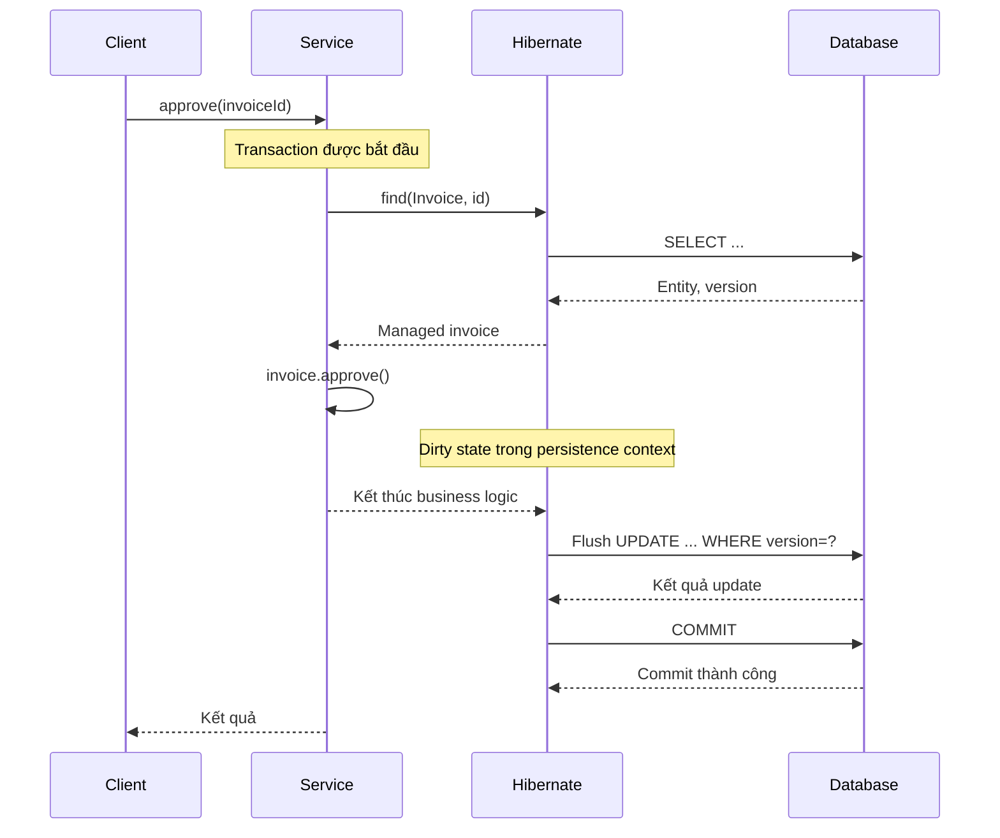
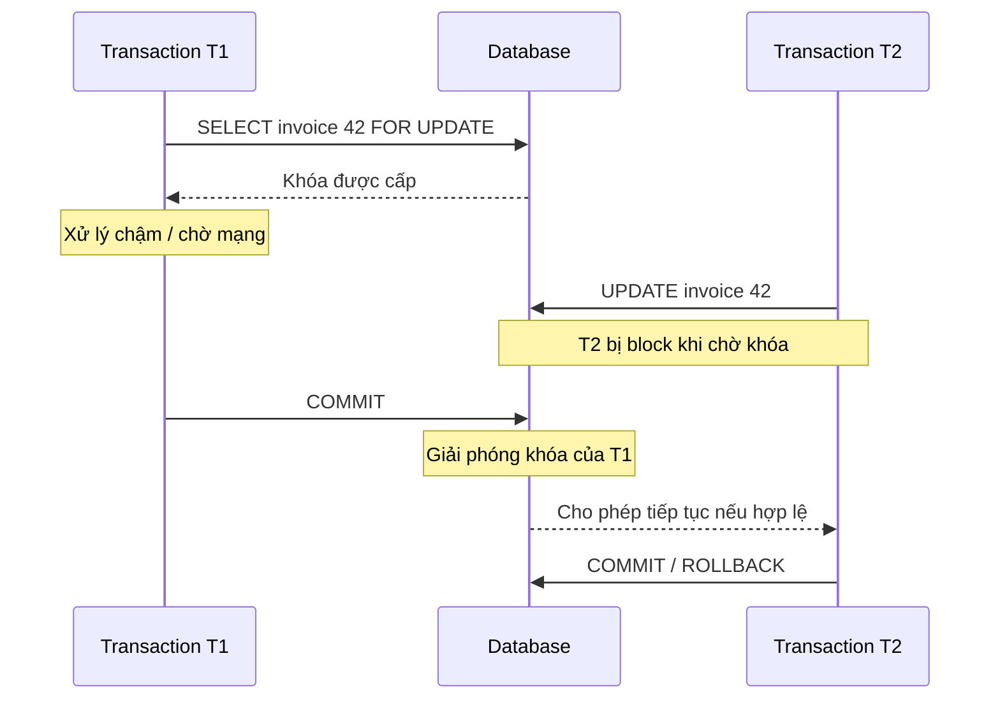
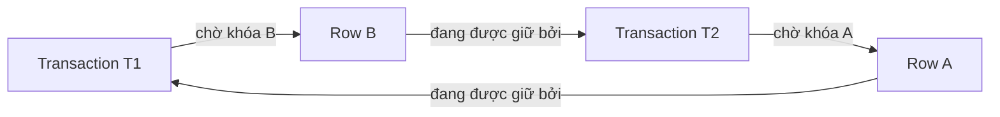
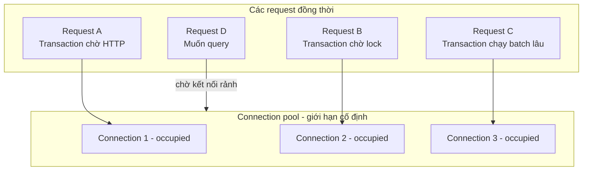
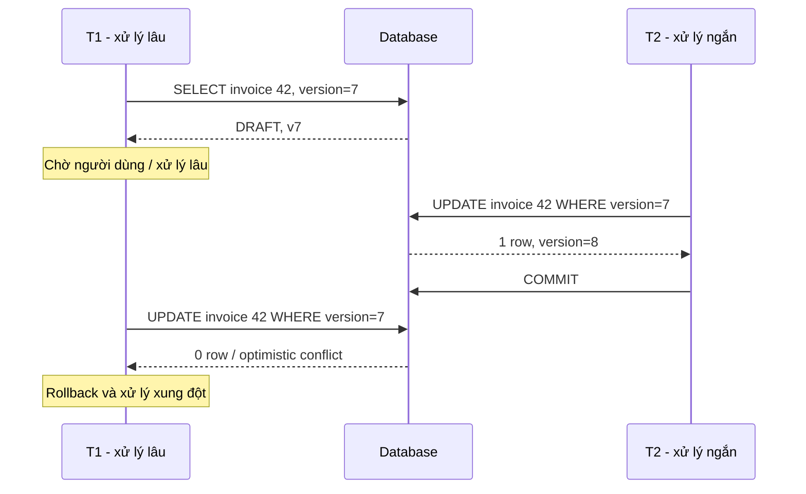
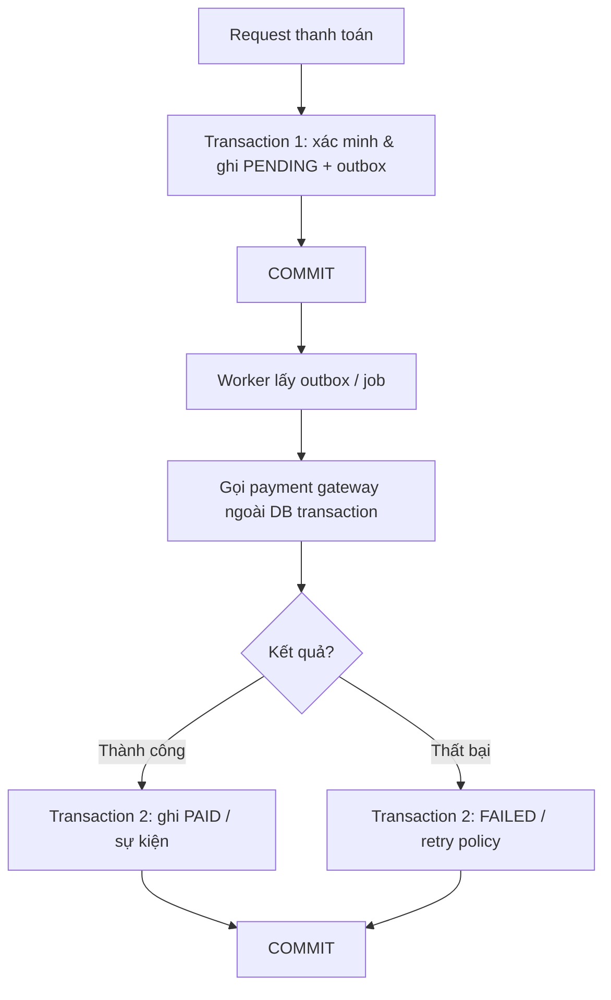

# Ảnh hưởng của giao dịch dài đến khóa, kết nối và phiên bản dữ liệu trong Hibernate

Một transaction là đơn vị công việc cần hoàn thành hoặc thất bại cùng nhau. Trong ứng dụng Hibernate, ta thường mở transaction để tải entity, áp dụng thay đổi nghiệp vụ rồi để ORM `flush` các câu lệnh SQL và commit. Giao dịch ngắn giúp việc giữ khóa, sử dụng kết nối và xử lý xung đột đồng thời trở nên dễ kiểm soát.

Ngược lại, **giao dịch dài (*long-running transaction*)** có thể làm hệ thống chậm hoặc bất ổn dù từng câu SQL riêng lẻ đều nhanh. Ví dụ, một request mở transaction, thực hiện `SELECT ... FOR UPDATE`, gọi API thanh toán mất nhiều giây rồi mới commit. Trong khoảng thời gian đó, database có thể phải giữ khóa; kết nối vẫn có thể thuộc về request; transaction khác cần sửa cùng dữ liệu phải chờ. Nếu dùng optimistic locking, việc giữ entity lâu còn làm tăng xác suất entity đã mang phiên bản cũ khi flush.

Bài học này giải thích ba hệ quả chính của giao dịch dài trong hệ sinh thái **Hibernate/JPA, Spring transaction management và cơ sở dữ liệu quan hệ**:

1. **Khóa (*locks*):** khóa hàng/bảng hoặc xung đột ghi được giữ lâu, gây chờ, deadlock và timeout.
2. **Kết nối (*connections*):** giao dịch có thể chiếm kết nối trong connection pool, khiến những request khác không lấy được kết nối.
3. **Phiên bản dữ liệu (*data versioning*):** entity và snapshot được đọc sớm có thể trở nên cũ; các transaction khác có thể commit thay đổi; `@Version` giúp phát hiện một số xung đột, còn MVCC/isolation quyết định snapshot mà truy vấn nhìn thấy.

Trọng tâm không phải “mọi transaction dài đều sai”, mà là **giữ transaction mở lâu hơn mức thực sự cần thiết làm tăng chi phí và rủi ro**. Khi nghiệp vụ bắt buộc kéo dài hàng phút hoặc hàng giờ, nên tách *business workflow* khỏi *database transaction* và dùng trạng thái nghiệp vụ, phiên bản hoặc thông điệp/event để phối hợp.

## 1. Giao dịch dài thực sự là gì?

Thời gian của một transaction được đo từ lúc nó **bắt đầu** tới lúc **commit hoặc rollback**. Khái niệm “dài” mang tính tương đối: một transaction 300 ms có thể là dài với hệ thống xử lý hàng chục nghìn request/giây, còn một batch nghiệp vụ vài giây có thể được chấp nhận nếu được cô lập và thiết kế đúng.

Không có ngưỡng cố định mà mọi DBMS và ứng dụng đều phải áp dụng. Đánh giá phải dựa trên:

- Độ trễ mục tiêu của API.
- Số transaction đồng thời.
- Tỷ lệ truy vấn ghi/đọc và mức tranh chấp bản ghi.
- Kích thước connection pool.
- Kiểu khóa và isolation của database.
- Query latency, số lần round-trip và lượng dữ liệu xử lý.
- Việc transaction có gọi mạng, đọc file lớn, chờ người dùng hoặc ngủ (*sleep*) trong lúc mở không.

### 1.1. Phân biệt transaction dài với một Session sống lâu

**Hibernate `Session`/JPA `EntityManager`** là persistence context quản lý entity identity, dirty checking và cache cấp một. **Database transaction** là ranh giới atomicity của những thay đổi ở database. Chúng có liên quan, nhưng **không hoàn toàn đồng nhất**.

| Thành phần | Vai trò | Có bắt buộc sống cùng độ dài với transaction không? |
|---|---|---|
| Entity object | Trạng thái Java của một bản ghi | Không, có thể tồn tại sau transaction dưới dạng detached |
| Persistence context (`Session`/`EntityManager`) | Giữ managed entities và snapshot | Không nhất thiết; transaction-scoped thường ngắn, extended/session dài có thể khác |
| Database connection | Kênh thực thi SQL trong DBMS | Có thể được mượn/lấy và trả theo connection handling mode, transaction manager, pool |
| Database transaction | Ranh giới commit/rollback/isolation/locks | Kết thúc khi commit hoặc rollback |
| Business workflow | Một quy trình nhiều bước, có thể chờ người dùng/hệ khác | Có thể kéo dài hàng phút/ngày; không nên mặc nhiên là một DB transaction |

Một `Session` mở lâu có thể gây stale entity hoặc giữ nhiều object trong bộ nhớ, nhưng **không nên khẳng định nó luôn giữ một database transaction và một JDBC connection suốt thời gian sống**. Hibernate có cơ chế trì hoãn lấy connection hoặc giải phóng connection theo môi trường. Ngược lại, khi một transaction thực sự đang mở và đã chạy SQL, nó thường cần giữ tài nguyên liên quan cho tới khi hoàn tất.

### 1.2. Ví dụ giao dịch bị kéo dài không cần thiết

```java
@Transactional
public void approveInvoice(Long invoiceId) {
    Invoice invoice =
        entityManager.find(Invoice.class, invoiceId);

    invoice.approve();

    // Giả sử gọi HTTP bên ngoài mất 8 giây.
    externalAccountingClient.notifyApproval(invoiceId);

    // Transaction vẫn chưa kết thúc.
}
```

Mặc dù có thể Hibernate chưa phát `UPDATE` cho `invoice.approve()` trước khi method kết thúc, transaction/persistence context vẫn có thể sống qua 8 giây chờ I/O. Nếu code đã dùng pessimistic lock hoặc flush trước khi gọi HTTP, ảnh hưởng tới database còn lớn hơn. Nếu mạng bị treo 30 giây, transaction cũng có nguy cơ bị giữ gần tương ứng.

**Không đưa một HTTP call chậm vào transaction chỉ vì cả hai thao tác cùng nằm trong một service method.** Phải xác định điều gì thực sự cần atomic ở database và cách thông báo ra ngoài sau commit.

## 2. Vòng đời một transaction Hibernate điển hình

Ví dụ Spring:

```java
@Service
public class InvoiceService {
    @PersistenceContext
    private EntityManager entityManager;

    @Transactional
    public void approve(Long invoiceId) {
        Invoice invoice =
            entityManager.find(Invoice.class, invoiceId);

        if (invoice == null) {
            throw new NoSuchElementException(
                "Invoice not found");
        }

        invoice.approve();

        // Hibernate flush khi cần trong transaction.
    }
}
```

Sơ đồ thời gian:



Thời điểm Hibernate gửi SQL phụ thuộc flush mode, identifier strategy, query và mapping. Điểm quan trọng: **mỗi giây chờ giữa lúc mở transaction và lúc kết thúc** có thể tăng thời gian giữ tài nguyên hoặc làm phiên bản dữ liệu càng cũ.

### 2.1. Một transaction dài vẫn có thể có SQL rất nhanh

Giả sử:

- SELECT mất 5 ms.
- Java logic mất 2 ms.
- Gọi hệ thống bên ngoài mất 12 giây.
- UPDATE mất 4 ms.
- COMMIT mất 3 ms.

Thời gian SQL tổng chỉ vài mili giây, nhưng transaction mở hơn 12 giây. Nhìn riêng chỉ số slow query có thể không phát hiện vấn đề. Cần quan sát **transaction duration**, **connection hold time** và **lock wait**, không chỉ query execution time.

## 3. Hệ quả thứ nhất: khóa được giữ quá lâu

Database dùng lock để bảo vệ tính nhất quán khi các transaction đồng thời đọc/ghi cùng dữ liệu. Loại khóa và cách giữ phụ thuộc DBMS, isolation, statement và index.

### 3.1. Khóa hàng khi cập nhật

Một câu `UPDATE` thường cần khóa liên quan tới hàng được cập nhật và giữ các quyền khóa cần thiết tới khi transaction kết thúc, theo quy tắc DBMS.

Ví dụ hai transaction cùng sửa một hóa đơn:

```text
T1: BEGIN
T1: UPDATE invoices SET status = 'APPROVED' WHERE id = 42
T1: ... chờ gọi API 15 giây ...
T2: BEGIN
T2: UPDATE invoices SET status = 'CANCELLED' WHERE id = 42
T2: chờ T1 giải phóng khóa
T1: COMMIT
T2: tiếp tục / kiểm tra ràng buộc / có thể lỗi
```

T2 có thể bị **block** chứ không phải chậm vì query phức tạp. Nếu nhiều request cùng sửa bản ghi “nóng”, hàng đợi lock wait sẽ gây tăng latency trên diện rộng.

### 3.2. Pessimistic lock từ SELECT FOR UPDATE

Trong JPA:

```java
Invoice invoice = entityManager.find(
    Invoice.class,
    invoiceId,
    LockModeType.PESSIMISTIC_WRITE
);
```

Hibernate sẽ yêu cầu cơ chế khóa ghi tương ứng nếu DBMS/driver hỗ trợ, thường liên quan cú pháp như `SELECT ... FOR UPDATE`. Khi transaction giữ khóa này rồi chờ I/O hoặc suy nghĩ nghiệp vụ lâu, transaction khác cần khóa xung đột có thể phải đợi.



Pessimistic locking có thể đúng với một số thao tác cần tuần tự hóa trên bản ghi, nhưng **phải giữ transaction ngắn**. Không khóa hàng ngay khi người dùng mở màn hình rồi giữ chờ người dùng nhấn nút xác nhận.

### 3.3. Khóa không chỉ có một loại

| Loại xung đột/tài nguyên | Ví dụ | Ảnh hưởng khi transaction kéo dài |
|---|---|---|
| Row locks | UPDATE hoặc SELECT FOR UPDATE | Transaction khác chờ sửa/khóa hàng |
| Table/metadata locks | DDL hoặc thay đổi cấu trúc liên quan | Migration/schema operations có thể bị block tùy DBMS |
| Gap/range/predicate locks | Một số isolation/mức khóa, đặc biệt InnoDB | Chèn/sửa các hàng nằm trong phạm vi có thể bị chặn |
| Foreign-key related locks | Chèn con, xóa cha, kiểm tra quan hệ | Giao dịch tác động các hàng liên quan có thể chờ nhau |
| Advisory/application locks | Khóa được ứng dụng chủ động lấy | Giữ quá lâu có thể gây bottleneck riêng |
| Lock do deadlock | T1 giữ A chờ B; T2 giữ B chờ A | DB phải phát hiện/hủy một transaction hoặc hết timeout |

Không phải mọi DBMS đều dùng cùng tên lock hoặc giữ khóa ở cùng thời điểm. Ví dụ PostgreSQL và MySQL InnoDB đều có MVCC nhưng chi tiết gap locks, predicate locks, range locking và câu `SELECT` thường khác nhau.

### 3.4. Khóa có thể xuất hiện ở flush, không phải lúc gọi setter

```java
Invoice invoice =
    entityManager.find(Invoice.class, invoiceId);

invoice.approve(); // Thay trạng thái Java.

entityManager.flush(); // UPDATE được gửi; DB bắt đầu xử lý lock.
```

Với managed entity thông thường, thay field Java không tự phát `UPDATE` tại đúng dòng gọi method. Database lock do SQL update có thể chỉ xuất hiện khi Hibernate flush. Nhưng **không thể suy ra mọi thao tác trước flush đều không giữ khóa**: SELECT FOR UPDATE, native DML, IDENTITY insert, truy vấn khác hoặc các khóa chủ động có thể đã thực thi.

Nếu transaction mở từ đầu rồi chỉ flush ở cuối, thời gian giữ row lock của UPDATE có thể ngắn hơn trường hợp flush sớm rồi chờ. Dù vậy transaction dài vẫn có thể giữ connection/snapshot và tạo stale entity; không nên dùng việc trì hoãn flush làm biện pháp duy nhất để hợp thức hóa transaction quá dài.

## 4. Blocked transaction, lock wait và deadlock

### 4.1. Lock wait khiến latency tăng theo dây chuyền

Giả sử hệ thống có một hóa đơn được nhiều worker cập nhật trạng thái. T1 khóa hàng và đợi 10 giây; T2 đến sau phải đợi; T3 lại đợi. Khi số request tới lớn hơn khả năng transaction cũ hoàn tất, hàng đợi kéo dài, thời gian chờ tăng và các thread giữ kết nối khác nhau.

Hiệu ứng này thường được gọi là **contention**: nhiều hoạt động tranh chấp tài nguyên chung. Một câu SQL được tối ưu tốt vẫn có thể bị chậm vì phải đợi lock.

### 4.2. Deadlock

Một deadlock đơn giản:

```text
T1: UPDATE account A     -- giữ khóa A
T2: UPDATE account B     -- giữ khóa B
T1: UPDATE account B     -- chờ T2
T2: UPDATE account A     -- chờ T1
```



DBMS có cơ chế phát hiện và xử lý deadlock hoặc timeout; thông thường một transaction sẽ bị chọn làm nạn nhân và rollback. Transaction dài tăng cửa sổ thời gian xảy ra tranh chấp, nhưng deadlock cũng có thể xảy ra giữa transaction ngắn nếu chúng lấy khóa theo thứ tự khác nhau.

Giảm rủi ro bằng:

- Cập nhật nhiều bản ghi theo một **thứ tự khóa nhất quán**, ví dụ ID tăng dần.
- Giữ logic trong transaction ngắn và không chờ hệ thống ngoài.
- Có index phù hợp để query UPDATE/DELETE không quét và khóa nhiều hàng không cần thiết.
- Chọn optimistic hoặc pessimistic locking đúng mức tranh chấp.
- Thiết kế retry cho lỗi deadlock/serialization conflict khi thao tác **idempotent hoặc có thể chạy lại an toàn**.

**Không retry một đoạn SQL bị lỗi trong cùng transaction đã bị DB đánh dấu abort**. Thường phải rollback transaction đó và khởi động **transaction mới** để thử lại toàn bộ đơn vị nghiệp vụ, với giới hạn số lần thử và backoff thích hợp.

### 4.3. Timeout có nhiều loại khác nhau

| Timeout | Điều nó giới hạn | Khi phát sinh |
|---|---|---|
| Connection acquisition timeout | Thời gian chờ mượn connection từ pool | Trước khi có JDBC connection |
| Lock timeout | Thời gian một statement được phép chờ lock | Khi cần khóa đang bị transaction khác giữ |
| Query/statement timeout | Thời gian SQL được phép thực thi/chờ theo cơ chế DB/driver | Trong statement |
| Transaction timeout | Thời gian transaction được phép sống theo transaction manager/DB | Trong toàn transaction hoặc khi commit |
| Network/socket timeout | Thời gian chờ phản hồi từ DB/socket | Khi giao tiếp mạng |

Một timeout không tự thay thế những loại khác. Ví dụ connection pool timeout có thể xảy ra ngay cả khi không có SQL query chậm, vì các transaction khác đang giữ hết connections.

## 5. Hệ quả thứ hai: chiếm dụng kết nối trong pool

Trong ứng dụng Spring Boot, connection pool thường được cấu hình qua HikariCP hoặc một pool tương đương. Pool có **số kết nối tối đa**; mỗi connection vật lý có chi phí ở ứng dụng và DB.

Một transaction có hoạt động JDBC có thể giữ connection cần thiết cho tới khi kết thúc, tùy transaction manager và chế độ connection handling. Khi nhiều transaction dài cùng lúc, pool có thể bị **starvation**: request mới chờ connection dù database chưa đạt giới hạn CPU.

### 5.1. Phân biệt bắt đầu transaction với mượn connection vật lý

Không luôn đúng rằng gọi `@Transactional` ngay lập tức mượn connection trong mọi cấu hình. Hibernate có thể **lấy connection trễ** khi cần JDBC, và có nhiều chế độ release/handling phụ thuộc môi trường. Một transaction chưa thực thi SQL có thể chưa dùng một connection theo một số cấu hình.

Nhưng một khi transaction đã thực thi SQL và còn cần đảm bảo transaction context nhất quán, tài nguyên connection thường có thể bị giữ qua những bước chờ tiếp theo. Vì vậy:

**Không dùng giả định lazy connection acquisition như một lý do để đặt mọi I/O chậm trong @Transactional.** Cách an toàn là đặt ranh giới transaction ngay sát những thao tác database cần atomic.

### 5.2. Minh họa connection pool bị nghẽn

Giả sử pool tối đa **10 connections**, mỗi request chiếm một connection trong trung bình **10 giây**. Theo mô hình đơn giản lý tưởng, capacity khoảng:

\[
\text{Throughput tối đa lý thuyết}
\approx \frac{\text{Số kết nối}}{\text{Thời gian giữ mỗi kết nối}}
\]

Tức khoảng `10 / 10 = 1` request/giây nếu mỗi request cần giữ một connection suốt 10 giây và không có giới hạn khác. Nếu thời gian giữ giảm về 100 ms, cùng một pool về lý thuyết có thể hỗ trợ một trật tự thông lượng lớn hơn nhiều, dù thực tế còn bị giới hạn bởi database, CPU, I/O và workload.

Đây chỉ là **mô hình minh họa**, không phải công thức tuning HikariCP hoặc cam kết throughput. Mục đích là thấy thời gian giữ connection ảnh hưởng trực tiếp tới khả năng phục vụ đồng thời.



### 5.3. Dấu hiệu connection pool starvation

Những triệu chứng có thể thấy:

- API latency tăng đồng loạt, cả endpoint chỉ đọc ít dữ liệu.
- Số connection `active` gần bằng pool maximum trong thời gian dài.
- Connection `idle` gần 0, `pending/waiting` tăng.
- Pool ghi log timeout chờ connection.
- Thread dump cho thấy nhiều thread đang đợi connection hoặc chờ ở một dịch vụ bên ngoài trong transaction.
- DB CPU có thể vẫn không cao; nút thắt là lock hoặc connection hold time.

**Không mặc định tăng pool size là cách chữa.** Tăng quá nhiều connections có thể làm DB bị quá tải thread/process, tăng contention và memory. Cần xác định vì sao connection bị giữ lâu và giảm thời gian đó trước.

### 5.4. Ví dụ cấu hình pool và metric

Trong Spring Boot dùng HikariCP:

```properties
spring.datasource.hikari.maximum-pool-size=20
spring.datasource.hikari.connection-timeout=3000

# Bật metric qua Actuator/Micrometer nếu dự án đã cấu hình.
management.endpoints.web.exposure.include=health,info,metrics
```

Đây là **số minh họa**, không phải cấu hình tối ưu phổ quát. Pool sizing phụ thuộc số instance của ứng dụng, giới hạn connections của DB, workload và thời gian giữ connection.

Các số liệu như active/idle/pending connections, acquisition time, usage/hold time và timeout count có thể được thu thập qua HikariCP/Micrometer tùy phiên bản, cấu hình quan sát. Không bật actuator endpoint nhạy cảm công khai chỉ để debug.

### 5.5. @Transactional(readOnly = true) vẫn có thể dùng kết nối

Read-only transaction có thể giảm overhead flush/dirty checking trong Hibernate hoặc truyền hint xuống JDBC/DB, tùy integration. Tuy nhiên **read-only không có nghĩa không cần JDBC connection**: một truy vấn SELECT vẫn phải đi qua database.

Nếu transaction read-only tải nhiều dữ liệu rồi chờ xử lý file hàng phút trong khi vẫn mở, nó vẫn có thể giữ connection hoặc snapshot theo implementation và làm pool nghẽn. Cần tách việc đọc dữ liệu và xử lý CPU/I/O kéo dài khỏi transaction khi semantics cho phép.

## 6. Hệ quả thứ ba: dữ liệu cũ và phiên bản entity

Khi transaction tải một entity, Hibernate có thể giữ một **managed instance** cùng snapshot cho dirty checking trong persistence context. Nếu transaction kéo dài, dữ liệu database có thể được transaction khác cập nhật. Khi đó, entity ở T1 có thể **stale** — nó mô tả trạng thái cũ dù trong RAM vẫn có vẻ hợp lệ.

### 6.1. Ví dụ dữ liệu cũ trong persistence context

```text
T1 (mở lâu):                  T2 (ngắn):
BEGIN
SELECT invoice 42
  status = DRAFT
  version = 7
                               BEGIN
                               UPDATE invoice 42
                                  status = APPROVED
                                  version = 8
                               COMMIT
... xử lý vài giây ...
invoice trong T1 vẫn có
  status = DRAFT
  version = 7
```

Trong cùng persistence context:

```java
Invoice first =
    entityManager.find(Invoice.class, invoiceId);

Invoice again =
    entityManager.find(Invoice.class, invoiceId);

System.out.println(first == again); // true
```

Lời gọi `find` thứ hai thường trả cùng managed instance, không mặc định query lại row. Hibernate **không phải dịch vụ tự đẩy thay đổi từ transaction khác vào mọi object Java đang sống**.

### 6.2. MVCC và transaction snapshot

Nhiều DBMS quan hệ như PostgreSQL và MySQL InnoDB dùng **MVCC (Multi-Version Concurrency Control)**. Thay vì buộc mọi reader phải chờ writer, database duy trì các phiên bản hàng phù hợp với transaction/isolation để reader đọc một snapshot nhất quán theo quy tắc của engine.

Điều này cải thiện concurrency, nhưng transaction dài có thể có thêm chi phí:

- Một transaction giữ snapshot cũ lâu có thể khiến DB cần giữ các phiên bản row cũ lâu hơn, ảnh hưởng vacuum/garbage collection/undo retention tùy engine.
- Truy vấn trong cùng transaction có thể tiếp tục đọc cùng snapshot tại isolation cấp cao, dù transaction khác đã commit dữ liệu mới.
- Một write sau đó có thể gặp serialization conflict hoặc optimistic version conflict nếu dữ liệu nền thay đổi.
- Bộ nhớ/cache và tài nguyên duy trì transaction có thể bị chiếm dụng dài.

**Không có một quy tắc MVCC giống hệt cho mọi DBMS.** PostgreSQL `READ COMMITTED` thường lấy snapshot mới theo từng statement; `REPEATABLE READ` duy trì snapshot ổn định hơn trong transaction. MySQL InnoDB `REPEATABLE READ` có consistent read và locking read semantics riêng, không hoàn toàn tương đương PostgreSQL. SQL Server có nhiều mode read committed/row-versioning tùy cấu hình. Cần hiểu DBMS đích thay vì dùng tên isolation làm bảo đảm tuyệt đối.

### 6.3. Ví dụ snapshot và first-level cache là hai cơ chế khác nhau

Giả sử PostgreSQL `READ COMMITTED` và T2 đã commit. Trong T1, một **SQL SELECT mới** có thể nhìn thấy bản mới theo statement snapshot. Nhưng nếu application gọi `entityManager.find` đối với một entity **đã managed**, Hibernate có thể trả object cũ từ first-level cache mà không gửi SELECT.

Vì vậy có hai nguyên nhân độc lập khiến dữ liệu quan sát cũ:

1. **Isolation/MVCC của database:** SQL mới có thể nhìn snapshot cũ theo isolation.
2. **Persistence context của Hibernate:** SQL có thể **không được phát** vì entity đã managed.

`entityManager.refresh(entity)` yêu cầu tải lại state từ database nhưng **không vượt qua** transaction isolation/snapshot của DB. Trong transaction snapshot ổn định, refresh chưa chắc thấy thay đổi vừa commit ở transaction khác theo kỳ vọng; một transaction đọc mới có thể cần thiết.

## 7. @Version phát hiện xung đột khi giao dịch dài

Hibernate/JPA hỗ trợ **optimistic locking** thông qua `@Version`:

```java
@Entity
@Table(name = "invoices")
public class Invoice {
    @Id
    private Long id;

    @Version
    @Column(name = "row_version", nullable = false)
    private long version;

    @Enumerated(EnumType.STRING)
    @Column(name = "status", nullable = false)
    private InvoiceStatus status;

    protected Invoice() {}

    public void approve() {
        if (status != InvoiceStatus.DRAFT) {
            throw new IllegalStateException(
                "Only draft invoices can be approved");
        }
        status = InvoiceStatus.APPROVED;
    }

    public long getVersion() { return version; }
    public InvoiceStatus getStatus() { return status; }
}

public enum InvoiceStatus {
    DRAFT, APPROVED, CANCELLED
}
```

Khi Hibernate cập nhật managed entity có version, SQL có thể có dạng:

```sql
UPDATE invoices
SET status = ?,
    row_version = ?
WHERE id = ?
  AND row_version = ?;
```

Nếu T1 đã đọc version 7, còn T2 commit thành version 8, UPDATE của T1 với `WHERE row_version = 7` không tìm thấy hàng khớp. Hibernate có thể ném `OptimisticLockException` hoặc exception tương ứng được Spring dịch ra lớp khác.

### 7.1. Giao dịch dài tăng khả năng stale version



`@Version` **không ngăn dữ liệu trở nên cũ**; nó giúp phát hiện xung đột khi ORM cố ghi trong những tình huống được hỗ trợ. Càng nhiều thời gian giữa **đọc version** và **ghi**, cửa sổ bị transaction khác chen vào càng lớn.

### 7.2. Lỗi có thể xuất hiện khi flush hoặc commit

`invoice.approve()` chỉ thay Java field. Hibernate có thể gửi SQL tại `flush()` hoặc trước commit. Vì vậy optimistic conflict thường không xuất hiện đúng lúc gọi domain method.

```java
invoice.approve();

// Chưa chắc có SQL tại đây.
entityManager.flush(); // Có thể ném optimistic conflict.
```

Một khi optimistic conflict hoặc lỗi database xảy ra, transaction thường phải rollback; không tiếp tục sửa version thủ công trong transaction đã hỏng rồi flush lại.

### 7.3. Không tự tăng version

```java
@Version
private long version;
```

Đây là metadata Hibernate/JPA quản lý. Không đặt method `setVersion(version + 1)` để né optimistic locking. Nếu workflow cần ép kiểm tra/tăng version dù không có thay đổi field, JPA có lock mode như `OPTIMISTIC_FORCE_INCREMENT` theo contract phù hợp; phải đánh giá việc dùng nó theo transaction và domain.

### 7.4. @Version có giới hạn

- Bulk JPQL/HQL UPDATE thường không tự xử lý version trên từng entity như dirty checking-managed update.
- Native SQL không mặc định tăng/check version trừ khi query chủ động làm.
- Database trigger hoặc external service ghi vào bảng mà không duy trì version tương ứng có thể làm ứng dụng mất cơ chế phát hiện xung đột mong muốn.
- Optimistic locking một entity không tự bảo vệ bất biến liên nhiều bảng/hàng.
- `@Version` không thay thế UNIQUE/FK/CHECK constraints và transaction isolation.

Nếu dùng bulk update cùng entity versioned, cần có chính sách tăng version/conditional update tương ứng và xử lý managed entity stale.

## 8. Giao dịch dài làm tăng xác suất mất cập nhật thế nào?

**Lost update** xảy ra khi một thay đổi hợp lệ của transaction trước bị transaction sau ghi đè mà không được kiểm soát.

Ví dụ:

```text
Số lượng tồn kho ban đầu: 10

T1 đọc: 10
T2 đọc: 10
T2 bán 3, ghi thành 7, COMMIT
T1 bán 2, ghi thành 8, COMMIT
Kết quả cuối: 8 thay vì 5
```

Nếu cả hai thao tác tải entity rồi tự tính giá trị mới từ snapshot cũ và không có version/locking phù hợp, T1 có thể ghi đè kết quả của T2. Giao dịch dài mở rộng khoảng thời gian có thể xảy ra kiểu đan xen này.

### 8.1. Optimistic locking để phát hiện và thử lại

Với `@Version`, T1 có thể thất bại khi cập nhật version đã cũ. Khi thử lại, ứng dụng phải:

1. Rollback transaction lỗi.
2. Mở transaction mới.
3. Tải tồn kho mới nhất theo isolation phù hợp.
4. Kiểm tra lại quy tắc “còn đủ tồn”.
5. Tính lại số lượng cần thay đổi.
6. Commit nếu không xung đột nữa.

Không chỉ retry lệnh `flush()` trên entity cũ. Nếu operation có side effects bên ngoài, phải bảo đảm idempotency và không phát event/email hai lần.

### 8.2. Atomic conditional UPDATE

Với những nghiệp vụ phù hợp, một câu update có điều kiện ở DB có thể giảm cửa sổ đọc–ghi:

```sql
UPDATE inventory_items
SET quantity = quantity - :amount,
    row_version = row_version + 1
WHERE id = :item_id
  AND quantity >= :amount
  AND row_version = :expected_version;
```

Nếu số hàng ảnh hưởng bằng 1, thao tác thành công theo điều kiện. Nếu 0, có thể thiếu tồn, version đã đổi hoặc ID không tồn tại; application phải phân biệt theo yêu cầu nghiệp vụ.

Đây là pattern **conditional mutation**. Nó không tự gọi JPA callbacks hay domain methods trên từng entity và có thể làm managed instances stale nếu cùng persistence context đã tải row đó. Chỉ dùng khi các bất biến cần thiết thực sự được diễn tả trong điều kiện update/transaction.

### 8.3. Pessimistic locking để tuần tự hóa

Một lựa chọn khác là lấy `PESSIMISTIC_WRITE` trên hàng tồn kho, kiểm tra và ghi trong transaction ngắn:

```java
@Transactional
public void reserveStock(Long itemId, int amount) {
    InventoryItem item = entityManager.find(
        InventoryItem.class,
        itemId,
        LockModeType.PESSIMISTIC_WRITE
    );

    if (item == null) {
        throw new NoSuchElementException(
            "Inventory item not found");
    }

    item.reserve(amount);
}
```

Đây là lựa chọn phù hợp khi xung đột cao hoặc phải đọc nhiều field nhất quán trong cùng critical section. Nhưng nếu `reserve` gọi API ngoài hoặc transaction chờ người dùng, PESSIMISTIC_WRITE sẽ giữ khóa quá lâu và làm contention nghiêm trọng.

## 9. Long transaction và các isolation levels

Isolation level giúp xác định transaction nhìn thấy gì và được bảo vệ khỏi những anomaly nào. Với transaction dài, tác động của isolation thường rõ rệt hơn.

| Isolation level | Ý nghĩa khái quát theo SQL | Điểm cần lưu ý với transaction dài |
|---|---|---|
| `READ UNCOMMITTED` | Cho phép mức cách ly thấp nhất theo standard; behavior tùy DBMS | Nhiều DBMS không thực sự cho dirty read ở mode này |
| `READ COMMITTED` | Tránh đọc dữ liệu chưa commit | Các statement trong transaction có thể thấy dữ liệu đã commit khác nhau |
| `REPEATABLE READ` | Hạn chế non-repeatable reads theo standard | Snapshot/locking behavior khác nhau giữa PostgreSQL, InnoDB và các engine |
| `SERIALIZABLE` | Kết quả tương đương một thứ tự tuần tự của transaction | Có thể phát sinh blocking/serialization failure; cần thiết kế retry |

Không coi isolation table là cam kết duy nhất cho mọi DBMS. `REPEATABLE READ` trong PostgreSQL dùng MVCC snapshot và có quy tắc serialization conflicts khác với cơ chế InnoDB; `SERIALIZABLE` có thể dùng các thuật toán khác nhau theo engine.

### 9.1. Snapshot lâu và MVCC overhead

Ở engine dùng MVCC, database phải duy trì những phiên bản dữ liệu cũ để phục vụ snapshot còn hiệu lực. Một transaction giữ snapshot cũ lâu có thể cản trở việc thu hồi row versions hoặc giữ undo/history lâu hơn.

Ví dụ PostgreSQL có cơ chế vacuum và row versions; transaction dài có thể làm các row versions chưa được giải phóng sớm như mong muốn. Ở MySQL InnoDB, long-running consistent read có thể làm undo history/purge lag tăng. Những cơ chế này khác nhau về chi tiết, nhưng cùng nhắc rằng **giao dịch dài có chi phí lưu trữ/duy trì phiên bản dữ liệu**, ngay cả khi không giữ row lock theo kiểu blocking writer trong toàn bộ thời gian.

### 9.2. Read-only transaction cũng có thể là vấn đề

Một truy vấn báo cáo mở transaction `REPEATABLE READ`, lấy snapshot rồi xử lý CSV trong hàng giờ có thể kéo dài tuổi snapshot. Dù không có UPDATE, DB vẫn phải phục vụ consistency yêu cầu bởi transaction.

Nên cân nhắc:

- Dùng query/page/chunk đủ nhỏ và kết thúc transaction tương ứng.
- Đọc theo snapshot có chủ đích nếu nghiệp vụ yêu cầu nhất quán toàn tập.
- Dùng read replica hoặc warehouse nếu phù hợp, hiểu độ trễ replication.
- Tránh giữ cursor/connection/transaction mở trong lúc ghi file chậm qua mạng.
- Nếu cần một snapshot lớn hoàn toàn nhất quán, xác định chi phí và vận hành theo batch window phù hợp thay vì giả vờ đây là request HTTP ngắn.

## 10. Hibernate persistence context cũng có thể phình trong giao dịch dài

Ngoài tài nguyên database, Hibernate có **first-level cache** và những cấu trúc phục vụ identity map/dirty checking, action queue, collection snapshots. Nếu một transaction tải hoặc persist số lượng lớn entities, bộ nhớ ứng dụng có thể tăng.

### 10.1. Ví dụ batch thiếu kiểm soát

```java
@Transactional
public void importAll(List<InvoiceInput> inputs) {
    for (InvoiceInput input : inputs) {
        Invoice invoice = convert(input);
        entityManager.persist(invoice);
    }

    // Nếu inputs có 200.000 phần tử, persistence context
    // có thể giữ lượng lớn entity/actions trước commit.
}
```

Trong một batch rất lớn, có thể gặp:

- Heap usage tăng, GC tăng.
- Flush chậm vì phải xử lý nhiều managed entities/collections.
- Transaction dài giữ connection/snapshot/locks.
- Rollback tốn kém khi lỗi xảy ra gần cuối.
- DB transaction log/WAL/undo lớn, replication lag tăng tùy engine.

### 10.2. Flush/clear theo batch

Mẫu kỹ thuật:

```java
@Transactional
public void importChunk(List<InvoiceInput> chunk) {
    final int flushEvery = 50;

    for (int i = 0; i < chunk.size(); i++) {
        Invoice invoice = convert(chunk.get(i));
        entityManager.persist(invoice);

        if ((i + 1) % flushEvery == 0) {
            entityManager.flush();
            entityManager.clear();
        }
    }

    entityManager.flush();
    entityManager.clear();
}
```

Cách này có thể giảm memory của persistence context và tận dụng JDBC batching, nhưng **flush/clear không chia một transaction thành nhiều transaction nhỏ**. Nếu `importChunk` xử lý một triệu bản ghi trong cùng `@Transactional`, transaction vẫn sống dài cho đến khi method kết thúc và commit.

Muốn các chunk commit độc lập, application phải tổ chức nhiều transaction:

```text
Đọc danh sách input
    ↓
Chunk 1 -> transaction 1 -> commit
    ↓
Chunk 2 -> transaction 2 -> commit
    ↓
Chunk 3 -> transaction 3 -> commit
    ...
```

Cần thiết kế lại tính atomicity: khi chunk 3 lỗi, chunk 1–2 đã commit không tự rollback. Nên dùng checkpoint, idempotent operations, trạng thái job và khả năng tiếp tục/chạy lại.

### 10.3. Batching và identity generator

JDBC batching có thể giảm round-trip, nhưng `GenerationType.IDENTITY` thường hạn chế batch insert vì ID phải được DB sinh khi insert. `SEQUENCE` hoặc generator phù hợp có thể thuận lợi hơn trong một số DBMS/workload. Không chỉ thay generator để tối ưu mà bỏ qua schema, semantics ID và migration.

## 11. Transaction dài với external I/O: lỗi thiết kế thường gặp

Trong một transaction, application có thể thực hiện những việc không cần database:

- Gọi REST/gRPC sang hệ thống khác.
- Chờ payment gateway trả kết quả.
- Gửi email, upload file/object storage.
- Sinh PDF/Excel nặng.
- Đợi message broker.
- `Thread.sleep(...)` hoặc chờ retry từ dịch vụ ngoài.
- Chờ người dùng xác nhận trên web/mobile.

Những thao tác này thường **không thể rollback cùng database** bằng transaction JPA thông thường. Giữ DB transaction mở không khiến side effect ngoài DB trở nên atomic.

### 11.1. Anti-pattern: chờ API ngoài khi đang giữ khóa

```java
@Transactional
public void payInvoice(Long invoiceId) {
    Invoice invoice = entityManager.find(
        Invoice.class,
        invoiceId,
        LockModeType.PESSIMISTIC_WRITE
    );

    invoice.markPaymentPending();

    PaymentResult result =
        paymentGateway.charge(invoice.getAmount());

    invoice.applyPaymentResult(result);
}
```

Nếu gateway mất 20 giây, khóa có thể bị giữ 20 giây. Nếu gateway đã charge thành công nhưng DB commit lỗi, tiền đã thu bên ngoài mà invoice không được cập nhật — đây là **distributed consistency problem**, không phải vấn đề flush.

### 11.2. Thiết kế bằng trạng thái và transaction ngắn

Một cách thường được dùng:



Đây là pattern ở mức ý tưởng; triển khai thực cần:

- Idempotency key cho payment request.
- Transactional outbox hoặc cơ chế bàn giao job đáng tin cậy.
- Retry/backoff có giới hạn.
- Đối soát khi không biết gateway đã xử lý hay chưa.
- Kiểm tra version/trạng thái trước khi áp dụng kết quả.
- Xử lý kết quả tới nhiều lần hoặc tới muộn.

**Không chỉ đơn giản đưa gateway call ra ngoài `@Transactional` rồi cho rằng mọi thứ đã atomic.** Cần một quy trình nghiệp vụ chịu được partial failure.

## 12. Giao dịch dài do tương tác người dùng: đừng giữ DB transaction qua màn hình

Một giao diện “chỉnh sửa hóa đơn” có thể mở trong 10 phút. Sai lầm là:

1. Mở DB transaction khi user bấm “Edit”.
2. Đọc invoice và giữ khóa.
3. Chờ user nhập dữ liệu.
4. Khi user bấm Save mới commit.

Trong ứng dụng web thông thường, không nên giữ transaction mở giữa hai HTTP requests hoặc qua thời gian người dùng suy nghĩ. Thay vào đó:

```text
GET /invoices/42
  -> transaction đọc ngắn
  -> trả DTO { id: 42, version: 7, ... }
  -> kết thúc transaction

Người dùng chỉnh trong trình duyệt 10 phút

PUT /invoices/42
  -> transaction ghi ngắn
  -> tải entity/version hiện tại
  -> so sánh version client gửi
  -> áp dụng thay đổi hợp lệ
  -> commit
```

### 12.1. DTO chứa version

```java
public record InvoiceEditView(
    Long id,
    long version,
    String description,
    BigDecimal amount
) {}

public record UpdateInvoiceCommand(
    Long id,
    long expectedVersion,
    String description
) {}
```

Trong service:

```java
@Transactional
public void updateDescription(UpdateInvoiceCommand cmd) {
    Invoice invoice = entityManager.find(
        Invoice.class,
        cmd.id()
    );

    if (invoice == null) {
        throw new NoSuchElementException("Invoice not found");
    }

    if (invoice.getVersion() != cmd.expectedVersion()) {
        throw new ConcurrentModificationException(
            "Invoice changed since it was opened");
    }

    invoice.changeDescription(cmd.description());
    // ORM vẫn dùng @Version khi flush để chặn race sau check.
}
```

Check version bằng Java giúp trả lỗi sớm và thông điệp rõ hơn; **không thay thế** optimistic check ở SQL flush, vì T2 có thể cập nhật ngay sau dòng kiểm tra. Khi client version cũ, API có thể trả phản hồi xung đột phù hợp như HTTP 409 hoặc precondition failure 412 nếu dùng ETag/If-Match.

Không merge trực tiếp toàn bộ entity được deserialize từ request vì những field client không gửi có thể bị coi là null và ghi đè dữ liệu.

### 12.2. Extended persistence context không có nghĩa extended transaction

JPA có `extended persistence context` trong những mô hình ứng dụng nhất định. Nó có thể giữ entity managed qua nhiều thao tác, nhưng **không có nghĩa nên giữ database transaction và row locks xuyên suốt tương tác người dùng**. State có thể stale và cần version/conflict handling khi cuối cùng ghi.

Với phần lớn ứng dụng Spring web, pattern DTO + short transaction rõ ràng và dễ vận hành hơn.

## 13. Spring @Transactional và độ dài transaction

Trong Spring Boot, `@Transactional` thường tạo ranh giới transaction quanh method khi được gọi qua proxy/framework transaction infrastructure phù hợp.

### 13.1. Đặt transaction quanh đoạn thực sự cần atomic

Không nên:

```java
@Transactional
public InvoiceResponse processInvoice(Long invoiceId) {
    Invoice invoice =
        invoiceRepository.findById(invoiceId).orElseThrow();

    ExternalProfile profile = externalClient.fetchProfile();
    byte[] attachment = reportRenderer.render(profile);
    objectStorage.upload(attachment);

    invoice.approve();

    return toResponse(invoice);
}
```

Vì transaction bao cả network, render và upload không cần atomic cùng DB. Cấu trúc tốt hơn là làm rõ ranh giới:

```java
public InvoiceResponse processInvoice(Long invoiceId) {
    ExternalProfile profile =
        externalClient.fetchProfile();

    byte[] attachment =
        reportRenderer.render(profile);

    String objectKey =
        objectStorage.upload(attachment);

    return invoiceTxService.approveWithAttachment(
        invoiceId, objectKey
    );
}
```

```java
@Service
public class InvoiceTxService {
    @Transactional
    public InvoiceResponse approveWithAttachment(
            Long invoiceId, String objectKey) {

        Invoice invoice =
            invoiceRepository.findById(invoiceId)
                .orElseThrow();

        invoice.attachDocument(objectKey);
        invoice.approve();

        return toResponse(invoice);
    }
}
```

Ví dụ tách thời gian giữ transaction, **nhưng upload đã xảy ra trước commit**; nếu DB commit thất bại sẽ có file mồ côi. Phải thêm cleanup, outbox, trạng thái PENDING hoặc quy trình bù trừ nếu yêu cầu consistency cao. Phương thức `approveWithAttachment` cần được gọi qua Spring-managed bean/proxy để annotation transaction hoạt động theo cấu hình proxy thông thường.

### 13.2. Self-invocation có thể không mở transaction mới

Trong Spring proxy mode phổ biến, lời gọi một method `@Transactional` từ method khác **trên chính object `this`** có thể không đi qua proxy, vì vậy transaction annotation trên method nội bộ không được áp dụng như mong đợi:

```java
public void outer() {
    innerTransactionalMethod(); // Có thể bypass proxy.
}

@Transactional
public void innerTransactionalMethod() {
    // ...
}
```

Để thật sự chia transaction, dùng bean khác, `TransactionTemplate` hoặc cơ chế transaction management phù hợp. Không tự cho rằng gắn `@Transactional` lên một method private/internal đã thay đổi ranh giới transaction.

### 13.3. @Transactional(timeout = ...)

```java
@Transactional(timeout = 5)
public void updateInvoice(Long id) {
    // Nghiệp vụ DB ngắn.
}
```

Timeout của Spring transaction được biểu diễn bằng giây theo contract API, nhưng mức độ enforcement phụ thuộc transaction manager, JDBC driver và DBMS. Một số trường hợp timeout áp vào SQL statement hoặc khiến transaction bị đánh dấu rollback-only; **không nên coi đây là công tắc có thể ngay lập tức dừng mọi đoạn Java bị kẹt**.

Cần cấu hình riêng timeout của HTTP client, DB lock wait, JDBC query, connection pool và các hệ thống ngoài. Nếu transaction đã timeout/rollback-only, xử lý bằng rollback và bắt đầu giao dịch mới khi phù hợp.

### 13.4. Propagation REQUIRES_NEW và áp lực connection pool

Một transaction đang mở gọi một service `REQUIRES_NEW` có thể tạm treo transaction cũ rồi mở transaction độc lập. Tùy transaction manager và connection handling, request có thể cần **thêm một connection** trong khi tài nguyên transaction ngoài vẫn còn.

Nếu nhiều thread đồng thời giữ outer transaction và đều chờ inner transaction mượn connection, pool có thể bị thiếu connection nghiêm trọng, thậm chí tạo tình huống chờ tài nguyên dạng deadlock ở tầng pool.

```java
@Transactional
public void outerOperation() {
    updateOuterEntity();
    auditService.writeAuditInNewTransaction();
}
```

```java
@Service
public class AuditService {
    @Transactional(
        propagation = Propagation.REQUIRES_NEW
    )
    public void writeAuditInNewTransaction() {
        // Transaction riêng.
    }
}
```

`REQUIRES_NEW` còn có **semantics commit khác**: inner transaction có thể commit thành công trong khi outer về sau rollback. Nếu audit phải phản ánh chính xác trạng thái outer operation, cần cân nhắc pattern phù hợp thay vì dùng REQUIRES_NEW chỉ để “ép flush”.

## 14. Open Session in View (OSIV) và request dài

Một số ứng dụng web dùng pattern Open Session in View để giữ persistence context tới cuối request. Nó giúp truy cập lazy associations trong tầng view/controller mà không gặp lỗi detached ngay lập tức, nhưng có thể che giấu những truy vấn SQL ngoài service.

**OSIV không đồng nghĩa giữ một database transaction mở suốt request trong mọi cấu hình.** Tuy nhiên, tùy cơ chế quản lý connection, query lazy và transaction, nó có thể tạo áp lực connection/pool hoặc khiến code phụ thuộc lazy loading từ những vị trí khó đoán.

Điểm cần kiểm soát:

- Không dùng OSIV như biện pháp thay thế việc thiết kế fetch plan và DTO.
- Không thực hiện lazy loading tùy tiện trong serializer tạo N+1.
- Không cho rằng mở Session lâu sẽ có dữ liệu mới; first-level cache vẫn có thể giữ entity cũ.
- Không kết luận “OSIV bật thì mọi request giữ lock tới khi response xong” — cần xem transaction boundaries thực tế.
- Với API có response streaming hoặc external calls, cần đặc biệt tránh giữ transaction/persistence resources không cần thiết.

Trong nhiều service, tải dữ liệu cần thiết trong transaction ngắn rồi map sang DTO trước khi rời service là cách dễ quan sát và tối ưu hơn.

## 15. Chia transaction dài thành các đơn vị ngắn

Không phải mọi công việc đều có thể hoàn tất trong một transaction ngắn, nhất là import hàng triệu bản ghi, reconciliation hoặc workflow có nhiều bước. Nhưng có thể chia **database transaction** theo các đơn vị có ý nghĩa, thay vì giữ một transaction bao toàn bộ.

### 15.1. Chunk processing

Ví dụ một job import:

```text
Input 100.000 records
       ↓
Validate trước khi ghi
       ↓
Chunk 1: 500 records -> transaction -> commit
       ↓
Checkpoint vị trí xử lý
       ↓
Chunk 2: 500 records -> transaction -> commit
       ↓
...
```

Lợi ích:

- Mỗi transaction giữ lock/snapshot/connection ngắn hơn.
- Rollback một chunk ít tốn hơn rollback toàn job.
- Có thể giới hạn memory persistence context mỗi chunk.
- Dễ theo dõi progress và resume.

Nhưng trade-off:

- Job không còn atomic trên toàn bộ 100.000 bản ghi.
- Phải xác định trạng thái partial completion.
- Có thể cần deduplication và idempotency key.
- Nếu nhiều worker chạy, cần cơ chế claim/chia việc và bảo vệ concurrency.
- Checkpoint và dữ liệu batch cần nhất quán; không ghi checkpoint trước khi data chunk commit một cách thiếu kiểm soát.

### 15.2. TransactionTemplate cho batch boundaries

Nếu cần điều khiển transaction rõ ràng trong Spring:

```java
@Service
public class InvoiceImportService {

    private final TransactionTemplate txTemplate;
    private final InvoiceWriter writer;

    public InvoiceImportService(
            PlatformTransactionManager transactionManager,
            InvoiceWriter writer) {

        this.txTemplate =
            new TransactionTemplate(transactionManager);
        this.writer = writer;
    }

    public void importAll(List<InvoiceInput> inputs) {
        for (List<InvoiceInput> chunk : partition(inputs, 200)) {
            txTemplate.executeWithoutResult(status -> {
                writer.persistChunk(chunk);
            });
        }
    }
}
```

`partition(...)` là helper ứng dụng tự cung cấp, không phải API Jakarta Persistence. Trong ví dụ, `importAll` không được gọi bên trong một transaction đang có nếu ý định là mỗi `txTemplate.execute...` mở transaction độc lập theo `PROPAGATION_REQUIRED`; khi đã có outer transaction, nó có thể tham gia transaction đó thay vì tạo một transaction mới. Cần đặt propagation đúng và xác định rõ transaction owner.

### 15.3. Một atomicity boundary phù hợp quan trọng hơn số dòng

Không phải cứ đúng 200 row thì nên commit một lần. Hãy xác định **đơn vị dữ liệu phải nhất quán cùng nhau**: một hóa đơn cùng các dòng hóa đơn, một lần chuyển tiền giữa hai tài khoản, một lệnh đặt hàng cùng reservation, hoặc một chunk import độc lập.

Tách transaction ở giữa một invariant bắt buộc atomic có thể tạo dữ liệu sai. Nếu workflow nhiều bước không thể nằm trong cùng DB transaction, cần thiết kế state machine/saga/compensation phù hợp thay vì chia tùy tiện.

## 16. Pessimistic vs optimistic locking khi transaction có thể kéo dài

Hai chiến lược thường được so sánh:

| Tiêu chí | Optimistic locking (`@Version`) | Pessimistic locking (`PESSIMISTIC_WRITE`) |
|---|---|---|
| Cách xử lý xung đột | Cho phép cạnh tranh rồi phát hiện version conflict khi ghi | Cố gắng lấy khóa trước khi làm critical section |
| Khóa DB giữ từ lúc đọc | Không nhất thiết giữ row lock ghi khi chỉ đọc | Có thể giữ lock từ lúc lấy pessimistic lock tới transaction kết thúc |
| Khi tranh chấp hiếm | Thường hiệu quả vì ít blocking | Có thể giữ khóa không cần thiết |
| Khi tranh chấp rất cao | Có thể nhiều retry/conflict | Có thể tuần tự hóa nhưng tăng thời gian chờ |
| Giao dịch kéo dài | Phiên bản dễ cũ và conflict tăng | Khóa bị giữ lâu, request khác bị block |
| Yêu cầu thực thi | Có `@Version`/query version đúng, retry policy | Transaction ngắn, lock ordering, timeout, giới hạn số hàng khóa |
| Phù hợp với UI edit lâu | Dùng version token qua request | Không giữ lock chờ người dùng |

**Không có chiến lược nào làm giao dịch dài trở nên miễn phí.** Optimistic giảm chặn nhưng tăng nguy cơ retry khi dữ liệu đổi; pessimistic hạn chế ghi chồng nhưng có thể khiến hệ thống bị block dưới tải đồng thời.

## 17. Tránh “idle in transaction”

Một trạng thái nguy hiểm là **transaction đã mở và đã chạy SQL nhưng ứng dụng không làm gì với DB trong một thời gian dài**, ví dụ đang chờ HTTP response.

Trên PostgreSQL, công cụ giám sát có thể hiển thị session ở trạng thái `idle in transaction`. Đây không nhất thiết có nghĩa đang chạy query chậm; connection đang tồn tại trong transaction nhưng hiện không chạy statement.

Hệ quả có thể gồm:

- Giữ một số khóa đã lấy trước đó.
- Giữ transaction/snapshot resources.
- Ảnh hưởng vacuum hoặc bloat tùy cơ chế DB.
- Giữ connection khiến pool thiếu tài nguyên.
- Làm tăng độ khó chẩn đoán vì log slow SQL không chỉ ra câu query kéo dài 20 giây.

### 17.1. Giới hạn idle transaction từ phía database

Một số DBMS có cấu hình timeout cho session idle in transaction. Ví dụ PostgreSQL có tham số `idle_in_transaction_session_timeout`. Tùy môi trường, có thể thiết lập giới hạn phù hợp để tránh session bỏ quên transaction.

Nhưng **timeout cấp DB là lớp bảo vệ cuối**, không thay thế thiết kế transaction boundaries đúng ở ứng dụng. Khi DB cắt session, ứng dụng có thể nhận lỗi kết nối/transaction và phải rollback/cleanup theo framework.

### 17.2. Query không còn chạy nhưng lock vẫn có thể tồn tại

Không dựa vào việc monitoring hiện thấy `state=idle` để khẳng định DB không bị chặn. Một session có thể không chạy SQL tại thời điểm quan sát nhưng vẫn giữ lock cho tới commit/rollback nếu đã lấy trước đó.

## 18. Quan sát và chẩn đoán giao dịch dài

Một hệ thống có nhiều transaction nên có số liệu ở **ba tầng**: application/ORM, connection pool và database.

### 18.1. Application và Hibernate

Theo dõi:

- Thời gian thực thi service method có `@Transactional`.
- Thời gian chờ external API bên trong transaction.
- Số entity được tải/modified và kích thước batch.
- Số lần flush và thời gian flush.
- Tỷ lệ `OptimisticLockException`/deadlock/serialization failures.
- Transaction rollback rate và timeout count.
- Truy vấn N+1 làm kéo dài thời gian transaction.

Hibernate có logging SQL và thống kê theo release/cấu hình, ví dụ:

```properties
logging.level.org.hibernate.SQL=DEBUG
spring.jpa.properties.hibernate.generate_statistics=true
```

Chỉ bật log sâu trong môi trường phù hợp. Log bind parameters có thể chứa PII/secrets; không bật tracing toàn bộ tham số trên production thiếu kiểm soát.

### 18.2. HikariCP/pool

Quan sát:

- Active, idle và pending connections.
- Connection acquisition wait time.
- Connection usage/hold duration.
- Số lần connection timeout.
- Maximum pool size so với giới hạn DB và số app instances.
- Các thread đang mượn connection nhưng chờ network hoặc business processing.

Leak detection của pool có thể giúp phát hiện connection giữ lâu, nhưng **giữ lâu không nhất thiết là leak**. Một transaction hợp lệ nhưng chậm cũng có thể kích hoạt cảnh báo. Phải xem stack trace và transaction duration thay vì tự kết luận có mã quên close connection.

### 18.3. Database: PostgreSQL ví dụ

Một truy vấn quan sát cơ bản trên PostgreSQL, khi tài khoản có quyền xem session metadata phù hợp:

```sql
SELECT
    pid,
    state,
    wait_event_type,
    wait_event,
    now() - xact_start AS transaction_age,
    now() - query_start AS query_age,
    application_name
FROM pg_stat_activity
WHERE xact_start IS NOT NULL
ORDER BY xact_start;
```

Ý nghĩa:

- `transaction_age`: tuổi transaction đang mở.
- `state`: active, idle in transaction và các trạng thái khác.
- `wait_event_type`/`wait_event`: loại tài nguyên có thể đang chờ.
- `query_age`: tuổi hoạt động truy vấn theo metadata; **không được đồng nhất với thời gian DB transaction**.

Để điều tra sessions bị block có thể dùng `pg_locks`, `pg_stat_activity` và hàm `pg_blocking_pids(pid)` theo tài liệu PostgreSQL và quyền truy cập. Không tự kill backend tùy tiện trên production; phải hiểu tác động rollback và người sở hữu transaction.

### 18.4. MySQL/InnoDB và hệ khác

MySQL có những nguồn quan sát InnoDB transactions, lock waits, Performance Schema và thông tin process/session tùy phiên bản. SQL Server có DMVs cho locks/waits/transactions; Oracle có views tương ứng. Tên bảng, quyền và semantics khác nhau; không dùng SQL quan sát PostgreSQL trên mọi DBMS.

### 18.5. Correlation ID và timeline

Khi điều tra một request chậm, một timeline có ích hơn chỉ một dòng slow SQL:

```text
12:00:00.000 request bắt đầu
12:00:00.005 @Transactional entered
12:00:00.010 SELECT invoice
12:00:00.015 row lock acquired
12:00:00.020 gọi external gateway
12:00:10.050 gateway trả về
12:00:10.055 UPDATE/flush
12:00:10.061 COMMIT
12:00:10.064 response
```

Nếu chỉ xem câu UPDATE mất 6 ms, nguyên nhân giữ lock gần 10 giây bị che khuất. Cần kết nối trace của application, pool metrics và DB wait events.

## 19. N+1, lazy loading và transaction dài

Một read transaction có thể kéo dài chỉ vì ORM phát quá nhiều query khi điều hướng lazy associations:

```java
@Transactional(readOnly = true)
public List<InvoiceDto> listInvoices() {
    List<Invoice> invoices =
        entityManager.createQuery(
            "from Invoice i",
            Invoice.class
        ).getResultList();

    return invoices.stream()
        .map(i -> new InvoiceDto(
            i.getId(),
            i.getCustomer().getName()
        ))
        .toList();
}
```

Nếu `customer` là lazy và chưa được tải, vòng lặp có thể phát thêm nhiều SELECT. Điều này tăng thời gian transaction và connection usage, dù không có thao tác ghi.

Các hướng khắc phục tùy use case:

- JPQL constructor projection để lấy đúng field cần trả.
- `JOIN FETCH` hoặc entity graph khi cần entity graph đầy đủ.
- Batch fetching phù hợp với mapping/khối lượng.
- Pagination và kiểm soát số hàng trả.
- Không serialize trực tiếp entity graph ngoài transaction nếu không có chủ đích.

Không “chữa” N+1 bằng cách giữ transaction mở lâu hơn; phải sửa fetch plan và query.

## 20. Dữ liệu mới sau commit: refresh và transaction isolation

Giả sử một transaction dài đã tải invoice version 7, T2 thay invoice và commit. T1 muốn lấy dữ liệu mới:

```java
entityManager.refresh(invoice);
```

`refresh` yêu cầu provider tải lại entity từ DB, nhưng cần lưu ý:

- Entity phải managed hoặc phù hợp contract của provider.
- Thay đổi Java chưa flush trên entity có thể bị ghi đè.
- Transaction isolation quyết định SQL SELECT mới nhìn thấy snapshot nào.
- Nếu transaction đã bị đánh dấu rollback-only do lỗi, refresh không phải cách khôi phục transaction.
- Second-level cache/query cache và các nguồn dữ liệu ngoài DB có semantics riêng.

Nếu cần xử lý lại dựa trên trạng thái sau khi T2 commit, một pattern rõ ràng là:

1. Rollback/kết thúc T1 nếu có xung đột.
2. Bắt đầu transaction mới.
3. Tải entity mới.
4. Kiểm tra lại điều kiện nghiệp vụ.
5. Thực hiện update và commit.

Không cố “chữa” stale state bằng việc gọi `find` nhiều lần trong cùng persistence context.

## 21. Tác động lên replica, replication lag và consistency

Một giao dịch ghi lớn hoặc rất dài có thể ảnh hưởng cơ chế log/replication và tài nguyên DB tùy engine. Ngoài ra, khi ứng dụng đọc từ **read replica**, dữ liệu có thể bị trễ so với primary dù transaction trên primary đã commit.

Điều đó khác với stale first-level cache hoặc MVCC snapshot:

| Nguồn dữ liệu cũ | Cơ chế | Hướng xử lý |
|---|---|---|
| Managed entity đã tải | Hibernate first-level cache | Refresh/clear hoặc transaction/context mới |
| Snapshot của transaction | Isolation/MVCC | Transaction mới/isolation phù hợp |
| Read replica trễ | Replication chưa áp dụng commit mới | Read-your-writes policy, route về primary hoặc chờ replay theo thiết kế |
| Materialized view chưa refresh | Kết quả tổng hợp lưu sẵn | Refresh policy và mô hình freshness |
| Second-level/query cache | Entry cache chưa invalidated/expired | Eviction/TTL/invalidation chính xác |

Một transaction ngắn không tự bảo đảm mọi replica/query luôn trả dữ liệu mới nhất. Cần xác định consistency target của từng use case.

## 22. Case study: cập nhật trạng thái đơn hàng khi có nhiều worker

Giả sử có worker xử lý đơn hàng:

```text
Order PENDING
  -> worker nhận nhiệm vụ
  -> gọi hệ thống bên ngoài
  -> ghi DONE/FAILED
```

### 22.1. Cách giữ transaction mở xuyên suốt

```java
@Transactional
public void processOrder(Long id) {
    Order order = entityManager.find(
        Order.class,
        id,
        LockModeType.PESSIMISTIC_WRITE
    );

    ExternalResult result = externalService.call(order);
    order.apply(result);
}
```

Hậu quả có thể:

- Worker giữ row lock trong lúc mạng chậm.
- Worker khác chờ cùng row.
- Connection pool bị chiếm.
- Gateway có thể hoàn tất nhưng DB rollback.
- Nếu timeout hoặc thread bị hủy, việc xử lý lỗi phức tạp.

### 22.2. Cách chia thành claim–process–complete

```text
Transaction 1 (ngắn):
  UPDATE order
  SET status = PROCESSING, claimed_by = worker
  WHERE status = PENDING
  -> commit

Không có DB transaction mở:
  Gọi dịch vụ ngoài với idempotency key

Transaction 2 (ngắn):
  Xác minh trạng thái/lease/version
  UPDATE order SET status = DONE/FAILED
  -> commit
```

Một số thiết kế cần **lease timeout**, heartbeat, claim token hoặc `SELECT FOR UPDATE SKIP LOCKED` (DBMS-specific) để phân phối job. Nếu worker chết sau khi claim, trạng thái PROCESSING phải có cơ chế được thu hồi; nếu xử lý lại, external call phải idempotent hoặc có reconciliation.

Trong mô hình này, mỗi database transaction ngắn, nhưng **business workflow dài** được quản lý bằng state machine và idempotency, không phải khóa DB kéo dài.

## 23. Những nhầm lẫn thường gặp

### “Transaction dài chỉ nguy hiểm nếu chạy query chậm”

Không. SQL có thể nhanh nhưng transaction chờ API ngoài, đợi người dùng hoặc giữ snapshot/connection/lock trong thời gian dài. Phải xem transaction duration và connection hold time.

### “Chỉ cần tăng maximum pool size”

Tăng pool có thể tạm giảm thời gian chờ nhưng có thể làm DB chịu nhiều connection hơn và lock contention tăng. Trước hết cần giảm thời gian giữ connection và sửa transaction boundary.

### “Có @Version thì không còn vấn đề concurrency”

`@Version` giúp phát hiện một số ghi đè theo entity nhưng không ngăn dữ liệu stale trong RAM, không bảo vệ mọi bulk/native write và không xử lý bất biến liên hàng. Transaction dài vẫn làm tăng xác suất conflict.

### “READ COMMITTED luôn cho entity managed thấy bản mới nhất”

Một SQL query mới có thể nhìn snapshot mới theo DBMS, nhưng `entityManager.find` trong cùng persistence context có thể trả entity đã managed mà không SELECT lại.

### “REPEATABLE READ nghĩa là không có chi phí”

Một snapshot ổn định trong transaction dài có thể tạo thêm chi phí MVCC/undo/vacuum và làm update cuối transaction gặp conflict theo engine.

### “@Transactional(readOnly=true) không lấy connection”

Truy vấn SELECT vẫn cần DB connection. Read-only có thể tối ưu flush nhưng không loại bỏ I/O hoặc chi phí snapshot/connection.

### “Mở Session lâu luôn giữ row lock”

Không nhất thiết. Session lifetime khác database transaction lifetime; row locks phụ thuộc SQL và transaction. Cần quan sát configuration và hành vi thực.

### “Flush sớm sẽ giúp transaction commit sớm”

Không. Flush đồng bộ SQL nhưng không commit. Nếu flush rồi chờ ngoài lâu, lock có thể bị giữ còn lâu hơn.

### “Sau rollback, object Java tự quay về trạng thái trước”

Không mặc định. Object có thể vẫn mang trạng thái đã gán; persistence context sau lỗi thường không nên dùng tiếp như transaction hợp lệ.

### “Chỉ retry câu UPDATE bị deadlock”

Thường phải rollback transaction đã lỗi rồi chạy lại toàn đơn vị nghiệp vụ trong transaction mới, có giới hạn retry/backoff và bảo đảm idempotent đối với side effects.

### “Đặt timeout=5 trong @Transactional bảo đảm request không kéo dài hơn 5 giây”

Timeout enforcement tùy transaction manager/DB/driver và không nhất thiết dừng mọi Java I/O. Cần timeout cho HTTP, SQL, locks và connection pool riêng.

### “REQUIRES_NEW luôn giảm thời gian giữ khóa”

Inner transaction độc lập có thể thêm connection pressure trong khi outer còn mở. Không dùng propagation như công cụ tối ưu tự động, cần hiểu semantics commit và pool capacity.

### “Batch flush/clear mỗi 50 entity nghĩa là commit mỗi 50 entity”

Không. `flush()`/`clear()` không chia transaction. Muốn commit mỗi chunk phải tổ chức transaction boundaries riêng.

### “PESSIMISTIC_WRITE phù hợp để khóa dữ liệu tới khi người dùng bấm Save”

Không nên giữ DB lock xuyên qua một phiên chỉnh sửa UI dài. Dùng version/ETag và transaction ngắn khi user gửi yêu cầu lưu.

### “OSIV bật thì mọi request đều giữ transaction đến hết response”

OSIV giữ persistence context theo mô hình triển khai, nhưng không bắt buộc giữ DB transaction xuyên suốt request. Cần tách khái niệm Session, connection và transaction.

## 24. Quy trình thiết kế để tránh giao dịch dài

Một quy trình kiểm soát hữu ích:

1. **Xác định đơn vị atomic bắt buộc.** Những hàng nào phải commit/rollback cùng nhau?
2. **Tìm mọi thao tác có thể chờ.** HTTP/gRPC, file, PDF, queue, sleep, user interaction, network retry và CPU-heavy processing.
3. **Đặt transaction sát phần database.** Validate/input preparation trước transaction khi không cần DB snapshot; external side effects sau commit hoặc qua outbox.
4. **Ưu tiên managed entity + domain methods cho logic phức tạp.** Dùng optimistic version để phát hiện xung đột.
5. **Chọn pessimistic lock có chủ đích.** Nếu cần, khóa càng muộn càng tốt và giải phóng bằng commit/rollback sớm.
6. **Giữ query hiệu quả.** Index tốt, fetch plan phù hợp, không N+1, giới hạn số hàng và số lần round-trip.
7. **Thiết lập timeout theo từng lớp.** Pool acquisition, lock wait, SQL/statement, transaction và external HTTP.
8. **Thiết kế retry có giới hạn.** Rollback transaction cũ, mở transaction mới, idempotency và backoff cho deadlock/serialization/optimistic conflict.
9. **Chia batch theo atomicity.** Commit từng đơn vị hợp lệ, checkpoint và xử lý partial completion.
10. **Giám sát production.** Transaction age, idle-in-transaction, lock waits, pool active/pending, Hibernate flush, version conflict và slow requests.
11. **Xác định chính sách dữ liệu mới.** First-level cache, MVCC, replica và materialized view có thể tạo những loại stale khác nhau.
12. **Kiểm tra trên DBMS thật.** PostgreSQL, MySQL, SQL Server và Oracle có isolation/locking/timeout khác nhau.

### 24.1. Bảng chọn chiến lược theo tình huống

| Use case | Chiến lược thường phù hợp | Điều cần cẩn trọng |
|---|---|---|
| Sửa một entity trong một request ngắn | `@Transactional` + managed entity + `@Version` | Retry/feedback khi optimistic conflict |
| Đổi một trạng thái bằng điều kiện đơn giản | Conditional UPDATE với điều kiện/version | Bulk SQL không chạy callback/domain method |
| Giữ khóa để cập nhật tài nguyên tranh chấp cao | `PESSIMISTIC_WRITE` trong transaction ngắn | Lock wait, deadlock, DB-specific behavior |
| Người dùng sửa form trong vài phút | DTO + version/ETag; transaction khi Save | Không giữ transaction/lock giữa requests |
| Gọi payment gateway | State machine + outbox/idempotency | Partial failure và reconciliation |
| Import hàng triệu dòng | Transaction theo chunk + checkpoint | Không còn atomic toàn job; cần resume/dedup |
| Dashboard đọc nhiều dữ liệu | DTO/projection, phân trang, read-only | Connection/snapshot/replica freshness |
| Worker xử lý job chậm | Claim/lease ngắn → process ngoài tx → complete ngắn | Retry, lease expiry, idempotency |
| Transaction báo cáo cần snapshot nhất quán lớn | Isolation/snapshot được thiết kế rõ | MVCC retention, connection và performance |

## 25. Kết luận

**Giao dịch dài làm tăng thời gian hệ thống phải bảo vệ một trạng thái chưa hoàn tất.** Từ đó nảy sinh ba nhóm tác động chính:

- **Khóa:** row locks, xung đột ghi, lock wait và deadlock có thể kéo dài, làm chặn các giao dịch khác.
- **Kết nối:** database connections bị giữ hoặc mượn lâu, dẫn đến connection pool starvation, timeout và giảm throughput.
- **Phiên bản dữ liệu:** entity Hibernate và snapshot DB có thể cũ; `@Version` phát hiện xung đột ở thời điểm update nhưng không tự làm dữ liệu mới, còn MVCC/isolation làm chi phí duy trì lịch sử/snapshot tăng.

Điều quan trọng là **không đồng nhất độ dài workflow nghiệp vụ với độ dài DB transaction**. Một quy trình có thể kéo dài 10 phút nhưng gồm nhiều transaction vài chục mili giây, kết nối với nhau bằng trạng thái, version, idempotency và sự kiện đáng tin cậy. Ngược lại, một service method chỉ vài chục dòng vẫn có thể giữ transaction 20 giây nếu chờ mạng.

Khi dùng Hibernate, hãy đặt `@Transactional` quanh **đoạn dữ liệu cần atomic**, giữ pessimistic locks ngắn, dùng optimistic version cho các phiên chỉnh sửa dài, chia batch theo đơn vị có thể commit, và giám sát transaction age/lock waits/pool metrics. Thiết kế transaction ngắn không chỉ cải thiện tốc độ mà còn giảm xác suất xung đột và giúp lỗi dễ chẩn đoán hơn.

### Tài liệu tham khảo để đối chiếu theo phiên bản

- [Hibernate ORM User Guide](https://docs.jboss.org/hibernate/orm/current/userguide/html_single/Hibernate_User_Guide.html) — transactions, persistence context, flushing, optimistic/pessimistic locking, batching và connection handling.
- [Jakarta Persistence Specification](https://jakarta.ee/specifications/persistence/) — `EntityManager`, `@Version`, `LockModeType`, transaction và isolation-related semantics.
- [Spring Framework Transaction Management](https://docs.spring.io/spring-framework/reference/data-access/transaction.html) — `@Transactional`, propagation, timeout và transaction boundaries.
- [HikariCP Documentation](https://github.com/brettwooldridge/HikariCP) — pool sizing, connection timeout và thông số kết nối.
- [PostgreSQL Documentation: Explicit Locking](https://www.postgresql.org/docs/current/explicit-locking.html) — row/table locks, deadlocks.
- [PostgreSQL Documentation: Transaction Isolation](https://www.postgresql.org/docs/current/transaction-iso.html) — snapshots, isolation và serialization.
- [MySQL Reference Manual: InnoDB Transaction Isolation Levels](https://dev.mysql.com/doc/refman/8.4/en/innodb-transaction-isolation-levels.html) — isolation và locking reads trong InnoDB.

Các chi tiết locking, MVCC, timeout và connection release phụ thuộc DBMS, JDBC driver, Spring transaction manager và phiên bản Hibernate. Hãy kiểm tra đúng tổ hợp công nghệ đang triển khai trước khi đưa ra kỳ vọng về hành vi đồng thời hoặc số lượng kết nối thực tế.
