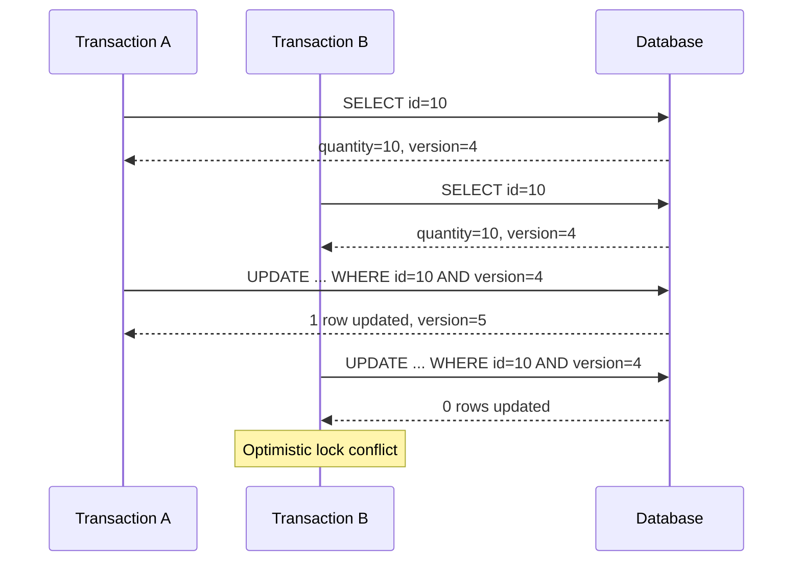

# SQL kiểm tra phiên bản và kết quả khi bản ghi đã bị sửa trong Hibernate

## 1. Vấn đề: hai transaction cùng sửa một bản ghi

Trong ứng dụng nhiều người dùng, hai transaction có thể cùng đọc một hàng dữ liệu rồi cập nhật dựa trên trạng thái mà mỗi transaction đã nhìn thấy. Nếu không phát hiện xung đột, lần ghi sau có thể ghi đè kết quả của lần ghi trước. Hiện tượng này thường được gọi là **lost update**.

Ví dụ, tồn kho ban đầu là 10:

1. Transaction A đọc `quantity = 10`.
2. Transaction B cũng đọc `quantity = 10`.
3. A giảm số lượng xuống 8 và commit.
4. B đặt số lượng thành 7 dựa trên dữ liệu cũ rồi commit.
5. Nếu không có cơ chế kiểm tra, kết quả cuối có thể là 7; cập nhật của A đã bị ghi đè.

Hibernate hỗ trợ **optimistic locking** (khóa lạc quan) bằng thuộc tính `@Version`. Mỗi lần entity được cập nhật thành công, version được thay đổi. Khi ghi, Hibernate chỉ cập nhật nếu version trong database vẫn bằng version mà transaction đã đọc.



**Kết quả:** transaction B dùng version cũ nên câu UPDATE không còn khớp. Hibernate phát hiện số dòng được cập nhật bằng 0 và báo xung đột thay vì âm thầm ghi đè dữ liệu mới.

## 2. Khai báo version bằng `@Version`

Jakarta Persistence cung cấp annotation `jakarta.persistence.Version`. Hibernate dùng field này để kiểm soát optimistic locking.

```java
import jakarta.persistence.Column;
import jakarta.persistence.Entity;
import jakarta.persistence.GeneratedValue;
import jakarta.persistence.GenerationType;
import jakarta.persistence.Id;
import jakarta.persistence.Table;
import jakarta.persistence.Version;

@Entity
@Table(name = "inventory_items")
public class InventoryItem {

    @Id
    @GeneratedValue(strategy = GenerationType.IDENTITY)
    private Long id;

    @Column(nullable = false, unique = true)
    private String sku;

    @Column(nullable = false)
    private int quantity;

    @Version
    @Column(nullable = false)
    private Long version;

    protected InventoryItem() {
    }

    public InventoryItem(String sku, int quantity) {
        this.sku = sku;
        this.quantity = quantity;
    }

    public Long getId() {
        return id;
    }

    public String getSku() {
        return sku;
    }

    public int getQuantity() {
        return quantity;
    }

    public Long getVersion() {
        return version;
    }

    public void changeQuantity(int nextQuantity) {
        if (nextQuantity < 0) {
            throw new IllegalArgumentException(
                "quantity must be non-negative"
            );
        }
        this.quantity = nextQuantity;
    }
}
```

Schema minh họa:

```sql
CREATE TABLE inventory_items (
    id BIGINT GENERATED BY DEFAULT AS IDENTITY PRIMARY KEY,
    sku VARCHAR(100) NOT NULL UNIQUE,
    quantity INTEGER NOT NULL,
    version BIGINT NOT NULL
);
```

Cú pháp identity phụ thuộc database. Dự án có thể để Hibernate sinh DDL trong môi trường thử nghiệm hoặc dùng Flyway/Liquibase để quản lý schema. Dù dùng cách nào, cột version phải tồn tại, có kiểu tương thích và không null theo chính sách của ứng dụng.

### 2.1. Kiểu dữ liệu và giá trị ban đầu

Jakarta Persistence hỗ trợ các kiểu version phổ biến như `short`/`Short`, `int`/`Integer`, `long`/`Long` và `java.sql.Timestamp`. Với ứng dụng mới, kiểu số nguyên như `Long` thường dễ hiểu và ít phụ thuộc độ chính xác đồng hồ hơn timestamp.

Giá trị ban đầu do persistence provider quản lý. Không nên giả định mọi provider/database đều bắt đầu chính xác bằng 0 hoặc 1. Nếu cần đưa version vào response, đọc giá trị sau khi entity được persist/refresh:

```java
em.persist(item);
em.flush();

Long currentVersion = item.getVersion();
```

Không gán version từ request để đặt lại phiên bản. Version client gửi lên chỉ là **expected version** dùng để kiểm tra dữ liệu còn ở trạng thái mà client đã đọc hay không. Hibernate chịu trách nhiệm tăng version.

### 2.2. Version không phải khóa chính

Version thay đổi theo các lần ghi; primary key thì định danh hàng. Không dùng version làm business identifier hoặc thành phần của `equals()/hashCode()`. Nếu hash code phụ thuộc version, một lần update có thể làm entity đổi bucket trong `HashSet`.

## 3. SQL SELECT: Hibernate đọc version cùng entity

Khi tải entity có `@Version`, Hibernate lấy cả cột version:

```sql
SELECT
    i.id,
    i.sku,
    i.quantity,
    i.version
FROM inventory_items i
WHERE i.id = ?;
```

Ví dụ database trả:

| id | sku | quantity | version |
|---:|---|---:|---:|
| 10 | SKU-10 | 10 | 4 |

Hibernate giữ version này cùng trạng thái managed entity trong persistence context:

```java
InventoryItem item = em.find(InventoryItem.class, 10L);

System.out.println(item.getVersion()); // Ví dụ: 4
```

Đó là phiên bản mà transaction đang dựa vào. Nếu transaction khác cập nhật hàng sau đó, object managed hiện tại không tự nhận version mới chỉ vì database đã đổi.

### 3.1. Persistence context giữ expected version

```text
Database lúc SELECT:
    id=10, quantity=10, version=4
                 |
                 v
Managed entity:
    quantity=10, version=4
                 |
          application sửa
                 |
                 v
Dirty state:
    quantity=8, expectedVersion=4
```

Khi flush, Hibernate gửi giá trị mới cùng điều kiện version mong đợi.

## 4. SQL UPDATE có điều kiện version

Với entity versioned, SQL UPDATE thường có dạng:

```sql
UPDATE inventory_items
SET quantity = ?,
    version = ?
WHERE id = ?
  AND version = ?;
```

Nếu A đã đọc version 4 và đặt quantity thành 8, SQL minh họa là:

```sql
UPDATE inventory_items
SET quantity = 8,
    version = 5
WHERE id = 10
  AND version = 4;
```

Nếu đúng một hàng khớp, cập nhật thành công và version mới là 5. Giá trị version mới có thể được bind hoặc được tạo bằng biểu thức SQL tùy provider/dialect; điều cốt lõi là WHERE kiểm tra version cũ và thao tác ghi tạo ra version tiếp theo.

### 4.1. Ý nghĩa affected row count

| Số dòng bị ảnh hưởng | Ý nghĩa |
|---:|---|
| 1 | ID và version đều khớp; cập nhật thành công |
| 0 | Không có hàng khớp cả primary key và version |
| Lớn hơn 1 | Không mong đợi với primary key duy nhất; cần kiểm tra mapping/SQL |

Khi UPDATE trả về 0, Hibernate biết entity không còn ở trạng thái mà câu lệnh mong đợi. Với entity versioned, đây là optimistic locking conflict hoặc stale state, chẳng hạn hàng đã bị xóa.

**Row count bằng 0 không tự phân biệt được hàng đã bị sửa hay đã bị xóa.** Nếu nghiệp vụ cần thông báo cụ thể, ứng dụng có thể đọc lại bằng transaction/context mới.

### 4.2. Vì sao kiểm tra version phải nằm trong UPDATE?

Cách làm không an toàn:

```sql
SELECT version FROM inventory_items WHERE id = 10;
-- Ứng dụng thấy version=4.

UPDATE inventory_items
SET quantity = 8
WHERE id = 10;
```

Một transaction khác có thể cập nhật sau SELECT nhưng trước UPDATE. Cách đúng là kiểm tra trong chính câu lệnh ghi:

```sql
UPDATE inventory_items
SET quantity = 8, version = 5
WHERE id = 10 AND version = 4;
```

Database kiểm tra điều kiện và cập nhật như một thao tác nguyên tử ở mức statement.

## 5. Hai transaction cùng sửa một bản ghi

Dữ liệu ban đầu:

```text
id=10, sku=SKU-10, quantity=10, version=4
```

Cả A và B đều đọc version 4. A cập nhật trước:

```sql
-- Transaction A
UPDATE inventory_items
SET quantity = 8, version = 5
WHERE id = 10 AND version = 4;
-- affected rows = 1
```

A commit. B sau đó ghi dựa trên version cũ:

```sql
-- Transaction B
UPDATE inventory_items
SET quantity = 7, version = 5
WHERE id = 10 AND version = 4;
-- affected rows = 0
```

Kết quả cuối:

```text
Database:
id=10, quantity=8, version=5

Transaction B:
optimistic locking conflict
```

B không ghi đè 8 bằng 7. Ứng dụng có thể yêu cầu người dùng tải lại hoặc hòa giải thay đổi theo quy tắc nghiệp vụ.

### 5.1. Transaction nào thắng?

Optimistic locking không ưu tiên A hay B. Transaction nào thực hiện UPDATE thành công với version hiện tại trước sẽ tăng version. Transaction còn lại dùng version cũ sẽ thất bại. Kết quả phụ thuộc thứ tự thực thi, commit và mức cô lập của database.

### 5.2. Nếu transaction đầu rollback?

Nếu A UPDATE nhưng rollback, thay đổi version trong database cũng bị rollback. B có thể cập nhật thành công nếu version cũ vẫn khớp tại thời điểm B ghi.

Phân biệt ba sự kiện:

- SQL UPDATE đã thực thi trong transaction.
- Transaction commit thành công.
- Java object đã được đồng bộ trạng thái mới.

SQL xuất hiện trong log không chứng minh dữ liệu đã commit.

## 6. Khi nào Hibernate báo optimistic lock conflict?

Conflict thường được phát hiện khi Hibernate thực thi UPDATE/DELETE có điều kiện version. Thời điểm có thể là:

- `em.flush()` hoặc `session.flush()` tường minh.
- Tự động flush trước một query cần đồng bộ pending changes.
- `commit()` khi transaction kích hoạt flush.
- Một thao tác ghi sớm do ID generator hoặc provider.

Vì vậy, setter không nhất thiết ném exception:

```java
item.changeQuantity(7);

// Chỉ đổi Java state; conflict có thể chưa được phát hiện.
em.flush(); // Exception có thể xuất hiện tại đây.
```

### 6.1. Các exception thường gặp

Ở tầng Jakarta Persistence:

```java
jakarta.persistence.OptimisticLockException
```

Ở tầng Hibernate có các exception stale state, chẳng hạn:

```java
org.hibernate.StaleObjectStateException
org.hibernate.StaleStateException
```

Ở tầng Spring có thể gặp exception được chuyển đổi như `ObjectOptimisticLockingFailureException`. Loại exception thực tế phụ thuộc API, provider và transaction manager. Khi dùng abstraction JPA/Spring, xử lý ở đúng tầng abstraction thay vì chỉ bắt một implementation exception duy nhất.

### 6.2. Không tiếp tục transaction sau conflict

Sau optimistic lock exception trong flush/commit, transaction thường bị đánh dấu rollback-only hoặc không còn phù hợp để tiếp tục. Persistence context có thể chứa state không còn đồng bộ với database.

Không nên bắt exception rồi tiếp tục sửa entity trong cùng transaction như thể thao tác vừa thất bại không để lại hậu quả. Hãy rollback, kết thúc context/đơn vị công việc và nếu cần thì tải lại dữ liệu trong transaction mới.

## 7. Ví dụ service cập nhật bằng entity managed

```java
import jakarta.persistence.EntityManager;
import jakarta.persistence.EntityManagerFactory;
import jakarta.persistence.EntityTransaction;

public class InventoryService {

    private final EntityManagerFactory emf;

    public InventoryService(EntityManagerFactory emf) {
        this.emf = emf;
    }

    public void changeQuantity(Long id, int quantity) {
        EntityManager em = emf.createEntityManager();
        EntityTransaction tx = em.getTransaction();

        try {
            tx.begin();

            InventoryItem item =
                    em.find(InventoryItem.class, id);

            if (item == null) {
                throw new IllegalArgumentException(
                        "Inventory item not found"
                );
            }

            item.changeQuantity(quantity);

            // Conflict có thể được phát hiện ở đây.
            em.flush();

            tx.commit();
        } catch (RuntimeException ex) {
            if (tx.isActive()) {
                tx.rollback();
            }
            throw ex;
        } finally {
            em.close();
        }
    }
}
```

Entity được tải trong cùng EntityManager là managed. Không cần gọi `merge` hay `persist` cho entity đó; Hibernate dùng dirty checking và version đã đọc để tạo UPDATE.

Một lớp gọi bên ngoài có thể chuyển conflict thành thông báo nghiệp vụ:

```java
try {
    inventoryService.changeQuantity(itemId, requestedQuantity);
} catch (OptimisticLockException ex) {
    // Thông báo: dữ liệu đã được cập nhật bởi thao tác khác.
}
```

Không hiển thị SQL, tên bảng hoặc stack trace cho người dùng cuối.

## 8. Client gửi expected version

Một ứng dụng web thường có khoảng thời gian dài giữa lúc tải form và lúc nhấn Save. Trong khoảng đó, người khác có thể đã sửa bản ghi.

Response ban đầu:

```json
{
  "id": 10,
  "sku": "SKU-10",
  "quantity": 10,
  "version": 4
}
```

Client giữ version 4. Người khác cập nhật hàng, database tăng version lên 5. Client cũ gửi yêu cầu dựa trên version 4.

DTO có thể mang expected version:

```java
public record ChangeQuantityRequest(
        int quantity,
        long expectedVersion
) {
}
```

Service có thể kiểm tra sớm:

```java
@Transactional
public void changeQuantity(
        Long id,
        ChangeQuantityRequest request) {

    InventoryItem item = em.find(InventoryItem.class, id);

    if (item == null) {
        throw new IllegalArgumentException("Not found");
    }

    if (!item.getVersion().equals(request.expectedVersion())) {
        throw new StaleClientDataException(
                "The record has changed"
        );
    }

    item.changeQuantity(request.quantity());
}
```

Kiểm tra Java giúp báo lỗi sớm, nhưng **không thay thế WHERE version trong UPDATE**. Transaction khác vẫn có thể cập nhật sau phép so sánh Java và trước flush. Hibernate cần kiểm tra version nguyên tử ở database.

### 8.1. HTTP ETag và If-Match

REST API có thể dùng version làm ETag:

```http
GET /api/inventory/10

ETag: "4"
```

Client gửi:

```http
PUT /api/inventory/10
If-Match: "4"
Content-Type: application/json

{
  "quantity": 7
}
```

Nếu ETag không còn đúng, API có thể trả `412 Precondition Failed`. Một API khác có thể dùng `409 Conflict` cho xung đột trạng thái theo hợp đồng riêng.

- `412` phù hợp khi điều kiện HTTP `If-Match` không được đáp ứng.
- `409` phù hợp khi thao tác xung đột với trạng thái hiện tại theo ngữ nghĩa ứng dụng.

Không tự động dùng một status code cho mọi optimistic lock exception mà không xét hợp đồng HTTP.

## 9. Detached entity và `merge()`

Entity detached giữ version tại thời điểm nó được tải. Nếu hàng đã được transaction khác cập nhật, version trong object detached đã cũ.

```text
Detached object:
quantity=10, version=4

Database sau cập nhật khác:
quantity=8, version=5
```

Gọi `merge` không bỏ qua optimistic locking:

```java
detached.changeQuantity(7);

InventoryItem managed = em.merge(detached);
```

Hibernate/JPA có thể phát hiện version cũ trong lúc merge, flush hoặc commit tùy tình huống. Merge không phải lệnh “ghi đè bất kể dữ liệu hiện tại”.

`merge` sao chép state vào managed instance và trả về instance đó. Nguồn detached không tự trở thành managed:

```java
InventoryItem managed = em.merge(detached);

// Tiếp tục dùng managed trong context hiện tại.
managed.changeQuantity(6);
```

Nếu có conflict, rollback và tải lại state mới. Không phát lại snapshot cũ một cách mù quáng.

### 9.1. DTO + ID thường dễ kiểm soát hơn

Một object detached có thể chứa nhiều field và association mà client không được phép sửa. Merge cả graph đòi hỏi kiểm soát state cũ, cascade, quyền cập nhật và version.

Một quy trình rõ ràng hơn:

1. Nhận ID, expected version và các field được phép thay đổi.
2. Tải entity managed trong transaction.
3. Kiểm tra quyền và expected version.
4. Chỉ cập nhật field hợp lệ.
5. Để Hibernate kiểm tra version lần cuối khi flush.
6. Trả conflict nếu dữ liệu đã đổi.

## 10. DELETE cũng kiểm tra version

Khi xóa entity versioned, Hibernate có thể tạo:

```sql
DELETE FROM inventory_items
WHERE id = ?
  AND version = ?;
```

Nếu entity được tải với version 4 nhưng transaction khác đã cập nhật thành version 5, điều kiện DELETE không khớp. Số dòng bị xóa bằng 0 và Hibernate phát hiện stale state.

Ví dụ:

```java
InventoryItem item = em.find(InventoryItem.class, id);

// Một transaction khác cập nhật sau khi item được tải.
em.remove(item);
em.flush(); // DELETE có thể conflict do version cũ.
```

Cơ chế này ngăn một thao tác xóa dựa trên snapshot cũ xóa bản ghi đã thay đổi.

## 11. Khi nào version tăng?

Với entity versioned, Hibernate quản lý version khi có cập nhật cần ghi:

```java
InventoryItem item = em.find(InventoryItem.class, id);
item.changeQuantity(8);
em.flush();
```

Nếu không có dirty change:

```java
InventoryItem item = em.find(InventoryItem.class, id);
item.changeQuantity(item.getQuantity());
em.flush();
```

Hibernate thường không cần UPDATE và version không nhất thiết tăng. Nhiều thay đổi trước một flush có thể được gom thành một UPDATE; nếu có flush trung gian, version có thể tăng qua nhiều lần ghi.

Không dùng `@Version` làm timestamp hoặc business event counter. Sau rollback, Java object có thể vẫn giữ version đã được gán trong lúc flush, trong khi database đã rollback. Sau lỗi, kết thúc context và tải lại thay vì tiếp tục dựa vào object cũ.

## 12. Bulk UPDATE/DELETE là trường hợp đặc biệt

JPQL bulk DML thao tác trực tiếp trên database, không đi qua dirty checking từng entity. Ví dụ:

```java
int count = em.createQuery(
        """
        update InventoryItem i
        set i.quantity = :quantity
        where i.sku = :sku
        """
    )
    .setParameter("quantity", 0)
    .setParameter("sku", "SKU-10")
    .executeUpdate();
```

Bulk update chuẩn JPA **không tự động áp dụng optimistic locking semantics cho từng entity versioned** như entity UPDATE thông thường. Nó cũng không tự đồng bộ managed instances đã có trong persistence context.

### 12.1. Tăng version tường minh

Có thể tăng version trong bulk JPQL:

```java
int updated = em.createQuery(
        """
        update InventoryItem i
        set i.quantity = :quantity,
            i.version = i.version + 1
        where i.sku = :sku
        """
    )
    .setParameter("quantity", 0)
    .setParameter("sku", "SKU-10")
    .executeUpdate();
```

Đoạn này tăng version cho các hàng phù hợp, nhưng không kiểm tra một expected version cụ thể. Nếu cần compare-and-swap:

```java
int updated = em.createQuery(
        """
        update InventoryItem i
        set i.quantity = :quantity,
            i.version = i.version + 1
        where i.id = :id
          and i.version = :expectedVersion
        """
    )
    .setParameter("quantity", requestedQuantity)
    .setParameter("id", id)
    .setParameter("expectedVersion", expectedVersion)
    .executeUpdate();

if (updated == 0) {
    throw new StaleClientDataException(
        "The item changed or was deleted"
    );
}
```

Đây là thao tác nguyên tử dựa trên ID và expected version. Cần xử lý context/cache vì bulk DML không cập nhật managed entity đã nạp.

### 12.2. Hibernate HQL `update versioned`

Hibernate có extension HQL:

```java
int updated = session.createMutationQuery(
        "update versioned InventoryItem i "
      + "set i.quantity = :quantity "
      + "where i.sku = :sku"
    )
    .setParameter("quantity", 0)
    .setParameter("sku", "SKU-10")
    .executeUpdate();
```

`update versioned` là Hibernate-specific, không phải JPQL portable. Nó tăng version trong bulk update nhưng không tự tạo expected-version check theo token client. Nếu cần kiểm tra version cụ thể, thêm điều kiện WHERE rõ ràng.

Sau bulk DML, cân nhắc flush pending changes trước, rồi clear/refresh/reload các entity liên quan. Không gọi `clear()` nếu còn thay đổi chưa flush mà bạn cần giữ.

## 13. Lock mode optimistic và force increment

JPA cung cấp lock mode:

- `LockModeType.OPTIMISTIC`: yêu cầu provider kiểm tra version theo semantics optimistic lock, kể cả trong use case chỉ đọc.
- `LockModeType.OPTIMISTIC_FORCE_INCREMENT`: yêu cầu tăng version, hữu ích khi cần invalidating snapshot cũ dù không thay đổi field thông thường.

Ví dụ:

```java
InventoryItem item = em.find(
        InventoryItem.class,
        id,
        LockModeType.OPTIMISTIC
);
```

Hoặc:

```java
InventoryItem item = em.find(
        InventoryItem.class,
        id,
        LockModeType.OPTIMISTIC_FORCE_INCREMENT
);
```

Có thể áp dụng trên entity managed:

```java
em.lock(item, LockModeType.OPTIMISTIC_FORCE_INCREMENT);
```

Provider có thể thực hiện kiểm tra/tăng version vào thời điểm thích hợp, thường gắn với flush/commit. Force increment biến thao tác đọc thành thao tác có ảnh hưởng version; không bật tùy tiện cho mọi query.

## 14. Optimistic và pessimistic locking

Optimistic locking phù hợp khi xung đột tương đối ít và transaction ngắn. Nó không giữ row lock trong suốt thời gian người dùng mở form.

Pessimistic locking yêu cầu database lock sớm hơn, ví dụ:

```java
InventoryItem item = em.find(
        InventoryItem.class,
        id,
        LockModeType.PESSIMISTIC_WRITE
);
```

Database có thể dùng câu SELECT với row lock như `SELECT ... FOR UPDATE` tùy dialect.

| Tiêu chí | Optimistic (`@Version`) | Pessimistic |
|---|---|---|
| Cách hoạt động | So version khi ghi | Database lock theo lock mode |
| Khi conflict | Báo stale update | Transaction khác có thể chờ/timeout |
| Phù hợp | Đọc nhiều, xung đột ít, transaction ngắn | Tranh chấp cao hoặc cần tuần tự hóa thao tác |
| Rủi ro | Cần xử lý retry/conflict | Deadlock, timeout, giảm throughput |

Không chọn pessimistic chỉ để khỏi viết xử lý conflict; lock lâu có thể làm hệ thống chậm.

## 15. Transaction isolation và optimistic locking

Hai cơ chế giải quyết những khía cạnh khác nhau:

- **Isolation** là thuộc tính của transaction/database, quy định cách các giao dịch quan sát dữ liệu và tương tác đồng thời.
- **Optimistic locking** kiểm tra version ở thao tác ghi để phát hiện state cũ.

`@Version` không thay thế transaction. Ứng dụng vẫn cần transaction để bảo đảm atomicity và commit/rollback.

Tùy database/isolation level, một UPDATE cạnh tranh có thể chờ row lock, gặp deadlock, serialization failure hoặc kết quả row count không khớp. Không khẳng định optimistic locking luôn thất bại tức thì và không bao giờ block.

## 16. Writer ngoài Hibernate phải cập nhật version

`@Version` chỉ phát hiện được thay đổi nếu mọi đường ghi liên quan tuân thủ chính sách version.

Giả sử Hibernate đã đọc version 4. Một script SQL ngoài ứng dụng sửa quantity nhưng không tăng version:

```sql
UPDATE inventory_items
SET quantity = 6
WHERE id = 10;
```

Database vẫn giữ version 4. Hibernate cũ sau đó có thể gửi UPDATE với điều kiện version 4 và ghi đè dữ liệu mà không phát hiện writer ngoài.

Nếu writer ngoài tham gia optimistic locking, nó phải tăng version:

```sql
UPDATE inventory_items
SET quantity = 6,
    version = version + 1
WHERE id = 10;
```

Nếu request có expected version, điều kiện cũng phải có version:

```sql
UPDATE inventory_items
SET quantity = 6,
    version = version + 1
WHERE id = 10
  AND version = 4;
```

Kiểm tra row count; bằng 0 nghĩa là conflict hoặc row không còn tồn tại.

Không để Hibernate và trigger cùng tăng version tùy tiện. Nếu cả hai cùng sở hữu cột version, entity có thể giữ giá trị khác database. Thông thường để Hibernate quản lý `@Version` là đơn giản nhất.

## 17. Association và aggregate version

Một entity có thể chứa collection:

```java
@OneToMany(mappedBy = "order")
private List<OrderLine> lines = new ArrayList<>();
```

Thay đổi child hoặc collection không nhất thiết làm version của parent tăng theo cách developer mong đợi. Nếu nghiệp vụ cần bảo vệ toàn bộ aggregate, hãy xác định những thay đổi nào phải invalidating version root.

Các lựa chọn gồm:

- Version trên entity thực sự được cập nhật.
- Cập nhật trạng thái versioned của root theo quy tắc domain.
- Dùng `OPTIMISTIC_FORCE_INCREMENT` khi một thao tác aggregate cần invalidating snapshot cũ.
- Đặt version riêng trên child nếu child có lifecycle/update độc lập.

Không giả định một `@Version` ở parent tự bảo vệ mọi hàng con.

## 18. Retry: đọc lại rồi tính lại ý định

Sau conflict, retry có thể hữu ích nhưng không được phát lại snapshot cũ một cách mù quáng.

Quy trình:

1. Rollback và kết thúc context/transaction bị conflict.
2. Tạo transaction mới.
3. Đọc lại entity và version mới nhất.
4. Xác định ý định người dùng có còn hợp lệ không.
5. Tính lại kết quả hoặc yêu cầu người dùng giải quyết.
6. Commit và giới hạn số lần retry.

Ví dụ ý định “giảm thêm 2 sản phẩm” có thể được tính lại trên quantity mới. Nhưng ý định “đặt chính xác số lượng thành 7” có thể ghi đè quyết định của người khác và cần xác nhận.

Retry cần tính đến idempotency. Nếu thao tác có side effect ngoài database như gửi email, thanh toán hoặc phát message, không tự chạy lại toàn bộ side effect khi chưa có cơ chế chống thực hiện trùng.

## 19. Test hai transaction để tái hiện conflict

Khung test minh họa, giả định đã có một row `InventoryItem`:

```java
EntityManager emA = emf.createEntityManager();
EntityManager emB = emf.createEntityManager();

EntityTransaction txA = emA.getTransaction();
EntityTransaction txB = emB.getTransaction();

try {
    txA.begin();
    txB.begin();

    InventoryItem a =
            emA.find(InventoryItem.class, itemId);
    InventoryItem b =
            emB.find(InventoryItem.class, itemId);

    System.out.println(a.getVersion());
    System.out.println(b.getVersion());
    // Cùng version ban đầu, ví dụ 4.

    a.changeQuantity(8);
    emA.flush();
    txA.commit();

    b.changeQuantity(7);

    try {
        emB.flush();
        txB.commit();
        throw new AssertionError(
            "Expected optimistic locking conflict"
        );
    } catch (RuntimeException ex) {
        if (txB.isActive()) {
            txB.rollback();
        }
        // Phân loại root cause theo provider/database.
    }
} finally {
    if (emB.isOpen()) {
        emB.close();
    }
    if (emA.isOpen()) {
        emA.close();
    }
}
```

Database/isolation cụ thể có thể khiến transaction B chờ hoặc phát exception ở tầng database. Test integration nên chạy trên database/dialect ứng dụng thật và phân loại root cause thay vì bắt mọi RuntimeException rồi coi là optimistic lock.

Sau test, đọc lại trong EntityManager mới:

```java
EntityManager verify = emf.createEntityManager();

try {
    InventoryItem current =
            verify.find(InventoryItem.class, itemId);

    System.out.println(current.getQuantity()); // 8
    System.out.println(current.getVersion());  // Version mới
} finally {
    verify.close();
}
```

Context mới giúp xác nhận kết quả database, tránh nhầm Java object B cũ vẫn giữ quantity 7 trong bộ nhớ.

## 20. Đọc SQL log để chẩn đoán

Có thể bật SQL logging:

```xml
<property name="hibernate.show_sql" value="true"/>
<property name="hibernate.format_sql" value="true"/>
<property name="hibernate.use_sql_comments" value="true"/>
```

Với Hibernate 6.x, logger bind parameter thường dùng category `org.hibernate.orm.jdbc.bind` ở mức TRACE tùy backend logging. Tránh log dữ liệu nhạy cảm trong production.

Cần đối chiếu:

1. Version được SELECT lúc tải entity.
2. Version được bind trong WHERE của UPDATE/DELETE.
3. Version hiện tại trong database sau transaction thắng.
4. Số dòng JDBC báo đã cập nhật.
5. Exception gốc và thời điểm xuất hiện (flush/commit).
6. Transaction nào commit, transaction nào rollback.

Không chỉ nhìn SQL mà thiếu bind values. Nếu không biết version thực tế Hibernate gửi, chưa thể giải thích đầy đủ conflict.

## 21. Bảng phân biệt các cơ chế

| Cơ chế | Cách hoạt động | Khi phù hợp |
|---|---|---|
| `@Version` | So version cũ trong WHERE khi entity UPDATE/DELETE | Entity đọc nhiều, xung đột ít |
| JPQL compare-and-swap | WHERE có ID + expected version và tăng version | Thao tác nguyên tử theo token cụ thể |
| Hibernate `update versioned` | Bulk update tăng version theo extension | Có chủ đích dùng HQL-specific DML |
| `OPTIMISTIC` | Kiểm tra version ngay cả trong use case đọc | Quyết định đọc cần snapshot còn hợp lệ |
| `OPTIMISTIC_FORCE_INCREMENT` | Yêu cầu tăng version | Cần invalidating snapshot cũ |
| `PESSIMISTIC_WRITE` | Database lock hàng | Tranh chấp cao, cần tuần tự hóa |
| Transaction isolation | Kiểm soát khả năng quan sát/lịch thực thi | Bảo vệ tính nhất quán rộng hơn entity |

## 22. Những nhầm lẫn thường gặp

| Nhầm lẫn | Thực tế |
|---|---|
| `@Version` là khóa chính | Version chỉ theo dõi lần cập nhật; ID vẫn định danh entity |
| Setter lập tức kiểm tra version | Conflict thường xuất hiện khi UPDATE/DELETE thực thi |
| UPDATE row count 0 luôn có nghĩa version sai | Row có thể đã bị sửa hoặc bị xóa; điều kiện khác cũng có thể ảnh hưởng |
| `merge` bỏ qua version cũ | Merge vẫn chịu optimistic locking |
| Bắt exception rồi tiếp tục transaction cũ | Transaction/context có thể đã rollback-only hoặc không còn an toàn |
| Bulk JPQL tự áp dụng version như entity update | Bulk DML cần chính sách version riêng |
| SQL ngoài Hibernate luôn được phát hiện | Nếu không tăng version, stale ORM update có thể không phát hiện |
| `@Version` thay transaction isolation | Hai cơ chế bổ sung nhau |
| Pessimistic lock luôn tốt hơn | Có thể gây chờ, deadlock và giảm throughput |
| Retry cùng detached snapshot cũ sẽ giải quyết conflict | Phải đọc lại và tính lại ý định |
| Version parent bảo vệ mọi child | Phải xác định aggregate/version policy rõ |
| Version phải tăng mỗi lần gọi setter | Chỉ tăng khi provider thực hiện cập nhật/version operation phù hợp |

## 23. Quy trình xử lý khi bản ghi đã bị sửa

Khi Hibernate báo optimistic lock conflict:

1. **Dừng thao tác hiện tại:** không tiếp tục flush trong transaction đã conflict.
2. **Rollback:** kết thúc transaction ở trạng thái rõ ràng.
3. **Kết thúc persistence context lỗi:** không tái sử dụng managed graph cũ.
4. **Đọc lại dữ liệu mới nhất:** dùng transaction/context mới.
5. **Đối chiếu ý định:** xác định thay đổi còn hợp lệ trên state mới không.
6. **Chọn hành vi:** tự hòa giải theo domain, yêu cầu người dùng xác nhận hoặc trả conflict.
7. **Retry có giới hạn:** chỉ khi thao tác có thể tính lại và bảo đảm idempotency.
8. **Ghi log có correlation ID:** lưu thông tin chẩn đoán phù hợp, không lộ dữ liệu nhạy cảm.

Optimistic locking phát hiện xung đột; **nó không tự quyết định cách hòa giải nghiệp vụ**.

## 24. Câu hỏi tự kiểm tra

**1. `@Version` dùng để làm gì?**

Theo dõi phiên bản entity để phát hiện cập nhật dựa trên state cũ.

**2. Hibernate đọc version ở đâu?**

Trong SELECT tải entity; version được giữ cùng managed state làm expected version khi ghi.

**3. SQL UPDATE có version thường trông thế nào?**

```sql
UPDATE inventory_items
SET quantity = ?, version = ?
WHERE id = ? AND version = ?;
```

**4. Vì sao affected rows bằng 0?**

Không có hàng khớp ID và version mong đợi; row có thể đã đổi version hoặc đã bị xóa.

**5. Conflict có xuất hiện ngay khi setter chạy không?**

Không nhất thiết. Thường phát hiện tại flush hoặc commit.

**6. `merge` có ghi đè bất chấp version cũ không?**

Không. Detached snapshot cũ vẫn có thể conflict.

**7. Có nên tiếp tục transaction sau optimistic lock exception?**

Thông thường không. Rollback và kết thúc đơn vị công việc/context bị lỗi.

**8. Bulk JPQL có tự kiểm tra version không?**

Không theo semantics portable mặc định. Cần điều kiện/increment tường minh hoặc extension Hibernate có chủ đích.

**9. Writer SQL ngoài Hibernate có cần tăng version không?**

Có, nếu muốn Hibernate phát hiện writer đó đã sửa hàng.

**10. Optimistic locking có thay transaction isolation không?**

Không. Nó bổ sung kiểm tra version; database vẫn quản lý atomicity, isolation, commit và rollback.

## 25. Ghi nhớ

- `@Version` cho Hibernate biết phiên bản entity đã đọc và cần kiểm tra khi cập nhật/xóa.
- Hibernate thường tạo UPDATE/DELETE có điều kiện **primary key + version cũ**.
- Nếu một hàng được cập nhật, thao tác thành công và version mới được ghi; nếu **0 hàng**, entity stale hoặc row không còn tồn tại, Hibernate báo conflict.
- Conflict thường được phát hiện tại **flush/commit**, không nhất thiết ở setter.
- Sau conflict, rollback và kết thúc context lỗi; tải lại dữ liệu trong transaction mới.
- `merge` không bỏ qua version; dùng managed instance được trả về và không phát lại snapshot cũ một cách mù quáng.
- Bulk JPQL/native SQL và writer ngoài Hibernate cần chính sách version riêng.
- Retry chỉ an toàn khi đọc lại và tính lại ý định nghiệp vụ, có giới hạn và bảo đảm idempotency.
- Optimistic locking khác transaction isolation và pessimistic locking; chọn theo mức tranh chấp và yêu cầu domain.

### Tài liệu tham khảo

- [Jakarta Persistence 3.1 Specification — Optimistic locking và version attributes](https://jakarta.ee/specifications/persistence/3.1/jakarta-persistence-spec-3.1)
- [Jakarta Persistence API — `Version`](https://jakarta.ee/specifications/persistence/3.1/apidocs/jakarta.persistence/jakarta/persistence/Version.html)
- [Jakarta Persistence API — `LockModeType`](https://jakarta.ee/specifications/persistence/3.1/apidocs/jakarta.persistence/jakarta/persistence/LockModeType.html)
- [Hibernate ORM 6.6 User Guide — Locking](https://docs.jboss.org/hibernate/orm/6.6/userguide/html_single/Hibernate_User_Guide.html#locking)
- [Hibernate ORM 6.6 JavaDoc — `OptimisticLocking`](https://docs.jboss.org/hibernate/orm/6.6/javadocs/org/hibernate/annotations/OptimisticLocking.html)

