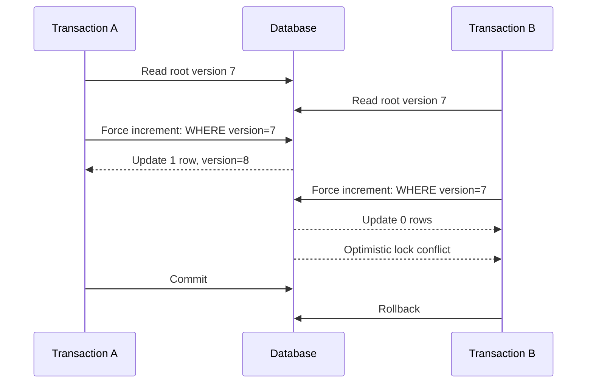

# Khóa lạc quan với yêu cầu tăng phiên bản chủ động trong Hibernate

Trong Hibernate, **khóa lạc quan (*optimistic locking*)** giúp phát hiện hai transaction cùng sửa một dữ liệu dựa trên phiên bản cũ. Cơ chế phổ biến là khai báo thuộc tính `@Version`: mỗi lần entity được cập nhật thành công, Hibernate kiểm tra version hiện tại trong database rồi tăng version để những transaction khác nhận ra dữ liệu đã đổi.

Có một tình huống đặc biệt: một use case cần báo cho các transaction khác biết rằng **aggregate hoặc entity đã có thay đổi về mặt nghiệp vụ, dù các thuộc tính thông thường của entity không đổi**. Ví dụ, một `PurchaseOrder` có danh sách `OrderLine`; transaction chỉ thêm một dòng con hoặc cập nhật một entity liên quan, trong khi hàng cha không có field scalar nào thay đổi. Nếu muốn version của root cũng tham gia phát hiện xung đột, JPA cung cấp chế độ khóa **`LockModeType.OPTIMISTIC_FORCE_INCREMENT`**.

Chế độ này yêu cầu provider tăng version của entity được khóa trong transaction, kể cả khi entity không có thay đổi thông thường cần ghi. Nó vẫn là **khóa lạc quan**: không giữ một row lock để chặn transaction khác như `PESSIMISTIC_WRITE`; xung đột được phát hiện bằng kiểm tra version khi provider thực hiện thao tác tương ứng.

Bài học giải thích `@Version`, khác biệt giữa `OPTIMISTIC` và `OPTIMISTIC_FORCE_INCREMENT`, cách dùng trong JPA/Hibernate và Spring Data JPA, cách phối hợp với aggregate root, thời điểm version thực sự tăng, cách xử lý conflict và những giới hạn cần hiểu trước khi áp dụng.

## 1. Ôn lại khóa lạc quan và thuộc tính `@Version`

Khóa lạc quan giả định xung đột ghi không xảy ra thường xuyên. Thay vì khóa hàng ngay từ đầu, Hibernate cho phép nhiều transaction đọc cùng một phiên bản rồi kiểm tra xem dữ liệu có còn đúng phiên bản khi ghi hay không.

Một entity đơn giản:

```java
import jakarta.persistence.Column;
import jakarta.persistence.Entity;
import jakarta.persistence.Id;
import jakarta.persistence.Table;
import jakarta.persistence.Version;

@Entity
@Table(name = "inventory_items")
public class InventoryItem {

    @Id
    private Long id;

    @Column(nullable = false)
    private String name;

    @Column(nullable = false)
    private int availableQuantity;

    @Version
    private Long version;

    protected InventoryItem() {}

    public InventoryItem(Long id, String name, int quantity) {
        this.id = id;
        this.name = name;
        this.availableQuantity = quantity;
    }

    public Long getId() {
        return id;
    }

    public Long getVersion() {
        return version;
    }

    public int getAvailableQuantity() {
        return availableQuantity;
    }

    public void reserve(int quantity) {
        if (quantity <= 0) {
            throw new IllegalArgumentException(
                "Quantity phải lớn hơn 0");
        }
        if (availableQuantity < quantity) {
            throw new IllegalStateException("Không đủ tồn kho");
        }
        availableQuantity -= quantity;
    }
}
```

Cột database tương ứng:

```sql
CREATE TABLE inventory_items (
    id BIGINT PRIMARY KEY,
    name VARCHAR(150) NOT NULL,
    available_quantity INTEGER NOT NULL,
    version BIGINT NOT NULL
);
```

`@Version` đánh dấu thuộc tính mà provider dùng để kiểm soát optimistic locking. Kiểu version phải thuộc các kiểu được Jakarta Persistence/provider hỗ trợ, thường là số nguyên hoặc timestamp phù hợp. Ví dụ dùng `Long`.

**Không tự tăng hoặc gán lại trường version trong business code.** Hibernate/JPA quản lý giá trị này. Ứng dụng có thể đọc version để hiển thị hoặc đưa vào API concurrency token, nhưng không được tự sửa field như một thuộc tính thông thường.

### Hibernate sinh SQL kiểm tra version thế nào?

Giả sử database đang có:

```text
id = 10
available_quantity = 8
version = 4
```

Một transaction tải entity, trừ số lượng và flush. SQL minh họa:

```sql
UPDATE inventory_items
SET available_quantity = 5,
    version = 5
WHERE id = 10
  AND version = 4;
```

Điều kiện `WHERE version = 4` bảo đảm update chỉ thành công nếu hàng vẫn ở phiên bản mà transaction đã đọc. Nếu transaction khác đã cập nhật trước và version trở thành 5, câu lệnh này không cập nhật được hàng như mong đợi; provider nhận diện xung đột optimistic locking và thông báo lỗi phù hợp.

Hình dạng SQL thực tế có thể khác theo dialect, kiểu version, batch và Hibernate version, nhưng nguyên tắc là **so sánh version cũ và ghi version mới một cách nguyên tử**.

## 2. Vì sao cần tăng version chủ động?

Trong tình huống thông thường, một entity thay đổi field persistent thì Hibernate tự tăng version khi cập nhật. Nhưng không phải mọi thay đổi trong mô hình đối tượng đều nhất thiết làm thay đổi row version của entity mà nghiệp vụ coi là **aggregate root**.

Ví dụ mô hình đơn hàng:

```text
PurchaseOrder (root, version = 7)
    ├── OrderLine #1 (quantity = 2)
    └── OrderLine #2 (quantity = 1)
```

Hai transaction cùng tải đơn hàng version 7:

- Transaction A thêm một `OrderLine` mới.
- Transaction B thay đổi một `OrderLine` hiện có.
- Các thao tác ghi tập trung vào bảng con; tùy mapping và ownership, row của `purchase_orders` có thể không được cập nhật như một entity scalar thông thường.

Nếu root version không tăng, một transaction khác đang dựa trên version 7 của root có thể không nhận được tín hiệu rằng aggregate đã thay đổi thông qua các thao tác con.

Đây là lúc có thể yêu cầu **force increment** trên root:

```text
Transaction A:
    Đọc PurchaseOrder version 7
    Yêu cầu OPTIMISTIC_FORCE_INCREMENT
    Thay đổi OrderLine
    Root version được tăng theo cơ chế provider
    Commit

Transaction B:
    Cũng dựa trên PurchaseOrder version 7
    Yêu cầu OPTIMISTIC_FORCE_INCREMENT
    Một trong các transaction không thể xác nhận version cũ
    -> Optimistic locking conflict
```

Ý nghĩa nghiệp vụ: **mọi thao tác làm thay đổi aggregate đều tham gia cùng một giao thức version trên root**.

Không nên mặc định rằng Hibernate luôn tăng version của parent mỗi khi bất kỳ child entity nào đổi. Hành vi versioning còn phụ thuộc mapping, ownership và loại thay đổi. Nếu invariant yêu cầu root version phản ánh thay đổi aggregate, hãy thể hiện rõ chính sách đó và kiểm tra nó trong mapping/thao tác thực tế.

## 3. Phân biệt `OPTIMISTIC` và `OPTIMISTIC_FORCE_INCREMENT`

JPA cung cấp hai lock mode lạc quan thường được so sánh:

- `LockModeType.OPTIMISTIC`: yêu cầu kiểm tra optimistic lock cho entity versioned trong transaction. Nếu version thay đổi theo cách gây xung đột, provider phải báo lỗi. Mode này **không yêu cầu tăng version chỉ vì đã lấy lock**.
- `LockModeType.OPTIMISTIC_FORCE_INCREMENT`: yêu cầu kiểm tra optimistic lock và **tăng version của entity** trong transaction, kể cả khi không có thay đổi state thông thường cần ghi.

| Tiêu chí | `OPTIMISTIC` | `OPTIMISTIC_FORCE_INCREMENT` |
| --- | --- | --- |
| Kiểm tra version | Có | Có |
| Chủ động tăng version khi entity không dirty | Không yêu cầu | Có |
| Dùng để xác nhận entity không bị thay đổi trong transaction | Có | Có, đồng thời thay đổi version |
| Phù hợp khi cần phát tín hiệu thay đổi ở root | Không đủ nếu cần version tăng | Phù hợp |
| Tạo row lock để chặn transaction khác ngay từ đầu | Không | Không |
| Có thể phát sinh optimistic lock exception | Có | Có |
| Có thể tăng số lần ghi/version conflict | Không chỉ vì lock mode | Có |

### Ví dụ trực quan

Giả sử một transaction chỉ kiểm tra trạng thái đơn hàng, không thay đổi entity:

```java
PurchaseOrder order = em.find(PurchaseOrder.class, orderId);

em.lock(order, LockModeType.OPTIMISTIC);
// Chỉ yêu cầu kiểm tra version theo optimistic locking.
```

Nếu muốn **tăng version dù không sửa field nào**:

```java
PurchaseOrder order = em.find(PurchaseOrder.class, orderId);

em.lock(order, LockModeType.OPTIMISTIC_FORCE_INCREMENT);
// Provider được yêu cầu force version increment.
```

Hai đoạn code có ý nghĩa khác nhau. Không thay `OPTIMISTIC_FORCE_INCREMENT` bằng `OPTIMISTIC` nếu nghiệp vụ phụ thuộc vào việc version root phải đổi.

### Khóa lạc quan khác khóa bi quan

`OPTIMISTIC_FORCE_INCREMENT` không tương đương `PESSIMISTIC_FORCE_INCREMENT` hoặc `PESSIMISTIC_WRITE`.

| Lock mode | Cơ chế chính |
| --- | --- |
| `OPTIMISTIC` | Kiểm tra version, không yêu cầu tăng version chỉ vì khóa |
| `OPTIMISTIC_FORCE_INCREMENT` | Kiểm tra version và yêu cầu tăng version |
| `PESSIMISTIC_READ` | Yêu cầu khóa bi quan đọc theo khả năng DB/provider |
| `PESSIMISTIC_WRITE` | Yêu cầu khóa bi quan ghi, thường dựa trên row lock |
| `PESSIMISTIC_FORCE_INCREMENT` | Khóa bi quan và yêu cầu tăng version |

Chọn optimistic force increment khi muốn phát hiện xung đột mà không chủ động giữ row lock trong suốt công việc. Nếu cần transaction khác bị chặn ngay khi tranh chấp, xem xét pessimistic locking và chi phí lock/timeout/deadlock.

## 4. Dùng `EntityManager.lock()` để force increment

Ví dụ JPA:

```java
import jakarta.persistence.EntityManager;
import jakarta.persistence.LockModeType;
import jakarta.persistence.PersistenceContext;

import org.springframework.stereotype.Service;
import org.springframework.transaction.annotation.Transactional;

@Service
public class OrderCommandService {

    @PersistenceContext
    private EntityManager em;

    @Transactional
    public void recordAggregateChange(Long orderId) {
        PurchaseOrder order =
            em.find(PurchaseOrder.class, orderId);

        if (order == null) {
            throw new IllegalArgumentException(
                "Không tìm thấy đơn hàng");
        }

        em.lock(
            order,
            LockModeType.OPTIMISTIC_FORCE_INCREMENT
        );

        // Các thao tác thay đổi aggregate được thực hiện ở đây.
        // Ví dụ thêm/xóa OrderLine hoặc đổi trạng thái nghiệp vụ.
    }
}
```

`EntityManager.lock(entity, lockMode)` áp dụng lock mode cho một entity đã được quản lý bởi EntityManager hiện tại. Vì vậy, hãy tải entity bằng context hiện tại rồi yêu cầu lock. Gọi lock trên một object detached không phải cách hợp lệ để áp dụng lock mode; JPA có thể ném `IllegalArgumentException`.

### Dùng lock ngay khi tải entity

Có thể yêu cầu lock mode ngay trong `find`:

```java
PurchaseOrder order = em.find(
    PurchaseOrder.class,
    orderId,
    LockModeType.OPTIMISTIC_FORCE_INCREMENT
);
```

Cách này làm ý định của use case rõ từ lúc nạp entity: transaction cần kiểm tra version và yêu cầu tăng version.

### Dùng lock trên JPQL query

JPA query hỗ trợ `setLockMode`:

```java
PurchaseOrder order = em.createQuery(
        "select o from PurchaseOrder o where o.id = :id",
        PurchaseOrder.class
    )
    .setParameter("id", orderId)
    .setLockMode(LockModeType.OPTIMISTIC_FORCE_INCREMENT)
    .getSingleResult();
```

Nếu query trả về nhiều entity và lock mode áp dụng cho các entity được trả về, số lượng version cần cập nhật có thể tăng đáng kể. Chỉ yêu cầu force increment trên các entity mà invariant thực sự cần bảo vệ.

### Phải có transaction phù hợp

Optimistic lock mode được sử dụng trong một transaction có ranh giới rõ ràng. Hãy đặt lời gọi trong transaction đang hoạt động; ví dụ trên dùng `@Transactional`. Nếu thao tác được gọi ngoài transaction hoặc qua một môi trường persistence không hỗ trợ lock mode theo cách mong đợi, provider có thể báo lỗi hoặc semantics không đáp ứng mục tiêu.

## 5. Ví dụ aggregate root: thay đổi dòng đơn hàng nhưng tăng version của root

Giả sử `PurchaseOrder` có nhiều `OrderLine`. Root có `@Version`:

```java
import jakarta.persistence.CascadeType;
import jakarta.persistence.Entity;
import jakarta.persistence.GeneratedValue;
import jakarta.persistence.GenerationType;
import jakarta.persistence.Id;
import jakarta.persistence.OneToMany;
import jakarta.persistence.OrderBy;
import jakarta.persistence.Table;
import jakarta.persistence.Version;

import java.util.ArrayList;
import java.util.List;

@Entity
@Table(name = "purchase_orders")
public class PurchaseOrder {

    @Id
    @GeneratedValue(strategy = GenerationType.IDENTITY)
    private Long id;

    @Version
    private Long version;

    @OneToMany(
        mappedBy = "purchaseOrder",
        cascade = CascadeType.ALL,
        orphanRemoval = true
    )
    @OrderBy("id ASC")
    private List<OrderLine> lines = new ArrayList<>();

    protected PurchaseOrder() {}

    public Long getId() {
        return id;
    }

    public Long getVersion() {
        return version;
    }

    public List<OrderLine> getLines() {
        return lines;
    }

    public void addLine(OrderLine line) {
        lines.add(line);
        line.assignTo(this);
    }

    public void removeLine(OrderLine line) {
        lines.remove(line);
        line.assignTo(null);
    }
}
```

Entity con:

```java
import jakarta.persistence.Entity;
import jakarta.persistence.FetchType;
import jakarta.persistence.GeneratedValue;
import jakarta.persistence.GenerationType;
import jakarta.persistence.Id;
import jakarta.persistence.ManyToOne;
import jakarta.persistence.JoinColumn;
import jakarta.persistence.Table;

@Entity
@Table(name = "order_lines")
public class OrderLine {

    @Id
    @GeneratedValue(strategy = GenerationType.IDENTITY)
    private Long id;

    @ManyToOne(fetch = FetchType.LAZY, optional = false)
    @JoinColumn(name = "purchase_order_id", nullable = false)
    private PurchaseOrder purchaseOrder;

    private String sku;
    private int quantity;

    protected OrderLine() {}

    public OrderLine(String sku, int quantity) {
        this.sku = sku;
        this.quantity = quantity;
    }

    void assignTo(PurchaseOrder order) {
        this.purchaseOrder = order;
    }

    public void changeQuantity(int quantity) {
        if (quantity <= 0) {
            throw new IllegalArgumentException(
                "Quantity phải lớn hơn 0");
        }
        this.quantity = quantity;
    }
}
```

Trong mô hình này, `OrderLine.purchaseOrder` là owning side của foreign key. Thay đổi collection phía `PurchaseOrder.lines` cần đồng bộ owning side bằng helper `addLine`/`removeLine`.

### Service chủ động tăng root version

```java
import jakarta.persistence.EntityManager;
import jakarta.persistence.LockModeType;
import jakarta.persistence.PersistenceContext;

import org.springframework.stereotype.Service;
import org.springframework.transaction.annotation.Transactional;

@Service
public class PurchaseOrderService {

    @PersistenceContext
    private EntityManager em;

    @Transactional
    public void addOrderLine(
            Long orderId,
            String sku,
            int quantity) {

        PurchaseOrder order =
            em.find(PurchaseOrder.class, orderId);

        if (order == null) {
            throw new IllegalArgumentException(
                "PurchaseOrder không tồn tại");
        }

        em.lock(
            order,
            LockModeType.OPTIMISTIC_FORCE_INCREMENT
        );

        OrderLine line = new OrderLine(sku, quantity);
        order.addLine(line);

        // Cascade PERSIST/ALL quản lý entity con theo mapping.
        // Root version được yêu cầu tăng dù root không đổi field scalar.
    }
}
```

Ở đây có hai việc riêng:

1. `order.addLine(line)` thay đổi aggregate và tạo entity con.
2. `em.lock(order, OPTIMISTIC_FORCE_INCREMENT)` yêu cầu tăng version của root, tạo điểm kiểm soát xung đột cho các transaction khác cùng thao tác trên aggregate.

Trong thực tế, có thể chọn thứ tự gọi lock trước hoặc sau khi thay đổi collection tùy luồng, nhưng nên **yêu cầu lock ngay sau khi tải root và trước khi thực hiện logic dựa trên state** để ý định concurrency rõ ràng. Quan trọng là tất cả đường ghi liên quan cùng tuân thủ giao thức này.

### Vì sao không chỉ dựa vào version của OrderLine?

Nếu hai transaction cập nhật **hai OrderLine khác nhau**, mỗi dòng con có thể có version riêng và cả hai update đều hợp lệ. Nhưng aggregate có thể có invariant xuyên nhiều dòng, ví dụ:

- Tổng số lượng trong đơn không vượt giới hạn.
- Tổng giá trị đơn phải nằm trong một hạn mức.
- Chỉ được có một dòng đại diện cho một nhóm sản phẩm.
- Không được thêm dòng khi đơn hàng đã chuyển trạng thái đóng.
- Thay đổi một dòng phải phối hợp với trạng thái/phê duyệt của root.

Version của từng child chỉ bảo vệ từng child. Force increment version của root giúp các thao tác thay đổi aggregate **cùng tranh chấp trên một version chung**.

## 6. Cơ chế phát hiện xung đột khi hai transaction cùng force increment

Giả sử row root ban đầu:

```text
purchase_orders:
    id = 501
    version = 7
```

Hai transaction A và B cùng tải root version 7, sau đó cùng yêu cầu `OPTIMISTIC_FORCE_INCREMENT`.

Một cách hình dung SQL mà provider có thể thực hiện:

```sql
UPDATE purchase_orders
SET version = 8
WHERE id = 501
  AND version = 7;
```

Một transaction cập nhật được row. Transaction còn lại không còn tìm thấy row với `version = 7`, do đó provider phát hiện optimistic locking conflict.



Sơ đồ minh họa một thứ tự thực thi có thể xảy ra. Trong thực tế, provider có thể trì hoãn version update đến flush/commit; hai transaction không nhất thiết gửi SQL đúng tại thời điểm gọi `lock`. Điều bất biến là chỉ một transaction có thể xác nhận dựa trên cùng version cũ theo giao thức optimistic locking.

### Đây không phải khóa chặn

Cả A và B có thể đọc cùng version và tiếp tục tính toán trong bộ nhớ. Một transaction không nhất thiết phải chờ transaction kia giải phóng row lock như với pessimistic locking. Xung đột được phát hiện khi provider thực hiện kiểm tra/cập nhật version.

Vì vậy, nếu nghiệp vụ cần ngăn transaction khác tiến vào critical section ngay từ đầu, optimistic force increment không đáp ứng cùng mục tiêu với `PESSIMISTIC_WRITE`.

### Lỗi có thể xuất hiện ở đâu?

Tùy provider và thời điểm thực hiện version check, exception có thể xuất hiện khi:

- Gọi `lock` hoặc thao tác lấy lock.
- Gọi `flush`.
- `commit` transaction.
- Kết thúc transaction qua Spring interceptor.

Không đặt giả định rằng dòng `em.lock(...)` luôn là nơi exception xuất hiện. Trong Spring, lỗi commit có thể xảy ra sau khi method `@Transactional` đã chạy xong phần thân.

## 7. Version có tăng ngay khi gọi lock không?

Không nên dựa vào việc đọc lại field version ngay sau lời gọi `OPTIMISTIC_FORCE_INCREMENT` để kết luận version đã được tăng.

```java
PurchaseOrder order = em.find(PurchaseOrder.class, id);
Long before = order.getVersion();

em.lock(order, LockModeType.OPTIMISTIC_FORCE_INCREMENT);

Long immediatelyAfter = order.getVersion();
// Không nên giả định giá trị ở đây luôn là before + 1.
```

JPA cho phép provider thực hiện version increment ở thời điểm phù hợp trong transaction; việc tăng có thể được trì hoãn đến flush hoặc commit. Vì vậy:

- Không viết business logic phụ thuộc version tăng ngay tại dòng `lock`.
- Không tự tăng field `version` để “đồng bộ” giá trị.
- Nếu cần kiểm tra kết quả, quan sát sau khi transaction hoàn tất và tải entity trong một Persistence Context mới.
- Exception optimistic locking cũng có thể được ném ở thời điểm flush/commit thay vì lúc yêu cầu lock.

### Ví dụ kiểm tra sau commit

Một test integration có thể:

1. Mở transaction và tải root.
2. Ghi lại version hiện tại.
3. Gọi `OPTIMISTIC_FORCE_INCREMENT`.
4. Commit transaction.
5. Mở EntityManager/transaction mới.
6. Tải root và kiểm tra version đã thay đổi.

Không dùng cùng managed instance để kiểm tra dữ liệu database sau commit nếu mục tiêu là quan sát giá trị thực đã được lưu; Persistence Context có thể giữ trạng thái hiện tại và không phát SELECT mới.

## 8. Dùng `find(..., LockModeType.OPTIMISTIC_FORCE_INCREMENT)`

Nếu ngay khi bắt đầu use case đã biết phải tăng version, có thể dùng overload của `find`:

```java
@Transactional
public void changeOrderContents(Long orderId) {
    PurchaseOrder order = em.find(
        PurchaseOrder.class,
        orderId,
        LockModeType.OPTIMISTIC_FORCE_INCREMENT
    );

    if (order == null) {
        throw new IllegalArgumentException("Order không tồn tại");
    }

    // Kiểm tra state và thay đổi aggregate.
}
```

Ưu điểm:

- Lock policy xuất hiện cùng lúc entity được tải.
- Caller dễ nhận ra use case này tham gia version protocol.
- Tránh một đoạn code tải entity rồi quên yêu cầu force increment.

Nếu chỉ một số nhánh nghiệp vụ cần tăng version, gọi `em.lock` ở nhánh tương ứng có thể thể hiện ý định tốt hơn.

## 9. Dùng JPQL query với lock mode

JPA hỗ trợ áp dụng lock mode cho SELECT query:

```java
TypedQuery<PurchaseOrder> query = em.createQuery(
    "select o from PurchaseOrder o where o.id = :id",
    PurchaseOrder.class
);

PurchaseOrder order = query
    .setParameter("id", orderId)
    .setLockMode(LockModeType.OPTIMISTIC_FORCE_INCREMENT)
    .getSingleResult();
```

Một số lưu ý:

- Lock mode được áp dụng cho entity được query trả về theo semantics của JPA.
- Không phải mọi query shape hoặc projection đều hỗ trợ entity locking theo cùng cách; dùng query trả entity phù hợp.
- Nếu query trả nhiều root, mỗi entity được khóa có thể làm tăng version và tăng xung đột.
- Không áp dụng force increment cho một danh sách lớn chỉ để “đảm bảo cache mới”; đây là concurrency policy có tác động ghi thực sự.

## 10. Spring Data JPA: khai báo `@Lock` ở repository

Spring Data JPA cung cấp annotation `org.springframework.data.jpa.repository.Lock` để gắn lock mode cho query method.

Ví dụ:

```java
import java.util.Optional;

import jakarta.persistence.LockModeType;

import org.springframework.data.jpa.repository.JpaRepository;
import org.springframework.data.jpa.repository.Lock;
import org.springframework.data.jpa.repository.Query;
import org.springframework.data.repository.query.Param;

public interface PurchaseOrderRepository
        extends JpaRepository<PurchaseOrder, Long> {

    @Lock(LockModeType.OPTIMISTIC_FORCE_INCREMENT)
    @Query("select o from PurchaseOrder o where o.id = :id")
    Optional<PurchaseOrder> findAndForceIncrementVersion(
        @Param("id") Long id
    );
}
```

Service:

```java
@Service
public class PurchaseOrderApplicationService {

    private final PurchaseOrderRepository orders;

    public PurchaseOrderApplicationService(
            PurchaseOrderRepository orders) {
        this.orders = orders;
    }

    @Transactional
    public void addLine(Long orderId, String sku, int quantity) {
        PurchaseOrder order = orders
            .findAndForceIncrementVersion(orderId)
            .orElseThrow(() ->
                new IllegalArgumentException("Order không tồn tại"));

        order.addLine(new OrderLine(sku, quantity));
    }
}
```

Ở đây `@Lock` chỉ định lock mode cho repository query. Service vẫn cần transaction boundary để toàn bộ thao tác được quản lý nhất quán.

### Dùng derived query method

Spring Data cũng có thể gắn `@Lock` lên method query derivation nếu method được hỗ trợ:

```java
@Lock(LockModeType.OPTIMISTIC_FORCE_INCREMENT)
Optional<PurchaseOrder> findById(Long id);
```

Tuy nhiên, repository đã kế thừa `findById` từ `JpaRepository`; nếu cần tùy biến method kế thừa, kiểm tra quy tắc override và cách Spring Data áp dụng annotation trong phiên bản đang dùng. Một method riêng như `findAndForceIncrementVersion` giúp ý nghĩa rõ ràng hơn và tránh người đọc nhầm mọi thao tác tìm ID đều tăng version.

## 11. Force increment để bảo vệ invariant của aggregate root

Một aggregate có thể bao gồm nhiều entity và collection. Các invariant thường nằm ở cấp root, trong khi SQL update lại xảy ra ở child.

Ví dụ `ShoppingCart` có các `CartLine`. Quy tắc nghiệp vụ: tổng số lượng không vượt 20.

Hai transaction:

- A đọc tổng hiện tại là 12 và thêm 5.
- B cũng đọc tổng 12 và thêm 6.
- Nếu mỗi transaction chỉ thêm child row độc lập, cả hai có thể nghĩ điều kiện còn hợp lệ; kết quả 23 vi phạm giới hạn.

Nếu cả hai thao tác đều force increment version của `ShoppingCart`, chỉ một transaction có thể commit dựa trên version cũ. Transaction còn lại phải rollback, tải state mới và tính lại tổng.

### Ví dụ

```java
@Entity
public class ShoppingCart {

    @Id
    private Long id;

    @Version
    private Long version;

    @OneToMany(mappedBy = "cart", cascade = CascadeType.ALL)
    private List<CartLine> lines = new ArrayList<>();

    public int totalQuantity() {
        return lines.stream()
            .mapToInt(CartLine::getQuantity)
            .sum();
    }

    public void addLine(CartLine line) {
        if (totalQuantity() + line.getQuantity() > 20) {
            throw new IllegalStateException(
                "Giỏ hàng vượt quá 20 sản phẩm");
        }
        lines.add(line);
        line.setCart(this);
    }
}
```

Service:

```java
@Transactional
public void addCartLine(Long cartId, CartLine line) {
    ShoppingCart cart = em.find(
        ShoppingCart.class,
        cartId,
        LockModeType.OPTIMISTIC_FORCE_INCREMENT
    );

    if (cart == null) {
        throw new IllegalArgumentException("Cart không tồn tại");
    }

    cart.addLine(line);
}
```

Kết quả: version root là điểm tranh chấp chung. Nếu A commit trước, B gặp optimistic lock conflict. Khi retry B trong transaction mới, B đọc lại tổng đã tăng và có thể nhận lỗi vượt giới hạn.

**Điều kiện bắt buộc:** mọi luồng ghi có thể làm thay đổi invariant phải tuân thủ cùng giao thức. Nếu một batch job, native SQL hoặc service khác chèn `CartLine` mà không kiểm tra/increment version root, cơ chế này không bảo vệ được invariant khỏi đường ghi đó.

### Force increment không tự tính lại business rule

Version conflict chỉ cho biết dữ liệu đã thay đổi từ phiên bản transaction đọc. Nó không tự động chạy lại `totalQuantity()` hoặc quyết định có được thêm dòng hay không. Ứng dụng phải rollback, tải state mới và **thực hiện lại toàn bộ kiểm tra nghiệp vụ**.

## 12. Kết hợp version root và version child

Một hệ thống có thể version cả root và child:

```java
@Entity
public class OrderLine {

    @Id
    private Long id;

    @Version
    private Long version;

    private int quantity;
}
```

Lợi ích:

- `OrderLine.version` bảo vệ cập nhật đồng thời cùng một dòng.
- `PurchaseOrder.version` bảo vệ các thay đổi aggregate cần phối hợp trên root.

Hai version giải quyết hai phạm vi khác nhau. Nếu hai transaction sửa hai dòng con khác nhau nhưng cùng phải tuân thủ invariant chung, version của từng child không đủ; force increment root giúp chúng tranh chấp cùng một điểm kiểm soát.

Ngược lại, nếu chỉ cần bảo vệ từng dòng con và không có invariant xuyên dòng, ép mọi cập nhật phải increment root có thể tạo contention không cần thiết.

### Có nên tăng version root cho mọi thay đổi child?

Chỉ khi đó là chính sách nhất quán của aggregate. Một aggregate lớn với hàng nghìn child có thể trở thành điểm nóng nếu mọi thao tác đều increment cùng một root version. Khi đó cần cân nhắc:

- Chia aggregate theo ranh giới consistency thực tế.
- Chỉ force increment với những use case tác động invariant xuyên nhiều entity.
- Dùng locking/constraint ở cấp database cho quy tắc phù hợp.
- Chuyển một số thao tác thành command có tính nguyên tử ở database.
- Đo tần suất conflict và retry thực tế.

Force increment là công cụ tạo **một điểm kiểm soát đồng thời**, nhưng điểm kiểm soát tập trung cũng có thể giới hạn throughput.

## 13. Optimistic force increment không thay thế validation và database constraint

Giả sử một đơn hàng không được có hai dòng trùng SKU. Có thể kiểm tra trong Java:

```java
if (order.containsSku(sku)) {
    throw new DuplicateSkuException(sku);
}
```

Nhưng hai transaction cùng kiểm tra “chưa có SKU này” rồi cùng insert vẫn có thể tạo race condition nếu không có cơ chế đồng bộ phù hợp.

Các công cụ bổ sung:

- `OPTIMISTIC_FORCE_INCREMENT` trên root để các transaction tuân thủ cùng version protocol xung đột với nhau.
- Unique constraint ở database trên cặp cột nghiệp vụ thích hợp để chặn duplicate từ mọi đường ghi.
- Validation trong domain để trả lỗi dễ hiểu.
- Locking hoặc câu SQL atomic nếu invariant đòi hỏi.

Ví dụ unique constraint:

```sql
ALTER TABLE order_lines
ADD CONSTRAINT uk_order_line_sku
UNIQUE (purchase_order_id, sku);
```

Constraint trên phù hợp nếu domain cho phép mỗi SKU chỉ có một dòng trong một đơn. Nếu một SKU được phép xuất hiện nhiều dòng với cấu hình khác nhau, constraint phải phản ánh khóa nghiệp vụ thực tế, không sao chép ví dụ một cách máy móc.

**Force increment không thay thế unique constraint.** Nó điều phối các writer tham gia cùng giao thức; database constraint bảo vệ dữ liệu ở tầng lưu trữ.

## 14. Tăng version chủ động và dữ liệu detached/API concurrency token

Một API có thể trả version của root để client gửi lại khi thực hiện thao tác tiếp theo.

Ví dụ response:

```json
{
  "id": 501,
  "version": 7,
  "lines": [
    {"sku": "KB-01", "quantity": 2}
  ]
}
```

Client giữ version 7. Trong lúc đó một thao tác khác thêm dòng và force increment root lên version 8. Client cũ gửi command dựa trên version 7.

Server có thể dùng version để từ chối command stale, thông qua optimistic lock hoặc kiểm tra version đầu vào:

```java
@Transactional
public void updateOrder(
        Long orderId,
        Long expectedVersion,
        OrderCommand command) {

    PurchaseOrder order = em.find(
        PurchaseOrder.class,
        orderId,
        LockModeType.OPTIMISTIC_FORCE_INCREMENT
    );

    if (order == null) {
        throw new IllegalArgumentException("Order không tồn tại");
    }

    if (!order.getVersion().equals(expectedVersion)) {
        throw new StaleOrderCommandException();
    }

    order.apply(command);
}
```

Trong code thực tế, phải xác định lúc nào provider cập nhật field version và cách so sánh version mà client gửi. Một cách phổ biến là so expected version với version đã đọc **trước khi thay đổi**, sau đó để provider thực hiện kiểm tra/increment khi flush/commit. Không tự sửa version để làm cho điều kiện khớp.

Version token hữu ích cho API, nhưng không thay thế authorization. Client không được phép sửa một đơn hàng chỉ vì biết đúng version; server vẫn phải xác minh quyền truy cập và tenant.

## 15. `OPTIMISTIC_FORCE_INCREMENT` và `@Version` trên entity không versioned

Optimistic lock mode dựa trên version attribute. Entity cần có `@Version` hợp lệ để provider thực hiện cơ chế theo chuẩn.

Ví dụ entity không version:

```java
@Entity
public class LegacyRecord {

    @Id
    private Long id;

    private String value;
}
```

Không nên gọi:

```java
em.lock(record, LockModeType.OPTIMISTIC_FORCE_INCREMENT);
```

và kỳ vọng Hibernate tự tạo một bộ đếm version cho entity. Nếu entity không versioned, yêu cầu optimistic locking có thể dẫn đến `PersistenceException`/lỗi provider theo quy tắc API.

Hãy bổ sung `@Version` và migration cột version nếu muốn sử dụng chiến lược này. Nếu không thể thay đổi schema, cân nhắc giải pháp concurrency khác như pessimistic lock, constraint hoặc cơ chế kiểm soát chuyên biệt ở database.

### Cột version phải do provider quản lý

Ví dụ DDL:

```sql
ALTER TABLE purchase_orders
ADD COLUMN version BIGINT NOT NULL DEFAULT 0;
```

Đây chỉ là migration minh họa. Khi thêm version vào bảng có dữ liệu hiện tại, cần kiểm tra default, backfill, kiểu cột và cách Hibernate validate schema. Không tự thêm cột version trong Java mà bỏ qua schema production.

## 16. Khi nào force increment có thể làm tăng contention?

Giả sử một `Project` có 5.000 task. Nếu mọi lần đổi trạng thái một task đều force increment `Project.version`, 100 transaction cùng cập nhật task khác nhau vẫn tranh chấp một version duy nhất.

Hệ quả:

- Nhiều transaction đọc cùng version cũ.
- Một số transaction commit thành công, số còn lại rollback.
- Retry tăng tải database và có thể làm tăng latency.
- Một root version trở thành điểm nghẽn dù các child row khác nhau.

### Chọn phạm vi bảo vệ đúng

| Tình huống | Lựa chọn thường phù hợp |
| --- | --- |
| Hai người sửa cùng một entity | `@Version` tự động khi cập nhật |
| Hai thao tác khác nhau trên cùng aggregate có invariant chung | Cân nhắc force increment root |
| Nhiều child độc lập, không có invariant xuyên child | Version từng child có thể đủ |
| Cần chặn transaction khác ngay khi vào critical section | Cân nhắc `PESSIMISTIC_WRITE` |
| Quy tắc duy nhất trên cột/cặp cột | Database unique constraint |
| Thay đổi dữ liệu bằng bulk/native SQL | Cơ chế version/constraint phải được xử lý rõ trong SQL hoặc workflow |

Đừng dùng force increment chỉ để làm version “tăng đều” cho đẹp log. Mỗi lần tăng tạo một xung đột có thể quan sát được đối với transaction đang dựa trên version cũ.

## 17. Xử lý optimistic lock exception đúng cách

Các lỗi có thể gặp gồm:

- `jakarta.persistence.OptimisticLockException` ở tầng JPA.
- `org.hibernate.StaleObjectStateException` hoặc loại stale-state tương ứng ở tầng Hibernate.
- `ObjectOptimisticLockingFailureException` trong tích hợp Spring, tùy đường chuyển đổi exception.
- Lỗi có thể xuất hiện khi flush/commit chứ không chỉ tại lời gọi lock.

Khi xung đột xảy ra, transaction hiện tại thường được đánh dấu rollback-only hoặc không thể tiếp tục theo cách bình thường. **Không bắt exception rồi tiếp tục sửa entity trong cùng Persistence Context như chưa có gì xảy ra.**

### Quy trình xử lý

1. Để transaction hiện tại rollback.
2. Kết thúc/đóng Persistence Context thuộc unit of work đó.
3. Nếu use case có thể retry, mở transaction mới.
4. Đọc lại root và child state mới nhất có thể nhìn thấy.
5. Chạy lại validation và business rule.
6. Thực hiện command một lần nữa nếu vẫn hợp lệ.
7. Giới hạn số lần retry và có backoff phù hợp.

### Vì sao không retry đúng câu SQL cũ?

Giả sử transaction A và B cùng thêm dòng để tổng số lượng không vượt 20. A commit trước. Nếu B chỉ thử lại thao tác tăng version mà không tải lại danh sách dòng và tính lại tổng, B vẫn dùng kết quả tính toán từ state cũ. Version check mới có thể thành công trong một lần thử sau, nhưng invariant vẫn có thể bị vi phạm nếu logic không chạy lại.

**Retry phải bao trùm toàn bộ quyết định nghiệp vụ**, không chỉ câu update version.

### Ví dụ retry ở boundary ngoài

Một coordinator không giữ transaction qua các lần thử:

```java
@Service
public class OrderRetryCoordinator {

    private final OrderAttemptService attempts;

    public OrderRetryCoordinator(OrderAttemptService attempts) {
        this.attempts = attempts;
    }

    public void addLineWithRetry(
            Long orderId,
            String sku,
            int quantity) {

        int maxAttempts = 3;

        for (int attempt = 1; attempt <= maxAttempts; attempt++) {
            try {
                attempts.addLine(orderId, sku, quantity);
                return;
            } catch (ObjectOptimisticLockingFailureException ex) {
                if (attempt == maxAttempts) {
                    throw ex;
                }
                // Backoff có giới hạn có thể được thêm tại đây.
            }
        }
    }
}

@Service
public class OrderAttemptService {

    @Transactional
    public void addLine(Long orderId, String sku, int quantity) {
        // Mỗi lần gọi qua Spring proxy tạo unit of work mới.
        // Load lại root, force increment, kiểm tra và sửa.
    }
}
```

Ví dụ minh họa cách đặt retry ngoài transaction method. Cần bảo đảm `OrderAttemptService` là bean riêng để lời gọi đi qua proxy, và exception được Spring chuyển đổi đúng kiểu mà coordinator bắt. Trong hệ thống thật, nên có backoff/jitter và phân loại lỗi để không retry mọi exception.

## 18. Kết hợp với `PESSIMISTIC_FORCE_INCREMENT` và `PESSIMISTIC_WRITE`

Đôi khi optimistic conflict quá thường xuyên hoặc use case cần ngăn các transaction khác đọc/ghi theo cách nhất định trong lúc critical section diễn ra.

### `PESSIMISTIC_WRITE`

```java
PurchaseOrder order = em.find(
    PurchaseOrder.class,
    orderId,
    LockModeType.PESSIMISTIC_WRITE
);
```

Provider yêu cầu database áp dụng pessimistic write lock theo khả năng dialect/database. Transaction khác có thể phải chờ, timeout hoặc gặp deadlock tùy tình huống.

### `PESSIMISTIC_FORCE_INCREMENT`

```java
PurchaseOrder order = em.find(
    PurchaseOrder.class,
    orderId,
    LockModeType.PESSIMISTIC_FORCE_INCREMENT
);
```

Mode này kết hợp pessimistic locking với yêu cầu tăng version của entity versioned.

### Chọn theo mục tiêu

- **Muốn phát hiện có ai đó thay đổi kể từ lúc đọc:** `OPTIMISTIC`.
- **Muốn buộc version tăng để các transaction cùng aggregate xung đột:** `OPTIMISTIC_FORCE_INCREMENT`.
- **Muốn giữ lock database trong critical section:** `PESSIMISTIC_WRITE`.
- **Muốn pessimistic lock đồng thời tăng version:** `PESSIMISTIC_FORCE_INCREMENT`.

Pessimistic locking có thể giảm số lần retry nhưng tăng thời gian giữ lock, nguy cơ deadlock và phụ thuộc database. Không chuyển sang pessimistic chỉ vì thấy một optimistic exception; trước hết cần đo conflict rate và xác định invariant.

## 19. Những điểm cần chú ý khi dùng với collection và association

Force increment root hữu ích khi thay đổi association hoặc child là một phần của aggregate. Tuy nhiên, cần hiểu mapping:

- Với `@OneToMany(mappedBy = "...")`, child thường sở hữu foreign key; thay đổi child có thể phát SQL trên bảng child.
- Với `@ManyToMany`, thay đổi join table có thể không giống cập nhật field scalar của root.
- Với `@ElementCollection`, collection table được quản lý theo owner; version behavior cần được kiểm chứng theo mapping/provider.
- Với child entity có `@Version` riêng, root version và child version bảo vệ những phạm vi khác nhau.
- `CascadeType.ALL` và `orphanRemoval` quyết định lifecycle, không tự thay thế version protocol.

Nếu business invariant yêu cầu “mọi thay đổi association đều thay đổi version root”, hãy gọi force increment trên root trong use case tương ứng và kiểm tra mọi đường ghi. Không suy ra quy tắc này chỉ từ việc field Java là `List` hay `Set`.

### Có nên dùng `OPTIMISTIC_FORCE_INCREMENT` với `@ManyToMany`?

Có thể áp dụng cho entity versioned được khóa, nhưng hãy xác định root nào thực sự sở hữu nghiệp vụ. Một `Tag` có thể được nhiều `Article` dùng chung; thay đổi quan hệ của một article không nhất thiết phải tăng version của mọi tag hoặc article khác. Chọn đúng entity root và ranh giới aggregate trước khi thêm lock mode.

## 20. Force increment và bulk update/native SQL

Các câu bulk JPQL/SQL không đi qua dirty checking từng entity theo cách thông thường. Nếu có đường ghi ngoài Hibernate:

```sql
UPDATE order_lines
SET quantity = 4
WHERE id = 900;
```

database không tự biết cần tăng `purchase_orders.version` trừ khi SQL, trigger hoặc workflow được thiết kế như vậy.

Nếu invariant dựa trên root version, mọi writer cần tuân thủ:

- Thao tác qua Hibernate gọi `OPTIMISTIC_FORCE_INCREMENT`.
- Bulk JPQL/native SQL có thể cần cập nhật root version một cách tường minh và kiểm tra version cũ.
- Stored procedure cần thực thi cùng quy tắc concurrency.
- Job import và service khác phải theo protocol hoặc dùng cơ chế database bảo vệ invariant.

Ví dụ SQL tường minh minh họa compare-and-increment:

```sql
UPDATE purchase_orders
SET version = version + 1
WHERE id = :order_id
  AND version = :expected_version;
```

Ứng dụng phải kiểm tra số dòng cập nhật. Nếu số dòng là 0, root không còn ở version mong đợi hoặc không tồn tại; xử lý như conflict/not found theo ngữ cảnh.

**Không cập nhật version trực tiếp bằng native SQL rồi tiếp tục dùng entity managed cũ** mà không đồng bộ Persistence Context. Entity có thể giữ version cũ và lần flush sau gặp optimistic conflict. Cần refresh/clear hoặc kết thúc context theo workflow phù hợp.

## 21. Lock scope: force increment root không tự khóa toàn bộ object graph

JPA có khái niệm lock scope cho một số lock mode, nhưng không nên hiểu `OPTIMISTIC_FORCE_INCREMENT` như lệnh khóa đệ quy mọi entity con trong aggregate.

Force increment trên root tác động vào version của **entity được yêu cầu lock**. Nếu cần kiểm tra version của child hoặc bảo vệ child độc lập, phải cấu hình/thực hiện lock tương ứng cho child. Nếu invariant xuyên aggregate, root version là điểm đồng bộ do tất cả writer chủ động tham gia.

Ví dụ:

```java
em.lock(order, LockModeType.OPTIMISTIC_FORCE_INCREMENT);
```

không có nghĩa mọi `OrderLine.version` đều tự tăng. Hãy giữ rõ ranh giới:

```text
PurchaseOrder.version -> bảo vệ quyết định cấp aggregate
OrderLine.version     -> bảo vệ cập nhật từng dòng
Database constraints  -> bảo vệ quy tắc ở tầng lưu trữ
```

Mỗi lớp giải quyết một loại xung đột khác nhau.

## 22. Kiểm thử hai transaction đồng thời

Một bài kiểm thử integration nên dùng hai EntityManager/transaction độc lập và một database có hỗ trợ concurrency thực tế. Không kiểm thử force increment bằng cách gọi hai lần trong cùng Persistence Context, vì L1 identity sẽ khiến cả hai thao tác không đại diện cho hai transaction độc lập.

### Kịch bản kiểm thử khái niệm

1. Tạo `PurchaseOrder` có version 3 và commit.
2. Mở EntityManager A và B.
3. A tải root version 3.
4. B tải root version 3.
5. Cả A và B yêu cầu `OPTIMISTIC_FORCE_INCREMENT`.
6. A thay đổi aggregate và commit.
7. B thử commit dựa trên version cũ.
8. B phải nhận optimistic locking conflict ở thời điểm provider kiểm tra version.
9. Mở context mới, xác nhận version root đã tăng một lần theo transaction thành công.

Sơ đồ:

```mermaid
sequenceDiagram
    participant Test
    participant A as EM/Tx A
    participant B as EM/Tx B
    participant DB as Database
    Test->>DB: Seed root version 3; commit
    Test->>A: Load root
    Test->>B: Load root
    A->>DB: Read version 3
    B->>DB: Read version 3
    A->>A: OPTIMISTIC_FORCE_INCREMENT
    B->>B: OPTIMISTIC_FORCE_INCREMENT
    A->>DB: Flush/commit version check
    DB-->>A: Success, version 4
    B->>DB: Flush/commit version check
    DB-->>B: Conflict
    B->>DB: Rollback
```

Trong test, exception có thể xuất hiện ở `flush` hoặc `commit`; không hard-code assertion rằng nó phải xảy ra ngay tại `em.lock`. Sau khi rollback B, đóng context B và xác nhận dữ liệu trong context mới.

### Vì sao test phải dùng hai transaction thực?

Optimistic locking là bài toán concurrency ở database. Một unit test thuần Java với hai object mới chỉ kiểm tra `equals` hoặc business logic; nó không chứng minh version predicate được thực thi đúng.

Dùng Testcontainers hoặc database integration tương thích với production nếu cần kiểm chứng dialect/locking behavior. H2 có thể hữu ích cho một số test nhưng không thay thế việc xác minh hành vi concurrency trên database triển khai.

## 23. Quan sát SQL và version qua log

Bật log SQL Hibernate trong môi trường phát triển để thấy câu UPDATE version. Ví dụ Spring Boot với Hibernate 6:

```properties
logging.level.org.hibernate.SQL=DEBUG
logging.level.org.hibernate.orm.jdbc.bind=TRACE
```

Với update thông thường, có thể quan sát dạng:

```sql
UPDATE purchase_orders
SET version = ?
WHERE id = ?
  AND version = ?;
```

Còn update field thường có thể là:

```sql
UPDATE purchase_orders
SET status = ?,
    version = ?
WHERE id = ?
  AND version = ?;
```

Tên cột, thứ tự bind và số câu SQL thay đổi theo mapping/dialect. `OPTIMISTIC_FORCE_INCREMENT` có thể được thực thi ở thời điểm provider lựa chọn trong transaction; log giúp xác nhận nó có tham gia SQL thực tế.

Không bật bind logging nhạy cảm trên production một cách tùy tiện. Log có thể chứa giá trị tham số, ID nghiệp vụ và dữ liệu cá nhân.

## 24. Những lỗi thường gặp

### Lỗi 1: nhầm `OPTIMISTIC` với `OPTIMISTIC_FORCE_INCREMENT`

`OPTIMISTIC` yêu cầu kiểm tra version, còn `OPTIMISTIC_FORCE_INCREMENT` yêu cầu tăng version ngay cả khi entity không dirty.

**Cách xử lý:** chọn đúng mode theo mục tiêu. Nếu cần root version đổi sau thay đổi child/aggregate, phải dùng force increment hoặc một cơ chế cập nhật version rõ ràng khác.

### Lỗi 2: entity chưa có `@Version`

Optimistic lock mode dựa trên version attribute. Entity không versioned không có cơ sở để thực hiện chiến lược này.

**Cách xử lý:** thêm `@Version` và migration cột version phù hợp, hoặc chọn concurrency mechanism khác.

### Lỗi 3: tự tăng field version trong Java

Code viết `version++` có thể xung đột với provider, làm sai dirty checking và version predicate.

**Cách xử lý:** để Hibernate/JPA quản lý version; yêu cầu force increment bằng lock mode.

### Lỗi 4: mong version đổi ngay sau `em.lock`

Provider có thể trì hoãn version increment tới flush/commit.

**Cách xử lý:** kiểm tra sau khi transaction hoàn tất trong context mới; không dùng giá trị version tức thời để điều khiển business branch.

### Lỗi 5: cho rằng force increment tạo row lock

Đây vẫn là optimistic locking. Transaction khác không nhất thiết bị chặn ngay từ đầu.

**Cách xử lý:** nếu cần chặn, xem `PESSIMISTIC_WRITE` và chính sách timeout/deadlock.

### Lỗi 6: chỉ force increment ở một service nhưng bỏ qua đường ghi khác

Job nền, native SQL hoặc một service khác có thể thay đổi child mà không tăng root version.

**Cách xử lý:** mọi writer liên quan invariant phải tham gia protocol; bổ sung constraint/trigger hoặc SQL compare-and-increment cho đường ghi ngoài ORM.

### Lỗi 7: chỉ version child nhưng invariant nằm ở root

Hai transaction sửa hai child khác nhau có thể không xung đột, dù tổng hợp của chúng vi phạm một quy tắc chung.

**Cách xử lý:** force increment root hoặc thiết kế cơ chế đồng bộ ở cấp aggregate.

### Lỗi 8: bắt optimistic exception rồi tiếp tục trong transaction cũ

Transaction có thể rollback-only và persistence context không còn đáng tin.

**Cách xử lý:** để rollback, mở transaction/context mới rồi tải và tính lại toàn bộ nghiệp vụ nếu retry được.

### Lỗi 9: retry chỉ câu update version

Logic nghiệp vụ đã tính từ dữ liệu cũ vẫn có thể sai sau khi version được tải lại.

**Cách xử lý:** retry nguyên use case từ bước đọc và validation, không chỉ lặp câu SQL cuối.

### Lỗi 10: tăng version root cho mọi thay đổi nhỏ

Một root nóng có thể trở thành điểm contention, gây nhiều rollback/retry.

**Cách xử lý:** chỉ force increment khi invariant cần đồng bộ; đo conflict rate và cân nhắc chia aggregate.

### Lỗi 11: dùng force increment như unique constraint

Version conflict không thay thế unique constraint cho mã đơn hàng, SKU hay cặp business key.

**Cách xử lý:** giữ database constraint phù hợp và xử lý duplicate ở tầng nghiệp vụ.

### Lỗi 12: dùng detached entity để yêu cầu lock

`EntityManager.lock` yêu cầu entity managed trong context hiện tại.

**Cách xử lý:** tải managed instance bằng `find`/query trong transaction rồi áp dụng lock mode.

### Lỗi 13: cho rằng mọi child tự làm root version tăng

Điều đó phụ thuộc mapping và provider; không được suy ra từ quan hệ Java.

**Cách xử lý:** nếu root version là invariant cần thiết, yêu cầu force increment một cách tường minh và kiểm tra SQL.

### Lỗi 14: dùng lock mode trên một query trả về quá nhiều entity

Nhiều entity bị force increment có thể tạo lượng update và contention không cần thiết.

**Cách xử lý:** query đúng root cần bảo vệ và giới hạn phạm vi.

### Lỗi 15: dùng force increment để khắc phục stale cache

Versioning là cơ chế concurrency, không phải API eviction cache. Việc tăng version có thể làm cache/version state thay đổi theo provider, nhưng không nên dùng như thao tác “clear cache”.

**Cách xử lý:** xử lý cache bằng API cache phù hợp; dùng force increment chỉ khi cần concurrency token thay đổi.

## 25. Quy trình quyết định có cần force increment hay không

Trước khi dùng, trả lời các câu hỏi:

1. **Invariant thuộc một entity hay toàn aggregate?** Nếu chỉ một row, version thông thường có thể đủ.
2. **Thay đổi child có chắc làm version root tăng tự động theo mapping hiện tại không?** Nếu không và invariant cần root token, force increment là một lựa chọn.
3. **Mọi đường ghi có thể thay đổi aggregate có tham gia cùng giao thức không?** Nếu không, version root không bảo vệ được toàn bộ dữ liệu.
4. **Xung đột có hiếm không?** Nếu rất thường xuyên, optimistic retry có thể kém hiệu quả; cân nhắc pessimistic lock hoặc thiết kế lại aggregate.
5. **Có unique/check/FK constraint nào diễn đạt invariant trực tiếp ở database không?** Dùng constraint khi phù hợp.
6. **Retry có an toàn không?** Use case phải có khả năng tải lại state, tính lại và tránh lặp side effect.
7. **Version được expose ra API hoặc cache không?** Nếu có, tăng version chủ động có thể làm client cũ nhận diện state stale như mong muốn.

### Chọn lock mode theo nhu cầu

| Mục tiêu | Lựa chọn |
| --- | --- |
| Entity chỉ cần kiểm tra không bị thay đổi trong transaction | `OPTIMISTIC` |
| Muốn root version tăng dù không sửa field root | `OPTIMISTIC_FORCE_INCREMENT` |
| Muốn chặn writer khác bằng database lock | `PESSIMISTIC_WRITE` |
| Muốn pessimistic lock và tăng version | `PESSIMISTIC_FORCE_INCREMENT` |
| Bảo vệ duy nhất của một business key | Unique constraint |
| Bảo vệ giá trị trong giới hạn | Check constraint hoặc cập nhật atomic phù hợp |
| Bảo vệ invariant qua nhiều child | Root version protocol, locking hoặc mô hình dữ liệu phù hợp |

## 26. Câu hỏi tự kiểm tra

**1. `@Version` dùng để làm gì?**

Nó cung cấp version attribute để provider phát hiện cập nhật dựa trên phiên bản cũ. Khi update thành công, provider cập nhật version theo cơ chế optimistic locking.

**2. `OPTIMISTIC_FORCE_INCREMENT` khác `OPTIMISTIC` ở điểm nào?**

Cả hai yêu cầu kiểm tra optimistic lock; force increment còn yêu cầu tăng version của entity ngay cả khi không có thay đổi persistent state thông thường.

**3. Force increment có tạo row lock và chặn transaction khác ngay khi gọi không?**

Không. Đây là optimistic locking. Xung đột được phát hiện khi provider thực hiện version check/update, thường ở flush hoặc commit.

**4. Vì sao một aggregate root có thể cần force increment khi chỉ child thay đổi?**

Vì invariant có thể trải trên nhiều child; version riêng của từng child không tạo một điểm xung đột chung. Root version cung cấp token đồng bộ cho toàn aggregate nếu mọi writer cùng tham gia protocol.

**5. Có thể tự viết `order.version++` không?**

Không nên. Provider quản lý version; dùng lock mode hoặc cơ chế persistence được thiết kế đúng.

**6. Version có nhất thiết tăng ngay sau `em.lock` không?**

Không. Provider có thể trì hoãn increment tới flush/commit; kiểm tra trong context mới sau transaction để xác nhận kết quả.

**7. Có thể gọi `em.lock` trên entity detached không?**

Không theo workflow JPA thông thường; cần tải entity managed trong EntityManager hiện tại rồi áp dụng lock mode.

**8. Nếu optimistic conflict xảy ra, có nên bắt exception rồi tiếp tục transaction đó không?**

Không. Rollback, kết thúc context lỗi và chỉ retry trong transaction mới nếu use case an toàn.

**9. Hai transaction sửa hai child khác nhau có chắc xung đột không?**

Không nếu chỉ version child được kiểm tra và không có root-level protocol. Force increment root khiến chúng cùng tranh chấp trên root version.

**10. Force increment có thay unique constraint không?**

Không. Unique constraint bảo vệ quy tắc duy nhất ở database; version lock bảo vệ concurrent state dựa trên version.

**11. Nếu một batch job native SQL sửa child mà không tăng root version, cơ chế root force increment có đủ bảo vệ không?**

Không. Đường ghi ngoài ORM phải tham gia cùng protocol hoặc có constraint/trigger/cơ chế database tương đương.

**12. Khi nào nên dùng pessimistic locking thay force increment?**

Khi cần transaction khác bị chặn trong critical section hoặc optimistic conflict/retry quá thường xuyên, sau khi đánh giá lock duration, timeout và deadlock.

## 27. Ghi nhớ

- **`@Version` là nền tảng của optimistic locking**: provider kiểm tra version cũ và cập nhật version mới khi entity được ghi.
- **`OPTIMISTIC` kiểm tra version; `OPTIMISTIC_FORCE_INCREMENT` còn yêu cầu tăng version**, kể cả khi entity không dirty.
- **Force increment hữu ích cho aggregate root** khi một thay đổi child phải làm các transaction khác nhận ra toàn aggregate đã đổi.
- **Đây không phải pessimistic row lock.** Transaction có thể cùng đọc version cũ; conflict xuất hiện khi kiểm tra/cập nhật version.
- **Thời điểm tăng version có thể bị trì hoãn** tới flush/commit; không phụ thuộc vào giá trị field ngay sau lời gọi lock.
- **Mọi writer phải tuân thủ cùng version protocol.** Native SQL, bulk update và job ngoài ORM không tự động tham gia.
- **Optimistic lock exception yêu cầu rollback và context mới**; retry phải chạy lại toàn bộ business decision, không chỉ câu update cuối.
- **Version root và version child bảo vệ phạm vi khác nhau.** Dùng đúng nơi invariant cần kiểm soát.
- **Force increment có chi phí contention.** Chỉ tăng version khi nghiệp vụ cần một điểm đồng bộ chung.
- **Constraint, validation và locking bổ sung cho nhau.** Không dùng versioning thay cho unique/check/FK constraint.

Trong Hibernate, khóa lạc quan với yêu cầu tăng phiên bản chủ động là cách nói rõ rằng **một thao tác nghiệp vụ đã làm thay đổi trạng thái mà các transaction khác cần quan sát**, ngay cả khi row của entity root không có field thông thường nào thay đổi. Khi đặt force increment đúng aggregate, mọi writer tuân thủ cùng giao thức và retry được thiết kế đúng, version trở thành một tín hiệu concurrency hữu ích thay vì chỉ là một cột số tăng tự động.
