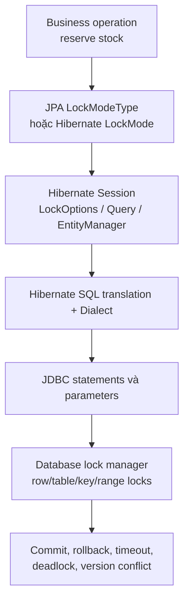
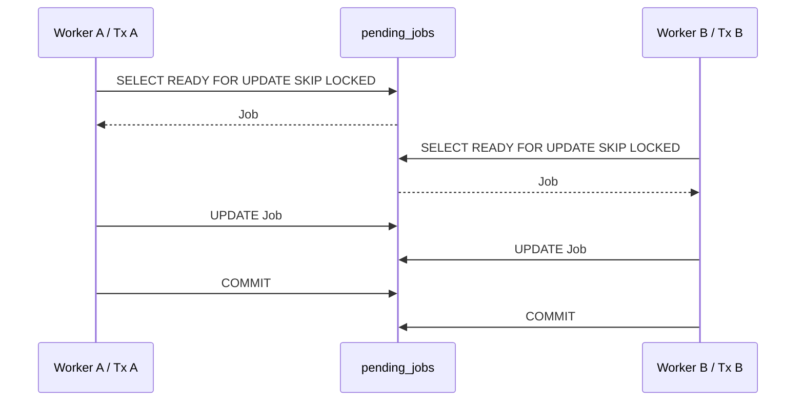
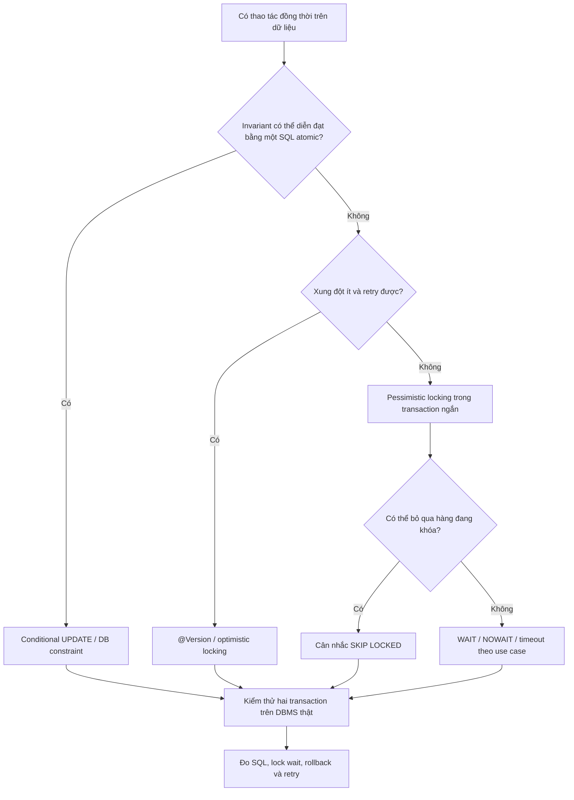

# Chế độ khóa Hibernate và ánh xạ sang khả năng của Dialect

Trong ứng dụng dùng **Hibernate ORM** để truy cập cơ sở dữ liệu quan hệ, hai transaction có thể đồng thời đọc, cập nhật hoặc xóa cùng một bản ghi. Nếu không thiết kế cơ chế điều phối, hệ thống có thể gặp **lost update**, dữ liệu không còn thỏa bất biến nghiệp vụ, transaction chờ khóa quá lâu, hoặc deadlock.

Hibernate cung cấp nhiều **chế độ khóa** (*lock modes*) để diễn đạt ý định ở tầng ORM. Tuy nhiên, một chế độ khóa **không đồng nghĩa với một câu SQL cố định trên mọi hệ quản trị**. Hibernate phải dựa vào **Dialect**, JDBC driver và khả năng thực tế của DBMS để chọn cách gửi SQL, áp dụng timeout, thực hiện kiểm tra phiên bản hoặc xử lý một truy vấn cần khóa theo nhiều bước.

Ví dụ:

- `LockModeType.OPTIMISTIC` chủ yếu yêu cầu **kiểm tra phiên bản entity**, không nhất thiết phát `SELECT ... FOR UPDATE`.
- `LockModeType.PESSIMISTIC_WRITE` thường yêu cầu database cấp **khóa loại trừ phù hợp** khi đọc hoặc khóa một entity đang managed.
- `PESSIMISTIC_READ` có thể dùng khóa đọc dùng chung ở DBMS hỗ trợ, nhưng Hibernate có thể phải dùng cơ chế mạnh hơn ở DBMS khác.
- Yêu cầu **NOWAIT**, **SKIP LOCKED** hoặc thời gian chờ cụ thể phụ thuộc khả năng DBMS và cách Hibernate Dialect ánh xạ, không phải lựa chọn portable tuyệt đối.

Bài học phân biệt các mức khóa, đi từ API JPA tới Hibernate và SQL, giải thích những giới hạn của Dialect, các tình huống ứng dụng thực tế và cách kiểm thử concurrency trên database đích.

## 1. Vì sao cần khóa khi đã có transaction?

Transaction bảo đảm một tập thao tác được commit/rollback theo những thuộc tính ACID mà DBMS cung cấp, nhưng **không có nghĩa mọi transaction được thực thi tuần tự**.

Giả sử bảng quản lý tồn kho:

| sku | available | version |
|---|---:|---:|
| `BOOK-101` | 5 | 7 |

Hai yêu cầu đồng thời muốn đặt 4 sản phẩm.

```text
Transaction A                      Transaction B
---------------                    ---------------
Đọc available = 5                  Đọc available = 5
Kiểm tra 5 >= 4                    Kiểm tra 5 >= 4
Tính available = 1                 Tính available = 1
Ghi available = 1                  Ghi available = 1
Commit                             Commit

Kết quả lưu = 1, nhưng hệ thống đã chấp nhận 8 sản phẩm.
```

Nếu mọi cập nhật đọc rồi ghi lại cùng giá trị cũ, có thể xảy ra **lost update** hoặc chấp nhận quá số lượng thực tế. Mức độ và dạng lỗi phụ thuộc isolation, SQL, ràng buộc và cách ORM ghi dữ liệu.

Có một số chiến lược phòng ngừa:

1. **Optimistic locking:** cho phép nhiều transaction cùng đọc; khi ghi, kiểm tra trạng thái/phiên bản chưa bị transaction khác thay đổi.
2. **Pessimistic locking:** xin khóa database đủ sớm để giao dịch khác không thể thực hiện những thao tác xung đột cùng lúc theo semantics DBMS.
3. **Atomic conditional UPDATE:** diễn đạt kiểm tra và thay đổi trong **một câu SQL**, có thể tránh phải load rồi khóa entity cho một số nghiệp vụ.
4. **Database constraints và isolation:** dùng unique/check/FK, serialization/locking phù hợp để bảo vệ bất biến, kể cả khi dữ liệu được ghi bên ngoài Hibernate.

Hibernate lock modes chủ yếu hỗ trợ hai nhóm đầu, nhưng lựa chọn thiết kế đúng phải xét cả bốn.

## 2. Ba tầng cần phân biệt: LockMode, Dialect và khóa thực tại DB



Các tầng mang ý nghĩa khác nhau:

| Tầng | Ví dụ | Trách nhiệm |
|---|---|---|
| Ứng dụng | “Chỉ một worker được claim job” | Chọn yêu cầu nhất quán |
| JPA/Hibernate API | `PESSIMISTIC_WRITE` | Diễn đạt ý định khóa |
| Hibernate Dialect | Chọn `FOR UPDATE` hoặc DB-specific SQL hints | Ánh xạ ý định vào khả năng DBMS |
| Database | Row locks, lock queues, deadlock detector | Thực sự cấp/chờ/từ chối khóa |
| Transaction manager | Commit/rollback | Xác định thời hạn tồn tại của khóa DB |
| Test/observability | SQL log, lock waits, row counts | Xác minh hành vi thực tế |

**Hibernate không tự tạo một lock manager thay thế cho database** khi yêu cầu pessimistic locking thông thường. Những khóa ấy được thực thi theo cơ chế của DBMS qua SQL/JDBC.

Với optimistic locking, Hibernate thường dùng **version column** và kiểm tra số hàng được cập nhật; không cần giữ row lock kéo dài từ lúc đọc ban đầu theo kiểu `SELECT ... FOR UPDATE`.

## 3. Dialect là gì trong cơ chế khóa?

**Hibernate Dialect** là thành phần mô tả SQL grammar và một số khả năng của một DBMS cụ thể. Nó ảnh hưởng cách Hibernate diễn đạt:

- Row locking trong câu SELECT.
- Khóa đọc dùng chung hoặc khóa ghi loại trừ.
- Cú pháp `NOWAIT` hoặc `SKIP LOCKED` nếu được hỗ trợ.
- Tùy chọn lock timeout và khả năng bind/thiết lập timeout.
- Khóa trong SELECT có JOIN, phân trang, DISTINCT hoặc truy vấn phức tạp.
- Follow-on locking khi không thể gắn khóa trực tiếp vào câu SELECT ban đầu.
- Cách database trả lỗi lock timeout, deadlock và optimistic/pessimistic conflict.
- Một số khả năng liên quan `FOR UPDATE OF alias` hoặc column lists.

Các thuật ngữ support/capability ở đây diễn tả chức năng của Dialect; **tên API nội bộ có thể khác giữa các đời Hibernate**.

### “Có Dialect” không đồng nghĩa mọi chế độ đều được hỗ trợ

Ví dụ Hibernate nhận yêu cầu `PESSIMISTIC_READ`, nhưng database đích không có cú pháp khóa đọc dùng chung tương ứng hoặc Dialect không thể dùng nó trong query hiện tại. Hibernate có thể **chọn dạng khóa khác, phát SQL bổ sung, hoặc từ chối/không đáp ứng một số tùy chọn** tùy phiên bản và tình huống.

Không nên suy luận:

```text
JPA enum giống nhau
       ⇒ SQL giống nhau
       ⇒ lock behavior giống nhau
```

Hợp đồng cần kiểm tra là: transaction của ứng dụng có đạt mức bảo vệ mong muốn **trên database thực** hay không.

## 4. Hai họ khóa chính: optimistic và pessimistic

### 4.1. Optimistic locking

Thích hợp khi:

- Xung đột ghi tương đối ít.
- Transaction đọc dữ liệu nhưng thường không sửa.
- Người dùng có thể giữ bản chỉnh sửa trong vài giây hoặc phút.
- Không muốn giữ database row lock suốt thời gian user nhập liệu.
- Khi xung đột, ứng dụng có thể báo lỗi hoặc retry có kiểm soát.

Cơ chế phổ biến là `@Version`:

```sql
update inventory_items
set available = ?, version = ?
where id = ? and version = ?;
```

Nếu version trong DB đã thay đổi, UPDATE không tác động số hàng mong đợi. Hibernate phát hiện stale state và báo optimistic locking failure.

### 4.2. Pessimistic locking

Thích hợp khi:

- Xung đột cùng một tài nguyên xảy ra thường xuyên.
- Thao tác đọc rồi cập nhật cần được điều phối ngay.
- Muốn serialize những transaction có thể sửa cùng bản ghi.
- Có job queue/claim resource trong DB.
- Chi phí xử lý conflict bằng retry lớn hơn chi phí giữ lock ngắn.

Một dạng SQL phổ biến trên DBMS hỗ trợ:

```sql
select *
from inventory_items
where id = ?
for update;
```

Database có thể khóa hàng được chọn cho tới khi transaction kết thúc, khiến transaction khác phải chờ hoặc nhận lỗi theo timeout/lock mode.

**Pessimistic không có nghĩa tránh được deadlock.** Một transaction có thể giữ khóa A và chờ B trong khi transaction khác giữ B và chờ A. Cần quản lý thứ tự khóa, timeout, retry và transaction duration.

## 5. Entity ví dụ có `@Version`

```java
package com.example.inventory;

import jakarta.persistence.*;

@Entity
@Table(
    name = "inventory_items",
    uniqueConstraints = @UniqueConstraint(
        name = "uk_inventory_sku",
        columnNames = "sku"
    )
)
public class InventoryItem {

    @Id
    @GeneratedValue(strategy = GenerationType.SEQUENCE)
    private Long id;

    @Column(nullable = false, length = 64)
    private String sku;

    @Column(nullable = false)
    private int available;

    @Version
    private long version;

    protected InventoryItem() {}

    public InventoryItem(String sku, int available) {
        if (available < 0) {
            throw new IllegalArgumentException("available < 0");
        }
        this.sku = java.util.Objects.requireNonNull(sku);
        this.available = available;
    }

    public Long getId() { return id; }
    public String getSku() { return sku; }
    public int getAvailable() { return available; }
    public long getVersion() { return version; }

    public void reserve(int quantity) {
        if (quantity <= 0) {
            throw new IllegalArgumentException("quantity <= 0");
        }
        if (quantity > available) {
            throw new IllegalStateException("Không đủ tồn kho");
        }
        available -= quantity;
    }
}
```

DDL minh họa:

```sql
create table inventory_items (
    id bigint primary key,
    sku varchar(64) not null,
    available integer not null,
    version bigint not null,
    constraint uk_inventory_sku unique (sku),
    constraint chk_inventory_nonnegative check (available >= 0)
);
```

Trong hệ thống thực, sequence hoặc generator ID phải phù hợp DBMS; DDL chỉ diễn đạt cấu trúc. Constraint `CHECK(available >= 0)` là một lớp bảo vệ nhưng **không tự chứng minh hai đơn đặt hàng đã được chấp nhận đúng số lượng** nếu service xử lý sai. Cần đặt reservation vào một transaction có concurrency control.

## 6. Các LockModeType của Jakarta Persistence

JPA công bố enum `jakarta.persistence.LockModeType` dùng trong `EntityManager` và query.

| LockModeType | Ý nghĩa chính | Cần DB row lock lúc đọc? |
|---|---|---|
| `NONE` | Không yêu cầu khóa tường minh qua operation này | Không, nhưng DB vẫn dùng locks thông thường của câu SQL/transaction |
| `OPTIMISTIC` | Yêu cầu kiểm tra optimistic version phù hợp | Không nhất thiết |
| `OPTIMISTIC_FORCE_INCREMENT` | Optimistic lock và yêu cầu tăng version | Không nhất thiết kiểu FOR UPDATE; có thể phát UPDATE |
| `PESSIMISTIC_READ` | Yêu cầu khóa để ngăn những xung đột ghi theo contract | Thường có DB locking SQL |
| `PESSIMISTIC_WRITE` | Yêu cầu khóa mạnh hơn cho đọc/sửa | Thường có DB locking SQL |
| `PESSIMISTIC_FORCE_INCREMENT` | Pessimistic lock và tăng version | Thường kết hợp DB locking với update version |
| `READ` | Tên tương thích cũ, tương ứng optimistic mode | Không nên nhầm với Hibernate native `LockMode.READ` |
| `WRITE` | Tên tương thích cũ, tương ứng optimistic force increment | Không nên nhầm với Hibernate native `LockMode.WRITE` |

**Không nên diễn giải `LockModeType.NONE` là “database hoàn toàn không khóa gì”.** `INSERT`, `UPDATE`, `DELETE` và thậm chí SELECT tùy isolation có thể dùng khóa nội bộ DBMS. `NONE` chỉ có nghĩa application không yêu cầu một kiểu lock đặc biệt thông qua lời gọi đó.

Các chế độ optimistic thường có ý nghĩa mạnh nhất với **versioned entities**. Với entity không có `@Version`, khả năng optimistic check có thể bị giới hạn hoặc provider từ chối; không giả định mọi mode được hỗ trợ cho mọi mapping.

## 7. Hibernate có `LockMode` riêng

Ngoài enum Jakarta Persistence, Hibernate còn có `org.hibernate.LockMode`. Bộ giá trị và API native có thể bao gồm những mode/synonym phục vụ:

- Optimistic và pessimistic operations.
- Các chế độ lịch sử liên quan tình trạng đọc/ghi của entity.
- Yêu cầu database-specific như **NOWAIT** hoặc **SKIP LOCKED** ở những phiên bản hỗ trợ.
- Những lựa chọn Hibernate native không nằm trong chuẩn JPA.

Ví dụ các mode chính thường gặp:

```java
import org.hibernate.LockMode;

LockMode.PESSIMISTIC_READ;
LockMode.PESSIMISTIC_WRITE;
LockMode.PESSIMISTIC_FORCE_INCREMENT;
LockMode.OPTIMISTIC;
LockMode.OPTIMISTIC_FORCE_INCREMENT;
```

Đoạn trên là danh sách minh họa các enum constants, không phải các biểu thức Java được phép đứng riêng như statement. Trong code thực, dùng chúng làm tham số của API khóa Hibernate tương ứng.

Một số tài liệu hoặc codebase cũ còn dùng các tên như `UPGRADE`, `UPGRADE_NOWAIT`, `UPGRADE_SKIPLOCKED`, `READ`, `WRITE`. **Availability, deprecation và semantics của chúng thay đổi theo phiên bản**, nên cần đọc API của Hibernate ORM thực tế đang chạy. Không dùng tên cũ làm hợp đồng portability cho code mới chỉ vì nó xuất hiện trong một bài blog.

### Không nhầm JPA READ/WRITE với Hibernate READ/WRITE

Tên giống nhau nhưng lịch sử/semantics của các enum khác nhau. Khi đọc code:

```java
LockModeType.READ
```

và:

```java
org.hibernate.LockMode.READ
```

phải nhìn đúng **package và API**. Không chuyển đổi đơn giản dựa trên tên string `"READ"` hoặc `"WRITE"`. Dùng các mode diễn đạt rõ ý định như `OPTIMISTIC` hoặc `PESSIMISTIC_WRITE` khi có thể.

## 8. Các cách yêu cầu khóa qua JPA

### 8.1. `find` với LockModeType

```java
import jakarta.persistence.EntityManager;
import jakarta.persistence.LockModeType;

InventoryItem item = entityManager.find(
    InventoryItem.class,
    itemId,
    LockModeType.PESSIMISTIC_WRITE
);
```

Trong môi trường có transaction phù hợp, Hibernate cần thực hiện thao tác khóa thích hợp cho entity. Database SQL sẽ phụ thuộc Dialect.

### 8.2. `lock` trên một managed entity

```java
InventoryItem item = entityManager.find(
    InventoryItem.class, itemId
);

// Yêu cầu khóa sau khi entity đã được quản lý.
entityManager.lock(
    item,
    LockModeType.OPTIMISTIC
);
```

Phương thức `lock` áp dụng cho entity managed hợp lệ theo contract của JPA; không dùng nó như hàm tự động reattach một detached object.

Nếu entity đã thay đổi trong một transaction khác trước khi kiểm tra version, optimistic lock có thể thất bại tại thời điểm check/flush/commit. Không mặc định lỗi luôn ném ngay tại dòng `entityManager.lock`.

### 8.3. `TypedQuery.setLockMode`

```java
List<InventoryItem> items = entityManager
    .createQuery("""
        select i
        from InventoryItem i
        where i.sku in :skus
        order by i.id
        """, InventoryItem.class)
    .setParameter("skus", skus)
    .setLockMode(LockModeType.PESSIMISTIC_WRITE)
    .getResultList();
```

Trong query này, việc khóa SQL trực tiếp hay follow-on locking phụ thuộc query shape và Dialect. Không suy luận rằng mọi SELECT với `setLockMode` sẽ có cùng hậu tố `FOR UPDATE`.

### 8.4. Cấu hình lock mode ở Spring Data JPA

Một repository method có thể khai báo:

```java
public interface InventoryRepository
        extends JpaRepository<InventoryItem, Long> {

    @Lock(LockModeType.PESSIMISTIC_WRITE)
    @Query("select i from InventoryItem i where i.id = :id")
    Optional<InventoryItem> findLockedById(@Param("id") Long id);
}
```

`@Lock` ở đây là annotation của **Spring Data JPA**, truyền yêu cầu lock xuống JPA provider. Nó không làm câu query tự trở thành một transaction kéo dài. Service sử dụng method cần có transaction phù hợp.

## 9. Optimistic locking thông thường với `@Version`

Ngay cả khi không chỉ định `LockModeType.OPTIMISTIC` cho mỗi query, Hibernate thường sử dụng `@Version` để bảo vệ các entity UPDATE/DELETE do ORM quản lý.

Ví dụ:

```java
@Transactional
public void reserveOptimistically(Long itemId, int quantity) {
    InventoryItem item = entityManager.find(
        InventoryItem.class, itemId
    );

    if (item == null) {
        throw new IllegalArgumentException("Item không tồn tại");
    }

    item.reserve(quantity);
    // Khi flush, Hibernate kiểm tra version.
}
```

Hai transaction cùng đọc version 7:

```text
A: SELECT id=42, available=5, version=7
B: SELECT id=42, available=5, version=7

A: reserve(4) → available=1
B: reserve(4) → available=1

A: UPDATE ... SET available=1, version=8
   WHERE id=42 AND version=7
   → thành công

B: UPDATE ... SET available=1, version=8
   WHERE id=42 AND version=7
   → không cập nhật được row theo kỳ vọng
   → optimistic locking failure
```

Với optimistic locking, một transaction sẽ phải **rollback hoặc xử lý xung đột**. Không nên đơn giản bắt exception rồi commit tiếp một Session/EntityManager đã thất bại.

### `OPTIMISTIC` tường minh để làm gì?

`LockModeType.OPTIMISTIC` có thể yêu cầu kiểm tra version của entity ngay cả trong một luồng nghiệp vụ không trực tiếp sửa field, ví dụ đọc một bản ghi rồi thực hiện logic khác cần xác nhận bản ghi không thay đổi trước khi kết thúc transaction.

Tuy nhiên, **một kiểm tra version trên một hàng không bảo vệ mọi dữ liệu liên quan**. Nếu bất biến bao gồm tổng của nhiều hàng, cần thiết kế locking/isolation/invariant khác; `OPTIMISTIC` trên một entity không tự khóa cả truy vấn tổng hợp.

### Optimistic locking không giữ khóa ứng dụng suốt “thời gian nghĩ”

Người dùng có thể mở form chỉnh sửa trong vài phút. Giữ transaction/row lock qua toàn bộ thời gian này là rủi ro lớn. Thông thường hệ thống gửi version ở DTO:

```java
public record EditItemRequest(
    Long itemId,
    long expectedVersion,
    int newQuantity
) {}
```

Khi cập nhật, service cần kiểm tra expected version theo contract và dựa vào optimistic concurrency của DB/Hibernate trong transaction. **Chỉ kiểm tra version trong Java rồi UPDATE thiếu điều kiện version vẫn có race**; atomicity phải nằm ở SQL/locking semantics.

## 10. `OPTIMISTIC_FORCE_INCREMENT` và lý do tăng version có chủ đích

`OPTIMISTIC_FORCE_INCREMENT` yêu cầu optimistic lock và **tăng version** của entity ngay cả khi nghiệp vụ không nhất thiết sửa một field persistent thông thường.

Ví dụ aggregate root `PurchaseOrder` có các child lines. Một transaction thêm OrderLine nhưng không thay thuộc tính scalar của root. Nếu muốn transaction khác theo dõi version của order và phát hiện cấu trúc aggregate đã thay đổi, có thể cân nhắc force increment root version.

```java
PurchaseOrder order =
    entityManager.find(PurchaseOrder.class, orderId);

entityManager.lock(
    order,
    LockModeType.OPTIMISTIC_FORCE_INCREMENT
);

// Thực hiện thay đổi liên quan aggregate trong transaction.
```

Bản chất:

- Một version increment được yêu cầu theo cơ chế ORM.
- Hibernate có thể phát SQL UPDATE cho version.
- Thời điểm thực thi/tăng version có thể được trì hoãn đến flush hoặc một giai đoạn phù hợp theo provider.
- Concurrent transactions có thể nhận optimistic lock conflict.

**Không giả định force increment là một cách lock toàn bộ child rows.** Nó bảo vệ thông tin version của root theo contract được thiết kế, chỉ hữu ích khi các luồng cập nhật liên quan đều tuân thủ quy tắc tăng/kiểm tra version tương ứng.

Nếu nhiều transaction sửa child trực tiếp mà không tăng root version, force increment được sử dụng ở một luồng **không bảo đảm** những luồng khác bị phát hiện.

## 11. `PESSIMISTIC_READ`: khóa đọc có bảo vệ gì?

`PESSIMISTIC_READ` yêu cầu database ngăn những xung đột ghi theo semantics của pessimistic read lock.

Ở DBMS hỗ trợ khóa chia sẻ trên các hàng được đọc, một SQL có thể có dạng:

```sql
select *
from inventory_items
where id = ?
for share;
```

Hình dạng trên là **ví dụ kiểu PostgreSQL**, không phải câu SQL Hibernate dùng ở mọi phiên bản. Có database dùng cú pháp khác hoặc không hỗ trợ chính xác chế độ shared row lock được yêu cầu. Hibernate có thể lựa chọn dạng khóa mạnh hơn để đáp ứng hợp đồng trong phạm vi khả năng.

### Khóa đọc không đồng nghĩa có snapshot bất biến toàn database

Một transaction khóa đọc InventoryItem#42 không tự ngăn transaction khác tạo thêm hàng khác vào bảng, trừ khi DB isolation/locks/constraints bảo vệ điều đó. Query dựa trên một range hoặc tổng hợp có thể vẫn bị **phantom** trong một số mức isolation.

Ví dụ:

```hql
select i
from InventoryItem i
where i.available > 0
```

Khóa các hàng đã được trả về không tự ngăn INSERT một hàng mới thỏa điều kiện. Muốn bảo vệ một bất biến dựa trên tập hàng cần kiểm tra isolation, predicate locking hoặc thiết kế atomic constraint thích hợp.

### Khi nào dùng?

Pessimistic read có thể phù hợp khi cần giữ dữ liệu được đọc không bị update/delete trong một transaction ngắn, nhưng ứng dụng vẫn muốn cho phép những reader tương thích khác. Nếu DB dialect không hỗ trợ shared lock như mong muốn, lợi ích concurrency có thể thấp hơn kỳ vọng.

## 12. `PESSIMISTIC_WRITE`: khóa để cập nhật

Đây là mode thường gặp khi service cần đọc một hàng rồi cập nhật ngay trong cùng transaction.

```java
@Transactional
public void reservePessimistically(
    Long itemId,
    int quantity
) {
    InventoryItem item = entityManager.find(
        InventoryItem.class,
        itemId,
        LockModeType.PESSIMISTIC_WRITE
    );

    if (item == null) {
        throw new IllegalArgumentException("Item không tồn tại");
    }

    item.reserve(quantity);
}
```

Ví dụ SQL trên DBMS dùng `FOR UPDATE`:

```sql
select id, sku, available, version
from inventory_items
where id = ?
for update;
```

Một transaction khác cố lấy khóa xung đột cho cùng hàng có thể **chờ** cho tới khi transaction đầu commit/rollback, hoặc bị từ chối do timeout/NOWAIT/deadlock.

### Dòng thời gian

```mermaid
sequenceDiagram
    participant A as Transaction A
    participant DB as Database
    participant B as Transaction B
    A->>DB: SELECT item#42 FOR UPDATE
    DB-->>A: Cấp khóa, available=5
    B->>DB: SELECT item#42 FOR UPDATE
    Note over B,DB: B chờ / timeout tùy cấu hình
    A->>DB: UPDATE available=1; COMMIT
    DB-->>A: Giải phóng khóa
    DB-->>B: B được tiếp tục theo isolation/DB semantics
    B->>DB: Kiểm tra available và cập nhật hoặc từ chối
```

Đây là dòng thời gian **minh họa**. Ở isolation cao như repeatable read/serializable, giao dịch thứ hai có thể gặp serialization failure thay vì tiếp tục như trên. Một số DB cũng có khóa/giao thức khác tùy query và plan.

### Transaction phải bao quanh toàn bộ read–check–update

Nếu code đọc bằng `PESSIMISTIC_WRITE` rồi transaction kết thúc **trước** khi sửa và ghi, khóa không còn bảo vệ khoảng trống ấy.

Sai lầm:

```text
Transaction 1:
  SELECT FOR UPDATE
  COMMIT → lock được giải phóng

Ứng dụng xử lý dài ở ngoài transaction

Transaction 2:
  UPDATE theo dữ liệu cũ
```

Pessimistic lock thường thuộc **database transaction**, không thuộc “tuổi thọ của Java entity”. Session vẫn mở sau commit không có nghĩa DB lock vẫn được giữ.

## 13. `PESSIMISTIC_FORCE_INCREMENT`: kết hợp hai cơ chế

`PESSIMISTIC_FORCE_INCREMENT` kết hợp yêu cầu pessimistic locking với việc **buộc tăng version** của versioned entity theo contract Hibernate/JPA.

Một trường hợp phù hợp là aggregate root cần vừa điều phối cập nhật đồng thời ngay bây giờ, vừa phát tín hiệu version thay đổi cho các luồng đọc/ghi optimistic khác.

```java
@Transactional
public void addLine(Long orderId, NewLine input) {
    PurchaseOrder order = entityManager.find(
        PurchaseOrder.class,
        orderId,
        LockModeType.PESSIMISTIC_FORCE_INCREMENT
    );

    if (order == null) {
        throw new IllegalArgumentException("Order không tồn tại");
    }

    // Thêm line vào aggregate theo mapping/lifecycle phù hợp.
    order.addLine(input.productId(), input.quantity());
}
```

Điểm cần nhớ:

- DB cần đáp ứng yêu cầu pessimistic lock.
- Entity version được yêu cầu increment, thường làm phát sinh SQL UPDATE/version mutation.
- Mode này không tự tạo khóa trên mọi child table của aggregate.
- Nếu entity không versioned hoặc mapping không hỗ trợ, operation có thể bị từ chối hoặc có giới hạn.
- Transaction cần ngắn để tránh giữ khóa lâu.
- Các đường cập nhật cùng aggregate cần thống nhất quy ước concurrency.

Không dùng `PESSIMISTIC_FORCE_INCREMENT` chỉ vì “khóa mạnh nhất là an toàn nhất”. Việc tăng version không cần thiết có thể tạo optimistic conflicts cho nhiều transaction khác.

## 14. Ánh xạ mode sang SQL: sơ đồ điển hình

| Yêu cầu ở ORM | Cách DBMS có thể thực hiện | Những khác biệt cần kiểm tra |
|---|---|---|
| `NONE` | SELECT bình thường | Isolation và MVCC vẫn có lock/visibility semantics |
| `OPTIMISTIC` | Kiểm tra version, có thể kiểm tra khi flush/commit | Versioned entity, thời điểm check |
| `OPTIMISTIC_FORCE_INCREMENT` | UPDATE version với điều kiện phù hợp | Timing, SQL shape, concurrency |
| `PESSIMISTIC_READ` | Shared row lock hoặc fallback tương đương/mạnh hơn | Có hỗ trợ shared locks? |
| `PESSIMISTIC_WRITE` | `FOR UPDATE`, lock hints hoặc thao tác theo dialect | Row/table/key locks, JOIN, pagination |
| `PESSIMISTIC_FORCE_INCREMENT` | Pessimistic lock + version mutation | Version, lock ordering, flush |
| NOWAIT request | `NOWAIT` hoặc cơ chế lock timeout 0 | Dialect có hỗ trợ, fallback/ignored? |
| SKIP LOCKED request | `SKIP LOCKED` hoặc DB-specific skip behavior | Fairness, query semantics, DB support |
| Finite lock timeout | SQL hint/session timeout/driver-specific action | Đơn vị thời gian, phạm vi, support |

**Bảng không phải ánh xạ 1–1 bắt buộc.** SQL translator có thể chọn câu lệnh khác theo Hibernate version, query shape và Dialect; DBMS sau đó mới quyết định loại khóa thực tế. Muốn biết ứng dụng đang chạy mode nào, phải nhìn **SQL và tình huống cạnh tranh thật**.

## 15. Ví dụ khác nhau giữa các Dialect

Các hệ quản trị hỗ trợ locking bằng những grammar và cơ chế khác nhau.

### 15.1. PostgreSQL

Những dạng SQL row lock tiêu biểu:

```sql
select *
from inventory_items
where id = 42
for update;

select *
from inventory_items
where id = 42
for share;

select *
from inventory_items
where id = 42
for update nowait;

select *
from pending_jobs
where status = 'READY'
for update skip locked;
```

PostgreSQL còn có các biến thể `FOR NO KEY UPDATE`, `FOR KEY SHARE` và tùy chọn xác định bảng trong JOIN. Hibernate Dialect quyết định dạng SQL cụ thể theo mode, mapping và version; không mặc định `PESSIMISTIC_WRITE` luôn render đúng chuỗi `FOR UPDATE` trần.

### 15.2. MySQL / InnoDB

Một số phiên bản MySQL hiện đại hỗ trợ các biến thể như:

```sql
select *
from inventory_items
where id = 42
for update;

select *
from inventory_items
where id = 42
for share;
```

Khả năng `NOWAIT`, `SKIP LOCKED`, các tên cú pháp shared lock và mức hỗ trợ phụ thuộc **phiên bản MySQL/InnoDB**. Isolation và query/index plan còn ảnh hưởng tới gap/next-key locking, nên không được suy luận “chỉ một hàng bị khóa” dựa trên câu SELECT đơn giản nếu predicate không dùng index phù hợp.

### 15.3. Oracle

Oracle hỗ trợ các biến thể locking với `FOR UPDATE`, `NOWAIT`, `WAIT n` và `SKIP LOCKED` trong những phiên bản/ngữ cảnh phù hợp. Ví dụ mang tính minh họa:

```sql
select *
from inventory_items
where id = 42
for update nowait;
```

Yêu cầu timeout bằng milliseconds ở JPA không nhất thiết được Oracle diễn đạt chính xác từng millisecond vì cú pháp/driver có thể có đơn vị và phạm vi khác. Hibernate Dialect chịu trách nhiệm ánh xạ khi có thể, còn ứng dụng phải kiểm chứng.

### 15.4. SQL Server

SQL Server thường diễn đạt ý định khóa thông qua **table hints**, chẳng hạn các kết hợp:

```sql
-- Minh họa ý tưởng, không phải SQL Hibernate cố định.
select *
from inventory_items with (updlock, rowlock)
where id = 42;
```

Khả năng dùng `UPDLOCK`, `HOLDLOCK`, `ROWLOCK`, `READPAST` hoặc lựa chọn khác phụ thuộc transaction isolation và query; `READPAST` không phải bản sao hoàn toàn của `SKIP LOCKED` trong mọi tình huống.

### 15.5. H2 và test database

H2 có thể hỗ trợ một số cú pháp locking, nhưng **không tái hiện toàn bộ** row lock, MVCC, timeout, deadlock và optimizer của PostgreSQL/MySQL/Oracle/SQL Server. Một test chạy qua H2 không đủ chứng minh job claim bằng `SKIP LOCKED` hoặc xử lý deadlock sẽ hoạt động giống production.

**Quy tắc:** Dùng cùng JPA API trên nhiều DBMS không đảm bảo câu SQL, số round trip, phạm vi khóa hoặc failure timing tương đương. Test trên DBMS/version thực đang được hỗ trợ.

## 16. Timeout: chờ, thất bại nhanh hay bỏ qua hàng đang khóa?

Khi transaction B cần khóa một hàng đã bị A giữ, ứng dụng có ba cách phản ứng phổ biến:

1. **Chờ:** B chờ cho tới khi A giải phóng khóa, hoặc tới giới hạn timeout.
2. **NOWAIT:** B từ chối gần như ngay nếu không thể lấy khóa.
3. **SKIP LOCKED:** B bỏ qua những hàng đang bị khóa và xử lý các hàng khác.

Ba lựa chọn phục vụ mục đích khác nhau.

| Chiến lược | Hành vi mục tiêu | Use case |
|---|---|---|
| Wait | Xếp hàng chờ tài nguyên | Cập nhật một entity bắt buộc |
| NOWAIT | Không muốn latency chờ khó đoán | API phản hồi “đang bận” và cho retry |
| SKIP LOCKED | Chọn công việc khác nếu hàng đầu đang bận | Nhiều worker cùng claim job |

### Không nhầm lock timeout với query timeout

- **Lock timeout:** thời gian chờ để **giành khóa**.
- **Query timeout:** thời hạn tổng thể để **query hoàn thành**, có thể bao gồm nhiều loại chờ/chạy khác.
- **Transaction timeout:** thời hạn của transaction theo transaction manager.
- **JDBC socket/network timeout:** thời gian liên quan driver/communication.

Một query có thể tốn thời gian dài sau khi lấy khóa, và một query timeout không nhất thiết có nghĩa chính sách lock timeout của DB đã được thiết lập đúng.

## 17. Hint `jakarta.persistence.lock.timeout`

Jakarta Persistence có hint tiêu chuẩn dùng để yêu cầu lock timeout, thường biểu diễn bằng **milliseconds**:

```java
import jakarta.persistence.LockModeType;
import java.util.Map;

InventoryItem item = entityManager.find(
    InventoryItem.class,
    itemId,
    LockModeType.PESSIMISTIC_WRITE,
    Map.of("jakarta.persistence.lock.timeout", 0)
);
```

Ý định của `0` là **không chờ** khi không lấy được khóa theo các provider/DBMS hỗ trợ. Với thời gian dương:

```java
Map<String, Object> hints =
    Map.of("jakarta.persistence.lock.timeout", 3000);
```

ý định là giới hạn chờ khoảng 3.000 milliseconds.

Tuy nhiên:

- Đây là **hint**, không phải bảo đảm mọi provider/dialect đều thực hiện chính xác.
- Một số DBMS có giới hạn/đơn vị timeout khác.
- Có nơi Hibernate phải dùng cú pháp SQL, thay đổi session setting hoặc chọn fallback.
- Một số database/driver có thể bỏ qua hoặc không hỗ trợ hint cụ thể.
- Phiên bản Hibernate cũ có thể dùng namespace `javax.persistence.lock.timeout`; sử dụng đúng Jakarta/Java EE API của dự án.
- Nếu không lấy được khóa, cần phân tích exception và trạng thái transaction thay vì giả định hành vi đồng nhất.

Với ứng dụng mới dựa trên `jakarta.persistence`, nên khai báo rõ namespace Jakarta và kiểm thử thực trên dialect mục tiêu.

### Timeout 0 không tự đồng nghĩa ứng dụng có NOWAIT syntax

Hibernate có thể ánh xạ timeout 0 sang SQL NOWAIT trên DBMS hỗ trợ; nếu DB không hỗ trợ hoặc query shape hạn chế, behavior có thể khác. **Hãy xem SQL và đo thời gian trả lỗi khi có cạnh tranh thật.**

## 18. Hibernate `LockOptions` và các lựa chọn riêng provider

Ở Hibernate native API, những điều kiện khóa như mode, timeout và scope có thể được biểu diễn qua `org.hibernate.LockOptions` cùng các API query/session tương ứng.

Ý tưởng cấu hình:

```java
import org.hibernate.LockMode;
import org.hibernate.LockOptions;

LockOptions options =
    new LockOptions(LockMode.PESSIMISTIC_WRITE);

// Các phương thức và hằng số cấu hình timeout
// phụ thuộc Hibernate version đang sử dụng.
```

Một số Hibernate versions công bố các giá trị quy ước như:

- `LockOptions.NO_WAIT`: không chờ.
- `LockOptions.WAIT_FOREVER`: chờ không giới hạn do ORM yêu cầu, vẫn chịu timeout của DB/transaction.
- `LockOptions.SKIP_LOCKED`: yêu cầu bỏ qua hàng đã khóa khi chức năng được hỗ trợ.

**Không xem tên hằng số là bằng chứng DBMS đã nhận được tùy chọn đó.** Cần dùng đúng API Hibernate version thực tế và kiểm tra SQL được render.

Các Hibernate-specific lock modes có lịch sử khác nhau giữa các đời ORM. Ví dụ tài liệu cũ có thể biểu diễn NOWAIT hoặc SKIP LOCKED bằng `LockMode.UPGRADE_NOWAIT`, `UPGRADE_SKIPLOCKED`; code mới thường cần xem API `LockOptions` hoặc phương thức khóa tương ứng của bản đang dùng. Đừng copy nguyên cú pháp từ một major version sang major version khác mà không xác minh compatibility.

## 19. SKIP LOCKED cho job queue: đúng ở đâu, nguy hiểm ở đâu?

Giả sử có bảng:

```sql
create table pending_jobs (
    id bigint primary key,
    status varchar(20) not null,
    created_at timestamp not null,
    attempts integer not null
);
```

Nhiều worker cần chọn job READY nhưng không lấy cùng một job.

Một SQL minh họa trên DBMS hỗ trợ:

```sql
select id, status, created_at, attempts
from pending_jobs
where status = 'READY'
order by created_at, id
for update skip locked
limit 1;
```

Worker A giữ lock Job#1; Worker B có thể **bỏ qua Job#1** và chọn Job#2. Cách này giúp nhiều worker claim những hàng khác nhau thay vì xếp hàng dài trên một job.



Cú pháp thứ tự `FOR UPDATE`/`LIMIT` và khả năng dùng chung khác nhau theo DBMS. Hibernate có thể cần render câu SQL khác; **không dán câu ví dụ này vào mọi dialect**.

### Những điều SKIP LOCKED không bảo đảm

- **Không bảo đảm fairness**: một job bị khóa thường xuyên có thể bị bỏ qua nhiều lần.
- **Không bảo đảm kết quả tuần tự nhất quán**: tập hàng được trả về có thể khác với snapshot logic mong muốn.
- **Không thay thế trạng thái job và transaction claim**: phải đánh dấu job đã được claim trong cùng transaction phù hợp.
- **Không tự mang lại exactly-once side effect**: worker có thể crash sau khi gọi hệ thống bên ngoài nhưng trước khi commit; cần idempotency và recovery.
- **Không phải lựa chọn tốt cho mọi API pagination**: dữ liệu bị skip có thể tạo trang thiếu/không ổn định.
- **Không bảo vệ hàng chưa tồn tại hoặc predicate không được index đúng**.

### Khi nào nên tránh?

Không dùng SKIP LOCKED để đảm bảo người dùng “đọc đầy đủ mọi khoản nợ” hoặc “tính tổng chính xác mọi giao dịch”, vì bỏ qua hàng đang bị khóa làm kết quả thiếu dữ liệu. Nó phù hợp hơn với **work stealing / job claiming** nơi bỏ qua một công việc tạm thời là chấp nhận được.

## 20. NOWAIT cho API fail-fast

Giả sử thao tác chuyển trạng thái đơn hàng phải khóa root row. Nếu đơn hàng đang được transaction khác xử lý, API có thể muốn trả “đang được cập nhật” thay vì giữ request thread chờ vài giây.

Yêu cầu lock timeout 0, trong DB hỗ trợ, có thể dẫn đến:

```sql
select *
from orders
where id = ?
for update nowait;
```

Khi không lấy được khóa, database có thể trả lỗi gần như ngay. Ở tầng ứng dụng:

- Bắt exception thuộc nhóm lock timeout/pessimistic locking phù hợp.
- Rollback transaction khi cần theo trạng thái mà provider báo.
- Trả thông báo có ý nghĩa hoặc retry có backoff.
- Không công bố lỗi nội bộ JDBC/SQLSTATE như một thông điệp nghiệp vụ nguyên xi.

**NOWAIT không có nghĩa operation miễn nhiễm với mọi loại latency.** Query vẫn cần parse/plan, đọc dữ liệu và đi qua network. Nếu request timeout ngắn, vẫn cần query/transaction timeout và giới hạn tài nguyên khác.

## 21. Follow-on locking: vì sao Hibernate có thể khóa sau SELECT?

Một số SQL query shapes không cho phép hoặc không hỗ trợ tốt việc gắn `FOR UPDATE` trực tiếp:

- SELECT dùng `DISTINCT`.
- Query có `GROUP BY`, aggregation hoặc projection.
- JOIN ngoài với những cấu trúc DBMS không cho row lock trực tiếp trên nullable side.
- Pagination, union/subquery hoặc dialect-specific restrictions.
- Truy vấn có nhiều bảng nhưng chỉ muốn khóa entity root.

Trong trường hợp thích hợp, Hibernate có thể dùng **follow-on locking**: trước hết thực hiện một SELECT để xác định các entity cần khóa, sau đó phát thêm SQL lấy lock cho các hàng tương ứng.

```text
HQL: select o from Order o ... order by ...
      + request PESSIMISTIC_WRITE

SQL #1: SELECT dữ liệu / ID / entity rows
SQL #2: SELECT ... WHERE id IN (...) FOR UPDATE
        (hoặc từng row/nhóm, phụ thuộc Hibernate & Dialect)
```

### Hệ quả phải biết

1. Một query ở Java có thể sinh **nhiều câu SQL**.
2. Có khoảng thời gian giữa SELECT ban đầu và lock thực tế; Hibernate phải xử lý đúng ngữ nghĩa provider trong phạm vi khả năng.
3. Row set có thể thay đổi bởi transaction khác trong thời gian đó, tùy isolation và locking.
4. Khóa theo nhóm ID có thể ảnh hưởng thứ tự cấp khóa/deadlock.
5. N+1 lock statements có thể tạo latency đáng kể.
6. Timeout và NOWAIT có thể được áp dụng khác so với một SELECT FOR UPDATE duy nhất.
7. Một số query/projection không hỗ trợ lock theo cách bạn kỳ vọng và provider có thể ném exception.

### Ví dụ query cần cẩn trọng

```java
List<PurchaseOrder> orders = entityManager
    .createQuery("""
        select distinct o
        from PurchaseOrder o
        left join fetch o.lines
        where o.status = :status
        """, PurchaseOrder.class)
    .setParameter("status", OrderStatus.PENDING)
    .setLockMode(LockModeType.PESSIMISTIC_WRITE)
    .getResultList();
```

Đây là một query có fetch join collection, `distinct` và lock request. SQL/behavior phụ thuộc Hibernate version, dialect và mapping; ngoài lock còn có rủi ro kết quả bị nhân hàng và khó pagination. **Không suy luận Hibernate sẽ gửi một SQL duy nhất có FOR UPDATE.**

Nếu cần khóa một order, phương án dễ kiểm soát thường là:

1. Truy vấn chỉ các ID mục tiêu bằng query phù hợp.
2. Trong cùng transaction, khóa root rows bằng ID và thứ tự xác định.
3. Sau khi có khóa, tải dữ liệu liên quan cần thiết.
4. Kiểm tra lại business conditions trước khi cập nhật.

Cách đó cũng cần đánh giá race giữa bước tìm ID và bước lock. Nó không tự thay thế transaction isolation/constraints.

## 22. Lock scope: khóa entity root hay toàn object graph?

Một entity Java có thể tham chiếu nhiều entity khác:

```text
PurchaseOrder
  ├── OrderLine #1
  ├── OrderLine #2
  └── Customer
```

Khi yêu cầu `PESSIMISTIC_WRITE` trên `PurchaseOrder`, **không nên mặc định** database khóa mọi bảng/row mà object graph có thể trỏ tới.

Trong Jakarta Persistence có khái niệm `PessimisticLockScope.NORMAL` và `EXTENDED`, có thể được truyền qua lock scope hint ở những provider/DBMS hỗ trợ.

- **NORMAL:** tập trung vào rows thuộc entity được lock theo mapping và inheritance tables liên quan.
- **EXTENDED:** có thể yêu cầu khóa thêm một số rows trong collection/join tables hoặc association table theo quy định cụ thể, **không đồng nghĩa recursively khóa mọi child entity**.

Cách Hibernate/Dialect hỗ trợ lock scope phụ thuộc provider, query và mapping. Nếu nghiệp vụ cần bảo vệ OrderLine trước transaction khác, phải xác định rõ những hàng nào cần lock và yêu cầu chúng được khóa một cách tường minh hoặc có cơ chế versioning/constraints tương ứng.

### Không dùng cascade như “lan truyền row lock” tuyệt đối

`CascadeType.ALL` điều khiển nhiều thao tác entity lifecycle như persist/merge/remove/refresh/detach, **không phải** lời hứa mọi row trong graph đều tự được `FOR UPDATE`. Lock request trên một entity và cascade lifecycle là hai hợp đồng khác nhau.

## 23. Lock và transaction isolation: giao thoa nhưng không thay thế nhau

Những mức isolation quen thuộc:

- `READ_UNCOMMITTED`.
- `READ_COMMITTED`.
- `REPEATABLE_READ`.
- `SERIALIZABLE`.

Tên và hành vi thực tế có thể khác theo DBMS/MVCC implementation. Ví dụ PostgreSQL và MySQL InnoDB đều có mức “REPEATABLE READ” nhưng chi tiết snapshot, gap locking và conflict resolution không hoàn toàn giống.

| Vấn đề | Isolation có thể tác động? | Explicit lock có thể giúp? | Ghi chú |
|---|---|---|---|
| Dirty read | Có | Có liên quan nhưng isolation thường là trọng tâm | DBMS có thể không thực sự cho dirty read |
| Non-repeatable read | Có | Row lock có thể hạn chế thay đổi | Xét thời điểm lock và query |
| Lost update | Có | Optimistic/pessimistic/atomic update | Cần kiểm thử cụ thể |
| Phantom/range anomalies | Có | Row lock các hàng hiện hữu chưa chắc đủ | Có thể cần predicate/range/serializable |
| Deadlock | Isolation/locks ảnh hưởng | Explicit locks cũng có thể tạo deadlock | Cần thứ tự khóa và retry |
| Write skew | Có | Khóa một số row chưa chắc đủ | Phụ thuộc invariant đa hàng |

### Không xem PESSIMISTIC_WRITE như SERIALIZABLE cho cả transaction

Khóa một InventoryItem#42 chỉ nhắm tới tài nguyên nhất định. Nếu invariant liên quan “tổng số đơn đang xử lý của tất cả khách hàng dưới 100”, khóa một row đơn lẻ có thể không đủ. Cần thiết kế invariant ở schema hoặc dùng isolation/locking phù hợp với tập dữ liệu liên quan.

### JDBC transaction phải được duy trì

Khi dùng pessimistic locking, giữ lock cho đến lúc commit/rollback theo DBMS. Nếu auto-commit khiến SELECT FOR UPDATE kết thúc ngay, lock không bảo vệ đoạn Java xử lý tiếp theo. Với ORM transaction manager, thường cần một transaction bao quanh toàn bộ thao tác đọc, kiểm tra và cập nhật.

## 24. Row lock có thể trở thành range/key/table lock

Tên `PESSIMISTIC_WRITE` có thể khiến lập trình viên tưởng database chỉ khóa đúng một Java entity. Nhưng DBMS lock manager có thể dùng:

- Row-level locks.
- Key locks.
- Gap/next-key locks.
- Page locks.
- Table locks hoặc lock escalation.
- Predicate/SIREAD locks trong serializable MVCC.
- Intent locks ở các cấp cấu trúc.

Tài nguyên bị khóa còn phụ thuộc **index và execution plan**.

Ví dụ:

```sql
select *
from inventory_items
where sku = ?
for update;
```

Nếu `sku` có unique index, database có thể định vị hàng mục tiêu hiệu quả hơn. Nếu predicate không có index hoặc query chứa range condition, một số engine/isolation modes có thể khóa phạm vi rộng hơn hoặc đọc nhiều hàng hơn.

Để giảm contention:

1. Tạo index theo predicate khóa thực.
2. Giới hạn số rows cần lock.
3. Tránh scan toàn bảng khi muốn khóa một tài nguyên cụ thể.
4. Dùng transaction ngắn.
5. Giữ thứ tự khóa nhất quán.
6. Đo lock waits và deadlock graphs trên database thật.

**Khóa ORM không sửa được một SQL execution plan tệ.** Một query chậm giữ lock lâu hơn và làm tăng độ trễ của các transaction khác.

## 25. Nếu entity không tồn tại thì locking giúp gì?

Giả sử muốn bảo đảm **không có hai Customer cùng email**:

```java
Customer c = findByEmail(email);
// Nếu null thì persist Customer mới.
```

Hai transaction có thể cùng query “chưa có” rồi cùng INSERT. `PESSIMISTIC_WRITE` trên một entity **không tồn tại** không có row hiện hữu để khóa theo cách thông thường.

Giải pháp đúng thường là **unique constraint**:

```sql
alter table customers
add constraint uk_customer_email unique (email);
```

Sau đó ứng dụng xử lý conflict khi hai transaction cùng tạo. Ở những DBMS/isolation modes đặc thù có thể khóa range/gap/predicate để bảo vệ sự không tồn tại, nhưng đó là vấn đề của DBMS và không nên thay unique constraint một cách mù quáng.

### “Kiểm tra trước” không thay thế constraint

```text
A: SELECT email='a@example.com' → chưa có
B: SELECT email='a@example.com' → chưa có
A: INSERT
B: INSERT
```

Chỉ DB unique constraint hoặc thiết kế transaction serializable/locking đủ chặt mới bảo vệ invariant khi có concurrency đúng nghĩa. Hibernate `@Column(unique = true)` là metadata; nếu production dùng migrations, cần xác nhận **constraint thật** tồn tại.

## 26. Pessimistic lock có thể tương tác với `@Version`

Một entity có `@Version` vẫn có thể được đọc với `PESSIMISTIC_WRITE`.

Khi đó:

- Database có thể cấp khóa cho transaction hiện tại.
- Hibernate vẫn có version state của entity.
- Khi UPDATE, Hibernate có thể thực hiện version check/increment theo mapping.
- Nếu entity đã stale trước lúc lấy khóa hoặc transaction isolation có conflict, vẫn có thể gặp optimistic/stale exception.
- Yêu cầu pessimistic **không làm vô hiệu hóa `@Version`**.

Vì vậy, viết:

```java
entityManager.find(
    InventoryItem.class,
    itemId,
    LockModeType.PESSIMISTIC_WRITE
);
```

không có nghĩa Hibernate bỏ các điều kiện version cần thiết trong UPDATE. Tùy mode và timing, Hibernate có thể phát thêm SQL để bảo vệ contract.

### Khi nào nên kết hợp?

Có thể dùng:

- `@Version` để phát hiện cập nhật stale từ các transaction/clients khác.
- `PESSIMISTIC_WRITE` cho một số đường ghi nóng thường xuyên đụng nhau.
- Atomic SQL cho những thay đổi đơn giản cần throughput cao.

Không cần mọi thao tác đều khóa bi quan chỉ vì entity có version. Sử dụng quá nhiều pessimistic locks có thể làm mất concurrency của ứng dụng.

## 27. Atomic conditional UPDATE là lựa chọn khác rất quan trọng

Với tồn kho, đôi khi một SQL duy nhất hiệu quả hơn load + lock + check:

```sql
update inventory_items
set available = available - :quantity
where id = :id
  and available >= :quantity;
```

Đọc **số hàng bị ảnh hưởng**:

- `1`: một hàng đạt điều kiện và được cập nhật.
- `0`: không có hàng hoặc không đủ hàng theo điều kiện tại thời điểm update.
- Database thực thi predicate và update như một SQL statement trong transaction.

Đây là mô hình hữu ích để bảo vệ `available >= 0` mà không cần giữ một pessimistic lock từ bước SELECT riêng. Trên nhiều DBMS, UPDATE vẫn dùng khóa cần thiết bên trong engine, nhưng ứng dụng không phải yêu cầu SELECT FOR UPDATE trước đó.

### HQL bulk mutation

```java
int changed = entityManager.createQuery("""
    update InventoryItem i
    set i.available = i.available - :quantity
    where i.id = :id
      and i.available >= :quantity
    """)
    .setParameter("quantity", quantity)
    .setParameter("id", itemId)
    .executeUpdate();

if (changed != 1) {
    throw new IllegalStateException(
        "Không có hàng hoặc không đủ tồn kho"
    );
}
```

**Lưu ý rất quan trọng:** HQL bulk UPDATE có semantics khác entity dirty checking; nó thường không tự cập nhật managed instances trong persistence context và không tự thực hiện `@Version` như các managed entity updates trừ khi query yêu cầu rõ theo cơ chế hỗ trợ. Nếu business cần version increment, phải thiết kế nó trong bulk mutation theo Hibernate version hoặc chọn cách cập nhật managed entity. Sau bulk mutation, các object đã load có thể stale; cần clear/refresh thích hợp.

### Khi nào không đủ?

Nếu nghiệp vụ cần kiểm tra dữ liệu ở nhiều bảng/hàng, tạo các side effects phụ thuộc trên state đã đọc hoặc duy trì invariants phức tạp, một conditional update duy nhất có thể không biểu diễn được toàn bộ. Khi đó phải thiết kế transaction/locking toàn bộ critical section.

## 28. Khóa không giải quyết deadlock

Một tình huống cơ bản:

```text
Transaction A                     Transaction B
-------------                     -------------
Khóa Order#1                      Khóa Order#2
Muốn khóa Order#2                 Muốn khóa Order#1
→ chờ B                           → chờ A
```

Đây là vòng chờ deadlock. Database có thể phát hiện và chọn một transaction làm victim để rollback.

### Giảm deadlock trong code Hibernate

**Khóa theo thứ tự ổn định.** Nếu phải xử lý nhiều IDs, sắp xếp trước:

```java
List<Long> ids = new ArrayList<>(requestedOrderIds);
ids.sort(Long::compareTo);

for (Long id : ids) {
    PurchaseOrder order = entityManager.find(
        PurchaseOrder.class,
        id,
        LockModeType.PESSIMISTIC_WRITE
    );
    // Giữ transaction ngắn.
}
```

Đây là một cách giảm một nhóm deadlock, không loại bỏ mọi deadlock do foreign keys, triggers, indexes hoặc các bảng liên quan.

**Không giữ lock khi làm I/O ngoài database.** Gọi HTTP, đọc file lớn hoặc chờ người dùng trong transaction đang giữ row lock làm contention tăng mạnh. Có thể chuẩn bị dữ liệu trước, khóa ngắn để cập nhật trạng thái, commit, rồi xử lý side effect theo outbox/idempotency pattern khi phù hợp.

**Retry toàn bộ transaction** với backoff có giới hạn nếu deadlock/serialization failure là lỗi transient được phép retry. Không chỉ retry dòng `flush` trong một Session đã thất bại.

## 29. Các exception thường gặp

Khi yêu cầu khóa không thành công, có thể gặp các lớp exception khác nhau tùy JPA/Hibernate/driver/framework:

| Nhóm lỗi | Ý nghĩa khái quát | Hướng xử lý |
|---|---|---|
| `OptimisticLockException` | Version/state đã thay đổi, optimistic condition thất bại | Rollback, reload, thông báo conflict hoặc retry phù hợp |
| Hibernate `StaleObjectStateException` | Hibernate phát hiện stale entity | Xem phiên bản và câu SQL |
| `PessimisticLockException` | Pessimistic locking thất bại, thường liên quan transaction rollback theo contract | Rollback và xử lý lỗi |
| `LockTimeoutException` | Hết thời gian chờ lock theo contract provider | Xác định transaction có còn dùng được không theo provider/DB |
| JDBC deadlock/serialization error | DB chọn victim hoặc không thể serialize | Rollback toàn transaction, có thể retry |
| Hibernate `LockAcquisitionException` | Không lấy được lock theo JDBC cause | Đọc SQLSTATE/vendor code |
| Query/transaction timeout | Query/transaction vượt giới hạn khác | Xem cấu hình timeout đúng tầng |

JPA phân biệt các trường hợp lock failure có hoặc không làm transaction bị rollback theo hợp đồng. Tuy nhiên, cách driver/DBMS xử lý statement error, transaction state và exception wrapping có thể khác nhau. **Không cố tiếp tục dùng một transaction đã bị database đánh dấu thất bại**. Hãy kiểm tra rollback-only/transaction state và coi rollback + mở unit of work mới là hướng mặc định an toàn sau concurrency failure.

Trong Spring, exception có thể được chuyển thành `DataAccessException` hoặc subclass thích hợp. Đừng chỉ bắt một string trong error message; nên theo cause chain, SQLSTATE và vendor code có kiểm soát.

## 30. Khi lock thất bại, retry thế nào?

Một chính sách retry đúng cần đáp ứng:

1. Transaction cũ đã rollback/đóng.
2. Mỗi lần retry mở transaction/persistence context mới.
3. Đọc lại dữ liệu và đánh giá lại business predicate.
4. Có giới hạn số lần retry.
5. Có backoff/jitter khi contention cao.
6. Không thực thi lại side effect không idempotent ngoài DB một cách mù quáng.

Ví dụ pseudo-code:

```java
for (int attempt = 1; attempt <= MAX_ATTEMPTS; attempt++) {
    try {
        return transactionRunner.runInNewTransaction(() -> {
            InventoryItem item = entityManager.find(
                InventoryItem.class,
                itemId,
                LockModeType.PESSIMISTIC_WRITE
            );
            item.reserve(quantity);
            return item.getId();
        });
    } catch (RetryableConcurrencyFailure ex) {
        if (attempt == MAX_ATTEMPTS) {
            throw ex;
        }
        backoff(attempt);
    }
}
```

Đây là **pseudocode mô tả chiến lược**; `transactionRunner`, `RetryableConcurrencyFailure` và `backoff` phải được định nghĩa theo framework thực, bao gồm rollback semantics. Không copy đoạn này như Java hoàn chỉnh.

Một API chuyển tiền không nên tự retry một giao dịch bên ngoài đã được gửi thành công mà không dùng **idempotency key** và trạng thái giao dịch rõ.

## 31. Cách kiểm tra SQL thực do Dialect tạo

Để biết Hibernate dùng chính xác SQL nào cho lock request:

### 31.1. Bật SQL logging

Trong Spring Boot dùng Hibernate ORM 6+ có thể bật:

```properties
logging.level.org.hibernate.SQL=DEBUG
logging.level.org.hibernate.orm.jdbc.bind=TRACE
```

Tên logger cho bind parameters có thể khác ở các phiên bản cũ. Không bật bind TRACE lâu dài trên production vì có thể ghi PII, mã nghiệp vụ và dữ liệu nhạy cảm.

### 31.2. Capture SQL với StatementInspector

```java
import java.util.ArrayList;
import java.util.List;
import org.hibernate.resource.jdbc.spi.StatementInspector;

public final class SqlCapture implements StatementInspector {

    private final List<String> statements = new ArrayList<>();

    @Override
    public String inspect(String sql) {
        statements.add(sql);
        return null; // Giữ nguyên SQL.
    }

    public List<String> getStatements() {
        return List.copyOf(statements);
    }
}
```

Nếu dùng inspector riêng theo một Session test tuần tự, có thể thu SQL text để xem khóa được đặt ở SELECT ban đầu hay query bổ sung. Nếu đăng ký inspector chung cho SessionFactory với nhiều threads, phải thiết kế thread-safe collector/context isolation thay vì dùng `ArrayList` đơn giản.

`StatementInspector` không tự cho biết:

- Thời gian transaction chờ row lock.
- Giá trị bind parameters.
- Row locks thực mà DB cấp.
- Execution plan hay wait graph.
- SQL chạy từ JDBC connection khác ngoài Hibernate.

Do đó, cần kết hợp database lock views/statistics và integration tests có hai connections đang cạnh tranh.

### 31.3. SQL text không phải bằng chứng duy nhất

Một câu có `FOR UPDATE` không chứng minh service giữ lock đủ lâu. Nếu transaction commit ngay sau SELECT, một transaction khác chạy sau đó sẽ không chờ. Kiểm thử cần đồng bộ hai transaction để chứng minh ràng buộc concurrency.

## 32. Thiết kế integration test khóa với hai transaction

Một bài test có ý nghĩa cần **hai connections/transactions thực sự độc lập** và sự điều phối thời điểm.

Trường hợp kiểm tra `PESSIMISTIC_WRITE`:

```text
Setup:
  Insert InventoryItem#42.

Transaction A:
  BEGIN
  SELECT item#42 with PESSIMISTIC_WRITE
  Signal "lock acquired"
  Hold transaction open

Transaction B:
  BEGIN on separate connection
  Wait for A's signal
  Try SELECT item#42 with PESSIMISTIC_WRITE + timeout

Assertions:
  B waits, fails fast or times out according to requested policy
  (DBMS/Dialect dependent)

Cleanup:
  COMMIT/ROLLBACK A
  Ensure B rolled back/closed appropriately
  Retry after A releases lock and verify expected result
```

Trong Java/JUnit có thể dùng `CountDownLatch` hoặc `CyclicBarrier` để điều phối hai threads. Nhưng **không chia sẻ cùng Hibernate Session/EntityManager giữa hai threads**. Mỗi transaction cần Session/connection riêng.

### Những chi tiết tránh test giả

- Bảo đảm Connection Pool có ít nhất hai physical connections.
- Không để cả hai operation vô tình chạy trong cùng transaction của một test framework.
- Không dùng một transaction test mặc định bao quanh toàn bộ test khiến các threads không nhìn thấy setup data.
- Setup phải được commit trước khi hai giao dịch bắt đầu, nếu cần.
- Dùng timeout test để tránh CI treo khi lock không bao giờ được giải phóng.
- Cleanup luôn rollback/close trong `finally`.
- Chạy trên DBMS production-like, không chỉ H2.
- Không assert “B luôn chờ đúng 1.000 ms” vì scheduling, driver và đơn vị DB timeout có sai số.
- Kiểm tra SQL và kết quả dữ liệu sau conflict.

## 33. Pseudocode test khóa bằng hai Session độc lập

```java
// Skeleton minh họa ý tưởng; không phải test hoàn chỉnh.
CountDownLatch lockedByA = new CountDownLatch(1);
CountDownLatch releaseA = new CountDownLatch(1);

Future<?> futureA = executor.submit(() -> {
    try (Session sessionA = sessionFactory.openSession()) {
        Transaction txA = sessionA.beginTransaction();
        try {
            InventoryItem item = sessionA.find(
                InventoryItem.class,
                42L,
                LockModeType.PESSIMISTIC_WRITE
            );

            lockedByA.countDown();
            releaseA.await(5, TimeUnit.SECONDS);

            txA.commit();
        } catch (Exception ex) {
            if (txA.isActive()) txA.rollback();
            throw new RuntimeException(ex);
        }
    }
});

// Chờ A thực sự có lock rồi mới chạy B.
assertTrue(lockedByA.await(5, TimeUnit.SECONDS));

try (Session sessionB = sessionFactory.openSession()) {
    Transaction txB = sessionB.beginTransaction();
    try {
        // Yêu cầu timeout/nowait theo API đang dùng.
        // Assert kết quả theo contract DBMS mục tiêu.
    } finally {
        if (txB.isActive()) txB.rollback();
    }
} finally {
    releaseA.countDown();
    futureA.get(10, TimeUnit.SECONDS);
}
```

Để dùng code thực cần chuẩn bị `executor`, imports, DB setup, JUnit assertions và cấu hình transaction/hints tương ứng; overload `Session.find` với lock mode còn phụ thuộc Hibernate version/native API. Một cách ít phụ thuộc API hơn là dùng `EntityManager.find(..., LockModeType, Map)` của Jakarta Persistence trong từng transaction. Nội dung quan trọng của skeleton là **thứ tự kiểm thử và hai persistence contexts độc lập**.

## 34. Ma trận test mode ↔ Dialect

Một bộ test khóa nên có ít nhất các hàng sau:

| Kịch bản | Kỳ vọng nghiệp vụ cần xác minh |
|---|---|
| `OPTIMISTIC`, không có transaction khác sửa | Kiểm tra version thành công |
| Hai writer cùng version cũ | Một trong các cập nhật bị từ chối theo optimistic locking |
| `OPTIMISTIC_FORCE_INCREMENT` | Version root tăng theo semantics provider |
| `PESSIMISTIC_READ` + writer cạnh tranh | Writer bị chặn/chờ hoặc hành vi tương đương theo DB |
| `PESSIMISTIC_WRITE` + writer cạnh tranh | Không có hai writer cùng đi qua critical section sai |
| Pessimistic timeout = 0 | Fail-fast khi lock đã bị giữ, nếu Dialect hỗ trợ |
| Timeout hữu hạn | Có failure/behavior phù hợp, không treo vô hạn |
| SKIP LOCKED job claim | Hai worker chọn hai job khác nhau khi job đầu đang khóa |
| Query có JOIN/DISTINCT | SQL và lock behavior phù hợp, không bỏ sót entity cần khóa |
| Pagination + lock | Kiểm tra kết quả và khả năng follow-on locking |
| No-row predicate | Invariant được bảo vệ bằng constraint/atomic strategy, không giả định row lock |
| Deadlock | Một transaction fail/rollback, retry policy hoạt động |
| Transaction commit/rollback | Lock được giải phóng đúng phạm vi |
| Isolation khác nhau | Kiểm tra serialization/lost-update/phantom theo DBMS |
| L2 cache có bật | Lock request không bị hiểu nhầm với cached entity state |

Mỗi test nên ghi lại:

```text
Hibernate version:
Dialect class:
DBMS/version:
JDBC driver/version:
Transaction isolation:
LockModeType / Hibernate LockMode:
Lock timeout / hints:
Actual SQL:
Number of SQL statements:
Observed wait/timeout/error:
Final row/version values:
```

Việc lưu những thông tin này giúp phát hiện regression khi nâng ORM hoặc chuyển database.

## 35. Lock với JOIN FETCH và collection: cần thận trọng

Một câu query fetch graph:

```hql
select o
from PurchaseOrder o
left join fetch o.lines
where o.id = :id
```

có thể tạo nhiều SQL result rows cho cùng một PurchaseOrder do JOIN collection. Nếu gắn `PESSIMISTIC_WRITE`:

- Có DBMS không cho `FOR UPDATE` trên một số outer-join structures.
- Hibernate có thể cần follow-on locking.
- Không chắc tất cả `OrderLine` được khóa như nghiệp vụ mong muốn.
- Pagination trên query fetch collection vốn đã có rủi ro về tính đúng đắn/hiệu năng.
- Thứ tự khóa giữa parent và child có thể ảnh hưởng deadlock.

Nếu nghiệp vụ yêu cầu sửa một order và nhiều lines:

1. Xác định aggregate root nào cần bảo vệ.
2. Khóa root row trước theo thứ tự ổn định.
3. Tải lines cần thiết bằng query phù hợp.
4. Nếu các transaction khác có thể sửa lines mà **không khóa root**, root lock không tự bảo vệ được.
5. Quy ước mọi đường ghi của aggregate phải nhất quán hoặc có versioning/ràng buộc bổ sung.

Một `@Version` trên root cũng không tự tăng khi mọi child bị sửa trực tiếp ở ngoài root. Business consistency cần được thiết kế xuyên tất cả write paths.

## 36. Lock và cache/persistence context

Hibernate có first-level cache trong Session và có thể có second-level cache tùy cấu hình.

Một entity đã được tải trong cùng persistence context có thể đang có state cũ. Khi gọi một operation yêu cầu lock:

- Hibernate có thể không cần tải entity như một query bình thường, hoặc có thể phải phát SQL để lấy pessimistic DB lock theo contract.
- Optimistic lock có thể chỉ lưu yêu cầu kiểm tra version.
- L2 cache không thay thế database row lock; dữ liệu cache không tự chịu cơ chế `FOR UPDATE` của DB.
- Native SQL hoặc writer khác có thể làm cache stale nếu invalidation không đúng.
- `contains(entity)` chỉ kiểm tra managed membership, không chứng minh transaction đã sở hữu lock.

Không nên viết:

```java
if (session.contains(item)) {
    // "Đã khóa" — sai suy luận.
}
```

`contains` chỉ cho biết object đang managed, không cho biết một pessimistic lock đang được giữ trong database.

Tương tự, `session.getCurrentLockMode(entity)` hoặc API quan sát lock mode nếu phiên bản hỗ trợ có thể phản ánh lock mode Hibernate gắn với entity, nhưng đó không phải truy vấn trực tiếp tình trạng row lock của DBMS cho toàn bộ graph.

## 37. Khóa và thời điểm flush

Hibernate có thể chưa gửi một UPDATE ngay khi bạn gọi setter. Dirty checking và flush quyết định khi nào SQL thực thi:

```java
InventoryItem item = entityManager.find(
    InventoryItem.class,
    itemId,
    LockModeType.PESSIMISTIC_WRITE
);

item.reserve(1);
// Chưa nhất thiết có UPDATE ngay.

entityManager.flush();
// ORM đồng bộ những thay đổi cần thiết.
```

Pessimistic lock có thể đã được cấp ở SELECT trước khi UPDATE. Commit/rollback quyết định kết quả transaction và giải phóng locks theo semantics DB.

### Flush không phải commit

Nếu `flush()` đã thực thi UPDATE nhưng transaction rollback, database vẫn có thể hoàn tác thay đổi. Ngược lại, `clear()` chỉ làm rỗng persistence context, không giải phóng mọi row lock đang được transaction giữ và không rollback SQL đã thực thi.

`LockModeType` cũng không phải cách thay thế transaction demarcation. Một lock request ngoài transaction với pessimistic mode thường không hợp lệ theo JPA contract và có thể nhận `TransactionRequiredException`.

### Auto flush trước lock query

Nếu Session đang có pending updates, Hibernate flush mode có thể khiến một query tự kích hoạt flush trước khi lấy lock. Điều này ảnh hưởng thứ tự SQL, lock ordering và deadlock behavior. Khi phân tích concurrency, xem **toàn bộ chuỗi SQL trong transaction**, không chỉ câu `FOR UPDATE`.

## 38. Chọn chế độ theo nhu cầu nghiệp vụ

| Nhu cầu | Lựa chọn thường cân nhắc | Lý do |
|---|---|---|
| Form chỉnh sửa kéo dài | `@Version`/optimistic | Không giữ DB lock lúc người dùng nhập liệu |
| Cập nhật một row ít xung đột | Optimistic mặc định với `@Version` | Ít contention, conflict có thể retry |
| Cập nhật row rất nóng, thao tác ngắn | `PESSIMISTIC_WRITE` | Điều phối writer trước khi xử lý |
| Đọc cần ổn định trước cập nhật trong transaction | `PESSIMISTIC_READ` hoặc WRITE | Tùy contract DB và tính chất write |
| Buộc thay đổi version của aggregate | `OPTIMISTIC_FORCE_INCREMENT` | Phát tín hiệu version |
| Vừa giữ pessimistic lock vừa tăng version | `PESSIMISTIC_FORCE_INCREMENT` | Kết hợp hai mục tiêu |
| Worker queue nhiều consumer | SKIP LOCKED (nếu DB hỗ trợ) | Chọn job khác khi job đầu đang khóa |
| API cần từ chối nhanh khi bận | NOWAIT / lock timeout 0 | Tránh chờ lock kéo dài |
| Tạo dữ liệu với business key duy nhất | DB UNIQUE constraint | Lock row chưa tồn tại không đủ |
| Trừ tồn kho đơn giản | Conditional atomic UPDATE | Gộp check + write vào SQL |
| Invariant nhiều hàng phức tạp | Isolation/lock/constraints có thiết kế | Khóa một entity không tự bảo vệ cả tập |

Đây là **gợi ý thiết kế**, không phải mapping tự động từ use case sang mode duy nhất. Quyết định cuối cùng dựa trên tần suất tranh chấp, thời lượng transaction, khả năng retry, database isolation và các đường ghi khác.

## 39. Những nhầm lẫn phổ biến

| Nhận định | Hiểu đúng |
|---|---|
| “`LockModeType.NONE` nghĩa database không cấp lock.” | Không có lock request đặc biệt, nhưng DB vẫn có lock/isolation semantics. |
| “`OPTIMISTIC` tạo `SELECT FOR UPDATE`.” | Optimistic thường dựa trên version check, không yêu cầu DB lock dài từ lúc đọc. |
| “Có `@Version` thì phải luôn gọi `OPTIMISTIC`.” | Hibernate thường tự dùng version cho managed entity UPDATE/DELETE. |
| “`PESSIMISTIC_READ` luôn có đúng một shared lock syntax.” | Dialect có thể dùng SQL khác hoặc khóa mạnh hơn. |
| “`PESSIMISTIC_WRITE` là cách bảo đảm serializable toàn transaction.” | Nó nhắm tài nguyên được khóa; phạm vi dữ liệu khác cần cơ chế bổ sung. |
| “Hibernate Dialect luôn triển khai được NOWAIT/SKIP LOCKED.” | Khả năng phụ thuộc DBMS/version/query; hint có thể không được hỗ trợ. |
| “JPA READ giống Hibernate LockMode.READ.” | Khác namespace và lịch sử semantics; không so theo tên string. |
| “Lock timeout và query timeout giống nhau.” | Một cái chờ khóa; cái kia giới hạn query/operation theo cấu hình. |
| “SKIP LOCKED là cách pagination công bằng.” | Có thể bỏ qua rows và gây starvation; phù hợp hơn cho queue claim. |
| “Khóa root sẽ khóa toàn bộ child graph.” | Phạm vi lock phụ thuộc SQL, mapping, lock scope và DB; không tự recursive. |
| “Lock đã được giữ đến khi Java Session đóng.” | DB lock thường theo **transaction**, commit/rollback có thể giải phóng trước. |
| “Một SELECT FOR UPDATE luôn có đúng một SQL.” | Follow-on locking có thể tạo thêm statements. |
| “Khóa ID không tồn tại sẽ ngăn duplicate INSERT.” | Cần unique constraint/serialization hoặc chiến lược bảo vệ sự không tồn tại. |
| “Pessimistic lock loại mọi deadlock.” | Explicit locks vẫn có thể deadlock; cần lock ordering/retry. |
| “`PESSIMISTIC_WRITE` làm `@Version` vô dụng.” | Hai cơ chế có thể cùng hoạt động và bảo vệ những hợp đồng khác nhau. |
| “Lỗi lock timeout luôn an toàn để tiếp tục transaction.” | Cần xem trạng thái transaction và semantics provider/DB. |
| “H2 test thành công đủ để khẳng định khóa production đúng.” | Cần test đúng DBMS/version và JDBC driver. |
| “`session.contains(entity)` chứng minh row lock đã được lấy.” | Contains chỉ kiểm tra entity thuộc persistence context. |
| “Dynamic SQL hoặc cache có thể thay thế DB lock.” | Optimizations không tạo locking guarantee khi concurrency cao. |

## 40. Quy trình thiết kế và kiểm thử locking trong dự án

**Bước 1 — Xác định invariant.** Ví dụ “available không âm” hoặc “mỗi job chỉ có một owner tại một thời điểm”.

**Bước 2 — Xác định những write paths.** Có API, batch job, scheduler, native SQL, dịch vụ khác cùng ghi dữ liệu không? Nếu có, Hibernate lock trong một service chưa chắc bảo vệ mọi đường.

**Bước 3 — Chọn cơ chế thấp nhất đủ an toàn.** Với một field có thể atomic conditional update, thử cách đó trước khi giữ row lock dài. Với form edit, `@Version` thường phù hợp. Với claim resource nóng, pessimistic/SKIP LOCKED có thể hữu ích.

**Bước 4 — Định nghĩa transaction boundary.** Lock, kiểm tra, update phải nằm trong một transaction có thời gian giữ lock nhỏ. Không chờ network/user input trong critical section.

**Bước 5 — Xem Dialect và DBMS version.** Chế độ nào hỗ trợ shared lock, NOWAIT, SKIP LOCKED? Timeout được ánh xạ ra sao? Có follow-on locking với query shape dự kiến không?

**Bước 6 — Quan sát SQL.** Bật logging/capture trong integration test và xem statements trước/sau lock request, không chỉ câu query cuối.

**Bước 7 — Test concurrency thật.** Hai transaction/connection độc lập, đồng bộ thời điểm bằng latch, xác minh B chờ/từ chối/skip đúng.

**Bước 8 — Test failover và lỗi.** Deadlock, lock timeout, optimistic conflict, rollback, retry/idempotency, connection loss.

**Bước 9 — Đo hiệu năng.** Transaction duration, lock wait histogram, deadlock rate, throughput, query plan và index.

**Bước 10 — Ghi contract.** Lưu DBMS version, Hibernate version, lock mode, timeout, SQL và invariant test; kiểm tra lại sau khi nâng version.



## 41. Tổng kết: một mode là ý định, Dialect là bản dịch, DBMS là nơi thực thi

Những điều cốt lõi khi làm việc với locking trong Hibernate:

1. **JPA `LockModeType`** cung cấp ngôn ngữ tương đối portable để yêu cầu optimistic hoặc pessimistic locking.
2. **Hibernate `LockMode` và `LockOptions`** có thể cung cấp thêm lựa chọn, nhưng phụ thuộc Hibernate version và Dialect.
3. **Optimistic locking** thường dùng `@Version` và kiểm tra state/version khi ghi; nó tránh giữ DB row lock từ thời điểm đọc ban đầu.
4. **Pessimistic locking** yêu cầu khóa ở database; SQL cụ thể có thể là `FOR UPDATE`, shared-lock clause hoặc table hints khác nhau.
5. **`PESSIMISTIC_READ`, `PESSIMISTIC_WRITE` và `PESSIMISTIC_FORCE_INCREMENT`** không phải ba cách viết của cùng một thứ; chúng khác về loại khóa và yêu cầu tăng version.
6. **NOWAIT/SKIP LOCKED/timeout** là khả năng có điều kiện theo DBMS/Dialect; không được mặc định mọi hint đều được thi hành.
7. **Follow-on locking** có thể khiến một query của Hibernate sinh nhiều SQL để khóa các entity đã chọn.
8. **Lock scope, JOIN, pagination, index và isolation** ảnh hưởng phạm vi khóa thực tế và độ trễ.
9. **Transaction boundary** mới quyết định thời gian giữ DB lock; `flush`, `clear`, `close` không được xem là những thao tác tương đương commit/rollback.
10. **Ràng buộc database, conditional atomic UPDATE và `@Version`** thường là thành phần không thể thiếu bên cạnh explicit lock để bảo vệ business invariant.
11. **Concurrency tests trên DBMS thật** là bằng chứng cần thiết; SQL log đơn lẻ hoặc H2 compatibility mode chưa đủ.

Cách tư duy đáng tin cậy nhất là: **chọn khóa từ bất biến nghiệp vụ, kiểm tra Hibernate đã dịch yêu cầu đó thành SQL gì, và xác nhận DBMS thực sự bảo vệ các transaction cạnh tranh như thiết kế**. Khi làm được ba bước này, chế độ khóa Hibernate mới trở thành một hợp đồng concurrency có thể vận hành và kiểm chứng, thay vì chỉ là một enum đặt trong code.
