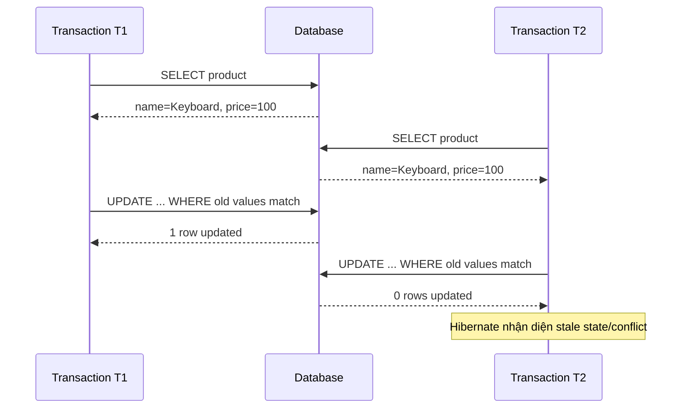

# Khóa lạc quan không dùng cột phiên bản và giới hạn của các cơ chế mở rộng trong Hibernate

Thông thường, Hibernate dùng thuộc tính `@Version` để triển khai **optimistic locking** (*khóa lạc quan*). Mỗi lần cập nhật thành công, giá trị phiên bản được tăng lên; câu `UPDATE` có điều kiện kiểm tra phiên bản mà transaction đã đọc. Nếu một transaction khác đã cập nhật hàng trước đó, điều kiện không còn khớp và Hibernate phát hiện xung đột.

Tuy nhiên, có những schema cũ không có cột version, hoặc ứng dụng không thể thêm cột mới. Hibernate cung cấp một phần mở rộng cho phép dùng **giá trị các thuộc tính đã đọc làm điều kiện kiểm tra** thay cho một version token. Cơ chế này thường được gọi là *versionless optimistic locking*.

Hai chiến lược chính là:

- `OptimisticLockType.ALL`: kiểm tra các giá trị thuộc tính cũ của entity khi cập nhật.
- `OptimisticLockType.DIRTY`: kiểm tra các giá trị cũ của những thuộc tính đang được thay đổi.

Đây là khả năng riêng của Hibernate, không phải cách ánh xạ optimistic locking di động chuẩn JPA. Nó hữu ích với một số schema legacy, nhưng có những giới hạn quan trọng về dữ liệu detached, thuộc tính không được so sánh, cập nhật đồng thời trên nhiều cột và các invariant nghiệp vụ.

**Không có cột version không có nghĩa là không cần phát hiện xung đột.** Ứng dụng vẫn phải xác định chính xác trạng thái cũ nào được dùng để xác nhận rằng dữ liệu chưa thay đổi ngoài dự kiến.

## 1. Ôn lại optimistic locking với `@Version`

Giả sử bảng `product` có:

```sql
CREATE TABLE product (
    id          BIGINT PRIMARY KEY,
    name        VARCHAR(150) NOT NULL,
    price       NUMERIC(12, 2) NOT NULL,
    description VARCHAR(1000),
    version     BIGINT NOT NULL
);
```

Entity:

```java
import jakarta.persistence.Column;
import jakarta.persistence.Entity;
import jakarta.persistence.Id;
import jakarta.persistence.Table;
import jakarta.persistence.Version;
import java.math.BigDecimal;

@Entity
@Table(name = "product")
public class Product {

    @Id
    private Long id;

    @Column(nullable = false)
    private String name;

    @Column(nullable = false, precision = 12, scale = 2)
    private BigDecimal price;

    private String description;

    @Version
    private long version;

    protected Product() {}

    public void changePrice(BigDecimal nextPrice) {
        this.price = nextPrice;
    }
}
```

Khi Hibernate cập nhật entity, SQL có thể tương đương:

```sql
UPDATE product
SET price = 120.00,
    version = 4
WHERE id = 10
  AND version = 3;
```

Nếu hàng vẫn có `version = 3`, update có thể thành công và version tăng lên 4. Nếu transaction khác đã cập nhật trước và version hiện tại là 4, điều kiện `WHERE version = 3` không còn khớp. Số hàng bị ảnh hưởng bằng 0, Hibernate phát hiện optimistic locking conflict.

Điểm mạnh của cách này là **một token nhỏ đại diện cho trạng thái phiên bản của hàng**. Ứng dụng không cần so sánh mọi cột để biết một cập nhật đã xảy ra.

Nhưng có hệ thống không thể thay đổi schema để thêm `version`. Khi đó, Hibernate có thể so sánh giá trị cũ của các thuộc tính thay vì so sánh token.

## 2. Versionless optimistic locking hoạt động bằng cách nào?

Với versionless locking, Hibernate đưa giá trị đã đọc vào điều kiện `WHERE` của câu lệnh ghi.

Ví dụ entity đã đọc:

```text
id          = 10
name        = "Keyboard"
price       = 100.00
description = "Mechanical"
```

Transaction muốn đổi `price`. Thay vì chỉ kiểm tra `id`, Hibernate còn kiểm tra một hoặc nhiều giá trị cũ:

```sql
UPDATE product
SET price = 120.00
WHERE id = 10
  AND name = 'Keyboard'
  AND price = 100.00
  AND description = 'Mechanical';
```

Nếu một transaction khác đã sửa một giá trị thuộc phạm vi kiểm tra, điều kiện có thể không còn khớp. Hibernate dựa vào số hàng cập nhật để nhận biết xung đột.



Khác biệt so với `@Version`:

- Không có một cột version tăng sau mỗi lần cập nhật.
- SQL có thể chứa nhiều điều kiện so sánh giá trị cũ.
- Kết quả kiểm tra phụ thuộc vào những thuộc tính được đưa vào predicate.
- Nếu giá trị cũ đã thay đổi rồi lại trở về đúng giá trị ban đầu, so sánh theo giá trị có thể không nhận ra lịch sử cập nhật đó.

Hibernate cung cấp hai phạm vi so sánh phổ biến là `ALL` và `DIRTY`.

## 3. `OptimisticLockType.ALL`: so sánh toàn bộ trạng thái thuộc tính

Đặt annotation Hibernate trên entity:

```java
import jakarta.persistence.Entity;
import jakarta.persistence.Id;
import jakarta.persistence.Table;
import org.hibernate.annotations.OptimisticLockType;
import org.hibernate.annotations.OptimisticLocking;

@Entity
@Table(name = "product")
@OptimisticLocking(type = OptimisticLockType.ALL)
public class Product {

    @Id
    private Long id;

    private String name;

    private BigDecimal price;

    private String description;

    protected Product() {}
}
```

Với `ALL`, Hibernate dùng các giá trị cũ của những thuộc tính persistent phù hợp để kiểm tra trạng thái hàng. Câu SQL minh họa khi đổi giá:

```sql
UPDATE product
SET price = 120.00
WHERE id = 10
  AND name = 'Keyboard'
  AND price = 100.00
  AND description = 'Mechanical';
```

Tên và mô tả không thay đổi vẫn có thể xuất hiện trong điều kiện `WHERE`. Mục tiêu là phát hiện bất kỳ thay đổi nào trong phạm vi thuộc tính được kiểm tra kể từ khi trạng thái ban đầu được đọc.

### 3.1. ALL phát hiện cả thay đổi ở thuộc tính không được sửa trong T1

Giả sử T1 chỉ sửa `price`, còn T2 chỉ sửa `description`:

```text
Trạng thái ban đầu:
  name = Keyboard
  price = 100.00
  description = Mechanical

T1 đọc trạng thái trên và sửa price = 120.00.
T2 đọc trạng thái trên và sửa description = Compact.
```

T1 chạy update trước. Sau khi T1 commit, hàng có `description = Compact`. Khi T2 cố cập nhật, điều kiện ALL vẫn yêu cầu `description = Mechanical`, nên không còn khớp.

Kết quả: T2 bị phát hiện xung đột, dù hai transaction sửa hai thuộc tính khác nhau.

Đây là hành vi **bảo thủ**: bất kỳ thay đổi nào trong phạm vi so sánh đều có thể khiến transaction sau phải đọc lại và quyết định lại.

### 3.2. Khi nào ALL hữu ích?

`ALL` có thể phù hợp khi:

- Schema legacy không có version column.
- Entity có số lượng thuộc tính vừa phải.
- Mọi thay đổi trên cùng hàng cần được phát hiện, kể cả thay đổi ở thuộc tính khác với thuộc tính đang sửa.
- Ứng dụng chấp nhận conflict nhiều hơn và có quy trình xử lý/retry rõ ràng.

Nó không tự tạo ra một snapshot transaction trên nhiều hàng, cũng không bảo vệ mọi invariant của domain. Phạm vi chính là kiểm tra những giá trị hàng được ánh xạ và tham gia cơ chế locking.

## 4. `OptimisticLockType.DIRTY`: chỉ kiểm tra thuộc tính đang thay đổi

`DIRTY` thu hẹp điều kiện kiểm tra vào những thuộc tính Hibernate xác định là dirty trong lần cập nhật hiện tại.

Ví dụ:

```java
import jakarta.persistence.Entity;
import jakarta.persistence.Id;
import jakarta.persistence.Table;
import org.hibernate.annotations.DynamicUpdate;
import org.hibernate.annotations.OptimisticLockType;
import org.hibernate.annotations.OptimisticLocking;

@Entity
@Table(name = "product")
@DynamicUpdate
@OptimisticLocking(type = OptimisticLockType.DIRTY)
public class Product {

    @Id
    private Long id;

    private String name;

    private BigDecimal price;

    private String description;

    protected Product() {}

    public void changePrice(BigDecimal nextPrice) {
        this.price = nextPrice;
    }

    public void changeDescription(String nextDescription) {
        this.description = nextDescription;
    }
}
```

`@DynamicUpdate` yêu cầu Hibernate chỉ đưa những cột cần cập nhật vào phần `SET` của SQL. Với chiến lược `DIRTY`, đây là phần cấu hình quan trọng để các cập nhật ở những thuộc tính khác nhau không vô tình ghi lại giá trị cũ của nhau.

Nếu T1 chỉ đổi `price`, SQL minh họa:

```sql
UPDATE product
SET price = 120.00
WHERE id = 10
  AND price = 100.00;
```

Nếu T2 chỉ đổi `description`, SQL có thể là:

```sql
UPDATE product
SET description = 'Compact'
WHERE id = 10
  AND description = 'Mechanical';
```

Hai điều kiện không kiểm tra thuộc tính mà transaction kia đang sửa. Vì vậy, cả hai update có thể thành công và giữ lại cả hai thay đổi.

### 4.1. DIRTY cho phép cập nhật đồng thời các thuộc tính khác nhau

Timeline:

```text
Ban đầu: price=100, description=Mechanical

T1: đổi price
    WHERE id=10 AND price=100
    SET price=120

T2: đổi description
    WHERE id=10 AND description=Mechanical
    SET description=Compact
```

Sau khi T1 cập nhật, giá trị `description` vẫn là `Mechanical`, nên điều kiện của T2 vẫn khớp. T2 có thể cập nhật thành công mà không ghi đè giá mới của T1, vì `@DynamicUpdate` chỉ ghi cột description.

Đây là ưu điểm của `DIRTY` khi nhiều người dùng sửa các phần dữ liệu độc lập trên cùng một hàng.

### 4.2. DIRTY vẫn phát hiện hai transaction sửa cùng thuộc tính

Nếu cả T1 và T2 cùng sửa `price` từ giá trị ban đầu 100:

```sql
-- T1:
UPDATE product
SET price = 120.00
WHERE id = 10 AND price = 100.00;

-- T2:
UPDATE product
SET price = 130.00
WHERE id = 10 AND price = 100.00;
```

Sau khi T1 thành công, `price` không còn bằng 100. T2 cập nhật 0 hàng và Hibernate phát hiện conflict.

Vì vậy `DIRTY` không có nghĩa “không kiểm tra xung đột”. Nó kiểm tra theo **những thuộc tính transaction đang sửa**, nên ít xung đột hơn `ALL` khi các cập nhật độc lập.

## 5. Vì sao `DIRTY` cần `@DynamicUpdate`?

Giả sử Hibernate chỉ kiểm tra thuộc tính dirty trong `WHERE` nhưng vẫn ghi mọi cột trong `SET`.

T1 sửa `price`; T2 sửa `description`. Nếu T1 commit trước, T2 có thể gửi một câu SQL kiểu:

```sql
UPDATE product
SET name = 'Keyboard',
    price = 100.00,
    description = 'Compact'
WHERE id = 10
  AND description = 'Mechanical';
```

Điều kiện chỉ kiểm tra description, nhưng phần SET lại ghi `price = 100` — giá trị cũ T2 đã đọc. Như vậy T2 có thể ghi đè giá mới của T1, dù hai transaction sửa hai thuộc tính khác nhau.

`@DynamicUpdate` tránh tình huống đó bằng cách chỉ ghi các cột thực sự dirty:

```sql
UPDATE product
SET description = 'Compact'
WHERE id = 10
  AND description = 'Mechanical';
```

Vì thế, khi dùng `OptimisticLockType.DIRTY`, cấu hình `@DynamicUpdate` là phần đi cùng quan trọng của chiến lược.

### 5.1. Dynamic update có đánh đổi riêng

`@DynamicUpdate` khiến Hibernate sinh nhiều hình dạng SQL tùy tập thuộc tính thay đổi. Điều này có thể:

- Giảm số cột bị ghi không cần thiết.
- Tránh ghi đè các thay đổi ở thuộc tính khác trong trường hợp DIRTY.
- Tăng số biến thể câu SQL, ảnh hưởng statement cache hoặc JDBC batching.
- Tăng công việc tạo SQL động ở runtime.

Không bật `@DynamicUpdate` trên mọi entity chỉ vì thấy nó có vẻ tiết kiệm. Đánh giá dựa trên số thuộc tính, workload và chiến lược locking thực tế.

## 6. So sánh ALL và DIRTY qua hai transaction

Bảng sau giả định cùng một hàng ban đầu và hai transaction thay đổi hai thuộc tính khác nhau:

| Tiêu chí | `ALL` | `DIRTY` + `@DynamicUpdate` |
|---|---|---|
| Thuộc tính trong `WHERE` | Các thuộc tính persistent tham gia kiểm tra | Các thuộc tính dirty của update hiện tại |
| Sửa hai field khác nhau | Transaction thứ hai thường conflict nếu transaction thứ nhất đổi field thuộc phạm vi ALL | Có thể cùng thành công |
| Sửa cùng một field | Phát hiện conflict khi giá trị cũ không còn khớp | Phát hiện conflict khi giá trị cũ của field dirty không còn khớp |
| Nguy cơ ghi đè field khác | Thấp hơn do kiểm tra toàn bộ trạng thái; vẫn phụ thuộc SQL và mapping | Cần dynamic update để chỉ ghi field dirty |
| Mức conflict | Bảo thủ, có thể nhiều false conflict theo nghĩa nghiệp vụ | Ít conflict hơn, cho phép cập nhật độc lập |
| Bảo vệ invariant nhiều field | Có thể phát hiện thay đổi khác field trên cùng hàng | Có thể cho cả hai update qua dù invariant kết hợp bị vi phạm |
| Cột version | Không cần | Không cần |
| Chuẩn JPA | Không, Hibernate extension | Không, Hibernate extension |

“False conflict” ở đây có nghĩa là hai thao tác nghiệp vụ có thể độc lập nhưng ALL vẫn yêu cầu một transaction phải thử lại vì một field khác đã đổi. Đây không phải lỗi của cơ chế; đó là mức kiểm soát bảo thủ mà ứng dụng đã chọn.

## 7. Cấu hình `@SelectBeforeUpdate` và entity detached

Khi entity đã detached, Hibernate có thể thiếu snapshot cần thiết để xác định những thuộc tính nào đã thay đổi so với database. Trong một số đường reattachment/update detached entity của Hibernate, annotation `@SelectBeforeUpdate` yêu cầu đọc trạng thái hiện tại từ database trước khi thực hiện update.

Ví dụ cấu hình kết hợp thường gặp:

```java
import org.hibernate.annotations.DynamicUpdate;
import org.hibernate.annotations.OptimisticLockType;
import org.hibernate.annotations.OptimisticLocking;
import org.hibernate.annotations.SelectBeforeUpdate;

@Entity
@DynamicUpdate
@SelectBeforeUpdate
@OptimisticLocking(type = OptimisticLockType.DIRTY)
public class LegacyCustomer {

    @Id
    private Long id;

    private String displayName;

    private String phoneNumber;

    protected LegacyCustomer() {}
}
```

`@SelectBeforeUpdate` là annotation Hibernate-specific. Nó có thể hữu ích trong các luồng dùng API cập nhật detached entity mà cần snapshot để xác định dirty state.

Cần phân biệt ba khái niệm:

- **Snapshot của Hibernate:** trạng thái database mà Hibernate dùng để dirty-check trong một persistence context.
- **Trạng thái detached object:** những field còn lại trong object Java sau khi context cũ kết thúc.
- **Version token của client:** một giá trị phiên bản được gửi qua nhiều request/transaction để chứng minh client đang sửa đúng phiên bản mà nó đã đọc.

`@SelectBeforeUpdate` có thể giúp Hibernate lấy snapshot cho một đường cập nhật detached cụ thể, nhưng **không biến object detached thành một bản ghi có version token bền vững**.

### 7.1. `merge` không phải cơ chế khôi phục lịch sử trạng thái của client

JPA `merge(detached)` sao chép state từ object detached sang managed instance và trả về instance managed. Nó không gắn lại nguyên object cũ và cũng không tự biết client đã đọc dữ liệu từ bao lâu trước.

Ví dụ:

```java
Product detached = requestMapper.toProduct(request);

// Trong persistence context mới:
Product managed = entityManager.merge(detached);
```

Nếu detached object chứa dữ liệu cũ, việc merge có thể sao chép những giá trị cũ đó vào managed entity vừa được tải. Không có version token từ lần đọc ban đầu, Hibernate không thể luôn phân biệt “client cố ý đặt lại giá trị” với “client đang ghi state lỗi thời”.

Versionless ALL/DIRTY bảo vệ cập nhật dựa trên snapshot và đường SQL mà Hibernate đang sử dụng; nó **không tự cung cấp đầy đủ cơ chế phát hiện stale edit qua nhiều request như một version token được giữ trong DTO**.

### 7.2. Thiết kế API cập nhật detached an toàn

Nếu ứng dụng nhận request cập nhật từ trình duyệt hoặc client bên ngoài, nên cân nhắc:

- Dùng `@Version` và trả version trong response để client gửi lại expected version.
- Nếu không thể thêm cột version, lưu một token revision riêng hoặc so sánh expected values được client gửi một cách tường minh.
- Tải managed entity trong transaction hiện tại rồi áp dụng các field client thực sự thay đổi.
- Phân biệt field không được gửi, field được gửi `null` và field được gửi giá trị mới.
- Không merge một object graph thiếu dữ liệu như thể nó đại diện toàn bộ trạng thái entity.

Đừng giả định `@SelectBeforeUpdate` tự giải quyết mọi xung đột giữa một form cũ và dữ liệu mới đã được người khác lưu.

## 8. Giới hạn thứ nhất: không phát hiện được lịch sử thay đổi nếu giá trị quay lại như cũ

Versionless locking so sánh **giá trị**, không có bộ đếm thay đổi.

Giả sử T1 đọc `price = 100`. Trong lúc đó, T2 thực hiện:

```text
100 -> 120 -> 100
```

Nếu cả hai thay đổi của T2 đã commit trước khi T1 cập nhật, giá trị cuối cùng vẫn là 100. Điều kiện của T1:

```sql
WHERE id = 10 AND price = 100.00
```

vẫn có thể khớp.

Đây là dạng vấn đề thường được gọi là **ABA**: giá trị trở về A sau khi từng chuyển sang B. So sánh giá trị cũ không biết rằng giữa hai thời điểm đã có một hoặc nhiều cập nhật.

Với `@Version`, nếu mỗi lần cập nhật thành công đều tăng version, T1 có thể nhận ra version đã đổi dù giá trị price quay lại 100.

Nếu nghiệp vụ cần phát hiện **mọi lần sửa**, kể cả khi giá trị cuối cùng giống giá trị ban đầu, version token hoặc audit/revision mechanism phù hợp hơn.

## 9. Giới hạn thứ hai: phạm vi thuộc tính được kiểm tra không phải toàn bộ database

ALL/DIRTY hoạt động trên các thuộc tính persistent mà Hibernate đưa vào optimistic predicate theo mapping và cơ chế của phiên bản đang dùng. Không được suy luận rằng mọi dữ liệu liên quan tới entity đều tự động tham gia.

Những phần cần xem xét riêng:

- Thuộc tính không được ánh xạ thành cột thông thường.
- Trường tính toán bằng `@Formula` hoặc dữ liệu đọc từ view.
- Thuộc tính được sinh/cập nhật bởi database trigger.
- Quan hệ và collection có bảng riêng.
- Secondary table hoặc inheritance mapping.
- LOB, kiểu dữ liệu đặc thù và phép so sánh phụ thuộc DBMS.
- Trường bị loại khỏi chính sách optimistic locking bởi cấu hình Hibernate cụ thể.

Ví dụ, `Customer.orders` là collection ở bảng `purchase_order`. Việc thêm một order không đồng nghĩa Hibernate so sánh toàn bộ số order như một cột của hàng `customer` khi cập nhật customer.

Nếu một invariant phụ thuộc nhiều bảng, versionless locking trên một entity đơn không tự bảo vệ invariant đó.

### 9.1. `@OptimisticLock(excluded = true)` cần được hiểu đúng phạm vi

Hibernate có annotation `@OptimisticLock` cho một số mapping/property nhằm điều khiển ảnh hưởng của thuộc tính đến optimistic locking, đặc biệt trong các tình huống liên quan versioned entity và collection.

Không dùng annotation này theo suy đoán để “bỏ qua một cột cho nhanh”. Hãy kiểm tra semantics của đúng phiên bản Hibernate và loại mapping. Nếu một field bị loại khỏi phạm vi kiểm tra, thay đổi field đó có thể không tạo conflict theo chính sách mà ứng dụng kỳ vọng.

Không nên dựa vào một thuộc tính excluded để bảo vệ invariant liên quan đến thuộc tính đó.

## 10. Giới hạn thứ ba: cập nhật độc lập từng field có thể phá invariant nghiệp vụ

`DIRTY` có thể cho phép hai transaction sửa các field khác nhau trên cùng hàng. Đây là ưu điểm về concurrency, nhưng có thể nguy hiểm nếu các field có quan hệ nghiệp vụ.

Ví dụ bảng `product_offer`:

```sql
CREATE TABLE product_offer (
    id            BIGINT PRIMARY KEY,
    price         NUMERIC(12, 2) NOT NULL,
    discount_rate NUMERIC(5, 2) NOT NULL,
    final_price   NUMERIC(12, 2) NOT NULL
);
```

Giả sử invariant là:

```text
final_price = price * (1 - discount_rate / 100)
```

T1 cập nhật `price`, T2 cập nhật `discount_rate`. Nếu cả hai được phép thành công qua DIRTY, kết quả cuối có thể chứa giá mới và discount mới nhưng `final_price` do một transaction tính dựa trên dữ liệu cũ.

Cả hai update riêng lẻ đều không đụng cùng một field, nhưng **kết quả kết hợp có thể sai**.

Các cách xử lý tùy nghiệp vụ:

1. Dùng `ALL` để thay đổi bất kỳ field nào cũng làm transaction kia conflict.
2. Gom các field liên quan vào một thao tác domain và cập nhật cùng transaction.
3. Dùng `@Version` nếu schema cho phép.
4. Tính giá cuối trong một SQL expression/constraint có thể bảo vệ ở database.
5. Dùng lock hoặc isolation mạnh hơn khi invariant vượt ra ngoài một hàng.

Không chọn DIRTY chỉ vì nó giảm conflict. Chọn khi các field được cập nhật độc lập **thật sự độc lập theo nghiệp vụ**.

## 11. Giới hạn thứ tư: write skew và xung đột trên nhiều hàng

Ngay cả `ALL` cũng chủ yếu kiểm tra trạng thái của hàng entity được cập nhật. Nó không tự khóa một điều kiện truy vấn trên nhiều hàng.

Ví dụ: một nhóm phải có ít nhất một người trực. T1 cập nhật hàng bác sĩ A; T2 cập nhật hàng bác sĩ B. Mỗi transaction có thể kiểm tra trạng thái tổng thể rồi sửa một hàng riêng. Nếu hai hàng không cùng bị cập nhật bởi cả hai transaction, optimistic predicate trên từng hàng không nhất thiết phát hiện write skew.

```text
T1: đọc 2 bác sĩ đang trực -> tắt bác sĩ A
T2: đọc 2 bác sĩ đang trực -> tắt bác sĩ B
Kết quả: 0 bác sĩ đang trực
```

Đây là vấn đề isolation/predicate-level concurrency, không chỉ là vấn đề entity versionless.

Có thể cần:

- `SERIALIZABLE` transaction và xử lý serialization failure/retry.
- Một hàng guard được tất cả transaction cập nhật/khóa.
- Constraint database nếu invariant biểu đạt được.
- Thiết kế dữ liệu để thao tác tranh chấp trên cùng một row hoặc token.

`OptimisticLockType.ALL` không tương đương `SERIALIZABLE`; `DIRTY` cũng không thể thay thế khóa phạm vi.

## 12. Null, kiểu dữ liệu và phép so sánh trong SQL

SQL có logic ba giá trị. Biểu thức:

```sql
description = NULL
```

không trả `TRUE` khi description là NULL; kết quả là `UNKNOWN`. Vì vậy, không được tự viết SQL versionless theo kiểu so sánh `= NULL` rồi cho rằng nó tương đương Hibernate.

Hibernate phải sinh điều kiện null-aware phù hợp với dialect, ví dụ dạng:

```sql
description IS NULL
```

hoặc dùng toán tử/cách so sánh null-safe mà DBMS hỗ trợ. Hình dạng thực tế phụ thuộc dialect và phiên bản.

Ngoài null, cần xem semantics của:

- Chuỗi theo collation, phân biệt hoa/thường hoặc dấu.
- `BigDecimal` và scale/precision.
- Timestamp, timezone và độ chính xác lưu trữ.
- Kiểu JSON/array và kiểu đặc thù của DBMS.
- Binary/LOB có hỗ trợ so sánh trong predicate hay không.
- Trigger hoặc generated column thay đổi giá trị sau câu update.

Nếu một thuộc tính không thể so sánh ổn định theo cách Hibernate cần, nó có thể không phù hợp để làm thành phần versionless optimistic predicate. Kiểm tra SQL thực tế và hỗ trợ của DBMS trước khi dựa vào nó.

## 13. LOB và cột lớn có thể làm predicate nặng hoặc không khả thi

Nếu entity có trường nội dung rất lớn:

```java
@Lob
@Column(name = "document_body")
private String documentBody;
```

đưa nội dung LOB vào điều kiện so sánh có thể gây:

- Câu SQL dài hoặc bind parameter lớn.
- Chi phí truyền dữ liệu và so sánh cao.
- Hạn chế của DBMS/JDBC driver đối với so sánh LOB.
- Khó tối ưu hoặc không thể dùng phép so sánh thông thường.
- Tăng rủi ro phát sinh SQL không tương thích giữa các dialect.

Không giả định `ALL` sẽ luôn tạo được predicate đơn giản trên mọi kiểu cột. Với entity có LOB hoặc kiểu đặc biệt, cần thử trên DBMS đích và xem SQL thực tế.

Nếu cần phát hiện thay đổi trên một tài liệu lớn, có thể cân nhắc hash/checksum được quản lý có chủ đích, một revision token riêng hoặc tách nội dung lớn khỏi entity metadata. Nhưng checksum cũng phải được cập nhật nguyên tử và bảo vệ bằng constraint/transaction phù hợp.

## 14. Thuộc tính do trigger hoặc hệ thống ngoài cập nhật

Một số bảng legacy có trigger tự thay đổi:

- `updated_at`.
- Trạng thái đồng bộ.
- Mã chuẩn hóa.
- Giá trị tổng hợp.
- Cột audit do DBMS quản lý.

Nếu Hibernate đọc snapshot nhưng trigger hoặc một writer bên ngoài thay đổi thêm field, predicate ALL có thể không khớp trong lần cập nhật sau. Đây có thể là phát hiện conflict mong muốn, nhưng cũng có thể tạo xung đột thường xuyên nếu field thay đổi tự động.

Ngược lại, nếu một thuộc tính không nằm trong phạm vi kiểm tra, cập nhật ngoài ORM có thể không bị phát hiện.

Cần thống nhất:

1. Ai là nguồn ghi chính của từng field?
2. Trigger thay đổi field nào?
3. Hibernate có đọc lại generated value sau update không?
4. Field đó có tham gia optimistic predicate không?
5. Các writer ngoài Hibernate có tuân theo cùng quy tắc concurrency không?

Versionless locking chỉ đáng tin khi phạm vi state được so sánh và mọi đường ghi được hiểu rõ.

## 15. Không nhầm optimistic predicate với foreign key hoặc unique constraint

Các cơ chế database giải quyết câu hỏi khác nhau:

| Cơ chế | Bảo vệ điều gì |
|---|---|
| Foreign key | Giá trị tham chiếu phải trỏ tới hàng hợp lệ |
| Unique constraint | Không có hai hàng vi phạm tính duy nhất |
| Check constraint | Giá trị/hàng phải thỏa biểu thức điều kiện |
| `@Version` hoặc versionless optimistic locking | Phát hiện cập nhật dựa trên trạng thái cũ không còn phù hợp |
| Pessimistic lock | Điều phối truy cập đồng thời bằng khóa DBMS |
| Transaction isolation | Quy định những thay đổi transaction được phép quan sát và xung đột được xử lý |

Ví dụ, `UNIQUE(email)` vẫn cần thiết dù entity dùng `OptimisticLockType.ALL`. Nếu hai transaction đồng thời tạo hai customer cùng email, optimistic locking trên từng hàng customer hiện có không tự thay thế unique constraint.

Tương tự, ALL/DIRTY không tự bảo đảm `balance >= 0`. Constraint hoặc atomic update phù hợp vẫn cần thiết.

## 16. Xử lý conflict khi Hibernate phát hiện stale state

Khi câu update có optimistic predicate ảnh hưởng 0 hàng, Hibernate có thể phát hiện stale state. Tùy API và framework, ứng dụng có thể thấy:

- `jakarta.persistence.OptimisticLockException`.
- `org.hibernate.StaleObjectStateException` hoặc lỗi stale state tương ứng.
- Exception được Spring dịch sang nhóm optimistic locking failure.

Tên exception chính xác phụ thuộc đường gọi, Hibernate version và lớp tích hợp.

### 16.1. Không tiếp tục dùng transaction lỗi như bình thường

Khi optimistic conflict xuất hiện:

1. Rollback transaction/unit of work hiện tại theo transaction manager.
2. Không cố flush lại state cũ trong cùng persistence context như thể chưa có gì xảy ra.
3. Thông báo conflict hoặc tải lại dữ liệu mới trong transaction mới.
4. Nếu retry được, thực hiện lại **toàn bộ thao tác nghiệp vụ** trên trạng thái mới.
5. Giới hạn số lần retry và bảo đảm thao tác có tính idempotent khi cần.

Không nên tự động retry một phép chuyển tiền, tạo đơn hoặc gửi thông báo mà không xét side effect đã xảy ra ngoài transaction.

### 16.2. Conflict không nhất thiết có nghĩa “một người khác vừa sửa”

Số hàng update bằng 0 có thể do:

- Hàng đã bị xóa.
- Một giá trị trong optimistic predicate đã thay đổi.
- Điều kiện tenant/filter hoặc soft-delete không còn khớp.
- Mapping và SQL predicate không phù hợp dữ liệu.
- Trigger hoặc writer khác làm thay đổi cột được kiểm tra.

Thông báo người dùng có thể nói “dữ liệu đã thay đổi hoặc không còn tồn tại; hãy tải lại”, thay vì khẳng định chắc chắn có người khác chỉnh sửa.

## 17. ALL/DIRTY có làm giảm khả năng batching không?

SQL của versionless locking có thể có nhiều predicate và bind parameter hơn so với `@Version`. Với `DIRTY` kết hợp `@DynamicUpdate`, số dạng SQL phụ thuộc tập thuộc tính thay đổi.

Điều này có thể ảnh hưởng:

- JDBC statement batching nếu nhiều entity có các tập dirty field khác nhau.
- Statement cache vì có nhiều câu SQL với hình dạng khác nhau.
- Chi phí bind parameter và parse SQL.
- Execution plan tùy DBMS và kiểu dữ liệu.
- Khả năng quan sát/logging do câu SQL dài hơn.

Dù predicate có nhiều cột, điều kiện `id = ?` thường vẫn cho DBMS định vị một hàng qua primary key; các phép so sánh còn lại xác nhận trạng thái. Không nên suy ra rằng mọi cột trong WHERE đều cần một index riêng. Đánh giá bằng execution plan và workload thực tế.

## 18. Cách kiểm tra mapping versionless trong môi trường thật

Một thử nghiệm tối thiểu nên tạo hai persistence context độc lập và điều phối transaction:

1. T1 load product và giữ trạng thái cũ.
2. T2 load cùng product.
3. T1 sửa một field và flush/commit.
4. T2 sửa field theo kịch bản đang thử và flush.
5. Quan sát số hàng cập nhật, SQL và exception.
6. Lặp lại với cùng field và khác field.

### 18.1. Kịch bản ALL

Với `ALL`, T1 và T2 sửa hai thuộc tính khác nhau. Sau khi T1 commit, T2 thường phải conflict vì ít nhất một giá trị cũ trong predicate ALL đã thay đổi.

### 18.2. Kịch bản DIRTY

Với `DIRTY` và `@DynamicUpdate`:

- Cùng sửa `price`: transaction sau phải conflict nếu giá cũ đã đổi.
- Một transaction sửa `price`, transaction kia sửa `description`: cả hai có thể thành công nếu các field độc lập và predicate riêng vẫn khớp.

### 18.3. Kiểm tra SQL

Bật SQL logging trong môi trường kiểm thử và xem:

- Các cột xuất hiện trong `SET`.
- Các cột xuất hiện trong `WHERE`.
- Điều kiện cho giá trị `NULL`.
- Số hàng update.
- Thời điểm exception xuất hiện: flush hay commit.

Không chỉ kiểm tra exception bằng unit test mock; cơ chế phụ thuộc SQL thực tế và row count của DBMS.

## 19. Ví dụ test tích hợp với hai transaction

Đoạn dưới minh họa cấu trúc điều phối. Phần tạo `EntityManagerFactory`, dữ liệu fixture và transaction helper tùy test framework của dự án.

```java
EntityManager em1 = emf.createEntityManager();
EntityManager em2 = emf.createEntityManager();

try {
    em1.getTransaction().begin();
    em2.getTransaction().begin();

    Product p1 = em1.find(Product.class, 10L);
    Product p2 = em2.find(Product.class, 10L);

    // T1 thay đổi giá.
    p1.changePrice(new BigDecimal("120.00"));
    em1.flush();

    // T2 thay đổi mô tả.
    p2.changeDescription("Compact");

    // Với ALL: có thể conflict vì giá đã thay đổi.
    // Với DIRTY + DynamicUpdate: có thể thành công,
    // vì T2 chỉ kiểm tra description cũ.
    em2.flush();

    em1.getTransaction().commit();
    em2.getTransaction().commit();
} catch (RuntimeException ex) {
    if (em1.getTransaction().isActive()) {
        em1.getTransaction().rollback();
    }
    if (em2.getTransaction().isActive()) {
        em2.getTransaction().rollback();
    }
    throw ex;
} finally {
    em1.close();
    em2.close();
}
```

Đây là mẫu minh họa thứ tự, không phải test portable hoàn chỉnh. Trong thực tế, nếu `em2.flush()` conflict, transaction T2 đã có thể ở trạng thái rollback-only; không gọi commit T2 như thể flush thành công. Mỗi kịch bản test cần fixture mới hoặc rollback/khởi tạo lại dữ liệu để không phụ thuộc kết quả lần trước.

## 20. Versionless locking với quan hệ và collection

Một entity có thể chứa:

```java
@OneToMany(mappedBy = "product")
private List<ProductReview> reviews;
```

Những review này thường nằm trong bảng riêng. Thêm review không nhất thiết cập nhật hàng `product`; do đó optimistic locking ALL trên product không tự phát hiện một review vừa được thêm.

Nếu nghiệp vụ yêu cầu “chỉ cho phép thay đổi giá khi không có review mới”, cần cơ chế khác:

- Khóa hoặc version trên một hàng đại diện trạng thái nghiệp vụ.
- Cập nhật revision của product khi thêm review theo một protocol thống nhất.
- Dùng transaction isolation phù hợp với predicate.
- Thiết kế constraint nếu điều kiện có thể biểu diễn ở database.

Đừng hiểu chữ `ALL` là “mọi hàng trong toàn bộ graph entity”. Nó là phạm vi thuộc tính của entity được mapping, không phải khóa toàn bộ các bảng liên quan.

## 21. Khi nào nên chọn @Version thay vì versionless locking?

Nếu có thể thay đổi schema, `@Version` thường là lựa chọn đơn giản và dễ giải thích hơn.

| Tiêu chí | `@Version` | Versionless `ALL` | Versionless `DIRTY` |
|---|---|---|---|
| Cần cột version | Có | Không | Không |
| Cơ chế kiểm tra | Token phiên bản | Giá trị cũ của nhiều thuộc tính | Giá trị cũ của thuộc tính dirty |
| Phát hiện cập nhật rồi đổi giá trị trở lại | Có thể phát hiện nhờ version tăng | Có thể không phát hiện | Có thể không phát hiện nếu field liên quan trở về giá trị cũ |
| Cập nhật khác field trên cùng hàng | Conflict nếu version đã tăng | Thường conflict | Có thể cùng thành công |
| Tính di động JPA | Chuẩn | Hibernate-specific | Hibernate-specific |
| Phụ thuộc so sánh kiểu cột | Thấp hơn | Cao hơn | Cao hơn |
| Phù hợp schema legacy không sửa được | Không nếu thật sự không thể thêm cột | Có thể | Có thể |
| Bảo vệ invariant nhiều field cùng hàng | Token bao quát các update có version | Bảo thủ trên field được kiểm tra | Cần xem các field dirty và invariant |
| Stale client qua nhiều request | Có thể gửi version token cho client | Không có token bền vững tương đương | Không có token bền vững tương đương |

Nếu một hệ thống có thể thêm cột version, chi phí migration thường đáng cân nhắc so với các giới hạn lâu dài của so sánh toàn bộ thuộc tính.

## 22. Một số cấu hình cần tránh

### 22.1. DIRTY nhưng quên DynamicUpdate

Đây là cấu hình dễ tạo hiểu lầm: predicate chỉ kiểm tra field dirty nhưng câu update lại ghi cả field không đổi. Transaction sau có thể ghi đè thay đổi mà nó không hề kiểm tra.

Hãy kết hợp `@OptimisticLocking(type = OptimisticLockType.DIRTY)` với `@DynamicUpdate` theo hướng dẫn Hibernate của phiên bản dự án.

### 22.2. ALL trên entity có nhiều cột không thể so sánh ổn định

Nếu entity có LOB, generated column hoặc kiểu dữ liệu đặc thù, predicate ALL có thể không tương thích hoặc rất tốn kém. Kiểm tra mapping và SQL thực tế trước khi áp dụng.

### 22.3. DIRTY cho dữ liệu có invariant liên cột

Nếu price, discount, tax và final amount phải nhất quán với nhau, cho phép các transaction sửa từng field độc lập có thể tạo trạng thái sai. Dùng ALL hoặc cơ chế bảo vệ invariant phù hợp.

### 22.4. Xem @SelectBeforeUpdate như version token

SELECT trước UPDATE không cung cấp một revision bền vững cho client. Nó không thay thế token phiên bản truyền qua nhiều request và không giải quyết stale form một cách tổng quát.

### 22.5. Chỉ thử trên một persistence context

Hai lần đọc trong cùng context không tạo concurrency. Muốn thử optimistic conflict phải có hai context/transaction độc lập và điều phối thứ tự cập nhật.

### 22.6. Bỏ qua writer ngoài Hibernate

Nếu batch SQL, ETL hoặc service khác cập nhật cùng bảng, phải kiểm tra chúng có tương tác đúng với predicate hay không. Một writer không tuân theo version protocol vẫn có thể gây tình huống mà ứng dụng không dự đoán.

## 23. Bài thực hành: cập nhật sản phẩm từ hai màn hình

Một màn hình quản trị cho phép sửa giá; màn hình nội dung cho phép sửa mô tả. Cả hai dùng cùng entity `Product` và schema legacy không có cột version.

Dữ liệu ban đầu:

```text
id = 10
name = Keyboard
price = 100.00
description = Mechanical
```

### Yêu cầu

1. Ánh xạ `Product` bằng `OptimisticLockType.ALL` và viết SQL logic khi thay giá.
2. Đổi sang `DIRTY` + `DynamicUpdate`. Viết SQL logic cho transaction thay mô tả.
3. Mô tả kết quả khi hai transaction sửa cùng `price`.
4. Mô tả kết quả khi T1 sửa `price`, T2 sửa `description`.
5. Nêu vì sao không nên dùng DIRTY nếu `price` và `description` cùng tham gia một invariant cần kiểm tra như một khối.
6. Giải thích vì sao `@SelectBeforeUpdate` không thể thay thế version token gửi tới client.

### Gợi ý giải

Với `ALL`, khi T1 đổi giá, predicate có thể kiểm tra `name`, `price` và `description` theo trạng thái cũ. Nếu T2 đổi mô tả trước khi T1 update, một giá trị trong predicate không còn khớp và T1 conflict.

Với `DIRTY`, T1 đổi giá có predicate trên giá cũ; T2 đổi mô tả có predicate trên mô tả cũ. Khi dùng `@DynamicUpdate`, mỗi câu update chỉ ghi cột dirty nên hai thay đổi độc lập có thể cùng thành công.

Nếu cả hai sửa giá, transaction sau thấy giá cũ không còn khớp và conflict. Nếu các field có invariant chung, DIRTY có thể cho phép kết hợp những thay đổi mà domain không cho phép; phải dùng ALL hoặc cơ chế concurrency/constraint khác.

`@SelectBeforeUpdate` hỗ trợ một số đường update detached cần snapshot, nhưng không giữ revision token của lần đọc ban đầu qua một khoảng thời gian dài và không tự biết request đang dựa trên phiên bản dữ liệu nào.

## 24. Câu hỏi tự kiểm tra

**1.** Versionless optimistic locking khác `@Version` ở điểm nào?

**Trả lời:** Nó dùng các giá trị thuộc tính cũ làm điều kiện `WHERE` thay cho một cột version được tăng sau update.

**2.** ALL và DIRTY khác nhau ra sao?

**Trả lời:** ALL kiểm tra phạm vi thuộc tính rộng hơn, còn DIRTY chỉ kiểm tra các thuộc tính đang thay đổi. Vì vậy DIRTY có thể cho phép hai update độc lập trên cùng hàng cùng thành công.

**3.** Vì sao DIRTY cần `@DynamicUpdate`?

**Trả lời:** Để câu `UPDATE` chỉ ghi các cột dirty, tránh ghi lại giá trị cũ của những field khác và ghi đè thay đổi của transaction khác.

**4.** Hai transaction cùng sửa một field trong DIRTY có thể cùng thành công không?

**Trả lời:** Nếu transaction đầu đã đổi giá trị, predicate kiểm tra giá trị cũ của transaction sau thường không còn khớp, nên transaction sau bị phát hiện conflict.

**5.** Vì sao ALL có thể tạo conflict dù hai người sửa field khác nhau?

**Trả lời:** Vì predicate kiểm tra cả các giá trị cũ ngoài field dirty; một thay đổi ở field bất kỳ trong phạm vi so sánh cũng làm predicate không khớp.

**6.** `@SelectBeforeUpdate` có thay thế `@Version` cho stale client request không?

**Trả lời:** Không. Nó có thể lấy snapshot trong một đường cập nhật detached, nhưng không cung cấp revision token bền vững xuyên nhiều request.

**7.** Versionless locking có phát hiện giá trị thay đổi rồi trở về như cũ không?

**Trả lời:** Không nhất thiết. Nếu giá trị hiện tại bằng giá trị cũ trong predicate, update vẫn có thể khớp; version counter có thể phát hiện lịch sử cập nhật đó.

**8.** ALL có bảo vệ collection ở bảng khác không?

**Trả lời:** Không. ALL kiểm tra thuộc tính của entity được mapping, không tự khóa mọi hàng trong graph quan hệ.

**9.** Vì sao DIRTY có thể phá invariant nhiều field?

**Trả lời:** Hai transaction sửa các field khác nhau có thể cùng thành công, dù giá trị kết hợp sau cùng vi phạm một quy tắc domain.

**10.** Khi optimistic conflict xảy ra, có nên flush lại cùng context không?

**Trả lời:** Thông thường cần rollback unit of work lỗi, tải state mới trong transaction mới và quyết định lại nghiệp vụ; không tiếp tục dùng state stale như bình thường.

## 25. Nguyên tắc ghi nhớ

- **`@Version` vẫn là lựa chọn chuẩn JPA và thường dễ dự đoán nhất** khi schema có thể bổ sung version column.
- **Versionless optimistic locking là phần mở rộng Hibernate**, dùng giá trị thuộc tính cũ trong điều kiện update thay cho version token.
- **`OptimisticLockType.ALL`** phát hiện thay đổi ở phạm vi thuộc tính được kiểm tra, kể cả field không được transaction hiện tại sửa.
- **`OptimisticLockType.DIRTY`** kiểm tra field đang dirty, cho phép các update độc lập trên những field khác nhau.
- **`@DynamicUpdate` cần đi cùng DIRTY** để câu `UPDATE` không ghi lại giá trị cũ của các field khác.
- **`@SelectBeforeUpdate`** hỗ trợ lấy snapshot trong một số luồng update detached, nhưng không phải version token xuyên request.
- **So sánh giá trị không phát hiện chắc chắn lịch sử thay đổi** nếu giá trị quay lại trạng thái ban đầu.
- **Phạm vi locking không bao gồm tự động mọi quan hệ hoặc collection ở bảng khác.**
- **DIRTY có thể làm invariant liên cột bị vi phạm** nếu các field được sửa độc lập nhưng có ràng buộc nghiệp vụ chung.
- **ALL/DIRTY không thay thế transaction isolation, database constraints hoặc pessimistic locks.**
- **Sau conflict, rollback và xử lý lại trong unit of work mới** theo chính sách retry có giới hạn.
- **Phải kiểm tra SQL và behavior trên Hibernate version/DBMS thật**, đặc biệt với LOB, null, generated columns, trigger và detached entities.

Khi schema không thể có cột version, ALL và DIRTY cung cấp hai cách kiểm tra optimistic dựa trên giá trị cũ. Hãy chọn ALL khi mọi thay đổi trên hàng cần được phát hiện; chọn DIRTY khi các thuộc tính có thể được cập nhật độc lập và đã cấu hình dynamic update. Nếu nghiệp vụ cần phát hiện mọi lần sửa, bảo vệ dữ liệu qua nhiều request hoặc giữ invariant trên nhiều hàng, hãy đánh giá thêm version token, lock, isolation và constraint ở database. Không có một annotation đơn lẻ nào thay thế được thiết kế concurrency ở cả tầng ORM lẫn tầng dữ liệu.
