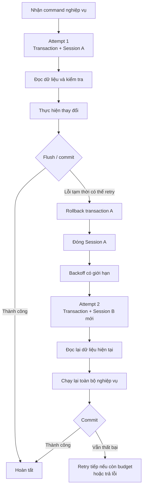
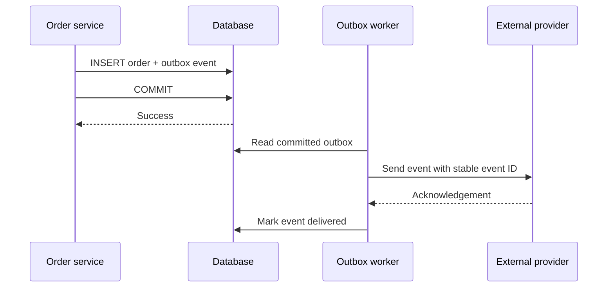

# Retry toàn thao tác nghiệp vụ bằng context mới khi phù hợp

## 1. Vì sao không nên chỉ thử lại câu SQL vừa thất bại?

Trong ứng dụng Hibernate ORM, một nghiệp vụ thường gồm nhiều bước liên quan trong cùng transaction. Ví dụ đặt hàng có thể đọc tồn kho, kiểm tra giá, tạo đơn, tạo dòng hàng và trừ số lượng tồn:

```java
Product product = session.find(Product.class, productId);

if (product.getStockQuantity() < requestedQuantity) {
    throw new InsufficientStockException();
}

Order order = new Order(customer, product, requestedQuantity);
session.persist(order);

product.decreaseStock(requestedQuantity);
```

Giả sử transaction bị deadlock hoặc optimistic locking conflict khi flush. Việc chỉ chạy lại câu `UPDATE products ...` cuối cùng thường **không đủ**:

- Giá và tồn kho có thể đã thay đổi kể từ lần đọc ban đầu.
- Đơn hàng hoặc các entity khác có thể đã được tạo trong Persistence Context.
- Transaction database có thể đã bị đánh dấu aborted hoặc rollback-only.
- Hibernate Session có thể đang giữ managed entities và queued actions của lần thử trước.
- Việc chỉ chạy lại một statement có thể phá vỡ các kiểm tra nghiệp vụ đã được thực hiện trước đó.

Khi lỗi là lỗi đồng thời tạm thời và nghiệp vụ cho phép thử lại, cách an toàn thường là **rollback toàn bộ transaction cũ, kết thúc Persistence Context cũ, rồi chạy lại toàn bộ use case trong một transaction và context mới**.



**Retry toàn thao tác** không có nghĩa lặp lại vô điều kiện mọi exception. Trước hết phải xác định lỗi có thể tạm thời, transaction cũ đã được rollback, thao tác có thể thực hiện lại an toàn và còn thời gian retry hay không.

## 2. Retry toàn thao tác nghĩa là gì?

Một lần thử (*attempt*) nên bao gồm một đơn vị nghiệp vụ nguyên tử:

1. Mở transaction và Persistence Context phù hợp.
2. Tải lại các entity cần thiết từ database.
3. Kiểm tra điều kiện nghiệp vụ trên dữ liệu hiện tại.
4. Thực hiện tất cả thay đổi liên quan.
5. Flush và commit.
6. Nếu thất bại, rollback, kết thúc context và phân loại exception.

Nếu lỗi được phân loại là retryable, lần thử tiếp theo phải bắt đầu bằng **transaction mới và Persistence Context mới**. Điều này giúp Hibernate không tái sử dụng managed instance, snapshot dirty checking hoặc trạng thái transaction của lần thất bại.

### Không phải chỉ lặp lại method bị lỗi

Giả sử nghiệp vụ:

```text
Đọc số dư tài khoản
    ↓
Kiểm tra số dư đủ
    ↓
Tạo giao dịch chuyển tiền
    ↓
Trừ tài khoản nguồn
    ↓
Cộng tài khoản đích
    ↓
Commit
```

Nếu lỗi optimistic locking xảy ra khi cập nhật tài khoản đích, phải chạy lại **toàn bộ thao tác chuyển tiền** để kiểm tra lại số dư nguồn, trạng thái tài khoản, giới hạn và dữ liệu đích. Không được chỉ chạy lại câu cộng tiền trong transaction mới dựa trên kết quả kiểm tra cũ.

### Vì sao phải dùng context mới?

Persistence Context của Hibernate có first-level cache và identity map. Entity đã được tải vẫn có thể chứa dữ liệu cũ; transaction có thể đã thất bại; action queue có thể chứa thay đổi chưa được đồng bộ. Sau lỗi persistence nghiêm trọng, không nên coi Session ấy là một môi trường sạch để tiếp tục retry.

Tạo Session/EntityManager mới giúp:

- Tải lại entity theo trạng thái mà transaction mới được phép nhìn thấy.
- Tạo snapshot/dirty-checking state mới.
- Không giữ các entity transient/managed của lần thử trước.
- Không tái sử dụng transaction đã rollback-only hoặc connection đã bị lỗi.
- Giữ ranh giới một lần thử rõ ràng để log, metrics và đối soát.

**Context mới không bảo đảm dữ liệu mới nhất trong mọi trường hợp**: transaction isolation, second-level cache, read replica và commit của transaction khác vẫn có ảnh hưởng. Cần thiết kế nguồn đọc và cache phù hợp.

## 3. Phân loại lỗi trước khi retry

Retry chỉ hữu ích với những lỗi có khả năng tự biến mất sau một khoảng thời gian hoặc sau khi tải lại dữ liệu. Một lỗi nghiệp vụ cố định sẽ chỉ thất bại thêm lần nữa.

| Nhóm lỗi | Ví dụ | Có thể retry toàn thao tác? | Ghi chú |
|---|---|---|---|
| **Deadlock victim** | Database chọn transaction làm nạn nhân deadlock | Thường có thể | Rollback toàn transaction, thử lại với backoff |
| **Serialization failure** | Isolation cao từ chối transaction do xung đột đồng thời | Thường có thể | Phải chạy lại toàn transaction với snapshot mới |
| **Optimistic locking conflict** | Version entity không còn khớp | Có thể, nếu nghiệp vụ cho phép hợp nhất | Tải lại, kiểm tra lại điều kiện và quyết định |
| **Lock acquisition timeout** | Không lấy được pessimistic lock trong thời hạn | Có thể | Xác minh transaction đã rollback và retry budget còn |
| **Transient connection failure trước khi commit** | Connection tạm thời bị ngắt, statement chưa hoàn tất | Có thể trong một số trường hợp | Phải biết transaction đã bị rollback/kết thúc và thao tác an toàn |
| **Query/transaction timeout** | Vượt giới hạn thời gian | Có thể nhưng thận trọng | Cần phân biệt timeout do tải tạm thời và query chậm cố hữu |
| **UNIQUE constraint violation** | Email hoặc request key đã tồn tại | Thông thường không | Có thể là xung đột nghiệp vụ; đọc lại để xác định idempotent duplicate |
| **FOREIGN KEY / NOT NULL / CHECK violation** | Dữ liệu không hợp lệ hoặc mapping sai | Không | Sửa dữ liệu/code/schema; retry y nguyên không giúp |
| **Validation/business exception** | Thiếu tồn kho, tài khoản bị khóa | Không | Trả lỗi nghiệp vụ |
| **SQL syntax / mapping error** | Câu SQL sai, cột không tồn tại | Không | Sửa code/migration |
| **Authentication/permission error** | DB từ chối quyền | Không | Cần sửa cấu hình/quyền |

### Retryable không phải một thuộc tính cố định của tên exception

Cùng một loại exception có thể xuất phát từ nhiều nguyên nhân. Ví dụ:

- `JDBCConnectionException` có thể là lỗi mạng tạm thời hoặc cấu hình kết nối sai.
- `LockAcquisitionException` có thể là deadlock hoặc lock timeout; chính sách xử lý có thể khác.
- `QueryTimeoutException` có thể là tải tạm thời, query plan xấu hoặc timeout quá thấp.
- `OptimisticLockException` có thể là xung đột bình thường cần người dùng giải quyết, không phải lúc nào cũng nên tự retry.

Nên kết hợp **exception type, SQLState, vendor error code, transaction status và ngữ cảnh use case**. Không chỉ bắt `RuntimeException` rồi lặp lại.

## 4. Những lỗi đồng thời thường có thể thử lại

### 4.1. Deadlock

Hai transaction khóa các hàng theo thứ tự khác nhau:

```text
Transaction A                 Transaction B
-------------                 -------------
Lock Account 1                Lock Account 2
Chờ Account 2                 Chờ Account 1
       \                         /
        \_____ Deadlock ________/
```

Database phát hiện chu trình chờ và thường hủy một transaction làm victim. Transaction còn lại có thể tiếp tục.

Với transaction bị chọn làm victim:

1. Nhận lỗi deadlock.
2. Rollback transaction đã thất bại theo quy tắc database/transaction manager.
3. Đóng Persistence Context/Session tương ứng.
4. Chờ một khoảng ngắn có jitter.
5. Mở transaction mới và chạy lại toàn bộ thao tác.

Nếu chỉ retry statement cuối, các lock, quyết định và dữ liệu đã đọc trước đó có thể không còn phù hợp.

### 4.2. Serialization failure

Ở isolation level như `SERIALIZABLE`, database có thể phát hiện lịch thực thi đồng thời không tương đương một thứ tự tuần tự hợp lệ và từ chối một transaction.

Ví dụ hai transaction cùng đọc tổng số đặt chỗ còn trống, sau đó mỗi transaction thêm một đặt chỗ. Nếu database phát serialization failure, cách xử lý thông thường là **retry toàn transaction** với snapshot mới, không chỉ chạy lại INSERT cuối.

Với PostgreSQL, SQLState `40001` thường biểu thị serialization failure. SQLState `40P01` thường biểu thị deadlock detected. Đây là mã ví dụ theo PostgreSQL; các database/driver khác có mã và exception mapping riêng.

### 4.3. Optimistic locking conflict

Entity có:

```java
@Version
private long version;
```

Nếu một transaction khác cập nhật entity trước, Hibernate có thể phát hiện version mismatch lúc flush/commit. Retry có thể hợp lý nếu nghiệp vụ có thể áp dụng lại ý định trên dữ liệu mới.

Ví dụ:

```text
Lần thử 1:
  đọc tồn kho = 10, version = 4
  request muốn lấy 3
  transaction khác đã cập nhật tồn kho = 5, version = 5
  flush lần 1 -> optimistic lock conflict

Lần thử 2 trong context mới:
  đọc tồn kho = 5, version = 5
  kiểm tra lại: còn đủ 3
  trừ 3 -> tồn kho = 2
  commit thành công
```

Nếu lần đọc lại thấy tồn kho chỉ còn 2, lần retry phải trả lỗi thiếu hàng. **Không được giữ kết quả kiểm tra “đủ hàng” từ lần thử đầu.**

## 5. Vì sao phải rollback và đóng Session cũ?

Sau một lỗi SQL nghiêm trọng, database transaction có thể đã chuyển sang trạng thái aborted. Hibernate cũng có thể đã có action queue, entity state và transaction coordination không còn phù hợp để tiếp tục.

Ví dụ không an toàn:

```java
try {
    session.flush();
} catch (RuntimeException ex) {
    // Không làm như thể transaction vẫn sạch:
    retryLastUpdate(session);
}
```

Những rủi ro:

- Transaction có thể đã rollback-only hoặc không còn active.
- Connection có thể đã bị đóng/hỏng.
- Managed entities vẫn giữ giá trị của lần đọc cũ.
- Các thay đổi chưa flush hoặc các entity transient có thể vẫn nằm trong bộ nhớ.
- Retry một statement có thể bỏ qua những kiểm tra và thay đổi đã xảy ra trước đó.

### Quy trình kết thúc một attempt thất bại

```java
try (Session session = sessionFactory.openSession()) {
    Transaction tx = session.beginTransaction();
    try {
        performBusinessOperation(session, command);
        tx.commit();
    } catch (RuntimeException ex) {
        if (tx.isActive()) {
            tx.rollback();
        }
        throw ex;
    }
}
```

Đoạn code trên minh họa một attempt resource-local. Khi exception thoát khỏi method, `try-with-resources` đóng Session. Lớp retry bên ngoài sẽ gọi lại method này để mỗi attempt có Session và transaction mới.

**Không gọi `session.clear()` rồi tiếp tục transaction cũ như giải pháp mặc định.** Clear chỉ detach entities; nó không hồi phục transaction đã aborted/rollback-only hoặc connection đã hỏng.

## 6. Thiết kế một lần thử nghiệp vụ độc lập

Một pattern rõ ràng là tách:

- **Retry coordinator:** quyết định số lần thử, phân loại lỗi, backoff và deadline.
- **Transactional operation:** thực hiện đúng một lần nghiệp vụ trong transaction mới.

Ví dụ Hibernate native API:

```java
public class OrderAttemptService {

    private final SessionFactory sessionFactory;

    public OrderAttemptService(SessionFactory sessionFactory) {
        this.sessionFactory = sessionFactory;
    }

    public OrderResult executeOnce(PlaceOrderCommand command) {
        try (Session session = sessionFactory.openSession()) {
            Transaction tx = session.beginTransaction();
            try {
                OrderResult result = placeOrderInSession(session, command);
                tx.commit();
                return result;
            } catch (RuntimeException ex) {
                if (tx.isActive()) {
                    tx.rollback();
                }
                throw ex;
            }
        }
    }

    private OrderResult placeOrderInSession(
            Session session,
            PlaceOrderCommand command) {
        Product product = session.find(
            Product.class,
            command.productId()
        );

        if (product == null) {
            throw new ProductNotFoundException();
        }

        if (product.getStockQuantity() < command.quantity()) {
            throw new InsufficientStockException();
        }

        product.decreaseStock(command.quantity());

        Order order = new Order(
            command.requestKey(),
            command.customerId(),
            product,
            command.quantity()
        );
        session.persist(order);

        return new OrderResult(order.getId());
    }
}
```

Các class command/result và entity trong ví dụ được giả định đã định nghĩa phù hợp. Phần quan trọng là **`executeOnce()` mở một Session mới và một transaction mới mỗi lần được gọi**; nó không tự retry.

### Coordinator gọi lại toàn bộ executeOnce

```java
public OrderResult placeOrderWithRetry(
        PlaceOrderCommand command) {

    int maxAttempts = 3;

    for (int attempt = 1; attempt <= maxAttempts; attempt++) {
        try {
            return attemptService.executeOnce(command);
        } catch (RuntimeException ex) {
            if (!isRetryable(ex) || attempt == maxAttempts) {
                throw ex;
            }

            sleepBeforeRetry(attempt);
        }
    }

    throw new IllegalStateException("Unreachable");
}
```

Đây mới là cấu trúc khái quát. Trong code production, `isRetryable` cần phân tích root cause và vendor code; `sleepBeforeRetry` cần backoff, jitter, deadline và xử lý interruption. Không dùng `Thread.sleep()` tùy tiện trong request thread nếu hệ thống có cơ chế scheduler/resilience phù hợp.

## 7. Ví dụ Spring: retry ở ngoài transaction, mỗi lần gọi tạo transaction mới

Trong Spring, pattern thường rõ ràng nhất là **một bean retry coordinator gọi một bean transactional worker qua proxy**.

### 7.1. Worker thực hiện đúng một transaction

```java
import org.springframework.stereotype.Service;
import org.springframework.transaction.annotation.Transactional;

@Service
public class PlaceOrderAttempt {

    private final ProductRepository products;
    private final OrderRepository orders;

    public PlaceOrderAttempt(
            ProductRepository products,
            OrderRepository orders) {
        this.products = products;
        this.orders = orders;
    }

    @Transactional
    public OrderResult executeOnce(PlaceOrderCommand command) {
        Product product = products.findById(command.productId())
            .orElseThrow(ProductNotFoundException::new);

        if (product.getStockQuantity() < command.quantity()) {
            throw new InsufficientStockException();
        }

        product.decreaseStock(command.quantity());

        Order order = new Order(
            command.requestKey(),
            command.customerId(),
            product,
            command.quantity()
        );
        orders.save(order);

        return new OrderResult(order.getId());
    }
}
```

Khi method này được gọi qua Spring transaction proxy:

- Spring bắt đầu hoặc tham gia transaction theo propagation.
- EntityManager/Persistence Context gắn với transaction được sử dụng.
- Khi method kết thúc bình thường, transaction interceptor thực hiện flush/commit.
- Nếu flush/commit thất bại, exception có thể được ném ra **sau khi body method đã return**.

### 7.2. Coordinator không có transaction bao quanh

```java
import org.springframework.stereotype.Service;

@Service
public class PlaceOrderService {

    private final PlaceOrderAttempt attempt;

    public PlaceOrderService(PlaceOrderAttempt attempt) {
        this.attempt = attempt;
    }

    public OrderResult place(PlaceOrderCommand command) {
        int maxAttempts = 3;

        for (int number = 1; number <= maxAttempts; number++) {
            try {
                // Gọi qua proxy: mỗi lần tạo transaction mới.
                return attempt.executeOnce(command);
            } catch (RuntimeException ex) {
                if (!RetryPolicy.isRetryable(ex)
                        || number == maxAttempts) {
                    throw ex;
                }
                RetryPolicy.pause(number);
            }
        }

        throw new IllegalStateException("Unreachable");
    }
}
```

Điều quan trọng:

1. `PlaceOrderService.place()` **không** mang `@Transactional` bao quanh vòng lặp.
2. `PlaceOrderAttempt.executeOnce()` được gọi qua Spring bean proxy, không phải self-invocation trong cùng class.
3. Transaction interceptor hoàn tất/rollback transaction của attempt trước khi exception đi về coordinator.
4. Coordinator chỉ retry sau khi attempt cũ đã kết thúc.

Nếu coordinator cũng có một transaction `REQUIRED` bao quanh, các lời gọi worker mặc định có thể tham gia **cùng transaction vật lý**, khiến lần thử sau không phải transaction mới như mong muốn.

### Tại sao không đặt @Retryable và @Transactional tùy tiện trên cùng method?

Thứ tự interceptor/proxy có thể quyết định retry chạy **bên trong một transaction dài** hay mỗi lần retry tạo một transaction mới. Nếu retry advice nằm bên trong transaction advice, nhiều attempt có thể dùng cùng transaction đã rollback-only.

Có thể dùng Spring Retry hoặc Spring Framework resilience/retry facilities, nhưng cần cấu hình rõ **retry ở ngoài transaction boundary**. Một cách dễ kiểm soát là tách bean coordinator và bean `executeOnce` như ví dụ.

## 8. Backoff và jitter: không retry liên tục

Nếu nhiều request cùng gặp deadlock/lock timeout rồi retry ngay lập tức, chúng có thể va vào nhau lần nữa. Hiện tượng này có thể tạo **retry storm**:

```text
100 request cùng lỗi
    ↓
100 request retry ngay lập tức
    ↓
Database vẫn đang quá tải/lock contention
    ↓
Lại lỗi đồng loạt
    ↓
Tải và độ trễ tăng thêm
```

### Exponential backoff

Một chiến lược phổ biến tăng khoảng chờ theo số lần thử:

\[
delay_n = \min(cap,\ base \times 2^{n-1})
\]

Ví dụ `base = 100 ms`, `cap = 2 s`:

| Lần thử tiếp theo | Khoảng chờ danh nghĩa |
|---:|---:|
| 1 | 100 ms |
| 2 | 200 ms |
| 3 | 400 ms |
| 4 | 800 ms |
| 5 trở đi | Tối đa 2.000 ms |

### Jitter

Thêm ngẫu nhiên để các client không cùng retry đúng một thời điểm. Một cách đơn giản:

\[
delay = random(0,\ min(cap,\ base \times 2^{attempt-1}))
\]

Đây là *full jitter*. Có nhiều biến thể khác; chọn một chính sách nhất quán với thư viện retry đang dùng.

Ví dụ Java:

```java
import java.time.Duration;
import java.util.concurrent.ThreadLocalRandom;

public final class RetryDelay {

    private RetryDelay() {}

    public static Duration fullJitter(
            int retryNumber,
            Duration base,
            Duration cap) {

        long baseMillis = base.toMillis();
        long capMillis = cap.toMillis();

        int exponent = Math.min(retryNumber - 1, 20);
        long upper = Math.min(
            capMillis,
            baseMillis * (1L << exponent)
        );

        long millis = ThreadLocalRandom.current()
            .nextLong(upper + 1);

        return Duration.ofMillis(millis);
    }
}
```

Đoạn code giới hạn exponent để tránh dịch bit quá lớn; code production vẫn cần xử lý giá trị base/cap không hợp lệ và overflow nếu nhận tham số không tin cậy.

### Backoff phải nằm trong deadline

Giả sử request có deadline còn 1 giây nhưng chính sách backoff đề nghị chờ 2 giây. Không nên ngủ rồi bắt đầu một attempt chắc chắn vượt deadline. Coordinator nên kiểm tra **thời gian còn lại** trước mỗi lần chờ và trước khi bắt đầu transaction mới.

Retry count cũng phải hữu hạn. Không dùng vòng lặp vô hạn để “chờ database khỏe lại”.

## 9. Idempotency: retry không được tạo tác động trùng

Một thao tác nghiệp vụ có thể được thực hiện nhiều lần do:

- Transaction thất bại và coordinator thử lại.
- Client gửi lại request vì timeout.
- Worker bị khởi động lại sau khi không nhận được acknowledgement.
- Kết nối mất ngay lúc commit khiến ứng dụng không biết database đã commit hay chưa.

Nếu mỗi lần thử tạo một đơn hàng hoặc thanh toán mới, có thể tạo **tác động trùng lặp**.

### Dùng request key ổn định

Ví dụ bảng:

```sql
CREATE TABLE orders (
    id BIGINT GENERATED BY DEFAULT AS IDENTITY PRIMARY KEY,
    request_key VARCHAR(80) NOT NULL,
    customer_id BIGINT NOT NULL,
    total_amount NUMERIC(14, 2) NOT NULL,
    status VARCHAR(20) NOT NULL,
    CONSTRAINT uk_orders_request_key UNIQUE (request_key)
);
```

Client gửi một idempotency key cho một ý định đặt hàng. **Mọi attempt của cùng ý định dùng cùng key**, không tạo key mới mỗi lần retry.

### Kiểm tra và xử lý trùng

Trong transaction:

1. Tìm order theo `request_key`.
2. Nếu đã tồn tại và command tương ứng, trả kết quả đã có theo chính sách idempotency.
3. Nếu chưa tồn tại, chạy kiểm tra nghiệp vụ và tạo order.
4. Unique constraint bảo vệ khi hai request đồng thời cùng kiểm tra “chưa có” rồi cùng insert.
5. Nếu gặp unique violation do request cạnh tranh, transaction lỗi phải rollback; ở transaction mới có thể đọc lại order theo request key để xác định kết quả.

**Không bắt mọi lỗi unique rồi trả thành công.** Một unique violation trên SKU hoặc email có thể là lỗi nghiệp vụ khác. Chỉ xử lý như idempotent duplicate khi xác định đúng constraint/key và xác minh payload/owner tương ứng.

### Payload phải ổn định

Nếu client gửi cùng request key nhưng nội dung command khác (ví dụ số lượng 2 ở lần đầu, số lượng 5 ở lần sau), ứng dụng phải có quy tắc rõ:

- Từ chối vì key đã được dùng cho payload khác.
- Hoặc định nghĩa key chỉ đại diện cho một operation cụ thể và yêu cầu client dùng key mới cho ý định mới.

Có thể lưu hash của payload quan trọng cùng request key để phát hiện reuse không hợp lệ.

## 10. Commit có kết quả không rõ: retry cần đối soát trước

Một lỗi mạng xảy ra ngay lúc commit tạo ra tình huống đặc biệt:

```text
Ứng dụng gửi COMMIT
       ↓
Database commit thành công
       ↓
Mạng đứt trước khi ứng dụng nhận ACK
       ↓
Ứng dụng nhận timeout/connection exception
```

Ứng dụng **không biết chắc** transaction đã commit hay chưa. Không được giả định catch exception rồi retry sẽ luôn an toàn.

### Cách xử lý

1. Kết thúc/loại bỏ connection và Persistence Context lỗi.
2. Dùng connection/transaction mới để đối soát bằng request key hoặc business key.
3. Nếu nghiệp vụ đã được commit, trả lại kết quả cũ.
4. Nếu chắc chắn chưa được commit, có thể thử lại theo chính sách.
5. Nếu trạng thái vẫn chưa xác định, trả lỗi có thể đối soát sau thay vì tạo operation mới.

Idempotency key giúp giải quyết trường hợp ứng dụng không biết commit đã thành công hay chưa. **Retry toàn thao tác và idempotency bổ trợ nhau**: retry đảm bảo dữ liệu được đọc/kiểm tra lại trong context mới; idempotency ngăn một ý định tạo nhiều kết quả.

## 11. Side effects ngoài database: email, HTTP, thanh toán và message

Một transaction Hibernate rollback không thể tự hoàn tác:

- Email đã gửi.
- HTTP request đã tới service khác.
- Thanh toán đã được cổng thanh toán chấp nhận.
- Message đã được publish lên broker.
- File đã ghi ra filesystem hoặc object storage.

Ví dụ không an toàn:

```java
@Transactional
public void placeOrder(PlaceOrderCommand command) {
    Order order = createAndSaveOrder(command);
    emailClient.sendConfirmation(order);
    // Nếu commit sau đó deadlock/timeout, email đã được gửi.
}
```

Nếu transaction bị retry toàn bộ, email có thể được gửi nhiều lần dù chỉ một order cuối cùng được commit.

### Transactional outbox

Một thiết kế thường dùng:

1. Trong cùng transaction database, persist Order và OutboxEvent.
2. Commit transaction.
3. Worker đọc các outbox event đã commit.
4. Gửi message/email với event ID ổn định.
5. Đánh dấu delivered; consumer/provider cần idempotency để xử lý giao trùng.



Khi retry order transaction, outbox row của attempt bị rollback cùng order; chỉ event thuộc transaction commit mới được worker phát. Tuy vậy worker vẫn có thể gửi lại nếu mất acknowledgement, nên event ID và xử lý idempotent vẫn cần thiết.

### Gọi API thanh toán

Nếu phải gọi payment provider, dùng idempotency key mà provider hỗ trợ và tách trạng thái thanh toán thành một quy trình rõ ràng. Không giữ database transaction/lock trong khi chờ một HTTP call dài nếu có thể tránh; thiết kế state machine, outbox hoặc saga theo yêu cầu nghiệp vụ.

## 12. Không tạo command mới hoặc dữ liệu ngẫu nhiên khác nhau mỗi lần thử

Retry toàn use case nên giữ nguyên **ý định ban đầu của người dùng**, nhưng vẫn tải lại trạng thái database.

Ví dụ command:

```java
public record PlaceOrderCommand(
    String requestKey,
    Long customerId,
    Long productId,
    int quantity,
    BigDecimal agreedUnitPrice
) {}
```

Các trường như `requestKey`, `quantity` và giá đã được chốt trong hợp đồng nghiệp vụ cần ổn định giữa các attempt. Nhưng số lượng tồn, trạng thái sản phẩm, giới hạn tài khoản và version phải **đọc lại từ database** mỗi lần.

### Những thứ cần chú ý

- Không tạo một `requestKey` mới mỗi lần retry.
- Không gọi random generator để chọn một kết quả nghiệp vụ khác mà không có quy tắc.
- Nếu dùng thời gian hiện tại làm dữ liệu nghiệp vụ, xác định thời điểm là lúc client yêu cầu hay lúc transaction thành công; truyền giá trị đã chốt trong command khi phù hợp.
- Không tái sử dụng entity object của attempt trước trong attempt mới.
- Không giữ một DTO mutable chứa kết quả trung gian rồi cộng dồn nhiều lần.
- Tính toán lại derived values từ dữ liệu mới nếu quy tắc yêu cầu.

**Giữ ổn định command không đồng nghĩa giữ snapshot entity cũ.** Command mô tả ý định; Persistence Context mới cung cấp trạng thái database để kiểm tra ý định đó có còn hợp lệ không.

## 13. Phân biệt retry với optimistic locking và pessimistic locking

Ba khái niệm bổ sung nhau:

| Cơ chế | Mục đích | Khi gặp xung đột |
|---|---|---|
| **Optimistic locking (`@Version`)** | Phát hiện entity đã bị transaction khác sửa kể từ lúc đọc | Báo conflict; ứng dụng quyết định retry, merge hoặc yêu cầu người dùng xử lý |
| **Pessimistic locking** | Giữ lock để ngăn một số transaction khác sửa/xóa hàng trong thời gian xử lý | Có thể chờ, timeout hoặc deadlock |
| **Retry toàn thao tác** | Thử lại một unit of work sau lỗi transient | Tạo transaction/context mới và chạy lại toàn bộ use case |

### Optimistic locking không tự retry

`@Version` chỉ giúp phát hiện xung đột. Nếu ứng dụng muốn tự retry, cần một coordinator có thể:

1. Bắt đúng optimistic locking exception.
2. Rollback transaction hiện tại.
3. Tạo context mới.
4. Tải lại entity và kiểm tra lại quy tắc nghiệp vụ.
5. Áp dụng lại ý định nếu còn hợp lệ.

### Pessimistic locking không loại bỏ mọi lỗi

`PESSIMISTIC_WRITE` có thể giảm xung đột trên một hàng, nhưng vẫn có thể:

- Lock timeout.
- Deadlock khi khóa nhiều hàng theo thứ tự khác nhau.
- Connection/transaction timeout.
- Constraint violation ở những bảng khác.

Retry vẫn có thể hữu ích, nhưng phải giới hạn và thiết kế thứ tự lock nhất quán khi có thể.

## 14. Spring Retry và ranh giới transaction

Có thể sử dụng Spring Retry hoặc cơ chế retry/resilience của Spring, nhưng **thứ tự các interceptor rất quan trọng**.

### Mô hình dễ kiểm soát: coordinator ngoài, worker transactional bên trong

```text
Retry coordinator (không @Transactional)
  ├── attempt.executeOnce() -> Transaction A
  │       └── commit/rollback + close context
  ├── backoff
  ├── attempt.executeOnce() -> Transaction B
  │       └── commit/rollback + close context
  └── trả kết quả hoặc lỗi cuối
```

Mỗi lần gọi worker qua proxy tạo transaction mới, vì transaction trước đã hoàn tất.

### Nếu dùng @Retryable

Ví dụ cấu trúc:

```java
@Service
public class OrderRetryFacade {

    private final OrderTransactionalWorker worker;

    public OrderRetryFacade(OrderTransactionalWorker worker) {
        this.worker = worker;
    }

    @Retryable(
        retryFor = RetryableDatabaseException.class,
        maxAttempts = 3
    )
    public OrderResult place(PlaceOrderCommand command) {
        return worker.executeOnce(command);
    }
}
```

Worker là một bean riêng:

```java
@Service
public class OrderTransactionalWorker {

    @Transactional
    public OrderResult executeOnce(PlaceOrderCommand command) {
        // Một lần thực hiện toàn bộ use case.
        // Transaction interceptor hoàn tất trước khi lỗi
        // quay lại RetryFacade qua proxy.
        return doPlaceOrder(command);
    }
}
```

Đây là cấu trúc minh họa. Phải kiểm tra:

- Spring Retry đã được cấu hình và phiên bản annotation phù hợp.
- `RetryFacade` không nằm trong một transaction bao quanh các attempt.
- `worker.executeOnce()` đi qua proxy transaction.
- Retry rule chỉ bao gồm lỗi transient được phân loại.
- Commit-time exception từ transaction interceptor cũng quay về retry advice ở đúng thứ tự.

**Không dựa vào thứ tự mặc định của AOP để đoán transaction mới.** Nếu retry advice bọc bên ngoài transaction advice, mỗi attempt có thể tạo transaction riêng; nếu transaction advice bọc ngoài retry advice, nhiều attempt có thể dùng cùng một transaction. Kiểm tra cấu hình order và test tích hợp.

### Tránh self-invocation

Trong Spring proxy mode, gọi method `this.executeOnce()` bên trong cùng object có thể bỏ qua transaction proxy. Tách worker thành bean riêng hoặc dùng cấu trúc proxy được hỗ trợ để đảm bảo mỗi attempt thực sự có transaction mới.

## 15. Retry ở đâu trong kiến trúc?

Retry có thể được đặt ở nhiều tầng, nhưng chỉ nên có **một nơi chịu trách nhiệm rõ ràng** cho một loại lỗi/use case.

| Vị trí | Khi phù hợp | Rủi ro |
|---|---|---|
| Repository | Một lỗi I/O cụ thể có semantics độc lập và retry an toàn | Thường không đủ thông tin để chạy lại toàn nghiệp vụ |
| Transactional worker | Một attempt nguyên tử | Nếu tự retry bên trong cùng transaction/context thì sai |
| Application service/coordinator | Có đầy đủ command và có thể gọi transaction mới | Cần tránh bọc transaction ngoài |
| HTTP/controller/client | Retry request khi service có idempotency | Có thể nhân retry giữa client, gateway và service |
| Message consumer | Retry message có delivery semantics rõ | Có thể xử lý trùng; cần idempotent consumer và DLQ |

### Tránh nhân số lần retry

Giả sử:

- HTTP client retry 3 lần.
- API gateway retry 3 lần.
- Service retry 3 lần.
- Database driver cũng retry một số lỗi.

Số lần thực hiện downstream có thể tăng theo tích các lớp, không còn là 3. Hệ thống dễ bị quá tải khi đang gặp sự cố.

Chọn **retry owner** cho từng ranh giới, truyền deadline/budget nếu có thể và giới hạn tổng số lần thực hiện. Không xếp chồng retry policy mà không tính tổng tác động.

## 16. Chính sách retry cần có giới hạn và deadline

Một policy tối thiểu cần quy định:

- Danh sách lỗi có thể retry.
- Số attempt tối đa (tính cả lần đầu hay chỉ lần retry).
- Backoff và jitter.
- Deadline tổng của request/job.
- Hành vi khi bị interrupt/cancel.
- Metrics và log theo từng attempt.
- Cách xử lý commit outcome không rõ.
- Idempotency và đối soát.

Ví dụ policy:

```java
public record RetryPolicyConfig(
    int maxAttempts,
    Duration baseDelay,
    Duration maxDelay,
    Duration totalDeadline
) {}
```

Giả sử cấu hình:

| Tham số | Giá trị minh họa |
|---|---:|
| Attempts tối đa | 3 |
| Base delay | 100 ms |
| Max delay | 1 s |
| Tổng deadline | 5 s |
| Retryable errors | Deadlock, serialization failure, một số lock timeout |
| Non-retryable | Business validation, FK/NOT NULL, mapping, permission |

Các con số chỉ là ví dụ. Phải đo độ trễ database và yêu cầu latency của use case để chọn giá trị phù hợp.

### Interruption phải được tôn trọng

Nếu coordinator đang chờ backoff mà thread bị interrupt, không được nuốt tín hiệu rồi tiếp tục retry:

```java
try {
    Thread.sleep(delayMillis);
} catch (InterruptedException ex) {
    Thread.currentThread().interrupt();
    throw new RetryCancelledException(ex);
}
```

Với ứng dụng reactive hoặc scheduler, dùng cơ chế delay/cancellation tương ứng thay vì block thread.

## 17. Khi nào không nên retry?

### Lỗi nghiệp vụ

Ví dụ `InsufficientStockException`, `AccountClosedException`, `OrderAlreadyCancelledException`. Nếu trạng thái không thay đổi, retry cùng command không tạo kết quả khác. Nếu muốn thử lại sau một sự kiện nghiệp vụ, cần một trigger hoặc command mới.

### Constraint violation do dữ liệu không hợp lệ

FK, NOT NULL, CHECK hoặc UNIQUE thường chỉ ra invariant bị vi phạm. Không retry vô điều kiện cùng payload. Trường hợp unique do race/idempotency cần **đọc lại và phân loại đúng constraint**, không coi mọi duplicate là thành công.

### SQL syntax, mapping hoặc schema mismatch

Lỗi code/schema sẽ lặp lại ở mọi attempt. Retry chỉ làm tăng tải và che giấu nguyên nhân.

### Permission hoặc authentication failure

Quyền database sai không tự được sửa sau một backoff ngắn. Trả lỗi vận hành và xử lý cấu hình.

### Lỗi commit có kết quả không xác định

Không retry một lệnh tạo dữ liệu không idempotent khi chưa đối soát. Connection exception tại commit có thể xảy ra sau khi database đã commit.

### Người dùng đã hủy request

Nếu cancellation/deadline đã hết, không bắt đầu thêm attempt chỉ vì còn số lần retry. Hủy phải lan truyền qua coordinator và worker theo hợp đồng.

## 18. Đọc lại dữ liệu và áp dụng lại quy tắc nghiệp vụ

Một retry đúng phải **tính lại những quyết định phụ thuộc database**.

Ví dụ đặt hàng:

```java
@Transactional
public OrderResult executeOnce(PlaceOrderCommand command) {
    Product product = productRepository.findById(command.productId())
        .orElseThrow(ProductNotFoundException::new);

    Customer customer = customerRepository.findById(command.customerId())
        .orElseThrow(CustomerNotFoundException::new);

    if (!customer.isActive()) {
        throw new CustomerInactiveException();
    }

    if (product.getStockQuantity() < command.quantity()) {
        throw new InsufficientStockException();
    }

    BigDecimal currentPrice = product.getPrice();
    BigDecimal total = currentPrice.multiply(
        BigDecimal.valueOf(command.quantity())
    );

    product.decreaseStock(command.quantity());
    Order order = Order.create(
        command.requestKey(),
        customer,
        product,
        command.quantity(),
        currentPrice,
        total
    );
    orderRepository.save(order);

    return new OrderResult(order.getId(), total);
}
```

Mỗi lần gọi `executeOnce`:

- Customer được tải lại và trạng thái active được kiểm tra lại.
- Product được tải lại và tồn kho được kiểm tra lại.
- Giá hiện tại được đọc lại theo chính sách giá của nghiệp vụ.
- Tổng tiền được tính lại từ dữ liệu hợp lệ của attempt.
- Version được kiểm tra ở flush/commit.

Nếu hợp đồng bán hàng yêu cầu giữ **giá đã báo cho khách** thay vì giá hiện tại, giá chốt phải nằm trong command/quotation hợp lệ và được kiểm tra thời hạn; không tự ý đổi giá chỉ vì retry.

## 19. Concurrency và tính công bằng khi retry

Retry nhiều lần không bảo đảm một request cuối cùng sẽ thắng. Trong môi trường cạnh tranh cao, một request có thể liên tục gặp conflict.

Các yếu tố cần xem:

- **Hot rows:** nhiều transaction cùng cập nhật một sản phẩm/tài khoản.
- **Lock order:** các use case lấy lock theo thứ tự nhất quán.
- **Transaction duration:** giữ lock càng lâu, khả năng deadlock càng tăng.
- **Batch size:** một transaction sửa quá nhiều hàng có thể tăng thời gian giữ lock.
- **Retry fairness:** backoff/jitter giúp phân tán thời điểm nhưng không bảo đảm công bằng tuyệt đối.
- **Admission control:** giới hạn số operation đồng thời khi database quá tải.

Nếu một hàng bị tranh chấp liên tục, tăng số lần retry có thể làm tải nặng hơn. Có thể cần:

- Xếp hàng command theo key (ví dụ product ID).
- Serialize cập nhật một aggregate.
- Dùng atomic SQL update có điều kiện.
- Thiết kế reservation/queue thay vì nhiều request tranh chấp cùng một row.
- Tách read model và write model nếu workload phù hợp.

### Atomic conditional update có thay thế retry toàn use case?

Một số thao tác đơn giản có thể thực hiện bằng câu lệnh atomic:

```sql
UPDATE products
SET stock_quantity = stock_quantity - :quantity
WHERE id = :product_id
  AND stock_quantity >= :quantity;
```

Nếu số hàng bị ảnh hưởng là 1, phép trừ tồn kho đã được kiểm tra nguyên tử tại database. Nếu 0, sản phẩm không tồn tại hoặc tồn kho không đủ (cần truy vấn/phân loại thêm).

Đây là kỹ thuật phù hợp cho **một invariant cục bộ**, nhưng nếu use case còn tạo order, payment, outbox và kiểm tra customer thì toàn bộ transaction vẫn phải được thiết kế nhất quán. Atomic update không tự biến nhiều bước thành một giao dịch hoàn chỉnh.

## 20. Quan sát retry bằng log và metrics

Retry không được diễn ra âm thầm. Nên ghi nhận:

| Trường log/metric | Mục đích |
|---|---|
| `operationName` | Use case đang retry |
| `requestKey` / correlation ID | Liên kết các attempt của cùng ý định |
| `attemptNumber` / `maxAttempts` | Biết đã thử bao nhiêu lần |
| `exceptionClass` | Phân loại lỗi |
| `SQLState` / vendor code | Phân loại lỗi database |
| `transactionDuration` | Độ dài transaction từng attempt |
| `backoffDuration` | Thời gian chờ trước lần thử sau |
| `outcome` | success, retry, exhausted, rejected, unknown commit |
| `deadlineRemaining` | Ngân sách thời gian còn lại |

### Không log dữ liệu nhạy cảm

Không ghi toàn bộ payload, thông tin thanh toán, mật khẩu hoặc dữ liệu cá nhân vào log retry. Dùng request key/correlation ID và các field đã được phép ghi.

### Metrics hữu ích

- Tổng số operation.
- Tỷ lệ operation thành công ngay lần đầu.
- Số retry trung bình mỗi operation.
- Tỷ lệ retry thành công.
- Số lần retry exhausted.
- Deadlock/serialization/optimistic conflict theo loại.
- Tổng latency p95/p99 bao gồm backoff.
- Số request bị deadline/cancel.

Nếu retry success rate tăng cùng thời gian response và database load, có thể policy đang che một vấn đề contention thay vì cải thiện độ tin cậy.

## 21. Kiểm thử retry đúng cách

Một test chỉ kiểm tra `RetryPolicy.isRetryable(...)` là chưa đủ. Cần xác nhận mỗi attempt dùng transaction và context riêng, và attempt sau đọc lại trạng thái database.

### Test theo kịch bản

1. Attempt đầu gặp deadlock/optimistic conflict mô phỏng.
2. Transaction đầu rollback.
3. Session/EntityManager đầu đóng.
4. Attempt hai mở context mới.
5. Attempt hai tải lại dữ liệu và kiểm tra nghiệp vụ.
6. Chỉ một kết quả nghiệp vụ được commit.

### Gợi ý kiểm thử với Spring

- Mock hoặc spy `OrderTransactionalWorker` để xác nhận được gọi lại đúng số lần.
- Dùng integration test với database tương ứng để xác nhận transaction boundary, vì mock không chứng minh commit-time exception được retry đúng.
- Kiểm tra `TransactionSynchronizationManager.isActualTransactionActive()` ở những điểm phù hợp để bảo đảm coordinator không giữ transaction ngoài.
- Có thể ghi transaction ID/connection identity trong test hoặc quan sát log SQL.
- Dùng barrier/latch để tạo race có kiểm soát cho optimistic locking; tránh test dựa vào sleep ngẫu nhiên.
- Xác nhận side effect chỉ phát một lần theo outbox/idempotency policy.

### Test các trường hợp không retry

- Insufficient stock.
- FK/NOT NULL/validation error.
- Permission/configuration error.
- Payload reuse cùng request key nhưng khác nội dung.
- Retry deadline đã hết.
- Thread bị interrupt/cancel.
- Commit outcome không xác định cần đối soát.

### Tránh chỉ dùng H2 để kết luận về concurrency

Deadlock, SQLState, isolation, lock timeout, deferrable constraints và JDBC driver behavior có thể khác database production. Với use case phụ thuộc PostgreSQL/MySQL/Oracle, chạy integration test trên cùng hệ quản trị hoặc môi trường tương thích.

## 22. Các lỗi triển khai retry thường gặp

### Lỗi 1: Retry bên trong cùng transaction

```java
@Transactional
public void placeWithRetry(Command command) {
    for (int i = 0; i < 3; i++) {
        try {
            executeBusinessSteps(command);
            return;
        } catch (RuntimeException ex) {
            // Transaction có thể đã rollback-only/aborted.
        }
    }
}
```

Đây là cấu trúc nguy hiểm: các vòng lặp có thể dùng cùng transaction và Persistence Context. Khi transaction đã hỏng, lần thử sau không phải một attempt sạch.

### Lỗi 2: Bắt mọi RuntimeException

```java
catch (RuntimeException ex) {
    retry();
}
```

Nó có thể retry cả validation, null pointer, mapping, permission và business exceptions. Hãy phân loại root cause.

### Lỗi 3: Chỉ retry statement cuối

Không chạy lại các bước kiểm tra nghiệp vụ và đọc dữ liệu; dễ dùng quyết định cũ với database mới.

### Lỗi 4: Dùng lại entity từ lần thử trước

Entity cũ có thể detached, stale hoặc có ID/state từ transaction rollback. Lần thử mới phải nạp entity trong context mới; chỉ tái sử dụng command bất biến và khóa nghiệp vụ ổn định.

### Lỗi 5: Retry vô hạn hoặc không có backoff

Tạo retry storm và kéo dài request. Dùng max attempts, deadline, exponential backoff và jitter.

### Lỗi 6: Retry trùng ở nhiều tầng

Client, gateway, service và repository đều retry có thể nhân số lần thực hiện. Chỉ định retry owner và budget tổng.

### Lỗi 7: Không có idempotency

Request có thể tạo nhiều order/payment/message khi commit đã thành công nhưng acknowledgement bị mất. Dùng stable request key và đối soát.

### Lỗi 8: Gửi side effect trong transaction

Email/payment/message có thể đã thành công dù database rollback. Dùng outbox hoặc workflow phù hợp.

### Lỗi 9: Không tính commit-time exception

Body method trả bình thường nhưng transaction interceptor lỗi khi flush/commit. Retry phải bao trọn **lời gọi qua transactional proxy**, không chỉ phần thân code trước commit.

### Lỗi 10: Nghĩ context mới luôn thấy dữ liệu mới nhất

Isolation, replica lag và L2 cache vẫn có thể trả dữ liệu cũ. Xác định nguồn đọc, transaction và cache.

## 23. Mẫu triển khai hoàn chỉnh hơn: policy + attempt + idempotency

Một kiến trúc đơn giản:

```text
Controller / Message consumer
          │
          ▼
Application Retry Coordinator
  - deadline
  - attempt budget
  - error classification
  - backoff + jitter
          │
          ├── Attempt 1
          │     └── Transactional worker
          │           ├── New transaction
          │           ├── New Persistence Context
          │           ├── Reload entities
          │           ├── Revalidate business rules
          │           ├── Apply changes
          │           └── Commit / rollback
          │
          ├── Attempt 2 (nếu retryable)
          │     └── Transactional worker mới
          │
          ▼
Idempotent result / final exception
```

### Pseudocode

```java
public OrderResult execute(
        PlaceOrderCommand command,
        Instant deadline) {

    for (int attempt = 1; attempt <= maxAttempts; attempt++) {
        if (Instant.now().isAfter(deadline)) {
            throw new OperationDeadlineExceededException();
        }

        try {
            // Proxy gọi method transactional:
            // transaction/context của attempt kết thúc trước return.
            return transactionalWorker.executeOnce(command);
        } catch (RuntimeException ex) {
            if (!classifier.isRetryable(ex)) {
                throw ex;
            }

            if (attempt == maxAttempts) {
                throw new RetryExhaustedException(ex);
            }

            Duration delay = backoff.delayFor(attempt);
            if (Instant.now().plus(delay).isAfter(deadline)) {
                throw new OperationDeadlineExceededException(ex);
            }

            sleeper.sleep(delay);
        }
    }

    throw new IllegalStateException("Unreachable");
}
```

Đây là pseudocode cấu trúc, không phải một thư viện retry hoàn chỉnh. Cần xử lý interruption, monotonic clock/deadline, lỗi rollback, ambiguous commit, logging, metrics và mapping exception theo database.

## 24. Checklist quyết định có retry hay không

Trước khi retry một lỗi, hãy trả lời:

1. **Lỗi có transient không?** Deadlock/serialization thường có thể; validation/permission/schema thường không.
2. **Transaction cũ đã kết thúc chưa?** Rollback đã hoàn tất hay transaction manager vẫn đánh dấu rollback-only?
3. **Persistence Context cũ đã được loại bỏ chưa?** Không tái sử dụng Session lỗi.
4. **Attempt mới có đọc lại trạng thái cần thiết không?** Không dùng stale entities hoặc kết quả kiểm tra cũ.
5. **Có chạy lại toàn bộ use case không?** Mọi kiểm tra và thay đổi liên quan phải được thực hiện lại.
6. **Command có ổn định và idempotent không?** Cùng ý định phải có cùng request key.
7. **Có side effect ngoài DB không?** Email/payment/message cần outbox hoặc idempotency.
8. **Còn deadline và retry budget không?** Không retry sau khi request đã hết hạn.
9. **Có retry ở tầng khác không?** Tránh nhân attempt.
10. **Commit outcome có chắc chắn không?** Nếu connection mất lúc commit, đối soát trước khi tạo lại.

Nếu không trả lời được các câu hỏi này, retry tự động có thể làm tình hình tệ hơn.

## 25. Bài thực hành: chuyển tiền với optimistic locking

Giả sử có hai tài khoản:

```sql
CREATE TABLE accounts (
    id BIGINT PRIMARY KEY,
    balance NUMERIC(14, 2) NOT NULL CHECK (balance >= 0),
    version BIGINT NOT NULL
);

CREATE TABLE transfers (
    id BIGINT GENERATED BY DEFAULT AS IDENTITY PRIMARY KEY,
    request_key VARCHAR(80) NOT NULL UNIQUE,
    from_account_id BIGINT NOT NULL REFERENCES accounts(id),
    to_account_id BIGINT NOT NULL REFERENCES accounts(id),
    amount NUMERIC(14, 2) NOT NULL CHECK (amount > 0)
);
```

Command:

```java
public record TransferCommand(
    String requestKey,
    long fromAccountId,
    long toAccountId,
    BigDecimal amount
) {}
```

Mỗi attempt phải:

1. Kiểm tra request key đã có transfer chưa.
2. Tải lại hai account trong transaction mới.
3. Xác minh hai account hợp lệ và số dư đủ.
4. Trừ tài khoản nguồn và cộng tài khoản đích.
5. Persist transfer với cùng request key.
6. Commit.

Nếu optimistic lock conflict, rollback toàn attempt và thử lại với context mới. Nếu attempt mới thấy số dư không đủ, trả lỗi nghiệp vụ.

### Câu hỏi tự kiểm tra

1. Vì sao không chỉ retry câu UPDATE tài khoản đích?
2. Vì sao request key phải giữ nguyên qua các lần thử?
3. Nếu commit thành công nhưng connection mất trước ACK, phải làm gì trước khi retry?
4. Vì sao một attempt mới cần tải lại cả hai account?
5. Nếu attempt đầu gửi email rồi transaction rollback, lần retry có thể gây tác động gì?
6. Khi nào nên trả lỗi optimistic conflict thay vì tự retry?

Gợi ý: (1) phải giữ tính cân bằng hai tài khoản và kiểm tra lại nguồn; (2) để idempotency; (3) đối soát request key; (4) version/balance có thể đổi; (5) email trùng hoặc xác nhận giao dịch chưa tồn tại; (6) khi cần người dùng giải quyết xung đột hoặc retry budget/deadline đã hết.

## 26. Bài thực hành: deadlock và retry toàn transaction

Tạo hai bảng `accounts` và một use case chuyển tiền. Thiết kế hai luồng test:

- Luồng A cập nhật tài khoản 1 rồi tài khoản 2.
- Luồng B cập nhật tài khoản 2 rồi tài khoản 1.

Dùng barrier/latch để tạo overlap có kiểm soát. Quan sát database phát hiện deadlock và chọn một transaction làm victim.

Sau đó:

1. Bổ sung retry coordinator chỉ bắt đúng deadlock error theo SQLState/vendor code.
2. Mỗi attempt mở transaction/Session mới.
3. Thêm backoff+jitter có giới hạn.
4. Đo tổng số attempt, latency và deadlock rate.
5. Thử chuẩn hóa thứ tự khóa theo account ID để giảm deadlock.
6. Kiểm tra idempotency của transfer request để bảo đảm không chuyển tiền hai lần.

**Không dùng `Thread.sleep()` làm đồng bộ test nếu có thể dùng latch/barrier; test dựa trên timing ngẫu nhiên dễ flake.**

## 27. Nguyên tắc cần ghi nhớ

1. **Retry toàn thao tác là chạy lại một unit of work nguyên tử**, gồm đọc dữ liệu, kiểm tra nghiệp vụ, thay đổi entity và commit.
2. **Mỗi attempt phải có transaction và Persistence Context mới.** Rollback transaction cũ, đóng Session cũ rồi mới thử lại.
3. **Không retry bên trong transaction đã rollback-only/aborted.** Clear Persistence Context không khôi phục transaction lỗi.
4. **Chỉ retry lỗi transient được phân loại.** Deadlock, serialization failure và một số optimistic/lock conflicts có thể phù hợp; validation, constraint và lỗi mapping thường không.
5. **Attempt mới phải tải lại dữ liệu và chạy lại quy tắc nghiệp vụ.** Không giữ managed entity, snapshot hay quyết định phụ thuộc database từ lần thử trước.
6. **Đặt retry bên ngoài transaction boundary.** Với Spring, worker transactional nên được gọi qua proxy; tránh self-invocation và transaction ngoài bao trùm toàn bộ vòng retry.
7. **Giới hạn retry bằng attempts, deadline, backoff và jitter.** Không tạo retry storm hoặc nhân số lần retry giữa các tầng.
8. **Idempotency là bắt buộc với operation có thể được gửi lại.** Dùng request/business key ổn định và đối soát khi commit outcome không rõ.
9. **Side effect ngoài database cần thiết kế riêng.** Outbox, idempotent consumer/provider hoặc saga giúp xử lý email, payment và message.
10. **Đo và kiểm thử trên database thực tế.** SQLState, lock behavior, isolation, transaction manager và driver khác nhau giữa môi trường.

Khi một giao dịch Hibernate gặp lỗi đồng thời, hãy nghĩ theo trình tự: **xác định lỗi có retryable không → kết thúc transaction cũ → loại bỏ Persistence Context cũ → mở transaction/context mới → đọc lại dữ liệu → chạy lại toàn bộ quy tắc nghiệp vụ → commit với idempotency được bảo đảm**. Đó là nền tảng để retry tăng độ tin cậy mà không biến một lỗi tạm thời thành dữ liệu trùng hoặc sai nghiệp vụ.

### Tài liệu tham khảo chính thức

- [Hibernate ORM User Guide — Transactions and concurrency](https://docs.jboss.org/hibernate/orm/current/userguide/html_single/Hibernate_User_Guide.html#transactions)
- [Hibernate ORM User Guide — Optimistic locking](https://docs.jboss.org/hibernate/orm/current/userguide/html_single/Hibernate_User_Guide.html#locking-optimistic)
- [Hibernate ORM User Guide — Pessimistic locking](https://docs.jboss.org/hibernate/orm/current/userguide/html_single/Hibernate_User_Guide.html#locking-pessimistic)
- [Hibernate ORM User Guide — Flushing](https://docs.jboss.org/hibernate/orm/current/userguide/html_single/Hibernate_User_Guide.html#flushing)
- [Hibernate ORM Javadocs — Session](https://docs.jboss.org/hibernate/orm/current/javadocs/org/hibernate/Session.html)
- [Spring Framework Reference — Declarative transaction management](https://docs.spring.io/spring-framework/reference/data-access/transaction/declarative.html)
- [Spring Framework Reference — Transaction propagation](https://docs.spring.io/spring-framework/reference/data-access/transaction/declarative/tx-propagation.html)
- [Spring Retry](https://github.com/spring-projects/spring-retry)
- [PostgreSQL Documentation — Transaction Isolation](https://www.postgresql.org/docs/current/transaction-iso.html)
