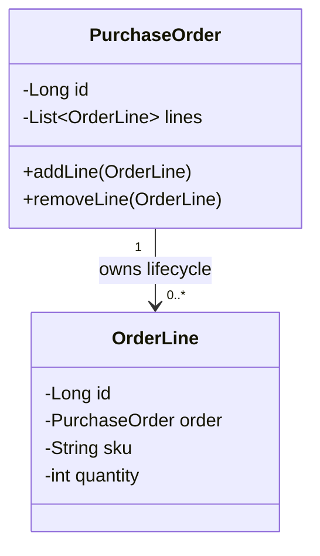

# PERSIST, MERGE, REMOVE, REFRESH, DETACH và ý nghĩa của ALL trong Hibernate

Trong Jakarta Persistence và Hibernate, một entity có thể liên kết tới những entity khác. Khi ứng dụng gọi một thao tác vòng đời như `persist()`, `merge()`, `remove()`, `refresh()` hoặc `detach()`, câu hỏi đặt ra là: **thao tác đó có chỉ áp dụng cho entity được gọi hay còn lan sang các entity liên quan?**

Cơ chế **cascade** trả lời câu hỏi này. Nếu mapping một association khai báo cascade phù hợp, thao tác vòng đời trên entity nguồn có thể được truyền tới entity đích. Ví dụ, khi một đơn hàng mới được persist, các dòng hàng thuộc riêng đơn đó cũng có thể được persist tự động.

```java
@OneToMany(
    mappedBy = "order",
    cascade = CascadeType.ALL,
    orphanRemoval = true
)
private List<OrderLine> lines = new ArrayList<>();
```

Mapping trên thường phù hợp khi `OrderLine` là thành phần có vòng đời phụ thuộc vào `PurchaseOrder`. Tuy nhiên, không nên thêm `CascadeType.ALL` vào mọi quan hệ theo thói quen. Nếu đơn hàng tham chiếu một `Customer` dùng chung, xóa đơn hàng không được tự động xóa khách hàng.

Bài học này giải thích ý nghĩa của từng loại cascade, cách chúng hoạt động trong persistence context và transaction, vì sao `ALL` không đồng nghĩa với “mọi thứ”, sự khác biệt với `orphanRemoval` và database `ON DELETE CASCADE`, cùng cách chọn cấu hình phù hợp cho quan hệ trong Hibernate.

## 1. Cascade là gì?

**Cascade** (*lan truyền thao tác vòng đời*) là quy tắc trong mapping quan hệ cho biết một thao tác trên entity nguồn có được áp dụng tiếp lên entity đích hay không.

Ví dụ một đơn hàng có nhiều dòng hàng:



Nếu khai báo `cascade = CascadeType.PERSIST` trên association từ `PurchaseOrder` tới `OrderLine`, gọi `persist(order)` có thể lan thao tác persist tới các dòng hàng đang được liên kết.

```java
PurchaseOrder order = new PurchaseOrder();
order.addLine(new OrderLine("SKU-01", 2));
order.addLine(new OrderLine("SKU-02", 1));

entityManager.persist(order);
// PERSIST được cascade sang OrderLine theo mapping.
```

Cascade **không phải một câu lệnh SQL**. Nó là quy tắc ở tầng ORM/JPA để lan truyền thao tác lifecycle qua object graph. Sau đó Hibernate vẫn phải thực hiện công việc persistence tương ứng trong transaction và theo mapping.

### 1.1. Cascade có hướng, không tự động đối xứng

Giả sử:

```java
@OneToMany(mappedBy = "order", cascade = CascadeType.PERSIST)
private List<OrderLine> lines;
```

`PurchaseOrder.lines` có cascade PERSIST tới `OrderLine`. Điều đó không tự động có nghĩa thao tác persist trên `OrderLine` sẽ lan ngược về `PurchaseOrder`. Muốn cascade theo hướng ngược, mapping ở association tương ứng phải khai báo riêng.

Một quan hệ hai chiều trong Java có thể điều hướng cả hai hướng, nhưng cascade được cấu hình **trên từng association attribute**. Nó không tự suy luận theo sơ đồ hai chiều.

### 1.2. Cascade mặc định là không có

Nếu không khai cascade:

```java
@ManyToOne(fetch = FetchType.LAZY)
@JoinColumn(name = "customer_id")
private Customer customer;
```

thì thao tác persist/merge/remove trên entity nguồn không tự lan sang `Customer` chỉ vì có reference tới nó. Ứng dụng phải quản lý trạng thái entity đích theo cách phù hợp, thường là tải một instance managed của Customer rồi gán vào đơn hàng.

Đây là default hữu ích: quan hệ tới một entity khác không mặc nhiên có nghĩa entity đó thuộc quyền sở hữu vòng đời của entity hiện tại.

### 1.3. Cascade và owning side là hai khái niệm riêng

- **Owning side** xác định phía mapping quyết định khóa ngoại hoặc bảng nối được ghi.
- **Cascade** xác định thao tác lifecycle có lan từ entity nguồn sang entity đích không.
- **Helper method** giữ các reference/collection trong Java nhất quán.
- **Transaction/flush** xác định khi nào SQL được đồng bộ xuống database.

Một association có cascade PERSIST không làm thay đổi owning side. Nếu quan hệ hai chiều mà code chỉ thêm entity vào inverse collection nhưng không cập nhật owning side, FK có thể vẫn không được ghi như mong muốn.

## 2. Năm loại cascade trong Jakarta Persistence

`jakarta.persistence.CascadeType` định nghĩa các thao tác có thể lan truyền:

| Cascade type | Thao tác được lan truyền | Ý nghĩa chính |
|---|---|---|
| `PERSIST` | `EntityManager.persist()` | Persist entity liên quan khi persist entity nguồn |
| `MERGE` | `EntityManager.merge()` | Merge trạng thái entity liên quan khi merge entity nguồn |
| `REMOVE` | `EntityManager.remove()` | Xóa entity liên quan khi remove entity nguồn |
| `REFRESH` | `EntityManager.refresh()` | Tải lại entity liên quan khi refresh entity nguồn |
| `DETACH` | `EntityManager.detach()` | Detach entity liên quan khi detach entity nguồn |
| `ALL` | Tất cả năm thao tác trên | Viết tắt cho PERSIST, MERGE, REMOVE, REFRESH và DETACH |

Cần nhớ rằng `ALL` **không phải** “mọi thao tác ORM có thể có”. Nó không bao gồm `orphanRemoval`, không tự cấu hình database cascade, không có nghĩa mọi thay đổi field đều lan qua association và không thay thế transaction.

## 3. CascadeType.PERSIST

`PERSIST` thường được dùng khi entity đích được tạo cùng entity nguồn và có vòng đời phụ thuộc vào nguồn.

### 3.1. Không có cascade: phải persist entity mới phù hợp

Ví dụ `PurchaseOrder` có một collection `OrderLine`, nhưng mapping không khai cascade:

```java
@OneToMany(mappedBy = "order")
private List<OrderLine> lines = new ArrayList<>();
```

```java
PurchaseOrder order = new PurchaseOrder();
OrderLine line = new OrderLine("SKU-01", 2);

order.addLine(line);
entityManager.persist(order);
entityManager.flush();
```

Nếu `line` là entity mới và đang được tham chiếu bởi entity managed/new theo mapping không có cascade persist, Hibernate có thể báo lỗi tham chiếu tới transient entity khi flush. Cách xử lý là persist rõ ràng entity con:

```java
entityManager.persist(order);
entityManager.persist(line);
```

hoặc khai cascade PERSIST nếu con thực sự thuộc vòng đời của cha.

### 3.2. Có cascade PERSIST

```java
@OneToMany(
    mappedBy = "order",
    cascade = CascadeType.PERSIST
)
private List<OrderLine> lines = new ArrayList<>();
```

Khi gọi:

```java
entityManager.persist(order);
```

Hibernate/JPA áp dụng thao tác persist tới những entity đích phù hợp trong association có cascade PERSIST. Các entity con mới được đưa vào persistence context và được chèn theo quy tắc ID, FK và flush.

Ví dụ helper đồng bộ hai phía:

```java
@Entity
public class PurchaseOrder {
    @Id
    @GeneratedValue
    private Long id;

    @OneToMany(
        mappedBy = "order",
        cascade = CascadeType.PERSIST
    )
    private List<OrderLine> lines = new ArrayList<>();

    public void addLine(OrderLine line) {
        lines.add(line);
        line.setOrder(this);
    }
}

@Entity
public class OrderLine {
    @Id
    @GeneratedValue
    private Long id;

    @ManyToOne(fetch = FetchType.LAZY, optional = false)
    @JoinColumn(name = "order_id", nullable = false)
    private PurchaseOrder order;

    protected OrderLine() {}

    public void setOrder(PurchaseOrder order) {
        this.order = order;
    }
}
```

Trong ví dụ, `OrderLine.order` là owning side vì chứa `@JoinColumn`. Helper `addLine` cập nhật cả collection của cha và reference sở hữu FK ở con. Cascade PERSIST giúp vòng đời insert lan từ cha tới con; helper mới là phần giữ object graph nhất quán.

### 3.3. Persist entity đã tồn tại hoặc detached

Cascade PERSIST không phải cách gắn lại một entity detached. Nếu association chứa entity detached không phù hợp với thao tác persist, provider có thể ném lỗi như `EntityExistsException` hoặc lỗi Hibernate tương ứng, tùy trạng thái và thời điểm phát hiện.

Ví dụ một `Customer` đã tồn tại trong database không nên được tạo lại như một object mới rồi cascade persist từ đơn hàng. Thông thường hãy tải Customer managed:

```java
Customer customer =
    entityManager.find(Customer.class, customerId);

PurchaseOrder order = new PurchaseOrder(customer);
entityManager.persist(order);
```

Không khai cascade PERSIST từ đơn hàng sang khách hàng chỉ vì muốn “tự lưu mọi thứ”. Customer là entity độc lập có thể được nhiều đơn hàng tham chiếu.

### 3.4. Khi nào nên dùng PERSIST?

Phù hợp với:

- Order → OrderLine.
- Invoice → InvoiceLine.
- BlogPost → Attachment metadata thuộc riêng bài viết.
- Aggregate root → entity con được tạo và lưu cùng root.

Thận trọng với:

- Order → Customer.
- Employee → Department.
- Article → Category dùng chung.
- Nhiều entity cùng tham chiếu một danh mục hoặc người dùng.

Quy tắc thực tế: **cascade PERSIST khi tạo cha thì việc tạo con cũng là một phần tự nhiên của cùng thao tác nghiệp vụ**.

## 4. CascadeType.MERGE

`MERGE` áp dụng khi hợp nhất trạng thái từ một object mới hoặc detached vào persistence context hiện tại.

### 4.1. Merge không attach chính object đầu vào

```java
PurchaseOrder detached = loadFromPreviousRequest();

PurchaseOrder managed =
    entityManager.merge(detached);
```

`merge` copy state từ `detached` vào một instance managed tương ứng và trả về instance managed. Input có thể vẫn detached. Khi thao tác tiếp, dùng object trả về:

```java
PurchaseOrder managed = entityManager.merge(detached);

managed.changeDeliveryNote("Giao giờ hành chính");
// Đừng tiếp tục sửa detached rồi mong managed tự nhận thay đổi.
```

Đây là semantics quan trọng: **merge là copy state, không phải attach input object vào Session**.

### 4.2. Cascade MERGE trên graph

Giả sử mapping:

```java
@OneToMany(
    mappedBy = "order",
    cascade = CascadeType.MERGE
)
private List<OrderLine> lines = new ArrayList<>();
```

Khi merge một `PurchaseOrder` detached, thao tác merge có thể lan tới những `OrderLine` liên quan theo mapping. Provider hợp nhất state của từng entity đích và duy trì graph managed theo semantics JPA.

Ví dụ:

```java
@Transactional
public PurchaseOrder mergeOrderSnapshot(
        PurchaseOrder detachedOrder) {

    PurchaseOrder managed =
        entityManager.merge(detachedOrder);

    return managed;
}
```

Đây chỉ là ví dụ cho một snapshot đã được kiểm soát. Không nên lấy JSON từ client, deserialize thẳng thành entity graph rồi merge mà không kiểm soát field được phép thay đổi, version, ownership, cascade và collection semantics.

### 4.3. Cascade MERGE không biến PATCH thành an toàn

Giả sử client chỉ gửi:

```json
{
  "id": 42,
  "deliveryNote": "Gọi trước khi giao"
}
```

Nếu object được deserialize có những field khác thành `null` hoặc collection rỗng, merge có thể copy những giá trị đó vào managed representation. Hibernate không tự biết rằng “field không xuất hiện trong request nghĩa là giữ nguyên”.

Với cập nhật từng phần, nên dùng request DTO và tải entity managed:

```java
@Transactional
public void changeNote(Long id, String note) {
    PurchaseOrder order =
        entityManager.find(PurchaseOrder.class, id);

    if (order == null) {
        throw new NoSuchElementException("Order not found");
    }

    order.changeDeliveryNote(note);
}
```

Merge phù hợp hơn khi ứng dụng thực sự có một detached snapshot đầy đủ, được tin cậy và có quy tắc merge graph rõ ràng.

### 4.4. Cascade MERGE và entity đích dùng chung

Nếu một đơn hàng có association tới Customer và cascade MERGE, merge đơn hàng có thể copy trạng thái Customer từ graph detached vào Customer managed. Điều này có thể vô tình ghi đè tên, địa chỉ hoặc trạng thái khách hàng mà use case “sửa ghi chú đơn hàng” không có ý định thay đổi.

Không cascade MERGE qua mọi quan hệ chỉ vì entity nguồn có reference tới entity đích. Hãy hỏi: **thao tác cập nhật entity nguồn có thật sự sở hữu quyền hợp nhất trạng thái của entity đích không?**

## 5. CascadeType.REMOVE

`REMOVE` truyền thao tác xóa từ entity nguồn sang các entity đích trong association có cascade remove.

### 5.1. Ví dụ xóa aggregate cha và các con

```java
@OneToMany(
    mappedBy = "order",
    cascade = CascadeType.REMOVE
)
private List<OrderLine> lines = new ArrayList<>();
```

Khi gọi:

```java
PurchaseOrder order =
    entityManager.find(PurchaseOrder.class, orderId);

entityManager.remove(order);
```

các entity `OrderLine` liên quan có thể được đánh dấu removed theo cascade. SQL delete được đồng bộ khi flush và transaction commit.

### 5.2. REMOVE có thể gây lỗi nếu quan hệ còn được tham chiếu

Nếu một entity đích được nhiều entity khác tham chiếu, xóa nó có thể vi phạm FK hoặc phá dữ liệu của các đối tượng còn lại.

Ví dụ `Customer` được nhiều `PurchaseOrder` sử dụng:

```java
@ManyToOne(fetch = FetchType.LAZY)
@JoinColumn(name = "customer_id", nullable = false)
private Customer customer;
```

Nếu khai `cascade = CascadeType.REMOVE` ở phía `PurchaseOrder.customer`, xóa một đơn có thể truyền thao tác remove sang Customer. Đây thường là điều sai: Customer còn được các đơn hàng khác tham chiếu.

**Theo Jakarta Persistence, cascade REMOVE chỉ nên được áp dụng cho association OneToOne và OneToMany; áp dụng nó lên ManyToOne hoặc ManyToMany không portable.** Với quan hệ nhiều-nhiều hoặc tham chiếu tới entity dùng chung, cần đặc biệt tránh xóa target chỉ vì một nguồn bị xóa.

### 5.3. Cascade REMOVE không đồng nghĩa xóa mọi hàng liên quan trong database

Cascade REMOVE là thao tác lifecycle ORM. Nó có thể làm Hibernate tải/duyệt graph và phát các lệnh DELETE phù hợp. Kết quả còn chịu ảnh hưởng của FK constraints, mapping và transaction.

Nếu DB schema khai `ON DELETE CASCADE`, database có thể tự xóa hàng con khi hàng cha bị xóa. Đó là cơ chế ở tầng database, khác với JPA cascade. Hai cơ chế có thể được phối hợp, nhưng phải thiết kế để tránh thao tác thừa, stale cache và kỳ vọng callback sai.

## 6. CascadeType.REFRESH

`REFRESH` yêu cầu tải lại trạng thái entity từ database và có thể lan sang các entity liên quan nếu association khai cascade REFRESH.

### 6.1. Refresh một managed entity

```java
PurchaseOrder order =
    entityManager.find(PurchaseOrder.class, orderId);

order.changeDeliveryNote("Thay đổi chưa flush");

entityManager.refresh(order);
```

`refresh` tải lại state từ database. Vì thế, thay đổi Java chưa flush trên entity có thể **bị ghi đè** bằng giá trị database đang thấy. Refresh không phải “lưu” hoặc “flush”; nó là thao tác đọc lại.

Nếu cần tải lại cả một graph:

```java
@OneToMany(
    mappedBy = "order",
    cascade = CascadeType.REFRESH
)
private List<OrderLine> lines;
```

thì refresh trên order có thể lan sang các line phù hợp theo mapping. Đây có thể là điều mong muốn khi cần làm mới một graph đã tải từ trước, nhưng cũng có thể ghi đè thay đổi chưa flush ở các entity con.

### 6.2. Khi nào dùng REFRESH?

Một số tình huống:

- Database trigger hoặc generated columns đã thay đổi dữ liệu và ứng dụng cần đọc lại.
- Một thao tác DB ngoài ORM cập nhật row và ứng dụng muốn refresh managed entity.
- Cần loại bỏ thay đổi Java chưa lưu và nạp lại state DB theo chủ đích.

Không gọi refresh tùy tiện sau mỗi thao tác. Nó có thể phát thêm SELECT, ghi đè pending changes và vẫn chịu transaction isolation. Trong một transaction snapshot ổn định, refresh không nhất thiết thấy commit mới từ transaction khác.

### 6.3. Cascade REFRESH cần thận trọng

Nếu graph có nhiều entity managed với những thay đổi riêng chưa flush, refresh parent với cascade REFRESH có thể làm mất các thay đổi ở child. Chỉ khai báo cascade REFRESH nếu việc tải lại đồng bộ toàn bộ graph là ý định nghiệp vụ rõ ràng.

## 7. CascadeType.DETACH

`DETACH` lan thao tác tách entity khỏi persistence context sang các entity liên quan.

### 7.1. Detach một entity

```java
PurchaseOrder order =
    entityManager.find(PurchaseOrder.class, orderId);

entityManager.detach(order);

assert !entityManager.contains(order);
```

Sau detach, object vẫn tồn tại trong Java và các reference của nó vẫn còn, nhưng Hibernate không còn dirty checking object đó trong persistence context hiện tại.

```java
entityManager.detach(order);

order.changeDeliveryNote("Chỉ đổi trong RAM");
entityManager.flush();

// Không mong flush lưu thay đổi trên order đã detached.
```

`detach` không phải update hoặc delete. Nó không gửi pending changes của object ra database; nếu thay đổi chưa flush, những thay đổi đó không được persistence context cũ đồng bộ chỉ nhờ detach.

### 7.2. Cascade DETACH

```java
@OneToMany(
    mappedBy = "order",
    cascade = CascadeType.DETACH
)
private List<OrderLine> lines = new ArrayList<>();
```

Khi detach order, những line trong association có cascade DETACH cũng được tách theo. Nếu không có cascade DETACH, entity liên quan có thể vẫn managed nếu nó đang được quản lý riêng trong cùng context.

### 7.3. Vì sao cần DETACH?

Một số trường hợp có thể cần:

- Không muốn một object tiếp tục được dirty checking trong context.
- Xử lý một entity tách biệt sau khi đã flush và muốn giảm lượng managed state.
- Kiểm soát persistence context khi xử lý batch hoặc graph lớn.

Trong batch processing, `entityManager.clear()` thường tách toàn bộ context thay vì detach từng entity. Nhưng clear không tự flush; cần flush các thay đổi cần giữ trước khi clear.

Không dùng DETACH để né transaction design hoặc thay thế DTO. Nếu mục tiêu chỉ là trả dữ liệu ra API, DTO/projection thường rõ nghĩa hơn.

## 8. Ý nghĩa chính xác của CascadeType.ALL

`CascadeType.ALL` là viết tắt của **năm loại cascade**:

```java
cascade = {
    CascadeType.PERSIST,
    CascadeType.MERGE,
    CascadeType.REMOVE,
    CascadeType.REFRESH,
    CascadeType.DETACH
}
```

Do đó:

```java
@OneToMany(
    mappedBy = "order",
    cascade = CascadeType.ALL
)
private List<OrderLine> lines = new ArrayList<>();
```

tương đương về mặt cascade với khai báo đủ năm loại trên.

### 8.1. ALL không bao gồm orphanRemoval

`orphanRemoval` là một thuộc tính mapping riêng, không phải giá trị của `CascadeType`.

```java
@OneToMany(
    mappedBy = "order",
    cascade = CascadeType.ALL,
    orphanRemoval = true
)
private List<OrderLine> lines = new ArrayList<>();
```

Hai phần có ý nghĩa khác nhau:

- `cascade = ALL`: truyền persist, merge, remove, refresh và detach từ order tới line.
- `orphanRemoval = true`: khi một line bị loại khỏi quan hệ sở hữu theo quy tắc orphan removal, JPA áp dụng thao tác remove lên orphan khi flush theo semantics của specification.

Nếu chỉ có `cascade = ALL` mà không có `orphanRemoval = true`, xóa một phần tử khỏi collection **không mặc nhiên có nghĩa xóa entity con**. Kết quả còn phụ thuộc owning side, nullable FK và cách helper cập nhật quan hệ. Với FK NOT NULL, thao tác chỉ bỏ reference mà không xóa con có thể dẫn tới constraint violation.

### 8.2. ALL không bao gồm database ON DELETE CASCADE

`CascadeType.REMOVE` do ORM lan thao tác remove qua entity graph. `ON DELETE CASCADE` là constraint/action ở database. Hai cơ chế không giống nhau và không được bật tự động cùng nhau.

### 8.3. ALL không có nghĩa cascade mọi thao tác Hibernate

Các API riêng của Hibernate hoặc thao tác như lock, evict, replicate, native SQL, bulk mutation không trở thành cascade chỉ vì khai `ALL`. `ALL` chỉ là tập hợp các giá trị enum CascadeType chuẩn của Jakarta Persistence.

### 8.4. ALL có thể quá rộng

Nếu entity đích có vòng đời độc lập, `ALL` có thể mang theo REMOVE hoặc REFRESH/DETACH ngoài ý muốn. Thường tốt hơn khi chỉ khai các cascade thật sự cần:

```java
@OneToMany(
    mappedBy = "order",
    cascade = {
        CascadeType.PERSIST,
        CascadeType.MERGE
    }
)
private List<OrderLine> lines = new ArrayList<>();
```

Hoặc dùng `ALL` khi child hoàn toàn thuộc aggregate root và toàn bộ năm thao tác thực sự có ý nghĩa.

## 9. Phân biệt CascadeType.REMOVE với orphanRemoval

Đây là hai tính năng thường được dùng cùng nhau nhưng có trigger khác nhau.

| Tình huống | `cascade = REMOVE` | `orphanRemoval = true` |
|---|---|---|
| Gọi `remove(parent)` | Lan remove sang target | Entity con orphan được remove theo quy tắc orphan removal |
| Bỏ child khỏi collection | Không tự động có nghĩa xóa child chỉ vì cascade REMOVE | Có thể đánh dấu child để xóa khi flush |
| Đặt association OneToOne thành null | Không phải trigger chung của cascade REMOVE | Có thể xóa entity con bị orphan |
| Là giá trị của `CascadeType`? | Có | Không |
| Dùng cho child có vòng đời riêng? | Thường không | Không phù hợp nếu child được chia sẻ/độc lập |
| Hạn chế association | REMOVE nên dùng với OneToOne/OneToMany theo JPA | Dành cho OneToOne/OneToMany |

### 9.1. Ví dụ aggregate có orphanRemoval

```java
@Entity
public class PurchaseOrder {
    @Id
    @GeneratedValue
    private Long id;

    @OneToMany(
        mappedBy = "order",
        cascade = CascadeType.ALL,
        orphanRemoval = true
    )
    private List<OrderLine> lines = new ArrayList<>();

    public void addLine(OrderLine line) {
        lines.add(line);
        line.setOrder(this);
    }

    public void removeLine(OrderLine line) {
        if (lines.remove(line)) {
            line.setOrder(null);
        }
    }
}
```

Khi gọi `removeLine`, object graph được cập nhật. Với orphanRemoval, Hibernate/JPA có thể lên lịch xóa line khỏi database khi flush. Không cần gọi `entityManager.remove(line)` thủ công cho trường hợp orphan được quản lý theo mapping.

Ví dụ helper đặt FK thành null chỉ phù hợp nếu domain/mapping cho phép state tạm đó. Với `nullable=false`, ORM vẫn có thể thực hiện orphan delete theo lifecycle, nhưng code và SQL order phải được kiểm tra với mapping thực tế; không dùng helper này để tách child rồi giữ nó như một entity độc lập.

### 9.2. Child được chuyển sang parent khác

Nếu một `OrderLine` có thể chuyển sang một order khác mà vẫn giữ identity, đó là dấu hiệu cần cân nhắc liệu `orphanRemoval=true` có đúng không. Việc bỏ line khỏi parent cũ có thể lên lịch xóa nó, khiến chuyển giao không còn là một thao tác move đơn giản.

`orphanRemoval` biểu đạt ownership vòng đời chặt: con bị bỏ khỏi parent thì không còn tồn tại như entity độc lập. Nếu domain cho phép tái gán, cần thiết kế mapping/helper và thao tác transaction phù hợp.

## 10. Cascade không thay thế việc đồng bộ hai phía của quan hệ

Cascade điều khiển **truyền thao tác lifecycle**. Nó không tự sửa mọi reference Java ở hai phía.

Ví dụ:

```java
@OneToMany(
    mappedBy = "order",
    cascade = CascadeType.PERSIST
)
private List<OrderLine> lines = new ArrayList<>();
```

Nếu chỉ gọi:

```java
order.getLines().add(line);
entityManager.persist(order);
```

mà không gán `line.order`, owning side vẫn chưa có giá trị. Hibernate có thể không ghi FK đúng hoặc phát sinh lỗi NOT NULL.

Helper nên làm cả hai:

```java
public void addLine(OrderLine line) {
    lines.add(line);
    line.setOrder(this);
}
```

Tương tự khi remove, cần xử lý owning side và orphan semantics theo domain. **Cascade không phải công cụ đồng bộ association.**

## 11. Chọn cascade theo vòng đời thực của entity

Một cách thiết kế dễ nhớ là phân biệt:

- **Owned child:** chỉ có ý nghĩa khi nằm trong aggregate cha, vòng đời phụ thuộc cha.
- **Shared reference:** có thể được nhiều entity sử dụng, có vòng đời riêng.
- **Independent entity:** tồn tại độc lập và chỉ liên kết với entity khác để tham chiếu hoặc nghiệp vụ.

Ví dụ:

| Quan hệ | Đặc tính | Cấu hình thường cân nhắc |
|---|---|---|
| PurchaseOrder → OrderLine | Dòng hàng thuộc riêng đơn hàng | PERSIST, MERGE; thường REMOVE/ALL và orphanRemoval nếu domain yêu cầu |
| Invoice → InvoiceLine | Dòng hóa đơn thuộc hóa đơn | Tương tự aggregate child |
| BlogPost → Comment | Bình luận có thể thuộc vòng đời bài viết | PERSIST/MERGE/REMOVE tùy chính sách xóa |
| PurchaseOrder → Customer | Customer dùng chung nhiều đơn | Thường không cascade REMOVE; có thể không cascade hoặc chỉ cascade rất chọn lọc |
| Employee → Department | Phòng ban được nhiều nhân viên tham chiếu | Không cascade REMOVE |
| Article → Tag (ManyToMany) | Tag dùng chung nhiều bài | Tránh cascade REMOVE; thường thao tác join table |
| User → Role (ManyToMany) | Role dùng chung | Tránh cascade REMOVE tới Role |

### 11.1. Vì sao không nên cascade ALL từ ManyToOne?

Ví dụ:

```java
@ManyToOne(
    fetch = FetchType.LAZY,
    cascade = CascadeType.ALL
)
@JoinColumn(name = "customer_id")
private Customer customer;
```

Khi xóa một PurchaseOrder, cascade REMOVE có thể lan sang Customer. Nhưng Customer có thể có hàng trăm đơn khác. Điều đó vừa sai vòng đời domain vừa có thể vi phạm FK.

Với `ManyToOne`, association thường trỏ tới entity dùng chung nên cấu hình an toàn thường là không cascade hoặc chỉ cascade một thao tác cụ thể khi có lý do rõ. Đặc biệt, JPA không bảo đảm tính portable cho cascade REMOVE trên ManyToOne.

### 11.2. Vì sao không nên cascade ALL từ ManyToMany?

```java
@ManyToMany(cascade = CascadeType.ALL)
private Set<Tag> tags = new HashSet<>();
```

Một tag có thể được nhiều bài viết sử dụng. Xóa một bài viết không nên xóa tag. Với ManyToMany, thao tác bỏ liên kết thường cần xóa row trong join table, không phải xóa entity Tag. Cascade REMOVE có thể gây xóa target dùng chung và vi phạm ràng buộc từ các bài viết khác.

Thường chỉ cascade các thao tác phù hợp với cách tạo/quản lý tag, hoặc không cascade nếu Tag là danh mục dùng chung được quản trị riêng.

## 12. Cascade và database ON DELETE CASCADE

Hai cơ chế có thể cùng nhắc đến từ “cascade”, nhưng ở hai tầng khác nhau.

### 12.1. JPA cascade REMOVE

```java
@OneToMany(
    mappedBy = "order",
    cascade = CascadeType.REMOVE
)
private List<OrderLine> lines;
```

Khi ứng dụng gọi `entityManager.remove(order)`, JPA/Hibernate truyền thao tác remove qua graph theo mapping. ORM có thể thực thi nhiều DELETE statements và các lifecycle callbacks tương ứng.

### 12.2. Database foreign key ON DELETE CASCADE

```sql
CREATE TABLE order_lines (
    id BIGINT PRIMARY KEY,
    order_id BIGINT NOT NULL,
    sku VARCHAR(50) NOT NULL,
    CONSTRAINT fk_order_line
        FOREIGN KEY (order_id)
        REFERENCES purchase_orders(id)
        ON DELETE CASCADE
);
```

Khi database thực thi DELETE trên `purchase_orders`, DBMS tự xóa các row `order_lines` tham chiếu theo FK rule. Cơ chế này vẫn hoạt động với SQL trực tiếp ngoài Hibernate.

### 12.3. So sánh

| Tiêu chí | JPA `CascadeType.REMOVE` | Database `ON DELETE CASCADE` |
|---|---|---|
| Nơi thực thi | ORM/JPA lifecycle | Database FK engine |
| Trigger | `EntityManager.remove(parent)` và cascade mapping | SQL DELETE hàng cha |
| Callback JPA cho từng child | Có thể được gọi theo lifecycle ORM | Không tự gọi Java callbacks |
| Áp dụng khi native SQL bên ngoài ORM | Không tự áp dụng | Có, nếu FK rule được khai trong DB |
| Cache/persistence context | Hibernate quản lý các entity tham gia lifecycle | Entity/cache có thể stale nếu DB xóa con mà ORM không biết |
| Phụ thuộc schema | Mapping cascade | FK constraint thực tế |
| Tác động lên bulk delete | Bulk DML bỏ qua cascade entity lifecycle | DB FK cascade vẫn có thể chạy |

Nếu dùng DB cascade, cần xem cách Hibernate biết child đã bị DB xóa, cùng với second-level cache/query cache và managed collections. Một native/bulk DELETE có thể khiến persistence context còn tham chiếu tới child không còn trong DB.

Hibernate có các mapping-specific khả năng như `@OnDelete` trong một số cấu hình, nhưng đây là tính năng Hibernate-specific và phải kiểm tra đúng version. Không gộp nó vào semantics chuẩn của `CascadeType.REMOVE`.

## 13. Cascade và bulk JPQL/HQL DELETE khác nhau

Một câu lệnh:

```java
entityManager.createQuery(
    "delete from PurchaseOrder o where o.status = :status")
    .setParameter("status", OrderStatus.CANCELLED)
    .executeUpdate();
```

là bulk mutation trực tiếp trên database. Nó **không tương đương** với:

```java
List<PurchaseOrder> orders = ...;

for (PurchaseOrder order : orders) {
    entityManager.remove(order);
}
```

Vì vậy bulk DELETE không đi qua từng entity để áp dụng JPA cascade REMOVE, orphan removal, callbacks hay domain methods như thao tác lifecycle thông thường. Nếu DB có `ON DELETE CASCADE`, database vẫn có thể xóa child theo FK rule.

Bulk update/delete còn có thể làm managed entities đang tồn tại trong persistence context stale. Cần flush pending ORM changes trước nếu thứ tự yêu cầu, rồi refresh/clear hoặc kết thúc context phù hợp. `clear()` sẽ detach tất cả và không tự flush.

## 14. Cascade và vòng đời từng thao tác chi tiết

Bảng sau tóm lược cách các thao tác tương tác với association:

| Thao tác trên nguồn | Khi có cascade tương ứng | Khi không có cascade |
|---|---|---|
| `persist(parent)` | Entity đích phù hợp được persist theo mapping | Entity đích không tự được persist |
| `merge(parent)` | State entity đích được merge vào managed graph | Không có merge cascade từ association đó |
| `remove(parent)` | Entity đích được remove theo cascade | Không tự remove entity đích; FK/constraint vẫn phải hợp lệ |
| `refresh(parent)` | Entity đích được refresh theo cascade | Không tự refresh entity đích |
| `detach(parent)` | Entity đích được detach theo cascade | Entity đích có thể vẫn managed độc lập |

Cascade không tự động làm thao tác nguồn hợp lệ nếu entity đích có trạng thái không tương thích. Ví dụ persist parent có reference tới detached child nhưng không có cách quản lý phù hợp vẫn có thể thất bại; cascade không phải công cụ hợp thức hóa mọi object graph.

### 14.1. Cascade không truyền mọi thay đổi field

Sau khi hai entity đã managed, sửa:

```java
order.getCustomer().rename("Tên mới");
```

không cần cascade MERGE để Hibernate dirty-check Customer nếu Customer **đã managed trong cùng persistence context**. Cascade MERGE chỉ liên quan thao tác merge. Một managed Customer được sửa sẽ được dirty checking theo lifecycle của chính nó, bất kể Order có cascade MERGE hay không.

Đây là một khác biệt thường bị nhầm: cascade điều khiển việc **truyền thao tác**, không phải quyền sở hữu toàn bộ thay đổi field của entity đích.

## 15. Cascade với trạng thái managed, detached và new

### 15.1. Parent managed, child new

Nếu thêm child mới vào association có cascade PERSIST rồi flush, Hibernate có thể persist child. Nếu không có cascade, ứng dụng cần persist child riêng hoặc mapping/flow phù hợp.

### 15.2. Parent detached, child detached

Khi merge parent với cascade MERGE, trạng thái các child có thể được copy vào managed graph. Dùng object trả về từ merge và đảm bảo identity/version của graph không xung đột.

### 15.3. Parent managed, child detached

Không thể mặc định chỉ gán child detached vào association là Hibernate tự attach child. Nếu entity đích không managed hoặc không được quản lý theo cách phù hợp, flush có thể báo transient/detached reference hoặc lỗi khác. Hãy tải managed reference bằng `find`/`getReference` hoặc merge đúng cách trước khi gắn.

### 15.4. Parent bị remove

Cascade REMOVE lan tới các child được cấu hình. Nếu child có reference tới entity dùng chung khác, không được cascade REMOVE ngược lên những entity đó nếu không có vòng đời phụ thuộc thực sự.

### 15.5. Refresh và detach trên graph

REFRESH và DETACH cũng tuân theo trạng thái entity và association. Nếu child đang managed nhưng không cascade, refresh parent không mặc nhiên làm child được tải lại; detach parent không mặc nhiên tách mọi entity mà nó từng tham chiếu nếu không có cascade DETACH.

## 16. Một mapping aggregate thường dùng trong thực tế

Ví dụ mô hình một đơn hàng có các dòng hàng riêng và tham chiếu tới khách hàng dùng chung.

### 16.1. PurchaseOrder sở hữu collection con

```java
@Entity
@Table(name = "purchase_orders")
public class PurchaseOrder {

    @Id
    @GeneratedValue(strategy = GenerationType.IDENTITY)
    private Long id;

    @ManyToOne(fetch = FetchType.LAZY, optional = false)
    @JoinColumn(name = "customer_id", nullable = false)
    private Customer customer;

    @OneToMany(
        mappedBy = "order",
        cascade = CascadeType.ALL,
        orphanRemoval = true
    )
    private List<OrderLine> lines = new ArrayList<>();

    protected PurchaseOrder() {}

    public PurchaseOrder(Customer customer) {
        this.customer = Objects.requireNonNull(customer);
    }

    public void addLine(String sku, int quantity) {
        OrderLine line = new OrderLine(sku, quantity);
        line.setOrder(this);
        lines.add(line);
    }

    public void removeLine(OrderLine line) {
        if (lines.remove(line)) {
            line.setOrder(null);
        }
    }

    public Long getId() {
        return id;
    }
}
```

`Customer` không có cascade. Đây là lựa chọn có chủ đích: khách hàng có vòng đời riêng, có thể được tham chiếu bởi nhiều đơn hàng.

### 16.2. OrderLine là child

```java
@Entity
@Table(name = "order_lines")
public class OrderLine {

    @Id
    @GeneratedValue(strategy = GenerationType.IDENTITY)
    private Long id;

    @ManyToOne(fetch = FetchType.LAZY, optional = false)
    @JoinColumn(name = "order_id", nullable = false)
    private PurchaseOrder order;

    @Column(name = "sku", nullable = false, length = 50)
    private String sku;

    @Column(name = "quantity", nullable = false)
    private int quantity;

    protected OrderLine() {}

    public OrderLine(String sku, int quantity) {
        if (quantity <= 0) {
            throw new IllegalArgumentException(
                "Quantity must be positive");
        }
        this.sku = Objects.requireNonNull(sku);
        this.quantity = quantity;
    }

    void setOrder(PurchaseOrder order) {
        this.order = order;
    }
}
```

Method `setOrder` có thể package-private để caller ngoài domain không tự sửa một phía. Trong ví dụ, `orphanRemoval` biểu đạt line thuộc riêng order. Nếu domain cho phép chuyển line giữa các đơn, cần thiết kế lại lifecycle và không giả định orphan removal vẫn phù hợp.

### 16.3. Service tạo đơn

```java
@Transactional
public Long createOrder(Long customerId, List<LineInput> inputs) {
    Customer customer =
        entityManager.find(Customer.class, customerId);

    if (customer == null) {
        throw new NoSuchElementException("Customer not found");
    }

    PurchaseOrder order = new PurchaseOrder(customer);

    for (LineInput input : inputs) {
        order.addLine(input.sku(), input.quantity());
    }

    entityManager.persist(order);
    // Cascade ALL bao gồm PERSIST tới OrderLine.
    // Không persist hoặc cascade REMOVE sang Customer.

    return order.getId();
}
```

```java
public record LineInput(String sku, int quantity) {}
```

### 16.4. Service xóa đơn

```java
@Transactional
public void deleteOrder(Long orderId) {
    PurchaseOrder order =
        entityManager.find(PurchaseOrder.class, orderId);

    if (order == null) {
        return;
    }

    entityManager.remove(order);
    // REMOVE lan tới OrderLine theo cascade ALL.
    // Customer không bị xóa.
}
```

Đây là ý nghĩa quan trọng của cascade theo aggregate: thao tác trên root ảnh hưởng child thuộc root, trong khi reference tới entity dùng chung được giữ độc lập.

## 17. Chọn ALL hay liệt kê từng cascade?

Không có quy tắc rằng `ALL` luôn tốt hơn hoặc luôn xấu. Quyết định phụ thuộc vào vòng đời thực tế.

### 17.1. Khi ALL có thể hợp lý

- Entity đích hoàn toàn thuộc sở hữu của entity nguồn.
- Khi tạo nguồn thì cần tạo con.
- Khi hợp nhất graph nguồn thì cần hợp nhất graph con.
- Khi xóa nguồn thì con không thể tồn tại độc lập.
- Khi refresh/detach nguồn thì muốn các con đi cùng.
- Không có entity dùng chung bị xóa nhầm qua association đó.

Trong một aggregate đơn giản, `cascade = ALL` giúp mapping biểu đạt quan hệ vòng đời đầy đủ.

### 17.2. Khi chỉ cần một vài cascade

Ví dụ một entity có quan hệ tới audit metadata hoặc value-related entity mà chỉ cần persist/merge. Nếu không muốn remove, refresh hoặc detach lan theo, liệt kê cụ thể:

```java
@OneToOne(
    cascade = {
        CascadeType.PERSIST,
        CascadeType.MERGE
    }
)
private DraftMetadata draftMetadata;
```

### 17.3. Khi không nên cascade

- Entity đích được chia sẻ giữa nhiều nguồn.
- Association chỉ là reference để đọc.
- Parent không sở hữu vòng đời child.
- Entity đích có quyền/lifecycle riêng.
- Việc remove parent không có nghĩa remove target.
- Graph detached không đáng tin cậy hoặc không đầy đủ để merge.

Ví dụ:

```java
@ManyToOne(fetch = FetchType.LAZY)
@JoinColumn(name = "department_id")
private Department department;
```

```java
@ManyToMany
@JoinTable(
    name = "article_tags",
    joinColumns = @JoinColumn(name = "article_id"),
    inverseJoinColumns = @JoinColumn(name = "tag_id")
)
private Set<Tag> tags = new HashSet<>();
```

Trong các ví dụ này, cascade REMOVE/ALL thường không phù hợp nếu Department/Tag được dùng chung.

## 18. Các lỗi thường gặp khi cấu hình cascade

### 18.1. Cascade ALL trên ManyToOne làm xóa entity dùng chung

**Triệu chứng:** xóa một order làm Hibernate cố xóa Customer, dẫn tới FK violation hoặc xóa dữ liệu không mong muốn.

**Nguyên nhân:** ALL bao gồm REMOVE, được khai trên association tham chiếu entity có vòng đời độc lập.

**Cách xử lý:** bỏ cascade REMOVE/ALL; tải và gán Customer managed; chỉ khai PERSIST/MERGE khi có lý do nghiệp vụ cụ thể và phù hợp mapping.

### 18.2. Không cascade PERSIST cho child mới

**Triệu chứng:** flush báo transient object/reference hoặc không persist child như mong muốn.

**Nguyên nhân:** parent được persist nhưng child mới chưa được quản lý và association không cascade PERSIST.

**Cách xử lý:** persist child riêng hoặc khai cascade PERSIST trên association sở hữu vòng đời child; đồng thời cập nhật owning side.

### 18.3. Dùng merge để PATCH một entity

**Triệu chứng:** field không gửi từ client bị null hoặc collection bị thay đổi ngoài ý muốn.

**Nguyên nhân:** merge copy state của object input, không hiểu semantics field absent trong HTTP PATCH.

**Cách xử lý:** DTO command + tải managed entity + domain method; chỉ merge snapshot đầy đủ và được kiểm soát.

### 18.4. Nghĩ Cascade REMOVE sẽ xóa child khi bỏ khỏi collection

**Triệu chứng:** bỏ line khỏi collection nhưng row vẫn còn hoặc FK bị null/constraint error.

**Nguyên nhân:** cascade REMOVE được kích hoạt khi remove parent, không phải mọi thao tác remove association.

**Cách xử lý:** dùng orphanRemoval nếu child thật sự thuộc riêng parent; hoặc gọi remove explicit khi domain cho phép.

### 18.5. Nhầm orphanRemoval với ALL

**Triệu chứng:** mapping cascade ALL nhưng remove child khỏi collection không tạo DELETE như mong đợi.

**Nguyên nhân:** ALL không chứa orphanRemoval.

**Cách xử lý:** khai `orphanRemoval=true` riêng và chỉ dùng cho association OneToOne/OneToMany có private ownership.

### 18.6. Cascade không sửa owning side

**Triệu chứng:** persist graph thành công nhưng FK null/sai.

**Nguyên nhân:** chỉ sửa inverse collection; cascade không đồng bộ hai phía.

**Cách xử lý:** viết helper thêm/xóa liên kết cập nhật cả owning side và inverse side.

### 18.7. Cascade REFRESH làm mất thay đổi chưa flush

**Triệu chứng:** field Java vừa đổi bỗng trở về giá trị DB.

**Nguyên nhân:** refresh tải lại trạng thái database và có thể cascade sang child.

**Cách xử lý:** chỉ refresh khi thật sự muốn bỏ pending state và đọc lại DB; flush trước nếu muốn giữ thay đổi, nhưng cân nhắc transaction isolation.

### 18.8. Cascade DETACH làm entity không còn được theo dõi

**Triệu chứng:** sửa child sau khi detach parent nhưng flush không lưu.

**Nguyên nhân:** DETACH cascade đã tách child khỏi persistence context.

**Cách xử lý:** dùng managed entity trong transaction mới hoặc merge có chủ đích; thao tác trên instance trả về từ merge.

### 18.9. Bulk DELETE không chạy cascade JPA

**Triệu chứng:** xóa parent bằng JPQL bulk nhưng child còn lại hoặc FK constraint ngăn xóa.

**Nguyên nhân:** bulk mutation không gọi remove lifecycle trên từng entity.

**Cách xử lý:** dùng entity remove/cascade hoặc thiết kế DB FK ON DELETE CASCADE có chủ đích; đồng bộ persistence context/cache sau bulk.

### 18.10. Cascade trên graph lớn tạo quá nhiều SQL

**Triệu chứng:** persist/merge/remove một root gây nhiều SELECT/INSERT/UPDATE/DELETE và transaction kéo dài.

**Nguyên nhân:** cascade duyệt graph lớn, nhiều child/association hoặc lazy loads phát sinh.

**Cách xử lý:** thu hẹp aggregate, tải graph theo use case, chia batch/transaction khi phù hợp và không cascade qua các entity không sở hữu.

## 19. Cascade và hiệu năng

Cascade tiện cho vòng đời aggregate, nhưng không miễn phí. Hibernate cần xử lý graph và có thể phát sinh thêm truy vấn hoặc SQL.

### 19.1. Merge graph lớn

Merge một root có hàng nghìn child có thể khiến provider phải tìm managed counterpart, tải dữ liệu và copy trạng thái. Nếu graph detached được tạo từ request, merge còn có nguy cơ copy các giá trị thiếu/không hợp lệ.

Chỉ dùng merge cho graph thực sự cần hợp nhất; với update nhỏ, tải managed entity rồi sửa vài field thường đơn giản và tiết kiệm hơn.

### 19.2. Remove graph lớn

Cascade REMOVE có thể tạo nhiều DELETE statements, phụ thuộc batching và mapping. Xóa hàng triệu child bằng cách tải toàn bộ graph vào persistence context có thể tốn memory và thời gian. Nếu cần bulk deletion, thiết kế rõ DB constraints, auditing, callbacks và cache thay vì kỳ vọng cascade JPA sẽ áp dụng cho bulk query.

### 19.3. Refresh graph lớn

Cascade REFRESH có thể tải lại nhiều entity liên quan. Chỉ dùng khi cần refresh toàn graph; nếu một field generated cần đọc lại, có thể chỉ refresh entity/field theo cơ chế phù hợp thay vì refresh cả aggregate.

### 19.4. Detach graph lớn

Cascade DETACH có thể hữu ích khi muốn tách một graph cụ thể, nhưng trong batch có thể đơn giản hơn khi flush và clear toàn persistence context theo từng chunk. Phải đảm bảo không còn pending work cần giữ trước khi clear.

## 20. Kiểm thử cascade đúng cách

Nên kiểm tra không chỉ trạng thái object trong RAM mà cả database sau flush/clear/reload. Ví dụ test cho Order/OrderLine:

### 20.1. PERSIST cascade

```java
@Test
@Transactional
void persistCascadesToOrderLines() {
    PurchaseOrder order = new PurchaseOrder(customer);

    order.addLine("SKU-01", 2);
    order.addLine("SKU-02", 1);

    entityManager.persist(order);
    entityManager.flush();

    Long orderId = order.getId();
    entityManager.clear();

    PurchaseOrder reloaded =
        entityManager.find(PurchaseOrder.class, orderId);

    assertEquals(2, reloaded.getLines().size());
}
```

Giả định `customer` là entity managed hợp lệ và mapping có cascade PERSIST tới lines. Test nên chuẩn bị fixture bằng database thật/embedded phù hợp.

### 20.2. REMOVE cascade

```java
@Test
@Transactional
void removeCascadesToOwnedLines() {
    PurchaseOrder order =
        entityManager.find(PurchaseOrder.class, orderId);

    entityManager.remove(order);
    entityManager.flush();
    entityManager.clear();

    assertNull(
        entityManager.find(PurchaseOrder.class, orderId)
    );

    Long lineCount = entityManager.createQuery(
        "select count(l) from OrderLine l where l.order.id = :id",
        Long.class
    )
    .setParameter("id", orderId)
    .getSingleResult();

    assertEquals(0L, lineCount);
}
```

Test này xác nhận lifecycle cascade ở mapping ví dụ. Nếu database dùng ON DELETE CASCADE thay vì JPA cascade, phải thiết kế test theo cơ chế DB và cache tương ứng.

### 20.3. Orphan removal

```java
@Test
@Transactional
void removingLineDeletesOrphan() {
    PurchaseOrder order =
        entityManager.find(PurchaseOrder.class, orderId);

    OrderLine line = order.getLines().get(0);
    Long lineId = line.getId();

    order.removeLine(line);
    entityManager.flush();
    entityManager.clear();

    assertNull(
        entityManager.find(OrderLine.class, lineId)
    );
}
```

Test này chứng minh `orphanRemoval=true`, không phải chỉ cascade ALL.

### 20.4. MERGE trả về managed instance

```java
@Test
@Transactional
void mergeReturnsManagedCopy() {
    PurchaseOrder detached =
        entityManager.find(PurchaseOrder.class, orderId);

    entityManager.detach(detached);
    assertFalse(entityManager.contains(detached));

    PurchaseOrder managed =
        entityManager.merge(detached);

    assertTrue(entityManager.contains(managed));
    assertFalse(entityManager.contains(detached));
}
```

Trong test thực tế, cần bảo đảm object input thực sự detached và không bị cùng instance quản lý lại bởi test framework.

### 20.5. REFRESH loại bỏ pending changes

```java
@Test
@Transactional
void refreshReloadsDatabaseState() {
    PurchaseOrder order =
        entityManager.find(PurchaseOrder.class, orderId);

    String original = order.getDeliveryNote();

    order.changeDeliveryNote("Temporary");
    entityManager.refresh(order);

    assertEquals(original, order.getDeliveryNote());
}
```

Đây là test cho ý nghĩa refresh: pending change chưa flush bị thay bằng state DB mà transaction nhìn thấy. Không dùng test này để khẳng định refresh luôn thấy commit mới từ transaction khác ở mọi isolation level.

### 20.6. DETACH ngừng dirty checking

```java
@Test
@Transactional
void detachedChangesAreNotFlushed() {
    PurchaseOrder order =
        entityManager.find(PurchaseOrder.class, orderId);

    String original = order.getDeliveryNote();

    entityManager.detach(order);
    order.changeDeliveryNote("Detached change");

    entityManager.flush();
    entityManager.clear();

    PurchaseOrder reloaded =
        entityManager.find(PurchaseOrder.class, orderId);

    assertEquals(original, reloaded.getDeliveryNote());
}
```

Test nên dùng một transaction có fixture rõ ràng và xác nhận không có thao tác khác đã ghi cùng field.

## 21. Quy trình chọn cascade cho một association

Trước khi khai cascade, hãy trả lời các câu hỏi:

1. **Entity đích có vòng đời phụ thuộc entity nguồn không?** Nếu không, đừng cascade REMOVE/ALL.
2. **Khi tạo nguồn, có cần tạo đích không?** Nếu có, xem PERSIST.
3. **Khi hợp nhất snapshot nguồn, có quyền hợp nhất trạng thái đích không?** Nếu có, xem MERGE.
4. **Khi xóa nguồn, đích có phải biến mất không?** Nếu có, xem REMOVE và loại association được JPA hỗ trợ.
5. **Khi refresh nguồn, có muốn ghi đè state chưa flush của đích không?** Nếu có chủ đích, xem REFRESH.
6. **Khi detach nguồn, có muốn đích cũng ngừng được quản lý không?** Nếu có, xem DETACH.
7. **Khi bỏ đích khỏi quan hệ, có nghĩa xóa entity đích không?** Nếu có, xem orphanRemoval riêng.
8. **Entity đích có được chia sẻ ở nơi khác không?** Nếu có, tránh REMOVE/orphanRemoval.
9. **Owning side đã được cập nhật đúng chưa?** Cascade không thay thế helper đồng bộ hai phía.
10. **Có bulk/native SQL hoặc DB cascade không?** Xác định cache, callbacks và lifecycle nào bị bỏ qua.

### 21.1. Một bảng quyết định đơn giản

| Quan hệ | Persist | Merge | Remove | Refresh | Detach | ALL? |
|---|---|---|---|---|---|---|
| Aggregate root → private child | Thường có | Thường có nếu merge graph | Có nếu child chết cùng root | Theo nhu cầu | Theo nhu cầu | Có thể phù hợp |
| Order → Customer dùng chung | Thường không | Thường không | Không | Chỉ khi có lý do | Chỉ khi có lý do | Thường không |
| Article → Tag dùng chung | Theo cách quản lý tag | Theo cách quản lý tag | Tránh | Ít khi cần | Ít khi cần | Thường không |
| Parent → metadata riêng | Có thể có | Có thể có | Có thể có | Theo nhu cầu | Theo nhu cầu | Có thể |
| Entity → read-only/report entity | Thường không | Thường không | Không | Có thể không | Theo nhu cầu | Không |

Bảng chỉ là gợi ý thiết kế; vòng đời thực tế của domain quyết định cấu hình cuối cùng.

## 22. Kết luận

**Cascade quyết định thao tác vòng đời JPA nào được truyền từ entity nguồn sang entity đích.** Năm loại chuẩn là `PERSIST`, `MERGE`, `REMOVE`, `REFRESH` và `DETACH`. `CascadeType.ALL` là viết tắt cho cả năm loại này, nhưng **không bao gồm orphanRemoval và không phải database ON DELETE CASCADE**.

Hãy dùng cascade theo quan hệ sở hữu vòng đời:

- Với child riêng của aggregate, PERSIST/MERGE/REMOVE hoặc ALL có thể hợp lý; orphanRemoval phù hợp nếu bỏ child khỏi quan hệ đồng nghĩa xóa nó.
- Với entity dùng chung như Customer, Department hoặc Tag, không cascade REMOVE/ALL một cách tùy tiện.
- Với refresh/detach, chỉ cascade khi thực sự muốn toàn bộ graph được tải lại hoặc rời persistence context cùng nhau.
- Luôn tách cascade khỏi owning side, transaction, dirty checking và cơ chế cascade ở database.

Cấu hình cascade tốt giúp thao tác trên aggregate tự nhiên và nhất quán. Cấu hình quá rộng có thể làm xóa nhầm dữ liệu, ghi đè state, phát sinh truy vấn lớn hoặc khiến persistence context khó kiểm soát.

### Tài liệu tham khảo

- [Jakarta Persistence Specification](https://jakarta.ee/specifications/persistence/) — lifecycle operations, relationship mappings, cascade semantics, orphan removal và entity removal.
- [Jakarta Persistence API: CascadeType](https://jakarta.ee/specifications/persistence/) — các giá trị `PERSIST`, `MERGE`, `REMOVE`, `REFRESH`, `DETACH` và `ALL`.
- [Hibernate ORM User Guide](https://docs.jboss.org/hibernate/orm/current/userguide/html_single/Hibernate_User_Guide.html) — entity associations, cascading, orphan removal, persistence context và flushing.
- [Hibernate ORM Javadocs](https://docs.jboss.org/hibernate/orm/current/javadocs/) — annotation và API Hibernate-specific có liên quan.

Khi triển khai, đối chiếu đúng phiên bản Hibernate/Jakarta Persistence và DBMS. Đặc biệt, cascade REMOVE trên ManyToOne/ManyToMany, thứ tự SQL, orphan removal và database FK cascade cần được kiểm tra theo mapping/schema thực tế.
