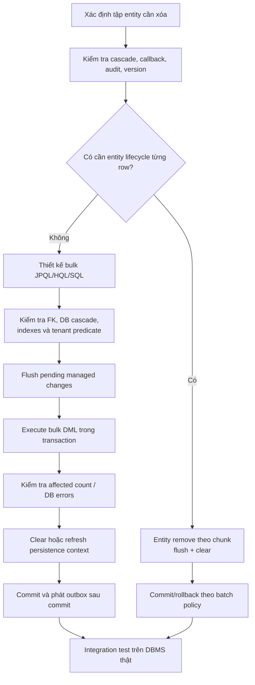

# Xóa bằng truy vấn hàng loạt không giống xóa từng thực thể

Trong Hibernate ORM, có hai cách phổ biến để xóa dữ liệu:

1. **Xóa từng entity qua persistence context**, bằng `EntityManager.remove(entity)` hoặc `Session.remove(entity)`.
2. **Xóa hàng loạt bằng JPQL/HQL hoặc SQL**, ví dụ `delete from Customer c where c.status = :status`.

Hai cách có thể làm biến mất những hàng giống nhau khỏi database, nhưng **không có cùng semantics ở tầng ORM**. Xóa từng entity đi qua vòng đời entity: Hibernate biết object nào bị xóa, áp dụng cascade mapping, xử lý orphan removal, lifecycle callbacks và trạng thái managed. Bulk delete chủ yếu là một thao tác set-based trực tiếp lên database; nó không tải từng entity và không chạy toàn bộ vòng đời tương ứng cho từng object.

Khác biệt này ảnh hưởng đến:

- `CascadeType.REMOVE` và `orphanRemoval`.
- `@PreRemove`, `@PostRemove`, entity listeners và auditing.
- Persistence context/first-level cache sau khi xóa.
- Optimistic locking bằng `@Version`.
- Database foreign keys và `ON DELETE CASCADE`.
- Hibernate second-level/query cache.
- Số câu SQL, JDBC batching và hiệu năng.
- Soft delete, bulk update và xử lý dữ liệu theo lô.

Một câu JPQL DELETE ngắn có thể xóa hàng triệu rows rất nhanh, nhưng nếu ứng dụng dựa vào callback, cascade, audit hoặc state của entity đang managed, bulk delete có thể phá vỡ những giả định đó. Ngược lại, xóa từng entity có đầy đủ ngữ nghĩa ORM nhưng có thể tốn bộ nhớ và round trips hơn khi xử lý khối lượng lớn.

Bài học phân tích hai con đường này từ góc nhìn JPA, Hibernate và database, kèm ví dụ Java/SQL, cách xử lý persistence context và hướng lựa chọn theo nghiệp vụ.

## 1. Hai kiểu xóa: entity lifecycle và set-based DML

Giả sử hệ thống quản lý khách hàng:

```java
@Entity
@Table(name = "customers")
public class Customer {

    @Id
    private Long id;

    @Column(nullable = false)
    private String status;

    @OneToMany(
        mappedBy = "customer",
        cascade = CascadeType.REMOVE,
        orphanRemoval = true
    )
    private List<PurchaseOrder> orders = new ArrayList<>();

    protected Customer() {}

    public Long getId() { return id; }
    public String getStatus() { return status; }
}
```

Ta muốn xóa khách hàng có trạng thái `INACTIVE`.

### Cách A: tải entity rồi remove từng instance

```java
List<Customer> customers = entityManager.createQuery("""
    select c
    from Customer c
    where c.status = :status
    """, Customer.class)
    .setParameter("status", "INACTIVE")
    .getResultList();

for (Customer customer : customers) {
    entityManager.remove(customer);
}
```

Mỗi customer được đưa vào persistence context, sau đó chuyển sang trạng thái removed. Hibernate xử lý cascade mapping và các bước entity lifecycle tương ứng.

### Cách B: bulk JPQL DELETE

```java
int deleted = entityManager.createQuery("""
    delete from Customer c
    where c.status = :status
    """)
    .setParameter("status", "INACTIVE")
    .executeUpdate();
```

Hibernate dịch bulk query thành SQL DML phù hợp Dialect. Database xóa tập rows đáp ứng điều kiện. Hibernate **không cần tạo một Java Customer object cho mỗi hàng**.

### Khác biệt cốt lõi

| Khía cạnh | Xóa từng entity | Bulk JPQL/HQL DELETE |
|---|---|---|
| Cách thực hiện | Tải/nhận entity managed, gọi remove | Một thao tác DML trên tập dữ liệu |
| Entity lifecycle | Có | Không chạy từng entity lifecycle |
| Cascade JPA REMOVE | Có theo mapping | Không tự áp dụng |
| orphanRemoval | Có trong thao tác quan hệ phù hợp | Không tự áp dụng |
| Entity callbacks | Có theo lifecycle | Không gọi cho từng row |
| First-level cache | Hibernate quản lý trạng thái từng entity | Không tự đồng bộ các object đang managed |
| Optimistic locking | Có thể dùng version predicate/check | Bulk DML bỏ qua cơ chế optimistic locking tự động |
| SQL | Có thể nhiều DELETE; có thể JDBC batch | Thường set-based; có thể nhiều SQL cho mapping nhiều bảng |
| Bộ nhớ ORM | Có thể tải nhiều entity | Thường thấp hơn |
| Audit dựa trên entity events | Có cơ hội chạy theo lifecycle | Không được giả định sẽ chạy |
| Phù hợp | Nghiệp vụ cần cascade/callback/state | Xóa nhiều hàng theo điều kiện đơn giản, có kiểm soát |

**Bulk delete không phải là “vòng lặp remove được Hibernate tối ưu tự động”.** Đây là hai cơ chế khác nhau.

## 2. Xóa từng entity bằng `remove()`

Trong JPA, `EntityManager.remove(entity)` đánh dấu một entity managed để xóa. SQL DELETE thường được thực thi khi persistence context flush, theo action ordering và transaction hiện tại.

Ví dụ:

```java
@Transactional
public void deleteCustomer(Long customerId) {
    Customer customer = entityManager.find(
        Customer.class,
        customerId
    );

    if (customer != null) {
        entityManager.remove(customer);
    }
}
```

Các điểm quan trọng:

- Entity cần ở trạng thái managed theo contract JPA.
- Nếu không tìm thấy hàng, `find` trả null và method không gọi remove.
- `remove` không nhất thiết gửi DELETE ngay tại dòng gọi; Hibernate thường lên lịch thao tác và thực thi khi flush.
- Transaction commit xác nhận thao tác; rollback có thể hoàn tác SQL đã chạy.
- Entity được đánh dấu removed trong persistence context; ứng dụng không nên tiếp tục coi nó là một entity bình thường.

Nếu có association với `cascade = CascadeType.REMOVE` hoặc `CascadeType.ALL`, việc xóa parent có thể lan tới child theo mapping.

### Detached entity không thể remove tùy ý bằng JPA

Ví dụ object được tải từ Session đã đóng:

```java
Customer detached = obtainCustomerFromPreviousSession();

// JPA EntityManager.remove yêu cầu entity managed.
entityManager.remove(detached);
```

Thao tác này không phải cách reattach entity. JPA yêu cầu entity đưa vào `remove` phải managed; detached input thường dẫn đến `IllegalArgumentException`.

Cách rõ ràng hơn là tải managed entity trong transaction hiện tại:

```java
Customer managed = entityManager.find(Customer.class, detached.getId());

if (managed != null) {
    entityManager.remove(managed);
}
```

Có thể dùng `merge` rồi remove kết quả trong một số trường hợp, nhưng merge sao chép state detached vào managed instance; nếu mục tiêu chỉ là xóa theo ID, tải entity managed là cách dễ hiểu và ít nguy cơ copy state cũ hơn.

## 3. Cascade REMOVE và orphanRemoval trong entity deletion

Giả sử Customer sở hữu các PurchaseOrder:

```java
@Entity
class Customer {

    @Id
    private Long id;

    @OneToMany(
        mappedBy = "customer",
        cascade = CascadeType.REMOVE
    )
    private List<PurchaseOrder> orders = new ArrayList<>();
}
```

Khi gọi:

```java
entityManager.remove(customer);
```

JPA/Hibernate áp dụng cascade REMOVE tới các association được mapping. Điều này có nghĩa child entities liên quan có thể được đưa vào lifecycle remove theo cascade.

**Cascade REMOVE là quy tắc ở tầng entity operation.** Nó không phải một câu lệnh database tự động áp dụng cho mọi cách xóa parent.

### `CascadeType.ALL` bao gồm gì?

`CascadeType.ALL` là nhóm cascade gồm các thao tác lifecycle như `PERSIST`, `MERGE`, `REMOVE`, `REFRESH` và `DETACH`. Vì ALL bao gồm REMOVE, xóa parent có thể lan tới child nếu association được cấu hình ALL.

### orphanRemoval khác Cascade REMOVE

`orphanRemoval = true` diễn đạt rằng child entity bị loại khỏi association sở hữu theo semantics của mapping sẽ được xóa khi flush.

Ví dụ:

```java
@OneToMany(
    mappedBy = "customer",
    cascade = CascadeType.ALL,
    orphanRemoval = true
)
private List<PurchaseOrder> orders = new ArrayList<>();
```

Khi ứng dụng bỏ một order khỏi collection theo cách quản lý quan hệ đúng:

```java
customer.removeOrder(order);
```

Hibernate có thể lên lịch xóa order bị orphan. Đây là hành vi phát sinh từ **thay đổi relationship state trong persistence context**.

Bulk DELETE không duyệt từng Customer để xóa từng Order theo orphanRemoval. Nó không thực hiện chuỗi thao tác Java collection tương ứng.

## 4. Bulk DELETE bằng JPQL/HQL

JPQL có cú pháp DELETE theo entity type:

```java
int count = entityManager.createQuery("""
    delete from Customer c
    where c.status = :status
    """)
    .setParameter("status", "INACTIVE")
    .executeUpdate();
```

HQL của Hibernate cũng hỗ trợ bulk mutation. Trong trường hợp đơn giản, SQL có thể tương tự:

```sql
delete from customers
where status = ?;
```

Điểm khác:

- Hibernate không tải từng Customer trước khi xóa.
- Không gọi `EntityManager.remove` cho từng entity.
- Không chạy cascade REMOVE qua Java association mapping.
- Không gọi `@PreRemove` hoặc `@PostRemove` cho từng entity bị tác động.
- Persistence context không tự cập nhật để phản ánh từng hàng đã bị xóa.
- Optimistic locking không tự được thực hiện như từng managed entity delete.

### Giá trị trả về của `executeUpdate()`

`executeUpdate()` trả số entity được cập nhật/xóa theo semantics của JPA/provider. Với mapping nhiều bảng hoặc inheritance, số câu SQL và số physical rows có thể khác số entity được tính ở API.

Không dùng số lượng physical rows trong log database để tự suy ra số entity bị ảnh hưởng trong mọi mapping. Nếu nghiệp vụ cần xác định chính xác danh sách IDs đã xóa, hãy thiết kế query/select/returning strategy riêng; một bulk DELETE đơn giản không trả về toàn bộ entity đã bị xóa.

### Transaction là bắt buộc

Bulk DML cần transaction theo JPA contract:

```java
@Transactional
public int deleteInactiveCustomers() {
    return entityManager.createQuery("""
        delete from Customer c
        where c.status = :status
        """)
        .setParameter("status", "INACTIVE")
        .executeUpdate();
}
```

Nếu gọi bulk DML không có transaction phù hợp, provider có thể ném `TransactionRequiredException`. Trong Spring, đặt transaction ở service hoặc method repository theo ranh giới nghiệp vụ.

## 5. Bulk DELETE không chạy cascade REMOVE

Đây là khác biệt quan trọng nhất nếu entity có quan hệ.

Giả sử:

```java
@OneToMany(
    mappedBy = "customer",
    cascade = CascadeType.REMOVE
)
private List<PurchaseOrder> orders;
```

Xóa từng entity:

```java
Customer customer = entityManager.find(Customer.class, id);
entityManager.remove(customer);
```

Có thể kích hoạt cascade remove đến orders theo mapping.

Bulk delete:

```java
entityManager.createQuery("""
    delete from Customer c
    where c.status = 'INACTIVE'
    """).executeUpdate();
```

**Không chạy cascade REMOVE qua association mapping**. Hibernate không tạo từng Customer managed rồi gọi remove, nên child entities không được đưa qua lifecycle cascade chỉ vì query xóa parent.

### Nếu database có foreign key thì sao?

Giả sử bảng orders có:

```sql
foreign key (customer_id)
references customers(id)
```

Nếu FK không có database cascade và child rows còn tồn tại, DELETE parent có thể thất bại do constraint.

Có hai cách xử lý phổ biến:

1. Xóa child rows trước rồi xóa parent, bằng query/batch phù hợp.
2. Thiết kế FK với `ON DELETE CASCADE` nếu semantics database-side cascade phù hợp.

Nhưng database cascade không tương đương JPA cascade. Đây là hai cơ chế ở hai tầng khác nhau.

## 6. Database `ON DELETE CASCADE` vẫn chạy khi bulk DELETE

Ví dụ DDL:

```sql
create table customers (
    id bigint primary key,
    status varchar(20) not null
);

create table purchase_orders (
    id bigint primary key,
    customer_id bigint not null,
    constraint fk_order_customer
        foreign key (customer_id)
        references customers(id)
        on delete cascade
);
```

Khi chạy:

```sql
delete from customers
where status = 'INACTIVE';
```

DBMS có thể tự xóa các rows `purchase_orders` liên quan theo FK action. Điều này xảy ra **ở tầng database**, không phải do Hibernate đi qua cascade REMOVE.

Hệ quả:

- Child rows bị xóa, nhưng child Java objects có thể vẫn đang managed/stale trong persistence context.
- `@PreRemove` của PurchaseOrder không tự được gọi cho từng child do database cascade.
- Entity listeners/audit dựa trên ORM lifecycle không tự nhận sự kiện từng child.
- Hibernate L2 cache cần được xử lý đúng; database-side cascade có thể xóa rows mà ORM không quan sát từng entity.
- Các trigger database vẫn có thể chạy theo DDL/DBMS semantics.

### So sánh cascade

| Cơ chế | Nơi thực thi | Khi gọi remove parent | Khi bulk DELETE parent |
|---|---|---|---|
| `CascadeType.REMOVE` | JPA/Hibernate entity lifecycle | Có theo mapping | Không tự chạy |
| `orphanRemoval` | JPA/Hibernate relationship lifecycle | Có trong tình huống orphan phù hợp | Không tự chạy |
| FK `ON DELETE CASCADE` | Database | Có nếu DELETE parent thực sự được gửi và FK cấu hình | Có |
| Database trigger | Database | Có theo trigger definition | Có theo trigger definition |
| Hibernate `@OnDelete` | Hibernate mapping/DDL integration | Có thể cấu hình DB cascade theo version/mapping | DB action vẫn do FK thực thi nếu đã tồn tại |

`@OnDelete` là Hibernate-specific mapping để làm việc với database-side cascade ở các mapping phù hợp. Nó không biến database cascade thành JPA entity callback cascade.

## 7. Bulk DELETE bỏ qua entity lifecycle callbacks

Xét entity:

```java
@Entity
@EntityListeners(CustomerListener.class)
class Customer {

    @Id
    private Long id;

    @PreRemove
    void beforeDelete() {
        // Kiểm tra rule hoặc ghi thông tin trước khi xóa.
    }

    @PostRemove
    void afterDelete() {
        // Side effect theo lifecycle.
    }
}
```

Hoặc listener:

```java
public class CustomerListener {

    @PreRemove
    public void beforeRemove(Customer customer) {
        // Audit/logging...
    }
}
```

Khi xóa một managed entity bằng `remove`, callback lifecycle phù hợp có thể được gọi.

Khi chạy bulk JPQL/HQL DELETE:

```java
entityManager.createQuery("""
    delete from Customer c
    where c.status = 'INACTIVE'
    """).executeUpdate();
```

Hibernate không tạo và xóa từng object, nên **không gọi callback cho mỗi entity bị xóa**.

### Những loại logic không nên đặt duy nhất trong callback nếu có bulk path

- Ghi audit record bắt buộc.
- Phát domain event.
- Thu hồi tài nguyên bên ngoài.
- Cập nhật aggregate khác.
- Gửi notification.
- Tính toán số liệu nghiệp vụ.
- Thực hiện authorization dựa trên từng entity.

Nếu ứng dụng có cả đường xóa đơn và đường bulk, logic chỉ đặt trong `@PreRemove` sẽ không được thực thi cho bulk path.

### Phương án thay thế

- Ghi audit bằng database trigger khi phù hợp.
- Ghi audit rows bằng một bulk INSERT/SELECT trong cùng transaction.
- Tạo explicit command/service để ghi audit và thực hiện bulk DML.
- Dùng outbox pattern nếu cần phát sự kiện bền vững sau commit.
- Nếu mỗi entity cần validation/callback phức tạp, dùng entity-by-entity deletion.

Không cố “gọi thủ công `@PreRemove`” bằng cách tự invoke callback trong code bulk; cách đó không tái tạo đầy đủ entity lifecycle semantics.

## 8. Bulk DELETE và optimistic locking

Entity có version:

```java
@Entity
class Customer {

    @Id
    private Long id;

    @Version
    private long version;

    private String status;
}
```

Khi xóa từng managed entity, Hibernate có thể tạo DELETE với version predicate:

```sql
delete from customers
where id = ?
  and version = ?;
```

Nếu row đã bị thay đổi bởi transaction khác, row count không như mong đợi có thể khiến Hibernate phát hiện stale state/optimistic lock failure.

Bulk DELETE:

```java
entityManager.createQuery("""
    delete from Customer c
    where c.status = :status
    """)
    .setParameter("status", "INACTIVE")
    .executeUpdate();
```

**Không tự áp dụng optimistic version checks cho từng entity** như lifecycle delete. Query xóa mọi hàng thỏa predicate tại thời điểm DB thực thi, không kiểm tra từng version mà Hibernate từng load.

### Nếu cần version condition cho bulk delete

Có thể đưa version predicate vào query nếu use case có một ID và expected version cụ thể:

```java
int deleted = entityManager.createQuery("""
    delete from Customer c
    where c.id = :id
      and c.version = :expectedVersion
    """)
    .setParameter("id", customerId)
    .setParameter("expectedVersion", expectedVersion)
    .executeUpdate();

if (deleted != 1) {
    throw new OptimisticLockException(
        "Customer đã thay đổi hoặc không tồn tại"
    );
}
```

Đây là **kiểm tra concurrency do ứng dụng chủ động viết**. Nó không khiến bulk DELETE tự động có đầy đủ optimistic locking semantics của entity lifecycle. Cần kiểm tra transaction, row count và exception mapping.

### Version của các entity khác

Bulk DELETE parent có thể làm database cascade xóa child rows, nhưng Hibernate không tự chạy từng child version check. Nếu child rows có version và nghiệp vụ yêu cầu xác nhận version riêng từng child, DB cascade/bulk delete không thực hiện quy tắc đó thay ORM.

## 9. Bulk DELETE không đồng bộ persistence context

Giả sử persistence context đã load Customer#42:

```java
Customer customer = entityManager.find(Customer.class, 42L);

int deleted = entityManager.createQuery("""
    delete from Customer c
    where c.id = :id
    """)
    .setParameter("id", 42L)
    .executeUpdate();
```

Bulk DML tác động trực tiếp database. **Object `customer` đang managed không tự biến thành removed hoặc detached**, và persistence context không được tự đồng bộ theo từng hàng.

Do đó có thể gặp tình huống:

```java
System.out.println(entityManager.contains(customer)); // có thể true
System.out.println(customer.getStatus()); // vẫn đọc state cũ
```

Dù row database đã bị xóa, object Java vẫn còn trong memory và có thể còn thuộc persistence context.

Đây là nguồn gốc của stale state.

### Hậu quả khi tiếp tục dùng object

Nếu code sửa `customer` sau bulk DELETE rồi flush, Hibernate có thể cố UPDATE một row không còn tồn tại. Tùy version mapping và row-count expectation, có thể phát sinh stale state/optimistic locking exception.

Nếu ứng dụng chỉ đọc getter, nó có thể tiếp tục thấy dữ liệu cũ trong object và đưa dữ liệu không còn tồn tại ra response.

**Sau bulk DML, phải có chiến lược xử lý persistence context** trước khi tiếp tục sử dụng các entity có khả năng bị ảnh hưởng.

## 10. `flush` trước bulk, `clear` sau bulk

Một pattern thường dùng:

```java
@Transactional
public int deleteInactiveCustomers() {
    entityManager.flush();

    int deleted = entityManager.createQuery("""
        delete from Customer c
        where c.status = :status
        """)
        .setParameter("status", "INACTIVE")
        .executeUpdate();

    entityManager.clear();

    return deleted;
}
```

Ý nghĩa:

1. `flush()` đồng bộ các thay đổi managed đang chờ xuống DB trước khi bulk DML chạy.
2. `executeUpdate()` thực hiện thao tác set-based.
3. `clear()` detach toàn bộ managed entities trong persistence context hiện tại, loại bỏ stale references do bulk DML gây ra.
4. Transaction vẫn tiếp tục cho đến commit/rollback.

### Vì sao cần flush trước clear?

Nếu clear trước khi flush:

```java
customer.setStatus("INACTIVE");
entityManager.clear();

entityManager.createQuery("""
    delete from Customer c where c.status = 'INACTIVE'
    """).executeUpdate();
```

Thay đổi `setStatus` có thể chưa được ghi xuống DB vì entity bị detach trước khi Hibernate đồng bộ. Bulk query sẽ nhìn dữ liệu database theo transaction hiện tại, không nhất thiết nhìn state Java vừa bị clear.

Pattern an toàn khi có pending changes:

```java
entityManager.flush();
entityManager.clear();
```

Nhưng với bulk DML, cần cân nhắc flush/clear đúng phạm vi và thứ tự. Thông thường: flush pending changes, chạy bulk operation, rồi clear hoặc refresh phần managed state có liên quan.

### Clear có phạm vi rộng

`entityManager.clear()` detach **tất cả** entities đang managed trong persistence context, không chỉ Customer. Nếu service đã load Order, Product hoặc User và còn thay đổi chưa flush, clear có thể làm mất những thay đổi chưa được đồng bộ đó.

Vì vậy:

- Dùng `flush` trước nếu những thay đổi cần lưu.
- Tránh gọi clear ẩn trong helper/repository dùng chung mà caller không biết.
- Có thể tách bulk operation vào một transaction/persistence context riêng.
- Nếu chỉ có một số managed entities bị ảnh hưởng và bạn giữ reference tới chúng, cân nhắc detach/refresh chọn lọc, nhưng JPA không có API “detach mọi entity theo predicate” đơn giản.

## 11. Auto-flush trước bulk query

Hibernate có flush modes; với `AUTO`, provider có thể flush các thay đổi liên quan trước khi thực thi query để query nhìn thấy state phù hợp.

Ví dụ:

```java
Customer customer = entityManager.find(Customer.class, 42L);
customer.setStatus("INACTIVE");

int deleted = entityManager.createQuery("""
    delete from Customer c
    where c.status = 'INACTIVE'
    """).executeUpdate();
```

Tùy flush mode và query spaces, Hibernate có thể tự flush trước bulk query. Nhưng **đừng dựa vào một giả định không được kiểm chứng** nếu correctness của operation phụ thuộc thứ tự đó.

Gọi `flush()` tường minh khi cần làm rõ unit of work và dễ đọc code. Sau bulk query, xử lý stale persistence context bằng clear/refresh phù hợp.

Với flush mode khác `AUTO` hoặc các cấu hình Hibernate native, thời điểm flush có thể khác. Integration tests cần kiểm tra chính xác.

## 12. JPQL bulk delete không thực hiện orphanRemoval

Xét quan hệ:

```java
@OneToMany(
    mappedBy = "customer",
    cascade = CascadeType.ALL,
    orphanRemoval = true
)
private List<PurchaseOrder> orders;
```

Nếu xóa một Customer qua entity lifecycle:

```java
Customer customer = entityManager.find(Customer.class, id);
entityManager.remove(customer);
```

Hibernate có thể cascade remove tới orders theo mapping. orphanRemoval còn có semantics khi child bị loại khỏi relationship.

Nhưng bulk delete:

```java
entityManager.createQuery("""
    delete from Customer c
    where c.status = 'INACTIVE'
    """).executeUpdate();
```

không tải Customer và không thao tác collection `orders`. Nó không chạy orphanRemoval.

### Nếu muốn xóa cả parent lẫn child bằng bulk

Có thể thực hiện hai bulk DELETE theo thứ tự:

```java
entityManager.flush();

int deletedOrders = entityManager.createQuery("""
    delete from PurchaseOrder o
    where o.customer.id in (
        select c.id
        from Customer c
        where c.status = :status
    )
    """)
    .setParameter("status", "INACTIVE")
    .executeUpdate();

int deletedCustomers = entityManager.createQuery("""
    delete from Customer c
    where c.status = :status
    """)
    .setParameter("status", "INACTIVE")
    .executeUpdate();

entityManager.clear();
```

Ví dụ dùng subquery để chọn IDs thay vì join trực tiếp trong target DELETE. Cần kiểm tra JPQL grammar/provider thực, thứ tự FK, transaction và dữ liệu concurrent. Nếu PurchaseOrder còn có child entities khác, phải xử lý chúng trước theo FK. Nếu có database ON DELETE CASCADE, có thể không cần câu xóa child riêng.

## 13. Giới hạn cú pháp JPQL bulk DML

JPQL bulk UPDATE/DELETE không có đầy đủ khả năng của một SELECT thông thường:

- Target là một entity abstract schema type, không phải tên bảng vật lý.
- Bulk DELETE không trả về entity objects.
- Không chạy lifecycle callbacks/cascade như entity operations.
- Không thể viết một JOIN tùy ý trực tiếp trong target DELETE như SQL có thể làm; subquery có thể được dùng trong WHERE theo grammar.
- Bulk operations có semantics polymorphic: query nhắm tới entity type có thể áp dụng cho các subtype theo hierarchy.
- Bulk DML không đồng bộ persistence context.
- Optimistic locking không tự được thực hiện cho từng entity.

Ví dụ subquery:

```java
int deleted = entityManager.createQuery("""
    delete from PurchaseOrder o
    where o.customer.id in (
        select c.id
        from Customer c
        where c.status = :status
    )
    """)
    .setParameter("status", "INACTIVE")
    .executeUpdate();
```

SQL cụ thể do Hibernate/Dialect sinh có thể khác nhau. Đối với query phức tạp, kiểm tra SQL thực và execution plan trên DBMS đích.

## 14. Inheritance làm bulk delete phức tạp hơn

Entity inheritance có thể ánh xạ thành một hoặc nhiều bảng:

- `SINGLE_TABLE`: nhiều subtype nằm chung một bảng.
- `JOINED`: bảng root và các bảng subclass.
- `TABLE_PER_CLASS`: mỗi concrete class có bảng riêng.

Khi chạy:

```java
int deleted = entityManager.createQuery("""
    delete from Payment p
    where p.status = :status
    """)
    .setParameter("status", PaymentStatus.FAILED)
    .executeUpdate();
```

Hibernate phải xóa đúng dữ liệu của các concrete entity theo mapping. Với `JOINED`, có thể phải xóa rows ở các bảng con và bảng cha theo thứ tự phù hợp. Với `TABLE_PER_CLASS`, query polymorphic có thể liên quan nhiều bảng concrete.

**Một bulk JPQL DELETE không đảm bảo luôn là một SQL DELETE duy nhất.** Hibernate có thể dùng temporary ID table, CTE, nhiều DELETE statements hoặc chiến lược bulk mutation khác tùy Dialect/version.

Ví dụ SQL khái niệm cho JOINED:

```sql
-- Pseudocode mô tả thứ tự cần thiết:
delete from card_payments
where id in (...);

delete from bank_transfer_payments
where id in (...);

delete from payments
where id in (...);
```

Không dùng đoạn SQL trên như output cố định của Hibernate. Mục đích là thấy một entity-level bulk delete có thể trở thành nhiều physical table mutations.

### Rủi ro khi đổi inheritance strategy

Một query HQL vẫn có thể giữ nguyên trong source khi mapping đổi từ SINGLE_TABLE sang JOINED/TABLE_PER_CLASS, nhưng số câu SQL, lock footprint, temp table usage và execution plan có thể thay đổi lớn. Benchmark và integration tests phải được chạy lại sau thay đổi mapping.

## 15. `@SQLDelete` và soft delete có làm bulk DELETE giống remove không?

Hibernate có extension cho custom delete SQL, ví dụ `@SQLDelete`, thường dùng trong mapping để thay câu DELETE của entity lifecycle bằng một câu SQL tùy biến.

Ý tưởng:

```java
@Entity
@Table(name = "documents")
@SQLDelete(sql = """
    update documents
    set deleted = true
    where id = ?
    """)
@SQLRestriction("deleted = false")
class Document {

    @Id
    private Long id;

    private boolean deleted;
}
```

Đây là mapping Hibernate-specific và SQL minh họa. Nếu entity có `@Version`, thứ tự placeholders, version predicate và row-count expectation phải được cấu hình đúng theo mapping/version.

**Không mặc định bulk JPQL DELETE sẽ chạy custom SQLDelete cho từng entity.** Bulk mutation có đường thực thi khác entity-by-entity. Behavior của `@SoftDelete` trong các Hibernate versions mới cũng có thể có xử lý riêng; cần xem tài liệu version cụ thể và test SQL thực.

### Nếu muốn bulk soft delete

Có thể biểu diễn nghiệp vụ bằng bulk UPDATE:

```java
int affected = entityManager.createQuery("""
    update Document d
    set d.deleted = true
    where d.deleted = false
      and d.createdAt < :cutoff
    """)
    .setParameter("cutoff", cutoff)
    .executeUpdate();
```

Đây là UPDATE set-based, không phải DELETE. Nó vẫn:

- Bỏ qua per-entity lifecycle callbacks.
- Không tự đồng bộ managed entities.
- Không tự chạy cascade REMOVE/orphanRemoval.
- Không tự cập nhật audit fields/version theo entity lifecycle nếu không thiết kế rõ.
- Cần kiểm tra filter/restriction và cache.

Nếu soft delete là yêu cầu trung tâm, cần một chiến lược thống nhất cho single delete, bulk delete, native SQL và mọi write path.

## 16. Bulk DELETE và auditing

Nhiều ứng dụng dùng lifecycle callback hoặc framework auditing để ghi lại ai xóa bản ghi, khi nào và vì sao.

Ví dụ:

```java
@PreRemove
void auditDelete() {
    // Ghi nhận thông tin trước khi xóa.
}
```

Bulk DELETE không gọi callback này cho từng entity. Tương tự, các listener dựa trên Hibernate entity events không nhận một event remove bình thường cho từng row mà bulk DML tác động.

### Envers và bulk operations

Hibernate Envers dựa trên event/lifecycle integration để ghi audit revisions cho entity changes. **Không giả định bulk HQL/JPQL DML được audit như hàng loạt entity operations**; bulk operations thường không tạo đầy đủ revision records như từng entity mutation. Nếu audit là yêu cầu bắt buộc, cần dùng cơ chế phù hợp đã được kiểm chứng cho phiên bản Envers/Hibernate, hoặc ghi audit rõ ràng qua DB trigger/bulk audit statement/service.

### Một số lựa chọn audit cho bulk delete

- **Database trigger:** audit mọi đường ghi ở DB, kể cả JDBC/native SQL; phải xem performance và schema ownership.
- **Audit table qua INSERT ... SELECT:** lưu ID/metadata trước khi xóa, trong cùng transaction nếu DB hỗ trợ và query phù hợp.
- **Outbox:** ghi event rows theo tập IDs/operation metadata rồi publish sau commit.
- **Entity-by-entity remove:** nếu cần đầy đủ callback và audit theo từng entity.
- **Explicit audit command:** ghi nhận thao tác nghiệp vụ ở service trước/sau bulk DML.

Không gửi event ra hệ thống ngoài trước commit mà không có idempotency/outbox, vì transaction có thể rollback sau khi event đã được phát.

## 17. Bulk DELETE và Spring Data JPA

Spring Data JPA cung cấp annotation `@Modifying` để đánh dấu repository query là DML:

```java
public interface CustomerRepository
        extends JpaRepository<Customer, Long> {

    @Modifying
    @Query("""
        delete from Customer c
        where c.status = :status
        """)
    int deleteByStatus(@Param("status") String status);
}
```

Method này thực hiện bulk delete. Nó không có semantics như gọi `repository.delete(customer)` trên từng entity.

### `clearAutomatically` và `flushAutomatically`

Spring Data JPA cho phép cấu hình:

```java
@Modifying(
    flushAutomatically = true,
    clearAutomatically = true
)
@Query("""
    delete from Customer c
    where c.status = :status
    """)
int deleteByStatus(@Param("status") String status);
```

- `flushAutomatically = true` yêu cầu flush persistence context trước khi thực hiện modifying query.
- `clearAutomatically = true` yêu cầu clear persistence context sau khi query.
- Hai thuộc tính này mặc định thường là `false`.
- `clearAutomatically` có phạm vi toàn bộ persistence context hiện tại, không chỉ các Customer bị xóa.

Ví dụ service:

```java
@Service
public class CustomerCleanupService {

    private final CustomerRepository repository;

    public CustomerCleanupService(CustomerRepository repository) {
        this.repository = repository;
    }

    @Transactional
    public int deleteInactive() {
        return repository.deleteByStatus("INACTIVE");
    }
}
```

Annotation `@Modifying` không thay thế transaction boundary. Cần bảo đảm method chạy trong transaction phù hợp; nếu framework cấu hình transaction ở repository/service, hiểu rõ phạm vi đó.

### Cẩn thận khi dùng clearAutomatically

Nếu persistence context đang quản lý Order, User hoặc entity khác có pending changes, clear tự động sẽ detach cả chúng. `flushAutomatically` giúp đồng bộ các thay đổi trước query, nhưng không làm clear trở thành thao tác chỉ giới hạn cho Customer.

Nếu method repository được gọi từ một service lớn, hãy tài liệu hóa side effect persistence-context hoặc cô lập bulk operation vào một unit of work riêng.

## 18. Spring Data: `deleteAll()` và `deleteAllInBatch()` không giống nhau

Tên method dễ gây nhầm:

- `delete(entity)`: xóa một entity theo lifecycle qua EntityManager.
- `deleteAll(Iterable<T>)`: thường đi qua việc xóa từng entity theo repository implementation.
- `deleteAll()`: trong các implementation phổ biến có thể tải entities rồi xóa từng entity.
- `deleteAllInBatch()`: thực hiện bulk delete.
- `deleteAllByIdInBatch(ids)`: thực hiện bulk delete theo danh sách IDs trong các phiên bản hỗ trợ.

Chi tiết implementation có thể thay đổi giữa Spring Data JPA versions. **Đọc implementation/tài liệu đúng version dự án** trước khi dựa vào số query hoặc lifecycle semantics.

Nếu cần cascade REMOVE, callback và auditing, tránh chọn method có hậu tố `InBatch` chỉ vì tên nghe nhanh hơn. Batch method có thể bỏ qua entity lifecycle tương tự bulk DML.

## 19. Bulk DELETE có thể nhanh hơn ở đâu?

Giả sử cần xóa 100.000 log rows đã hết hạn.

### Entity-by-entity

```java
List<ActivityLog> logs = entityManager.createQuery("""
    select l from ActivityLog l
    where l.createdAt < :cutoff
    """, ActivityLog.class)
    .setParameter("cutoff", cutoff)
    .getResultList();

for (ActivityLog log : logs) {
    entityManager.remove(log);
}
```

Chi phí có thể gồm:

- SELECT tải entity instances.
- Memory cho persistence context và snapshots.
- Entity lifecycle/callback/cascade processing.
- DELETE statements theo entity hoặc nhóm.
- JDBC batching nếu mapping/configuration cho phép.
- Dirty checking và action queue.

### Bulk DELETE

```java
int deleted = entityManager.createQuery("""
    delete from ActivityLog l
    where l.createdAt < :cutoff
    """)
    .setParameter("cutoff", cutoff)
    .executeUpdate();
```

Chi phí có thể chỉ gồm một câu SQL set-based (hoặc chiến lược nhiều statement theo mapping/dialect), không cần hydrate 100.000 Java objects.

### Vì sao bulk thường hiệu quả hơn?

Database tối ưu thao tác theo tập dữ liệu, tránh truyền hàng trăm nghìn IDs/objects qua JDBC và tránh ORM lifecycle overhead khi không cần.

Nhưng không có nghĩa bulk delete luôn rẻ:

- Predicate thiếu index có thể scan nhiều dữ liệu.
- Delete nhiều rows tạo nhiều WAL/redo/undo logs.
- FK checks, triggers và cascades DB vẫn có chi phí.
- Một transaction khổng lồ có thể giữ locks lâu, gây replication lag hoặc bloat.
- Multi-table inheritance có thể cần temporary tables/CTE và nhiều statements.
- Query cache/second-level cache cleanup có thể tốn chi phí.
- Bulk operation có thể làm persistence context stale.

## 20. Xóa từng entity vẫn có thể dùng JDBC batching

Không nên so sánh “bulk = một query” với “entity remove = 100.000 round trips” như thể không có tối ưu trung gian.

Hibernate có JDBC batching:

```properties
hibernate.jdbc.batch_size=50
hibernate.order_inserts=true
hibernate.order_updates=true
hibernate.order_deletes=true
```

Các option hỗ trợ và tên property cần xác nhận theo Hibernate version; Hibernate có khả năng ordering/batching cho một số mutation actions. Khi xóa nhiều entity cùng loại, Hibernate có thể gom các DELETE có cùng SQL shape thành batch tùy cấu hình, driver và mapping.

Tuy vậy, entity-by-entity vẫn phải thực hiện các semantics ORM:

- Cascade.
- Callback/listener.
- Version check.
- Lifecycle action planning.
- Có thể cần tải entity trước.

Batching giảm round trips nhưng **không biến entity removal thành bulk JPQL semantics**, cũng không loại bỏ chi phí hydrate/managed state.

### So sánh thực tế

| Tiêu chí | Remove từng entity + JDBC batch | Bulk DML |
|---|---|---|
| Hydrate entity | Thường có | Không cần |
| Callback/cascade ORM | Có theo mapping | Không |
| Version check từng entity | Có thể | Không tự động |
| Batch statements | Có nếu cùng SQL shape và cấu hình | Một statement set-based thường không cần JDBC batch; multi-table strategy có thể khác |
| Memory | Có thể cao nếu không clear theo batch | Thường thấp hơn |
| SQL count | Có thể nhiều nhưng batched | Thường ít hơn |
| Audit từng entity | Có cơ hội | Cần cơ chế khác |
| Relationship semantics | ORM-managed | Phải tự đảm bảo qua SQL/FK |

## 21. Xử lý số lượng lớn mà vẫn cần entity lifecycle

Nếu cần cascade, callback hoặc version checking nhưng có hàng trăm nghìn entities, có thể xử lý từng chunk:

```java
int batchSize = 100;

try (Session session = sessionFactory.openSession()) {
    Transaction tx = session.beginTransaction();

    try {
        Long lastId = 0L;

        while (true) {
            List<ActivityLog> chunk = session.createSelectionQuery("""
                select l
                from ActivityLog l
                where l.createdAt < :cutoff
                  and l.id > :lastId
                order by l.id
                """, ActivityLog.class)
                .setParameter("cutoff", cutoff)
                .setParameter("lastId", lastId)
                .setMaxResults(batchSize)
                .getResultList();

            if (chunk.isEmpty()) {
                break;
            }

            for (ActivityLog log : chunk) {
                session.remove(log);
            }

            lastId = chunk.get(chunk.size() - 1).getId();

            session.flush();
            session.clear();
        }

        tx.commit();
    } catch (RuntimeException ex) {
        if (tx.isActive()) {
            tx.rollback();
        }
        throw ex;
    }
}
```

Đây là code khung. Transaction strategy, dữ liệu mới được thêm trong lúc chạy và rollback semantics cần thiết kế. Nếu mỗi chunk commit riêng, thao tác không còn atomic toàn bộ; cần idempotency và khả năng resume.

Một lỗi phổ biến là dùng offset pagination trên tập dữ liệu đang bị xóa. Sau khi xóa chunk đầu, vị trí offset của rows còn lại thay đổi, dễ bỏ sót dữ liệu. Keyset theo ID như ví dụ trên thường dễ kiểm soát hơn, nếu điều kiện và thứ tự khóa ổn định.

### Clear sau mỗi chunk

Sau flush/clear:

- Các entities trong chunk đã được xử lý và trở thành detached.
- Persistence context được giải phóng managed state.
- Những Java references còn giữ ở list/biến có thể vẫn tồn tại đến khi scope kết thúc/GC.
- Transaction hiện tại vẫn tiếp tục nếu chưa commit.

Đây là cách giữ semantics entity lifecycle với bộ nhớ có giới hạn, đổi lại vẫn tốn chi phí tải entity và callback.

## 22. Bulk DELETE theo IDs và giới hạn parameter

Một cách thường dùng là lấy IDs rồi xóa theo nhóm:

```java
List<Long> ids = ...;

int deleted = entityManager.createQuery("""
    delete from ActivityLog l
    where l.id in :ids
    """)
    .setParameter("ids", ids)
    .executeUpdate();
```

Cách này có thể hữu ích khi đã chọn tập ID theo điều kiện phức tạp hoặc muốn xử lý theo chunk. Nhưng lưu ý:

- DBMS có giới hạn số bind parameters trong một statement.
- Danh sách lớn có thể cần chia batch.
- Empty list trong `IN` có semantics/provider differences; xử lý trước khi chạy.
- Query plan có thể thay đổi theo kích thước danh sách.
- Rows có thể đã bị xóa/cập nhật bởi transaction khác trước khi câu DELETE chạy.
- Bulk delete theo IDs vẫn bỏ qua entity lifecycle và version check tự động.

Với hàng triệu IDs, cân nhắc temporary table, staging table, join delete native SQL hoặc DB-specific bulk strategy thay vì bind danh sách quá lớn.

## 23. Database constraints quyết định thứ tự xóa

Nếu bảng con có FK không cascade:

```sql
alter table purchase_orders
add constraint fk_order_customer
foreign key (customer_id)
references customers(id);
```

Xóa Customer trước khi xóa PurchaseOrder có thể bị DB từ chối:

```sql
delete from customers where status = 'INACTIVE';
-- Có thể lỗi FK nếu còn purchase_orders tham chiếu.
```

Bulk delete cần đảm bảo thứ tự:

```sql
delete from purchase_orders
where customer_id in (
    select id
    from customers
    where status = 'INACTIVE'
);

delete from customers
where status = 'INACTIVE';
```

Câu SQL trên mang tính minh họa; cú pháp subquery/optimizer và lock behavior tùy DBMS. Cả hai câu cần chạy trong transaction nếu yêu cầu all-or-nothing.

### FK cascade có thể đơn giản hơn

Nếu domain cho phép child rows bị xóa vật lý cùng parent, FK `ON DELETE CASCADE` có thể giảm số câu SQL ở ứng dụng và bảo vệ mọi đường ghi. Nhưng nếu child cần audit callback, giữ lại lịch sử hoặc có lifecycle độc lập, DB cascade có thể không phù hợp.

### RESTRICT/NO ACTION là một bảo vệ hữu ích

Nếu child không được phép tồn tại độc lập hoặc phải được xử lý theo quy trình nghiệp vụ, FK restrict giúp database ngăn parent bị xóa sai. Đừng bỏ constraint chỉ để bulk delete chạy qua.

## 24. Bulk DELETE và second-level/query cache

Hibernate có thể sử dụng:

- First-level cache/persistence context theo Session.
- Second-level entity/collection cache theo SessionFactory.
- Query cache nếu bật.

Bulk HQL/JPQL tác động trực tiếp database, nhưng Hibernate biết một số query spaces/tables liên quan để thực hiện cache cleanup/invalidation theo cơ chế provider. **Phạm vi và cách invalidation phụ thuộc Hibernate version, cache provider, mapping và loại query.**

Điều chắc chắn cần ghi nhớ:

- First-level persistence context không tự đồng bộ entity instances đã load.
- Không giả định mọi object/collection ở L1 sẽ tự chuyển thành removed.
- Native SQL có thể không cung cấp đủ metadata query spaces cho Hibernate; cache synchronization cần được cấu hình rõ.
- Database-side cascade có thể xóa rows ở bảng khác mà ORM không quan sát từng entity.
- Query cache/entity cache behavior phải được kiểm chứng nếu bulk/native delete chạy trong hệ thống có L2 cache.

### Native query và synchronized query spaces

Với Hibernate native API, một native mutation query có thể khai báo synchronized entity/query spaces bằng API phù hợp, để provider biết bảng nào bị ảnh hưởng cho flush/cache cleanup. Nếu không, cân nhắc flush và cache eviction thủ công theo contract Hibernate version.

Không dùng `EntityManager.clear()` như một lệnh xóa L2 cache; nó chỉ dọn persistence context hiện tại.

## 25. Native SQL DELETE khác bulk JPQL ở đâu?

JPQL/HQL bulk DML vẫn đi qua Hibernate query translator, nên Hibernate hiểu entity type và một phần query spaces/mapping. Native SQL:

```java
int deleted = entityManager.createNativeQuery("""
    delete from customers
    where status = ?
    """)
    .setParameter(1, "INACTIVE")
    .executeUpdate();
```

đi thẳng theo SQL do ứng dụng cung cấp. Lợi ích:

- Dùng cú pháp DBMS-specific.
- Có thể tận dụng CTE, RETURNING, hints hoặc chiến lược riêng.
- Kiểm soát trực tiếp schema/table/column.
- Có thể phù hợp với dữ liệu lớn hoặc query optimizer cụ thể.

Nhưng trách nhiệm tăng lên:

- SQL phụ thuộc DBMS.
- Không có cascade entity lifecycle.
- Không gọi entity callbacks.
- Persistence context có thể stale.
- Hibernate có thể cần metadata query spaces/synchronization.
- Cache invalidation và transaction phải được quản lý.
- DDL/column naming không tự theo entity mapping nếu mapping đổi.

### Ví dụ PostgreSQL DELETE ... RETURNING

```sql
delete from activity_logs
where created_at < ?
returning id;
```

PostgreSQL hỗ trợ `RETURNING`; DB khác có cú pháp/khả năng khác. JPA native mutation API chuẩn không cung cấp một contract portable cho mọi dạng result-returning DML. Nếu cần IDs bị xóa, dùng Hibernate native API/driver cụ thể hoặc thiết kế select + delete có transaction phù hợp.

## 26. Bulk delete và filters/restrictions

Entity có thể sử dụng Hibernate-specific restrictions/filters hoặc các cơ chế soft-delete. Không nên mặc định điều kiện áp dụng cho SELECT cũng tự động bảo vệ mọi bulk DELETE.

Ví dụ entity:

```java
@Entity
@SQLRestriction("deleted = false")
class Document {
    @Id
    private Long id;
    private boolean deleted;
}
```

`@SQLRestriction` là restriction SQL cố định trong các đường tải entity phù hợp. Bulk HQL/JPQL, native SQL, loader và custom SQL có thể có semantics khác tùy Hibernate version và query translation.

Nếu query bulk xóa theo tenant hoặc trạng thái active, hãy viết **predicate rõ ràng trong chính DML** và kiểm tra SQL thực:

```java
int deleted = entityManager.createQuery("""
    delete from Document d
    where d.tenantId = :tenantId
      and d.deleted = false
      and d.createdAt < :cutoff
    """)
    .setParameter("tenantId", tenantId)
    .setParameter("cutoff", cutoff)
    .executeUpdate();
```

Không coi entity filter/restriction là authorization duy nhất. Với tenant isolation, dùng tenant-aware query/service policy và cơ chế bảo vệ DB phù hợp; native SQL phải tự áp dụng predicate.

## 27. Inheritance làm bulk delete phức tạp hơn

Entity inheritance có thể ánh xạ thành một hoặc nhiều bảng:

- `SINGLE_TABLE`: nhiều subtype nằm chung một bảng.
- `JOINED`: bảng root và các bảng subclass.
- `TABLE_PER_CLASS`: mỗi concrete class có bảng riêng.

Khi chạy:

```java
int deleted = entityManager.createQuery("""
    delete from Payment p
    where p.status = :status
    """)
    .setParameter("status", PaymentStatus.FAILED)
    .executeUpdate();
```

Hibernate phải xóa đúng dữ liệu của các concrete entity theo mapping. Với `JOINED`, có thể phải xóa rows ở các bảng con và bảng cha theo thứ tự phù hợp. Với `TABLE_PER_CLASS`, query polymorphic có thể liên quan nhiều bảng concrete.

**Một bulk JPQL DELETE không đảm bảo luôn là một SQL DELETE duy nhất.** Hibernate có thể dùng temporary ID table, CTE, nhiều DELETE statements hoặc chiến lược bulk mutation khác tùy Dialect/version.

Ví dụ SQL khái niệm cho JOINED:

```sql
-- Pseudocode mô tả thứ tự cần thiết:
delete from card_payments
where id in (...);

delete from bank_transfer_payments
where id in (...);

delete from payments
where id in (...);
```

Không dùng đoạn SQL trên như output cố định của Hibernate. Mục đích là thấy một entity-level bulk delete có thể trở thành nhiều physical table mutations.

## 28. Soft delete và bulk operation: quyết định riêng

Nếu dữ liệu phải giữ lại vì audit/compliance, xóa vật lý không phù hợp. Có thể dùng cột:

```sql
alter table customers
add column deleted_at timestamp null;
```

Entity:

```java
@Entity
class Customer {

    @Id
    private Long id;

    private Instant deletedAt;
}
```

Xóa từng entity có thể dùng Hibernate soft delete mapping hoặc custom lifecycle update theo ORM support.

Bulk soft delete có thể là:

```java
int changed = entityManager.createQuery("""
    update Customer c
    set c.deletedAt = :now
    where c.status = :status
      and c.deletedAt is null
    """)
    .setParameter("now", Instant.now())
    .setParameter("status", "INACTIVE")
    .executeUpdate();
```

Đây là bulk UPDATE; nó không chạy callback remove/cascade. Nếu cần soft-delete child records, phải thiết kế cascade logic riêng bằng query, DB trigger hoặc entity lifecycle.

### Unique constraint và soft delete

Nếu `email` có unique constraint toàn bảng, một Customer đã soft-deleted vẫn giữ email. Muốn tái sử dụng email có thể cần partial unique index (nếu DBMS hỗ trợ) hoặc thiết kế key khác. Bulk soft delete không tự giải quyết uniqueness.

### Audit và restore

Cần xác định:
- Ai thực hiện soft delete?
- Khi nào?
- Có lý do xóa?
- Có thể restore không?
- Child entities có bị soft-delete theo không?
- Unique keys được xử lý ra sao?
- Bulk operation có ghi audit cho từng ID hay chỉ một operation-level event?

Nếu cần audit từng row, tạo audit data trong cùng transaction bằng cơ chế rõ ràng.

## 29. Delete theo batch: một transaction hay nhiều transaction?

Khi xóa hàng triệu rows, một bulk DELETE duy nhất có thể giữ locks và transaction log lớn trong thời gian dài. Có thể chia thành các chunk bằng query phù hợp DBMS, ví dụ lấy một nhóm IDs theo keyset rồi xóa:

```sql
delete from activity_logs
where id in (
    select id
    from activity_logs
    where created_at < ?
      and id > ?
    order by id
    fetch first 1000 rows only
);
```

Đây là SQL minh họa; cú pháp giới hạn rows trong subquery khác giữa DBMS. Một chiến lược khác là lấy IDs bằng SELECT rồi bulk delete theo từng nhóm.

### Một transaction cho tất cả chunks

Ưu điểm:
- Atomicity toàn bộ nếu transaction commit.
- Lỗi ở chunk sau có thể rollback cả operation.

Nhược điểm:
- Transaction dài.
- Lock/log/undo retention cao.
- Connection bị giữ lâu.
- Replication/cleanup có thể bị ảnh hưởng.

### Một transaction cho mỗi chunk

Ưu điểm:
- Giảm thời gian giữ lock và lượng dữ liệu pending trong một transaction.
- Có thể retry/resume từng chunk.
- Dễ giới hạn load.

Nhược điểm:
- Không còn atomicity toàn bộ.
- Nếu lỗi giữa chừng, một phần dữ liệu đã xóa.
- Cần checkpoint, idempotency và monitoring tiến trình.

Chọn dựa trên nghiệp vụ. Nếu cleanup có thể chạy lại an toàn, chunk commit riêng thường là ứng viên tốt. Nếu yêu cầu “hoặc xóa tất cả hoặc không xóa gì”, transaction lớn hoặc chiến lược staging/partitioning phù hợp hơn.

## 30. Partitioning/retention có thể tốt hơn DELETE hàng triệu rows

Với bảng event/log theo thời gian, nếu DBMS hỗ trợ partitioning và dữ liệu hết hạn theo partition, **drop/detach partition** có thể hiệu quả hơn DELETE từng row.

Ví dụ ý tưởng:

```text
activity_logs
  ├── partition_2026_01
  ├── partition_2026_02
  ├── partition_2026_03
  └── partition_2026_04
```

Khi retention hết hạn, có thể detach/drop partition cũ theo DBMS. Điều này là DDL/administrative operation, không phải entity lifecycle delete; có thể có locking, FK, index và replication implications riêng.

Hibernate không tự biến `delete from ActivityLog` thành drop partition. Đây là một chiến lược database-level cần migration/operations rõ.

## 31. Một mẫu entity-by-entity delete có cascade

Ví dụ muốn xóa Customer cùng orders, đồng thời chạy callbacks/audit:

```java
@Transactional
public void deleteCustomerWithOrders(Long customerId) {
    Customer customer = entityManager.find(
        Customer.class,
        customerId
    );

    if (customer == null) {
        return;
    }

    entityManager.remove(customer);
}
```

Giả định mapping có cascade REMOVE đúng với domain và FK schema không mâu thuẫn. Khi flush, Hibernate xử lý lifecycle/cascade và phát SQL theo thứ tự phù hợp.

Nếu cần audit child, callback có thể được gọi theo lifecycle; nhưng callback không phải nơi tốt để thực hiện HTTP calls hoặc side effects không thể rollback. Ghi audit/outbox trong transaction thường đáng tin cậy hơn.

## 32. Một mẫu bulk delete có child rows

Nếu domain cho phép xóa vật lý nhiều Customer và orders, có thể viết rõ thứ tự:

```java
@Transactional
public int deleteInactiveCustomers() {
    entityManager.flush();

    int deletedOrders = entityManager.createQuery("""
        delete from PurchaseOrder o
        where o.customer.id in (
            select c.id
            from Customer c
            where c.status = :status
        )
        """)
        .setParameter("status", "INACTIVE")
        .executeUpdate();

    int deletedCustomers = entityManager.createQuery("""
        delete from Customer c
        where c.status = :status
        """)
        .setParameter("status", "INACTIVE")
        .executeUpdate();

    entityManager.clear();

    return deletedCustomers;
}
```

Đoạn này minh họa thứ tự FK và stale context. Cần kiểm tra JPQL grammar/provider thực, indexes và dữ liệu concurrent. Nếu PurchaseOrder còn có child entities khác, phải xử lý chúng trước theo FK. Nếu có database ON DELETE CASCADE, có thể không cần câu xóa child riêng.

Nếu cần audit, thêm audit operation phù hợp; không trông chờ callbacks.

## 33. Bulk delete và audit/event theo tập IDs

Nếu cần audit cho từng row nhưng muốn tránh hydrate entity, có thể dùng một thao tác audit set-based trong cùng transaction. Một cách DB-specific:

```sql
insert into customer_delete_audit (
    customer_id,
    deleted_at,
    reason
)
select
    id,
    current_timestamp,
    'INACTIVE_RETENTION'
from customers
where status = 'INACTIVE';

delete from customers
where status = 'INACTIVE';
```

Hai câu phải chạy trong cùng transaction để audit và delete nhất quán. Cú pháp thời gian và SQL dialect có thể khác nhau. Nếu cần child audit, phải đưa child IDs vào cùng chiến lược.

### Đừng phát event trước commit

Nếu service gửi message “Customer deleted” ra broker rồi database transaction rollback, hệ thống ngoài sẽ tin một sự kiện chưa xảy ra. Dùng outbox:

1. Ghi audit/outbox rows cùng transaction.
2. Bulk delete.
3. Commit.
4. Publisher đọc outbox và gửi event.
5. Consumer xử lý idempotent.

Bulk DML không tự tạo domain event cho từng entity; application phải định nghĩa event contract.

## 34. Bulk delete và database triggers

Bulk SQL vẫn chạy qua DBMS, nên các trigger database được định nghĩa phù hợp có thể chạy theo semantics của DBMS.

Điều này khác callback Hibernate:

| Cơ chế | Entity remove | Bulk JPQL/HQL | Native SQL/JDBC |
|---|---|---|---|
| JPA `@PreRemove` | Có | Không | Không |
| Hibernate entity event listener | Có theo lifecycle | Không phải per-entity event | Không |
| DB DELETE trigger | Có nếu SQL DELETE được phát | Có nếu câu DELETE chạm bảng | Có |
| FK ON DELETE CASCADE | Có nếu parent DELETE thực sự xảy ra | Có | Có |
| Java service audit | Tùy code gọi | Phải gọi riêng | Phải gọi riêng |

Nếu cần audit mọi đường ghi bất kể writer nào, database trigger có thể phù hợp hơn callback. Nhưng trigger có thể làm side effects khó quan sát trong Java, ảnh hưởng throughput và tăng phụ thuộc DBMS.

## 35. Lưu ý về SQL ordering và FK constraints

Hibernate entity remove thường lên lịch các actions và có thể sắp xếp thứ tự DELETE theo mapping/dependency để tránh vi phạm FK. Với bulk DML, ứng dụng tự viết các thao tác set-based và phải bảo đảm thứ tự phù hợp với schema.

Ví dụ:

```text
Customer
  └── PurchaseOrder
        └── OrderLine
```

Nếu không có DB cascade:

```sql
delete from order_lines
where order_id in (...);

delete from purchase_orders
where customer_id in (...);

delete from customers
where status = 'INACTIVE';
```

Nếu xóa parent trước, DB có thể báo FK violation. Đừng dựa vào thứ tự các JPQL bulk statements tự được Hibernate sắp xếp như entity action queue; chúng được thực thi theo thứ tự query mà ứng dụng gọi.

## 36. Xóa entity có version và bulk delete theo version

Khi entity removal qua ORM, versioned entity thường có điều kiện version trong DELETE để phát hiện stale state.

Bulk delete bỏ qua cơ chế đó. Nếu cần bảo vệ một tập ID theo version đã đọc, có thể dùng query theo cặp ID/version, nhưng JPQL bulk query không tự cung cấp một danh sách tuple portable đơn giản cho mọi use case.

Một pattern cho một entity:

```java
int deleted = entityManager.createQuery("""
    delete from Document d
    where d.id = :id
      and d.version = :version
    """)
    .setParameter("id", id)
    .setParameter("version", expectedVersion)
    .executeUpdate();

if (deleted == 0) {
    throw new OptimisticLockException();
}
```

Nếu xóa nhiều entities và cần optimistic validation từng row, entity-by-entity removal có thể phù hợp hơn. Hoặc dùng staging table chứa IDs + expected versions rồi native SQL join/delete theo DBMS. Chọn theo yêu cầu consistency.

## 37. Bulk delete và security/tenant boundaries

Một câu query:

```java
delete from Customer c where c.status = 'INACTIVE'
```

có thể quá rộng nếu hệ thống multi-tenant. Hãy luôn đưa tenant scope vào predicate khi đó là invariant:

```java
delete from Customer c
where c.tenantId = :tenantId
  and c.status = :status
```

Không dựa duy nhất vào filter đang được bật trong Session để bảo vệ bulk DML. Kiểm tra SQL thực và các đường native SQL. Nếu DB hỗ trợ row-level security và ứng dụng dùng nó, xác minh policy hoạt động trong cùng connection/session context.

Với destructive operation, cân nhắc:
- Preview/count trước khi delete.
- Audit operation-level metadata.
- Giới hạn batch size.
- Transaction boundary rõ.
- Tenant predicate bắt buộc.
- Dry-run/approval theo yêu cầu vận hành.
- Khả năng resume/rollback phù hợp.

Những biện pháp này bảo vệ nghiệp vụ, không thay thế database constraints.

## 38. Kiểm thử: xác minh bulk delete bỏ qua callbacks/cascade

Một integration test có thể tạo Customer cùng Order, rồi gọi bulk DELETE và kiểm tra:

```java
@Test
void bulkDeleteDoesNotRunEntityRemoveCascade() {
    Long customerId = createCustomerWithOrder();

    try (EntityManager em = emf.createEntityManager()) {
        EntityTransaction tx = em.getTransaction();
        tx.begin();

        int deleted = em.createQuery("""
            delete from Customer c
            where c.id = :id
            """)
            .setParameter("id", customerId)
            .executeUpdate();

        assertEquals(1, deleted);
        tx.commit();
    }

    // Nếu FK không cascade, DB có thể đã từ chối delete
    // vì Order vẫn tồn tại. Nếu DB cascade, kiểm tra row
    // Order đã bị xóa bởi database nhưng callback ORM
    // của child không được gọi.
}
```

Test nên có hai biến thể schema:

1. FK không cascade: bulk delete parent phải bị FK ngăn nếu còn child.
2. FK ON DELETE CASCADE: parent và child rows có thể bị DB xóa, nhưng không chạy JPA lifecycle callbacks từng child.

Không dùng H2 nếu cần chứng minh đúng semantics của DBMS production; chạy trên database thực hoặc Testcontainers cùng engine/version.

## 39. Kiểm thử persistence context sau bulk delete

```java
@Test
void bulkDeleteLeavesLoadedEntityStateUnsynchronized() {
    try (EntityManager em = emf.createEntityManager()) {
        EntityTransaction tx = em.getTransaction();
        tx.begin();

        Customer customer = em.find(Customer.class, 42L);
        assertNotNull(customer);

        int deleted = em.createQuery("""
            delete from Customer c
            where c.id = :id
            """)
            .setParameter("id", 42L)
            .executeUpdate();

        assertEquals(1, deleted);

        // Bulk DML không đồng bộ object đang managed.
        assertTrue(em.contains(customer));

        em.clear();
        assertFalse(em.contains(customer));

        tx.commit();
    }
}
```

Test này minh họa sự khác nhau giữa DB state và persistence-context state. Cần đảm bảo entity #42 tồn tại và test transaction cleanup đúng.

Một biến thể kiểm tra stale object: trước clear, getter vẫn có thể trả giá trị đã load; sau clear, object vẫn đọc được vì Java reference còn tồn tại. Mở EntityManager mới và query lại sẽ không tìm thấy row.

## 40. Kiểm thử lifecycle callback và version

Ví dụ listener:

```java
public class DeleteCounterListener {
    static final AtomicInteger preRemoveCount = new AtomicInteger();

    @PreRemove
    public void beforeRemove(Object entity) {
        preRemoveCount.incrementAndGet();
    }
}
```

Test nên:

1. Reset counter.
2. Tạo một entity.
3. Gọi `remove(managedEntity)` và flush/commit; xác nhận callback được gọi theo lifecycle.
4. Tạo nhiều entity khác.
5. Chạy bulk JPQL DELETE; xác nhận callback counter không tăng tương ứng với số row bị xóa.

Trong code thực, không dùng static mutable counter trong parallel tests nếu không cô lập. Dùng test listener/instrumentation phù hợp.

Đối với version, mở hai transaction độc lập: transaction A đọc entity version 3; transaction B cập nhật và commit version 4; transaction A remove entity managed cũ. Entity remove thông thường có thể phát hiện stale version, trong khi bulk DELETE theo ID không tự kiểm tra version 3. Đây là khác biệt concurrency cần có test riêng.

## 41. SQL logging và kiểm tra số statements

Để hiểu Hibernate đang thực hiện cách xóa nào, bật SQL logging trong môi trường test:

```properties
logging.level.org.hibernate.SQL=DEBUG
logging.level.org.hibernate.orm.jdbc.bind=TRACE
```

Tên logger bind có thể khác theo Hibernate version. Tránh ghi bind values nhạy cảm trên production.

Quan sát:

- Entity remove có SELECT trước DELETE hay không.
- Cascade có phát DELETE child trước parent không.
- Bulk query được dịch thành bao nhiêu statements.
- Inheritance có dùng temporary table/CTE hay nhiều DELETE không.
- Có auto-flush trước bulk query không.
- Có UPDATE version hay audit SQL nào khác không.
- Native SQL có được đồng bộ query spaces/cache như mong muốn không.

Hibernate `StatementInspector` có thể capture SQL text, nhưng không tự cung cấp bind values, batch execution count hoặc database execution plan. Để đo batching, dùng JDBC/driver metrics hoặc datasource proxy/observability tool phù hợp.

## 42. Bảng quyết định: nên dùng cách xóa nào?

| Nhu cầu | Cách thường phù hợp | Lý do |
|---|---|---|
| Xóa một entity theo nghiệp vụ | Load managed + `remove` | Lifecycle/cascade/callback |
| Xóa parent cùng child theo JPA cascade | `remove` + cascade mapping | ORM quản lý graph |
| Xóa child khi bị loại khỏi association | `orphanRemoval` | Relationship lifecycle |
| Xóa hàng trăm nghìn log đơn giản | Bulk DELETE theo predicate | Set-based, ít hydrate |
| Xóa theo retention policy và có FK cascade DB | Bulk DELETE + DB cascade | Database thực hiện quan hệ |
| Cần callback/audit cho từng entity | Entity-by-entity | Bulk bỏ qua callbacks |
| Cần optimistic version check từng row | Entity remove hoặc query có version predicate rõ | Bulk không tự kiểm tra version |
| Cần xóa mềm hàng loạt | Bulk UPDATE hoặc soft-delete strategy được kiểm thử | Không tạo entity lifecycle per row |
| Cần xóa theo DB-specific CTE/RETURNING | Native SQL | Kiểm soát SQL trực tiếp |
| Xóa hàng triệu rows theo thời gian | Chunk/partition retention | Giới hạn transaction/log/lock |
| Spring Data `deleteAllInBatch()` | Chỉ khi chấp nhận bulk semantics | Không tương đương từng `delete()` |

Một quy tắc thực dụng: **nếu mỗi entity có hành vi nghiệp vụ riêng khi bị xóa, hãy dùng entity lifecycle; nếu thao tác chỉ là biến đổi tập dữ liệu và DB có thể thực thi an toàn bằng một DML, cân nhắc bulk**.

## 43. Các lỗi phổ biến

### “Bulk delete tự chạy CascadeType.REMOVE”

Không. Cascade JPA là entity lifecycle semantics. Bulk DML bỏ qua quá trình remove từng entity. FK ON DELETE CASCADE là cơ chế database khác.

### “orphanRemoval sẽ xóa child khi bulk xóa parent”

Không. orphanRemoval dựa trên thay đổi quan hệ trong persistence context; bulk query không thao tác từng collection.

### “@PreRemove vẫn được gọi cho mỗi row”

Không. Bulk JPQL/HQL không hydrate và remove từng entity, nên không gọi entity lifecycle callback cho từng hàng.

### “Bulk delete tự xóa object khỏi persistence context”

Không. Managed objects có thể còn đó và stale. Clear/refresh/đơn vị làm việc riêng là cần thiết.

### “@Version vẫn tự kiểm tra khi bulk delete”

Không. Bulk DML bỏ qua optimistic locking tự động theo entity lifecycle. Nếu cần, thêm điều kiện version hoặc dùng entity remove.

### “Một JPQL DELETE luôn là một SQL DELETE”

Không. Inheritance/multi-table mapping và Dialect có thể cần nhiều statements/temporary tables/CTE.

### “DB ON DELETE CASCADE giống CascadeType.REMOVE”

Không. DB cascade không gọi Java callbacks và không tự đồng bộ managed objects/cache.

### “flush() đã commit”

Không. Flush gửi SQL trong transaction; commit mới xác nhận giao dịch.

### “clear() chỉ detach những Customer vừa bị xóa”

Không. Clear detach toàn bộ managed entities trong persistence context.

### “Spring Data deleteAllInBatch giống deleteAll”

Không nhất thiết. Batch methods dùng bulk DML và bỏ qua entity lifecycle semantics.

### “Bulk DELETE nhanh hơn trong mọi trường hợp”

Không. FK checks, triggers, indexes, locks, transaction logs, cache cleanup và multi-table inheritance có thể tạo chi phí đáng kể.

### “Bulk soft delete vẫn gọi @SQLDelete cho từng entity”

Không được mặc định như vậy. Bulk mutation có đường thực thi khác; phải kiểm tra version/provider và SQL thực.

## 44. Checklist trước khi chuyển entity remove thành bulk delete

Trước khi thay vòng lặp `remove` bằng bulk DML, hãy trả lời:

1. Có association nào dựa vào `CascadeType.REMOVE` không?
2. Có child nào được xóa qua `orphanRemoval` không?
3. Có `@PreRemove`, `@PostRemove` hoặc listener thực hiện logic nghiệp vụ không?
4. Có audit/Envers/Spring Data auditing cần một record cho mỗi entity không?
5. Có event/outbox/notification nào được phát từ lifecycle không?
6. FK schema có cho phép xóa parent trực tiếp không?
7. Có DB `ON DELETE CASCADE` và nó có đúng domain semantics không?
8. Có entity đang managed trong persistence context bị bulk tác động không?
9. Có pending changes cần flush trước bulk không?
10. Sau bulk có cần clear/refresh không?
11. Có yêu cầu optimistic locking/version check không?
12. Có soft-delete/custom SQLDelete mapping không?
13. Entity inheritance có nhiều bảng không?
14. Có tenant/security predicate rõ ràng trong DML không?
15. SQL có index và query plan phù hợp không?
16. Transaction có quá lớn hoặc giữ lock quá lâu không?
17. Có cần chunking, checkpoint và retry không?
18. Native SQL có cần cache synchronization/eviction không?
19. Test đã chạy trên DBMS/version thực chưa?
20. Nếu bulk operation thất bại giữa chừng, rollback/recovery có đúng không?

## 45. Quy trình triển khai một bulk delete an toàn



Trình tự triển khai khuyến nghị:

**Thiết kế nghiệp vụ:** xác định xóa vật lý hay soft delete, child lifecycle, audit, event và concurrency.

**Thiết kế dữ liệu:** kiểm tra FK, cascade DB, unique/check constraints, indexes và inheritance schema.

**Thiết kế query:** dùng predicate rõ, bind parameters, tenant scope và batch/chunk strategy.

**Quản lý persistence context:** flush pending work trước bulk nếu cần, clear/refresh sau bulk theo phạm vi tác động.

**Quản lý transaction:** quyết định atomic toàn bộ hay commit từng chunk; xác định retry và idempotency.

**Kiểm thử:** kiểm tra callbacks/cascade không chạy với bulk, DB cascade có chạy, stale state được xử lý, version semantics và execution plan.

## 46. Tổng kết: cùng xóa một hàng nhưng không cùng vòng đời

Giả sử hai đoạn code:

```java
Customer customer = entityManager.find(Customer.class, 42L);
entityManager.remove(customer);
```

và:

```java
entityManager.createQuery("""
    delete from Customer c where c.id = :id
    """)
    .setParameter("id", 42L)
    .executeUpdate();
```

có thể cùng làm row `customers.id = 42` biến mất khỏi database. Nhưng con đường ORM rất khác nhau.

**Xóa từng entity:**

- Entity được quản lý và chuyển sang removed state.
- Cascade REMOVE/orphanRemoval được áp dụng theo mapping.
- Entity callbacks/listeners có thể chạy.
- Version checking và lifecycle semantics được xử lý theo provider.
- Hibernate quản lý trạng thái entity trong persistence context.
- Có thể tốn chi phí tải entity, callback và nhiều mutations.

**Bulk DELETE:**

- Database xử lý một tập rows theo predicate.
- Không chạy từng entity lifecycle/cascade/callback.
- Không tự kiểm tra version từng entity.
- Persistence context không tự đồng bộ; managed objects có thể stale.
- DB FK cascade và triggers vẫn chạy theo schema.
- Có thể giảm đáng kể chi phí ORM/hydration, nhưng cần chú ý SQL shape, index, transaction và cache.

Những nguyên tắc cần nhớ:

1. **`remove(entity)` và bulk DELETE là hai semantics khác nhau**, không chỉ là hai cú pháp.
2. **CascadeType.REMOVE và orphanRemoval không tự chạy trong bulk DML.**
3. **DB ON DELETE CASCADE vẫn có thể chạy**, nhưng không gọi entity callbacks của Hibernate.
4. **Bulk DML bỏ qua optimistic locking tự động**; nếu cần version condition, phải thiết kế rõ.
5. **Persistence context không tự đồng bộ sau bulk**; flush trước, clear/refresh sau theo phạm vi.
6. **Clear ảnh hưởng toàn bộ context**, không chỉ entity bị xóa, và có thể bỏ pending changes chưa flush.
7. **Inheritance/multi-table mapping có thể tạo nhiều SQL statements**, dù source chỉ có một JPQL DELETE.
8. **Spring Data deleteAllInBatch() là bulk semantics**, không tương đương xóa từng entity.
9. **Audit, event, soft delete và security** cần được xử lý riêng nếu bulk path bỏ qua lifecycle logic.
10. **Bulk thường phù hợp với cleanup set-based**, còn entity remove phù hợp khi từng entity có hành vi nghiệp vụ riêng.

Lựa chọn đúng không dựa trên số dòng code ngắn hơn. Hãy bắt đầu từ **ngữ nghĩa xóa của domain**, xác định những side effects và invariants cần bảo vệ, rồi chọn entity lifecycle hoặc bulk DML với transaction, database constraints và persistence-context handling tương ứng.
