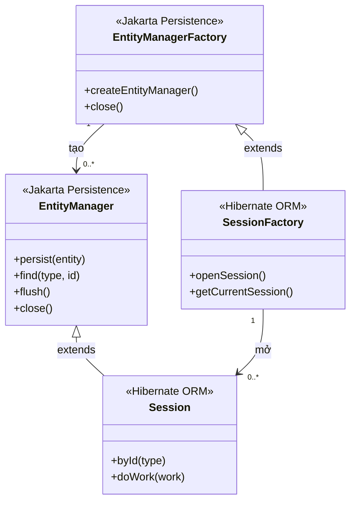
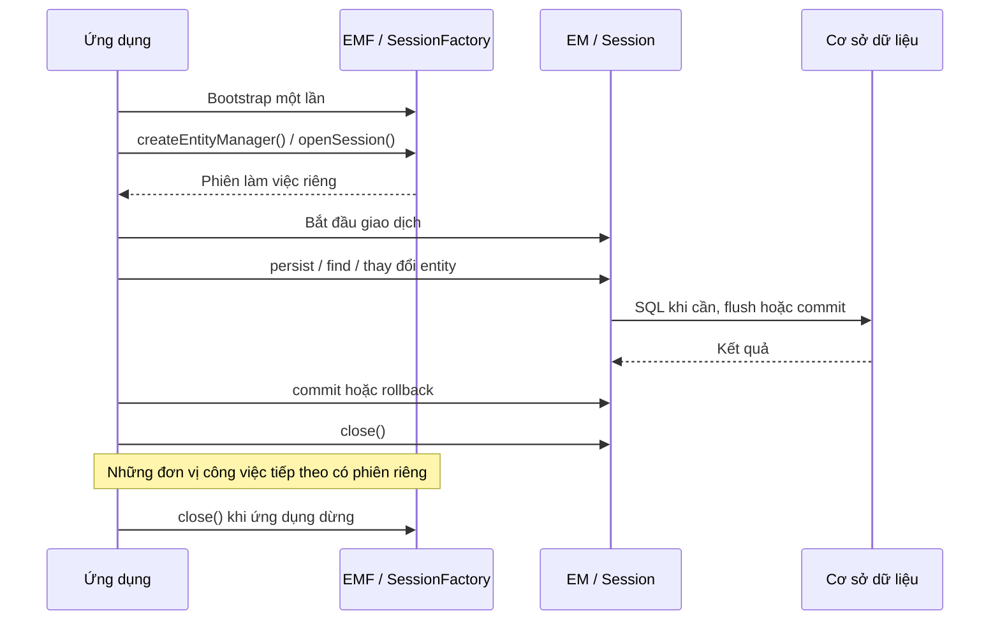

# Quan hệ giữa `EntityManagerFactory` với `SessionFactory` và `EntityManager` với `Session`

## 1. Bức tranh tổng quan

Khi làm việc với cơ sở dữ liệu quan hệ bằng Hibernate, lập trình viên thường gặp bốn kiểu: `EntityManagerFactory`, `SessionFactory`, `EntityManager` và `Session`. Chúng không đại diện cho bốn hệ thống độc lập. Đây là **hai cặp API tương ứng ở hai cấp độ**:

- **Jakarta Persistence (JPA)** định nghĩa `EntityManagerFactory` và `EntityManager` như các giao diện chuẩn để ứng dụng thao tác với dữ liệu mà ít phụ thuộc vào nhà cung cấp ORM.
- **Hibernate ORM** cung cấp `SessionFactory` và `Session`, kế thừa các giao diện chuẩn tương ứng và bổ sung những khả năng riêng của Hibernate.

Với Hibernate hiện đại (Hibernate 6.x/7.x, dùng `jakarta.persistence`), quan hệ kiểu Java là:

```java
// Diễn giải quan hệ kế thừa, không phải mã nguồn đầy đủ của thư viện.
interface SessionFactory extends EntityManagerFactory { /* Hibernate API */ }
interface Session extends EntityManager { /* Hibernate API */ }
```

Điểm cốt lõi: **`SessionFactory` cũng là một `EntityManagerFactory`; `Session` cũng là một `EntityManager`**. Khi Hibernate là JPA provider, cùng một bộ máy ORM có thể được sử dụng qua API chuẩn hoặc API đặc thù Hibernate.



Hai chiều nhìn cần được phân biệt:

1. **Quan hệ kế thừa giao diện:** Hibernate mở rộng hợp đồng Jakarta Persistence.
2. **Quan hệ tạo và sử dụng:** một factory sống lâu tạo ra nhiều phiên làm việc sống ngắn, mỗi phiên quản lý một *persistence context* (ngữ cảnh lưu trữ).

## 2. `EntityManagerFactory` và `SessionFactory`: cấp độ nhà máy

### 2.1. `EntityManagerFactory` trong Jakarta Persistence

`jakarta.persistence.EntityManagerFactory` là giao diện chuẩn gắn với một **persistence unit**: tập hợp các entity, ánh xạ ORM và cấu hình truy cập dữ liệu. Vai trò chính:

- Tạo `EntityManager` bằng `createEntityManager()`.
- Cung cấp thông tin mô hình và tiện ích dùng chung qua `getMetamodel()`, `getCriteriaBuilder()`, `getCache()`.
- Quản lý tài nguyên của factory; giải phóng chúng bằng `close()` khi vòng đời ứng dụng hoặc persistence unit kết thúc.

Trong Java SE, có thể bootstrap bằng API chuẩn:

```java
import jakarta.persistence.EntityManagerFactory;
import jakarta.persistence.Persistence;

EntityManagerFactory emf =
        Persistence.createEntityManagerFactory("shopPU");
```

`shopPU` là tên persistence unit đã khai báo trong cấu hình, chẳng hạn `META-INF/persistence.xml`, với Hibernate được chọn làm JPA provider. Dòng trên là bước khởi tạo factory, **chưa phải** một giao dịch hoặc một kết nối JDBC cố định.

### 2.2. `SessionFactory` trong Hibernate

`org.hibernate.SessionFactory` là giao diện factory mở rộng của Hibernate. Nó phục vụ cùng mục đích nền tảng nhưng bổ sung các API đặc thù, ví dụ:

- `openSession()` để mở một `Session` độc lập mà ứng dụng chịu trách nhiệm đóng.
- `getCurrentSession()` để lấy session gắn với ngữ cảnh hiện hành **khi ứng dụng đã cấu hình cơ chế current session phù hợp**.
- Truy cập các dịch vụ, metadata, thống kê và tính năng chuyên biệt của Hibernate.

Vì `SessionFactory extends EntityManagerFactory`, một `SessionFactory` có thể được truyền vào nơi nhận `EntityManagerFactory`:

```java
import jakarta.persistence.EntityManagerFactory;
import org.hibernate.SessionFactory;

void inspectJpaFactory(EntityManagerFactory factory) {
    System.out.println(factory.isOpen());
}

void useHibernateFactory(SessionFactory sessionFactory) {
    inspectJpaFactory(sessionFactory); // Hợp lệ: kiểu con -> kiểu cha.
}
```

Ngược lại, biến kiểu `EntityManagerFactory` không tự cho phép gọi `openSession()`. Muốn dùng API Hibernate, hãy yêu cầu provider trả về giao diện tương ứng:

```java
EntityManagerFactory emf =
        Persistence.createEntityManagerFactory("shopPU");

SessionFactory sf = emf.unwrap(SessionFactory.class);
// Có thể dùng sf.openSession(), sf.getStatistics(), ...
```

`unwrap` là API chuẩn hỗ trợ truy cập đối tượng đặc thù của provider. Ví dụ trên hoạt động khi provider là Hibernate và hỗ trợ kiểu được yêu cầu; **không được xem là mã portable** sang một JPA provider khác. Trong ứng dụng có framework hoặc container, đối tượng được inject đôi khi là proxy nên `unwrap` thường rõ ý định hơn ép kiểu trực tiếp.

### 2.3. Có hai factory riêng biệt cùng chạy không?

**Không bắt buộc.** Khi Hibernate cung cấp `EntityManagerFactory`, implementation của nó đồng thời hỗ trợ hợp đồng `SessionFactory`. Vì vậy hai tên API thường là **hai góc nhìn lên cùng cơ sở hạ tầng ORM**: metadata entity, quản lý service, cấu hình kết nối và cache cấp hai (nếu bật).

```text
Persistence unit: shopPU
          |
          v
    Hibernate factory
       /         \
      v           v
EntityManagerFactory    SessionFactory
  (JPA view)         (Hibernate view)
```

Tuy nhiên, ứng dụng vẫn **có thể chủ động bootstrap nhiều factory**; mỗi lần tạo factory mới có vòng đời và tài nguyên riêng. Không nên gọi cả `Persistence.createEntityManagerFactory(...)` lẫn một phương thức `buildSessionFactory()` khác chỉ để có đủ hai giao diện. Làm vậy dễ tạo hai bộ tài nguyên độc lập không cần thiết.

### 2.4. Factory tồn tại bao lâu?

`EntityManagerFactory`/`SessionFactory` thường:

- **Chi phí khởi tạo đáng kể:** đọc metadata, xây dựng ánh xạ, khởi tạo các dịch vụ và cơ chế ORM.
- **Được thiết kế để dùng chung an toàn giữa nhiều thread**; thường tạo một factory cho mỗi persistence unit trong vòng đời ứng dụng.
- **Không là JDBC `Connection` hay connection pool**. Factory sử dụng cấu hình kết nối/`DataSource` và có thể tương tác với pool; việc mượn hay trả connection tùy cách tích hợp và thời điểm thực thi.
- Chỉ nên đóng lúc hạ ứng dụng hoặc chủ động ngừng persistence unit; không đóng sau mỗi request.

## 3. `EntityManager` và `Session`: cấp độ phiên làm việc

### 3.1. `EntityManager` làm những gì?

`jakarta.persistence.EntityManager` là điểm vào của API chuẩn để thao tác với entity:

| Thao tác | Ví dụ API JPA | Ý nghĩa |
|---|---|---|
| Thêm entity mới | `em.persist(order)` | Đưa entity mới vào persistence context để được ghi xuống DB khi đồng bộ. |
| Tìm theo khóa chính | `em.find(Order.class, id)` | Tìm entity; ưu tiên đối tượng đã được context quản lý nếu có. |
| Lấy tham chiếu | `em.getReference(Order.class, id)` | Nhận tham chiếu theo định danh, có thể tải dữ liệu muộn. |
| Xóa | `em.remove(order)` | Đánh dấu entity đang managed để xóa khi đồng bộ. |
| Truy vấn | `em.createQuery("select o from Order o", Order.class)` | Tạo truy vấn JPQL. |
| Đồng bộ | `em.flush()` | Đẩy thay đổi đang chờ xuống DB trong phạm vi giao dịch thích hợp. |
| Xóa trạng thái quản lý | `em.clear()` | Detach các entity trong persistence context. |
| Kết thúc phiên | `em.close()` | Đóng entity manager do ứng dụng tự quản lý. |

Mỗi `EntityManager` làm việc với một **persistence context**: tập các entity instance được quản lý cùng trạng thái ban đầu/hiện tại để Hibernate thực hiện identity map và dirty checking. Một persistence context thường tương ứng một phiên làm việc và có thể kéo dài một giao dịch hoặc lâu hơn tùy cách quản lý.

### 3.2. `Session` bổ sung điều gì?

`org.hibernate.Session` kế thừa `EntityManager`. Do đó, một session có các thao tác `persist`, `find`, `createQuery`, `flush`, `remove`... như JPA, bên cạnh các tính năng riêng của Hibernate, chẳng hạn truy cập bằng `byId(...)`, làm việc trực tiếp với JDBC qua `doWork(...)` hoặc quản lý các filter Hibernate.

```java
import jakarta.persistence.EntityManager;
import org.hibernate.Session;

void saveWithJpa(EntityManager em, Order order) {
    em.persist(order);
}

void saveWithHibernate(Session session, Order order) {
    saveWithJpa(session, order); // Session là một EntityManager.
}
```

Nếu đã có `EntityManager` do Hibernate quản lý và cần một tính năng native:

```java
EntityManager em = /* EntityManager do Hibernate cung cấp */;
Session session = em.unwrap(Session.class);

// session chia sẻ ngữ cảnh thao tác ORM của EntityManager này.
// Không cần tạo một phiên mới chỉ để sử dụng API native.
```

Đoạn này chỉ minh họa `unwrap`; biến `em` phải được lấy từ cấu hình hoặc framework của ứng dụng và phải đang ở vòng đời hợp lệ. Khi dùng Spring/Jakarta EE, `em` có thể là một proxy chuyển tiếp đến session hiện hành thay vì đối tượng Hibernate trực tiếp.

### 3.3. `Session` có phải JDBC `Connection`?

**Không.** `Session` là đối tượng quản lý persistence context, entity và truy vấn; `Connection` là tài nguyên JDBC thực thi SQL. Hibernate có thể lấy connection khi cần và giải phóng theo chiến lược quản lý kết nối. Mở session **không đồng nghĩa** lập tức mở một connection vật lý hoặc bắt đầu transaction.

### 3.4. Session không an toàn để chia sẻ đồng thời

Factory có thể dùng chung giữa các thread, nhưng **`EntityManager`/`Session` không thread-safe**. Không đặt một session vào `static` field hoặc singleton để nhiều request cùng thao tác. Thay vào đó, mỗi luồng công việc hoặc đơn vị xử lý có context riêng và đóng/giải phóng đúng thời điểm.

Ví dụ, hai `EntityManager` được tạo từ cùng một `EntityManagerFactory`:

```java
EntityManager em1 = emf.createEntityManager();
EntityManager em2 = emf.createEntityManager();

try {
    Order a = em1.find(Order.class, 1L);
    Order b = em2.find(Order.class, 1L);

    // a và b có thể cùng đại diện một hàng DB,
    // nhưng chúng thuộc hai persistence context độc lập.
} finally {
    em1.close();
    em2.close();
}
```

Trong **cùng** persistence context, một định danh entity thường ánh xạ tới một instance Java được quản lý. Giữa **hai** context, Hibernate không cho phép suy luận rằng hai tham chiếu entity sẽ là cùng một object Java. Cache cấp hai (nếu bật) có thể chia sẻ dữ liệu đã lưu cache, **không hợp nhất hai persistence context**.

## 4. Quan hệ vòng đời: một factory, nhiều phiên



Ví dụ phổ biến ở ứng dụng tự quản lý tài nguyên:

1. Khi khởi động: tạo một `EntityManagerFactory`/`SessionFactory`.
2. Khi xử lý một đơn vị công việc: tạo `EntityManager`/`Session` và bắt đầu transaction thích hợp.
3. Thao tác trên entity. Hibernate theo dõi trạng thái và phát SQL khi cần `flush`, truy vấn hoặc `commit` tùy cấu hình.
4. `commit` nếu thành công, `rollback` khi thất bại; đóng phiên để giải phóng tài nguyên.
5. Khi kết thúc ứng dụng: đóng factory.

**Lưu ý:** `flush()` không thay thế `commit()`. `flush()` đồng bộ thay đổi với cơ sở dữ liệu trong phạm vi transaction, còn `commit()` quyết định hoàn tất transaction. Cơ chế quản lý transaction có thể do ứng dụng, Spring hoặc Jakarta EE đảm nhiệm.

## 5. Ví dụ đầy đủ theo Jakarta Persistence (JPA)

Giả sử ứng dụng đã cấu hình persistence unit `shopPU` và đã ánh xạ entity sau:

```java
import jakarta.persistence.Entity;
import jakarta.persistence.GeneratedValue;
import jakarta.persistence.GenerationType;
import jakarta.persistence.Id;
import jakarta.persistence.Table;

@Entity
@Table(name = "orders")
public class Order {
    @Id
    @GeneratedValue(strategy = GenerationType.IDENTITY)
    private Long id;

    private String code;

    protected Order() { }

    public Order(String code) {
        this.code = code;
    }

    public Long getId() { return id; }
    public String getCode() { return code; }
}
```

Đoạn mã tiếp theo dùng persistence unit có transaction kiểu `RESOURCE_LOCAL`, chẳng hạn một ứng dụng Java SE đơn giản:

```java
import jakarta.persistence.EntityManager;
import jakarta.persistence.EntityManagerFactory;
import jakarta.persistence.EntityTransaction;
import jakarta.persistence.Persistence;

public class JpaExample {
    public static void main(String[] args) {
        EntityManagerFactory emf =
                Persistence.createEntityManagerFactory("shopPU");

        try {
            EntityManager em = emf.createEntityManager();
            try {
                EntityTransaction tx = em.getTransaction();

                try {
                    tx.begin();

                    Order order = new Order("ORD-001");
                    em.persist(order);

                    tx.commit();
                    System.out.println("Created order id = " + order.getId());
                } catch (RuntimeException ex) {
                    if (tx.isActive()) {
                        tx.rollback();
                    }
                    throw ex;
                }
            } finally {
                em.close();
            }
        } finally {
            emf.close();
        }
    }
}
```

**Giải thích theo thứ tự:**

- `Persistence.createEntityManagerFactory("shopPU")` yêu cầu JPA provider khởi tạo factory. Nếu Hibernate là provider, factory này có thể `unwrap` thành `SessionFactory`.
- `emf.createEntityManager()` tạo một đơn vị quản lý entity. Với Hibernate, entity manager này có thể `unwrap` thành `Session`.
- `tx.begin()` mở transaction quản lý tại ứng dụng (`RESOURCE_LOCAL`).
- `em.persist(order)` đánh dấu entity mới là managed và lên lịch thao tác insert; thời điểm SQL chạy có thể phụ thuộc chiến lược sinh ID, flush và Hibernate.
- `tx.commit()` đồng bộ thay đổi cần thiết và commit transaction. `rollback()` xử lý đường lỗi, `em.close()` đóng phiên, `emf.close()` đóng factory khi không còn dùng.

Ở môi trường dùng **JTA** hoặc framework quản lý transaction, không dùng cùng cách `em.getTransaction()` như ví dụ `RESOURCE_LOCAL`; hãy để transaction manager đảm nhiệm vòng đời giao dịch.

## 6. Ví dụ theo API Hibernate và cách chuyển đổi

### 6.1. Dùng `SessionFactory.openSession()`

Trong ví dụ tiếp theo, ta lấy factory của Hibernate từ JPA bootstrap để tránh tạo hai factory riêng:

```java
import jakarta.persistence.EntityManagerFactory;
import jakarta.persistence.Persistence;
import org.hibernate.Session;
import org.hibernate.SessionFactory;
import org.hibernate.Transaction;

public class HibernateExample {
    public static void main(String[] args) {
        EntityManagerFactory emf =
                Persistence.createEntityManagerFactory("shopPU");

        try {
            SessionFactory sessionFactory = emf.unwrap(SessionFactory.class);

            try (Session session = sessionFactory.openSession()) {
                Transaction tx = session.beginTransaction();
                try {
                    session.persist(new Order("ORD-002"));
                    tx.commit();
                } catch (RuntimeException ex) {
                    if (tx.isActive()) {
                        tx.rollback();
                    }
                    throw ex;
                }
            }
        } finally {
            emf.close();
        }
    }
}
```

`Session` có thể dùng với `try-with-resources` vì hỗ trợ `close()`. **Không gọi thêm `sessionFactory.close()`** trong ví dụ này vì `sessionFactory` được lấy từ `emf` và cùng thuộc factory đang được `emf.close()` quản lý.

### 6.2. Truy cập tính năng native từ mã đang dùng JPA

Nếu phần lớn ứng dụng được thiết kế theo JPA nhưng có chỗ cần API riêng Hibernate:

```java
import jakarta.persistence.EntityManager;
import jakarta.persistence.EntityManagerFactory;
import org.hibernate.Session;
import org.hibernate.SessionFactory;

// Giả sử emf và em đã được ứng dụng tạo và đang mở.
SessionFactory hibernateFactory = emf.unwrap(SessionFactory.class);
Session hibernateSession = em.unwrap(Session.class);

// Tiếp tục xử lý trên cùng persistence context của em.
Order found = hibernateSession.find(Order.class, 1L);
```

Hai lệnh `unwrap` có ý nghĩa ở **hai cấp khác nhau**:

- `emf.unwrap(SessionFactory.class)` đổi góc nhìn ở cấp factory.
- `em.unwrap(Session.class)` đổi góc nhìn ở cấp phiên làm việc, giúp tiếp tục dùng persistence context hiện có.

Không tự mở `sessionFactory.openSession()` chỉ để thao tác với entity đang được `em` quản lý: session mới có context riêng, làm tăng độ phức tạp khi đồng bộ và quản lý transaction.

### 6.3. `openSession()` khác `getCurrentSession()` thế nào?

| Phương thức | Ý nghĩa | Vòng đời cần lưu ý |
|---|---|---|
| `sessionFactory.openSession()` | Tạo một session độc lập mới. | Ứng dụng thường tự quản lý transaction và đóng session. |
| `sessionFactory.getCurrentSession()` | Trả về session gắn với ngữ cảnh hiện hành. | Cần tích hợp/configuration cho current session; cơ chế quản lý/đóng phụ thuộc môi trường. |
| `emf.createEntityManager()` | Tạo một entity manager do ứng dụng quản lý theo API JPA. | Ứng dụng đóng bằng `em.close()` khi kết thúc công việc. |
| Inject `EntityManager` qua framework/container | Nhận đại diện cho context do framework/container quản lý. | Framework/container chịu trách nhiệm gắn transaction và giải phóng tài nguyên. |

Không giả định `getCurrentSession()` luôn hoạt động ngay sau `openSession()`, hoặc mỗi lần gọi đều tạo một session mới; cơ chế của hai phương thức khác nhau.

## 7. Cách hiểu trong Spring và Jakarta EE

Ở ứng dụng có dependency injection và transaction manager, lập trình viên thường không trực tiếp tạo/đóng factory hoặc session trong mỗi phương thức. Ví dụ với Spring có tích hợp JPA:

```java
import jakarta.persistence.EntityManager;
import jakarta.persistence.PersistenceContext;
import org.hibernate.Session;
import org.springframework.stereotype.Service;
import org.springframework.transaction.annotation.Transactional;

@Service
public class OrderService {
    @PersistenceContext
    private EntityManager em;

    @Transactional
    public void createOrder(String code) {
        em.persist(new Order(code));

        // Chỉ khi thật sự cần API native của Hibernate:
        Session session = em.unwrap(Session.class);
        // Có thể dùng các extension của Session ở đây.
    }
}
```

Trong cách tổ chức này, Spring giữ factory dùng chung và cung cấp entity manager/session phù hợp với transaction hiện hành thông qua cơ chế tích hợp. `EntityManager` được inject có thể là proxy, do đó **không nên lưu session thực để dùng ngoài ranh giới transaction**, cũng không tự đóng `em` được container/framework quản lý.

Jakarta EE áp dụng tư tưởng tương tự qua `@PersistenceContext` và quản lý transaction của container. Ứng dụng có thể lựa chọn `@PersistenceUnit` nếu thực sự cần truy cập factory; phần lớn code nghiệp vụ chỉ cần `EntityManager`.

## 8. Những nhầm lẫn quan trọng

| Nhầm lẫn | Cách hiểu đúng |
|---|---|
| `EntityManagerFactory` và `SessionFactory` là hai tầng ORM riêng, phải khởi tạo cả hai. | `SessionFactory` mở rộng `EntityManagerFactory`; Hibernate có thể phục vụ cả hai API thông qua cùng factory. |
| `EntityManager` chỉ dùng cho JPA, còn `Session` là cơ chế lưu trữ không liên quan. | `Session` kế thừa `EntityManager` và dùng cùng cơ chế persistence context của Hibernate. |
| `EntityManagerFactory` tạo một `EntityManager` dùng suốt ứng dụng. | Factory thường sống lâu; các entity manager/session được cấp theo từng đơn vị công việc và không chia sẻ đồng thời giữa các thread. |
| Mở session tức là bắt đầu giao dịch SQL. | Session quản lý context; transaction phải được bắt đầu hoặc do framework/container gắn vào. |
| Mỗi session luôn giữ một JDBC connection từ khi mở tới khi đóng. | Cách lấy, giữ và trả connection phụ thuộc cấu hình và thời điểm thực thi SQL. |
| `flush()` tương đương `commit()`. | `flush` đồng bộ SQL đang chờ; `commit` hoàn tất transaction. |
| `unwrap` giúp mã không phụ thuộc Hibernate. | `unwrap(Session.class)` truy cập API riêng Hibernate, do đó làm đoạn code phụ thuộc provider. |
| Đóng session là đóng luôn factory hoặc pool. | Đóng phiên giải phóng tài nguyên phiên; factory có vòng đời dài hơn và được đóng riêng khi ứng dụng ngừng dùng. |
| Hai session cùng factory có chung entity managed. | Mỗi phiên có persistence context riêng; dữ liệu cache cấp hai không làm hai context trở thành một. |

## 9. Chọn API nào cho tình huống nào?

**Ưu tiên `EntityManagerFactory`/`EntityManager`** khi phát triển ứng dụng theo chuẩn Jakarta Persistence, viết domain/service/repository dùng các thao tác JPA thông thường, hoặc muốn hạn chế sự phụ thuộc vào một ORM provider cụ thể. Đây thường là cách khởi đầu phù hợp khi dùng Spring Data JPA, Spring JPA hay Jakarta EE.

**Dùng `SessionFactory`/`Session`** khi ứng dụng chủ động theo Hibernate hoặc cần extension native mà JPA chưa cung cấp. Có thể giữ cấu trúc chung dựa trên JPA và chỉ gọi `unwrap` ở những chỗ thật sự cần tính năng chuyên biệt.

Quy tắc vòng đời áp dụng cho cả hai: **factory tạo một lần và dùng chung; phiên tạo/gắn theo đơn vị công việc; transaction có ranh giới rõ ràng; đóng đúng tài nguyên do mình sở hữu**.

## 10. Tự kiểm tra cách hiểu

**Câu 1.** Từ `SessionFactory`, có gọi được `createEntityManager()` không?

**Có.** Vì `SessionFactory extends EntityManagerFactory`; các API kế thừa vẫn dùng được.

**Câu 2.** Có `EntityManager em` do Hibernate cung cấp, làm sao gọi được API của `Session`?

**Dùng `em.unwrap(Session.class)`** khi provider hỗ trợ; cách này sử dụng phiên làm việc tương ứng với entity manager hiện có.

**Câu 3.** Hai thread có nên cùng dùng một `EntityManager` không?

**Không.** Entity manager/session và persistence context không được thiết kế cho truy cập đồng thời; mỗi luồng công việc cần context phù hợp.

**Câu 4.** Vì sao không tạo `EntityManagerFactory` cho từng lần đọc/ghi?

Vì factory là hạ tầng ORM có chi phí khởi tạo, được thiết kế để dùng lâu dài; các `EntityManager`/`Session` mới là đối tượng có vòng đời ngắn.

**Câu 5.** Có cần khởi tạo hai factory để dùng cả JPA và API Hibernate không?

**Không.** Khi provider là Hibernate, có thể khởi tạo một factory qua JPA rồi `unwrap(SessionFactory.class)`; tương tự, phiên JPA có thể `unwrap(Session.class)`.

---

### Tài liệu tham khảo

- [Hibernate ORM JavaDoc — Hibernate native API mở rộng JPA API](https://docs.jboss.org/hibernate/orm/current/javadocs/index.html)
- [Jakarta Persistence `EntityManagerFactory` API](https://jakarta.ee/specifications/persistence/3.2/apidocs/jakarta.persistence/jakarta/persistence/entitymanagerfactory)
- [Jakarta Persistence `EntityManager` API](https://jakarta.ee/specifications/persistence/3.2/apidocs/jakarta.persistence/jakarta/persistence/EntityManager.html)
- [Jakarta Persistence Specification — quản lý entity manager và persistence context](https://jakarta.ee/specifications/persistence/3.2/jakarta-persistence-spec-3.2.html)
