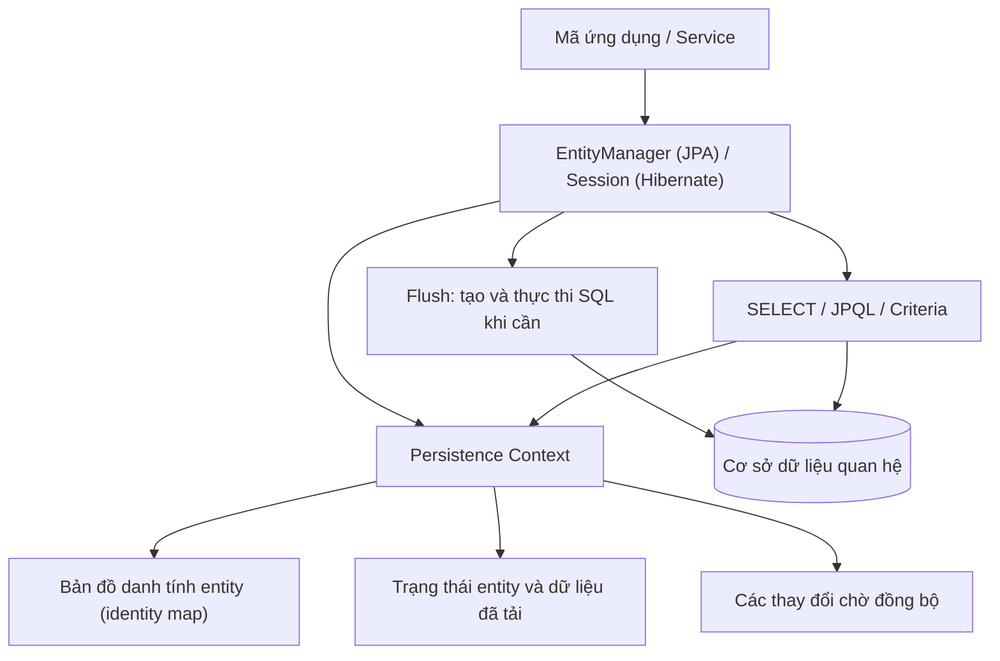
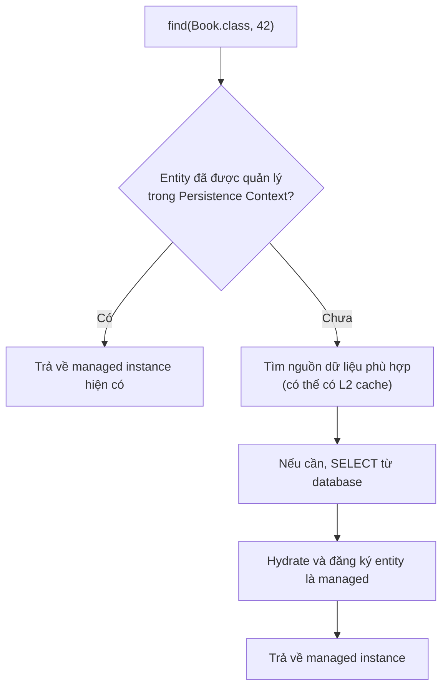
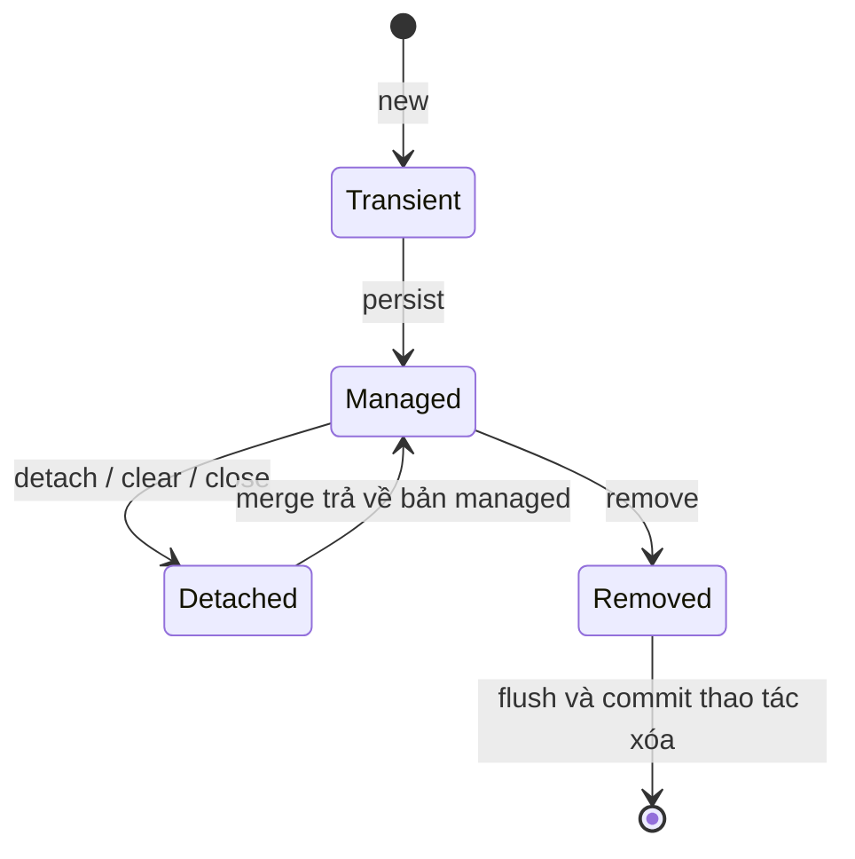

# Persistence Context, bộ nhớ đệm cấp một và cơ chế giữ danh tính đối tượng

Trong kiến trúc Hibernate, **Persistence Context** là nơi Hibernate theo dõi các entity đang được quản lý trong một phiên làm việc. Nó kết nối mô hình đối tượng Java với dữ liệu quan hệ, bảo đảm rằng cùng một bản ghi được biểu diễn nhất quán trong phạm vi phiên, đồng thời hỗ trợ bộ nhớ đệm cấp một (*first-level cache*), phát hiện thay đổi (*dirty checking*) và đồng bộ SQL khi *flush*.

Sau bài học này, bạn có thể giải thích vì sao hai lần tìm cùng khóa chính thường trả về đúng một đối tượng Java, phân biệt Persistence Context với cache cấp hai, nhận biết thời điểm Hibernate truy vấn hoặc cập nhật database, và chọn đúng `find`, `persist`, `merge`, `detach`, `clear`, `refresh` trong các tình huống thực tế.

## 1. Persistence Context nằm ở đâu trong Hibernate?

Ứng dụng Java làm việc với entity bằng `EntityManager` (API Jakarta Persistence/JPA) hoặc `Session` (API Hibernate). Mỗi `EntityManager`/`Session` có trạng thái thường gắn với một **Persistence Context** riêng. Hibernate dùng nó để theo dõi những entity đang ở trạng thái *managed*.



Một cách nhìn phù hợp về kiến trúc:

- **Entity** là đối tượng nghiệp vụ được ánh xạ sang bảng, cột và quan hệ.
- **Persistence Context** quản lý các entity và trạng thái hiện có trong bộ nhớ của phiên làm việc.
- **Hibernate Session** phối hợp việc tải entity, theo dõi thay đổi và gửi SQL.
- **Transaction** xác định việc thay đổi dữ liệu có được commit hay rollback; nó không đồng nghĩa tuyệt đối với vòng đời Persistence Context.

Trong trường hợp phổ biến, Spring quản lý một `EntityManager` gắn với giao dịch của phương thức `@Transactional`. Khi phương thức hoàn tất, giao dịch kết thúc và Persistence Context gắn với nó cũng được đóng. Tuy nhiên JPA còn có *extended persistence context*, và một `EntityManager` do ứng dụng tự quản lý có thể sống lâu hơn một giao dịch. Vì vậy, cần phân biệt **ranh giới Persistence Context** với **ranh giới transaction**.

### Persistence Context lưu những gì?

Về mặt khái niệm, Hibernate cần ít nhất ba nhóm thông tin:

1. **Danh tính entity:** khóa để tìm lại đối tượng đã quản lý, thường dựa trên loại entity và khóa chính (cùng ngữ cảnh ánh xạ/tenant nếu có).
2. **Trạng thái quản lý:** đối tượng Java, trạng thái vòng đời, giá trị đã tải và metadata cần cho dirty checking, versioning, lazy loading.
3. **Thao tác sẽ đồng bộ:** các thao tác chèn, sửa, xóa được phối hợp để thực thi lúc phù hợp.

Trong cách triển khai Hibernate stateful truyền thống, các khái niệm nội bộ như `EntityKey`, `EntityEntry` và `ActionQueue` tham gia việc này. Đây là chi tiết triển khai hữu ích để đọc log hoặc mã nguồn, nhưng ứng dụng thường tương tác qua API JPA/Hibernate thay vì phụ thuộc vào các lớp nội bộ đó.

**Persistence Context rộng hơn cache:** nó không chỉ nhớ dữ liệu đã đọc mà còn chịu trách nhiệm bảo đảm danh tính đối tượng và theo dõi các thay đổi sẽ ghi xuống database.

## 2. Cơ chế giữ danh tính đối tượng (*identity map*)

Giả sử bảng `books` có bản ghi:

| id | title | version |
| --- | --- | --- |
| 42 | Hibernate Essentials | 0 |

Trong cùng một Persistence Context, Hibernate phải tránh tạo hai thực thể *managed* độc lập đại diện cho cùng một định danh entity. Nếu hai đối tượng cùng đại diện cho `Book#42` và mỗi đối tượng bị chỉnh sửa khác nhau, trạng thái cần ghi xuống database sẽ mơ hồ.

Hibernate giải quyết vấn đề này bằng **identity map**: khi một entity đã được quản lý, lần truy cập tiếp theo đến cùng định danh sẽ dùng lại đối tượng đó.

```text
Persistence Context A
    (Book, id=42) -> Book object @A
    (Book, id=57) -> Book object @B

find(Book.class, 42) -> @A
find(Book.class, 42) -> @A

Persistence Context B
    (Book, id=42) -> Book object @C

@A == @A -> true
@A == @C -> false, dù cùng bản ghi Book#42
```

### Ba khái niệm dễ bị nhầm

| Khái niệm | Diễn giải | Ví dụ |
| --- | --- | --- |
| **Database identity** | Định danh bản ghi trong bảng | `books.id = 42` |
| **Object identity** | Cùng chính xác một đối tượng Java | `a == b` |
| **Logical equality** | Hai đối tượng được coi là bằng nhau theo `equals()` | `a.equals(b)` |

Quy tắc quan trọng: **cùng entity identity trong cùng một Persistence Context chỉ có một managed entity instance đại diện**. Điều này giải thích vì sao `a == b` đúng khi `a` và `b` đều là kết quả tải `Book#42` trong cùng một Persistence Context, theo đường truy cập entity thông thường.

Quy tắc trên **không** bảo đảm `==` giữa hai Persistence Context khác nhau. Nó cũng không tự động quy định cách triển khai `equals()` và `hashCode()`. Với lazy proxy, kế thừa entity hoặc bytecode enhancement, còn cần lưu ý kiểu Java và cách proxy được khởi tạo; nên lấy quy tắc quản lý danh tính làm cơ sở thay vì suy diễn mọi thao tác với proxy đều có hành vi tham chiếu giống đối tượng thuần.

### Ví dụ: tải hai lần, nhận cùng một đối tượng

Định nghĩa một entity tối giản bằng Jakarta Persistence:

```java
import jakarta.persistence.*;

@Entity
@Table(name = "books")
public class Book {
    @Id
    @GeneratedValue(strategy = GenerationType.IDENTITY)
    private Long id;

    @Column(nullable = false)
    private String title;

    @Version
    private Long version;

    protected Book() {
        // JPA cần constructor không tham số.
    }

    public Book(String title) {
        this.title = title;
    }

    public Long getId() {
        return id;
    }

    public String getTitle() {
        return title;
    }

    public void setTitle(String title) {
        this.title = title;
    }
}
```

Trong một transaction, với giả định `Book#42` đã tồn tại:

```java
import jakarta.persistence.EntityManager;
import jakarta.persistence.PersistenceContext;
import org.springframework.stereotype.Service;
import org.springframework.transaction.annotation.Transactional;

@Service
public class BookService {
    @PersistenceContext
    private EntityManager em;

    @Transactional
    public void demonstrateIdentity() {
        Book first = em.find(Book.class, 42L);
        Book second = em.find(Book.class, 42L);

        if (first == null) {
            throw new IllegalStateException("Book#42 chưa tồn tại");
        }

        System.out.println(first == second);     // true
        System.out.println(em.contains(first));   // true

        Book fromQuery = em.createQuery(
                "select b from Book b where b.id = :id", Book.class)
            .setParameter("id", 42L)
            .getSingleResult();

        System.out.println(first == fromQuery);   // true
    }
}
```

Ở đây:

- Lần `find` đầu tiên thường cần `SELECT`, nếu chưa có entity đó trong Persistence Context và không được đáp ứng từ nguồn cache phù hợp.
- Lần `find` thứ hai lấy ngay đối tượng đang được quản lý; thông thường không cần thêm `SELECT`.
- Truy vấn JPQL vẫn có thể chạy `SELECT` để xác định kết quả. Khi ánh xạ hàng trả về thành entity, Hibernate dùng **đối tượng đang quản lý** của `Book#42`, nên `fromQuery == first`.

Một truy vấn JPQL chạy SQL **không có nghĩa** Hibernate tạo lại đối tượng từ đầu. Ngược lại, entity đã nằm trong cache cấp một **không có nghĩa** mọi JPQL/Criteria truy vấn đều được bỏ qua SQL.

## 3. Bộ nhớ đệm cấp một (*first-level cache*) là gì?

**First-level cache (L1)** là khả năng giữ các entity đã được quản lý bên trong Persistence Context. Nó có sẵn khi dùng Hibernate `Session` thông thường (*stateful session*) và không cần bật bằng một cấu hình cache riêng.

Quá trình tìm entity theo khóa chính có thể hiểu như sau:



Một số tính chất quan trọng:

- **Phạm vi:** L1 thuộc về một Persistence Context, không dùng chung toàn ứng dụng.
- **Khóa:** dựa vào định danh entity, không đơn thuần là chuỗi SQL.
- **Tính nhất quán đối tượng:** lặp lại `find` trên cùng định danh trả lại entity đang quản lý và cả những thay đổi chưa flush trong bộ nhớ.
- **Không phải cache LRU/TTL:** L1 không tự đặt thời hạn sống hoặc tự loại entity vì quá hạn theo kiểu Redis hay cache truy cập chung.
- **Không thay thế database:** nếu entity chưa được quản lý, Hibernate có thể cần truy vấn database; khi Persistence Context đóng, các managed entity của nó không còn được quản lý tại đó.

**L1 cache không phải kết quả truy vấn SQL tổng quát.** Nó không biết rằng mọi câu `select ... where ...` đều có thể được trả lời chỉ từ một vài entity đang nằm trong bộ nhớ. Hibernate vẫn có thể thực thi truy vấn để xác định những bản ghi thỏa điều kiện.

### Một trace minh họa

Giả sử không bật cache cấp hai và không có entity `Book#42` trong Context lúc bắt đầu:

| Bước | Lệnh | SQL dự kiến | Đối tượng trả về |
| --- | --- | --- | --- |
| 1 | `a = em.find(Book.class, 42L)` | Có `SELECT` | `@A` |
| 2 | `b = em.find(Book.class, 42L)` | Không có `SELECT` mới | `@A` |
| 3 | `c = em.find(Book.class, 57L)` | Có thể có `SELECT` | `@B` |
| 4 | `em.clear()` | Không nhất thiết có SQL | Tách toàn bộ entity khỏi Context |
| 5 | `d = em.find(Book.class, 42L)` | Thường có `SELECT` mới | `@D` |

Sau bước 4, `a` vẫn là một object Java tồn tại trong bộ nhớ của ứng dụng, nhưng đã **detached**; `d` là một managed instance mới. Do đó `a == d` là `false` trong ví dụ điển hình này.

## 4. Vòng đời entity và trạng thái managed

Persistence Context quản lý entity theo trạng thái. Cần phân biệt rõ:

| Trạng thái | Ý nghĩa | Ví dụ chuyển trạng thái |
| --- | --- | --- |
| **Transient / new** | Đối tượng Java chưa gắn với Persistence Context, chưa là entity được quản lý | `new Book("JPA")` |
| **Managed / persistent** | Entity đang được một Persistence Context quản lý; thay đổi có thể được dirty checking phát hiện | `em.persist(book)` hoặc `em.find(...)` |
| **Detached** | Entity từng được quản lý nhưng không còn thuộc Context hiện tại | `em.detach(book)`, `em.clear()`, đóng `EntityManager` |
| **Removed** | Entity được đánh dấu để xóa khi đồng bộ với database | `em.remove(managedBook)` |



Sơ đồ là mô hình khái niệm. Chi tiết lệnh `merge` rất quan trọng: **merge không biến chính detached object thành managed**; nó sao chép trạng thái sang một managed instance và **trả về** instance đó.

Ví dụ:

```java
Book detached = em.find(Book.class, 42L);
em.detach(detached);                  // detached không còn được quản lý
detached.setTitle("Tiêu đề ngoại tuyến");

Book managed = em.merge(detached);    // nhận managed instance
System.out.println(em.contains(detached)); // false
System.out.println(em.contains(managed));  // true
System.out.println(detached == managed);   // false trong trường hợp này
```

Nếu Persistence Context đã có một managed `Book#42` khác, Hibernate sẽ chép trạng thái của `detached` vào đối tượng đang quản lý ấy. Sau `merge`, nên dùng **giá trị trả về** cho những thao tác tiếp theo.

### `persist` không đồng nghĩa với INSERT ngay lập tức

`em.persist(newBook)` đưa entity mới vào trạng thái được quản lý và lên lịch ghi dữ liệu theo quy tắc của provider. Lệnh `INSERT` thường được đồng bộ ở thời điểm flush, **nhưng** chiến lược sinh khóa như `GenerationType.IDENTITY` có thể khiến Hibernate phải thực hiện `INSERT` sớm để lấy khóa chính. Vì vậy không nên dựa vào khẳng định cứng rằng “persist luôn chỉ lưu trong RAM đến commit”.

## 5. Dirty checking và cơ chế *write-behind*

Một lợi ích trung tâm của Persistence Context là lập trình viên có thể chỉnh sửa entity managed như đối tượng Java bình thường, sau đó Hibernate phát hiện phần cần đồng bộ.

```java
@Transactional
public void renameBook(Long bookId, String newTitle) {
    Book book = em.find(Book.class, bookId);
    if (book == null) {
        throw new IllegalArgumentException("Không tìm thấy book: " + bookId);
    }

    book.setTitle(newTitle);
    // Không cần gọi update(book) hoặc merge(book) vì book đang managed.
}
```

Diễn tiến khái niệm:

1. Hibernate tải `Book` và ghi nhận dữ liệu cần thiết để theo dõi trạng thái, chẳng hạn bản giá trị ban đầu (*loaded state snapshot*) hoặc thông tin từ bytecode-enhanced dirty tracking.
2. Phương thức `setTitle` làm thay đổi object đang managed.
3. Đến thời điểm **flush**, Hibernate xác định những thay đổi cần ghi xuống database và gửi `UPDATE` phù hợp.
4. **Commit** làm thay đổi đã ghi trở thành chính thức theo cơ chế transaction; **rollback** có thể hủy tác động SQL đã thực thi trong transaction.

SQL minh họa (tên cột, số lượng câu lệnh và điều kiện `WHERE` phụ thuộc ánh xạ):

```sql
select id, title, version
from books
where id = 42;

update books
set title = 'Hibernate Advanced', version = 1
where id = 42 and version = 0;
```

Vì entity ví dụ có `@Version`, Hibernate có thể dùng phiên bản để kiểm tra cập nhật đồng thời. `@Version` thuộc cơ chế *optimistic locking*, giải quyết một bài toán khác với tính duy nhất đối tượng trong Persistence Context.

### Phân biệt flush, commit và clear

| Hành động | Ý nghĩa trực tiếp | Có kết thúc transaction? | Có tách managed entity? |
| --- | --- | --- | --- |
| `em.flush()` | Đồng bộ thay đổi hiện có xuống database bằng SQL | Không | Không |
| Commit | Kết thúc transaction thành công, xác nhận thay đổi | Có | Phụ thuộc vòng đời `EntityManager` |
| Rollback | Hủy tác động của transaction theo database | Có | Không nên tiếp tục tái sử dụng Context lỗi như chưa có gì xảy ra |
| `em.clear()` | Tách tất cả entity đang managed khỏi Context | Không | Có |
| `em.detach(entity)` | Tách một entity cụ thể khỏi Context | Không | Có, với entity được chỉ định |

Hibernate có thể tự flush trước một số truy vấn hoặc ở thời điểm commit theo flush mode và tình huống cụ thể. `flush()` **không** cam kết dữ liệu đã được commit. Ngược lại, gọi `clear()` **không** thay thế cho việc flush: thay đổi chưa được đồng bộ có thể không còn được theo dõi để ghi xuống database.

```java
Book book = em.find(Book.class, 42L);
book.setTitle("Tên mới");

em.flush();    // đồng bộ UPDATE xuống DB trong transaction hiện tại
em.clear();    // book trở thành detached
// Transaction vẫn có thể rollback sau hai lệnh trên.
```

### Vì sao Context giữ giá trị đã sửa?

```java
Book a = em.find(Book.class, 42L);
a.setTitle("Bản thảo");

Book b = em.find(Book.class, 42L);
System.out.println(a == b);           // true
System.out.println(b.getTitle());     // "Bản thảo"
```

Lần `find` thứ hai nhìn thấy chính đối tượng đang được quản lý, kể cả khi câu `UPDATE` chưa chạy. Đây là tính nhất quán của **mô hình đối tượng trong Context**, không phải bằng chứng transaction đã commit và người dùng khác đã nhìn thấy dữ liệu mới.

## 6. Các thao tác tác động trực tiếp đến Persistence Context

### `find` và `getReference`

- `em.find(Book.class, id)` yêu cầu entity theo khóa chính, trả về `null` nếu không có bản ghi. Nếu entity đã managed, Hibernate dùng lại object đó.
- `em.getReference(Book.class, id)` có thể trả về một tham chiếu lazy/proxy để trì hoãn truy cập database cho đến khi thực sự cần trạng thái. Việc truy cập thuộc tính có thể kích hoạt `SELECT`; với khóa không tồn tại, lỗi có thể xuất hiện khi tham chiếu được khởi tạo.
- Với proxy hoặc bytecode enhancement, hãy phân biệt “đang có tham chiếu được quản lý” với “toàn bộ trường của entity đã được tải”.

Ví dụ hữu ích khi chỉ cần liên kết:

```java
Book bookRef = em.getReference(Book.class, 42L);
// Có thể chưa SELECT toàn bộ Book#42.
// bookRef có thể dùng làm tham chiếu tới Book trong quan hệ được ánh xạ.
```

### `detach`, `clear` và `refresh`

```java
Book book = em.find(Book.class, 42L);
em.detach(book);

System.out.println(em.contains(book)); // false

Book fresh = em.find(Book.class, 42L);
// fresh được quản lý; book vẫn là object detached.
```

- `detach(book)` tách một entity khỏi Context. Với những quan hệ có cấu hình cascade thích hợp, tác động tách có thể lan theo quy tắc JPA.
- `clear()` tách toàn bộ entity managed. Đây là thao tác mạnh; nên xử lý các thay đổi chưa flush trước khi gọi.
- `refresh(book)` nạp lại trạng thái của **managed entity** từ database và ghi đè giá trị hiện tại trong bộ nhớ của entity đó. Nó hữu ích sau khi database thay đổi ngoài cơ chế quản lý thông thường; cũng có thể làm mất những thay đổi chưa flush trên entity được refresh.

```java
Book book = em.find(Book.class, 42L);
book.setTitle("Thay đổi chưa lưu");

em.refresh(book); // Tải lại từ database, ghi đè title chưa flush.
```

### `remove` và quan hệ đến Context

```java
Book book = em.find(Book.class, 42L);
if (book != null) {
    em.remove(book); // đánh dấu xóa, SQL DELETE đồng bộ khi phù hợp
}
```

`remove` thường nhận một entity đang managed. Nếu đang cầm đối tượng detached, hãy cân nhắc tải managed entity hoặc merge thích hợp trước khi xóa; đừng mặc định có thể gọi `remove(detached)` như với managed.

## 7. Context nào giữ danh tính? Ranh giới transaction và phiên

Một ví dụ dễ gây hiểu sai là cho rằng “cùng id thì `==` luôn đúng”. Thực tế, danh tính đối tượng chỉ được Hibernate giữ trong **cùng Persistence Context**.

```java
Book first;
try (EntityManager em1 = emf.createEntityManager()) {
    first = em1.find(Book.class, 42L);
}

Book second;
try (EntityManager em2 = emf.createEntityManager()) {
    second = em2.find(Book.class, 42L);
}

System.out.println(first == second); // false, trong trường hợp tải bình thường
System.out.println(first.getId().equals(second.getId())); // true
```

`first` và `second` biểu diễn cùng khóa chính nhưng thuộc hai Context khác nhau. Khi `em1` đóng, `first` là detached. Mỗi `EntityManager` có quyền có một managed instance riêng cho định danh đó.

### Ba kiểu phạm vi thường gặp

| Tình huống | Ranh giới thường gặp | Hệ quả |
| --- | --- | --- |
| Transaction-scoped `EntityManager` | Giao dịch ứng dụng, ví dụ `@Transactional` trong Spring | Các thao tác cùng Context chia sẻ managed entities |
| Application-managed `EntityManager` | Từ `createEntityManager()` đến `close()` | Context có thể tồn tại qua nhiều thao tác; ứng dụng chịu trách nhiệm đóng |
| Extended Persistence Context | Qua nhiều transaction theo cơ chế JPA phù hợp | Entity có thể tiếp tục được quản lý qua các bước hội thoại nghiệp vụ |

Ngoài ra, cấu hình **Open Session/EntityManager in View** có thể giữ Context mở trong quá trình xử lý request web, tạo ra các truy cập lazy sau khi tầng service đã kết thúc. Cơ chế này ảnh hưởng vòng đời Context, số lượng truy vấn và nơi SQL được thực thi. Không nên lấy nó làm điều kiện mặc định của mọi ứng dụng.

**Không chia sẻ `Session`/`EntityManager` stateful giữa các thread**: các đối tượng này có trạng thái thay đổi theo phiên và không được thiết kế để dùng đồng thời. Muốn hai tác vụ song song cập nhật cùng bản ghi an toàn, cần xét transaction isolation, optimistic/pessimistic locking và xử lý xung đột; identity map không giải quyết cạnh tranh giữa các transaction.

## 8. So sánh bộ nhớ đệm cấp một, cấp hai và query cache

| Tiêu chí | L1 / Persistence Context | L2 / Second-level cache | Query cache |
| --- | --- | --- | --- |
| Phạm vi | Một Persistence Context | Có thể dùng chung nhiều `Session` trong cùng `SessionFactory` / vùng cache | Theo cấu hình của bộ nhớ đệm kết quả truy vấn |
| Trạng thái mặc định | Gắn sẵn với stateful `Session` | Cần cấu hình provider, region và chiến lược phù hợp | Cần cấu hình và áp dụng rõ ràng cho truy vấn |
| Dữ liệu chính | Managed entities và trạng thái liên quan | Trạng thái entity/collection có thể tái sử dụng giữa phiên | Thông tin kết quả truy vấn, thường gắn với định danh và tham số |
| Giữ `==` cho entity managed | Có, trong một Context | Không trực tiếp giữa các Context | Không |
| Dirty checking | Có, với managed entities | Không chịu trách nhiệm thay Persistence Context | Không |
| Tác động của `clear()` | Tách entity khỏi L1 | Không mặc định xóa toàn bộ L2 | Không mặc định xóa query cache |

Ví dụ: một `Book#42` có thể được nạp từ L2 thay vì database ở phiên mới, nhưng Hibernate vẫn tạo/đăng ký **managed Java instance cho Persistence Context mới**. Vì thế object ở phiên A và phiên B không trở thành cùng tham chiếu Java chỉ vì L2 cache có giá trị của chúng.

Query cache cũng không “thay” identity map. Một truy vấn cache hit có thể cung cấp danh sách định danh kết quả, nhưng Hibernate vẫn phải giải quyết entity tương ứng thông qua Context, L2 và/hoặc database tùy trạng thái thực tế.

Hibernate còn có `StatelessSession` cho một số tác vụ đặc biệt. Nó không mang Persistence Context stateful và các dịch vụ dirty checking, write-behind theo cách `Session` thông thường vận hành. Đây là API khác, không phải một nút bật/tắt cache cấp một của `EntityManager`.

## 9. Những tình huống dễ gây lỗi

### 9.1. JPQL bulk update/delete bỏ qua trạng thái entity managed

Giả sử đã tải:

```java
Book book = em.find(Book.class, 42L);
String oldTitle = book.getTitle();

em.createQuery(
        "update Book b set b.title = :title where b.id = :id")
    .setParameter("title", "Đã cập nhật trực tiếp")
    .setParameter("id", 42L)
    .executeUpdate();

System.out.println(book.getTitle()); // Có thể vẫn là oldTitle.
```

JPQL bulk `update`/`delete` tác động trực tiếp tới database, **không đi qua dirty checking của từng managed entity**. Entity đã nằm trong Context có thể trở nên lệch với database. Sau bulk operation, có thể `refresh` các entity cụ thể, hoặc `clear` và tải lại khi phù hợp.

Nếu có thay đổi entity đang chờ flush, cần tính đến việc **flush trước bulk operation**, cũng như việc `clear()` sẽ detach các entity. Với bulk update/delete, optimistic locking/version column cũng không tự mang đầy đủ ngữ nghĩa như cập nhật từng managed entity; cần xử lý điều kiện/version khi bài toán yêu cầu.

### 9.2. Thay đổi database từ bên ngoài không tự làm mới entity

Một transaction hoặc tiến trình khác đã đổi `books.title`. Nếu Context hiện tại đã quản lý `Book#42`, lệnh `find` tiếp theo vẫn trả về object hiện có; Hibernate không tự truy vấn lại mỗi lần để phát hiện sự kiện bên ngoài.

```java
Book book = em.find(Book.class, 42L);
// Một tác vụ khác đã cập nhật dòng tương ứng trong DB.

Book again = em.find(Book.class, 42L);
System.out.println(book == again); // true
// Giá trị trong object chưa chắc là trạng thái mới nhất của DB.
```

`refresh`, mở Context mới hoặc cơ chế versioning/locking có thể liên quan tùy yêu cầu. Việc đọc được thay đổi từ transaction khác còn phụ thuộc **isolation level**, snapshot của transaction và thời điểm commit; không có lời hứa rằng `refresh` luôn nhìn thấy mọi ghi mới nhất dưới mọi mức isolation.

### 9.3. Giữ Context quá lâu làm tăng bộ nhớ

Nếu tải hàng chục nghìn entity trong một Persistence Context, identity map và dữ liệu dirty checking có thể chiếm nhiều RAM. Trong batch, một kỹ thuật thường dùng là flush rồi clear theo nhóm:

```java
@Transactional
public void importBooks(List<String> titles) {
    final int batchSize = 50;

    for (int i = 0; i < titles.size(); i++) {
        em.persist(new Book(titles.get(i)));

        if ((i + 1) % batchSize == 0) {
            em.flush();
            em.clear();
        }
    }

    em.flush();
    em.clear();
}
```

Các thao tác trên phải được cân nhắc với quan hệ cascade và việc còn cần dùng entity managed hay không sau `clear`. Chiến lược `IDENTITY` trong ví dụ entity có thể làm `INSERT` xảy ra sớm và hạn chế JDBC batching; nếu mục tiêu là tối ưu insert hàng loạt, cần lựa chọn chiến lược ID và batching phù hợp.

### 9.4. Nhầm L1 cache với giải pháp cho N+1 queries

Nếu tải 100 cuốn sách và mỗi sách tham chiếu một tác giả khác nhau bằng quan hệ lazy, truy cập tác giả có thể tạo nhiều `SELECT`. L1 chỉ giúp tránh tải lại **cùng entity đã quản lý**; nó không tự biết nên tải tất cả quan hệ cần dùng trong một câu query.

Cần xét `join fetch`, entity graph, batch fetching hoặc cách viết truy vấn theo use case. Nếu nhiều sách cùng tham chiếu một tác giả, L1 có thể giúp giảm truy vấn lặp cho tác giả đó, nhưng không giải quyết tổng quát hiện tượng N+1.

### 9.5. Truy cập quan hệ lazy ngoài Context

```java
Book book = bookService.loadBook(42L);
// Nếu Persistence Context đã đóng:
book.getAuthor().getName(); // Có thể phát sinh LazyInitializationException.
```

Ví dụ này giả định `Book` có quan hệ `author` ánh xạ lazy và quan hệ chưa được khởi tạo. Một entity detached vẫn có thể đọc các trường đã tải, nhưng việc truy cập dữ liệu chưa khởi tạo có thể thất bại vì không còn phiên quản lý để tải tiếp.

Giải pháp phổ biến là lấy đúng dữ liệu cần dùng **bên trong phạm vi service/transaction**, dùng projection/DTO hoặc fetch plan phù hợp, thay vì trông chờ một Context sẽ mở vô hạn.

### 9.6. Tự viết `equals()`/`hashCode()` thiếu cân nhắc

Identity map dùng cơ chế định danh nội bộ để quản lý entity; không nên suy ra rằng `equals()` mặc định đã thể hiện khóa chính. `Object.equals()` mặc định gần với tham chiếu; còn equality theo id, business key, hay quy tắc cho entity mới tạo là quyết định thiết kế riêng.

Với `@GeneratedValue`, entity mới có thể có `id == null` trước khi được gán khóa. Nếu tính `hashCode()` từ id rồi đưa object vào `HashSet` trước khi lưu, hash thay đổi về sau có thể làm tập hoạt động sai. Lazy proxy và cấu trúc kế thừa cũng có thể ảnh hưởng cách so sánh lớp entity. Cần chọn chiến lược equality nhất quán với vòng đời entity và mô hình domain.

## 10. Đọc log để hiểu Hibernate đang làm gì

Khi quan sát SQL trong môi trường phát triển, có thể lần theo bốn loại sự kiện:

1. **Nạp entity:** tìm một ID chưa được quản lý thường sinh `SELECT` hoặc được phục vụ bởi cache phù hợp.
2. **Tái truy cập theo ID:** tìm lại ID đã managed không cần `SELECT` mới cho riêng thao tác đó.
3. **Thay đổi managed entity:** lệnh setter không nhất thiết gửi SQL ngay.
4. **Flush:** Hibernate thực thi `INSERT`/`UPDATE`/`DELETE` phù hợp với thay đổi và các thao tác đang chờ.

Ví dụ cấu hình logging trong Spring Boot với backend logging tương thích:

```properties
# Log SQL do Hibernate phát ra
logging.level.org.hibernate.SQL=DEBUG

# Hibernate 6.x: log các giá trị bind JDBC, chỉ dùng khi cần debug
logging.level.org.hibernate.orm.jdbc.bind=TRACE
```

Các logger và định dạng output phụ thuộc phiên bản Hibernate và cấu hình ứng dụng. Giá trị bind có thể chứa thông tin nhạy cảm, nên chỉ bật mức TRACE trong phạm vi kiểm soát.

Khi đọc log, chú ý: “cùng một tham chiếu Java” không nhất thiết tương ứng “không có SQL nào”. Một JPQL query vẫn có thể chạy SQL và trả về entity đã managed; lazy loading cũng có thể gửi SQL để tải thêm quan hệ.

## 11. Một tình huống tổng hợp

Giả sử đang trong một Persistence Context và `Book#42` tồn tại:

```java
Book a = em.find(Book.class, 42L); // (1)
Book b = em.find(Book.class, 42L); // (2)

a.setTitle("Bản nháp");             // (3)
System.out.println(b.getTitle());  // (4) Bản nháp

em.flush();                         // (5)
em.detach(a);                       // (6)

Book c = em.find(Book.class, 42L); // (7)
System.out.println(a == c);        // (8) false

a.setTitle("Sửa bản detached");     // (9)
Book d = em.merge(a);              // (10)
System.out.println(c == d);        // (11) true
```

Giải thích:

- **(1)–(2):** `a` và `b` là cùng managed instance nhờ identity map.
- **(3)–(4):** đổi trường ở `a` cũng là đổi ở `b`; không cần chờ SQL.
- **(5):** đồng bộ thay đổi xuống database trong transaction, chưa phải commit.
- **(6):** `a` (và do đó `b`) rời Context; biến Java vẫn trỏ tới object cũ.
- **(7)–(8):** `c` là entity managed được tải/đăng ký lại; không phải object `a`.
- **(9)–(11):** `merge(a)` chép trạng thái detached sang entity managed `Book#42` vốn đã tồn tại là `c` và trả về chính `c`.

Sau `merge`, `d` mới là đối tượng nên tiếp tục chỉnh sửa nếu muốn Hibernate theo dõi thay đổi. Nếu object detached giữ dữ liệu cũ, merge còn có nguy cơ ghi đè thay đổi mới hơn; với dữ liệu cập nhật đồng thời nên kết hợp `@Version` và quy tắc xử lý xung đột.

## 12. Nguyên tắc ứng dụng

- Xác định **ranh giới Persistence Context** trước khi phán đoán số lần tải entity, trạng thái managed/detached hoặc kết quả `==`.
- Khi entity đang managed, sửa trường trực tiếp và để Hibernate dirty checking; không cần gọi `merge` cho mỗi thay đổi.
- Phân biệt **tái sử dụng đối tượng** (L1 identity map), **tái sử dụng trạng thái giữa phiên** (L2), và **cache kết quả truy vấn**.
- Chủ động quản lý dữ liệu cũ sau bulk SQL/JPQL hoặc cập nhật ngoài Context; không mặc định `find` sẽ làm mới object đang managed.
- Dùng `flush` để đồng bộ SQL tại điểm cần thiết, `clear`/`detach` để bỏ quản lý khi phù hợp, và commit để xác nhận giao dịch.
- Kiểm soát kích thước Context trong batch, fetch plan khi đọc quan hệ và vấn đề đồng thời bằng locking/versioning ở mức transaction.

**Ghi nhớ:** Persistence Context là *unit of work* ở cấp đối tượng trong Hibernate. Bộ nhớ đệm cấp một là một khả năng của Context; identity map giữ nhất quán các tham chiếu trong một phiên; dirty checking và flush chuyển những thay đổi của các đối tượng managed thành thao tác SQL có kiểm soát.
