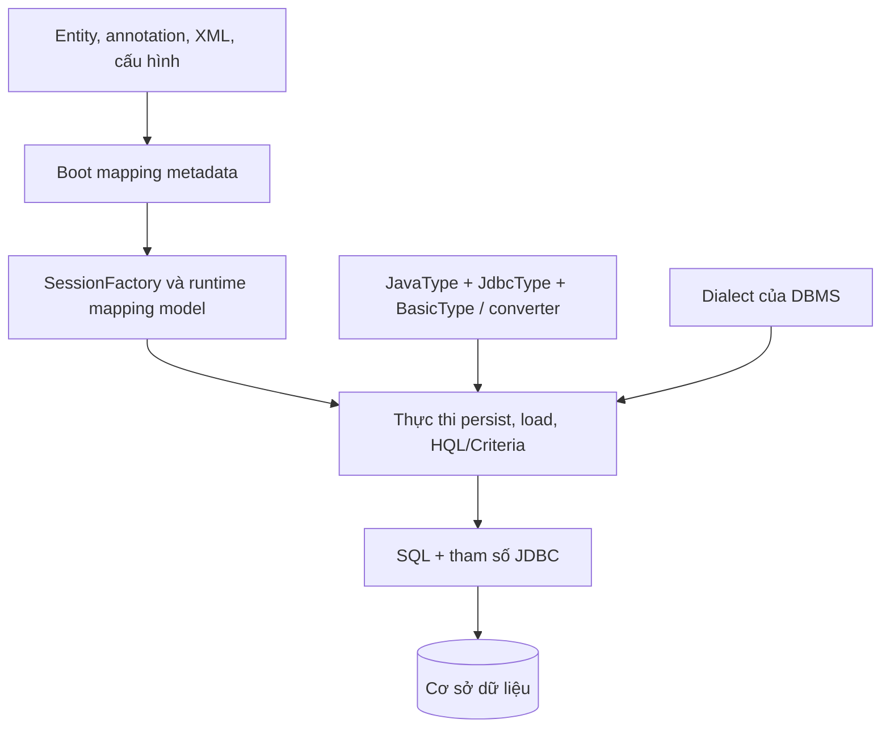

# Siêu dữ liệu ánh xạ, bộ mô tả kiểu và Dialect trong kiến trúc Hibernate

Khi một ứng dụng gọi `session.persist(entity)` hoặc thực thi một truy vấn HQL, Hibernate phải trả lời được nhiều câu hỏi trước khi phát SQL: lớp Java tương ứng với bảng nào, thuộc tính nào là khóa chính, giá trị Java được chuyển thành tham số JDBC ra sao, và cơ sở dữ liệu hiện tại hiểu cú pháp SQL nào. Ba thành phần phối hợp để giải quyết những câu hỏi đó là **siêu dữ liệu ánh xạ (mapping metadata)**, **hệ thống mô tả kiểu (type descriptors)** và **`Dialect`**.

Bài này tập trung vào kiến trúc **Hibernate ORM 6.x**, dùng API `jakarta.persistence.*`. Một số tên lớp và cơ chế nội bộ có thể khác ở Hibernate 5 hoặc thay đổi theo phiên bản nhỏ; các ví dụ về SQL tạo ra cũng phụ thuộc phiên bản Hibernate và hệ quản trị cơ sở dữ liệu (DBMS).

## 1. Bức tranh tổng thể: ba câu hỏi, ba trách nhiệm

| Thành phần | Câu hỏi chính | Ví dụ thông tin chịu trách nhiệm |
| --- | --- | --- |
| **Mapping metadata** | *Dữ liệu của đối tượng nằm ở đâu và quan hệ giữa các đối tượng được lưu thế nào?* | `Customer` ánh xạ tới `customers`; `id` là khóa chính; `address` là thành phần nhúng; `orders` là quan hệ một-nhiều. |
| **Type descriptors** | *Giá trị Java có ý nghĩa gì và được đọc/ghi qua JDBC bằng cách nào?* | `BigDecimal` được so sánh/xử lý như thế nào; enum lưu dưới dạng tên; một giá trị JSON được bind/extract như kiểu JDBC nào. |
| **`Dialect`** | *DBMS cụ thể hỗ trợ những kiểu cột, hàm và cú pháp SQL nào?* | Chọn tên kiểu SQL trong DDL; tạo câu lệnh phân trang; sinh khóa bằng identity/sequence; biểu diễn khóa bi quan hoặc các hàm SQL. |

Ba trách nhiệm liên hệ với nhau nhưng không đồng nhất. `@Column(name = "total", precision = 19, scale = 2)` mô tả một cột trong mapping; hệ thống kiểu xác định cách làm việc với `BigDecimal`/`DECIMAL`; còn `Dialect` tham gia chọn SQL phù hợp với PostgreSQL, MySQL hoặc DBMS khác.



Điểm mấu chốt: Hibernate không xem annotation như một chỉ dẫn rời rạc mỗi lần đọc/ghi thuộc tính. Nó **diễn giải và kiểm tra cấu hình khi khởi động**, tạo mô hình ánh xạ để tái sử dụng trong suốt vòng đời của `SessionFactory`.

## 2. Siêu dữ liệu ánh xạ được xây dựng khi nào?

### 2.1. Từ nguồn khai báo đến mô hình runtime

Một chuỗi khởi động điển hình của Hibernate native API:

1. Tạo **`ServiceRegistry`** chứa các dịch vụ hạ tầng và cấu hình: kết nối JDBC, quản lý transaction, chiến lược tạo SQL, thông tin DBMS, v.v.
2. Đưa những lớp/entity và tài liệu ánh xạ vào **`MetadataSources`**.
3. **`MetadataBuilder`** tổng hợp các nguồn, áp dụng chiến lược đặt tên và cấu hình liên quan, sau đó tạo **`Metadata`** (mô hình ánh xạ ở giai đoạn boot).
4. Từ metadata, Hibernate xây dựng **`SessionFactory`** và các thành phần runtime để xử lý entity, collection, truy vấn, JDBC và SQL.
5. Mỗi `Session` mở từ `SessionFactory` dùng lại mô hình đã chuẩn bị; `Session` quản lý persistence context riêng của mình.

```java
import org.hibernate.SessionFactory;
import org.hibernate.boot.Metadata;
import org.hibernate.boot.MetadataSources;
import org.hibernate.boot.registry.StandardServiceRegistry;
import org.hibernate.boot.registry.StandardServiceRegistryBuilder;

StandardServiceRegistry registry = new StandardServiceRegistryBuilder()
        .configure() // đọc hibernate.cfg.xml trên classpath
        .build();

try {
    Metadata metadata = new MetadataSources(registry)
            .addAnnotatedClass(Customer.class)
            .addAnnotatedClass(PurchaseOrder.class)
            .buildMetadata();

    try (SessionFactory sessionFactory = metadata.buildSessionFactory()) {
        // Các Session mở từ factory dùng chung runtime mapping model.
    }
} catch (RuntimeException exception) {
    StandardServiceRegistryBuilder.destroy(registry);
    throw exception;
}
```

Ví dụ giả định các entity đã được khai báo và `hibernate.cfg.xml` đã cấu hình kết nối cùng JDBC driver. Có thể dùng JPA `EntityManagerFactory` thay cho native `SessionFactory`; các bước boot do JPA provider thực hiện nhưng các khái niệm ánh xạ và kiểu vẫn tồn tại.

**Phân biệt hai kiểu “metadata”:**

- **Mapping metadata** mô tả mô hình *ứng dụng muốn ánh xạ*: entity, thuộc tính, bảng, cột, quan hệ, khóa, inheritance, converter… Nó có thể được tạo từ annotation/XML ngay cả khi chưa có bảng thực tế.
- **JDBC `DatabaseMetaData`** là thông tin *database/driver báo về*: sản phẩm, phiên bản, danh sách bảng/cột, khả năng JDBC… Hibernate có thể sử dụng thông tin này để chọn `Dialect`, kiểm tra schema hoặc quyết định một số tính năng. Nó không thay thế mapping metadata.

### 2.2. Nguồn của mapping metadata

| Nguồn | Vai trò | Ghi chú |
| --- | --- | --- |
| Annotation Jakarta Persistence | Cách khai báo thường gặp: `@Entity`, `@Id`, `@Column`, `@ManyToOne`, `@Embeddable`, `@Version`… | Dễ đặt cấu hình cạnh mã domain. |
| Annotation riêng của Hibernate | Bổ sung những nhu cầu cụ thể, ví dụ `@JdbcTypeCode`, `@Formula`, `@NaturalId`, `@BatchSize`. | Tăng khả năng biểu đạt nhưng giảm tính di động giữa các JPA provider. |
| XML mapping | `orm.xml` của Jakarta Persistence hoặc các định dạng ánh xạ Hibernate theo khả năng hỗ trợ của phiên bản. | Hữu ích khi muốn tách cấu hình khỏi mã nguồn; cần hiểu quy tắc ghép/ghi đè giữa XML và annotation. |
| Cấu hình và chiến lược lúc boot | `ImplicitNamingStrategy`, `PhysicalNamingStrategy`, các bộ đóng góp metadata/type. | Có thể thay đổi cách suy ra hoặc chuyển đổi tên bảng/cột và cách đăng ký kiểu. |

`Metadata` còn ghi nhận những thành phần vượt quá một cột: định danh entity, kiểu kế thừa, discriminator, primary/foreign key, collection table, join column, fetch policy, cascade, optimistic locking, generator, named queries… Hibernate cần chúng để sinh câu lệnh đúng và để biết khi nào phải đồng bộ trạng thái của đối tượng với database.

## 3. Đọc một entity như Hibernate đọc mapping

Giả sử có các entity sau (bỏ qua constructor và getter/setter để tập trung vào ánh xạ):

```java
import jakarta.persistence.*;
import java.math.BigDecimal;
import java.time.Instant;

enum OrderStatus { NEW, PAID, CANCELLED }

@Entity
@Table(name = "purchase_orders")
class PurchaseOrder {
    @Id
    @GeneratedValue(strategy = GenerationType.IDENTITY)
    Long id;

    @Column(name = "order_code", nullable = false, unique = true, length = 40)
    String orderCode;

    @Enumerated(EnumType.STRING)
    @Column(name = "status", nullable = false, length = 20)
    OrderStatus status;

    @Column(name = "total_amount", nullable = false, precision = 19, scale = 2)
    BigDecimal total;

    @ManyToOne(fetch = FetchType.LAZY, optional = false)
    @JoinColumn(name = "customer_id", nullable = false)
    Customer customer;

    @Version
    long version;

    Instant createdAt;
}

@Entity
@Table(name = "customers")
class Customer {
    @Id
    Long id;

    @Column(nullable = false, length = 120)
    String name;
}
```

Từ ví dụ này, metadata cho biết:

- `PurchaseOrder` là một entity quản lý vòng đời; `purchase_orders` là tên bảng ánh xạ.
- `id` là khóa chính; `IDENTITY` yêu cầu cơ chế sinh khóa phù hợp với dialect/database.
- `orderCode`, `status`, `total`, `version`, `createdAt` là các thuộc tính cơ bản, nhưng mỗi thuộc tính cần một ánh xạ kiểu cụ thể.
- `customer` là **association**: cột `customer_id` tham chiếu khóa của entity `Customer`; Hibernate xử lý nó như một liên kết entity, không đơn thuần bằng cách serialize đối tượng `Customer` vào một cột.
- `@Version` tham gia optimistic locking: khi cập nhật, Hibernate dùng phiên bản hiện có trong điều kiện đồng bộ và tăng phiên bản theo cơ chế thích hợp.
- `@Enumerated(EnumType.STRING)` yêu cầu biểu diễn dựa trên tên hằng enum; kiểu cột SQL vật lý cuối cùng vẫn có thể thay đổi theo dialect.

`@Column(length = 40)` chủ yếu cung cấp thông tin về cột/schema; nó **không phải** trình xác thực độ dài dữ liệu Java. Để kiểm tra đầu vào ở lớp ứng dụng, cần validation (ví dụ Jakarta Bean Validation) hoặc logic nghiệp vụ, ngoài ràng buộc ở database. `fetch = LAZY` cũng mô tả ý định tải dữ liệu; cơ chế thực tế có thể phụ thuộc loại association, proxy và bytecode enhancement.

### 3.1. Quy tắc đặt tên là một phần của kết quả ánh xạ

Với tên không khai báo tường minh, **implicit naming strategy** đề xuất tên logic; **physical naming strategy** chuyển tên logic thành tên vật lý trong database. Ví dụ `createdAt` có thể trở thành `created_at` nếu ứng dụng cấu hình chiến lược chuyển camelCase sang snake_case. Đây là hành vi của **cấu hình chiến lược**, không phải quy tắc bảo đảm của mọi Hibernate setup hoặc nhiệm vụ của `Dialect`.

Những lỗi như “column not found” thường bắt nguồn từ khác biệt giữa tên được mapping kỳ vọng và tên vật lý đã tạo, đặc biệt khi thay chiến lược đặt tên mà không đồng bộ migration.

## 4. Hệ thống kiểu trong Hibernate 6: không chỉ là một tên kiểu SQL

Một thuộc tính cơ bản phải đi qua ít nhất hai thế giới:

- **Java/domain:** object, tính bằng nhau, tính bất biến, phép chuyển đổi giữa biểu diễn Java.
- **JDBC/database:** mã kiểu JDBC, cách đưa giá trị vào `PreparedStatement` và lấy giá trị từ `ResultSet`, kiểu cột thích hợp.

Hibernate 6 mô hình hóa trách nhiệm này thành các thành phần có thể phối hợp:

| Thành phần | Trách nhiệm chính | Minh họa |
| --- | --- | --- |
| `JavaType<T>` | Mô tả hành vi phía Java: biểu diễn, so sánh, chuyển đổi/wrap/unwrap; làm việc với kế hoạch mutability. | `String`, `BigDecimal`, `UUID`, `LocalDateTime` có đặc điểm Java khác nhau. |
| `JdbcType` | Mô tả kiểu JDBC và cách bind/extract dữ liệu qua JDBC. | `VARCHAR`, `NUMERIC`, `TIMESTAMP`, `BINARY`, `JSON` tùy mapping và driver. |
| `BasicType<T>` | Kết hợp ngữ nghĩa Java với ánh xạ JDBC cho một basic value. | Một ánh xạ `String`–`VARCHAR` hoặc `BigDecimal`–`NUMERIC`. |
| `BasicValueConverter` / `AttributeConverter` | Chuyển đổi giữa **kiểu domain** và **kiểu Java trung gian dùng cho quan hệ**. | `EmailAddress` ⇄ `String`; enum ⇄ mã nghiệp vụ. |
| `MutabilityPlan<T>` | Cho Hibernate biết việc sao chép, snapshot và xử lý giá trị có thể thay đổi. | `String` thường bất biến; đối tượng mutable có thể cần deep copy để phát hiện dirty changes. |
| `TypeConfiguration` và các registry | Tổ chức việc tìm/đăng ký các descriptor và kiểu. | `JavaTypeRegistry`, `JdbcTypeRegistry`, `BasicTypeRegistry`. |

Đây là mô hình khái niệm, không có nghĩa mỗi thuộc tính đều phải khai báo bằng tay cả sáu thành phần. Với phần lớn kiểu chuẩn, Hibernate có sẵn descriptor và tự suy ra mapping từ kiểu Java, annotation, JDBC type indicators và khả năng của dialect.

### 4.1. Dòng chảy ghi và đọc giá trị

```text
GHI:
Domain value (Java)
    → [converter nếu có] → relational Java value
    → JavaType/JdbcType phối hợp bind
    → PreparedStatement parameter → database

ĐỌC:
database → ResultSet
    → JdbcType/JavaType phối hợp extract
    → relational Java value → [converter nếu có]
    → Domain value (Java)
```

Ví dụ với `BigDecimal total = new BigDecimal("125000.50")`: Hibernate xác định giá trị Java thuộc kiểu số thập phân, ánh xạ sang JDBC type phù hợp, gọi binder để gán giá trị cho placeholder SQL `?` và extractor tương ứng khi tải lại entity. `@Column(precision = 19, scale = 2)` giúp diễn đạt kích thước/độ chính xác của cột; nó không thay thế việc bind JDBC.

### 4.2. Vì sao mutability quan trọng với dirty checking?

Hibernate thường so sánh trạng thái đã ghi nhận với trạng thái hiện tại để quyết định có cần `UPDATE` hay không. Đối với kiểu bất biến như `String`, có thể giữ tham chiếu khi snapshot. Với một kiểu mutable (mảng byte, đối tượng chứa danh sách có thể sửa trực tiếp…), snapshot sai có thể khiến Hibernate không phát hiện thay đổi hoặc sinh update không cần thiết. Khi tự xây dựng custom type, **ngữ nghĩa bằng nhau và `MutabilityPlan` phải phù hợp với bản chất của kiểu**.

Không nên suy ra rằng chỉ cần tự viết `equals()` cho một entity là giải quyết được dirty checking của mọi basic attribute: cơ chế kiểm tra thay đổi của thuộc tính dựa vào mapping/type và các tối ưu runtime liên quan.

### 4.3. Basic attribute khác association và composite value

- **Basic attribute:** một giá trị thuộc ánh xạ cơ bản, ví dụ `String`, `BigDecimal`, `Instant`, enum hay custom value type. Thường được ánh xạ vào một cột, dù một số cơ chế/type đặc thù có khả năng phức tạp hơn.
- **Embeddable:** một cấu phần (`@Embeddable`) có thể chứa nhiều thuộc tính/cột; mapping của nó là mô hình tổng hợp, không thể coi toàn bộ là một `BasicType` thông thường.
- **Association:** `@ManyToOne`, `@OneToMany`, v.v. ánh xạ quan hệ giữa các entity và mang thông tin khóa ngoại, cardinality, fetching. Nó không tương đương `AttributeConverter` chuyển cả entity sang `VARCHAR`.

Hiểu sự phân chia này giúp chọn đúng công cụ mở rộng: đổi cách biểu diễn một **giá trị** thường dùng converter/type; đổi **mô hình quan hệ** phải xem lại entity, embeddable và annotation liên kết.

## 5. Chọn công cụ ánh xạ kiểu: enum, converter, `@JdbcTypeCode`

### 5.1. Enum: chọn ngữ nghĩa lưu trữ trước

```java
@Enumerated(EnumType.STRING)
@Column(name = "status", nullable = false)
OrderStatus status;
```

`EnumType.STRING` lưu theo tên hằng (`"NEW"`, `"PAID"`…), giúp dữ liệu ít phụ thuộc vào thứ tự khai báo enum. `EnumType.ORDINAL` lưu ordinal và có thể gây sai nghĩa dữ liệu khi chèn/sắp xếp lại các hằng. Trong Hibernate 6, một dialect có thể chọn kiểu enum native của DBMS thay vì `VARCHAR`; **ngữ nghĩa `STRING` không cam kết một kiểu DDL vật lý duy nhất**.

Nếu database dùng các mã nghiệp vụ như `N`, `P`, `C`, có thể dùng `AttributeConverter<OrderStatus, String>` để kiểm soát phép biến đổi; không phối hợp đồng thời `@Enumerated` với converter cho cùng một mapping khi hai cách mô tả xung đột.

### 5.2. `AttributeConverter`: đưa value object vào một cột cơ bản

Giả sử domain cần kiểu `EmailAddress` để không truyền chuỗi tùy tiện khắp nghiệp vụ:

```java
import jakarta.persistence.AttributeConverter;
import jakarta.persistence.Convert;
import jakarta.persistence.Converter;
import jakarta.persistence.Column;

record EmailAddress(String value) {
    EmailAddress {
        if (value == null || value.isBlank()) {
            throw new IllegalArgumentException("Email must not be blank");
        }
    }
}

@Converter
class EmailAddressConverter implements AttributeConverter<EmailAddress, String> {
    @Override
    public String convertToDatabaseColumn(EmailAddress attribute) {
        return attribute == null ? null : attribute.value();
    }

    @Override
    public EmailAddress convertToEntityAttribute(String dbData) {
        return dbData == null ? null : new EmailAddress(dbData);
    }
}

// Bên trong một @Entity:
@Convert(converter = EmailAddressConverter.class)
@Column(name = "contact_email", length = 254)
private EmailAddress contactEmail;
```

Nhìn theo kiến trúc: `EmailAddress` là **domain Java type**, converter chuyển sang **relational Java type `String`**, rồi Hibernate dùng ánh xạ JDBC tương ứng để đưa chuỗi vào cột. Converter không tự tạo cột, không chọn cú pháp SQL phân trang và không kiểm soát tất cả khả năng của DBMS. `autoApply = true` chỉ phù hợp khi thật sự muốn converter được áp dụng cho mọi thuộc tính tương thích trong phạm vi persistence unit. Không nên dựa vào converter JPA cho những vị trí như `@Id`, `@Version` hoặc relationship nếu chưa xác minh quy tắc áp dụng của API/phiên bản.

> Ví dụ trên mới kiểm tra chuỗi không rỗng để làm rõ luồng chuyển đổi; nếu sản phẩm cần ràng buộc email, quy tắc kiểm tra phải được thiết kế riêng. Cũng cần cân nhắc giới hạn cột, chuẩn hóa dữ liệu và backward compatibility trước khi thay converter của một hệ thống đang chạy.

### 5.3. `@JdbcTypeCode`: gợi ý biểu diễn JDBC cụ thể

Hibernate cung cấp `@JdbcTypeCode` để chọn mã SQL/JDBC type cho một thuộc tính khi cách suy luận mặc định chưa đủ:

```java
import java.util.Map;
import org.hibernate.annotations.JdbcTypeCode;
import org.hibernate.type.SqlTypes;

// Bên trong một @Entity:
@JdbcTypeCode(SqlTypes.JSON)
@Column(name = "preferences")
private Map<String, String> preferences;
```

Ở đây `SqlTypes.JSON` mô tả ý định dùng ánh xạ JSON của Hibernate. Hibernate cần **JSON format mapper** tương thích trên classpath/cấu hình (ví dụ Jackson hoặc JSON-B theo cách setup Hibernate hỗ trợ), dialect phải hỗ trợ cách lưu tương ứng, và database phải có kiểu/cơ chế xử lý phù hợp. PostgreSQL có thể dùng kiểu `jsonb` trong tình huống thích hợp; một DBMS khác có thể chọn tên kiểu hoặc chiến lược khác. Không nên giả định annotation này làm mọi database hỗ trợ JSON giống hệt nhau.

Nếu thêm `@Column(columnDefinition = "jsonb")`, bạn đã cố định một phần DDL theo PostgreSQL. Hãy dùng `columnDefinition` khi thực sự cần tính năng vendor-specific và chấp nhận chi phí migration/kiểm thử đa DBMS.

### 5.4. Khi nào phải đăng ký custom Hibernate type?

`AttributeConverter` phù hợp khi bài toán chỉ là chuyển giữa domain type và một kiểu Java đã được JDBC mapping hỗ trợ. Nếu cần điều khiển sâu hơn việc bind/extract JDBC, ngữ nghĩa so sánh/mutability hoặc một mã SQL type đặc thù, có thể triển khai/đăng ký `JavaType`, `JdbcType`, `BasicType` hoặc dùng các annotation đăng ký kiểu phù hợp với phiên bản Hibernate.

Quyết định theo thứ tự: **kiểu tích hợp sẵn → annotation chuẩn/JPA converter → annotation riêng Hibernate → custom descriptor**. Custom type can thiệp sâu vào nền tảng lưu trữ, vì vậy phải quan tâm cả hướng ghi lẫn hướng đọc, xử lý `null`, dirty checking, schema và khả năng chạy với JDBC driver đang dùng.

## 6. `Dialect` làm gì và không làm gì?

`org.hibernate.dialect.Dialect` mô tả khả năng và quy ước SQL của một họ DBMS cùng phiên bản liên quan. Hibernate tham khảo nó trong quá trình khởi động, lập kế hoạch truy vấn, sinh SQL và một số thao tác schema.

| Nhu cầu | Cách `Dialect` ảnh hưởng | Điều cần nhớ |
| --- | --- | --- |
| **Tên kiểu DDL** | Hỗ trợ ánh xạ mã SQL type + kích thước/precision/scale sang định nghĩa cột phù hợp. | Cùng `BigDecimal` có thể có SQL type declaration khác nhau giữa DBMS. |
| **Phân trang** | Diễn đạt limit/offset/fetch theo cú pháp và khả năng database. | HQL/Criteria có thể giữ nguyên dù SQL xuất ra khác. |
| **Khóa được sinh** | Định hình hỗ trợ identity, sequence, cách truy xuất generated values. | `GenerationType.IDENTITY` và `SEQUENCE` có chi phí hành vi khác nhau; không nên đổi tùy tiện. |
| **Hàm và biểu thức SQL** | Đăng ký và render các hàm, phép toán, cast, xử lý dữ liệu. | Không phải mọi hàm có cùng tên/ngữ nghĩa trên mọi database. |
| **Locking và thao tác DML** | Hỗ trợ cú pháp khóa, khả năng `RETURNING`, một số đặc điểm insert/update/delete theo DBMS. | Không phải mọi mức khóa hay tính năng đều được mọi dialect hỗ trợ. |
| **Schema management** | Tham gia render `CREATE`, `ALTER`, ràng buộc và các cấu trúc đặc thù. | Schema export không thay thế quy trình migration có kiểm soát. |

Ví dụ về ý định phân trang có thể viết bằng JPA:

```java
List<PurchaseOrder> page = entityManager
        .createQuery("select p from PurchaseOrder p order by p.id", PurchaseOrder.class)
        .setFirstResult(20)
        .setMaxResults(10)
        .getResultList();
```

Ứng dụng yêu cầu bỏ qua 20 kết quả và lấy 10 kết quả tiếp theo; dialect quyết định cú pháp SQL chính xác phù hợp DBMS. Các dạng như `LIMIT ... OFFSET ...` hay `OFFSET ... FETCH ...` chỉ là **minh họa họ cú pháp**: Hibernate có thể biến đổi truy vấn, sắp xếp tham số hoặc sử dụng chiến lược khác theo dialect/version. Cần `ORDER BY` ổn định để phân trang có kết quả dự đoán được khi dữ liệu thay đổi.

### 6.1. Hibernate chọn `Dialect` bằng cách nào?

Trong setup thông thường, Hibernate có thể **tự nhận diện dialect từ thông tin JDBC** mà driver/database cung cấp. Vì vậy không nhất thiết đặt `hibernate.dialect` khi kết nối database hoạt động và phiên bản Hibernate hỗ trợ DBMS đó.

Khi môi trường khởi động không cho phép lấy metadata JDBC, hoặc có nhu cầu cấu hình đặc biệt, có thể chỉ định tường minh, ví dụ:

```properties
# Chỉ là ví dụ cấu hình khi thật sự cần ghi đè việc tự nhận diện:
hibernate.dialect=org.hibernate.dialect.PostgreSQLDialect
```

Các bản Hibernate gần đây có thể cảnh báo nếu khai báo dialect mà nó tự xác định được. Class dialect và mức phiên bản DBMS được hỗ trợ thay đổi giữa các dòng phát hành; nên chọn theo **Hibernate ORM đang dùng + phiên bản DBMS thực tế**, không sao chép tên class từ hướng dẫn Hibernate 5 cũ. Khai báo `Dialect` **không thiết lập JDBC URL, driver, tài khoản kết nối hoặc tạo database**.

### 6.2. Ranh giới với JDBC driver và DBMS

- **JDBC driver** thực hiện giao tiếp với database, cung cấp `Connection`, `PreparedStatement`, `ResultSet` và thông tin metadata; driver có thể có hành vi riêng khi xử lý kiểu native.
- **Dialect** giúp Hibernate tạo SQL, DDL và lựa chọn tính năng tương thích với DBMS.
- **Type descriptors** quyết định đường đi của giá trị từ Java tới JDBC và ngược lại.
- **Mapping metadata** quyết định thuộc tính/quan hệ nào được lưu và lưu ở vị trí nào.

Chẳng hạn PostgreSQL hỗ trợ `jsonb` không đồng nghĩa rằng mọi đối tượng Java tự động trở thành JSON; vẫn cần mapping kiểu và bộ chuyển đổi JSON phù hợp. Ngược lại, có converter chuyển object thành chuỗi JSON cũng không mặc nhiên biến cột SQL `VARCHAR` thành cột `jsonb`.

## 7. Một lượt thực thi: từ metadata đến SQL

Xét thao tác lưu một `PurchaseOrder` mới:

```java
entityManager.getTransaction().begin();
entityManager.persist(order);
entityManager.getTransaction().commit();
```

Đường đi khái niệm:

1. `Session`/`EntityManager` nhận entity và đưa nó vào persistence context. Hibernate dựa vào runtime mapping model để biết entity name, identifier generator, bảng và các thuộc tính cần ghi.
2. Mapping cho biết cột `order_code`, `status`, `total_amount`, `customer_id`, `version`, `createdAt` và thông tin nullable/insertable của chúng. Association `customer` đóng góp giá trị khóa ngoại thay vì serialize cả object.
3. Type system chuyển và bind từng basic value: `String` cho mã đơn; enum theo chiến lược đã khai báo; `BigDecimal` cho số tiền; `Instant` theo temporal mapping; converter nếu thuộc tính có converter.
4. `Dialect` ảnh hưởng cú pháp statement, generated key và chức năng SQL được phép dùng; driver thực thi `PreparedStatement`.
5. Khi tải lại, Hibernate dùng mapping để đọc đúng cột, type descriptors để extract/convert và cơ chế entity loading để lắp object/association tương ứng.

Một câu `INSERT` dạng minh họa (không cam kết SQL thực tế, thứ tự cột hoặc thời điểm Hibernate phát lệnh):

```sql
insert into purchase_orders
    (order_code, status, total_amount, customer_id, version, createdAt)
values (?, ?, ?, ?, ?, ?);
```

Với `GenerationType.IDENTITY`, Hibernate có thể phải thực thi `INSERT` theo cơ chế có thể nhận khóa do database sinh, thay vì lấy sẵn giá trị từ sequence; khác biệt này ảnh hưởng cách batching và thời điểm có identifier. Việc có dùng identity/sequence hay không phải được chọn dựa trên yêu cầu mapping và khả năng database.

### 7.1. Đổi database: điều gì giữ được, điều gì phải xem lại?

| Phần | Mức độ có thể giữ lại | Cần xem lại khi đổi DBMS |
| --- | --- | --- |
| Domain model và quan hệ JPA chuẩn | Thường giữ được. | Identifier strategy, native query, khóa và constraint đặc thù. |
| Annotation `@Column`, `@ManyToOne`, `@Version` | Chủ yếu giữ được. | Tên vật lý, reserved words, precision/scale, độ dài thực tế của cột. |
| `AttributeConverter<X, String>` | Thường giữ được khi JDBC type đích được hỗ trợ. | Dữ liệu lịch sử, collation, encoding, ràng buộc và cách so sánh. |
| `@JdbcTypeCode(SqlTypes.JSON)` | Phụ thuộc dialect/driver/serializer. | Kiểu JSON native, truy vấn JSON, schema migration. |
| SQL/HQL và schema | HQL/Criteria thường di động hơn native SQL. | Hàm vendor-specific, native SQL, DDL, lock, pagination, migration. |

**Có `Dialect` không đồng nghĩa tính di động tuyệt đối.** Chỉ có thể tin vào tính năng chung sau khi kiểm tra mapping, dữ liệu thực, schema, driver và các câu truy vấn đang dùng trên DBMS mục tiêu.

## 8. Các sai lầm dễ nhầm lẫn và cách chẩn đoán

| Hiện tượng | Câu hỏi nên đặt ra trước | Hướng kiểm tra |
| --- | --- | --- |
| `MappingException`, `AnnotationException` khi boot | Tên entity, `@Id`, quan hệ và cột có mâu thuẫn? | Xem mapping nguồn và stack trace boot; xác nhận association có entity target hợp lệ. |
| Tên bảng/cột trong SQL không khớp schema | Implicit/physical naming strategy nào đang chạy? | Đối chiếu annotation, chiến lược đặt tên, SQL thực tế và migration. |
| Không nhận được kiểu JDBC mong muốn | Java type suy ra gì, converter/`@JdbcTypeCode` đã áp dụng chưa? | Kiểm tra kiểu property, converter, custom type registration và hỗ trợ driver/dialect. |
| Lỗi serialize/deserialize JSON | JSON format mapper và cấu trúc dữ liệu hai chiều có tương thích? | Xem thư viện JSON, kiểu cột, dữ liệu cũ và hành vi converter. |
| SQL lỗi cú pháp khi đổi DBMS | Dialect đã được nhận diện đúng theo DBMS/version? Có SQL native vendor-specific? | Xem thông tin database, cấu hình dialect, SQL và khả năng DBMS. |
| DDL lệch với schema thật | Hibernate đang tạo/cập nhật/validate theo chế độ nào? | So migration thực tế với metadata mapping và phạm vi schema validation. |
| Sửa object mutable nhưng không có `UPDATE` | Type có ngữ nghĩa equal/mutability đúng? | Kiểm tra snapshot, converter/custom type và phương thức cập nhật đối tượng. |

Với ứng dụng phát triển, logging có thể giúp quan sát câu lệnh và kiểu tham số. Trong Hibernate 6, thường cấu hình logger `org.hibernate.SQL` để xem SQL và `org.hibernate.orm.jdbc.bind` ở mức `TRACE` để điều tra bind parameters (tên logger và mức chi tiết có thể khác theo dòng phiên bản/cấu hình logging). Tránh bật trace giá trị tham số trong môi trường có dữ liệu bí mật hoặc dữ liệu cá nhân, vì log có thể chứa nội dung cột.

### 8.1. Dùng schema generation đúng mục đích

Các lựa chọn như `hibernate.hbm2ddl.auto=validate`, `create`, `create-drop` và `update` điều khiển một số tác vụ quản lý schema của Hibernate; chúng **không** phải cơ chế migration phiên bản đầy đủ. `validate` chỉ kiểm tra những khía cạnh mà Hibernate hỗ trợ, không chứng minh mọi constraint/index/default/data migration đã chính xác. Với hệ thống triển khai thật, nên quản lý thay đổi schema bằng công cụ migration có version (ví dụ Flyway/Liquibase), sau đó dùng mapping/schema validation như một lớp kiểm tra bổ sung phù hợp.

## 9. Quy tắc thiết kế khi mở rộng hệ thống ánh xạ

1. **Mô hình domain trước, ràng buộc lưu trữ sau:** xác định đâu là entity, đâu là embeddable, đâu là value object; đừng chọn custom JDBC type để thay thế một quan hệ thực sự.
2. **Ưu tiên ánh xạ tiêu chuẩn:** sử dụng JPA annotation và các basic type có sẵn nếu đáp ứng nhu cầu. Chỉ thêm annotation Hibernate-specific khi cần tính năng cụ thể.
3. **Định nghĩa dữ liệu có thể tiến hóa:** enum lưu ordinal, converter đổi mã lưu trữ, hoặc `columnDefinition` cố định vendor có thể gây khó khăn với dữ liệu đã tồn tại. Khi thay đổi, phải lên kế hoạch migration.
4. **Đảm bảo symmetry của converter:** hai chiều chuyển đổi phải giữ đúng ý nghĩa giá trị, kể cả `null`, múi giờ, precision, encoding và trạng thái mutable.
5. **Để dialect quyết định những phần nó biết:** tránh tự ghép SQL/DDL vendor-specific khi Hibernate đã có abstraction phù hợp; nhưng vẫn kiểm tra các tính năng bắt buộc trên DBMS thật.
6. **Đừng nhầm metadata lúc boot với schema thực:** thay đổi annotation trong mã không tự sửa bảng đã triển khai; thay đổi bảng ngoài database cũng không tự cập nhật một `SessionFactory` đã khởi động.
7. **Giữ ánh xạ ổn định trong vòng đời factory:** nếu muốn thay đổi cấu trúc entity/type registration/dialect, thông thường cần khởi động lại `SessionFactory` với cấu hình và schema tương ứng.

## 10. Tình huống tự suy luận

**Tình huống A — lưu trạng thái đơn hàng:** muốn thêm trạng thái `REFUNDED` vào `OrderStatus`. Với `EnumType.STRING`, các bản ghi cũ vẫn chứa tên trạng thái trước đó; với `ORDINAL`, việc thêm/xếp lại hằng có thể làm số cũ mang nghĩa khác. Hãy kiểm tra xem database có native enum hoặc check constraint cần migration trước khi đưa trạng thái mới vào ứng dụng hay không.

**Tình huống B — chuyển PostgreSQL sang hệ quản trị khác:** entity có `@JdbcTypeCode(SqlTypes.JSON)` và một native query dùng toán tử JSON của PostgreSQL. `Dialect` có thể hỗ trợ phần SQL Hibernate tự sinh, nhưng native query và biểu diễn JSON vẫn phải được xem lại. Cần đánh giá riêng nguồn mapping, hệ thống type, SQL tùy biến và schema migration.

**Tình huống C — tạo `Money` value object:** nếu `Money` là một `BigDecimal` có quy tắc domain và lưu vào một cột số, converter có thể đủ. Nếu `Money` gồm **số tiền + đơn vị tiền tệ** ở hai cột, `@Embeddable` là lựa chọn tự nhiên hơn. Nếu cần hỗ trợ một kiểu JDBC riêng và binding đặc thù, mới cân nhắc custom `JavaType`/`JdbcType`.

Ba tình huống trên cùng minh họa một nguyên tắc: **metadata xác định cấu trúc lưu trữ, type system xác định ngữ nghĩa và chuyển đổi giá trị, còn dialect điều chỉnh SQL theo database**. Phân định đúng trách nhiệm giúp mở rộng Hibernate có chủ đích, phân tích lỗi nhanh hơn và hạn chế phụ thuộc vào một hệ quản trị cơ sở dữ liệu duy nhất.
