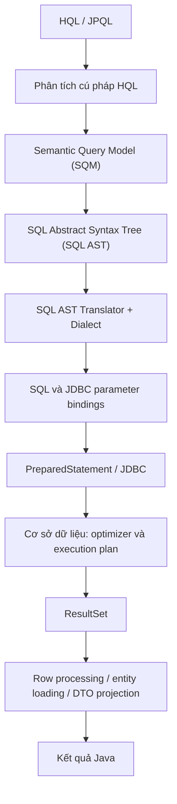
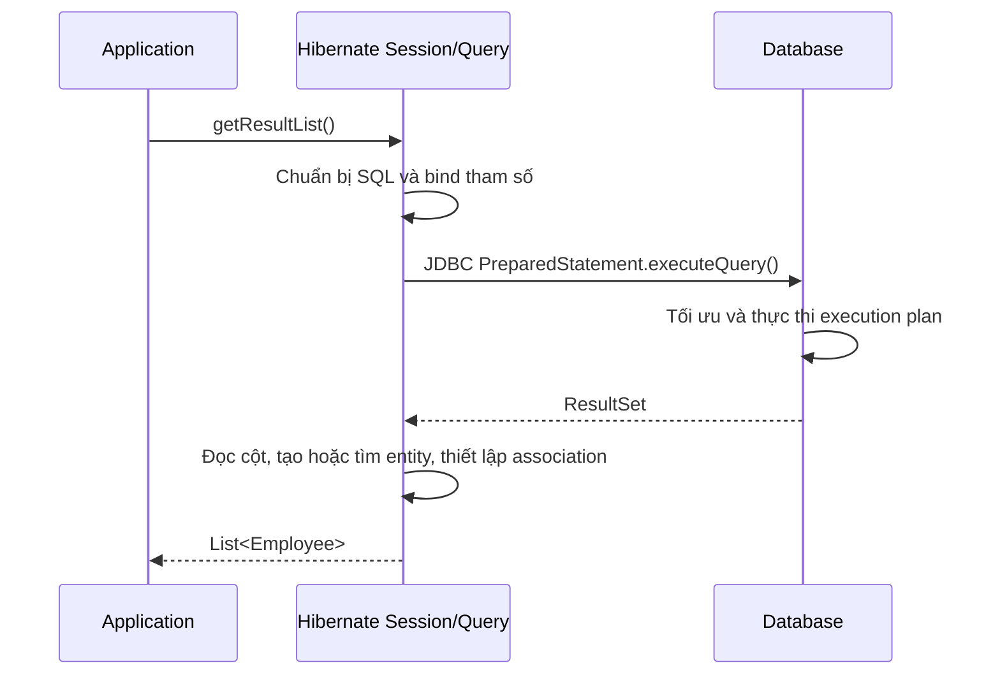
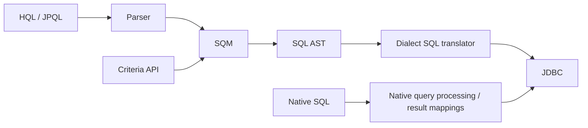

# Từ HQL đến mô hình truy vấn ngữ nghĩa, kế hoạch truy vấn và SQL

Trong kiến trúc Hibernate, câu HQL mà lập trình viên viết chỉ là **đầu vào ở mức mô hình đối tượng**. Hibernate phải hiểu câu truy vấn đó dựa trên các entity và ánh xạ ORM, chuyển nó sang một biểu diễn quan hệ phù hợp với cơ sở dữ liệu, tạo SQL theo dialect, truyền tham số qua JDBC và biến kết quả thành đối tượng Java hoặc dữ liệu vô hướng.

Chuỗi biến đổi cơ bản trong Hibernate ORM 6.x/7.x là:



Đây là các **tầng trách nhiệm** khác nhau. SQM diễn đạt *truy vấn có ý nghĩa gì* theo domain model; SQL AST mô tả *truy vấn đó cần những cấu trúc quan hệ nào*; SQL translator quyết định *cú pháp SQL cụ thể*; cuối cùng database optimizer quyết định *dùng chỉ mục, thứ tự join và thuật toán nào để thực thi*. Hiểu ranh giới này giúp giải thích tại sao cùng một HQL có thể sinh SQL khác nhau, tại sao `join fetch` thay đổi cách tải entity và tại sao SQL đúng cú pháp vẫn có thể chạy chậm.

## 1. HQL là ngôn ngữ truy vấn trên domain model

**Hibernate Query Language (HQL)** là ngôn ngữ truy vấn hướng đối tượng của Hibernate. JPQL (Jakarta Persistence Query Language) là tập chuẩn được Jakarta Persistence quy định; Hibernate hỗ trợ JPQL và mở rộng bằng nhiều tính năng HQL riêng. Khi ứng dụng dùng `Session.createSelectionQuery(...)` hoặc `EntityManager.createQuery(...)` với chuỗi HQL/JPQL, Hibernate không gửi nguyên chuỗi này cho cơ sở dữ liệu.

Xét hai entity dùng xuyên suốt bài học:

```java
import jakarta.persistence.*;
import java.math.BigDecimal;
import java.util.ArrayList;
import java.util.List;

@Entity
@Table(name = "departments")
public class Department {
    @Id
    @GeneratedValue(strategy = GenerationType.IDENTITY)
    private Long id;

    @Column(nullable = false)
    private String name;

    @OneToMany(mappedBy = "department")
    private List<Employee> employees = new ArrayList<>();

    protected Department() {}
    // Constructor nghiệp vụ, getters/setters được lược bớt.
}

@Entity
@Table(name = "employees")
public class Employee {
    @Id
    @GeneratedValue(strategy = GenerationType.IDENTITY)
    private Long id;

    @Column(nullable = false)
    private String name;

    @Column(nullable = false, precision = 15, scale = 2)
    private BigDecimal salary;

    @ManyToOne(fetch = FetchType.LAZY)
    @JoinColumn(name = "department_id")
    private Department department;

    protected Employee() {}
    // Constructor nghiệp vụ, getters/setters được lược bớt.
}
```

Giả sử chúng được ánh xạ tới hai bảng:

| Mô hình Java/HQL | Mô hình quan hệ/SQL |
|---|---|
| Entity `Employee` | Bảng `employees` |
| Entity `Department` | Bảng `departments` |
| `e.department` | Cột khóa ngoại `employees.department_id` |
| `d.name` | Cột `departments.name` |
| `d.employees` | Liên kết một-nhiều qua khóa ngoại của `employees` |
| `e.salary` | Cột `employees.salary` |

Một câu HQL hợp lệ:

```hql
select e
from Employee e
join e.department d
where d.name = :departmentName
  and e.salary >= :minimumSalary
order by e.salary desc
```

Các tên `Employee`, `department`, `name` và `salary` trong HQL là **tên entity và thuộc tính Java đã ánh xạ**, không phải tên bảng/cột vật lý. Chẳng hạn `join e.department d` yêu cầu Hibernate hiểu mối liên kết `@ManyToOne` rồi tự suy ra điều kiện join bằng metadata ánh xạ. Điều kiện `:departmentName` và `:minimumSalary` là tham số truy vấn, được liên kết với giá trị khi thực thi.

Có thể thực thi truy vấn bằng Hibernate `Session`:

```java
List<Employee> employees = session
    .createSelectionQuery("""
        select e
        from Employee e
        join e.department d
        where d.name = :departmentName
          and e.salary >= :minimumSalary
        order by e.salary desc
        """, Employee.class)
    .setParameter("departmentName", "Engineering")
    .setParameter("minimumSalary", new BigDecimal("25000000"))
    .getResultList();
```

Kết quả là `List<Employee>`. Hibernate chịu trách nhiệm tạo SQL và materialize dữ liệu trả về. `getResultList()` là thời điểm truy vấn được thực thi; việc tạo `Query` và gắn tham số chưa tự động đọc dữ liệu.

### Vì sao cần một tầng truy vấn ở mức đối tượng?

Nếu Hibernate thay tên entity thành tên bảng bằng một phép thay chuỗi đơn giản, nó sẽ không xử lý đúng các trường hợp như:

- Một entity ánh xạ qua nhiều bảng, phân cấp kế thừa, hoặc khóa chính nhiều cột.
- Một đường dẫn quan hệ `e.department.name` cần join trong SQL.
- Truy vấn polymorphic trên entity cha có thể cần điều kiện discriminator hoặc nhiều bảng.
- `join fetch` biểu thị yêu cầu nạp đồ thị đối tượng, không đơn thuần là join để lọc dữ liệu.
- Bộ lọc ánh xạ, điều kiện cho tenant, quy tắc xóa mềm hoặc mapping bổ sung có thể ảnh hưởng SQL.
- Dialect khác nhau có cú pháp phân trang, xử lý kiểu dữ liệu và hàm SQL khác nhau.

Hibernate vì vậy phân tích câu truy vấn thành các cấu trúc có ý nghĩa, rồi mới chuyển chúng thành cấu trúc quan hệ.

## 2. Giai đoạn phân tích cú pháp: từ chuỗi HQL đến cây cú pháp

Bước đầu tiên là **parsing**: Hibernate phân tích các token như `select`, `from`, `join`, dấu chấm, phép toán, tên định danh và tham số để xác định chúng có tuân thủ ngữ pháp HQL hay không.

Ví dụ:

```hql
select e from Employee e where e.salary >= :minimumSalary
```

Parser nhận ra đây là một truy vấn `select`, có một root `Employee e` và một predicate so sánh. Nó xây dựng cấu trúc cú pháp phục vụ các bước tiếp theo. Trong Hibernate 6+, lớp parser HQL được sinh từ ngữ pháp ANTLR; tên lớp nội bộ như `HqlParser` hoặc `SemanticQueryBuilder` hữu ích khi đọc source code và stack trace nhưng không phải API ứng dụng cần phụ thuộc.

**Lỗi cú pháp** xuất hiện khi cấu trúc câu HQL không tuân thủ ngữ pháp:

```hql
select from Employee e
where e.salary >
```

Câu này thiếu biểu thức cần thiết. Hibernate có thể báo lỗi trước khi gửi bất kỳ SQL nào.

Tuy vậy, một câu **đúng ngữ pháp** vẫn có thể **sai về ngữ nghĩa**:

```hql
select e
from Employee e
where e.unknownField = :value
```

Parser vẫn có thể nhận diện hình dạng câu truy vấn, nhưng `unknownField` không nằm trong ánh xạ của `Employee`. Đây là lỗi phải được phát hiện khi kiểm tra domain model.

## 3. Semantic Query Model (SQM): hiểu ý nghĩa của HQL

Sau parsing, Hibernate xây dựng **Semantic Query Model (SQM)**, một cây truy vấn có kiểu dữ liệu và gắn với metadata entity. SQM là một mô hình trung gian trung tâm của Hibernate hiện đại.

Đối với ví dụ `select e from Employee e join e.department d ...`, SQM biểu diễn những khái niệm như:

- Đây là truy vấn `select`; phần `from` có root của entity `Employee`, alias `e`.
- `join e.department d` là phép join qua một association đã ánh xạ tới `Department`.
- `d.name` là một đường dẫn có kiểu `String`; `e.salary` có kiểu `BigDecimal`.
- `:departmentName` được dùng trong ngữ cảnh so sánh với `String`; `:minimumSalary` ở ngữ cảnh so sánh với `BigDecimal`.
- Phần `select` trả về entity `Employee`; `order by` sắp xếp theo thuộc tính `salary` giảm dần.

Một hình dung rút gọn (không phải kết quả `toString()` thực tế của Hibernate):

```text
SqmSelectStatement<Employee>
├── selection: SqmRoot<Employee> (e)
├── from:
│   └── root: Employee (e)
│       └── join: e.department -> Department (d)
├── where:
│   └── AND
│       ├── d.name = :departmentName
│       └── e.salary >= :minimumSalary
└── order by: e.salary DESC
```

SQM trả lời câu hỏi: **“Người viết truy vấn đang yêu cầu điều gì trên mô hình Java?”**

### SQM lấy thông tin ngữ nghĩa từ đâu?

Hibernate sử dụng metadata được xây dựng lúc khởi tạo `SessionFactory`, bao gồm tên entity, kiểu thuộc tính, các association, khóa chính, cách ánh xạ thuộc tính xuống cột, chiến lược kế thừa và các quy tắc ánh xạ liên quan.

Nhờ metadata này, Hibernate có thể:

1. **Phân giải tên và đường dẫn.** `Employee` phải là entity được biết đến; `e.department` phải là thuộc tính hợp lệ của entity đó.
2. **Kiểm tra và suy luận kiểu.** Một phép so sánh phải có kiểu phù hợp; các tham số HQL có thể được suy luận kiểu từ ngữ cảnh.
3. **Gắn ngữ nghĩa cho join.** Join qua một association khác với việc ghép hai bảng theo điều kiện viết tay.
4. **Biểu diễn selection.** Kết quả có thể là entity, scalar, tuple, aggregate hoặc DTO projection.
5. **Bảo toàn tính đa hình.** Truy vấn entity cha có thể bao gồm các entity con tùy theo mapping và câu HQL.

Chẳng hạn, với mapping ở trên:

```hql
select e
from Employee e
where e.department.name = :name
```

Biểu thức `e.department.name` là một phép điều hướng association. Hibernate có thể tạo **implicit join** khi chuyển sang SQL. Người viết HQL không bắt buộc phải tự diễn đạt điều kiện `e.department_id = d.id`.

Ngược lại, biểu thức:

```hql
select e
from Employee e
where e.department = :department
```

so sánh **association tới entity**. Hibernate thường có thể chuyển điều kiện này thành so sánh khóa ngoại với định danh của `Department` mà không cần join bảng `departments`, vì chỉ cần biết khóa định danh của entity đích.

> **Chú ý:** SQM không phải SQL AST và cũng không phải cây kế hoạch thực thi của database. SQM bám theo entity/thuộc tính; việc chọn cấu trúc bảng, join và SQL nằm ở các bước sau.

## 4. Chuyển SQM sang SQL AST: từ domain model sang mô hình quan hệ

Ở giai đoạn tiếp theo, Hibernate đi qua cây SQM và xây dựng **SQL Abstract Syntax Tree (SQL AST)**. Trong Hibernate 6+, thành phần nội bộ thường được nhắc tới là bộ chuyển đổi SQM-to-SQL-AST, chẳng hạn `BaseSqmToSqlAstConverter`.

SQL AST biểu diễn truy vấn theo các khái niệm quan hệ: bảng, tham chiếu bảng, nhóm bảng, phép join, biểu thức cột, predicate, projection, grouping, ordering và các phần tử tham số JDBC. Đây là một cây cấu trúc SQL **trước khi** được render thành chuỗi SQL của một hệ quản trị cụ thể.

Với truy vấn ban đầu, quá trình chuyển đổi cần xử lý ít nhất bốn việc:

**Một là ánh xạ từ entity sang bảng.** Root `Employee` dẫn đến bảng `employees`; join `e.department` dẫn đến bảng `departments`. Nếu entity dùng `JOINED` inheritance, secondary table hoặc composite key, phần ánh xạ này có thể phức tạp hơn.

**Hai là tạo điều kiện join.** `@JoinColumn(name = "department_id")` cùng khóa chính của `Department` cung cấp quan hệ tương đương:

```sql
employees.department_id = departments.id
```

**Ba là tạo các biểu thức cột.** `d.name` chuyển thành cột `departments.name`; `e.salary` chuyển thành `employees.salary`. Selection `e` phải bao gồm những cột cần thiết để dựng `Employee`, không chỉ riêng thuộc tính xuất hiện trong `where`.

**Bốn là xác định biểu diễn tham số SQL.** Các named parameter HQL như `:departmentName` thường trở thành placeholder JDBC `?` trong SQL, kèm thông tin kiểu và cách bind. Một tham số HQL có thể tương ứng với nhiều JDBC placeholder trong trường hợp tuple hoặc tham số danh sách.

Có thể hình dung SQL AST rút gọn:

```text
SelectStatement
├── querySpecification
│   ├── selectClause: Employee columns
│   ├── fromClause
│   │   └── TableGroup(employees e)
│   │       └── TableGroupJoin(departments d)
│   │           └── predicate: e.department_id = d.id
│   ├── whereClause
│   │   └── d.name = JdbcParameter
│   │       AND e.salary >= JdbcParameter
│   └── orderByClause: e.salary DESC
└── result mapping: selected columns -> Employee
```

Cây trên minh họa tư duy về các node; Hibernate có hệ thống lớp SQL AST nội bộ riêng, và hình dạng thực tế phụ thuộc mapping, cấu hình cũng như phiên bản.

### HQL, SQM và SQL AST: phân biệt nhanh

| Đặc điểm | HQL | SQM | SQL AST |
|---|---|---|---|
| Dạng biểu diễn | Chuỗi ngôn ngữ truy vấn | Cây ngữ nghĩa hướng entity | Cây cấu trúc quan hệ |
| Trừu tượng chính | `Employee`, `e.department` | Entity root, path, association, kiểu | Table group, column, join, predicate |
| Hiểu tên bảng/cột vật lý? | Thường không cần | Dựa trên domain mapping | Có thể hiện thực hóa mapping quan hệ |
| Gắn với database dialect? | Ít | Ít | Được translator diễn giải theo dialect |
| Vai trò | Nói **muốn dữ liệu gì** | Xác thực và biểu diễn **ý nghĩa** | Chuẩn bị **cấu trúc SQL** |

## 5. SQL AST Translator, dialect và câu SQL cuối cùng

Hibernate dùng **SQL AST Translator** để biến SQL AST thành chuỗi SQL cụ thể. `Dialect` cung cấp sự khác biệt giữa PostgreSQL, MySQL, SQL Server, Oracle và các hệ quản trị khác.

Với một schema thông thường, SQL *minh họa* cho truy vấn ban đầu có thể là:

```sql
select
    e.id,
    e.name,
    e.salary,
    e.department_id
from employees e
join departments d
    on e.department_id = d.id
where d.name = ?
  and e.salary >= ?
order by e.salary desc
```

Đây là SQL diễn giải, **không phải cam kết Hibernate sẽ tạo chính xác chuỗi trên**. Alias, thứ tự cột, điều kiện bổ sung, cách sinh placeholder và số lượng join có thể thay đổi theo mapping, phiên bản Hibernate, dialect, filter và cấu hình.

Tại sao dialect quan trọng? Cùng một yêu cầu giới hạn 10 dòng có thể được diễn đạt bằng `limit ?`, `fetch first ? rows only` hoặc hình thức khác tùy database, dialect và ngữ cảnh truy vấn. Hibernate cũng phải xử lý sự khác biệt về hàm SQL, kiểu dữ liệu, khóa, phân trang và một số cấu trúc truy vấn nâng cao.

`setMaxResults(10)` ở API Java biểu đạt mong muốn giới hạn kết quả. Việc giới hạn đó được đưa xuống SQL bằng cách nào do tầng dịch SQL quyết định; đặc biệt, một số dạng fetch collection khiến việc phân trang tại database không thể áp dụng theo cách thông thường.

### SQL được thực thi cùng parameter bindings

Tham số `:departmentName` và `:minimumSalary` không nên được thay bằng cách nối chuỗi SQL thủ công. Hibernate/JDBC sử dụng tham số có kiểu:

```text
HQL:   d.name = :departmentName AND e.salary >= :minimumSalary
Java:  "Engineering"             BigDecimal("25000000")
SQL:   d.name = ?                 AND e.salary >= ?
Bind:  String "Engineering"       DECIMAL 25000000
```

Hình thức này tách cấu trúc truy vấn và dữ liệu, giúp kiểm soát kiểu dữ liệu và giảm nguy cơ SQL injection. Khi có cấu trúc động như tên cột trong `order by`, hãy chọn từ các tên thuộc tính được cho phép thay vì ghép trực tiếp input người dùng vào HQL.

## 6. “Kế hoạch truy vấn” trong Hibernate có nghĩa là gì?

Từ **query plan** dễ gây nhầm lẫn vì có ít nhất ba lớp khái niệm khác nhau:

| Tầng | Mục đích | Ai quản lý? |
|---|---|---|
| **Diễn giải/kế hoạch truy vấn Hibernate** | Lưu và tái dùng phần công việc phân tích, mô hình hóa hoặc chuẩn bị thực thi HQL/SQM khi phù hợp | Hibernate |
| **SQL AST và kế hoạch thực thi JDBC** | Biểu diễn SQL, tham số, kết quả và công việc cần thiết để gọi JDBC | Hibernate |
| **Execution plan của database** | Chọn index scan hay table scan, thuật toán join, thứ tự join, sort, aggregate, chi phí dự đoán | Database optimizer |

Các tên lớp có chứa `QueryPlan` hoặc `JdbcOperation` trong mã nguồn Hibernate chỉ nói tới các đối tượng quản lý truy vấn của **Hibernate**. Chúng **không** phải `EXPLAIN PLAN` của database.

### 6.1. Kế hoạch ở phía Hibernate

Khi chạy một HQL nhiều lần với các giá trị tham số khác nhau:

```java
var query = session.createSelectionQuery("""
    select e from Employee e where e.salary >= :min
    """, Employee.class);

query.setParameter("min", new BigDecimal("20000000"));
List<Employee> first = query.getResultList();

query.setParameter("min", new BigDecimal("30000000"));
List<Employee> second = query.getResultList();
```

Hibernate có thể tái sử dụng các thông tin đã phân tích hoặc chuẩn bị thay vì lặp toàn bộ quá trình từ đầu cho mọi lần chạy. Hibernate cung cấp cơ chế **query interpretation / query plan cache** để phục vụ việc này.

Lưu ý phạm vi tái sử dụng phụ thuộc phiên bản, query shape, tham số, query options, fetch configuration, filter và những điều kiện khác. Ví dụ `where e.id in :ids` với tập giá trị dài ngắn khác nhau có thể cần số lượng placeholder khác nhau; số SQL/JDBC operation được tạo không nhất thiết giống nhau.

**Plan cache của Hibernate không chứa dữ liệu kết quả.** Nếu lệnh chạy hai lần, database nhìn chung vẫn được truy vấn hai lần, trừ khi có cơ chế cache dữ liệu phù hợp và được bật riêng.

### 6.2. Kế hoạch ở phía database

Sau khi nhận SQL và các tham số, database tối ưu truy vấn dựa trên schema, index, statistics và các ước tính chi phí. Ví dụ với:

```sql
select e.id, e.name
from employees e
where e.department_id = ?
order by e.salary desc
```

Database có thể cân nhắc quét toàn bảng và sort, quét index rồi đọc các dòng tương ứng, hoặc những chiến lược khác. Với một câu join, nó còn có thể chọn nested loop, hash join, merge join hoặc đổi thứ tự join khi phép biến đổi là hợp lệ.

Đó mới là **execution plan** mà `EXPLAIN` hoặc `EXPLAIN ANALYZE` của database giúp quan sát. SQL được Hibernate sinh ra là **đầu vào** cho optimizer; Hibernate không kiểm soát trực tiếp từng bước thực thi của database.

Cần phân biệt `EXPLAIN` (ước tính, tùy hệ quản trị) và `EXPLAIN ANALYZE` (có thể **thực thi truy vấn thật** để ghi số liệu thực tế). Với truy vấn ghi dữ liệu, cần hiểu rõ hành vi của hệ quản trị và phạm vi transaction trước khi dùng chế độ phân tích có thực thi.

### 6.3. Ba loại cache không tương đương

| Cache | Lưu gì? | Tác động |
|---|---|---|
| Hibernate query plan/interpretation cache | Biểu diễn và công việc chuẩn bị truy vấn | Giảm chi phí phía Hibernate |
| Database statement/plan cache | Kế hoạch SQL đã chuẩn bị, tùy cơ chế database/driver | Có thể giảm chi phí tối ưu SQL |
| Hibernate query result cache (nếu bật và cấu hình) | Thông tin kết quả truy vấn để phục vụ lần đọc sau | Có thể giảm truy vấn dữ liệu trong điều kiện phù hợp |

Ngoài ra còn có **first-level cache** (persistence context theo `Session`) và **second-level cache** (tùy cấu hình). Chúng chủ yếu liên quan đến identity và dữ liệu entity, không đồng nghĩa với việc cache một câu HQL hay một database execution plan.

## 7. Thực thi qua JDBC và dựng kết quả Java

Khi SQL và parameter bindings đã sẵn sàng, Hibernate thực thi qua JDBC, thông thường bằng `PreparedStatement`. Ở đường đi select, các thành phần nội bộ của Hibernate 6+ như `JdbcSelectExecutor`, `JdbcValues`, row reader/initializer và bộ quản lý persistence context phối hợp để xử lý `ResultSet`.



Quá trình đọc `ResultSet` không đơn giản là gọi `new Employee()` cho từng dòng. Đối với entity result, Hibernate còn phải xét:

- **Identity:** định danh của entity là khóa logic để tìm thực thể đã được quản lý trong persistence context.
- **Hydration và initialization:** đọc và chuyển giá trị JDBC sang kiểu Java; điền thuộc tính và association theo mapping.
- **Persistence context:** nếu entity với cùng identity đã có trong `Session`, Hibernate giữ quy tắc một đối tượng được quản lý cho mỗi identity trong ngữ cảnh đó.
- **Fetch strategy:** xác định association nào đã được nạp từ truy vấn, association nào có thể được nạp sau.
- **Dirty checking:** với entity được quản lý, Hibernate duy trì thông tin cần thiết để phát hiện thay đổi khi flush, theo cơ chế và cấu hình thích hợp.

Nếu `select` chỉ trả về scalar hoặc DTO, Hibernate không nhất thiết tạo entity được quản lý. Chẳng hạn:

```hql
select e.name, e.salary
from Employee e
where e.department.name = :name
```

Kết quả có thể được lấy dưới dạng `Object[]`/`Tuple` hoặc projection khác phù hợp với API truy vấn. Nó khác với `select e`, nơi Hibernate cần dựng `Employee` và quản lý identity.

### Projection vào DTO

Với record Java:

```java
public record EmployeeSummary(
    String name,
    BigDecimal salary
) {}
```

Có thể truy vấn:

```java
List<EmployeeSummary> result = session
    .createSelectionQuery("""
        select new com.example.EmployeeSummary(e.name, e.salary)
        from Employee e
        where e.department.name = :name
        """, EmployeeSummary.class)
    .setParameter("name", "Engineering")
    .getResultList();
```

Tên lớp trong biểu thức `new` phải là tên đầy đủ của lớp DTO thực tế trong dự án. Hibernate chọn các cột cần cho constructor và tạo record/DTO từ dữ liệu; các DTO này không tự động trở thành managed entity. Vì vậy DTO projection thường phù hợp khi chỉ cần hiển thị vài trường và không chỉnh sửa entity.

## 8. Một HQL, nhiều cách tạo SQL: join và fetch

Hai câu sau trông gần giống nhau nhưng có **mục đích tải dữ liệu khác nhau**.

**Join để lọc:**

```hql
select e
from Employee e
join e.department d
where d.name = :name
```

Hibernate dùng `departments` để lọc những `Employee` khớp điều kiện. Association `e.department` có được khởi tạo cùng lúc hay không phụ thuộc mapping, trạng thái persistence context và các fetch options. Riêng `join` không đưa ra yêu cầu fetch association.

**Join fetch để tải association:**

```hql
select e
from Employee e
join fetch e.department d
where d.name = :name
```

`join fetch` là chỉ thị tải `department` trong cùng truy vấn cùng với `Employee`. SQL thường phải chọn thêm cột của bảng `departments` để dựng đối tượng `Department`, dù HQL vẫn `select e`.

Ví dụ SQL minh họa cho câu thứ hai:

```sql
select
    e.id, e.name, e.salary, e.department_id,
    d.id, d.name
from employees e
join departments d
    on d.id = e.department_id
where d.name = ?
```

Trong SQM, fetch join chứa **ngữ nghĩa fetch**. Khi chuyển thành SQL AST và xử lý `ResultSet`, Hibernate cần phối hợp cả việc chọn cột và khởi tạo association. Nếu chỉ xem SQL có join mà không xem HQL fetch mode, ta có thể hiểu nhầm lý do Hibernate nạp dữ liệu.

### Fetch collection có thể làm nở số dòng

Ví dụ:

```hql
select d
from Department d
left join fetch d.employees
where d.name = :name
```

Một `Department` có 100 `Employee` có thể tạo tới 100 dòng SQL cho cùng một department. Hibernate 6+ có thể loại trùng entity gốc trong kết quả của truy vấn fetch join khi cần, nhưng **số dòng database trả về vẫn có thể tăng mạnh**.

Vì vậy, không nên xem `join fetch` cho collection là tối ưu vô điều kiện. Fetch cùng lúc nhiều collection hoặc collection lớn có thể dẫn tới bùng nổ dữ liệu join; với nhiều bag còn có các giới hạn riêng của Hibernate.

### Phân trang kết hợp collection fetch

Ví dụ cần thận trọng:

```java
session.createSelectionQuery("""
    select d from Department d
    left join fetch d.employees
    order by d.id
    """, Department.class)
    .setFirstResult(0)
    .setMaxResults(20)
    .getResultList();
```

Giới hạn 20 **dòng SQL** có thể cắt ngang collection của một department, khiến tập đối tượng không đầy đủ. Hibernate vì vậy có thể cảnh báo và áp dụng phân trang trong bộ nhớ khi collection fetch khiến phân trang SQL không an toàn. Điều này có thể rất tốn bộ nhớ và thời gian.

Có thể cấu hình `hibernate.query.fail_on_pagination_over_collection_fetch=true` để yêu cầu truy vấn dạng này thất bại thay vì âm thầm phân trang trong bộ nhớ. Một cách thiết kế phổ biến là lấy **trang ID của entity gốc** bằng truy vấn riêng, rồi fetch dữ liệu cần thiết theo danh sách ID; lựa chọn thực tế cần xem kích thước collection và mục tiêu hiển thị.

## 9. Implicit join, N+1 và tác động thực tế lên pipeline

### 9.1. Implicit join không phải chuỗi thay thế văn bản

Hai câu HQL thường biểu đạt việc lọc tương tự:

```hql
-- Điều hướng thuộc tính:
select e from Employee e
where e.department.name = :name
```

```hql
-- Join tường minh:
select e from Employee e
join e.department d
where d.name = :name
```

Hibernate có thể tạo join phù hợp cho đường dẫn `e.department.name` mà không cần người viết tự nêu điều kiện khóa ngoại. Các implicit join qua đường dẫn association thường mang ngữ nghĩa inner join; trong một số trường hợp chỉ cần ID, Hibernate có thể tối ưu bằng tham chiếu khóa ngoại. Nếu cần giữ cả bản ghi không có association, hãy suy nghĩ rõ về `left join` và điều kiện `where`.

Ví dụ:

```hql
select e
from Employee e
left join e.department d
where d.name = :name
```

Dù `left join`, predicate `where d.name = :name` cũng loại những dòng không có department, vì `NULL = :name` không đúng theo logic SQL ba giá trị. Để thật sự giữ cả những dòng đó, biểu thức lọc phải được thiết kế phù hợp.

### 9.2. Vì sao N+1 xảy ra ở sau bước truy vấn ban đầu?

Giả sử:

```java
List<Employee> employees = session.createSelectionQuery(
    "from Employee e", Employee.class
).getResultList();

for (Employee e : employees) {
    // Giả sử có getter getDepartment() và getName().
    System.out.println(e.getDepartment().getName());
}
```

HQL ban đầu chỉ truy vấn `Employee`. Nếu association `department` là lazy và chưa được tải, các lần truy cập sau đó có thể kích hoạt thêm truy vấn. Kết quả có thể là 1 truy vấn ban đầu cộng N truy vấn association, dù số truy vấn phụ thuộc entity dùng chung department, first-level cache, second-level cache và chiến lược batching.

Điểm cần hiểu: **N+1 không nhất thiết nằm trong một SQL sai**. Nó là hệ quả của *nhiều lần thực thi SQL* do quá trình truy cập object graph sau đó. Cách xử lý có thể gồm:

- `join fetch` khi thực sự cần association trong cùng truy vấn và cardinality phù hợp.
- Entity graph hoặc fetch profile thích hợp với use case.
- Batch fetching (ví dụ cấu hình `hibernate.default_batch_fetch_size`) hay subselect fetching cho trường hợp phù hợp.
- DTO projection khi màn hình chỉ cần một tập trường cụ thể.

Cần quan sát số lượng câu SQL thực tế để chọn biện pháp đúng; chỉ xem HQL ban đầu sẽ không thấy toàn bộ vấn đề.

## 10. HQL, Criteria API và native SQL đi vào pipeline thế nào?

Hibernate có nhiều điểm đầu vào truy vấn; chúng không hoàn toàn đi theo cùng đường.



**HQL/JPQL** đi qua parser rồi thành SQM. **Criteria API** là cách xây dựng truy vấn có cấu trúc bằng Java; trong Hibernate hiện đại, đường này cũng gắn với mô hình truy vấn ngữ nghĩa, nhưng không cần parse chuỗi HQL giống như khi tạo query từ text.

Ví dụ Criteria:

```java
CriteriaBuilder cb = session.getCriteriaBuilder();
CriteriaQuery<Employee> cq = cb.createQuery(Employee.class);
Root<Employee> root = cq.from(Employee.class);

cq.select(root)
  .where(cb.greaterThanOrEqualTo(
      root.get("salary"),
      new BigDecimal("25000000")
  ));

List<Employee> result = session.createQuery(cq).getResultList();
```

`root.get("salary")` là đường dẫn thuộc tính của entity, không phải tên cột SQL. Khi dùng static metamodel, có thể tăng tính an toàn kiểu và hỗ trợ refactor so với dùng chuỗi tên thuộc tính.

**Native SQL** lại là câu SQL do ứng dụng viết trực tiếp, ví dụ:

```java
List<?> rows = session.createNativeQuery(
    "select id, name from employees where salary >= :min",
    Object[].class
).setParameter("min", new BigDecimal("25000000"))
 .getResultList();
```

Đường native query không cần biến HQL thành SQM rồi SQL AST theo cùng quy trình. Hibernate vẫn phải quản lý tham số, JDBC và mapping kết quả; SQL native thường phụ thuộc database hơn và đòi hỏi lập trình viên tự chịu trách nhiệm về bảng, cột và đặc thù cú pháp.

**Lưu ý phiên bản:** Các tên lớp nội bộ, cách dịch Criteria, query-plan caching và hỗ trợ cú pháp native có thể thay đổi giữa các phiên bản Hibernate. Sơ đồ này mô tả luồng kiến trúc khái niệm, không khẳng định mọi truy vấn phải đi qua chính xác các lớp giống nhau.

## 11. Các trường hợp cho thấy thông tin ngữ nghĩa ảnh hưởng SQL

### 11.1. Truy vấn trả về entity khác truy vấn tổng hợp

```hql
select e
from Employee e
where e.salary >= :min
```

Hibernate cần các cột để dựng entity. Nhưng với:

```hql
select count(e)
from Employee e
where e.salary >= :min
```

SQL có thể rút gọn gần như:

```sql
select count(e.id)
from employees e
where e.salary >= ?
```

Hibernate không cần tạo danh sách `Employee` để tính `count`. SQM cho biết selection là aggregate vô hướng và result mapping sẽ đọc một số thay vì hydrate entity. Cách diễn đạt `count(*)` hay `count(id)` thực tế do bản dịch SQL quyết định.

### 11.2. Mỗi association có thể đòi hỏi cách join khác nhau

Với `@ManyToOne` như `Employee.department`, một hàng employee thường liên hệ tối đa một department. Join fetch association này thường không làm tăng số dòng gốc khi FK trỏ hợp lệ tới một hàng.

Ngược lại, với `@OneToMany` như `Department.employees`, join có thể nhân số dòng gốc theo số phần tử collection. Do đó cardinality của mapping ảnh hưởng trực tiếp đến hình dạng SQL, lượng dữ liệu đọc và cách Hibernate ghép kết quả.

### 11.3. Inheritance và polymorphic query

Ví dụ `Payment` là entity cha với các subclass `CardPayment` và `BankTransferPayment`. HQL:

```hql
select p from Payment p where p.amount > :min
```

có thể yêu cầu dữ liệu của các subtype theo chiến lược ánh xạ kế thừa:

- `SINGLE_TABLE`: thường dùng một bảng với discriminator.
- `JOINED`: có thể phải join nhiều bảng trong phân cấp.
- `TABLE_PER_CLASS`: có thể cần truy vấn dạng union hoặc biểu diễn quan hệ tương đương.

Một câu HQL không thay đổi, nhưng SQL có thể khác đáng kể theo mapping. Điều này cho thấy SQM mang ngữ nghĩa đa hình, còn SQL AST hiện thực hóa chiến lược ánh xạ quan hệ.

### 11.4. Parameter list và shape của SQL

HQL:

```hql
select e from Employee e where e.id in :employeeIds
```

Java:

```java
query.setParameterList("employeeIds", List.of(10L, 20L, 30L));
```

Một SQL minh họa có thể là:

```sql
select ...
from employees e
where e.id in (?, ?, ?)
```

Một tham số named list có thể mở rộng thành nhiều placeholder JDBC. Số placeholder và cách tối ưu phụ thuộc Hibernate, dialect, cấu hình padding và số phần tử thực tế. Đừng kết luận “cùng chuỗi HQL luôn sinh cùng chuỗi SQL”. Với danh sách rỗng, cần hiểu chính xác hành vi của phiên bản và thiết kế logic ứng dụng, nhất là khi điều kiện `IN`/`NOT IN` có ý nghĩa nghiệp vụ đặc biệt.

## 12. Quan sát từng tầng khi ứng dụng chạy

Nếu cần trả lời “Hibernate đã làm gì với HQL này?”, nên lần theo **một truy vấn cụ thể** từ HQL, SQL được phát ra, tham số, số lần chạy, tới kế hoạch thực thi database.

### 12.1. Bật SQL logging

Ví dụ cấu hình Logback:

```xml
<configuration>
    <logger name="org.hibernate.SQL" level="DEBUG"/>
    <logger name="org.hibernate.orm.jdbc.bind" level="TRACE"/>
    <root level="INFO">
        <appender-ref ref="CONSOLE"/>
    </root>
</configuration>
```

Trong một cấu hình Logback hoàn chỉnh, cần định nghĩa appender `CONSOLE` tương ứng hoặc dùng appender sẵn có của ứng dụng. Đoạn trên minh họa **tên logger và mức log**. Với Hibernate ORM 6+, `org.hibernate.SQL` ghi SQL còn `org.hibernate.orm.jdbc.bind` cho phép quan sát giá trị bind ở mức TRACE. Phiên bản cũ có thể dùng logger bind khác.

Không nên bật log tham số mức TRACE lâu dài ở production khi tham số có thể chứa dữ liệu nhạy cảm; dùng phạm vi và thời gian đủ để chẩn đoán.

### 12.2. Dùng StatementInspector để thấy SQL ngay trước JDBC

Hibernate cung cấp SPI `StatementInspector` để quan sát SQL trước khi gửi xuống JDBC:

```java
import org.hibernate.resource.jdbc.spi.StatementInspector;

public class QueryInspector implements StatementInspector {
    @Override
    public String inspect(String sql) {
        System.out.println("Hibernate SQL: " + sql);
        return sql;
    }
}
```

Có thể đăng ký qua cấu hình `hibernate.session_factory.statement_inspector` hoặc các API bootstrap tương ứng. `inspect` nhận **SQL đã render**; nó không cung cấp một bản dump công khai của toàn bộ cây SQM hoặc SQL AST. Cần đặc biệt tránh sửa SQL một cách tùy tiện vì thứ tự, kiểu và số lượng bind parameter phải còn khớp.

### 12.3. Hibernate Statistics

Khi bật `hibernate.generate_statistics=true`, API `SessionFactory.getStatistics()` có thể cung cấp các bộ đếm về truy vấn, truy cập entity, collection và cache. Đây là cách có ích để phát hiện dấu hiệu N+1 hoặc số câu SQL vượt kỳ vọng. Số liệu thống kê của Hibernate và số liệu performance/IO của database bổ sung cho nhau; chúng đo các tầng khác nhau.

### 12.4. Xem execution plan của database

Lấy **SQL thật** từ log, thay bind bằng cách thức thử nghiệm phù hợp với DBMS, rồi dùng công cụ như:

```sql
-- Ví dụ minh họa cú pháp PostgreSQL:
EXPLAIN (ANALYZE, BUFFERS)
select e.id, e.name, e.salary, e.department_id
from employees e
join departments d on d.id = e.department_id
where d.name = 'Engineering'
  and e.salary >= 25000000
order by e.salary desc;
```

Hãy đối chiếu:

- Số dòng database ước lượng với số dòng thực tế; nếu lệch lớn, statistics có thể không phản ánh phân bố dữ liệu.
- Phương án quét bảng hay index, phép join được chọn và chi phí sort.
- Số lượng dòng trung gian so với số object Java mong đợi, đặc biệt khi fetch collection.
- Tổng thời gian ở database so với thời gian truyền dữ liệu, hydrate entity và logic ứng dụng.

Ví dụ, có thể cân nhắc chỉ mục trên `employees(department_id, salary)` khi workload thường lọc theo department và salary. Tuy nhiên hiệu quả thực tế phụ thuộc thứ tự điều kiện, dữ liệu, selectivity, kiểu join, cách sắp xếp và database. **Không thể kết luận index nào tốt chỉ từ HQL**; cần đo trên hệ quản trị và tập dữ liệu phù hợp.

### 12.5. Đọc source Hibernate hoặc debug nội bộ

Khi cần học sâu kiến trúc Hibernate 6+, các khái niệm/lớp đáng tìm trong đúng source version đang chạy gồm:

| Khâu | Điểm định hướng trong source |
|---|---|
| HQL parsing | HQL grammar, `HqlParser` |
| HQL → SQM | `SemanticQueryBuilder`, các node `org.hibernate.query.sqm.tree.*` |
| SQM → SQL AST | `BaseSqmToSqlAstConverter` và các cấu trúc `org.hibernate.sql.ast.tree.*` |
| SQL AST → JDBC SQL | SQL AST translator, dialect, `JdbcOperation` |
| Thực thi select và đọc hàng | `JdbcSelectExecutor`, các thành phần `JdbcValues`/row processing |
| Cache diễn giải truy vấn | Query engine, query interpretation cache, query plan interfaces |

Đây là **API nội bộ/SPI**, không phải hợp đồng ổn định cho code nghiệp vụ. Tên class, phạm vi cache và điểm mở rộng có thể đổi giữa phiên bản nhỏ hoặc lớn. Để quan sát ứng dụng, SQL logging và database `EXPLAIN` thường là điểm bắt đầu trực tiếp hơn.

## 13. Một quy trình phân tích hiệu năng từ HQL đến database

Giả sử màn hình cần 20 nhân viên thuộc bộ phận Engineering, sắp theo lương giảm dần và hiện tên bộ phận.

**Bước 1 — Diễn đạt đúng nhu cầu ở HQL.** Nếu muốn các entity `Employee` và thông tin `Department`:

```hql
select e
from Employee e
join fetch e.department d
where d.name = :name
order by e.salary desc, e.id desc
```

Join fetch to-one cho phép nạp thông tin bộ phận cùng lúc. Thêm `e.id` làm tie-breaker giúp thứ tự ổn định khi nhiều nhân viên trùng lương.

**Bước 2 — Dùng API phân trang.**

```java
List<Employee> page = session.createSelectionQuery("""
        select e
        from Employee e
        join fetch e.department d
        where d.name = :name
        order by e.salary desc, e.id desc
        """, Employee.class)
    .setParameter("name", "Engineering")
    .setMaxResults(20)
    .getResultList();
```

Ở đây `department` là association to-one. Rủi ro phân trang in-memory do **fetch collection** không áp dụng theo cùng cách cho association này. SQL phân trang thật sự vẫn phải được quan sát trên môi trường chạy.

**Bước 3 — Quan sát SQL.** Kiểm tra SQL có join đúng hai bảng, bind đúng tên bộ phận, sắp xếp theo hai cột và giới hạn số hàng theo dialect. Không dựa vào một chuỗi SQL dự đoán để khẳng định hành vi của Hibernate.

**Bước 4 — Đo SQL và database plan.** Nếu SQL chỉ chạy một lần nhưng chậm, kiểm tra execution plan, index và số hàng phải xử lý. Nếu SQL nhanh mà phần Java chậm, quan sát số hàng trả về, hydration, object graph hoặc logic sau truy vấn.

**Bước 5 — Xác nhận số truy vấn khi truy cập association.** Nếu sau khi trả danh sách, giao diện truy cập `e.getDepartment().getName()` mà không sinh truy vấn thứ cấp, fetch strategy đang phục vụ nhu cầu này. Nếu còn các association khác bị truy cập theo từng phần tử, N+1 có thể nằm ở những đường dẫn khác.

**Bước 6 — Chọn projection theo mục tiêu.** Nếu màn hình chỉ đọc tên nhân viên, lương và tên bộ phận, DTO projection có thể giảm số cột và tránh quản lý nhiều entity không cần thiết:

```java
public record EmployeeCard(String employeeName,
                           BigDecimal salary,
                           String departmentName) {}

List<EmployeeCard> cards = session.createSelectionQuery("""
    select new com.example.EmployeeCard(e.name, e.salary, d.name)
    from Employee e
    join e.department d
    where d.name = :name
    order by e.salary desc, e.id desc
    """, EmployeeCard.class)
    .setParameter("name", "Engineering")
    .setMaxResults(20)
    .getResultList();
```

Hai cách đều hợp lệ nhưng có semantics khác nhau: một cách lấy entity đã quản lý và fetch association; cách kia trả DTO chỉ đọc.

## 14. Những nhầm lẫn thường gặp

| Nhận định | Cách hiểu chính xác |
|---|---|
| “HQL là SQL có tên bảng viết bằng tên lớp.” | HQL chứa ngữ nghĩa entity, association, polymorphism và fetch; Hibernate không dịch bằng thay tên văn bản. |
| “SQM chính là SQL AST.” | SQM nói về domain model; SQL AST nói về bảng, cột và cấu trúc SQL quan hệ. |
| “Hibernate query plan là kế hoạch `EXPLAIN`.” | Hibernate plan/interpretation cache phục vụ chuẩn bị truy vấn; database optimizer tạo execution plan của SQL. |
| “Có `join` thì association đã được fetch.” | Join thường chỉ phục vụ lọc/biểu diễn truy vấn; `join fetch` mới chỉ thị nạp association qua truy vấn. |
| “Một HQL luôn cho ra một SQL giống hệt.” | SQL phụ thuộc dialect, mapping, query options, tham số, filters, fetch và phiên bản. |
| “Plan cache sẽ trả lại kết quả lần trước.” | Plan cache và query result cache là hai khái niệm khác nhau. |
| “SQL chạy một lần thì không thể bị N+1.” | N+1 có thể phát sinh sau lần truy vấn đầu khi mã Java truy cập lazy associations. |
| “`distinct` chữa được chi phí join collection.” | Loại trùng kết quả không loại bỏ lượng dòng trung gian mà SQL có thể cần truyền và xử lý. |
| “Tối ưu HQL là đủ để query nhanh.” | Cần xét SQL thật, execution plan, index, cardinality, số round trip và chi phí dựng object. |

## 15. Ghi nhớ kiến trúc bằng một câu truy vấn

Hãy trở lại:

```hql
select e
from Employee e
join e.department d
where d.name = :departmentName
  and e.salary >= :minimumSalary
order by e.salary desc
```

- **HQL:** Lấy những `Employee` thuộc phòng ban có tên phù hợp và lương đạt ngưỡng, sắp theo lương giảm dần.
- **Parser:** Xác nhận cú pháp của câu và dựng cấu trúc đầu vào.
- **SQM:** Xác định `Employee`, `Department`, association `department`, các kiểu thuộc tính, predicate và kiểu kết quả; từ đây truy vấn có ý nghĩa trên domain model.
- **SQL AST:** Chuyển nghĩa của entity và association thành bảng, cột, join, predicate, selection và thứ tự sắp xếp.
- **SQL Translator/Dialect:** Render câu SQL hợp lệ cho hệ quản trị hiện tại cùng vị trí bind tham số.
- **Hibernate query/JDBC plan:** Chuẩn bị công việc thực thi, binding và mapping kết quả; có thể tái sử dụng phần công việc đã chuẩn bị khi phù hợp.
- **Database execution plan:** Database tự chọn chiến lược quét dữ liệu, join và sort để chạy SQL nhận được.
- **Result processing:** Hibernate đọc JDBC `ResultSet`, dựng hoặc tìm `Employee` trong persistence context và trả kết quả Java.

Mô hình tư duy bền vững là: **HQL mô tả ý định trên entity → SQM xác định ngữ nghĩa → SQL AST biểu diễn quan hệ → dialect sinh SQL → database quyết định cách chạy → Hibernate dựng kết quả Java.** Khi một truy vấn sai hoặc chậm, xác định nó vướng ở tầng nào trước khi thay đổi HQL, mapping, fetch strategy hay chỉ mục.
