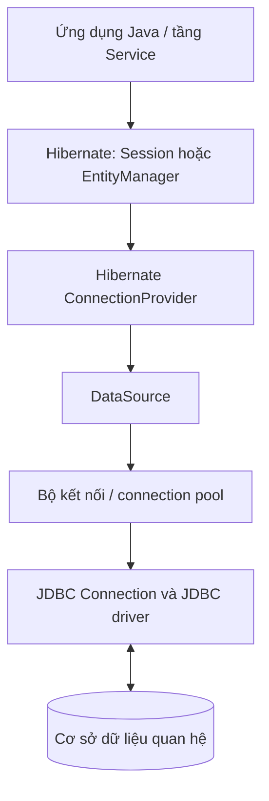

# Vai trò của `DataSource`, bộ kết nối và JDBC driver trong kiến trúc Hibernate

Hibernate là một framework ORM (*Object–Relational Mapping*) giúp ứng dụng Java thao tác với dữ liệu quan hệ thông qua các đối tượng, thay vì phải tự viết toàn bộ mã JDBC cho từng thao tác. Tuy nhiên, cuối cùng Hibernate vẫn cần gửi câu lệnh SQL đến hệ quản trị cơ sở dữ liệu (DBMS). Ba thành phần có vai trò đặc biệt quan trọng trên đường đi đó là **`DataSource`**, **bộ quản lý kết nối (connection pool)** và **JDBC driver**.

Hiểu ranh giới trách nhiệm giữa ba thành phần giúp cấu hình Hibernate đúng cách, quản lý giao dịch an toàn, tối ưu hiệu năng và tìm nguyên nhân khi ứng dụng gặp lỗi kết nối.

## 1. Vị trí của các thành phần trong kiến trúc Hibernate

Một ứng dụng sử dụng Hibernate thường có luồng xử lý như sau:



Sơ đồ biểu diễn cách triển khai phổ biến khi `DataSource` được hỗ trợ bởi một connection pool. Trong thực tế, **pool thường nằm ngay bên trong một lớp triển khai `DataSource`** (ví dụ `HikariDataSource`), nên hai ô `DataSource` và pool không nhất thiết là hai đối tượng tách biệt. Cũng có cấu hình Hibernate lấy kết nối trực tiếp mà không dùng `DataSource` hoặc pool.

Một cách phân biệt ngắn gọn:

| Thành phần | Trách nhiệm chính | Ví dụ |
|---|---|---|
| Hibernate (`Session`, `EntityManager`) | Theo dõi entity, chuyển thao tác trên đối tượng thành SQL, phối hợp giao dịch | `session.persist(customer)` |
| `ConnectionProvider` của Hibernate | Cấp và thu hồi `java.sql.Connection` cho Hibernate thông qua cơ chế kết nối đã cấu hình | Một provider sử dụng `DataSource` |
| `DataSource` | Cung cấp kết nối đến cơ sở dữ liệu qua `getConnection()` | `HikariDataSource`, `PGSimpleDataSource` |
| Connection pool | Duy trì và tái sử dụng các kết nối vật lý, giới hạn số kết nối đang sử dụng | HikariCP, Apache DBCP, Agroal |
| JDBC driver | Hiện thực JDBC API và giao tiếp theo giao thức của hệ quản trị CSDL | `org.postgresql.Driver`, `com.mysql.cj.jdbc.Driver` |
| DBMS | Thực thi SQL, kiểm soát dữ liệu, khóa, chỉ mục và giao dịch | PostgreSQL, MySQL, Oracle |

`ConnectionProvider` là lớp tích hợp thuộc cơ chế dịch vụ của Hibernate; mã nghiệp vụ thông thường không cần gọi trực tiếp nó. Khi làm việc với JPA, lập trình viên thường dùng `EntityManager`; với API gốc của Hibernate, thường dùng `Session`.

## 2. `DataSource`: điểm cung cấp kết nối cho ứng dụng

### 2.1. `DataSource` là gì?

`javax.sql.DataSource` là một interface chuẩn của Java để lấy kết nối JDBC. Phương thức được sử dụng nhiều nhất là:

```java
Connection connection = dataSource.getConnection();
```

Một `DataSource` có thể được cấu hình với URL, tên người dùng, mật khẩu và các thuộc tính kết nối. Nó có thể cấp kết nối bằng cách tạo kết nối vật lý mới hoặc mượn một kết nối sẵn có từ pool, tùy lớp triển khai.

`DataSource` **không phải là Hibernate** và cũng **không phải JDBC driver**. Đây là một cách chuẩn để các framework như Hibernate, Spring và các thành phần truy cập dữ liệu cùng lấy kết nối mà không phụ thuộc vào chi tiết tạo kết nối.

### 2.2. Vì sao Hibernate nên dùng `DataSource`?

Sử dụng `DataSource` mang lại một số lợi ích:

- **Tách cấu hình khỏi logic ORM:** Hibernate không cần quản lý trực tiếp chuỗi kết nối, thông tin đăng nhập hoặc cách tạo kết nối vật lý.
- **Tích hợp với môi trường chạy:** Framework hoặc application server có thể tạo và quản lý `DataSource`, rồi cung cấp nó cho Hibernate.
- **Hỗ trợ pool:** Một `DataSource` triển khai bởi pool có thể cấp kết nối nhanh bằng cách tái sử dụng kết nối đã mở.
- **Thuận tiện đổi môi trường:** Có thể đổi cơ sở dữ liệu hoặc thông tin kết nối qua cấu hình mà ít ảnh hưởng đến mã xử lý entity.
- **Hỗ trợ giám sát và chính sách kết nối:** Tùy triển khai, có thể theo dõi số kết nối đang dùng, thời gian chờ và trạng thái kết nối.

Ví dụ: cùng một đoạn gọi `entityManager.find(Customer.class, id)` có thể hoạt động với các cấu hình `DataSource` khác nhau cho môi trường phát triển, kiểm thử và triển khai thực tế.

### 2.3. Phân biệt `DataSource` và `DriverManager`

JDBC cung cấp cả hai cách lấy kết nối phổ biến:

```java
// Tạo kết nối thông qua DriverManager
Connection c1 = DriverManager.getConnection(
        "jdbc:postgresql://localhost:5432/shop",
        username,
        password
);

// Lấy kết nối thông qua DataSource đã được cấu hình
Connection c2 = dataSource.getConnection();
```

`DriverManager` chọn JDBC driver thích hợp để mở kết nối theo JDBC URL. `DataSource` ẩn cách tạo hoặc mượn kết nối sau một interface, có thể tích hợp pooling và cấu hình từ môi trường. Một `DataSource` không có pool vẫn hoàn toàn hợp lệ; việc gọi `getConnection()` **không tự động đồng nghĩa** với có tái sử dụng kết nối.

Trong các ứng dụng Hibernate chạy lâu dài và có nhiều yêu cầu đồng thời, `DataSource` kết hợp connection pool là lựa chọn phổ biến.

## 3. Connection pool: quản lý vòng đời và tái sử dụng kết nối

### 3.1. Vì sao không tạo kết nối mới cho mỗi truy vấn?

Mở một kết nối vật lý đến DBMS có thể cần thiết lập socket, bắt tay theo giao thức, xác thực và khởi tạo trạng thái phiên. Nếu mỗi lần thực hiện SQL đều tạo rồi đóng kết nối vật lý, ứng dụng sẽ chịu thêm độ trễ và tạo áp lực lên DBMS.

**Connection pool** duy trì một nhóm kết nối vật lý có thể dùng lại. Khi Hibernate cần làm việc với DBMS:

1. Hibernate yêu cầu một `Connection` từ cơ chế cung cấp kết nối.
2. Pool giao cho Hibernate một kết nối khả dụng hoặc cho yêu cầu chờ nếu các kết nối đang bận.
3. Hibernate sử dụng kết nối này để thực hiện SQL trong phạm vi cần thiết.
4. Khi Hibernate giải phóng kết nối, lời gọi `close()` trên kết nối do pool cấp thường **trả kết nối về pool**, thay vì đóng ngay socket vật lý.
5. Pool tiếp tục giữ, kiểm tra hoặc thay thế kết nối theo cấu hình và trạng thái thực tế.

```text
                  Connection pool
              ┌─────────────────────┐
Yêu cầu A ────>│ Connection #1: bận  │
Yêu cầu B ────>│ Connection #2: bận  │───> PostgreSQL / MySQL / ...
              │ Connection #3: rỗi  │
              └─────────────────────┘
                  ↑          │
                  └─ trả / mượn ─┘
```

Ở đây, “kết nối” mà mã Java nhận được có thể là một đối tượng bao (*wrapper/proxy*) do pool quản lý. Về mặt khái niệm cần phân biệt **kết nối logic đang được mượn** với **kết nối vật lý tới DBMS**.

### 3.2. Một số tham số quan trọng

| Tham số (tên minh họa theo HikariCP) | Ý nghĩa | Ảnh hưởng khi cấu hình chưa phù hợp |
|---|---|---|
| `maximumPoolSize` | Giới hạn số kết nối của pool | Quá thấp có thể gây chờ; quá cao có thể gây quá tải DBMS |
| `minimumIdle` | Số kết nối rỗi tối thiểu mà pool cố duy trì | Tăng mức sẵn sàng nhưng có thể giữ thêm tài nguyên |
| `connectionTimeout` | Thời gian tối đa chờ mượn kết nối | Hết thời gian sẽ phát sinh lỗi timeout khi không có kết nối khả dụng |
| `idleTimeout` | Thời gian trước khi kết nối rỗi có thể được thu hồi, tùy điều kiện của pool | Tác động đến mức sử dụng tài nguyên khi tải thấp |
| `maxLifetime` | Thời gian sống tối đa của kết nối vật lý trong pool | Hỗ trợ thay kết nối định kỳ, cần phối hợp với chính sách phía DBMS và hạ tầng |

Không có một `maximumPoolSize` thích hợp cho mọi hệ thống. Giá trị cần dựa trên số phiên DBMS cho phép, số instance ứng dụng, độ dài giao dịch và tải thực tế. Ví dụ, nếu có 4 instance ứng dụng, mỗi instance cho phép 20 kết nối thì tổng khả năng sử dụng có thể lên đến 80 kết nối, chưa kể ứng dụng hoặc dịch vụ khác.

### 3.3. Pool liên quan thế nào đến transaction?

Một transaction có thể cần giữ cùng một JDBC `Connection` để các thao tác SQL thuộc cùng ngữ cảnh giao dịch. Hibernate điều phối việc lấy và giải phóng kết nối dựa trên cấu hình quản lý kết nối và giao dịch; thời điểm mượn cụ thể có thể là khi bắt đầu transaction hoặc khi cần thực thi SQL lần đầu.

**Transaction dài** khiến kết nối bị giữ lâu hơn, làm giảm số kết nối còn khả dụng cho các yêu cầu khác. Vì vậy, nên giới hạn phần xử lý cần thiết bên trong transaction và tránh đặt các tác vụ chờ mạng hoặc xử lý lâu không liên quan đến cơ sở dữ liệu trong cùng transaction.

Không nên tự gọi `close()` trên `Connection` do Hibernate đang quản lý trong một transaction. Việc đóng `Session`/`EntityManager` và kết thúc transaction nên tuân theo cơ chế quản lý của Hibernate hoặc framework tích hợp.

## 4. JDBC driver: cầu nối từ JDBC API đến DBMS

JDBC (*Java Database Connectivity*) là bộ API cho phép mã Java tương tác với cơ sở dữ liệu quan hệ. **JDBC driver** là phần triển khai cụ thể của API đó cho từng hệ quản trị cơ sở dữ liệu hoặc giao thức tương ứng.

Ví dụ:

| Hệ quản trị | JDBC URL thường gặp | Lớp driver thường gặp |
|---|---|---|
| PostgreSQL | `jdbc:postgresql://localhost:5432/shop` | `org.postgresql.Driver` |
| MySQL | `jdbc:mysql://localhost:3306/shop` | `com.mysql.cj.jdbc.Driver` |
| Microsoft SQL Server | `jdbc:sqlserver://localhost:1433;databaseName=shop` | `com.microsoft.sqlserver.jdbc.SQLServerDriver` |

JDBC driver đảm nhận các việc như:

- Thiết lập giao tiếp với DBMS theo giao thức mà nó hỗ trợ.
- Thực hiện lời gọi JDBC từ `Connection`, `PreparedStatement` hoặc `ResultSet` bằng các thao tác tương ứng với DBMS.
- Truyền tham số SQL và nhận dữ liệu trả về, ánh xạ giữa kiểu JDBC và các kiểu dữ liệu hỗ trợ.
- Chuyển những lỗi do DBMS hoặc mạng phát sinh thành các ngoại lệ JDBC thích hợp, thường thuộc họ `SQLException`.

Ví dụ, khi Hibernate tạo câu SQL có tham số:

```sql
select id, name from customer where id = ?
```

Hibernate có thể dùng JDBC `PreparedStatement`, đặt giá trị tham số và thực thi. JDBC driver chịu trách nhiệm chuyển các lời gọi đó thành giao tiếp phù hợp với PostgreSQL, MySQL hoặc hệ quản trị đích. Sau khi có kết quả, Hibernate đọc dữ liệu JDBC và dựng hoặc cập nhật entity tương ứng.

**JDBC driver không quản lý entity hay ánh xạ ORM.** Nó cũng không mặc nhiên tạo connection pool. Ngược lại, Hibernate không thay thế driver và vẫn cần driver tương thích ở thời điểm chạy để giao tiếp với DBMS.

### JDBC driver khác Hibernate Dialect như thế nào?

Đây là hai khái niệm dễ nhầm lẫn:

- **Hibernate Dialect** mô tả đặc trưng SQL của DBMS: cú pháp phân trang, kiểu dữ liệu, hàm hoặc các khả năng SQL mà Hibernate cần tính đến khi sinh lệnh.
- **JDBC driver** thực hiện việc giao tiếp thực tế với DBMS thông qua JDBC.

Ví dụ, Dialect giúp Hibernate tạo cú pháp SQL phù hợp với PostgreSQL; driver PostgreSQL nhận lời gọi JDBC và trao đổi dữ liệu với PostgreSQL. Trong các phiên bản Hibernate hiện đại, Dialect thường được xác định tự động từ metadata JDBC, dù vẫn có trường hợp cần cấu hình thủ công.

## 5. Luồng xử lý một thao tác Hibernate

Giả sử tầng nghiệp vụ cần lưu một đối tượng `Customer`. Với API gốc Hibernate, mã xử lý có thể trông như sau (giả định `sessionFactory` đã được cấu hình và entity `Customer` đã có mapping hợp lệ):

```java
try (Session session = sessionFactory.openSession()) {
    Transaction tx = session.beginTransaction();

    try {
        Customer customer = new Customer("Lan");
        session.persist(customer);
        tx.commit();
    } catch (RuntimeException ex) {
        if (tx.isActive()) {
            tx.rollback();
        }
        throw ex;
    }
}
```

Diễn biến ở mức kiến trúc:

1. **Ứng dụng mở `Session` và bắt đầu transaction.** Hibernate tạo ngữ cảnh làm việc cho entity; thao tác này không bắt buộc phải mở ngay một kết nối vật lý mới.
2. **Ứng dụng gọi `persist`.** Hibernate đưa entity vào ngữ cảnh lưu trữ. Câu `INSERT` có thể được gửi khi `flush`/`commit` hoặc sớm hơn tùy chiến lược sinh khóa và tình huống cụ thể.
3. **Hibernate cần thực thi SQL.** Hệ thống quản lý kết nối của Hibernate yêu cầu một JDBC `Connection` từ `ConnectionProvider`.
4. **`DataSource`/pool cấp kết nối.** Nếu có kết nối rỗi hợp lệ, pool cho mượn; nếu không, pool có thể tạo thêm kết nối trong giới hạn cấu hình hoặc cho yêu cầu chờ.
5. **Hibernate dùng JDBC.** Hibernate tạo `PreparedStatement`, gán tham số và yêu cầu driver thực thi SQL trên DBMS.
6. **DBMS xử lý và phản hồi.** Driver chuyển kết quả hoặc lỗi về JDBC, Hibernate đồng bộ trạng thái entity phù hợp.
7. **Transaction kết thúc và kết nối được giải phóng.** Khi commit/rollback và thời điểm giải phóng kết nối đến, Hibernate trả kết nối theo cơ chế đã cấu hình; đối với pool, kết nối thường quay lại nhóm sẵn dùng.

Điểm cần nhớ: **`Session` không đồng nghĩa với một kết nối vật lý riêng**, và số `Session` đã tạo không đồng nghĩa với số kết nối mạng đang mở. Hibernate quản lý ngữ cảnh entity, còn pool quản lý tài nguyên kết nối vật lý.

## 6. Ví dụ cấu hình Hibernate với Spring Boot và PostgreSQL

Trong một ứng dụng Spring Boot sử dụng Spring Data JPA, cách triển khai thông dụng là để Spring Boot tạo `DataSource`, dùng HikariCP nếu có thành phần phù hợp trên classpath, rồi cung cấp `DataSource` cho tầng JPA/Hibernate.

Ví dụ `application.yml`:

```yaml
spring:
  datasource:
    url: jdbc:postgresql://localhost:5432/shop
    username: ${DB_USERNAME}
    password: ${DB_PASSWORD}
    hikari:
      maximum-pool-size: 10
      minimum-idle: 2
      connection-timeout: 30000

  jpa:
    hibernate:
      ddl-auto: validate
```

Để cấu hình này hoạt động, ứng dụng cần có các dependency tương ứng cho JPA/Hibernate và **PostgreSQL JDBC driver**. Trong các dự án Spring Boot dùng starter JPA, HikariCP thường được đưa vào qua dependency của starter. Các giá trị kích thước pool phía trên chỉ để minh họa, không phải khuyến nghị cố định cho production.

Các phần cấu hình đảm nhận những việc khác nhau:

| Cấu hình | Bên sử dụng | Ý nghĩa |
|---|---|---|
| `spring.datasource.url` | Cơ chế tạo `DataSource` / JDBC driver | Chỉ ra DBMS, máy chủ, cổng và tên database |
| `spring.datasource.username`, `password` | Cơ chế kết nối | Thông tin xác thực; ví dụ lấy từ biến môi trường |
| `spring.datasource.hikari.*` | HikariCP | Quy tắc quản lý pool và chờ kết nối |
| `spring.jpa.hibernate.ddl-auto` | Tầng JPA/Hibernate | Trong ví dụ, kiểm tra mapping với schema hiện có; không quyết định cách pool hoạt động |

Với JDBC driver hiện đại hỗ trợ cơ chế tự phát hiện của JDBC, Spring Boot thường có thể suy ra driver từ URL và classpath. Khi cần cấu hình tường minh, có thể thêm `spring.datasource.driver-class-name: org.postgresql.Driver`.

Sau khi khởi tạo thành công, một lệnh JPA như sau sẽ sử dụng chuỗi thành phần đã phân tích:

```java
Customer customer = entityManager.find(Customer.class, 42L);
```

Ứng dụng không phải tự gọi `dataSource.getConnection()` trong đoạn mã JPA đó; Hibernate sử dụng kết nối thông qua các dịch vụ tích hợp.

### Khi không sử dụng Spring Boot

Hibernate có thể được cấu hình với `DataSource` do ứng dụng hoặc application server quản lý, chẳng hạn bằng thuộc tính `hibernate.connection.datasource` phù hợp với cách khởi tạo `SessionFactory`. Trong một số cấu hình standalone, Hibernate cũng có thể nhận URL, tên người dùng và driver trực tiếp để tạo kết nối. Tuy nhiên, **cơ chế lấy kết nối** và **việc có dùng connection pool hay không** là hai quyết định khác nhau; ứng dụng production nên dùng giải pháp pool chuyên dụng và quản lý vòng đời rõ ràng.

## 7. Những điểm thường gây nhầm lẫn

### `SessionFactory` có giữ một JDBC `Connection` cho tất cả truy vấn không?

Không. `SessionFactory` là đối tượng tương đối nặng, thường được khởi tạo một lần cho một cấu hình và có thể chia sẻ giữa các luồng. Nó cung cấp các `Session`; từng `Session` sử dụng dịch vụ kết nối khi cần. `Session` và `EntityManager` bản thân không được thiết kế để chia sẻ đồng thời giữa các luồng.

### Mỗi thao tác `save`/`find` có mở một kết nối mạng mới không?

Không nhất thiết. Khi dùng pool, phần lớn thao tác mượn và trả lại các kết nối vật lý đã tồn tại. Thời điểm lấy và giải phóng còn phụ thuộc vào transaction, cấu hình Hibernate và framework quản lý giao dịch.

### Gọi `Connection.close()` có luôn ngắt kết nối với DBMS không?

Không. Với kết nối trực tiếp, `close()` thường đóng kết nối vật lý. Với đối tượng kết nối do pool cung cấp, `close()` thường trả kết nối về pool để dùng lại. Ứng dụng vẫn phải đóng tài nguyên đúng cách vì không trả kết nối sẽ dẫn đến rò rỉ pool.

### Có `DataSource` thì chắc chắn có connection pool không?

Không. Một `DataSource` có thể chỉ tạo kết nối mới khi được yêu cầu. Connection pool là chức năng của một triển khai hoặc thành phần bao quanh `DataSource`.

### Driver đúng nhưng vẫn không kết nối được thì sao?

Driver chỉ là một mắt xích. URL, DNS, cổng mạng, chứng chỉ TLS, tài khoản, quyền truy cập, trạng thái DBMS hoặc giới hạn kết nối đều có thể gây lỗi. Cần xác định lỗi phát sinh ở khâu nào trước khi điều chỉnh cấu hình ORM.

## 8. Chẩn đoán lỗi theo tầng kiến trúc

| Triệu chứng | Tầng cần kiểm tra trước | Hướng tìm nguyên nhân |
|---|---|---|
| `No suitable driver` hoặc không tìm thấy lớp driver | JDBC driver / dependency | Có đúng driver tại runtime không; JDBC URL có đúng dạng không |
| `Connection refused`, lỗi DNS hoặc timeout khi mở socket | Kết nối mạng / DBMS | Host, port, firewall, service DBMS và đường mạng |
| Lỗi xác thực hoặc từ chối truy cập | `DataSource` / DBMS | Username, password, database, quyền và chính sách xác thực |
| `Connection is not available`, timeout chờ pool | Connection pool / tải ứng dụng | Số kết nối đang bận, giao dịch quá dài, giới hạn pool và giới hạn DBMS |
| Lỗi SQL syntax hoặc kiểu dữ liệu | Hibernate SQL / Dialect / schema | Mapping entity, SQL được sinh, phiên bản DBMS và schema |
| Đã đóng `Session` nhưng vẫn giữ nhiều kết nối bận | Quản lý giao dịch / vòng đời tài nguyên | Transaction chưa kết thúc, tài nguyên chưa trả hoặc mã JDBC tự quản lý không đóng đúng cách |

Khi điều tra, có thể kết hợp log ở các tầng phù hợp: log SQL và tham số của Hibernate (bảo vệ dữ liệu nhạy cảm), số liệu pool như active/idle/pending, log lỗi của JDBC driver và thông tin phiên kết nối phía DBMS. Chỉ tăng `maximumPoolSize` có thể che giấu việc giữ kết nối quá lâu và còn làm quá tải database.

## 9. Ví dụ đối chiếu: JDBC thuần và Hibernate

Với JDBC thuần, ứng dụng tự nhận và trả kết nối, tạo câu lệnh, đặt tham số và đọc kết quả:

```java
try (Connection connection = dataSource.getConnection();
     PreparedStatement statement = connection.prepareStatement(
             "SELECT name FROM customer WHERE id = ?")) {

    statement.setLong(1, 42L);

    try (ResultSet rs = statement.executeQuery()) {
        if (rs.next()) {
            String name = rs.getString("name");
            System.out.println(name);
        }
    }
}
```

Với Hibernate, sau khi đã cấu hình mapping và hạ tầng kết nối, thao tác tương ứng có thể gọn hơn:

```java
Customer customer = entityManager.find(Customer.class, 42L);
String name = customer != null ? customer.getName() : null;
```

Ở ví dụ JDBC thuần, mã ứng dụng chịu trách nhiệm đóng `ResultSet`, `PreparedStatement` và `Connection`. Ở ví dụ Hibernate/JPA, framework quản lý việc sử dụng JDBC thông qua transaction và vòng đời `EntityManager` được cấu hình. **Cả hai con đường vẫn sử dụng `DataSource`/pool và JDBC driver ở tầng bên dưới.**

## 10. Tổng kết mối quan hệ

- **Hibernate** quyết định thao tác nào cần SQL và ánh xạ giữa hàng dữ liệu với đối tượng Java.
- **`ConnectionProvider`** là cầu nối trong Hibernate để nhận và giải phóng JDBC `Connection`.
- **`DataSource`** là giao diện chuẩn cấp kết nối; nó có thể được hỗ trợ bởi pool.
- **Connection pool** tái sử dụng và giới hạn kết nối vật lý để giảm chi phí mở kết nối và kiểm soát tài nguyên.
- **JDBC driver** hiện thực giao thức giao tiếp với DBMS và truyền nhận kết quả SQL.
- **DBMS** thực thi SQL và đảm bảo các quy tắc lưu trữ, khóa và giao dịch ở phía cơ sở dữ liệu.

Khi thiết kế một ứng dụng Hibernate, hãy hình dung có **hai trách nhiệm bổ sung cho nhau**: Hibernate quản lý *mô hình dữ liệu và thao tác ORM*, còn `DataSource`/pool/driver quản lý *con đường thực tế để SQL đến được cơ sở dữ liệu*. Tách bạch các vai trò này là nền tảng để cấu hình, mở rộng và xử lý sự cố truy cập dữ liệu hiệu quả.
