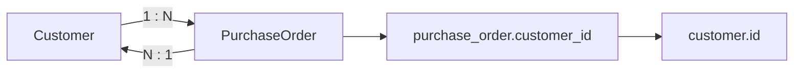

# `LAZY` và `EAGER` không mặc nhiên xác định số câu SQL trong Hibernate

Khi ánh xạ quan hệ trong Hibernate/JPA, hai lựa chọn thường gặp là `FetchType.LAZY` và `FetchType.EAGER`. Chúng dễ bị hiểu thành hai lời hứa đơn giản:

- `LAZY` nghĩa là Hibernate không chạy SQL để lấy quan hệ.
- `EAGER` nghĩa là Hibernate dùng một câu SQL `JOIN` để lấy quan hệ ngay cùng entity gốc.

Cả hai cách hiểu đều không chính xác. `LAZY` và `EAGER` chủ yếu mô tả **thời điểm dữ liệu cần sẵn sàng** (*fetch timing*). Chúng không tự quyết định Hibernate phải dùng bao nhiêu câu SQL, dùng `JOIN` hay `SELECT` riêng, hoặc có gom nhiều association vào cùng một truy vấn hay không.

Hibernate còn phải xét query đang chạy, fetch plan, loại association, trạng thái persistence context, cache, batch fetching, mapping cụ thể và khả năng của database. Vì thế, một quan hệ `EAGER` có thể được tải bằng truy vấn phụ và tạo ra `N+1`; một quan hệ `LAZY` có thể không phát SQL nếu ứng dụng không truy cập, hoặc phát nhiều SQL khi ứng dụng duyệt từng association.

Bài học này phân biệt **fetch timing** với **fetch strategy**, phân tích các đường thực thi thường gặp của `EntityManager.find` và JPQL/HQL, giải thích `N+1` ở cả hai chế độ, rồi trình bày cách chọn fetch plan và đo số SQL trong ứng dụng thực tế.

## 1. Fetch timing và fetch strategy là hai quyết định khác nhau

Hãy tách câu hỏi tải dữ liệu thành hai phần.

**Fetch timing — khi nào dữ liệu cần được tải?**

- `EAGER`: dữ liệu của association phải sẵn sàng theo fetch plan khi entity được lấy về hoặc trước khi thao tác tương ứng hoàn tất.
- `LAZY`: provider được phép trì hoãn việc tải cho đến khi ứng dụng truy cập association; với một số loại association, `LAZY` là một hint và provider có thể cần cơ chế hỗ trợ phù hợp.

**Fetch strategy — dữ liệu được tải bằng cách nào?**

- `JOIN`: dùng join trong cùng câu SQL để lấy dữ liệu của nhiều bảng.
- `SELECT`: chạy một hoặc nhiều câu `SELECT` riêng cho association.
- `BATCH`: gom nhiều khóa cần tải vào một truy vấn với điều kiện dạng `IN`.
- `SUBSELECT`: tải collection của một nhóm owner bằng một truy vấn phụ dựa trên truy vấn root trong một số tình huống Hibernate hỗ trợ.

`LAZY`/`EAGER` không đồng nghĩa trực tiếp với `JOIN`/`SELECT`.

| Fetch timing | Fetch strategy | Hành vi có thể thấy |
|---|---|---|
| `EAGER` | `JOIN` | Root và association được lấy qua một SQL join |
| `EAGER` | `SELECT` | Root được lấy trước, association được lấy bằng SQL bổ sung |
| `LAZY` | `SELECT` khi truy cập | Ban đầu chưa tải; truy cập sau đó mới chạy SQL |
| `LAZY` | `BATCH` khi truy cập | Truy cập một association có thể kích hoạt truy vấn lấy nhiều association cùng loại |
| `LAZY` | `SUBSELECT` khi truy cập collection | Một lần khởi tạo có thể tải collection cho nhóm owner |

Bảng là các hình thức thực thi khái quát; việc Hibernate chọn cách nào phụ thuộc mapping, query, phiên bản và cấu hình. Điều cần nhớ là **fetch timing nói về yêu cầu sẵn sàng dữ liệu, fetch strategy nói về cách thực hiện truy vấn**.

## 2. Mô hình ví dụ

Dùng một mô hình bán hàng có khách hàng và đơn hàng:

```sql
CREATE TABLE customer (
    id BIGINT PRIMARY KEY,
    full_name VARCHAR(150) NOT NULL
);

CREATE TABLE purchase_order (
    id BIGINT PRIMARY KEY,
    customer_id BIGINT NOT NULL,
    order_code VARCHAR(40) NOT NULL,
    status VARCHAR(30) NOT NULL,
    CONSTRAINT fk_order_customer
        FOREIGN KEY (customer_id) REFERENCES customer(id)
);
```

Entity `Customer`:

```java
import jakarta.persistence.*;
import java.util.ArrayList;
import java.util.List;

@Entity
@Table(name = "customer")
public class Customer {

    @Id
    private Long id;

    @Column(name = "full_name", nullable = false)
    private String fullName;

    @OneToMany(
        mappedBy = "customer",
        fetch = FetchType.LAZY
    )
    private List<PurchaseOrder> orders = new ArrayList<>();

    protected Customer() {}

    public Long getId() {
        return id;
    }

    public String getFullName() {
        return fullName;
    }

    public List<PurchaseOrder> getOrders() {
        return orders;
    }
}
```

Entity `PurchaseOrder`:

```java
@Entity
@Table(name = "purchase_order")
public class PurchaseOrder {

    @Id
    private Long id;

    @ManyToOne(fetch = FetchType.LAZY, optional = false)
    @JoinColumn(name = "customer_id", nullable = false)
    private Customer customer;

    @Column(name = "order_code", nullable = false)
    private String orderCode;

    @Column(name = "status", nullable = false)
    private String status;

    protected PurchaseOrder() {}

    public Long getId() {
        return id;
    }

    public Customer getCustomer() {
        return customer;
    }

    public String getOrderCode() {
        return orderCode;
    }

    public String getStatus() {
        return status;
    }
}
```

Quan hệ:



Trong mapping này, `Customer.orders` là collection một-nhiều, còn `PurchaseOrder.customer` là tham chiếu nhiều-một. Ví dụ khai báo `LAZY` tường minh cho cả hai để việc quan sát hành vi dễ hơn.

Lưu ý mặc định JPA:

- `@OneToMany` và `@ManyToMany` mặc định là `LAZY`.
- `@ManyToOne` và `@OneToOne` mặc định là `EAGER`.
- `LAZY` trên một số to-one association là fetch hint; provider có thể cần proxy hoặc bytecode enhancement để thực hiện lazy loading đúng cách.

Không nên để mặc định của annotation quyết định fetch plan cho toàn ứng dụng. Hãy khai báo rõ ý định và chọn dữ liệu cần tải theo từng use case.

## 3. `EAGER` yêu cầu dữ liệu sẵn sàng, không bắt buộc một SQL duy nhất

Giả sử đổi association của `PurchaseOrder` thành:

```java
@ManyToOne(fetch = FetchType.EAGER, optional = false)
@JoinColumn(name = "customer_id", nullable = false)
private Customer customer;
```

Khi lấy một `PurchaseOrder`, association `customer` phải được tải theo fetch requirement. Nhưng Hibernate có thể thực hiện theo nhiều cách.

### 3.1. Một câu SQL dùng JOIN

Một kế hoạch tải có thể sinh SQL tương tự:

```sql
SELECT
    o.id,
    o.customer_id,
    o.order_code,
    o.status,
    c.id,
    c.full_name
FROM purchase_order o
JOIN customer c ON c.id = o.customer_id
WHERE o.id = ?;
```

Đây là trường hợp dễ khiến người học nghĩ `EAGER = JOIN`. Tuy nhiên, đó chỉ là một strategy khả thi.

### 3.2. Root query và SELECT bổ sung

Một kế hoạch khác có thể chạy:

```sql
SELECT id, customer_id, order_code, status
FROM purchase_order
WHERE id = ?;

SELECT id, full_name
FROM customer
WHERE id = ?;
```

Dữ liệu vẫn được tải theo yêu cầu `EAGER`, nhưng bằng hai câu SQL. Với một order đơn lẻ, chênh lệch có thể nhỏ; với danh sách 100 order tham chiếu 100 customer khác nhau, các select bổ sung có thể trở thành vấn đề.

### 3.3. Vì sao Hibernate không luôn JOIN mọi association EAGER?

Join có thể làm phình số hàng, nhân dữ liệu khi nhiều quan hệ đa trị cùng tham gia và tạo kết quả SQL lớn. Ngoài ra, query plan cụ thể phải đáp ứng cấu trúc truy vấn, pagination và các ràng buộc của mapping.

Hibernate có thể dùng select fetching để đáp ứng yêu cầu EAGER khi query không chỉ định fetch join. Vì vậy, **EAGER không phải một cam kết về số statement**.

## 4. `LAZY` không có nghĩa là không phát SQL

Với mapping:

```java
@OneToMany(mappedBy = "customer", fetch = FetchType.LAZY)
private List<PurchaseOrder> orders;
```

Lấy customer:

```java
Customer customer = entityManager.find(Customer.class, 42L);
System.out.println(customer.getFullName());
```

Hibernate có thể chỉ cần một query:

```sql
SELECT id, full_name
FROM customer
WHERE id = 42;
```

Collection `orders` có thể vẫn chưa được khởi tạo. Nhưng khi code truy cập:

```java
for (PurchaseOrder order : customer.getOrders()) {
    System.out.println(order.getOrderCode());
}
```

Hibernate phải lấy các order liên quan, thường bằng SQL tương tự:

```sql
SELECT id, customer_id, order_code, status
FROM purchase_order
WHERE customer_id = 42;
```

`LAZY` đã trì hoãn query chứ không loại bỏ query. Nếu ứng dụng truy cập collection của 100 customer riêng lẻ, Hibernate có thể phát 100 truy vấn bổ sung nếu không có batch/subselect fetching hoặc dữ liệu không được cache.

### 4.1. Chỉ lấy root mà không chạm association

```java
List<Customer> customers = entityManager.createQuery(
    "select c from Customer c order by c.id",
    Customer.class
)
.setMaxResults(50)
.getResultList();

for (Customer customer : customers) {
    System.out.println(customer.getFullName());
}
```

Nếu query không yêu cầu association và code chỉ đọc `fullName`, collection lazy có thể không được tải. Số SQL trong ví dụ đơn giản thường là một câu lấy customer, cộng những SQL phụ do mapping/provider có thể cần.

### 4.2. Duyệt association tạo ra N+1

```java
for (Customer customer : customers) {
    for (PurchaseOrder order : customer.getOrders()) {
        System.out.println(order.getOrderCode());
    }
}
```

Nếu 50 customer đều có collection chưa tải và không được batching, hình dạng phổ biến là:

```text
1 query lấy 50 Customer
50 query lấy orders cho từng Customer
--------------------------------------
Có thể là 51 câu SELECT
```

Đây là `N+1`: một truy vấn lấy tập root, sau đó N truy vấn lấy association. Lazy loading không sai; fetch plan chưa phù hợp với cách sử dụng dữ liệu mới tạo ra chi phí đó.

## 5. `EAGER` cũng có thể gây N+1

Một ví dụ quan trọng hơn: `@ManyToOne` mặc định EAGER theo JPA.

```java
@Entity
public class PurchaseOrder {

    @Id
    private Long id;

    @ManyToOne // Mặc định EAGER theo JPA.
    @JoinColumn(name = "customer_id")
    private Customer customer;
}
```

Ứng dụng truy vấn danh sách order bằng JPQL:

```java
List<PurchaseOrder> orders = entityManager.createQuery(
    "select o from PurchaseOrder o order by o.id",
    PurchaseOrder.class
).getResultList();
```

Một câu JPQL không có `JOIN FETCH` không có nghĩa provider sẽ luôn join customer vào SQL. Hibernate phải đáp ứng yêu cầu EAGER của association; một cách thực thi có thể là:

```text
SELECT purchase_order ...             -- 1 câu lấy orders
SELECT customer WHERE id = ?          -- truy vấn customer thứ nhất
SELECT customer WHERE id = ?          -- truy vấn customer tiếp theo
SELECT customer WHERE id = ?          -- ...
...
```

Nếu danh sách chứa nhiều customer khác nhau chưa có trong persistence context hoặc cache, đây có thể là N+1 dù association là EAGER.

### 5.1. Vì sao ví dụ này quan trọng?

Một lập trình viên có thể đặt `EAGER` với ý định “tránh lazy exception”, nhưng query list lại phát nhiều SQL phụ. Nếu 200 order tham chiếu 200 customer, số query có thể tăng mạnh.

Nếu endpoint thật sự cần customer, hãy diễn đạt nhu cầu trong fetch plan của query, ví dụ `JOIN FETCH` hoặc entity graph. Nếu endpoint không cần customer, cân nhắc để mapping `LAZY` và không truy cập association.

**EAGER bảo đảm dữ liệu cần được fetch; nó không bảo đảm Hibernate fetch dữ liệu theo cách hiệu quả nhất cho mọi query.**

## 6. `EntityManager.find` và JPQL/HQL có thể tạo fetch plan khác nhau

Cùng một entity mapping, hai cách truy cập có thể cho SQL khác nhau.

### 6.1. Tìm một entity theo ID

```java
PurchaseOrder order = entityManager.find(
    PurchaseOrder.class,
    9001L
);
```

Đây là thao tác tìm entity theo identifier. Provider có thể xây dựng kế hoạch lấy các association EAGER trong thao tác find, chẳng hạn join hoặc select bổ sung tùy mapping.

### 6.2. Query danh sách bằng JPQL

```java
List<PurchaseOrder> orders = entityManager.createQuery(
    "select o from PurchaseOrder o",
    PurchaseOrder.class
).getResultList();
```

JPQL query có query plan riêng. Hibernate không nhất thiết biến mọi EAGER association thành join trong câu SQL root. Nó có thể chạy root query rồi select từng association EAGER cần thiết.

### 6.3. Thêm fetch join khi endpoint cần association

```java
List<PurchaseOrder> orders = entityManager.createQuery(
    "select o from PurchaseOrder o " +
    "join fetch o.customer",
    PurchaseOrder.class
).getResultList();
```

`JOIN FETCH` yêu cầu tải `customer` cùng truy vấn. SQL minh họa:

```sql
SELECT o.id, o.customer_id, o.order_code, o.status,
       c.id, c.full_name
FROM purchase_order o
JOIN customer c ON c.id = o.customer_id;
```

Với association to-one, join fetch thường là cách phù hợp khi endpoint cần dữ liệu đó. Tuy vậy, số SQL vẫn có thể bị ảnh hưởng bởi những association khác, cache, secondary table hoặc các query phụ ngoài ví dụ.

## 7. `JOIN FETCH` không phải lúc nào cũng làm tổng chi phí thấp hơn

Join giúp giảm round-trip, nhưng nó có thể tăng số hàng và lượng dữ liệu truyền.

Giả sử một customer có 20 order. Query:

```java
Customer customer = entityManager.createQuery(
    "select c from Customer c " +
    "left join fetch c.orders " +
    "where c.id = :id",
    Customer.class
)
.setParameter("id", 42L)
.getSingleResult();
```

có thể trả 20 hàng SQL với các cột customer được lặp lại theo từng order. Hibernate gom chúng thành một customer và collection order trong persistence context.

Đối với một root và collection nhỏ, điều này có thể hiệu quả. Với nhiều collection, số hàng có thể nhân lên:

```text
1 Customer
  20 Orders
  5 Addresses

JOIN cả hai collection:
  20 × 5 = 100 hàng kết quả cho một Customer
```

Một query duy nhất không đồng nghĩa với ít dữ liệu hoặc ít công việc. Hãy xét cả số statement, số hàng trả về, kích thước dữ liệu, CPU và bộ nhớ.

### 7.1. Cẩn trọng khi fetch nhiều collection

Fetch đồng thời nhiều collection có thể tạo tích Descartes. Với các bag mapping, Hibernate còn có thể báo `MultipleBagFetchException` trong một số trường hợp khi fetch nhiều bag cùng lúc.

Đổi `List` thành `Set` chỉ để né exception không tự giải quyết số hàng SQL bị nhân. Chọn collection theo semantics domain; thiết kế fetch plan để tải các nhánh cần thiết một cách có kiểm soát.

## 8. `@Fetch(FetchMode.JOIN)`, `SELECT` và `SUBSELECT` của Hibernate

Ngoài `FetchType` của JPA, Hibernate cung cấp `@Fetch` để điều khiển fetch strategy trong một số mapping.

```java
import org.hibernate.annotations.Fetch;
import org.hibernate.annotations.FetchMode;
```

### 8.1. `FetchMode.JOIN`

```java
@ManyToOne(fetch = FetchType.EAGER)
@Fetch(FetchMode.JOIN)
@JoinColumn(name = "customer_id")
private Customer customer;
```

`JOIN` yêu cầu Hibernate dùng join fetching cho association trong các kế hoạch phù hợp. Đây là cấu hình Hibernate-specific; nó không phải annotation chuẩn JPA.

Với join fetching, dữ liệu có thể được lấy cùng SQL root, nhưng query-specific fetch plan vẫn cần được xem xét. Đặc biệt, không nên giả định mọi truy vấn, mọi pagination hoặc mọi graph sẽ tạo đúng một SQL đơn giản.

### 8.2. `FetchMode.SELECT`

```java
@OneToMany(mappedBy = "customer", fetch = FetchType.LAZY)
@Fetch(FetchMode.SELECT)
private List<PurchaseOrder> orders;
```

`SELECT` dùng select riêng để lấy association khi fetch plan yêu cầu hoặc khi lazy association được truy cập. Nếu nhiều owner được duyệt tuần tự và không có batch, nó có thể tạo N+1.

Đây là strategy phổ biến của collection lazy.

### 8.3. `FetchMode.SUBSELECT`

```java
@OneToMany(mappedBy = "customer", fetch = FetchType.LAZY)
@Fetch(FetchMode.SUBSELECT)
private List<PurchaseOrder> orders;
```

Trong một số tình huống, khi collection của một owner được khởi tạo, Hibernate có thể dùng truy vấn phụ để lấy collection cho nhóm owner đã được tải bởi truy vấn root liên quan.

SQL ý tưởng:

```sql
SELECT o.*
FROM purchase_order o
WHERE o.customer_id IN (
    SELECT c.id
    FROM customer c
    WHERE /* điều kiện root query */
);
```

Hình dạng SQL và điều kiện áp dụng phụ thuộc Hibernate version và query gốc. Subselect fetching có thể giảm N+1, nhưng cũng có thể tải collection cho nhiều owner hơn phần code thực sự cần. Nó không giới hạn số phần tử của từng collection.

### 8.4. Bảng so sánh

| Hibernate fetch strategy | Cách tải | Điểm cần chú ý |
|---|---|---|
| `JOIN` | Join cùng SQL root | Có thể nhân hàng khi fetch collection |
| `SELECT` | Select riêng cho association | Có nguy cơ N+1 |
| `SUBSELECT` | Một truy vấn phụ cho nhóm collection | Có thể tải nhiều collection của nhóm owner |
| Batch fetching | Gom nhiều khóa vào `IN` | Giảm round-trip nhưng vẫn tải nội dung collection được khởi tạo |

Đừng trộn `FetchType` và `FetchMode` thành một enum. Chúng giải quyết hai khía cạnh khác nhau của fetch plan.

## 9. Batch fetching: giảm số query khi LAZY được truy cập

Hibernate có thể gom việc khởi tạo các association lazy của nhiều owner.

Cấu hình toàn cục:

```properties
hibernate.default_batch_fetch_size=16
```

Hoặc trên association:

```java
import org.hibernate.annotations.BatchSize;

@OneToMany(mappedBy = "customer", fetch = FetchType.LAZY)
@BatchSize(size = 16)
private List<PurchaseOrder> orders = new ArrayList<>();
```

Khi ứng dụng truy cập collection của một customer, Hibernate có thể lấy collection cho một nhóm customer ID:

```sql
SELECT id, customer_id, order_code, status
FROM purchase_order
WHERE customer_id IN (?, ?, ?, ...);
```

Nếu có 50 customer cần khởi tạo collection, batch size 16 có thể làm số lượt tải giảm đáng kể so với 50 truy vấn riêng; số query chính xác phụ thuộc số association cần tải, cache, số ID thực tế và cách Hibernate chia batch.

### 9.1. Batch fetching không giới hạn số phần tử

Giả sử 16 customer có tổng cộng 30.000 order. Batch fetching vẫn có thể tải 30.000 order khi tất cả collection được khởi tạo. Nó giảm round-trip, không thay đổi yêu cầu dữ liệu.

Nếu chỉ cần 10 order gần nhất của mỗi customer, hãy thiết kế query con/projection phù hợp thay vì tải tất cả collection rồi cắt bằng Java.

### 9.2. Batch fetching khác JDBC batching

Hai khái niệm thường bị nhầm:

- **Batch fetching**: gom nhiều lần đọc association thành một query có nhiều ID.
- **JDBC statement batching**: gom nhiều lệnh ghi tương tự như INSERT/UPDATE để gửi theo batch.

`hibernate.default_batch_fetch_size` liên quan đọc association; `hibernate.jdbc.batch_size` liên quan batching statement ghi. Cấu hình cái này không tự bật cái kia.

## 10. `@EntityGraph`: khai báo fetch plan theo use case

JPA `EntityGraph` cho phép yêu cầu một số association được tải trong một thao tác cụ thể mà không cần thay mapping mặc định thành EAGER.

Ví dụ cần order cùng customer:

```java
EntityGraph<PurchaseOrder> graph =
    entityManager.createEntityGraph(PurchaseOrder.class);

graph.addAttributeNodes("customer");

PurchaseOrder order = entityManager.find(
    PurchaseOrder.class,
    9001L,
    java.util.Map.of("jakarta.persistence.fetchgraph", graph)
);
```

Hoặc trong Spring Data JPA:

```java
public interface PurchaseOrderRepository
        extends JpaRepository<PurchaseOrder, Long> {

    @EntityGraph(attributePaths = "customer")
    Optional<PurchaseOrder> findWithCustomerById(Long id);
}
```

Entity graph mô tả association cần fetch; provider quyết định strategy SQL cụ thể. Một graph có thể được thực hiện bằng join, select hoặc kế hoạch khác. Vì vậy, **EntityGraph cũng không cam kết một số SQL cố định**.

### 10.1. `fetchgraph` và `loadgraph`

Hai hint JPA phổ biến:

- `jakarta.persistence.fetchgraph`: những attribute trong graph được yêu cầu fetch; các attribute không có trong graph được coi là lazy cho mục đích fetch graph.
- `jakarta.persistence.loadgraph`: những attribute trong graph được yêu cầu fetch, đồng thời giữ các quy tắc fetch mặc định của mapping cho attribute còn lại.

Provider có thể fetch thêm dữ liệu theo đặc tả và implementation. Dù dùng loại graph nào, vẫn cần kiểm tra SQL và dữ liệu thực tế.

### 10.2. EntityGraph có thể chứa collection

```java
EntityGraph<Customer> graph =
    entityManager.createEntityGraph(Customer.class);

graph.addAttributeNodes("orders");
```

Điều này yêu cầu tải collection orders cho use case đó. Nếu query có pagination trên customer và graph chứa collection, vẫn có rủi ro join collection làm sai giới hạn root hoặc khiến Hibernate phải phân trang trong bộ nhớ tùy query/provider.

EntityGraph là cách định nghĩa nhu cầu fetch; nó không tự biến collection lớn thành dữ liệu phân trang.

## 11. Query projection có thể loại bỏ nhu cầu tải association

Một màn hình chỉ cần tên customer và số order không cần entity graph đầy đủ.

DTO:

```java
public record CustomerOrderCount(
    Long customerId,
    String fullName,
    long orderCount
) {}
```

JPQL:

```java
List<CustomerOrderCount> rows = entityManager.createQuery(
    "select new com.example.CustomerOrderCount(" +
    " c.id, c.fullName, count(o.id)) " +
    "from Customer c " +
    "left join c.orders o " +
    "group by c.id, c.fullName " +
    "order by c.id",
    CustomerOrderCount.class
).getResultList();
```

Query aggregate có thể trả kết quả trực tiếp mà không khởi tạo `Customer.orders` như persistent collection. Nó có thể chỉ dùng một SQL join/group by, tùy cách provider dịch JPQL.

Nếu cần số lượng, dùng `COUNT`. Nếu cần kiểm tra tồn tại, dùng `EXISTS` hoặc query giới hạn một kết quả. Nếu cần vài cột, dùng DTO projection. Không tải entity và collection đầy đủ chỉ để lấy một giá trị tổng hợp.

## 12. `find`, query entity và query scalar: cùng dữ liệu nhưng khác kết quả

Hãy phân biệt ba thao tác:

**Tìm entity:**

```java
PurchaseOrder order = entityManager.find(
    PurchaseOrder.class, 9001L);
```

Hibernate trả managed entity theo identifier; fetch plan sẽ xử lý association EAGER/Lazy theo mapping.

**Query entity:**

```java
List<PurchaseOrder> orders = entityManager.createQuery(
    "select o from PurchaseOrder o",
    PurchaseOrder.class
).getResultList();
```

JPQL query có query plan riêng. Hibernate có thể cần truy vấn bổ sung để đáp ứng các association EAGER không được fetch join.

**Query scalar:**

```java
List<String> codes = entityManager.createQuery(
    "select o.orderCode from PurchaseOrder o",
    String.class
).getResultList();
```

Query scalar chỉ cần giá trị được chọn, nên không yêu cầu materialize toàn bộ entity graph `PurchaseOrder` và các association của nó.

Vì vậy, số SQL không chỉ phụ thuộc annotation. Nó còn phụ thuộc **loại kết quả mà query yêu cầu**.

## 13. Persistence context và cache ảnh hưởng số SQL quan sát được

Số SQL trong một ví dụ không cố định nếu trạng thái ứng dụng thay đổi.

### 13.1. First-level cache

Trong cùng persistence context:

```java
Customer first = entityManager.find(Customer.class, 42L);
Customer second = entityManager.find(Customer.class, 42L);
```

Lần tìm thứ hai thường lấy managed instance đã có mà không cần SELECT lại. Nếu customer đã được load trước đó qua một association, lần `find` tiếp theo cũng có thể dùng instance hiện có.

Do đó, cùng một query có thể phát SQL trong context mới nhưng không phát SQL trong context đã có entity.

### 13.2. Second-level cache

Nếu second-level cache được bật và entity/collection được cache theo cấu hình, Hibernate có thể lấy một số state từ cache thay vì database. Điều này có thể làm số SQL thấp hơn trong lần chạy sau.

Cache không phải một bảo đảm fetch strategy; nó là một lớp tối ưu có chính sách invalidation/consistency riêng.

### 13.3. Query cache

Query cache có thể cache kết quả truy vấn phù hợp, thường liên quan đến danh sách identifier/giá trị và cần cấu hình vùng cache. Nó không tự đảm bảo mọi entity và association đã có trong memory; việc materialize entity còn có thể cần first-level/second-level cache hoặc truy vấn khác.

### 13.4. Kết quả đo cần xác định bối cảnh cache

Khi so sánh số SQL, phải nói rõ:

- Persistence context mới hay đã dùng trước đó?
- Second-level cache có bật không?
- Query cache có bật không?
- Đây là lần chạy đầu hay lần chạy nóng?
- Các association đã được khởi tạo trước chưa?

Nếu không cố định các điều kiện này, so sánh hai lần chạy có thể dẫn đến kết luận sai.

## 14. Pagination và collection fetch join

Một lỗi thường gặp là kết hợp phân trang root với fetch join collection:

```java
List<Customer> page = entityManager.createQuery(
    "select distinct c from Customer c " +
    "left join fetch c.orders " +
    "order by c.id",
    Customer.class
)
.setFirstResult(0)
.setMaxResults(20)
.getResultList();
```

Một customer có thể tạo nhiều hàng SQL do join orders. Giới hạn 20 hàng SQL không tương ứng với 20 customer. Hibernate có thể phải tải kết quả join rộng rồi phân trang trong bộ nhớ hoặc phát cảnh báo/lỗi tùy cấu hình.

Hướng thường dễ kiểm soát hơn:

1. Query trang ID hoặc root entity trước, không fetch collection.
2. Fetch collection cho đúng nhóm root đó nếu kích thước collection có giới hạn phù hợp.
3. Nếu collection lớn, query child riêng và phân trang child.
4. Nếu UI chỉ cần count hoặc vài field, dùng projection.

Ví dụ lấy trang ID:

```java
List<Long> customerIds = entityManager.createQuery(
    "select c.id from Customer c order by c.id",
    Long.class
)
.setFirstResult(0)
.setMaxResults(20)
.getResultList();
```

Sau đó lấy customer và association cho nhóm ID:

```java
List<Customer> customers = customerIds.isEmpty()
    ? List.of()
    : entityManager.createQuery(
        "select distinct c from Customer c " +
        "left join fetch c.orders " +
        "where c.id in :ids",
        Customer.class
    )
    .setParameter("ids", customerIds)
    .getResultList();
```

`IN` không đảm bảo giữ thứ tự ID ban đầu; nếu giao diện cần đúng thứ tự trang, sắp xếp lại theo danh sách ID ở tầng ứng dụng hoặc dùng query có thứ tự phù hợp.

## 15. Các association lồng nhau có thể tạo N+1 nhiều tầng

Ví dụ graph:

```text
Customer
  └── orders
       └── lines
            └── product
                 └── category
```

Nếu ứng dụng duyệt tất cả:

```java
for (Customer customer : customers) {
    for (PurchaseOrder order : customer.getOrders()) {
        for (OrderLine line : order.getLines()) {
            System.out.println(line.getProduct().getCategory().getName());
        }
    }
}
```

Có thể phát sinh query ở nhiều tầng:

- Lấy customer.
- Lấy orders cho từng customer.
- Lấy lines cho từng order.
- Lấy product cho từng line.
- Lấy category cho từng product.

First-level cache và batch fetching có thể giảm số query nếu nhiều line dùng chung product/category, nhưng không nên giả định nó tự tối ưu mọi graph.

Hãy xác định màn hình cần dữ liệu sâu đến đâu. Nếu cần order và tên sản phẩm, có thể query DTO join các bảng cần thiết thay vì tải toàn bộ entity graph.

## 16. Mặc định EAGER của to-one là một nguồn N+1 phổ biến

JPA mặc định:

```java
@ManyToOne
private Customer customer; // EAGER mặc định

@OneToOne
private Address address;   // EAGER mặc định
```

Đối với các association to-one trong ứng dụng lớn, việc khai báo `LAZY` tường minh thường giúp fetch plan linh hoạt hơn:

```java
@ManyToOne(fetch = FetchType.LAZY)
private Customer customer;

@OneToOne(fetch = FetchType.LAZY)
private Address address;
```

Sau đó query nào cần association thì dùng fetch join hoặc entity graph.

Lưu ý `LAZY` to-one cần cơ chế proxy/bytecode enhancement thích hợp; hành vi cụ thể phụ thuộc Hibernate version, final class/method, access strategy và enhancement configuration. Không nên giả định mọi cấu hình đều trì hoãn tải giống nhau.

## 17. EAGER trên collection có thể làm mọi use case tải quá nhiều

Mặc dù `@OneToMany` mặc định LAZY, ứng dụng có thể đổi thành:

```java
@OneToMany(mappedBy = "customer", fetch = FetchType.EAGER)
private List<PurchaseOrder> orders;
```

Khi đó mọi thao tác lấy customer phải đáp ứng yêu cầu tải orders, kể cả màn hình chỉ cần tên khách hàng.

Một query danh sách customer có thể tạo nhiều truy vấn phụ, hoặc join kết quả lớn. Một customer có thể có hàng nghìn order; việc đánh dấu EAGER khiến mọi use case chịu chi phí tiềm tàng này.

Đối với collection có cardinality không giới hạn hoặc tăng theo thời gian, giữ `LAZY` thường là lựa chọn an toàn hơn, rồi query đúng tập con theo từng use case.

## 18. Fetch plan nên gắn với use case

Không có một fetch plan tối ưu cho mọi endpoint.

| Use case | Dữ liệu cần | Cách truy vấn thường phù hợp |
|---|---|---|
| Danh sách customer | ID, tên | Query root hoặc DTO |
| Danh sách customer và số order | Tên, count | Projection + aggregate |
| Chi tiết một customer và các order gần nhất | Customer + tập con order | Query customer riêng và query order có limit |
| Danh sách order kèm tên customer | Order + to-one customer | DTO join hoặc fetch join to-one |
| Chi tiết một order và toàn bộ lines nhỏ | Một order + collection có giới hạn tự nhiên | Fetch join/entity graph có chủ đích |
| Trang đầu của collection lớn | Một phần tử con | Query child riêng với pagination |
| Kiểm tra có order hay không | Boolean | EXISTS hoặc query limit 1 |
| Báo cáo tổng hợp | Count/sum/group | Aggregate projection |

Một câu hỏi hữu ích trước khi chọn annotation: **use case này thực sự cần dữ liệu nào, và có cần entity được quản lý đầy đủ hay chỉ cần giá trị để hiển thị?**

## 19. Đo số SQL thay vì suy đoán từ LAZY/EAGER

Số SQL thực tế nên được đo trên Hibernate và DBMS mà ứng dụng sử dụng.

### 19.1. Hibernate Statistics

Có thể bật thống kê:

```properties
hibernate.generate_statistics=true
```

Lấy statistics từ `SessionFactory`:

```java
import org.hibernate.SessionFactory;
import org.hibernate.stat.Statistics;

SessionFactory sessionFactory =
    entityManagerFactory.unwrap(SessionFactory.class);

Statistics statistics = sessionFactory.getStatistics();
statistics.clear();

// Chạy use case cần đo.

long statements = statistics.getPrepareStatementCount();
long entityFetches = statistics.getEntityFetchCount();
long collectionFetches = statistics.getCollectionFetchCount();

System.out.println("Statements: " + statements);
System.out.println("Entity fetches: " + entityFetches);
System.out.println("Collection fetches: " + collectionFetches);
```

Tên metric và API có thể khác theo Hibernate major version. Statistics là số liệu ở cấp SessionFactory và có thể bị các request khác làm nhiễu nếu test chạy song song; nên cô lập môi trường đo hoặc dùng công cụ theo dõi theo request.

### 19.2. SQL logging

Có thể bật SQL logging trong môi trường phát triển/kiểm thử để xem câu lệnh:

```properties
hibernate.show_sql=true
hibernate.format_sql=true
```

Trong Spring Boot, cấu hình thường nằm dưới namespace `spring.jpa.properties.hibernate.*` hoặc logging category tương ứng.

SQL logging hữu ích để nhìn rõ:

- Có bao nhiêu SELECT.
- Có join association hay select riêng.
- Có query lặp cùng điều kiện owner ID không.
- Có batch `IN` hay không.
- Có câu SQL phụ do EAGER association không.

Không bật log tham số nhạy cảm bừa bãi trên production. Logging có chi phí và có thể ghi dữ liệu cá nhân/secret.

### 19.3. StatementInspector hoặc datasource proxy

Hibernate `StatementInspector` có thể quan sát SQL trước khi thực thi:

```java
import org.hibernate.resource.jdbc.spi.StatementInspector;

public class SqlInspector implements StatementInspector {

    @Override
    public String inspect(String sql) {
        System.out.println("SQL: " + sql);
        return sql;
    }
}
```

Đây là ví dụ tối giản. Trong ứng dụng thật, nên dùng metric có cấu trúc và correlation ID theo request thay vì in mọi SQL vào stdout.

Các công cụ datasource proxy/APM cũng có thể thống kê số statement và thời gian theo request, hữu ích khi cần phát hiện N+1 ở production.

### 19.4. Đếm query trong test

Một integration test có thể reset statistics trước use case, chạy đúng transaction, rồi kiểm tra số statement theo kỳ vọng của test. Tuy nhiên, tránh viết assertion quá cứng cho số SQL nếu phiên bản Hibernate hoặc DBMS có thể thay đổi query plan hợp lệ. Nên kiểm tra mục tiêu kiến trúc, ví dụ “không phát một query cho mỗi customer” hoặc “collection không được khởi tạo trong endpoint summary”.

## 20. Những yếu tố khác làm số SQL thay đổi

Ngoài fetch timing và fetch strategy, số câu SQL có thể bị ảnh hưởng bởi:

- **First-level cache:** entity đã managed có thể không cần SELECT mới.
- **Second-level cache:** state entity/collection có thể lấy từ cache.
- **Query cache:** kết quả truy vấn có thể được tái sử dụng khi cấu hình phù hợp.
- **Batch fetching:** nhiều khóa association được gom vào một query.
- **Subselect fetching:** collection của nhóm owner có thể được tải chung.
- **Fetch join/entity graph:** query cụ thể yêu cầu tải association.
- **Generated identifier:** một số chiến lược sinh ID có thể phát SQL sớm.
- **Auto-flush:** thay đổi pending có thể được flush trước query theo flush mode.
- **Secondary table/inheritance:** một entity có thể cần đọc nhiều bảng.
- **Lazy basic attribute/LOB:** bytecode enhancement và mapping có thể tạo lần đọc riêng.
- **Database dialect và provider version:** SQL cụ thể có thể khác nhau.

Do đó, không thể suy ra một con số cố định chỉ từ một annotation `fetch`.

## 21. Các sai lầm thường gặp

### 21.1. “EAGER luôn dùng JOIN”

Sai. EAGER yêu cầu association sẵn sàng; Hibernate có thể dùng select bổ sung, đặc biệt với entity query không fetch join.

### 21.2. “LAZY nghĩa là không có SQL”

Sai. Khi ứng dụng truy cập proxy/collection lazy, Hibernate có thể phát SQL. Nhiều owner được truy cập tuần tự có thể tạo N+1.

### 21.3. “Chỉ cần đổi LAZY thành EAGER để hết LazyInitializationException”

Cách này có thể làm mọi query tải thêm dữ liệu và tạo N+1. Hãy xác định endpoint cần association nào và fetch có chủ đích trong transaction.

### 21.4. “Một câu SQL là luôn nhanh hơn nhiều câu”

Không đúng. Join nhiều collection có thể tạo hàng kết quả khổng lồ và lặp dữ liệu root. So sánh tổng chi phí, không chỉ số statement.

### 21.5. “Batch size giới hạn số phần tử collection”

Không. Batch size nhóm các owner/association cần khởi tạo; nó không giới hạn số child của collection.

### 21.6. “EntityGraph luôn tạo một JOIN”

Không. EntityGraph mô tả fetch requirement; provider chọn strategy. Phải xem SQL thực tế.

### 21.7. “JDBC batch size giải quyết N+1 SELECT”

Không. JDBC batching tối ưu lệnh ghi; batch fetching tối ưu cách đọc association.

### 21.8. “Một query JPQL luôn có SQL giống find”

Không. Find và JPQL có query plan khác nhau; eager association có thể được xử lý khác.

### 21.9. “Dùng stream limit là pagination database”

Không. Stream trên persistent collection có thể khởi tạo toàn bộ collection rồi mới limit ở Java.

### 21.10. “Số SQL của một lần chạy đại diện cho mọi lần chạy”

Không. Context, cache, dữ liệu fixture và trạng thái collection ảnh hưởng kết quả. Hãy đo cold/warm scenario riêng.

## 22. Bài thực hành: so sánh ba fetch plan

Giả sử database có:

- 50 customer.
- Mỗi customer có trung bình 10 order.
- Không bật second-level cache.
- Persistence context mới khi bắt đầu mỗi kịch bản.
- Chưa có collection nào được khởi tạo.

### Kịch bản A — LAZY, chỉ đọc customer name

```java
List<Customer> customers = entityManager.createQuery(
    "select c from Customer c order by c.id",
    Customer.class
).setMaxResults(50).getResultList();

for (Customer c : customers) {
    System.out.println(c.getFullName());
}
```

Kỳ vọng: một query root; collection orders chưa cần tải.

### Kịch bản B — LAZY, duyệt orders từng customer

```java
for (Customer c : customers) {
    for (PurchaseOrder o : c.getOrders()) {
        System.out.println(o.getOrderCode());
    }
}
```

Kỳ vọng nếu không batch/subselect: một query root và có thể 50 query collection. Đây là N+1.

### Kịch bản C — Fetch join

```java
List<Customer> customers = entityManager.createQuery(
    "select distinct c from Customer c " +
    "left join fetch c.orders " +
    "order by c.id",
    Customer.class
).getResultList();
```

Kỳ vọng: một query join trong ví dụ đơn giản, nhưng SQL trả khoảng 500 hàng order/customer kết hợp, có lặp cột customer. Không có pagination trong ví dụ này; nếu thêm pagination root, cần đánh giá lại.

### Câu hỏi

1. Vì sao kịch bản A có thể chỉ cần một query dù entity có collection?
2. Vì sao kịch bản B tạo N+1?
3. Kịch bản C có ít SQL hơn, vậy tại sao vẫn phải đo số hàng và dung lượng kết quả?
4. Nếu mỗi customer có 100.000 order, fetch join có còn hợp lý không?
5. Nếu chỉ cần số order, nên dùng query nào?
6. Nếu query C thêm `setMaxResults(20)`, rủi ro gì xuất hiện?

**Gợi ý trả lời:**

1. Vì collection LAZY chưa được truy cập.
2. Mỗi lần khởi tạo collection của một customer có thể tạo một SELECT riêng.
3. Join lặp thông tin root và có thể tạo kết quả lớn; một query chưa chắc ít tài nguyên.
4. Thường không. Nên query tập con hoặc aggregate theo nhu cầu.
5. Dùng `COUNT`/projection.
6. Pagination trên collection fetch join có thể không giới hạn đúng số root và bị xử lý trong bộ nhớ hoặc cảnh báo/lỗi tùy Hibernate.

## 23. Bài thực hành: EAGER to-one trong JPQL

Entity `PurchaseOrder` có:

```java
@ManyToOne(fetch = FetchType.EAGER)
private Customer customer;
```

Repository chạy:

```java
List<PurchaseOrder> orders = entityManager.createQuery(
    "select o from PurchaseOrder o where o.status = :status",
    PurchaseOrder.class
)
.setParameter("status", "PAID")
.getResultList();
```

### Yêu cầu

1. Nêu hai strategy có thể dùng để đáp ứng EAGER.
2. Giải thích vì sao một root query cộng nhiều select customer có thể xảy ra.
3. Sửa query để lấy customer trong cùng fetch plan.
4. Nếu endpoint không cần customer, thay đổi mapping nào giúp tránh tải thừa?
5. Nêu lý do cần đo SQL thay vì chỉ đọc annotation.

### Đáp án tham khảo

Có thể dùng join fetching hoặc select fetching. Với select fetching, Hibernate lấy danh sách order rồi truy vấn customer theo các khóa ngoại cần thiết; nếu nhiều customer khác nhau và không batching/cache, có thể thành N+1.

Nếu endpoint cần customer:

```java
List<PurchaseOrder> orders = entityManager.createQuery(
    "select o from PurchaseOrder o " +
    "join fetch o.customer " +
    "where o.status = :status",
    PurchaseOrder.class
)
.setParameter("status", "PAID")
.getResultList();
```

Nếu endpoint không cần customer, có thể ánh xạ `fetch = FetchType.LAZY` tường minh và tránh truy cập association. Tuy nhiên, `LAZY` to-one cần provider hỗ trợ proxy/enhancement phù hợp.

## 24. Nguyên tắc áp dụng vào dự án

- **Xem `LAZY`/`EAGER` là fetch timing**, không phải cam kết số SQL.
- **Phân biệt fetch timing và fetch strategy**: JOIN, SELECT, BATCH và SUBSELECT là các cách thực hiện khác nhau.
- **Ưu tiên LAZY cho collection lớn**, sau đó chọn fetch plan theo từng use case.
- **Cẩn thận với EAGER to-one mặc định của JPA**; entity query có thể phát select phụ và tạo N+1.
- **Dùng fetch join hoặc EntityGraph khi query thật sự cần association**, nhưng kiểm soát collection fetch và pagination.
- **Dùng batch fetching khi cần truy cập collection của nhiều owner**, đồng thời hiểu rằng nó không giới hạn số child.
- **Dùng DTO/projection/COUNT/EXISTS** khi không cần entity graph đầy đủ.
- **Không fetch nhiều collection lớn cùng lúc** nếu chưa đánh giá tích Descartes và giới hạn bag.
- **Đo số statement, số hàng và thời gian** trên DBMS và Hibernate version thực tế.
- **Cố định trạng thái cache và persistence context khi benchmark**, để các lần đo có thể so sánh.
- **Kiểm tra SQL của find, JPQL, native query và query cụ thể**, vì cùng mapping có thể có fetch plan khác nhau.

Điều quan trọng không phải làm cho mọi quan hệ thành LAZY hoặc EAGER. Hãy bắt đầu từ dữ liệu mà use case cần, sau đó chọn fetch plan và query phù hợp. Hibernate có thể tải association bằng nhiều cách; chỉ khi quan sát SQL và khối lượng dữ liệu thực tế, ta mới biết kế hoạch đó có phù hợp với ứng dụng hay không.
