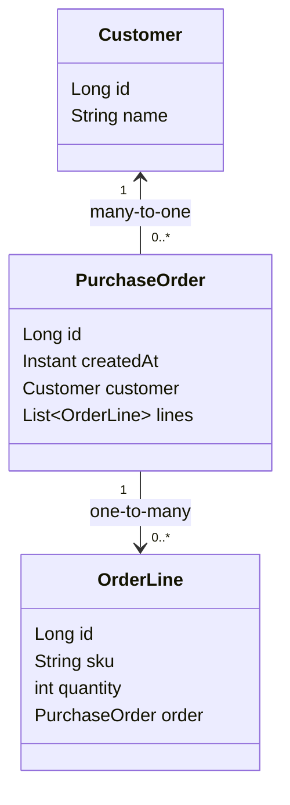
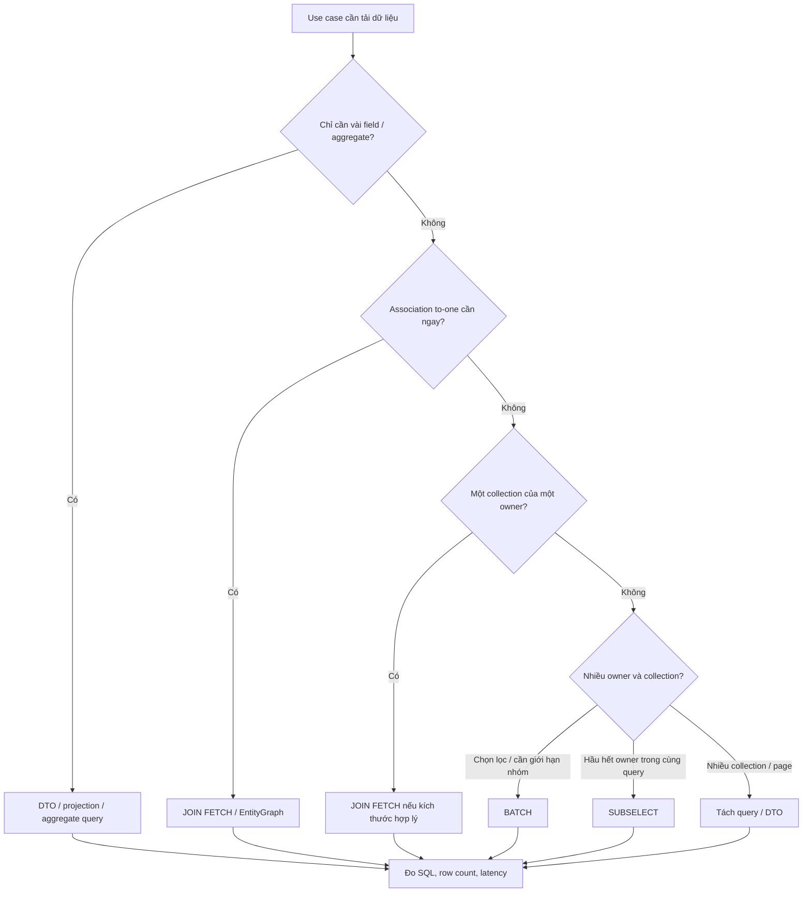

# Tải bằng SELECT, JOIN, BATCH hoặc SUBSELECT trong Hibernate

Khi Hibernate tải một entity, câu hỏi không chỉ là **lấy hàng dữ liệu nào**, mà còn là **lấy các association liên quan bằng cách nào và vào thời điểm nào**. Một màn hình danh sách đơn hàng có thể cần tên khách hàng và các dòng hàng. Nếu tải từng quan hệ bằng một truy vấn riêng, ứng dụng dễ gặp N+1 queries. Nếu join tất cả quan hệ vào một câu SQL, kết quả có thể nhân số hàng, tốn bộ nhớ hoặc làm phân trang sai. Nếu dùng batch hoặc subselect, Hibernate có thể giảm số truy vấn phụ mà vẫn giữ dữ liệu quan hệ ở chế độ lazy.

Bốn chiến lược thường được nhắc đến là:

- **SELECT:** tải entity/collection liên quan bằng câu SELECT riêng khi cần hoặc khi mapping yêu cầu eager.
- **JOIN:** tải entity/association cùng câu truy vấn gốc bằng SQL JOIN.
- **BATCH:** gom nhiều proxy hoặc collection chưa khởi tạo vào một hoặc một số SELECT dùng `IN (...)`.
- **SUBSELECT:** khi một collection được khởi tạo, tải collection cùng role cho nhóm owner đã được truy vấn trước đó bằng một truy vấn phụ có subquery.

Ví dụ, ứng dụng tải 30 đơn hàng và cần thông tin khách hàng:

```java
List<PurchaseOrder> orders =
    entityManager.createQuery(
        "select o from PurchaseOrder o order by o.createdAt desc",
        PurchaseOrder.class
    ).getResultList();

for (PurchaseOrder order : orders) {
    System.out.println(order.getCustomer().getName());
}
```

Nếu mỗi `customer` là proxy lazy và các proxy được khởi tạo riêng, Hibernate có thể chạy một truy vấn tải đơn hàng rồi thêm nhiều truy vấn tải khách hàng. Với batch fetching, Hibernate có thể gom các khách hàng cần tải vào một câu SELECT có nhiều ID. Nếu truy vấn ngay từ đầu dùng `JOIN FETCH`, khách hàng có thể được tải cùng truy vấn đơn hàng.

Không có chiến lược nào luôn tốt nhất. Chọn cách tải theo **dữ liệu màn hình thực sự cần, số lượng bản ghi, kiểu quan hệ, phân trang và giới hạn SQL/database**. Bài học này trình bày từng chiến lược, cách cấu hình, SQL minh họa, tình huống N+1, lỗi khi fetch collection và cách phối hợp nhiều chiến lược trong ứng dụng Hibernate.

## 1. Phân biệt FetchType và FetchMode

Trước khi chọn SELECT/JOIN/BATCH/SUBSELECT, cần tách hai khái niệm thường bị nhầm:

- **FetchType** của Jakarta Persistence (`LAZY`, `EAGER`) mô tả thời điểm/độ bắt buộc tải association.
- **FetchMode** của Hibernate (`SELECT`, `JOIN`, `SUBSELECT`) mô tả cách Hibernate thực hiện việc tải trong các mapping tương ứng.
- **Batch fetching** là cơ chế gom nhiều lần tải lazy thành một số truy vấn theo lô; có thể cấu hình bằng `@BatchSize` hoặc setting toàn cục.

Ví dụ:

```java
@ManyToOne(fetch = FetchType.LAZY)
@JoinColumn(name = "customer_id")
private Customer customer;
```

`LAZY` có nghĩa Hibernate có thể trì hoãn tải Customer cho tới khi ứng dụng cần dữ liệu. Khi cần tải, cách thực hiện có thể là SELECT riêng, batch fetching hoặc một kế hoạch query cụ thể khác.

Ví dụ Hibernate-specific:

```java
@ManyToOne(fetch = FetchType.LAZY)
@Fetch(FetchMode.SELECT)
@JoinColumn(name = "customer_id")
private Customer customer;
```

`FetchMode.SELECT` nói về cách tải bằng SELECT phụ; nó không tự biến association thành eager. Thời điểm khởi tạo còn phụ thuộc FetchType, trạng thái persistence context và query đang chạy.

| Khái niệm | Giá trị/cấu hình | Câu hỏi được trả lời |
|---|---|---|
| JPA FetchType | `LAZY`, `EAGER` | Association cần/được tải lúc nào? |
| Hibernate FetchMode | `SELECT`, `JOIN`, `SUBSELECT` | Dùng hình thức truy vấn nào để tải association? |
| Batch fetching | `@BatchSize`, `hibernate.default_batch_fetch_size` | Có thể gom bao nhiêu proxy/collection vào một SELECT? |
| Query fetch plan | `JOIN FETCH`, EntityGraph | Use case truy vấn cụ thể cần tải association nào? |

`FetchMode` là API riêng của Hibernate, không phải enum chuẩn Jakarta Persistence. Hãy đối chiếu đúng Hibernate version khi dùng annotation hoặc setting đặc thù.

### 1.1. Fetch plan nên xuất phát từ use case

Một entity có thể xuất hiện ở nhiều màn hình:

- Trang danh sách đơn hàng chỉ cần mã đơn và tên khách hàng.
- Trang chi tiết cần thêm dòng hàng, địa chỉ giao và thanh toán.
- Job báo cáo chỉ cần tổng tiền và ngày tạo.
- API cập nhật chỉ cần trạng thái và version.

Không nên ép một fetch plan cố định thật lớn vào entity để phục vụ mọi màn hình. Mapping nên giữ mặc định hợp lý, còn query/service chọn dữ liệu cần thiết cho từng use case bằng JOIN FETCH, EntityGraph, projection hoặc batch fetching.

## 2. Mô hình dữ liệu dùng trong ví dụ

Giả sử một hệ thống bán hàng có `PurchaseOrder`, `Customer` và `OrderLine`.



Mapping giản lược:

```java
@Entity
@Table(name = "customers")
public class Customer {
    @Id
    @GeneratedValue
    private Long id;

    @Column(nullable = false)
    private String name;

    protected Customer() {}

    public String getName() {
        return name;
    }
}

@Entity
@Table(name = "purchase_orders")
public class PurchaseOrder {
    @Id
    @GeneratedValue
    private Long id;

    @Column(name = "created_at", nullable = false)
    private Instant createdAt;

    @ManyToOne(fetch = FetchType.LAZY, optional = false)
    @JoinColumn(name = "customer_id", nullable = false)
    private Customer customer;

    @OneToMany(
        mappedBy = "order",
        fetch = FetchType.LAZY,
        cascade = CascadeType.ALL,
        orphanRemoval = true
    )
    private List<OrderLine> lines = new ArrayList<>();

    protected PurchaseOrder() {}

    public Customer getCustomer() {
        return customer;
    }

    public List<OrderLine> getLines() {
        return Collections.unmodifiableList(lines);
    }
}

@Entity
@Table(name = "order_lines")
public class OrderLine {
    @Id
    @GeneratedValue
    private Long id;

    @ManyToOne(fetch = FetchType.LAZY, optional = false)
    @JoinColumn(name = "order_id", nullable = false)
    private PurchaseOrder order;

    @Column(nullable = false)
    private String sku;

    @Column(nullable = false)
    private int quantity;

    protected OrderLine() {}
}
```

Đây là ví dụ minh họa mapping; các constructor, helper methods, imports và business methods có thể được bổ sung theo dự án. `PurchaseOrder.customer` là owning side của quan hệ many-to-one vì chứa FK `customer_id`. `PurchaseOrder.lines` là inverse side của one-to-many vì khai `mappedBy = "order"`.

Với `@ManyToOne`, JPA mặc định là EAGER nếu không khai báo; ví dụ chủ động đặt LAZY để tránh tải khách hàng ngoài nhu cầu. Với `@OneToMany`, mặc định là LAZY. Dù mapping khai LAZY, query cụ thể vẫn có thể yêu cầu tải ngay bằng JOIN FETCH hoặc EntityGraph.

## 3. SELECT fetching: tải association bằng SELECT riêng

SELECT là cách tải association bằng một truy vấn bổ sung. Đây là chiến lược thường gặp khi association được đặt LAZY và ứng dụng truy cập nó sau khi entity owner đã được tải.

### 3.1. Lazy loading với SELECT

Ví dụ:

```java
@ManyToOne(fetch = FetchType.LAZY)
@JoinColumn(name = "customer_id")
private Customer customer;
```

Truy vấn đơn hàng:

```java
List<PurchaseOrder> orders =
    entityManager.createQuery(
        "select o from PurchaseOrder o",
        PurchaseOrder.class
    ).getResultList();
```

SQL đầu tiên có thể tương tự:

```sql
SELECT o.id, o.created_at, o.customer_id
FROM purchase_orders o;
```

Nếu ứng dụng truy cập:

```java
for (PurchaseOrder order : orders) {
    System.out.println(order.getCustomer().getName());
}
```

Hibernate có thể chạy SELECT bổ sung để tải Customer:

```sql
SELECT c.id, c.name
FROM customers c
WHERE c.id = ?;
```

Nếu có 30 đơn hàng tham chiếu 30 khách hàng khác nhau và không có batch/cache phù hợp, tổng số truy vấn có thể là 1 truy vấn đơn hàng + 30 truy vấn khách hàng.

### 3.2. SELECT không luôn là N+1

Nếu 30 đơn hàng chỉ tham chiếu 4 khách hàng khác nhau, persistence context có thể tái sử dụng cùng một managed Customer cho những đơn cùng `customer_id`. Khi đó số truy vấn phụ có thể gần với số customer ID khác nhau chưa được tải, không nhất thiết đúng bằng 30.

Second-level cache cũng có thể giảm SELECT tới DB. Nhưng cache không nên được dùng làm lý do để bỏ qua fetch plan: hiệu năng cold cache vẫn phải hợp lý, và cache invalidation có chi phí riêng.

### 3.3. EAGER không có nghĩa JOIN

Một lỗi thiết kế thường gặp là nghĩ rằng:

```java
@ManyToOne(fetch = FetchType.EAGER)
private Customer customer;
```

sẽ luôn tạo SQL JOIN. `EAGER` yêu cầu association phải được nạp khi entity được truy xuất theo ngữ nghĩa JPA, nhưng Hibernate có thể dùng SELECT phụ để thỏa mãn yêu cầu đó tùy query/mapping. Nếu tải một danh sách entity và mỗi entity có association EAGER, SELECT phụ vẫn có thể tạo N+1.

Vì vậy, **FetchType.EAGER không phải giải pháp tổng quát cho N+1**. Hãy xác định query nào cần association và chọn fetch plan phù hợp.

### 3.4. Khi nào SELECT phù hợp?

- Association hiếm khi được truy cập.
- Mỗi request chỉ cần một entity và một vài quan hệ.
- Không muốn tải dữ liệu lớn nếu use case không dùng.
- Số owner nhỏ hoặc có batch fetching hỗ trợ.
- Query cần giữ cấu trúc đơn giản, không nhân hàng do join collection.

### 3.5. Khi nào SELECT trở thành vấn đề?

- Lặp qua nhiều owner và truy cập cùng một lazy association.
- Entity mapping EAGER khiến ORM phải tải quan hệ phụ cho danh sách lớn.
- Serialization/mapper truy cập lazy field trong vòng lặp.
- Template/controller chạm vào getter quan hệ mà service không dự kiến.
- Một transaction đọc dài phát hàng trăm hoặc hàng nghìn truy vấn phụ.

Cách nhận biết phổ biến là log có dạng:

```text
SELECT ... FROM purchase_orders ...
SELECT ... FROM customers WHERE id = ?
SELECT ... FROM customers WHERE id = ?
SELECT ... FROM customers WHERE id = ?
...
```

Đây là dấu hiệu cần xem xét N+1, nhưng không phải mọi SELECT lặp đều là N+1. Cần đếm query, xác định cùng một call path và đo chi phí thực tế.

## 4. JOIN fetching: tải association trong cùng truy vấn

JOIN fetching dùng SQL JOIN để lấy dữ liệu owner và association cùng một query. Ở cấp JPQL, cách thường dùng là `JOIN FETCH`.

### 4.1. JOIN FETCH cho quan hệ to-one

Nếu màn hình danh sách cần tên khách hàng cho từng đơn:

```java
List<PurchaseOrder> orders =
    entityManager.createQuery(
        """
        select o
        from PurchaseOrder o
        join fetch o.customer
        order by o.createdAt desc
        """,
        PurchaseOrder.class
    ).getResultList();
```

SQL minh họa:

```sql
SELECT
    o.id, o.created_at, o.customer_id,
    c.id, c.name
FROM purchase_orders o
JOIN customers c
    ON c.id = o.customer_id
ORDER BY o.created_at DESC;
```

Customer được nạp cùng truy vấn. Khi vòng lặp gọi `order.getCustomer().getName()`, Hibernate không cần một SELECT riêng cho mỗi customer nếu association đã được fetch.

Nếu quan hệ optional, dùng LEFT JOIN FETCH:

```java
select o
from PurchaseOrder o
left join fetch o.customer
```

`JOIN FETCH` (inner join) chỉ trả owner có bản ghi phù hợp ở phía liên quan. `LEFT JOIN FETCH` giữ owner ngay cả khi association không tồn tại/null. Với mapping `optional=false` và FK NOT NULL, inner join thường phù hợp; với association optional, cần cân nhắc để không loại mất owner.

### 4.2. JOIN FETCH cho collection

Một màn hình chi tiết cần các dòng hàng:

```java
List<PurchaseOrder> orders =
    entityManager.createQuery(
        """
        select distinct o
        from PurchaseOrder o
        left join fetch o.lines
        where o.id = :id
        """,
        PurchaseOrder.class
    )
    .setParameter("id", orderId)
    .getResultList();
```

SQL có thể tương tự:

```sql
SELECT
    o.id, o.created_at,
    l.id, l.order_id, l.sku, l.quantity
FROM purchase_orders o
LEFT JOIN order_lines l
    ON l.order_id = o.id
WHERE o.id = ?;
```

Một order có 5 line tạo ra 5 hàng SQL có phần cột của order lặp lại. Hibernate ghép chúng thành một object PurchaseOrder cùng collection lines.

### 4.3. Vì sao JOIN collection nhân số hàng?

Nếu query tải 20 orders, mỗi order có trung bình 5 lines, kết quả SQL có thể có khoảng 100 hàng thay vì 20. Nếu một order có nhiều collection được join, số hàng có thể tăng theo tích số phần tử.

Ví dụ một order có 4 lines và 3 payments:

```text
Order
  Lines:    4 phần tử
  Payments: 3 phần tử

JOIN đồng thời hai collection:
  4 × 3 = 12 hàng SQL cho cùng một order
```

Điều này có thể gây:

- Dữ liệu owner bị lặp trên nhiều hàng kết quả.
- Network payload lớn.
- Chi phí JDBC hydration và deduplication.
- Bộ nhớ tăng.
- Query plan phức tạp, join tốn kém.

JOIN fetch thường rất hữu ích với to-one association; với collection, cần giới hạn số collection và số hàng kết quả.

### 4.4. DISTINCT và duplicate entity results

JPQL:

```java
select distinct o
from PurchaseOrder o
left join fetch o.lines
```

thể hiện mong muốn kết quả entity root không bị lặp. Trong Hibernate 6, duplicate entity results do join fetch được loại bỏ tự động ở mức kết quả entity theo behavior của phiên bản này. Với các phiên bản Hibernate cũ hơn, `distinct` thường được dùng để yêu cầu loại trùng ở kết quả entity.

Lưu ý: SQL `DISTINCT` trên tất cả cột gồm cả cột line không nhất thiết loại được các hàng khác nhau của cùng order, vì mỗi line có ID/sku/quantity khác nhau. Việc Hibernate gom các hàng thành root entity và collection là một bước khác với SQL DISTINCT. Hãy kiểm tra behavior theo Hibernate version và không dùng `distinct` như cách giảm payload join.

### 4.5. JOIN FETCH và phân trang là một kết hợp nguy hiểm với collection

Ví dụ:

```java
entityManager.createQuery(
        """
        select o
        from PurchaseOrder o
        left join fetch o.lines
        order by o.createdAt desc
        """,
        PurchaseOrder.class
    )
    .setFirstResult(0)
    .setMaxResults(20)
    .getResultList();
```

Khi phân trang trên kết quả join collection, giới hạn SQL áp dụng lên hàng join chứ không đơn giản là 20 root orders. Điều đó có thể cắt mất một phần collection của owner hoặc khiến Hibernate phải xử lý pagination ở bộ nhớ tùy phiên bản/cấu hình; có thể phát cảnh báo hoặc lỗi nếu cấu hình cấm pagination trên collection fetch.

**Không nên phân trang trực tiếp query fetch-join collection.**

Một cách thường dùng là hai bước:

1. Query page các ID owner theo thứ tự.
2. Query fetch association cho đúng danh sách ID đó.
3. Khôi phục thứ tự theo danh sách ID ban đầu nếu cần.

```java
List<Long> ids = entityManager.createQuery(
        """
        select o.id
        from PurchaseOrder o
        order by o.createdAt desc, o.id desc
        """,
        Long.class
    )
    .setFirstResult(offset)
    .setMaxResults(pageSize)
    .getResultList();

List<PurchaseOrder> fetched = ids.isEmpty()
    ? List.of()
    : entityManager.createQuery(
        """
        select distinct o
        from PurchaseOrder o
        join fetch o.customer
        left join fetch o.lines
        where o.id in :ids
        """,
        PurchaseOrder.class
    )
    .setParameter("ids", ids)
    .getResultList();
```

Ví dụ này cần sắp xếp kết quả `fetched` theo thứ tự `ids` nếu thứ tự trang là quan trọng, vì SQL `IN (:ids)` không bảo đảm giữ thứ tự tham số. Nếu có nhiều collection, cân nhắc tải từng collection bằng batch/subselect hoặc query riêng thay vì join tất cả.

### 4.6. MultipleBagFetchException

Hibernate có thể ném `MultipleBagFetchException` khi một query cố fetch join nhiều bag collections cùng lúc. Bag thường là collection kiểu List không có thứ tự/khóa phân biệt phần tử theo mapping tương ứng; chi tiết còn phụ thuộc mapping và Hibernate version.

Ví dụ dễ gặp:

```java
select distinct o
from PurchaseOrder o
left join fetch o.lines
left join fetch o.payments
```

Nếu cả `lines` và `payments` là bag, Hibernate có thể không thể xử lý kết quả join theo cách an toàn. Đổi một List thành Set chỉ để né exception không phải lúc nào cũng đúng: Set có semantics equality/hashCode riêng và có thể làm mất thứ tự/cho kết quả khác.

Hướng xử lý thường tốt hơn:

- Fetch join một collection và batch fetch collection còn lại.
- Tách thành nhiều query có kiểm soát trong cùng persistence context.
- Dùng DTO projection để lấy dữ liệu phẳng khi chỉ cần hiển thị.
- Nếu domain thực sự cần List có thứ tự, cân nhắc `@OrderColumn` với hiểu biết về chi phí lưu thứ tự.
- Giới hạn số collection được fetch join trong một query.

## 5. Batch fetching: gom nhiều lazy loads thành một SELECT

Batch fetching giải quyết tình huống ứng dụng vẫn muốn association lazy nhưng không muốn phát một SELECT cho mỗi proxy/collection. Hibernate gom nhiều đối tượng chưa khởi tạo cùng loại vào một truy vấn có danh sách ID.

### 5.1. SQL trước và sau batch

Không batch:

```sql
SELECT * FROM purchase_orders;

SELECT * FROM customers WHERE id = 10;
SELECT * FROM customers WHERE id = 11;
SELECT * FROM customers WHERE id = 12;
SELECT * FROM customers WHERE id = 13;
```

Có batch fetching:

```sql
SELECT *
FROM customers
WHERE id IN (10, 11, 12, 13);
```

Thay vì N truy vấn phụ, Hibernate có thể tải một nhóm proxy bằng một câu SELECT. Nếu số ID vượt batch size, ORM chia thành nhiều nhóm.

### 5.2. @BatchSize trên entity

Đặt trên entity đích để batch các proxy của entity đó:

```java
@Entity
@BatchSize(size = 16)
@Table(name = "customers")
public class Customer {
    @Id
    private Long id;

    private String name;
}
```

Khi ứng dụng khởi tạo một proxy Customer, Hibernate có thể đồng thời tải những Customer proxy cùng loại đang chờ trong persistence context, tối đa theo batch size thích hợp.

Điều này hữu ích khi nhiều orders tham chiếu nhiều customers và vòng lặp cần đọc tên từng khách. Không phải lúc nào batch cũng đủ đúng 16 ID; số lượng còn phụ thuộc proxy đang chờ, dữ liệu đã có trong persistence context/cache và cách Hibernate chọn batch.

### 5.3. @BatchSize trên collection

Có thể batch các collection cùng role của nhiều owner:

```java
@OneToMany(mappedBy = "order", fetch = FetchType.LAZY)
@BatchSize(size = 20)
private List<OrderLine> lines = new ArrayList<>();
```

Khi ứng dụng khởi tạo `lines` của một order, Hibernate có thể tải collection `lines` cho nhiều order đang có trong context bằng một truy vấn dạng `WHERE order_id IN (...)`.

### 5.4. Cấu hình batch size toàn cục

Hibernate có setting:

```properties
spring.jpa.properties.hibernate.default_batch_fetch_size=16
```

Setting này cung cấp batch fetch size mặc định cho các mapping phù hợp không khai size riêng. `@BatchSize(size = ...)` cho phép tinh chỉnh theo entity/collection cụ thể.

Không nhầm với:

```properties
spring.jpa.properties.hibernate.jdbc.batch_size=50
```

- `hibernate.default_batch_fetch_size` gom SELECT để khởi tạo lazy proxies/collections.
- `hibernate.jdbc.batch_size` gom INSERT/UPDATE/DELETE qua JDBC.

Hai cấu hình phục vụ hai hướng khác nhau: một cái gom **đọc association**, một cái gom **thực thi DML**.

### 5.5. Batch fetching entity proxies

Ví dụ:

```java
List<PurchaseOrder> orders =
    entityManager.createQuery(
        "select o from PurchaseOrder o",
        PurchaseOrder.class
    ).getResultList();

for (PurchaseOrder order : orders) {
    System.out.println(order.getCustomer().getName());
}
```

Nếu Customer được cấu hình `@BatchSize(size = 16)`, Hibernate có thể tải nhóm proxy Customer khi proxy đầu tiên được khởi tạo. Các proxy còn lại trong batch được khởi tạo từ kết quả chung.

### 5.6. Batch fetching collection

Nếu query tải một page các order rồi cần lines của từng order:

```java
List<PurchaseOrder> orders = loadOrderPage();

for (PurchaseOrder order : orders) {
    int count = order.getLines().size();
    System.out.println(count);
}
```

Với batch size 16 trên collection role, Hibernate có thể tải lines của một nhóm order bằng một SELECT phụ, rồi tiếp tục nhóm kế tiếp. Đây vẫn là lazy fetching: collection chỉ được tải khi ứng dụng chạm tới một collection cần khởi tạo.

### 5.7. Khi nào batch phù hợp?

- Truy vấn tải một tập owner nhưng không phải tất cả owner đều cần cùng collection.
- Ứng dụng vẫn muốn lazy loading để tránh lấy dữ liệu không dùng.
- N+1 xuất hiện do truy cập nhiều proxy/collection cùng role.
- Join collection làm nhân số hàng hoặc vướng phân trang.
- Có một page/batch owner có kích thước giới hạn.

### 5.8. Giới hạn và cách chọn size

Batch size quá nhỏ làm còn nhiều round-trip; quá lớn có thể tạo danh sách `IN` dài, bind nhiều tham số và tăng lượng dữ liệu tải trong một lần. Database cũng có giới hạn số bind parameters hoặc kích thước statement.

Bắt đầu với một giá trị vừa phải (ví dụ 16 hoặc 32), sau đó đo trên workload thật. Không coi một con số minh họa là khuyến nghị chung cho mọi DBMS.

Batch fetching không bảo đảm chỉ chạy một truy vấn cho toàn bộ dữ liệu. Nếu có 1000 proxy và batch size 16, Hibernate vẫn cần nhiều nhóm SELECT; nếu một phần proxy đã có trong cache, số query có thể giảm.

## 6. SUBSELECT fetching: tải collection của nhóm owner bằng truy vấn phụ có subquery

Hibernate có `FetchMode.SUBSELECT` cho collection. Khi một collection của một owner được khởi tạo, Hibernate có thể tải collection cùng role cho các owner được lấy bởi truy vấn trước đó trong cùng persistence context, sử dụng một truy vấn phụ có dạng subselect.

### 6.1. Cấu hình

```java
@Entity
@Table(name = "purchase_orders")
public class PurchaseOrder {
    @Id
    private Long id;

    @OneToMany(mappedBy = "order", fetch = FetchType.LAZY)
    @Fetch(FetchMode.SUBSELECT)
    private List<OrderLine> lines = new ArrayList<>();
}
```

`@Fetch(FetchMode.SUBSELECT)` là annotation Hibernate-specific. Nó áp dụng cho collection fetching; không phải cách đặt cho mọi `@ManyToOne` to-one association.

### 6.2. Cách hoạt động khái quát

Giả sử query tải 20 orders:

```java
List<PurchaseOrder> orders =
    entityManager.createQuery(
        """
        select o
        from PurchaseOrder o
        where o.status = :status
        order by o.id
        """,
        PurchaseOrder.class
    )
    .setParameter("status", OrderStatus.CONFIRMED)
    .getResultList();
```

Ban đầu, `lines` của các order vẫn có thể chưa khởi tạo. Khi ứng dụng truy cập:

```java
orders.get(0).getLines().size();
```

Hibernate có thể tải lines cho nhóm owner được truy vấn trước đó bằng một SELECT có ý tưởng như:

```sql
SELECT l.*
FROM order_lines l
WHERE l.order_id IN (
    SELECT o.id
    FROM purchase_orders o
    WHERE o.status = ?
);
```

SQL thực tế có thể khác theo Hibernate version, dialect và cách query owner ban đầu được biểu diễn. Điểm chính: thay vì một SELECT cho từng collection, Hibernate dùng một truy vấn phụ để tải collection cùng role cho nhóm owner liên quan.

### 6.3. SUBSELECT khác BATCH ở đâu?

| Tiêu chí | BATCH | SUBSELECT |
|---|---|---|
| Cách gom owner | Gom một nhóm ID theo batch size | Dựa vào tập owner từ truy vấn trước đó |
| SQL thường thấy | `WHERE owner_id IN (?, ...)` | `WHERE owner_id IN (subquery...)` hoặc dạng SQL phụ tương đương |
| Giới hạn số owner mỗi lần | Theo batch size và số proxy/collection đang chờ | Có thể áp dụng cho tập owner được query trước đó |
| Phù hợp | Nhóm owner lớn nhưng muốn giới hạn theo batch | Đã tải một nhóm owner cùng query và thường cần collection cùng role |
| Nguy cơ tải dư | Có thể tải thêm owner trong batch | Có thể tải collection của nhiều owner dù chỉ chạm một collection đầu tiên |
| Cấu hình | `@BatchSize`/setting global | `@Fetch(FetchMode.SUBSELECT)` |

### 6.4. Khi nào SUBSELECT hữu ích?

- Một query tải một nhóm owner có phạm vi rõ.
- Sau đó màn hình cần collection cùng role cho hầu hết hoặc nhiều owner trong nhóm.
- Muốn tránh N+1 mà không nhân hàng owner trong truy vấn gốc.
- Collection có kích thước vừa phải và tập owner không quá lớn.
- Query owner ban đầu ổn định, dễ dự đoán phạm vi subselect.

### 6.5. Khi nào SUBSELECT có thể tải quá nhiều?

Nếu query ban đầu trả 5000 orders nhưng code chỉ cần lines của order đầu tiên, khởi tạo một collection có thể làm Hibernate tải collection cho nhiều owner trong tập đó. Đây là công việc thừa so với nhu cầu thực.

Trong trường hợp chỉ cần một vài collection, batch fetching với size giới hạn có thể hợp lý hơn. Nếu chỉ cần tổng số line, DTO query `count(...)` có thể hiệu quả hơn việc tải toàn bộ OrderLine entities.

### 6.6. SUBSELECT không phải SQL subquery trong JPQL

Cần phân biệt ba khái niệm:

- `@Fetch(FetchMode.SUBSELECT)`: cơ chế fetch collection của Hibernate.
- JPQL `where x.id in (select ...)`: subquery do lập trình viên viết trong query.
- `@Subselect`: annotation Hibernate khác để ánh xạ một entity từ SQL SELECT cố định.

Tên gần giống nhau nhưng mục đích hoàn toàn khác. `FetchMode.SUBSELECT` không tạo entity mapping từ một SQL query và cũng không phải cách thay thế DTO.

## 7. Kết hợp các chiến lược theo từng association

Một entity graph có thể cần nhiều cách tải khác nhau. Không cần chọn một chiến lược duy nhất cho cả entity.

Ví dụ màn hình danh sách đơn hàng:

- Customer là to-one và cần hiển thị cho mọi order: JOIN FETCH.
- Lines là collection, chỉ một số order được mở chi tiết: LAZY + BATCH.
- Một báo cáo tải nhóm orders và cần toàn bộ lines của nhóm: SUBSELECT hoặc query riêng.
- Một số màn hình chỉ cần tổng line count: DTO projection.

### 7.1. Mapping mặc định và query cụ thể

Mapping:

```java
@ManyToOne(fetch = FetchType.LAZY)
@BatchSize(size = 32)
private Customer customer;

@OneToMany(mappedBy = "order", fetch = FetchType.LAZY)
@BatchSize(size = 16)
private List<OrderLine> lines = new ArrayList<>();
```

Query cho danh sách:

```java
List<PurchaseOrder> orders =
    entityManager.createQuery(
        """
        select o
        from PurchaseOrder o
        join fetch o.customer
        order by o.createdAt desc
        """,
        PurchaseOrder.class
    ).getResultList();
```

Query này fetch Customer ngay; lines vẫn lazy và có thể được batch khi màn hình/flow thực sự truy cập nhiều collection.

### 7.2. EntityGraph như một cách khai báo fetch plan

Jakarta Persistence có EntityGraph để chỉ định association cần tải cho một query mà không phải viết `JOIN FETCH` trực tiếp:

```java
@EntityGraph(attributePaths = {"customer"})
@Query("select o from PurchaseOrder o order by o.createdAt desc")
List<PurchaseOrder> findRecentOrders();
```

Đây là ví dụ Spring Data JPA. EntityGraph biểu đạt fetch plan; provider quyết định cách thực hiện theo mapping/query. Nó không bảo đảm luôn là một JOIN đơn giản, và nếu graph chứa collection lớn vẫn cần xét row multiplication/pagination.

### 7.3. Projection thay vì tải entity graph

Nếu màn hình chỉ cần mã đơn và tên khách:

```java
public record OrderListRow(
    Long orderId,
    Instant createdAt,
    String customerName
) {}

List<OrderListRow> rows =
    entityManager.createQuery(
        """
        select new com.example.OrderListRow(
            o.id,
            o.createdAt,
            c.name
        )
        from PurchaseOrder o
        join o.customer c
        order by o.createdAt desc
        """,
        OrderListRow.class
    ).getResultList();
```

Projection chỉ lấy dữ liệu cần thiết, không hydrate cả collection `lines` hay giữ một graph managed lớn trong persistence context. Đây thường là lựa chọn tốt cho read API/list/report.

## 8. N+1 queries: nhận diện và chọn cách khắc phục

N+1 là tình huống một truy vấn lấy tập owner, sau đó phát thêm một truy vấn cho mỗi owner/association khi ứng dụng truy cập dữ liệu liên quan.

### 8.1. Ví dụ N+1 với collection

```java
List<PurchaseOrder> orders =
    entityManager.createQuery(
        "select o from PurchaseOrder o",
        PurchaseOrder.class
    ).getResultList();

for (PurchaseOrder order : orders) {
    System.out.println(order.getLines().size());
}
```

Nếu có N orders và collection `lines` lazy được SELECT riêng, số query có thể là:

\[
Q = 1 + N
\]

Với 100 orders, có thể có 101 SELECT. Nếu một query join fetch collection phù hợp, số query có thể giảm còn một nhưng số hàng SQL tăng theo số line. Batch/subselect có thể giảm số query phụ mà không nhân hàng owner trong query ban đầu.

### 8.2. N+1 với to-one association

```java
for (PurchaseOrder order : orders) {
    System.out.println(order.getCustomer().getName());
}
```

Nếu Customer proxies chưa được khởi tạo và không batch/cache, Hibernate có thể phát một SELECT cho từng customer ID khác nhau. `@BatchSize` trên Customer hoặc query `JOIN FETCH o.customer` thường là lựa chọn phù hợp.

### 8.3. Không phải lúc nào giảm số query cũng giảm thời gian

Một JOIN lớn có thể trả hàng trăm nghìn hàng lặp. Một truy vấn duy nhất nhưng rất đắt đôi khi chậm hơn vài SELECT nhỏ có index tốt. Cần xem:

- Tổng số SQL statements.
- Tổng số hàng trả về từ DB.
- Payload bytes và dữ liệu lặp.
- Execution plan và index.
- Thời gian hydration và memory.
- Cache hit/miss.
- Số collection thực sự được sử dụng.

Đo cả **query count và tổng chi phí truy vấn**, không tối ưu một chỉ số duy nhất.

## 9. JOIN FETCH với to-one và collection: quy tắc thực hành

### 9.1. To-one thường là ứng viên tốt cho JOIN FETCH

Một `ManyToOne` hoặc `OneToOne` thường thêm tối đa một hàng liên quan cho mỗi owner (giả định khóa và mapping hợp lệ). Join một số to-one association thường có thể kiểm soát được:

```java
select o
from PurchaseOrder o
join fetch o.customer
left join fetch o.shippingAddress
where o.status = :status
```

Tuy nhiên, nhiều to-one cùng join vẫn có thể tạo SQL rộng và join nhiều bảng. Chỉ fetch association mà use case thực sự cần.

### 9.2. Một collection có thể phù hợp nếu tập nhỏ

```java
select distinct o
from PurchaseOrder o
left join fetch o.lines
where o.id = :id
```

Khi query một order theo ID và số line vừa phải, JOIN FETCH collection thường tiện lợi và không gây pagination issue.

### 9.3. Nhiều collection nên chia chiến lược

Nếu màn hình cần `lines`, `payments`, `shipments`, không nhất thiết fetch join cả ba. Một kế hoạch có thể là:

1. Query orders + customer bằng JOIN FETCH.
2. Tải lines bằng batch fetching.
3. Tải payments bằng một query riêng/DTO.
4. Chỉ tải shipments cho những order cần hiển thị chi tiết.

Mỗi query có thể được thực thi trong cùng transaction/persistence context nếu cần identity consistency, nhưng phải cân nhắc memory và thời gian transaction.

## 10. Pagination: chiến lược tải dữ liệu cho trang danh sách

### 10.1. An toàn hơn với to-one fetch

Fetch join to-one thường không làm nhân số hàng owner như collection, nên có thể dùng với pagination nếu query và mapping phù hợp:

```java
select o
from PurchaseOrder o
join fetch o.customer
order by o.createdAt desc, o.id desc
```

Cần order ổn định, thường thêm khóa chính làm tie-breaker. Database và query plan vẫn phải được đo.

### 10.2. Không phân trang trực tiếp trên collection fetch join

Với collection, pagination giới hạn hàng join chứ không phải root entity theo cách đơn giản. Hibernate có thể cảnh báo hoặc phải phân trang trong memory tùy version/setting.

Một số cấu hình Hibernate có thể bật fail-fast cho trường hợp này (setting liên quan fail on pagination over collection fetch); tên setting và behavior phải đối chiếu version đang dùng.

### 10.3. Hai query: page ID rồi fetch dữ liệu

Query thứ nhất lấy page ID:

```java
List<Long> ids = entityManager.createQuery(
        """
        select o.id
        from PurchaseOrder o
        where o.status = :status
        order by o.createdAt desc, o.id desc
        """,
        Long.class
    )
    .setParameter("status", OrderStatus.CONFIRMED)
    .setFirstResult(offset)
    .setMaxResults(pageSize)
    .getResultList();
```

Query thứ hai tải graph cần thiết:

```java
List<PurchaseOrder> page = ids.isEmpty()
    ? List.of()
    : entityManager.createQuery(
        """
        select distinct o
        from PurchaseOrder o
        join fetch o.customer
        left join fetch o.lines
        where o.id in :ids
        """,
        PurchaseOrder.class
    )
    .setParameter("ids", ids)
    .getResultList();
```

Sau đó sắp xếp lại theo thứ tự `ids` nếu cần, vì SQL `IN` không bảo đảm giữ thứ tự. Nếu page có nhiều collection, tránh fetch join tất cả; batch/subselect hoặc query riêng có thể phù hợp hơn.

Hai query nên được thực hiện trong transaction/isolation phù hợp nếu cần page ID và dữ liệu chi tiết phản ánh cùng một snapshot. Với dữ liệu thay đổi đồng thời, có thể có owner bị xóa hoặc cập nhật giữa hai query tùy isolation.

## 11. Subselect và batch cho collection lớn

### 11.1. Chọn BATCH khi muốn giới hạn nhóm tải

Giả sử page có 100 orders nhưng màn hình chỉ mở chi tiết 5 orders. Batch size 16 có thể tải collection cho các owner đang cần trong nhóm, thay vì tải collection cho toàn bộ 100 owners ngay khi một collection được khởi tạo.

### 11.2. Chọn SUBSELECT khi hầu hết owner đều cần collection

Nếu báo cáo luôn hiển thị tổng line cho toàn bộ page 30 orders, subselect fetch có thể tải collection cùng role cho tập owner đã truy vấn bằng một query phụ. Điều này tránh join làm lặp hàng owner nhưng vẫn tải toàn bộ collection cần thiết.

### 11.3. Dùng aggregate projection nếu chỉ cần số lượng/tổng

Nếu chỉ cần `lineCount`, không cần tải từng OrderLine:

```java
public record OrderLineCount(Long orderId, Long lineCount) {}

List<OrderLineCount> counts =
    entityManager.createQuery(
        """
        select new com.example.OrderLineCount(
            o.id,
            count(l.id)
        )
        from PurchaseOrder o
        left join o.lines l
        group by o.id
        """,
        OrderLineCount.class
    ).getResultList();
```

Đây là một query aggregate, thường tiết kiệm hơn việc tải collection chỉ để gọi `size()` khi số lượng phần tử lớn. Lưu ý `Collection.size()` trên collection lazy thường có thể khởi tạo toàn bộ collection; một số mapping/query patterns có thể hỗ trợ count query riêng nhưng không nên giả định mọi trường hợp đều chỉ COUNT.

## 12. Cấu hình và annotation thường dùng

### 12.1. FetchType.LAZY

```java
@ManyToOne(fetch = FetchType.LAZY)
private Customer customer;

@OneToMany(mappedBy = "order", fetch = FetchType.LAZY)
private List<OrderLine> lines;
```

LAZY trì hoãn tải cho tới khi association được truy cập hoặc fetch plan query yêu cầu tải. Với to-one, khả năng lazy thực tế có thể phụ thuộc proxy/bytecode enhancement, kiểu class và Hibernate version. JPA xem LAZY là hint ở một số association; provider có thể phải tải sớm trong một số trường hợp.

### 12.2. FetchType.EAGER

```java
@ManyToOne(fetch = FetchType.EAGER)
private Customer customer;
```

EAGER yêu cầu provider nạp association theo ngữ nghĩa JPA, nhưng không buộc provider phải dùng JOIN. EAGER mapping rộng có thể làm query đơn giản tải nhiều dữ liệu và tạo SELECT phụ. Thường nên tránh chuyển mọi association thành EAGER để sửa lazy initialization exception.

### 12.3. Hibernate @Fetch

```java
@Fetch(FetchMode.SELECT)
private List<OrderLine> lines;

@Fetch(FetchMode.SUBSELECT)
private List<OrderLine> lines;
```

`@Fetch` là Hibernate-specific. `FetchMode.SELECT` dùng SELECT riêng; `FetchMode.SUBSELECT` dùng cơ chế subselect cho collection. `FetchMode.JOIN` yêu cầu join fetching và thường làm association eager theo mapping; nó không phải lựa chọn để giữ association lazy rồi chờ getter mới join.

### 12.4. @BatchSize

```java
@BatchSize(size = 24)
@Entity
public class Customer {
    @Id
    private Long id;
}
```

Hoặc trên collection:

```java
@OneToMany(mappedBy = "order")
@BatchSize(size = 24)
private List<OrderLine> lines;
```

Chọn size theo số owner thường được tải cùng nhau và giới hạn bind parameters của DB.

### 12.5. Setting toàn cục

```properties
spring.jpa.properties.hibernate.default_batch_fetch_size=16
```

Setting áp dụng mặc định cho batch fetching phù hợp. Đừng nhầm với:

```properties
spring.jpa.properties.hibernate.jdbc.batch_size=50
```

`hibernate.jdbc.batch_size` dành cho JDBC batching các lệnh DML, không phải gom SELECT lazy association. `hibernate.default_batch_fetch_size` mới là setting batch fetch SELECT.

## 13. LazyInitializationException và ranh giới tải dữ liệu

Nếu association LAZY được truy cập sau khi persistence context đã đóng:

```java
PurchaseOrder order = orderService.findOrder(orderId);
// Transaction/persistence context đã kết thúc.

String customerName = order.getCustomer().getName();
// Có thể ném LazyInitializationException.
```

Đây là dấu hiệu ứng dụng đang truy cập một association chưa được tải sau khi entity đã detached. Cách giải quyết nên là chọn fetch plan trong transaction service, hoặc trả DTO có dữ liệu cần thiết, không phải mặc định bật EAGER cho mọi quan hệ.

Ví dụ service trả DTO:

```java
@Transactional(readOnly = true)
public OrderDetailsDto getDetails(Long id) {
    PurchaseOrder order = entityManager.createQuery(
            """
            select distinct o
            from PurchaseOrder o
            join fetch o.customer
            left join fetch o.lines
            where o.id = :id
            """,
            PurchaseOrder.class
        )
        .setParameter("id", id)
        .getSingleResult();

    return toDetailsDto(order);
}
```

DTO được tạo khi association còn có thể truy cập. Controller/serializer không cần mở lazy collection ngoài transaction.

## 14. Fetching và second-level cache

Second-level cache có thể giảm SELECT nếu entity/collection được cache và cache entry hợp lệ. Tuy nhiên, nó không thay thế fetch plan:

- Cache cold vẫn cần query DB.
- Cache hit có chi phí lookup/deserialize và consistency.
- Query JOIN vẫn có thể trả nhiều dữ liệu lặp.
- Batch fetching có thể giúp gom proxy cache miss.
- Cache collection không nhất thiết đồng nghĩa các entity phần tử đã có trong cache.
- Native SQL/external writer cần cơ chế invalidation phù hợp.

Hãy đo hiệu năng với cache state thực tế (cold/warm) và chính sách invalidation. Không tối ưu một query chỉ dựa trên kết quả benchmark khi toàn bộ dữ liệu đã được cache.

## 15. Những lỗi thiết kế thường gặp

### 15.1. Chuyển mọi association thành EAGER để tránh LazyInitializationException

Điều này có thể làm các truy vấn tải quá nhiều dữ liệu, tạo SELECT phụ và N+1. Thay vào đó, xác định use case rồi dùng JOIN FETCH, EntityGraph, batch hoặc DTO.

### 15.2. Fetch join nhiều collection trong cùng query

Có thể nhân số hàng theo tích collection hoặc gây `MultipleBagFetchException`. Fetch một collection, batch/subselect các collection khác hoặc tách query.

### 15.3. Phân trang trên collection fetch join

Có thể cắt collection hoặc khiến Hibernate phải phân trang trong memory. Dùng page ID rồi query fetch theo ID, hoặc DTO/projection.

### 15.4. Nghĩ JOIN luôn nhanh hơn SELECT

JOIN có thể làm row multiplication và execution plan nặng. Với to-one thường hữu ích; với collection lớn, batch/subselect hoặc query riêng có thể tốt hơn.

### 15.5. Nghĩ BATCH là JDBC batch

`@BatchSize` gom SELECT lazy loads. `hibernate.jdbc.batch_size` gom DML executions. Hai cơ chế khác nhau.

### 15.6. Dùng SUBSELECT cho một tập owner khổng lồ

Khởi tạo một collection có thể làm Hibernate tải collection cùng role cho nhiều owner được query trước đó. Nếu chỉ cần một vài owner, batch size giới hạn có thể hợp lý hơn.

### 15.7. Gọi collection.size() trong vòng lặp mà không biết fetch plan

Có thể kích hoạt N+1 hoặc tải toàn bộ collection. Nếu chỉ cần count, dùng aggregate query.

### 15.8. Serialize entity trực tiếp

Serializer gọi getter lazy, gây query ngoài dự kiến hoặc `LazyInitializationException`. Trả DTO/projection với fetch plan rõ.

### 15.9. Dựa vào second-level cache để che N+1

Cache có thể giảm query trong một môi trường warm cache, nhưng không bảo đảm cold start hoặc cache miss. Fetch plan vẫn cần hợp lý.

### 15.10. Chọn batch size theo cảm tính

Batch quá lớn tăng bind parameters và payload; quá nhỏ còn nhiều round-trip. Đo số owner thường có trong persistence context, DB parameter limits và latency thực.

## 16. Ví dụ chọn chiến lược theo màn hình

| Use case | Dữ liệu cần | Cách tải thường cân nhắc |
|---|---|---|
| Danh sách 50 orders kèm tên customer | To-one customer | JOIN FETCH to-one hoặc DTO projection |
| Trang chi tiết một order kèm tất cả lines | Một owner, một collection | JOIN FETCH collection |
| Trang danh sách orders, chỉ mở một số lines | Collection lazy được truy cập chọn lọc | BATCH |
| Báo cáo tải một nhóm orders và hiển thị lines cho hầu hết owner | Một collection cùng role trên nhóm owner | SUBSELECT hoặc query riêng |
| Báo cáo chỉ cần số line và tổng quantity | Aggregate | DTO projection + COUNT/SUM |
| Trang có nhiều collection lớn | Nhiều collection | Tách query, BATCH/SUBSELECT, tránh join tất cả |
| API update chỉ đổi trạng thái | Ít field, không cần graph | Tải entity managed, không fetch association thừa |
| Export hàng trăm nghìn bản ghi | Dữ liệu phẳng, khối lượng lớn | DTO/native query, cursor/streaming và transaction theo batch |

### 16.1. Một fetch plan cụ thể cho danh sách

Mục tiêu: hiển thị mã đơn, ngày tạo và tên khách hàng; không cần lines.

Projection:

```java
public record OrderSummary(
    Long id,
    Instant createdAt,
    String customerName
) {}

public List<OrderSummary> listSummaries() {
    return entityManager.createQuery(
        """
        select new com.example.OrderSummary(
            o.id,
            o.createdAt,
            c.name
        )
        from PurchaseOrder o
        join o.customer c
        order by o.createdAt desc, o.id desc
        """,
        OrderSummary.class
    ).getResultList();
}
```

Không cần tải collection lines hoặc quản lý toàn bộ entity graph chỉ để render danh sách.

### 16.2. Một fetch plan cho trang chi tiết

```java
public OrderDetailsDto getDetails(Long id) {
    PurchaseOrder order = entityManager.createQuery(
        """
        select distinct o
        from PurchaseOrder o
        join fetch o.customer
        left join fetch o.lines
        where o.id = :id
        """,
        PurchaseOrder.class
    )
    .setParameter("id", id)
    .getSingleResult();

    return toDetailsDto(order);
}
```

Một order cụ thể nên giới hạn row multiplication; nếu collection rất lớn, có thể query lines riêng với pagination thay vì tải toàn bộ.

### 16.3. Một fetch plan cho page nhiều owner

- Query page ID và các cột cần sắp xếp.
- Query owner + to-one bằng JOIN FETCH.
- Collection cần cho nhiều owner: dùng batch hoặc subselect.
- Collection chỉ cần count: aggregate DTO.
- Map DTO trong transaction và trả ra ngoài.

Cách này giúp mỗi association được tải theo nhu cầu thay vì một query khổng lồ.

## 17. Kiểm tra SQL và hiệu năng

Đừng chọn SELECT/JOIN/BATCH/SUBSELECT chỉ theo cảm giác. Hãy quan sát SQL do Hibernate thực thi.

### 17.1. Bật SQL logging trong môi trường phát triển

Ví dụ Spring Boot/Hibernate 6:

```properties
logging.level.org.hibernate.SQL=DEBUG
spring.jpa.properties.hibernate.generate_statistics=true
```

Nếu cần xem bind values, logger Hibernate 6 thường dùng:

```properties
logging.level.org.hibernate.orm.jdbc.bind=TRACE
```

Bind log có thể lộ dữ liệu cá nhân hoặc bí mật, nên chỉ bật có kiểm soát trong môi trường phù hợp.

### 17.2. Đếm số truy vấn

Với cùng một fixture:

1. Tải danh sách 30 orders.
2. Truy cập customer cho từng order.
3. Ghi số SELECT.
4. Thêm `@BatchSize` hoặc JOIN FETCH.
5. Chạy lại với persistence context/cache được reset phù hợp.
6. So sánh số truy vấn, số hàng trả về và thời gian.

Không benchmark trong một context đã có sẵn tất cả entity hoặc cache warm nếu mục tiêu là đánh giá cold load.

### 17.3. Đo row count và payload

Ví dụ JOIN FETCH có thể giảm 31 query thành 1 query nhưng trả 150 hàng lặp. Batch có thể tạo 3 query phụ, mỗi query trả 16 customer. Hãy so sánh tổng payload, execution plan, CPU, memory và hydration time.

### 17.4. Thử dữ liệu có phân bố thực tế

Nếu dev chỉ có 2 orders và 1 line/order, mọi chiến lược đều có vẻ nhanh. Production có thể có một order với 10.000 lines, hoặc 1000 orders với nhiều customer. Benchmark cần dữ liệu đại diện cho cardinality và skew thực tế.

## 18. Quy trình ra quyết định

Có thể chọn chiến lược theo thứ tự:

1. **Xác định dữ liệu use case cần.** Cần entity, collection đầy đủ, vài cột hay aggregate?
2. **Xác định cardinality.** To-one hay collection? Collection có thể lớn đến đâu?
3. **Xác định số owner được tải.** Một entity, một page hay hàng nghìn owner?
4. **Nếu to-one cần ngay:** cân nhắc JOIN FETCH hoặc EntityGraph.
5. **Nếu một collection của một owner cần ngay:** cân nhắc JOIN FETCH.
6. **Nếu nhiều collection hoặc pagination:** tránh join tất cả; xem BATCH, SUBSELECT hoặc query riêng.
7. **Nếu lazy SELECT tạo N+1:** cân nhắc `@BatchSize`, `hibernate.default_batch_fetch_size`, query-specific fetch plan.
8. **Nếu chỉ cần số lượng/tổng:** dùng projection/aggregate, không tải toàn bộ collection.
9. **Nếu dữ liệu trả ra API:** map DTO trong transaction, không để serializer tự kích hoạt lazy loads.
10. **Đo SQL và execution plan** với dữ liệu gần thực tế trước khi quyết định cuối.



## 19. Kết luận

Hibernate có nhiều chiến lược tải association vì **một cách tải không thể tối ưu cho mọi cardinality và mọi use case**.

- **SELECT** đơn giản và hỗ trợ lazy loading, nhưng có thể tạo N+1 nếu truy cập nhiều association riêng lẻ.
- **JOIN** lấy dữ liệu cùng truy vấn, rất hữu ích với to-one và một collection nhỏ; join collection lớn hoặc nhiều collection có thể nhân hàng, gây khó phân trang và tăng memory.
- **BATCH** gom nhiều lazy proxies/collections vào các SELECT có danh sách ID, giúp giảm round-trip mà vẫn giữ lazy loading.
- **SUBSELECT** tải collection cùng role cho nhóm owner đã được query trước đó, hữu ích khi phần lớn owner trong nhóm đều cần collection, nhưng có thể tải dư nếu chỉ dùng một vài owner.

Hãy phân biệt `FetchType` (thời điểm/độ bắt buộc tải) với `FetchMode` (cách tải), và đừng nhầm batch fetch SELECT với JDBC DML batching. Với màn hình danh sách, DTO projection thường là lựa chọn hiệu quả; với trang chi tiết, JOIN FETCH có thể phù hợp; với page nhiều owner, batch hoặc subselect thường đáng cân nhắc.

Quyết định cuối cùng phải dựa trên **SQL thực tế, số hàng trả về, cardinality, execution plan, memory, pagination và dữ liệu cần thiết của use case**. Bật EAGER hoặc JOIN mọi association chỉ để loại bỏ một cảnh báo N+1 thường tạo ra vấn đề lớn hơn ở nơi khác.

### Tài liệu tham khảo

- [Hibernate ORM User Guide](https://docs.jboss.org/hibernate/orm/current/userguide/html_single/Hibernate_User_Guide.html) — fetching strategies, lazy/eager associations, join fetching, batch fetching, subselect fetching, entity graphs và pagination.
- [Hibernate ORM Javadocs](https://docs.jboss.org/hibernate/orm/current/javadocs/) — `@Fetch`, `FetchMode`, `@BatchSize` và các API Hibernate-specific theo release.
- [Jakarta Persistence Specification](https://jakarta.ee/specifications/persistence/) — `FetchType`, entity associations, JPQL fetch joins và EntityGraph.
- [Spring Data JPA Reference](https://docs.spring.io/spring-data/jpa/reference/) — query methods, projections và `@EntityGraph`.

Các chi tiết như tự loại duplicate entity results, pagination collection fetch, `MultipleBagFetchException`, batch selection và SQL subselect có thể khác theo Hibernate version và mapping. Hãy kiểm tra đúng phiên bản ORM, Dialect và DBMS của dự án trước khi dựa vào một hành vi cụ thể.
