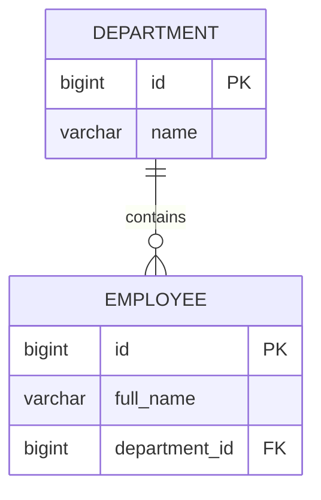

# N+1 trong quan hệ đơn trị lẫn đa trị trong Hibernate

## 1. N+1 là vấn đề gì?

**N+1 query problem** xảy ra khi ứng dụng chạy một truy vấn để lấy danh sách entity gốc, rồi phát thêm một truy vấn cho mỗi entity hoặc mỗi association được truy cập. Nếu có N entity gốc, tổng số truy vấn thường thành **1 + N** thay vì một số lượng nhỏ có thể dự đoán.

Ví dụ có 100 nhân viên. Ứng dụng lấy danh sách nhân viên bằng một câu SELECT, sau đó lặp qua từng nhân viên để đọc tên phòng ban:

```java
List<Employee> employees = em.createQuery(
        "select e from Employee e order by e.id",
        Employee.class
    )
    .getResultList();

for (Employee employee : employees) {
    System.out.println(employee.getDepartment().getName());
}
```

Nếu association `department` chưa được nạp và Hibernate phải khởi tạo riêng cho từng nhân viên, SQL có thể có dạng:

```sql
-- 1. Lấy danh sách nhân viên.
SELECT e.id, e.full_name, e.department_id
FROM employees e
ORDER BY e.id;

-- Các SELECT tiếp theo lấy department chưa được nạp.
SELECT d.id, d.name
FROM departments d
WHERE d.id = ?;

SELECT d.id, d.name
FROM departments d
WHERE d.id = ?;
```

Nếu 100 nhân viên tham chiếu 100 phòng ban khác nhau và không có cache đáp ứng, có thể có 1 truy vấn gốc cộng 100 truy vấn association. Nếu nhiều nhân viên cùng tham chiếu một phòng ban, first-level cache có thể giảm số SELECT xuống số **ID phòng ban khác nhau**. Vì vậy, N+1 là dạng hành vi có thể xảy ra; số truy vấn thực tế còn phụ thuộc dữ liệu, persistence context, cache và fetch plan.

N+1 không chỉ xuất hiện với quan hệ đơn trị như `@ManyToOne` hoặc `@OneToOne`. Nó cũng phổ biến với collection `@OneToMany` và `@ManyToMany`, khi ứng dụng lấy nhiều entity cha rồi lần lượt truy cập collection của từng entity.

## 2. Vì sao N+1 gây chậm?

Một câu SELECT riêng lẻ có thể nhanh, nhưng nhiều lượt round-trip giữa ứng dụng và database tạo ra chi phí cộng dồn:

- **Network latency:** mỗi truy vấn thường cần một lượt trao đổi giữa JDBC client và database.
- **Parse/plan/execute:** database phải xử lý nhiều statement hoặc nhiều lần thực thi prepared statement.
- **Connection và driver overhead:** nhiều thao tác JDBC làm tăng chi phí ở tầng ứng dụng.
- **Tải dữ liệu rời rạc:** các SELECT nhỏ có thể bỏ lỡ cơ hội join hoặc batch.
- **Khó dự đoán khi dữ liệu tăng:** code chạy ổn với 5 entity nhưng chậm rõ khi có hàng trăm hoặc hàng nghìn entity.

N+1 thường không phải lỗi cú pháp hay lỗi mapping. Nó là **vấn đề về kế hoạch tải dữ liệu**: code đã yêu cầu một đồ thị object, nhưng ORM tải các phần của đồ thị bằng quá nhiều câu SQL riêng.

## 3. Quan hệ đơn trị: N+1 với `@ManyToOne`

### 3.1. Ví dụ Employee–Department

Một nhân viên thuộc một phòng ban; một phòng ban có thể có nhiều nhân viên:



Mapping:

```java
@Entity
@Table(name = "departments")
public class Department {

    @Id
    @GeneratedValue(strategy = GenerationType.IDENTITY)
    private Long id;

    @Column(nullable = false)
    private String name;

    protected Department() {
    }

    public String getName() {
        return name;
    }
}
```

```java
@Entity
@Table(name = "employees")
public class Employee {

    @Id
    @GeneratedValue(strategy = GenerationType.IDENTITY)
    private Long id;

    @Column(name = "full_name", nullable = false)
    private String fullName;

    @ManyToOne(fetch = FetchType.LAZY)
    @JoinColumn(name = "department_id")
    private Department department;

    protected Employee() {
    }

    public String getFullName() {
        return fullName;
    }

    public Department getDepartment() {
        return department;
    }
}
```

Với `FetchType.LAZY`, Hibernate có thể giữ proxy hoặc lazy reference cho `Department`. Khi code truy cập `getName()`, proxy có thể được khởi tạo và phát SELECT.

```java
List<Employee> employees =
        em.createQuery("select e from Employee e", Employee.class)
          .getResultList();

for (Employee employee : employees) {
    System.out.println(employee.getDepartment().getName());
}
```

Nếu danh sách có N nhân viên và mỗi nhân viên tham chiếu một Department khác nhau, mẫu SQL thường là:

```text
1 SELECT lấy N Employee
N SELECT lấy Department tương ứng
--------------------------------
Tổng: 1 + N SELECT
```

### 3.2. Số truy vấn có thể ít hơn N

Giả sử 100 nhân viên chỉ thuộc 4 phòng ban. Trong cùng một persistence context, Hibernate thường chỉ cần khởi tạo mỗi Department identity một lần. Khi các nhân viên khác cùng tham chiếu một ID đã managed, Hibernate có thể lấy lại cùng instance từ first-level cache.

Số truy vấn có thể gần:

```text
1 SELECT lấy Employee
4 SELECT lấy 4 Department khác nhau
-------------------------------
Tổng: 1 + 4 SELECT
```

Đây vẫn là dạng hành vi N+1 theo cấu trúc code, nhưng dữ liệu cụ thể và cache làm số SELECT association nhỏ hơn N. Khi số phòng ban gần bằng số nhân viên, chi phí lại tăng.

### 3.3. `@ManyToOne` mặc định là EAGER theo JPA

Một điểm dễ gây nhầm: mặc định của `@ManyToOne` trong Jakarta Persistence là `FetchType.EAGER`, không phải LAZY. Tuy vậy, EAGER **không có nghĩa Hibernate bắt buộc phải dùng một JOIN duy nhất**.

Ví dụ JPQL:

```java
List<Employee> employees = em.createQuery(
        "select e from Employee e",
        Employee.class
    )
    .getResultList();
```

Nếu association EAGER cần được nạp mà câu query không join fetch nó, Hibernate có thể phát SELECT phụ để lấy các Department. Với nhiều nhân viên tham chiếu nhiều department, điều này vẫn có thể tạo N+1 dù mapping đang EAGER.

Do đó, đổi mọi quan hệ sang EAGER không phải cách chữa N+1. EAGER chỉ nói association phải được tải theo ngữ nghĩa mapping; nó không phải một kế hoạch SQL tối ưu cho mọi use case.

### 3.4. `@OneToOne` cũng có thể gặp N+1

Một quan hệ một-một có thể được truy cập theo cách tương tự:

```java
@Entity
class EmployeeProfile {

    @Id
    private Long id;

    @OneToOne(fetch = FetchType.LAZY)
    @JoinColumn(name = "employee_id")
    private Employee employee;
}
```

Nếu tải nhiều `EmployeeProfile` rồi lần lượt đọc `profile.getEmployee().getFullName()`, association chưa khởi tạo có thể tạo các SELECT bổ sung.

Lazy loading của `@OneToOne`, đặc biệt ở phía inverse không sở hữu FK, có những chi tiết riêng. Hibernate đôi khi cần biết association có tồn tại hay không trước khi quyết định tạo proxy. Bytecode enhancement và mapping optionality có thể ảnh hưởng khả năng lazy. Không giả định mọi `@OneToOne(fetch = LAZY)` đều trì hoãn tải giống hệt `@ManyToOne`.

## 4. Quan hệ đa trị: N+1 với `@OneToMany`

### 4.1. Ví dụ Department–Employee

Một phòng ban có nhiều nhân viên. Mapping hai chiều thường dùng:

```java
@Entity
@Table(name = "departments")
public class Department {

    @Id
    @GeneratedValue(strategy = GenerationType.IDENTITY)
    private Long id;

    private String name;

    @OneToMany(mappedBy = "department", fetch = FetchType.LAZY)
    private List<Employee> employees = new ArrayList<>();

    protected Department() {
    }

    public List<Employee> getEmployees() {
        return employees;
    }
}
```

Phía `Employee` sở hữu FK:

```java
@ManyToOne(fetch = FetchType.LAZY)
@JoinColumn(name = "department_id")
private Department department;
```

Collection `@OneToMany` mặc định LAZY theo Jakarta Persistence. Nếu lấy 50 phòng ban rồi gọi `getEmployees()` trên từng phòng ban, Hibernate có thể phát một SELECT riêng cho mỗi collection:

```java
List<Department> departments =
        em.createQuery("select d from Department d", Department.class)
          .getResultList();

for (Department department : departments) {
    System.out.println(
        department.getName() + ": "
        + department.getEmployees().size()
    );
}
```

SQL có dạng:

```sql
-- 1. Truy vấn danh sách department.
SELECT d.id, d.name
FROM departments d;

-- 2. Mỗi collection được khởi tạo riêng.
SELECT e.id, e.full_name, e.department_id
FROM employees e
WHERE e.department_id = ?;

SELECT e.id, e.full_name, e.department_id
FROM employees e
WHERE e.department_id = ?;
```

Với N phòng ban, số câu SELECT có thể là 1 + N. Một phòng ban không có nhân viên cũng có thể cần truy vấn để Hibernate xác định collection rỗng khi collection được khởi tạo.

### 4.2. Vì sao gọi `size()` cũng có thể gây truy vấn?

Một collection lazy thường được đại diện bởi wrapper của Hibernate. Khi code gọi:

```java
department.getEmployees().size();
```

Hibernate có thể phải khởi tạo collection để biết đầy đủ phần tử, tùy mapping và cách thao tác. Vì thế, chỉ gọi `size()` trong vòng lặp cũng có thể gây N+1.

Nếu chỉ cần số lượng, có thể truy vấn aggregate:

```java
List<Object[]> counts = em.createQuery(
        """
        select d.id, count(e)
        from Department d
        left join d.employees e
        group by d.id
        """,
        Object[].class
    )
    .getResultList();
```

Với API thực tế, nên ánh xạ kết quả vào DTO thay vì trả `Object[]` nếu có thể.

### 4.3. `@ManyToMany` cũng tạo N+1 khi tải collection

Ví dụ sinh viên đăng ký nhiều khóa học:

```java
@Entity
class Student {

    @Id
    private Long id;

    @ManyToMany(fetch = FetchType.LAZY)
    @JoinTable(
        name = "student_courses",
        joinColumns = @JoinColumn(name = "student_id"),
        inverseJoinColumns = @JoinColumn(name = "course_id")
    )
    private Set<Course> courses = new HashSet<>();

    public Set<Course> getCourses() {
        return courses;
    }
}
```

Nếu lấy N sinh viên rồi truy cập `student.getCourses()`, Hibernate có thể phát một truy vấn join table cho từng sinh viên. Câu SQL thường join `student_courses` với `courses` để nạp collection.

### 4.4. N+1 có thể xuất hiện ở nhiều tầng

Một use case có thể truy cập nhiều tầng association:

```text
Department
  -> employees
       -> department
       -> projects
            -> tasks
```

Nếu code lần lượt truy cập collection nhân viên, project của từng nhân viên, rồi task của từng project, số query có thể tăng theo từng cấp. Có thể xuất hiện nhiều nhóm N+1 hoặc kết hợp SELECT collection với SELECT to-one.

Khi điều tra cần nhìn **toàn bộ đường đi dữ liệu của use case**, không chỉ association đầu tiên trong entity.

## 5. Cách 1: JOIN FETCH để lấy association trong cùng truy vấn

Với use case biết trước cần association nào, `JOIN FETCH` là cách trực tiếp để yêu cầu Hibernate lấy chúng trong query.

### 5.1. Chữa N+1 của quan hệ đơn trị

```java
List<Employee> employees = em.createQuery(
        """
        select e
        from Employee e
        join fetch e.department
        order by e.id
        """,
        Employee.class
    )
    .getResultList();
```

SQL có thể tương đương:

```sql
SELECT
    e.id,
    e.full_name,
    e.department_id,
    d.id,
    d.name
FROM employees e
JOIN departments d
    ON d.id = e.department_id
ORDER BY e.id;
```

Hibernate có thể dựng Employee và Department từ cùng result set. Vòng lặp gọi `getDepartment().getName()` không cần SELECT riêng cho từng Department đã được fetch.

Nếu association optional, dùng `left join fetch` để giữ lại entity không có liên kết:

```java
List<Employee> employees = em.createQuery(
        """
        select e
        from Employee e
        left join fetch e.department
        order by e.id
        """,
        Employee.class
    )
    .getResultList();
```

- `join fetch` dùng inner join, chỉ trả các hàng có association khớp.
- `left join fetch` giữ cả hàng gốc không có association.

### 5.2. Chữa N+1 của collection

Lấy Department cùng Employee:

```java
List<Department> departments = em.createQuery(
        """
        select distinct d
        from Department d
        left join fetch d.employees
        order by d.id
        """,
        Department.class
    )
    .getResultList();
```

SQL có thể tương đương:

```sql
SELECT
    d.id,
    d.name,
    e.id,
    e.full_name,
    e.department_id
FROM departments d
LEFT JOIN employees e
    ON e.department_id = d.id
ORDER BY d.id;
```

Hibernate xây dựng collection nhân viên từ các dòng result set. `distinct` thường được dùng trong JPQL để diễn đạt kết quả entity gốc không trùng lặp; cách Hibernate xử lý duplicate root result và SQL DISTINCT có thể khác theo phiên bản. Dù danh sách Java được loại trùng, **số dòng SQL vẫn có thể tăng** vì một Department có nhiều Employee.

### 5.3. JOIN FETCH không phải lúc nào cũng nhanh hơn

Join fetch giảm số round-trip, nhưng có thể làm result set phình lớn:

- Một Department có 100 Employee tạo ít nhất 100 dòng kết quả cho department đó.
- Hai collection cùng được join có thể tạo tích Descartes giữa các phần tử của hai collection.
- Nhiều cột từ các bảng được lặp lại trên từng dòng.
- Database, driver và Hibernate phải xử lý nhiều dữ liệu hơn.

Mục tiêu không phải “một SQL bằng mọi giá”. Mục tiêu là **fetch plan cân bằng giữa số round-trip và lượng dữ liệu**.

### 5.4. Fetch nhiều collection cùng lúc

Ví dụ:

```java
select distinct d
from Department d
left join fetch d.employees
left join fetch d.projects
```

Nếu một Department có 10 Employee và 8 Project, join có thể tạo 80 dòng cho department đó. Dữ liệu tăng nhanh khi nhiều collection được fetch đồng thời.

Với các collection kiểu bag (thường gặp khi dùng `List` không có thứ tự/index mapping), Hibernate còn có thể ném `MultipleBagFetchException` khi cố fetch đồng thời nhiều bag. Đổi `List` thành `Set` chỉ để tránh exception không phải lúc nào cũng đúng ngữ nghĩa domain.

Các hướng phù hợp hơn:

- Fetch một collection và tải collection còn lại bằng query riêng.
- Dùng batch fetching.
- Chia thành nhiều truy vấn có kiểm soát.
- Dùng DTO projection để chỉ lấy dữ liệu cần thiết.
- Thiết kế lại endpoint để không trả toàn bộ graph quá lớn.

## 6. Cách 2: EntityGraph để khai báo fetch plan theo use case

Không phải lúc nào cũng muốn viết JPQL join fetch riêng. Jakarta Persistence có Entity Graph để mô tả những thuộc tính cần tải cho một thao tác.

### 6.1. Tạo graph bằng API

Ví dụ cần Employee cùng Department:

```java
EntityGraph<Employee> graph =
        em.createEntityGraph(Employee.class);

graph.addAttributeNodes("department");

List<Employee> employees = em.createQuery(
        "select e from Employee e",
        Employee.class
    )
    .setHint("jakarta.persistence.fetchgraph", graph)
    .getResultList();
```

`fetchgraph` yêu cầu các thuộc tính trong graph được fetch theo graph; thuộc tính ngoài graph được xử lý như LAZY theo ngữ nghĩa fetch graph. Với `loadgraph`, thuộc tính trong graph được fetch, còn thuộc tính ngoài graph giữ fetch semantics mapping.

### 6.2. Graph có collection

Ví dụ cần Department và collection Employee:

```java
EntityGraph<Department> graph =
        em.createEntityGraph(Department.class);

graph.addAttributeNodes("employees");

List<Department> departments = em.createQuery(
        "select d from Department d",
        Department.class
    )
    .setHint("jakarta.persistence.fetchgraph", graph)
    .getResultList();
```

Có thể tạo subgraph cho association lồng nhau:

```java
EntityGraph<Department> graph =
        em.createEntityGraph(Department.class);

Subgraph<Employee> employeeGraph =
        graph.addSubgraph("employees");

employeeGraph.addAttributeNodes("department");
```

EntityGraph diễn đạt **nhu cầu dữ liệu** theo use case. Nó không bảo đảm provider phải thực hiện bằng đúng một câu SQL JOIN; Hibernate có thể chọn chiến lược SQL phù hợp. Vẫn cần quan sát SQL và đo số truy vấn.

### 6.3. Named EntityGraph

Graph có thể khai báo trên entity:

```java
@NamedEntityGraph(
    name = "Employee.withDepartment",
    attributeNodes = @NamedAttributeNode("department")
)
@Entity
public class Employee {
    // ...
}
```

Sau đó lấy graph theo tên:

```java
EntityGraph<?> graph = em.getEntityGraph(
        "Employee.withDepartment"
);

List<Employee> employees = em.createQuery(
        "select e from Employee e",
        Employee.class
    )
    .setHint("jakarta.persistence.fetchgraph", graph)
    .getResultList();
```

Named graph hữu ích khi một fetch plan được dùng ở nhiều nơi. Graph động hữu ích khi từng use case cần tập association khác nhau.

## 7. Cách 3: Batch fetching để gom nhiều lần tải thành nhóm

Nếu không muốn join một collection lớn vào result set, Hibernate có thể gom các association lazy chưa khởi tạo vào một số truy vấn theo batch.

### 7.1. Batch fetching cho collection

```java
@Entity
public class Department {

    @Id
    private Long id;

    @OneToMany(mappedBy = "department", fetch = FetchType.LAZY)
    @BatchSize(size = 32)
    private List<Employee> employees = new ArrayList<>();
}
```

Khi một collection được khởi tạo, Hibernate có thể chọn thêm các collection cùng role đang chờ trong persistence context và nạp theo nhóm. SQL có thể dạng:

```sql
SELECT e.department_id, e.id, e.full_name
FROM employees e
WHERE e.department_id IN (?, ?, ?, ...);
```

Thay vì N truy vấn cho N phòng ban, batch size 32 có thể giảm xuống khoảng một truy vấn cho mỗi nhóm tối đa 32 owner, tùy số collection cần tải và tình trạng context.

### 7.2. Batch fetching cho to-one proxy

Với quan hệ `Employee.department`, có thể đặt `@BatchSize` trên entity đích:

```java
@Entity
@BatchSize(size = 32)
public class Department {
    // ...
}
```

Khi nhiều proxy Department đang chờ khởi tạo, Hibernate có thể lấy nhiều ID trong một SELECT với `IN` thay vì một SELECT mỗi proxy.

### 7.3. Cấu hình batch mặc định

Có thể đặt cấu hình toàn cục:

```properties
hibernate.default_batch_fetch_size=32
```

Hoặc trong `persistence.xml`:

```xml
<property name="hibernate.default_batch_fetch_size"
          value="32"/>
```

Giá trị 32 chỉ là ví dụ. Batch size phù hợp phụ thuộc database parameter limits, kích thước dữ liệu, JDBC driver, memory và workload. Không chọn một con số rồi mặc định nó tối ưu cho mọi hệ thống.

### 7.4. Batch fetching khác JOIN FETCH

| Tiêu chí | JOIN FETCH | Batch fetching |
|---|---|---|
| Cách tải | Join association vào truy vấn gốc | Tải association lazy theo nhóm bằng SELECT bổ sung |
| Số round-trip | Có thể một query cho graph đó | Nhiều query theo số batch |
| Kích thước result set | Có thể nhân dòng do collection | Tách result set theo association |
| Khi phù hợp | Graph nhỏ, biết rõ cần association | Nhiều association lazy, collection vừa/lớn |
| Pagination collection | Dễ gặp vấn đề với fetch join | Thường dễ kết hợp pagination hơn |
| Cấu hình | Fetch plan trong query | `@BatchSize` hoặc cấu hình mặc định |

Batch fetching giảm N+1, nhưng không biến mọi trường hợp thành một query. Nó gom nhiều lazy loads thành nhóm.

## 8. Cách 4: Subselect fetching cho collection

Hibernate cung cấp chiến lược riêng `FetchMode.SUBSELECT` cho collection:

```java
import org.hibernate.annotations.Fetch;
import org.hibernate.annotations.FetchMode;

@Entity
public class Department {

    @Id
    private Long id;

    @OneToMany(mappedBy = "department", fetch = FetchType.LAZY)
    @Fetch(FetchMode.SUBSELECT)
    private List<Employee> employees = new ArrayList<>();
}
```

Khi ứng dụng tải một tập Department bằng query rồi khởi tạo collection của một Department, Hibernate có thể dùng subselect để tải collection cùng role cho các owner liên quan đã được nạp bởi query trước đó trong persistence context.

SQL có thể có hình thức:

```sql
SELECT e.department_id, e.id, e.full_name
FROM employees e
WHERE e.department_id IN (
    SELECT d.id
    FROM departments d
    WHERE ...
);
```

SQL thực tế và phạm vi owner phụ thuộc query gốc, Hibernate version và mapping. `FetchMode.SUBSELECT` là Hibernate-specific, không phải annotation chuẩn Jakarta Persistence.

Subselect có thể hữu ích khi một truy vấn tải một tập parent và use case cần collection của hầu hết hoặc tất cả parent trong tập. Nó ít phù hợp khi chỉ cần collection của một parent hoặc khi truy vấn gốc tải một tập parent rất lớn. Cần quan sát SQL và đo lượng dữ liệu thực tế.

## 9. Cách 5: DTO projection khi chỉ cần dữ liệu hiển thị

Nhiều endpoint không cần một đồ thị entity đầy đủ. Ví dụ trang danh sách nhân viên chỉ hiển thị tên nhân viên và tên phòng ban. Tải Employee entity rồi truy cập Department có thể tạo N+1 không cần thiết.

Dùng DTO projection:

```java
package com.example.company;

public record EmployeeRow(
        Long employeeId,
        String employeeName,
        String departmentName
) {
}
```

JPQL:

```java
List<EmployeeRow> rows = em.createQuery(
        """
        select new com.example.company.EmployeeRow(
            e.id,
            e.fullName,
            d.name
        )
        from Employee e
        left join e.department d
        order by e.id
        """,
        EmployeeRow.class
    )
    .getResultList();
```

SQL có thể lấy đúng các cột cần thiết:

```sql
SELECT e.id, e.full_name, d.name
FROM employees e
LEFT JOIN departments d
    ON d.id = e.department_id
ORDER BY e.id;
```

Không cần hydrate cả hai entity và collection chỉ để tạo một dòng response.

### 9.1. DTO cho tổng số nhân viên mỗi phòng ban

```java
public record DepartmentSummary(
        Long departmentId,
        String departmentName,
        long employeeCount
) {
}
```

```java
List<DepartmentSummary> summaries = em.createQuery(
        """
        select new com.example.company.DepartmentSummary(
            d.id,
            d.name,
            count(e)
        )
        from Department d
        left join d.employees e
        group by d.id, d.name
        order by d.name
        """,
        DepartmentSummary.class
    )
    .getResultList();
```

Câu truy vấn aggregate trả về một hàng summary cho mỗi phòng ban. Nó tránh việc tải toàn bộ collection Employee chỉ để gọi `size()`.

### 9.2. DTO cho nhiều-nhiều

Nếu trang sinh viên chỉ cần tên khóa học, có thể truy vấn trực tiếp:

```java
public record StudentCourseRow(
        Long studentId,
        String studentName,
        String courseName
) {
}
```

```java
List<StudentCourseRow> rows = em.createQuery(
        """
        select new com.example.school.StudentCourseRow(
            s.id,
            s.name,
            c.name
        )
        from Student s
        join s.courses c
        order by s.id, c.name
        """,
        StudentCourseRow.class
    )
    .getResultList();
```

DTO projection phù hợp với read model/API, báo cáo và danh sách. Nếu cần sửa entity hoặc thực hiện nghiệp vụ trên aggregate, vẫn có thể tải entity managed trong một use case khác.

## 10. Pagination và collection fetch join

Một lỗi thiết kế thường gặp là kết hợp phân trang với fetch join collection:

```java
List<Department> page = em.createQuery(
        """
        select distinct d
        from Department d
        left join fetch d.employees
        order by d.id
        """,
        Department.class
    )
    .setFirstResult(0)
    .setMaxResults(20)
    .getResultList();
```

Database phân trang trên **các dòng kết quả join**, trong khi ứng dụng mong muốn phân trang trên Department. Một Department có nhiều Employee làm số dòng SQL lớn hơn số parent. Vì vậy, phân trang trực tiếp trên collection fetch join có thể cho kết quả không như mong đợi hoặc buộc Hibernate xử lý pagination trong bộ nhớ. Cấu hình Hibernate có thể phát cảnh báo hoặc được thiết lập để fail khi gặp trường hợp này.

Không nên dùng collection fetch join trực tiếp với pagination trên tập parent lớn.

### 10.1. Cách hai bước: phân trang ID trước

Bước 1: lấy ID của trang cần hiển thị:

```java
List<Long> ids = em.createQuery(
        """
        select d.id
        from Department d
        order by d.name, d.id
        """,
        Long.class
    )
    .setFirstResult(offset)
    .setMaxResults(pageSize)
    .getResultList();
```

Bước 2: nếu trang có ID, tải association cho đúng nhóm parent đó:

```java
List<Department> departments = ids.isEmpty()
    ? List.of()
    : em.createQuery(
        """
        select distinct d
        from Department d
        left join fetch d.employees
        where d.id in :ids
        """,
        Department.class
    )
    .setParameter("ids", ids)
    .getResultList();
```

`IN (:ids)` không bảo đảm giữ thứ tự danh sách ID ban đầu. Nếu API cần thứ tự trang theo `name`, hãy sắp xếp lại kết quả theo thứ tự ID đã lấy hoặc dùng query/DTO có thứ tự phù hợp.

### 10.2. Hai bước có thể tải collection rất lớn

Dù chỉ tải 20 Department, mỗi Department có thể có hàng chục nghìn Employee. Fetch join vẫn tạo result set lớn. Khi đó nên:

- Chỉ tải summary/count trong trang.
- Tải danh sách Employee bằng endpoint/query riêng có pagination.
- Dùng batch fetching khi phù hợp.
- Thiết kế response không yêu cầu toàn bộ graph.

Phân trang parent không tự giới hạn số child trong collection.

## 11. Vì sao không nên chữa N+1 bằng cách đặt EAGER toàn bộ?

Một phản ứng thường gặp là đổi:

```java
@ManyToOne(fetch = FetchType.LAZY)
private Department department;
```

thành:

```java
@ManyToOne(fetch = FetchType.EAGER)
private Department department;
```

hoặc đặt EAGER cho nhiều collection. Cách này có thể làm dữ liệu được tải sớm hơn, nhưng không quyết định rằng Hibernate phải dùng một JOIN tối ưu. Provider có thể phát các SELECT phụ để thỏa mãn EAGER semantics.

Những rủi ro của EAGER rộng khắp:

- Mọi use case tải entity đều phải đáp ứng fetch requirement, kể cả khi không cần association.
- Truy vấn một danh sách có thể kích hoạt nhiều SELECT phụ.
- Graph EAGER lồng nhau khó dự đoán và có thể kéo thêm nhiều dữ liệu.
- Dễ gặp truy vấn dư khi chỉ cần một vài cột.
- Khó kiểm soát pagination và result set.

Thường nên giữ mapping collection LAZY, cân nhắc LAZY cho to-one association và định nghĩa fetch plan theo use case bằng join fetch, EntityGraph, batch fetching hoặc projection.

Lưu ý: `FetchType.LAZY` cho to-one là hint theo đặc tả JPA; khả năng thực hiện phụ thuộc provider, proxy/bytecode enhancement và mapping. Hãy kiểm tra SQL thực tế thay vì chỉ đọc annotation.

## 12. N+1 do serialization, template và logging

N+1 không chỉ phát sinh trong service code. Nó có thể xuất hiện ở nơi truy cập entity gián tiếp.

### 12.1. JSON serialization

Ví dụ controller trả trực tiếp entity:

```java
@GetMapping("/departments")
public List<Department> list() {
    return departmentRepository.findAll();
}
```

Serializer có thể gọi getter collection `employees` trên từng Department. Nếu persistence context còn mở, quá trình serialize có thể kích hoạt N+1. Nếu context đã đóng, nó có thể gặp `LazyInitializationException` thay vì N+1.

Dùng DTO để kiểm soát rõ dữ liệu response. Chuyển entity thành DTO trong transaction/query có fetch plan rõ ràng. Không dựa vào serializer tự quyết định graph nào cần tải.

### 12.2. Template và mapper

Template engine, object mapper hoặc thư viện chuyển entity sang view có thể gọi getter lồng nhau. Một vòng lặp hiển thị nhiều record kèm association vẫn có thể gây N+1 dù service không có vòng lặp rõ ràng.

Khi điều tra, xem cả JSON serializer, mapper, template/view rendering, logging `toString()`, `equals()`/`hashCode()` có truy cập association và event listener truy cập lazy field.

### 12.3. Open Session in View không phải cách chữa

Open Session in View (OSIV) giữ persistence context mở qua một phần request để lazy loading vẫn hoạt động khi render response. Nó có thể tránh lỗi lazy initialization, nhưng **không tự loại bỏ N+1**. Truy vấn thậm chí có thể phát sinh muộn ở tầng serialization, khiến khó nhìn ra nơi tạo chi phí.

Cần thiết kế fetch plan và DTO rõ ràng. OSIV là quyết định kiến trúc vòng đời persistence context, không phải giải pháp tối ưu truy vấn.

## 13. Cache có giải quyết N+1 không?

First-level cache (persistence context) giúp tránh nạp lại cùng một entity identity nhiều lần trong cùng context. Second-level cache có thể giúp giảm SELECT xuống database nếu entity/association đã có trong cache và cache được cấu hình đúng.

Tuy nhiên, cache không thay thế fetch plan:

- Mỗi collection owner vẫn có thể cần kiểm tra hoặc nạp collection state.
- Cache miss vẫn gây query.
- Cache invalidation và độ mới dữ liệu phải được quản lý.
- Môi trường production có thể có cache lạnh hoặc phân bố dữ liệu khác môi trường dev.
- Nhiều lượt truy cập cache cũng có chi phí.

Một bài test chỉ chạy nhanh vì cache đã nóng không chứng minh N+1 đã được giải quyết. Hãy kiểm tra query count với cache được kiểm soát và dữ liệu đủ lớn.

## 14. Cách phát hiện N+1

### 14.1. Bật SQL logging trong môi trường phát triển

Trong cấu hình Hibernate có thể bật:

```xml
<property name="hibernate.show_sql" value="true"/>
<property name="hibernate.format_sql" value="true"/>
<property name="hibernate.use_sql_comments" value="true"/>
<property name="hibernate.generate_statistics" value="true"/>
```

Hoặc cấu hình logging backend cho SQL và bind parameters. Với Hibernate 6.x, category bind parameters thường là `org.hibernate.orm.jdbc.bind` ở mức TRACE; tránh ghi dữ liệu nhạy cảm trong production.

Dấu hiệu thường gặp:

- Một SELECT lấy nhiều entity gốc.
- Nhiều SELECT có cùng cấu trúc, chỉ khác FK/ID bind.
- Các SELECT lặp xuất hiện khi vòng lặp gọi getter association.
- Số query tăng gần tuyến tính theo số entity gốc.

### 14.2. Dùng Hibernate Statistics

Có thể lấy số statement được chuẩn bị từ `SessionFactory`:

```java
SessionFactory sessionFactory =
        emf.unwrap(SessionFactory.class);

Statistics statistics = sessionFactory.getStatistics();
statistics.setStatisticsEnabled(true);
statistics.clear();

// Chạy use case cần đo ở đây.

long preparedStatements =
        statistics.getPrepareStatementCount();

System.out.println(
        "Prepared statements: " + preparedStatements
);
```

Statistics là số liệu cấp SessionFactory và có thể bị ảnh hưởng bởi các test/request khác chạy đồng thời. Khi đo trong integration test, cô lập workload, reset statistics ở thời điểm phù hợp và tránh chạy test song song trên cùng factory nếu cần query count chính xác.

### 14.3. Dùng datasource proxy hoặc SQL inspector

Các công cụ như datasource-proxy, P6Spy hoặc Hibernate `StatementInspector` có thể giúp ghi nhận SQL, đếm statement và liên kết truy vấn với request/test. Khi dùng, tránh log credentials, token hoặc dữ liệu cá nhân.

### 14.4. Test với dữ liệu có nhiều association

Một test chỉ có một Department và một Employee sẽ không bộc lộ rõ N+1. Hãy tạo dữ liệu với nhiều parent và association, rồi chạy đúng use case:

1. Tạo 30 Department và Employee tương ứng.
2. Flush và clear để không dùng entity còn nằm trong first-level cache.
3. Reset query statistics.
4. Tải danh sách parent.
5. Truy cập association giống production.
6. Đọc query count và SQL log.
7. Thử fetch plan thay thế rồi so sánh.

Không nhất thiết assert một số query cố định nếu Hibernate version, dialect hoặc cache policy có thể thay đổi; nhưng có thể đặt ngưỡng hợp lý để phát hiện số truy vấn tăng tuyến tính ngoài ý muốn.

## 15. Chọn chiến lược theo loại association và use case

| Nhu cầu | Cách thường phù hợp | Điểm cần chú ý |
|---|---|---|
| Danh sách Employee cần Department | `JOIN FETCH` to-one hoặc EntityGraph | Thường tránh N+1 |
| Danh sách Department cần toàn bộ Employee và tập nhỏ | `LEFT JOIN FETCH` collection | Dòng SQL nhân theo số child |
| Nhiều collection lazy được truy cập theo nhóm | `@BatchSize` / default batch fetch | Vẫn có nhiều query theo batch |
| Nạp collection của nhiều parent cùng query | `FetchMode.SUBSELECT` | Hibernate-specific, xem phạm vi subselect |
| Chỉ cần tên Department trong danh sách Employee | DTO projection với join | Không hydrate entity graph không cần thiết |
| Chỉ cần số Employee mỗi Department | Aggregate query `COUNT` | Không tải collection |
| Trang Department có collection lớn | Phân trang ID rồi query child riêng | Giữ thứ tự trang, giới hạn child |
| Nhiều collection cùng lúc | Nhiều query có kiểm soát hoặc DTO | Tránh tích Descartes/multiple bag |
| Association chỉ dùng ở một số màn hình | LAZY mapping + fetch plan theo use case | Không đặt EAGER toàn cục |
| API trả dữ liệu lồng nhau | DTO được thiết kế rõ | Tránh serializer kích hoạt lazy loads |

Không có một fetch strategy tối ưu cho tất cả. Một use case đọc 20 Department cùng toàn bộ Employee có thể phù hợp với join fetch; một trang hiển thị count có thể phù hợp với aggregate DTO; một báo cáo có hàng nghìn parent có thể hợp với batch hoặc query riêng.

## 16. Ví dụ tổng hợp: so sánh ba cách tải

Giả sử màn hình hiển thị danh sách Department và số nhân viên.

### 16.1. Cách dễ gây N+1

```java
List<Department> departments = em.createQuery(
        "select d from Department d order by d.name",
        Department.class
    )
    .getResultList();

for (Department d : departments) {
    System.out.println(
        d.getName() + " - " + d.getEmployees().size()
    );
}
```

Nếu N collection chưa được khởi tạo, có thể có 1 + N SELECT.

### 16.2. Cách join fetch

```java
List<Department> departments = em.createQuery(
        """
        select distinct d
        from Department d
        left join fetch d.employees
        order by d.name
        """,
        Department.class
    )
    .getResultList();

for (Department d : departments) {
    System.out.println(
        d.getName() + " - " + d.getEmployees().size()
    );
}
```

Có thể chỉ cần một truy vấn SQL, nhưng result set chứa dữ liệu của từng Employee. Nếu collection lớn, đây có thể là quá nhiều dữ liệu cho màn hình chỉ cần count.

### 16.3. Cách aggregate DTO

```java
public record DepartmentCount(
        Long id,
        String name,
        long employeeCount
) {
}
```

```java
List<DepartmentCount> result = em.createQuery(
        """
        select new com.example.company.DepartmentCount(
            d.id,
            d.name,
            count(e)
        )
        from Department d
        left join d.employees e
        group by d.id, d.name
        order by d.name
        """,
        DepartmentCount.class
    )
    .getResultList();
```

Cách này trả một hàng summary cho mỗi Department và không cần khởi tạo collection Employee. Nếu màn hình chỉ hiển thị số lượng, đây thường là fetch plan gọn hơn.

## 17. Những anti-pattern thường gặp

| Anti-pattern | Vấn đề | Hướng xử lý |
|---|---|---|
| Lặp entity rồi gọi getter lazy trong từng vòng | Mỗi association có thể tạo SELECT riêng | Join fetch, EntityGraph hoặc batch |
| Đổi mọi association sang EAGER | EAGER không bảo đảm một JOIN; tải dư dữ liệu | LAZY có chủ đích và fetch theo use case |
| Dùng collection fetch join cho mọi query | Result set nhân dòng, có thể gây pagination issue | Chỉ fetch khi graph và kích thước phù hợp |
| Fetch nhiều collection lớn cùng lúc | Tích Descartes hoặc MultipleBagFetchException | Chia query hoặc dùng DTO/batch |
| Dùng collection fetch join cùng pagination | Phân trang trên dòng join có thể sai/được xử lý trong memory | Hai bước: page ID rồi fetch |
| Gọi `collection.size()` trong vòng lặp | Có thể khởi tạo từng collection | Aggregate count hoặc fetch plan |
| Trả entity trực tiếp cho JSON | Serializer có thể kích hoạt lazy loads | DTO projection/response |
| Dựa vào OSIV để mọi lazy field hoạt động | N+1 có thể xảy ra muộn ở tầng render | Fetch rõ trong service/query |
| Chỉ test với một parent | Không thể quan sát pattern N+1 | Seed nhiều parent/association |
| Tin cache nóng đã giải quyết N+1 | Cache miss hoặc cache lạnh vẫn nhiều query | Đo với cache được kiểm soát |
| Dùng join fetch để lấy toàn bộ child dù chỉ cần count | Tải quá nhiều row và object | COUNT/group by DTO |
| Dùng `distinct` nghĩ rằng SQL row multiplication biến mất | Entity result có thể được loại trùng nhưng dữ liệu join vẫn lớn | Chọn fetch plan phù hợp |

## 18. Bài tập thực hành

**Bài 1 — N+1 với ManyToOne.** Tạo 100 Employee thuộc 100 Department khác nhau. Tải danh sách Employee rồi truy cập tên Department. Bật SQL log và ghi số SELECT. Lặp lại khi 100 Employee chỉ thuộc 5 Department để quan sát tác động của identity map.

**Bài 2 — N+1 với OneToMany.** Tạo 30 Department, mỗi Department có nhiều Employee. Tải Department rồi gọi `getEmployees().size()` trong vòng lặp. Đối chiếu SQL.

**Bài 3 — JOIN FETCH to-one.** Viết JPQL `select e from Employee e join fetch e.department`. So query count và lượng dữ liệu với cách truy cập lazy.

**Bài 4 — JOIN FETCH collection.** Viết `left join fetch d.employees`. Quan sát số dòng SQL khi một Department có nhiều Employee và phân biệt số dòng SQL với số entity gốc trong Java result.

**Bài 5 — EntityGraph.** Tạo graph cho Employee có Department. So SQL với JOIN FETCH và giải thích vì sao EntityGraph là mô tả fetch plan, không phải cam kết một câu JOIN.

**Bài 6 — Batch fetching.** Cấu hình `@BatchSize(size=16)` cho collection hoặc entity đích. Tải nhiều parent rồi truy cập lazy association. Quan sát số nhóm SELECT.

**Bài 7 — Subselect fetching.** Dùng `@Fetch(FetchMode.SUBSELECT)` cho Department.employees. Tải một nhóm Department rồi khởi tạo collection. So SQL với batch fetching.

**Bài 8 — Pagination.** Thử collection fetch join cùng `setFirstResult`/`setMaxResults` trong môi trường phát triển. Quan sát cảnh báo/hành vi. Sau đó phân trang ID trước rồi fetch collection theo ID.

**Bài 9 — DTO projection.** Viết query trả tên nhân viên và tên phòng ban. So sánh số entity được hydrate và SQL với cách tải entity graph.

**Bài 10 — Serialization.** Tạo endpoint trả entity và bật SQL log khi JSON serialize. Xác định getter nào kích hoạt N+1; chuyển sang DTO và so sánh.

**Bài 11 — Multiple collections.** Tạo Department có employees và projects. Thử fetch đồng thời hai collection; quan sát số dòng, tích Descartes hoặc MultipleBagFetchException. Thiết kế lại bằng nhiều query.

**Bài 12 — Query-count test.** Dùng Hibernate Statistics hoặc datasource proxy để đo query count với 5, 20 và 100 parent. Xác định use case nào có số truy vấn tăng gần tuyến tính theo N.

## 19. Câu hỏi tự kiểm tra

**1. N+1 là gì?**

Một truy vấn lấy danh sách gốc, sau đó thêm nhiều truy vấn để tải association riêng lẻ; tổng thường là 1 + N.

**2. N+1 chỉ xảy ra với collection không?**

Không. `@ManyToOne` và `@OneToOne` cũng có thể gây N+1 khi từng association được nạp bằng SELECT riêng.

**3. `@ManyToOne` mặc định là LAZY hay EAGER?**

Jakarta Persistence mặc định EAGER. Tuy nhiên EAGER không bảo đảm provider dùng một JOIN duy nhất.

**4. Vì sao 100 Employee cùng 4 Department có thể chỉ cần 5 SELECT?**

First-level cache có thể tái sử dụng 4 Department identity đã được nạp; số query association có thể theo số ID khác nhau, không nhất thiết theo số Employee.

**5. `JOIN FETCH` giải quyết điều gì?**

Nó yêu cầu lấy association trong cùng truy vấn, giảm các SELECT riêng do lazy loading.

**6. Có nên fetch đồng thời mọi collection không?**

Không. Có thể tạo tích Descartes, result set lớn hoặc MultipleBagFetchException.

**7. EntityGraph có bảo đảm một SQL JOIN không?**

Không. Nó mô tả thuộc tính cần fetch; provider quyết định cách thực thi.

**8. Batch fetching khác join fetch thế nào?**

Batch gom nhiều lazy loads vào một SELECT theo nhóm; join fetch kết hợp association với query gốc.

**9. Vì sao collection fetch join khó dùng với pagination?**

Database phân trang trên dòng join, không trực tiếp trên parent entity; số dòng có thể lớn hơn số parent.

**10. Nếu chỉ cần số lượng child, có nên fetch cả collection không?**

Thường không. Dùng COUNT/aggregate DTO để tránh tải mọi child.

**11. Cache có xóa bỏ N+1 không?**

Cache có thể giảm truy vấn tới database nhưng không thay thế fetch plan và có thể miss/stale.

**12. OSIV có chữa N+1 không?**

Không. Nó có thể giữ context mở để lazy loading tiếp tục hoạt động, nhưng các lazy loads vẫn có thể tạo N+1.

## 20. Ghi nhớ

- N+1 là mẫu **một query gốc cộng nhiều query association**, thường tăng theo số entity hoặc collection được truy cập.
- Nó xuất hiện ở cả **quan hệ đơn trị** (`@ManyToOne`, `@OneToOne`) và **quan hệ đa trị** (`@OneToMany`, `@ManyToMany`).
- EAGER không đồng nghĩa một SQL JOIN; LAZY chỉ trì hoãn tải, không tự loại bỏ N+1.
- `JOIN FETCH` phù hợp khi biết rõ association cần dùng và graph không quá lớn.
- EntityGraph mô tả fetch plan; batch fetching và subselect gom nhiều lazy loads thành nhóm.
- DTO projection và aggregate query phù hợp khi chỉ cần một số cột hoặc số lượng liên quan.
- Collection fetch join có thể nhân dòng, gây vấn đề pagination và multiple bag.
- Serializer, template, mapper, logging và OSIV đều có thể làm phát sinh lazy loads.
- Dùng SQL log, Hibernate Statistics và dữ liệu nhiều parent để phát hiện; đo cả số query lẫn lượng dữ liệu.
- Chọn fetch plan theo use case, không đặt EAGER toàn cục và không tối ưu chỉ dựa vào số lượng câu SQL.

### Tài liệu tham khảo

- [Hibernate ORM 6.6 User Guide — Fetching](https://docs.jboss.org/hibernate/orm/6.6/userguide/html_single/Hibernate_User_Guide.html#fetching)
- [Hibernate ORM 6.6 User Guide — Batch fetching](https://docs.jboss.org/hibernate/orm/6.6/userguide/html_single/Hibernate_User_Guide.html#batch-fetching)
- [Hibernate ORM 6.6 User Guide — Subselect fetching](https://docs.jboss.org/hibernate/orm/6.6/userguide/html_single/Hibernate_User_Guide.html#fetching-subselect)
- [Jakarta Persistence 3.1 Specification — Fetching and entity graphs](https://jakarta.ee/specifications/persistence/3.1/jakarta-persistence-spec-3.1)
- [Jakarta Persistence API — EntityGraph](https://jakarta.ee/specifications/persistence/3.1/apidocs/jakarta.persistence/jakarta/persistence/EntityGraph.html)

