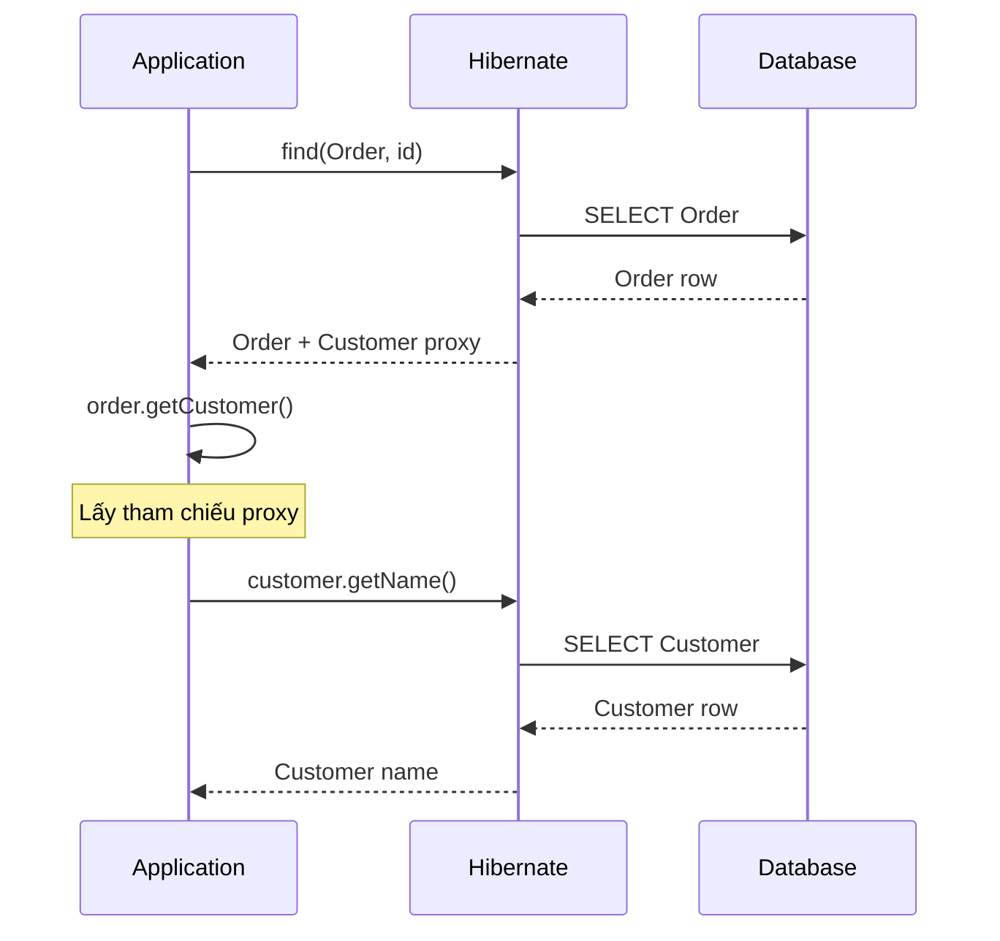
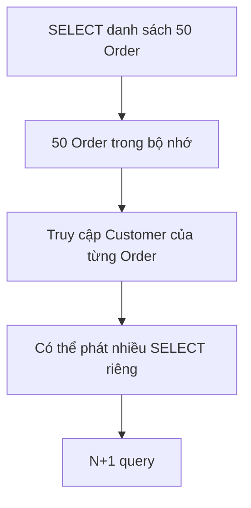

# Thời điểm truy cập thuộc tính gây tải dữ liệu trong Hibernate

Hibernate hỗ trợ **lazy loading (tải lười)** để trì hoãn việc lấy những phần dữ liệu mà use case hiện tại chưa cần. Một entity có thể được tải trước trong khi association của nó vẫn là proxy hoặc collection wrapper chưa khởi tạo. Khi ứng dụng lần đầu đọc phần state còn thiếu, Hibernate có thể gửi thêm SQL tới database.

Ví dụ:

```java
Order order = em.find(Order.class, orderId);

// Getter có thể chỉ trả về một Customer proxy.
Customer customer = order.getCustomer();

// Đọc state thực của proxy có thể gây SELECT.
String name = customer.getName();
```

Điểm quan trọng là **lấy tham chiếu đến thuộc tính không nhất thiết là tải dữ liệu của thuộc tính đó**. Getter `getCustomer()` có thể chỉ trả proxy. Lần gọi `getName()` mới khiến Hibernate cần state của Customer và khởi tạo proxy.

Với collection, getter có thể trả một wrapper lazy; duyệt collection hoặc yêu cầu dữ liệu phần tử thường làm wrapper được khởi tạo. Với thuộc tính cơ bản như LOB hoặc văn bản lớn, lazy loading thường cần bytecode enhancement phù hợp.

Bài học giải thích thời điểm truy cập nào có thể phát SQL, cách phân biệt proxy entity, lazy collection và lazy basic attribute, cách nhận biết trạng thái initialized, những thao tác Java vô tình gây tải dữ liệu, N+1 query và cách thiết kế fetch plan cho từng use case.

## 1. Lazy loading trì hoãn dữ liệu theo từng cơ chế

Hibernate có thể giữ các dạng đại diện khác nhau:

- **Entity proxy chưa khởi tạo:** đại diện một entity có identifier đã biết nhưng chưa có toàn bộ state.
- **Collection wrapper chưa khởi tạo:** đại diện cho quan hệ collection nhưng chưa đọc các phần tử.
- **Entity có bytecode enhancement:** interceptor theo dõi việc truy cập thuộc tính và có thể tải riêng một số thuộc tính lazy.
- **Entity đã initialized:** state cần thiết theo fetch plan đã được tải.

| Dạng dữ liệu | Lúc lấy tham chiếu có thể chưa phát SQL? | Truy cập thường làm tải |
| --- | --- | --- |
| `@ManyToOne(fetch = LAZY)` | Có, thường trả proxy | Đọc thuộc tính khác identifier của entity liên quan |
| `@OneToOne(fetch = LAZY)` | Có thể, tùy mapping/provider/enhancement | Đọc state của entity liên quan |
| `@OneToMany(fetch = LAZY)` | Có, thường trả collection wrapper | Duyệt hoặc yêu cầu dữ liệu collection |
| `@ManyToMany(fetch = LAZY)` | Có, thường trả collection wrapper | Duyệt hoặc yêu cầu dữ liệu collection |
| `@ElementCollection(fetch = LAZY)` | Có, thường trả collection wrapper | Duyệt hoặc yêu cầu phần tử |
| `@Basic(fetch = LAZY)` | Có thể, nếu provider và enhancement hỗ trợ | Đọc thuộc tính lazy |

**Lazy không có nghĩa là dữ liệu không bao giờ được tải.** Nó chuyển thời điểm tải sang lúc ứng dụng cần phần state đó.



Sơ đồ mô tả trường hợp phổ biến. Fetch plan, cache, mapping và phiên bản Hibernate có thể làm thay đổi số câu SQL.

## 2. Entity proxy: getter association và getter identifier

Xét hai entity:

```java
@Entity
@Table(name = "orders")
public class Order {

    @Id
    private Long id;

    @ManyToOne(fetch = FetchType.LAZY)
    @JoinColumn(name = "customer_id")
    private Customer customer;

    public Customer getCustomer() {
        return customer;
    }
}
```

```java
@Entity
@Table(name = "customers")
public class Customer {

    @Id
    private Long id;

    private String name;

    public Long getId() {
        return id;
    }

    public String getName() {
        return name;
    }
}
```

Khi chạy:

```java
Order order = em.find(Order.class, orderId);
```

Hibernate có thể đọc row của bảng `orders` và tạo proxy cho `customer` từ khóa ngoại `customer_id`. Vì identifier đã biết, provider có thể dựng tham chiếu tới Customer mà chưa đọc row Customer.

### Lấy association reference

```java
Customer customer = order.getCustomer();
```

Dòng này thường chỉ lấy tham chiếu được giữ trong Order. Nó **không nhất thiết phát SELECT Customer**.

### Đọc identifier của proxy

```java
Long customerId = customer.getId();
```

Với proxy Hibernate thông thường, identifier thường đã có từ khóa ngoại nên getter ID có thể đọc mà không khởi tạo proxy. Đây là hành vi phổ biến, nhưng không nên suy rộng sang mọi getter hoặc mọi cách mapping. Getter ID tùy chỉnh có logic đọc state khác cũng có thể dẫn tới khởi tạo.

### Đọc thuộc tính cần state thực

```java
String customerName = customer.getName();
```

Nếu proxy chưa initialized, Hibernate cần state của Customer và thường phát SELECT.

SQL minh họa:

```sql
SELECT o.id, o.customer_id
FROM orders o
WHERE o.id = ?;

SELECT c.id, c.name
FROM customers c
WHERE c.id = ?;
```

Hai SELECT xuất hiện ở hai thời điểm khác nhau. Nếu Customer đã có trong Persistence Context hoặc L2 cache, truy cập có thể không cần SELECT mới tới database.

## 3. Collection lazy: getter chưa chắc tải phần tử

Với quan hệ một-nhiều:

```java
@Entity
public class PurchaseOrder {

    @Id
    private Long id;

    @OneToMany(
        mappedBy = "purchaseOrder",
        fetch = FetchType.LAZY
    )
    private List<OrderLine> lines = new ArrayList<>();

    public List<OrderLine> getLines() {
        return lines;
    }
}
```

Hibernate có thể đặt vào `lines` một collection wrapper chưa đọc dữ liệu.

### Chỉ lấy collection

```java
List<OrderLine> lines = order.getLines();
```

Thông thường, dòng này lấy wrapper lazy và chưa tải tất cả row `order_lines`.

### Duyệt collection

```java
for (OrderLine line : order.getLines()) {
    System.out.println(line.getSku());
}
```

Khi iterator cần các phần tử, Hibernate thường khởi tạo collection bằng một truy vấn:

```sql
SELECT l.id, l.purchase_order_id, l.sku, l.quantity
FROM order_lines l
WHERE l.purchase_order_id = ?;
```

Một truy vấn có thể tải nhiều child rows của cùng parent.

### Gọi size, contains hoặc lấy phần tử

```java
int count = order.getLines().size();
boolean contains = order.getLines().contains(target);
OrderLine first = order.getLines().get(0);
```

Với collection lazy thông thường, các thao tác này có thể cần khởi tạo collection. Hibernate có các cơ chế extra-lazy cho một số mapping/thao tác, khi đó provider có thể chạy truy vấn chuyên biệt thay vì tải toàn bộ phần tử. Không nên mặc định `size()` luôn chạy `COUNT(*)` hoặc luôn tải tất cả; hãy kiểm tra mapping, cấu hình và SQL thực tế.

### Copy collection cũng có thể kích hoạt tải

```java
List<OrderLine> copy = new ArrayList<>(order.getLines());
```

Constructor của `ArrayList` phải duyệt collection đầu vào để copy phần tử. Nếu collection chưa initialized, thao tác này thường khiến Hibernate tải dữ liệu.

Collection wrapper không phải bản sao độc lập; nó là một phần của cơ chế theo dõi persistence.

## 4. Basic attribute lazy và bytecode enhancement

Lazy loading cũng có thể áp dụng cho thuộc tính cơ bản như văn bản lớn, LOB hoặc dữ liệu chỉ một số màn hình cần.

```java
@Entity
public class Document {

    @Id
    private Long id;

    private String title;

    @Lob
    @Basic(fetch = FetchType.LAZY)
    private String content;
}
```

`FetchType.LAZY` trên `@Basic` là một hint trong Jakarta Persistence. Provider không bắt buộc phải trì hoãn mọi basic attribute trong mọi cấu hình. Hibernate thường cần **bytecode enhancement** để tải riêng basic attribute một cách đáng tin cậy.

### Khi enhancement được cấu hình

Lúc tải Document mà chưa cần content, SQL có thể chỉ lấy:

```sql
SELECT d.id, d.title
FROM documents d
WHERE d.id = ?;
```

Khi ứng dụng gọi:

```java
String content = document.getContent();
```

Hibernate có thể phát truy vấn lấy thuộc tính lazy:

```sql
SELECT d.content
FROM documents d
WHERE d.id = ?;
```

Đây là mô hình minh họa. Hibernate có thể nhóm nhiều thuộc tính lazy trong cùng một lazy group; truy cập một thuộc tính có thể làm tải các thuộc tính khác cùng nhóm.

### Khi không có enhancement

Provider có thể tải basic attribute ngay trong SELECT ban đầu dù mapping khai báo LAZY. Vì vậy, nếu muốn trì hoãn một LOB lớn, cần xác minh enhancement ở build/runtime và quan sát SQL. Không dựa riêng vào annotation.

Hibernate có annotation như `@LazyGroup` trong các phiên bản hỗ trợ để gom nhóm thuộc tính lazy. Chọn nhóm theo các thuộc tính thường được dùng cùng nhau và kiểm tra câu SQL thực tế.

## 5. Những thao tác Java vô tình kích hoạt lazy loading

SQL bất ngờ thường không xuất phát từ dòng repository mà từ helper, logging, mapper hoặc serialization.

### Getter trên entity liên quan

```java
String customerName = order.getCustomer().getName();
```

Lấy Customer reference có thể chưa query; gọi getter đọc state của proxy có thể khởi tạo nó.

### Duyệt collection trong vòng lặp

```java
for (Order order : orders) {
    for (OrderLine line : order.getLines()) {
        process(line);
    }
}
```

Nếu mỗi collection chưa initialized, vòng lặp có thể phát một query cho từng Order.

### `toString()`

Một phương thức toString tự viết hoặc được sinh tự động có thể đọc association:

```java
@Override
public String toString() {
    return "Order{id=" + id
        + ", customer=" + customer
        + ", lines=" + lines + "}";
}
```

Khi logger thực hiện `log.debug("Order: {}", order)`, nó có thể gọi `toString()` và khởi tạo Customer/lines. Nếu hai entity tham chiếu qua lại, toString còn có thể gây đệ quy.

Không đưa toàn bộ association lazy vào toString của entity. Chỉ hiển thị identifier và scalar field an toàn.

### `equals()` và `hashCode()`

Nếu equality được sinh dựa trên mọi field:

```java
@Override
public int hashCode() {
    return Objects.hash(id, customer, lines);
}
```

thì đưa entity vào `HashSet` có thể truy cập association và khởi tạo proxy/collection. Equality cũng có thể gây query, đệ quy hoặc `LazyInitializationException` khi entity detached.

Hãy thiết kế equality theo identity/key phù hợp domain và tránh quan hệ lazy trong `equals/hashCode`.

### JSON/XML serialization

Serializer có thể gọi getter của mọi property. Nếu controller trả trực tiếp entity:

```java
return order;
```

serializer có thể duyệt `customer`, `lines` và các quan hệ sâu hơn. Hệ quả có thể là:

- Nhiều SELECT bất ngờ.
- N+1 query.
- Vòng tham chiếu khi serialize.
- `LazyInitializationException` nếu context đã đóng.
- Response phụ thuộc cấu trúc entity nội bộ.

DTO hoặc projection được tải theo fetch plan phù hợp thường dễ kiểm soát hơn.

### Debugger, mapper và validation

IDE có thể gọi getter hoặc toString khi mở rộng object. Object mapper có thể duyệt getter để tạo DTO. Validator có thể gọi `collection.isEmpty()` hoặc `size()`. Các thao tác này đều có khả năng chạm lazy state.

Khi debug, hãy đối chiếu SQL log với thời điểm inspect object. Với mapper/validator, kiểm tra code thực tế có đọc association nào.

## 6. Truy cập association lồng nhau

Một biểu thức:

```java
String city = order
    .getCustomer()
    .getAddress()
    .getCity();
```

có thể kích hoạt nhiều lần khởi tạo:

1. Tải Order nếu chưa có.
2. Khởi tạo Customer proxy.
3. Khởi tạo Address proxy.
4. Đọc city.

SQL minh họa:

```sql
SELECT ... FROM orders WHERE id = ?;
SELECT ... FROM customers WHERE id = ?;
SELECT ... FROM addresses WHERE id = ?;
```

Nếu association đã được fetch join, EntityGraph hoặc initialized từ trước, có thể không phát đủ ba truy vấn. Không phải mỗi lần gọi getter đều có SELECT; query thường phát khi lần đầu một phần state chưa tải được yêu cầu.

## 7. Fetch plan quyết định dữ liệu được tải trước

Mapping khai báo chiến lược mặc định; query/use case có thể yêu cầu dữ liệu cụ thể sớm hơn.

### Fetch join

```java
List<Order> orders = em.createQuery(
    "select distinct o " +
    "from Order o " +
    "join fetch o.customer " +
    "where o.status = :status",
    Order.class
)
.setParameter("status", OrderStatus.OPEN)
.getResultList();
```

`join fetch` yêu cầu tải Customer cùng truy vấn Order. Khi gọi `order.getCustomer().getName()` sau đó, association thường đã được fetch.

SQL minh họa:

```sql
SELECT o.*, c.*
FROM orders o
JOIN customers c ON c.id = o.customer_id
WHERE o.status = ?;
```

Fetch join collection có thể nhân dòng SQL theo số phần tử. `distinct` trong JPQL diễn đạt kết quả entity duy nhất nhưng không có nghĩa mọi row trùng bị loại bỏ khỏi SQL vật lý.

### EntityGraph

JPA EntityGraph khai báo association cần tải cho một use case:

```java
EntityGraph<Order> graph =
    em.createEntityGraph(Order.class);

graph.addAttributeNodes("customer");

Order order = em.find(
    Order.class,
    orderId,
    Map.of("jakarta.persistence.fetchgraph", graph)
);
```

EntityGraph tách fetch plan khỏi mapping mặc định. Provider có thể dùng join hoặc truy vấn khác để đáp ứng graph; không mặc định mọi graph luôn trở thành một SELECT.

### Batch fetching

Nếu cần truy cập Customer của nhiều Order, batch fetching có thể gom nhiều proxy cần khởi tạo thành một truy vấn với nhiều ID.

Hibernate có annotation `@BatchSize` trong các phiên bản hỗ trợ:

```java
@ManyToOne(fetch = FetchType.LAZY)
@BatchSize(size = 20)
private Customer customer;
```

Batch size là giới hạn gom nhóm, không phải cam kết chính xác một query cho mọi tình huống. Có thể áp dụng batch size ở entity hoặc collection theo mapping/cấu hình phù hợp.

### Subselect fetching

Hibernate có thể dùng subselect fetching cho một số collection để tải các collection của một nhóm parent bằng một truy vấn dựa trên truy vấn parent trước đó. `@Fetch(FetchMode.SUBSELECT)` là cấu hình Hibernate-specific. Cần đo SQL và bộ nhớ trong use case thật.

## 8. N+1 query do truy cập lazy trong vòng lặp

Ví dụ tải 50 đơn hàng:

```java
List<Order> orders = em.createQuery(
    "select o from Order o",
    Order.class
).getResultList();

for (Order order : orders) {
    System.out.println(order.getCustomer().getName());
}
```

Nếu mỗi Order tham chiếu một Customer khác nhau và proxy chưa initialized, có thể phát sinh:

- Một query tải danh sách Order.
- Tối đa 50 query tải Customer.

Tổng có thể là 51 SELECT. Nếu nhiều Order dùng cùng Customer, proxy đã được khởi tạo trong L1, L2 cache có hit hoặc batch fetching hoạt động, số truy vấn thực tế có thể thấp hơn.



### Cách xử lý

- Fetch join association cần dùng trong query.
- EntityGraph cho từng use case.
- Batch/subselect fetching khi cần giữ mapping lazy.
- DTO projection nếu chỉ cần một số field.
- Tách query đọc danh sách và query dữ liệu liên quan theo tập ID.
- Đếm query trong integration/performance test.

Không đổi mọi association thành EAGER chỉ để chữa N+1. EAGER có thể tải dữ liệu không cần thiết, tạo join phức tạp hoặc query phụ. Fetch plan theo use case thường kiểm soát tốt hơn.

## 9. Lazy loading sau khi entity detached

Một proxy/collection lazy cần Session hoặc Persistence Context còn hoạt động để tải phần state chưa initialized.

```java
Order order;

try (EntityManager em = emf.createEntityManager()) {
    order = em.find(Order.class, orderId);
}

// EntityManager đã đóng.
String name = order.getCustomer().getName();
```

Nếu Customer vẫn là proxy chưa initialized, lần truy cập sau khi context đóng có thể ném `LazyInitializationException`.

Tương tự, duyệt `order.getLines()` sau khi Session đóng có thể lỗi nếu collection chưa được khởi tạo.

### Vì sao scalar field vẫn đọc được?

Các field đã tải sẵn trong object Java vẫn có thể đọc sau khi detached. Vấn đề nằm ở phần state mà Hibernate chưa tải và cần Session để truy vấn.

### `merge()` không gắn lại object cũ

```java
Order managed = em.merge(detachedOrder);
```

`merge` sao chép state detached vào một managed instance và trả về instance đó. Object `detachedOrder` ban đầu không tự trở thành managed. Nếu cần truy cập lazy data, hãy làm việc với instance trả về trong transaction phù hợp.

### Initialize trước khi đóng context

Hibernate có helper:

```java
Hibernate.initialize(order.getLines());
```

Đây là API Hibernate-specific, cần Session đang mở. Nó khởi tạo collection được chỉ định; các association lazy bên trong từng OrderLine vẫn có thể chưa initialized.

Nếu DTO cần `line.getProduct().getName()`, chỉ initialize lines chưa chắc tải Product. Hãy dùng fetch join/EntityGraph hoặc map DTO trong transaction với fetch plan đầy đủ.

## 10. Kiểm tra proxy và collection đã initialized chưa

Dùng API kiểm tra trạng thái thay vì gọi getter chỉ để xem thử.

### Hibernate `isInitialized`

```java
import org.hibernate.Hibernate;

boolean customerLoaded =
    Hibernate.isInitialized(order.getCustomer());

boolean linesLoaded =
    Hibernate.isInitialized(order.getLines());
```

`Hibernate.isInitialized` kiểm tra đối tượng proxy/collection có được khởi tạo chưa. Đây là API Hibernate-specific.

### JPA `PersistenceUnitUtil.isLoaded`

```java
PersistenceUnitUtil util =
    emf.getPersistenceUnitUtil();

boolean customerLoaded =
    util.isLoaded(order, "customer");
```

`isLoaded(entity, attributeName)` kiểm tra trạng thái tải thuộc tính theo JPA.

### Kiểm tra thuộc tính lazy được enhancement

Với bytecode-enhanced entity, Hibernate có API property-level như:

```java
boolean contentLoaded =
    Hibernate.isPropertyInitialized(document, "content");
```

Tên property phải khớp mapping và khả năng hỗ trợ tùy Hibernate version.

| API | Phạm vi | Tính portable |
| --- | --- | --- |
| `Hibernate.isInitialized(value)` | Proxy/collection Hibernate | Hibernate-specific |
| `Hibernate.isPropertyInitialized(entity, name)` | Thuộc tính lazy của entity enhanced | Hibernate-specific |
| `PersistenceUnitUtil.isLoaded(entity, name)` | Thuộc tính entity theo JPA | Jakarta Persistence |
| `em.contains(entity)` | Entity có managed trong context không | JPA |

`em.contains(entity)` **không** cho biết association đã initialized chưa. Entity managed vẫn có thể chứa proxy hoặc collection lazy.

## 11. L1, L2 cache và số truy vấn thực tế

Khi proxy cần được khởi tạo, Hibernate có thể lấy state từ L1, L2 hoặc database tùy cache mapping/policy.

- **L1 / Persistence Context:** nếu entity đã có trong context, provider có thể dùng cùng managed instance và tránh query lại.
- **L2:** có thể cung cấp entity/collection state nếu cache được cấu hình và entry phù hợp.
- **Database:** được truy vấn khi cache không có dữ liệu phù hợp hoặc policy yêu cầu.

Vì vậy, không phải mỗi lần khởi tạo proxy đều chắc chắn có SELECT tới database. Nhưng việc truy cập vẫn có chi phí khôi phục state và xử lý cache.

```java
Customer customer = order.getCustomer();

String first = customer.getName();  // Có thể khởi tạo.
String second = customer.getName(); // Thường không SELECT lần nữa.
```

Sau lần đầu, proxy đã initialized trong Persistence Context. Lần sau dùng state đang giữ.

Khi kiểm tra N+1, hãy phân biệt cache warm/cold và chạy trong Persistence Context mới để không bị L1 che giấu hành vi truy vấn. L2 cache cũng cần được kiểm soát trong integration test.

## 12. DTO mapping và JSON serialization

Một service có thể trông đơn giản:

```java
@Transactional(readOnly = true)
public List<OrderResponse> listOrders() {
    return em.createQuery(
        "select o from Order o",
        Order.class
    ).getResultList()
     .stream()
     .map(OrderResponse::from)
     .toList();
}
```

Nếu `OrderResponse.from` đọc Customer và lines, mapping DTO có thể kích hoạt nhiều truy vấn. Nếu mapper chạy ngoài transaction sau khi Session đóng, nó có thể ném LazyInitializationException.

### Projection cho màn hình danh sách

```java
public record OrderSummary(
    Long orderId,
    String orderNumber,
    String customerName
) {}
```

```java
List<OrderSummary> summaries = em.createQuery(
    "select new com.example.OrderSummary(" +
    "o.id, o.orderNumber, c.name) " +
    "from Order o join o.customer c",
    OrderSummary.class
).getResultList();
```

Projection lấy đúng các field cần cho màn hình và không cần duyệt proxy sau đó.

### Entity response không nên để serializer quyết định fetch plan

Nếu controller trả entity trực tiếp, serializer có thể gọi mọi getter, khởi tạo association sâu và tạo N+1. DTO giúp xác định dữ liệu trả ra, nhưng query vẫn phải tải đúng dữ liệu DTO cần.

## 13. Open Session in View không làm lazy loading miễn phí

Open EntityManager in View (OSIV) có thể giữ Persistence Context mở trong phần lớn vòng đời HTTP request. Khi controller hoặc serializer truy cập association lazy, Hibernate vẫn có thể truy vấn.

Đánh đổi:

- SQL có thể phát sinh ở tầng web/serialization, ngoài ranh giới service.
- N+1 dễ bị che giấu.
- Thời điểm truy vấn khó dự đoán.
- Persistence Context có thể sống lâu hơn cần thiết.
- Lỗi database có thể xuất hiện muộn khi response đang được dựng.

OSIV có thể giảm một số LazyInitializationException, nhưng không thay thế fetch planning. Nếu OSIV tắt, hãy dựng DTO đầy đủ trong transaction service. Nếu OSIV bật, vẫn kiểm soát query và không để serializer quyết định fetch plan ngẫu nhiên.

## 14. Field access, property access và proxy

JPA có thể dùng field access hoặc property access tùy vị trí annotation/access strategy.

### Field access

```java
@Entity
@Access(AccessType.FIELD)
public class Order {

    @Id
    private Long id;

    @ManyToOne(fetch = FetchType.LAZY)
    private Customer customer;

    public Customer getCustomer() {
        return customer;
    }
}
```

Provider quản lý field và có thể sử dụng proxy/bytecode enhancement theo mapping. Khi ứng dụng gọi getter, nó đọc giá trị field; nếu field chứa proxy, truy cập tiếp trên proxy mới có thể khởi tạo entity liên quan.

### Property access

```java
@Entity
@Access(AccessType.PROPERTY)
public class Order {

    private Long id;
    private Customer customer;

    @Id
    public Long getId() {
        return id;
    }

    @ManyToOne(fetch = FetchType.LAZY)
    public Customer getCustomer() {
        return customer;
    }
}
```

Trong property access, provider gọi getter/setter theo mapping. Tránh đặt logic nghiệp vụ nặng hoặc truy vấn repository bên trong getter persistent property; điều đó khiến thời điểm SQL khó đoán và có thể gây recursion.

### Final class và final method

Proxy subclass truyền thống có giới hạn với final class hoặc final method vì không thể override để intercept. Bytecode enhancement có cơ chế khác nhưng vẫn cần cấu hình phù hợp. Kiểm tra yêu cầu proxy/enhancement của Hibernate version và mapping cụ thể.

Proxy có thể có runtime class khác entity gốc. Không dùng `getClass()` đơn giản để suy ra persistent type trong mọi trường hợp.

## 15. Những mapping có thể tải sớm hơn dự kiến

Khai báo `fetch = LAZY` không bảo đảm provider luôn trì hoãn association trong mọi tình huống.

Association có thể đã được tải vì:

- Query dùng `JOIN FETCH`.
- EntityGraph yêu cầu association.
- Mapping hoặc provider chọn fetch để đáp ứng semantics.
- Association đã initialized trước đó trong cùng Persistence Context.
- L2 cache cung cấp dữ liệu và provider không cần SELECT mới.
- Query trước đã tải cùng entity/association.
- Một số quan hệ có default fetch EAGER nếu không khai báo rõ.

Theo Jakarta Persistence, `@ManyToOne` và `@OneToOne` mặc định EAGER; `@OneToMany` và `@ManyToMany` mặc định LAZY. Với code cần kiểm soát truy vấn, khai báo fetch rõ ràng giúp người đọc hiểu ý định. LAZY vẫn phụ thuộc provider/mapping đối với một số association.

### One-to-one và association optional

`@OneToOne(fetch = LAZY)` có thể khó lazy ở phía inverse (mappedBy), vì bảng hiện tại không có FK để biết related row có tồn tại hay không. Hibernate có thể cần enhancement hoặc truy vấn để xác định association.

Với association optional hoặc inheritance, provider đôi khi cần thêm thông tin để xác định entity liên quan/concrete subtype. Không giả định mọi one-to-one đều hoạt động giống proxy của many-to-one đơn giản.

## 16. Tránh tải dữ liệu từ helper và mapper

Các nguồn phổ biến gây truy vấn ngoài dự kiến:

| Nguồn truy cập | Vì sao có thể gây tải |
| --- | --- |
| Logging toàn entity | Gọi `toString()` và đọc association |
| Lombok/IDE-generated equality | Duyệt field/collection lazy |
| DTO mapper | Gọi getter của association |
| JSON/XML serializer | Duyệt toàn bộ property |
| Validator | Gọi `size()`, `isEmpty()` hoặc đọc quan hệ |
| Template engine | Gọi getter khi render |
| Debugger | Tự đánh giá getter/toString |
| Collection copy | Duyệt toàn bộ wrapper |

Thay vì log toàn entity:

```java
log.debug("Processing order id={}", order.getId());
```

Nếu cần nhiều thông tin, dựng một summary/DTO có fetch plan rõ ràng.

## 17. Đo thời điểm truy cập bằng SQL logging

Trong môi trường development, có thể bật SQL logging. Với Spring Boot và Hibernate 6:

```properties
logging.level.org.hibernate.SQL=DEBUG
logging.level.org.hibernate.orm.jdbc.bind=TRACE
```

Thực nghiệm:

```java
Order order = em.find(Order.class, orderId);
System.out.println("Order loaded");

Customer customer = order.getCustomer();
System.out.println("Customer reference obtained");

String name = customer.getName();
System.out.println("Customer name loaded");
```

Quan sát log để xác định SELECT Customer xuất hiện ở bước nào. Kiểm tra trạng thái proxy:

```java
System.out.println(
    Hibernate.isInitialized(order.getCustomer())
);

Customer customer = order.getCustomer();

System.out.println(Hibernate.isInitialized(customer));

String name = customer.getName();

System.out.println(Hibernate.isInitialized(customer));
```

Kết quả phụ thuộc fetch plan/cache. SQL log và initialized state giúp tránh suy luận từ getter.

Bind logging ở TRACE có thể ghi ID, email hoặc dữ liệu nghiệp vụ. Chỉ bật trong môi trường an toàn, mask giá trị nhạy cảm và tắt sau khi chẩn đoán.

## 18. Đếm query để phát hiện N+1

Có thể quan sát số query bằng:

- Hibernate Statistics.
- JDBC/DataSource proxy như datasource-proxy hoặc P6Spy.
- Integration test có instrumentation.
- APM/tracing để liên kết SQL với request.

Ví dụ Hibernate Statistics:

```java
SessionFactory sessionFactory =
    entityManagerFactory.unwrap(SessionFactory.class);

Statistics stats = sessionFactory.getStatistics();
stats.clear();

orderService.listOrderSummaries();

long statements = stats.getPrepareStatementCount();
```

Statistics có phạm vi SessionFactory, có thể bị request đồng thời làm thay đổi. Không reset global statistics trong production để đo một request nếu không có cơ chế cô lập. Trong integration test tuần tự, nó hữu ích hơn.

Chạy test cả với cache cold và cache warm. L1/L2 có thể làm số query giảm ở lần chạy sau và che giấu N+1.

## 19. Chọn fetch plan theo nhu cầu use case

| Nhu cầu | Cách tiếp cận thường phù hợp |
| --- | --- |
| Chỉ cần Order ID và number | DTO/scalar projection |
| Cần Order và Customer | Fetch join hoặc EntityGraph |
| Cần danh sách Order cùng Customer | Fetch join to-one hoặc EntityGraph |
| Cần collection của một parent | Fetch join/EntityGraph hoặc initialize trong transaction |
| Cần collection của nhiều parent | Batch/subselect hoặc query riêng theo parent IDs |
| Cần một BLOB/CLOB lớn theo yêu cầu | Lazy basic attribute với enhancement hoặc query riêng |
| Nhiều màn hình có nhu cầu khác nhau | Fetch plan riêng cho từng use case |
| Báo cáo lớn | Projection/streaming/batch query, tránh entity graph lớn |

### To-one và to-many có rủi ro khác nhau

Fetch join to-one thường không nhân row gốc như fetch join collection. Fetch join hai collection có thể tạo Cartesian multiplication. Ví dụ một Order có 10 lines và 5 payments có thể tạo 50 dòng SQL cho một Order.

Pagination với collection fetch join cũng cần thận trọng; provider có thể phải xử lý giới hạn ở bộ nhớ hoặc cảnh báo tùy Hibernate version. Một pattern là phân trang root ID trước, sau đó tải associations cho tập ID của trang.

## 20. Quy trình tìm thuộc tính nào gây tải dữ liệu

Khi request phát nhiều SQL ngoài dự kiến:

1. Xác định query ban đầu và entity được tải.
2. Đọc mapping của association/basic attribute: fetch type, ownership, enhancement, batch/subselect.
3. Bật SQL logging trong môi trường kiểm thử.
4. Đánh dấu các điểm truy cập: getter, iterator, size, toString, equals/hashCode, mapper, serializer và validator.
5. Kiểm tra initialized state trước/sau bằng API Hibernate/JPA.
6. Chạy lại trong Persistence Context mới để tách ảnh hưởng L1/L2.
7. Đếm query trong integration test để tái hiện N+1.
8. Thiết kế fetch plan: fetch join, EntityGraph, batch/subselect hoặc projection.
9. Đo lại query count, row count, thời gian và bộ nhớ.
10. Kiểm tra detached boundary để mapper/serializer không truy cập lazy data sau khi Session đóng.

Không đổi hàng loạt LAZY thành EAGER trước khi biết thuộc tính nào gây truy vấn và use case cần dữ liệu gì.

## 21. Ví dụ tổng hợp: Order summary và Order detail

Màn hình danh sách chỉ cần ID, số đơn hàng và tên khách hàng. Dùng projection:

```java
public record OrderSummary(
    Long id,
    String orderNumber,
    String customerName
) {}
```

```java
List<OrderSummary> summaries = em.createQuery(
    "select new com.example.OrderSummary(" +
    "o.id, o.orderNumber, c.name) " +
    "from Order o join o.customer c " +
    "where o.status = :status",
    OrderSummary.class
)
.setParameter("status", OrderStatus.OPEN)
.getResultList();
```

Trang chi tiết cần cả dòng hàng:

```java
Order detail = em.createQuery(
    "select distinct o from Order o " +
    "join fetch o.customer " +
    "left join fetch o.lines " +
    "where o.id = :id",
    Order.class
)
.setParameter("id", orderId)
.getSingleResult();
```

Nếu mỗi line còn cần Product, query có thể bổ sung fetch join to-one Product hoặc dùng EntityGraph phù hợp. Chọn dữ liệu theo từng màn hình giúp tránh tải graph lớn trong mọi request.

## 22. Những lỗi thường gặp

### Lỗi 1: nghĩ gọi getter association là đã tải entity

`order.getCustomer()` có thể chỉ trả proxy.

**Cách xử lý:** kiểm tra `Hibernate.isInitialized` hoặc đọc property cần state trong Session đang mở và quan sát SQL.

### Lỗi 2: nghĩ getter collection luôn chạy SELECT

Getter có thể chỉ trả wrapper; duyệt hoặc yêu cầu phần tử mới thường khởi tạo.

**Cách xử lý:** phân biệt lấy reference với khởi tạo collection.

### Lỗi 3: truy cập ID rồi kết luận proxy đã initialized

Identifier có thể đã biết từ FK.

**Cách xử lý:** kiểm tra trạng thái bằng API, không dùng ID getter làm phép thử.

### Lỗi 4: cho rằng `FetchType.LAZY` trên mọi field đều được đảm bảo

Basic attribute lazy thường cần enhancement; một số association LAZY phụ thuộc provider.

**Cách xử lý:** xác minh enhancement, mapping và SQL thực tế.

### Lỗi 5: gọi size rồi tưởng chỉ chạy COUNT

Collection lazy thông thường có thể tải collection; extra-lazy chỉ tối ưu một số thao tác.

**Cách xử lý:** xem SQL hoặc dùng query COUNT rõ ràng nếu chỉ cần số lượng.

### Lỗi 6: toString làm khởi tạo association

Logger có thể gọi toString và duyệt collection.

**Cách xử lý:** loại association khỏi toString, chỉ log ID/scalar.

### Lỗi 7: equals/hashCode chạm lazy relation

Equality có thể gây SQL, đệ quy hoặc lỗi detached.

**Cách xử lý:** xác định identity fields, không đưa association vào equality.

### Lỗi 8: serialize entity trực tiếp

Serializer có thể gọi mọi getter, gây N+1 hoặc LazyInitializationException.

**Cách xử lý:** trả DTO/projection theo fetch plan.

### Lỗi 9: coi OSIV là giải pháp tận gốc

OSIV có thể dời SQL sang tầng web và che N+1.

**Cách xử lý:** thiết kế transaction service và fetch plan rõ ràng.

### Lỗi 10: initialize collection trong vòng lặp

`Hibernate.initialize` trên từng parent có thể tạo N+1.

**Cách xử lý:** fetch join phù hợp, batch/subselect hoặc query theo tập ID.

### Lỗi 11: initialize collection nhưng quên association bên trong

Initialize lines không nhất thiết tải Product của từng line.

**Cách xử lý:** fetch plan phải bao gồm association DTO thật sự cần.

### Lỗi 12: dùng entity detached rồi truy cập lazy

Proxy chưa initialized không còn Session để tải.

**Cách xử lý:** tải/mapping trong transaction hoặc query lại managed instance.

### Lỗi 13: merge rồi đọc object detached ban đầu

`merge` trả về managed instance khác.

**Cách xử lý:** dùng object trả về của merge.

### Lỗi 14: kết luận mỗi getter gây một query

Proxy initialized hoặc cache có thể tránh SELECT mới.

**Cách xử lý:** đo lần khởi tạo đầu và trạng thái cache.

### Lỗi 15: fetch join mọi collection

Có thể tạo Cartesian multiplication, dữ liệu lặp và vấn đề pagination.

**Cách xử lý:** chọn fetch plan tối thiểu, có thể tách query.

### Lỗi 16: debugger làm SQL xuất hiện

IDE có thể tự đánh giá getter/toString.

**Cách xử lý:** kiểm soát auto evaluation và đối chiếu SQL log với code thực thi.

## 23. Câu hỏi tự kiểm tra

**1. Gọi `order.getCustomer()` có chắc phát SELECT Customer không?**

Không. Hibernate có thể chỉ trả proxy chưa khởi tạo. Truy cập state như `getName()` mới thường kích hoạt tải.

**2. Vì sao gọi `customer.getId()` có thể không khởi tạo proxy?**

Identifier thường đã biết từ khóa ngoại và được lưu trong proxy; đọc ID có thể không cần tải state entity.

**3. Gọi `order.getLines()` có nhất thiết tải tất cả OrderLine không?**

Không. Getter có thể trả collection wrapper; duyệt hoặc yêu cầu dữ liệu phần tử mới thường khởi tạo.

**4. `collection.size()` có luôn chạy SQL COUNT không?**

Không. Collection lazy thông thường có thể tải collection; extra-lazy có thể tối ưu một số thao tác tùy provider.

**5. Vì sao `@Basic(fetch = LAZY)` có thể không trì hoãn tải LOB?**

LAZY cho basic attribute là hint; Hibernate thường cần bytecode enhancement và cấu hình phù hợp để tải riêng thuộc tính.

**6. `Hibernate.initialize(collection)` có tải association lazy bên trong từng phần tử không?**

Không nhất thiết. Nó khởi tạo collection được chỉ định; association bên trong có thể vẫn lazy.

**7. Vì sao truy cập lazy property sau khi EntityManager đóng có thể lỗi?**

Provider cần Session/Persistence Context để truy vấn phần state chưa initialized.

**8. `em.contains(entity)` có chứng minh mọi association đã tải không?**

Không. Nó chỉ kiểm tra entity có managed trong context; association vẫn có thể lazy.

**9. N+1 query xuất hiện như thế nào?**

Một query tải N parent, sau đó code truy cập association lazy của từng parent và phát thêm tới N query hoặc nhiều hơn.

**10. Vì sao toString/equals/hashCode có thể gây SQL?**

Nếu chúng đọc association hoặc duyệt collection lazy, Hibernate phải khởi tạo dữ liệu.

**11. Fetch join và EntityGraph có vai trò gì?**

Chúng mô tả dữ liệu liên quan cần tải cho một use case, giúp tránh truy vấn lazy rải rác và kiểm soát N+1.

**12. OSIV có phải giải pháp tối ưu cho lazy loading không?**

Không. Nó có thể giữ Session mở tới tầng web nhưng cũng dời SQL sang serialization/view và che N+1. Fetch plan và DTO vẫn cần được thiết kế.

**13. `merge(detached)` trả về object nào?**

Một managed instance có state được merge; object detached truyền vào không tự trở thành managed.

**14. Làm sao biết lần truy cập nào gây SELECT?**

Bật SQL logging, kiểm tra initialized state trước/sau và đối chiếu getter/iterator/mapper/serializer với thời điểm SQL xuất hiện.

## 24. Ghi nhớ

- **Lấy tham chiếu không đồng nghĩa tải state:** getter association có thể chỉ trả proxy hoặc collection wrapper.
- **Proxy entity thường được khởi tạo khi ứng dụng cần thuộc tính thực**; identifier có thể đọc mà không tải toàn bộ entity.
- **Collection lazy thường khởi tạo khi cần phần tử**, chẳng hạn duyệt hoặc gọi phương thức cần dữ liệu.
- **Basic attribute lazy thường cần bytecode enhancement**; không chỉ dựa vào `@Basic(fetch = LAZY)`.
- **toString, equals, hashCode, mapper, serializer, validator và debugger** có thể vô tình chạm lazy state.
- **Detached proxy/collection chưa initialized không thể tự tải** nếu không còn Session phù hợp.
- **Hibernate.initialize` là API Hibernate-specific** và không tự tải toàn bộ association lồng nhau.
- **L1/L2 cache ảnh hưởng số SQL**, nên lần truy cập đầu trong context mới có thể khác lần sau.
- **N+1 là hậu quả thường gặp của truy cập lazy trong vòng lặp**; fetch join, EntityGraph, batch/subselect và DTO projection giúp kiểm soát.
- **SQL log và trạng thái initialized là bằng chứng tốt hơn phỏng đoán từ getter**; thiết kế fetch plan theo từng use case giúp thời điểm truy vấn rõ ràng.

Lazy loading phát huy tác dụng khi ứng dụng chỉ tải dữ liệu thật sự cần. Để sử dụng an toàn, hãy nhận diện **thời điểm một tham chiếu lazy chuyển thành dữ liệu được khởi tạo**, kiểm soát những đoạn code vô tình truy cập thuộc tính và chuẩn bị fetch plan trước khi rời transaction. Khi đó, truy vấn trở nên có chủ đích, tránh N+1 và giảm cả dữ liệu thừa lẫn lỗi lazy initialization.
