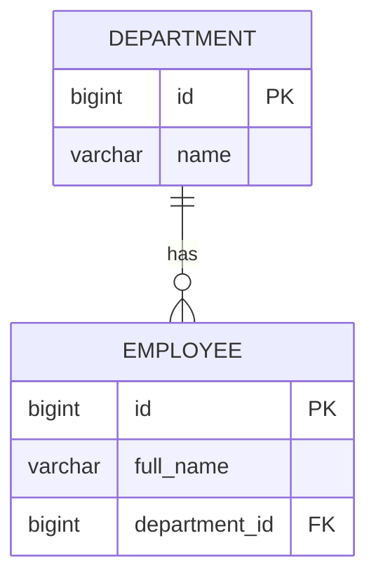
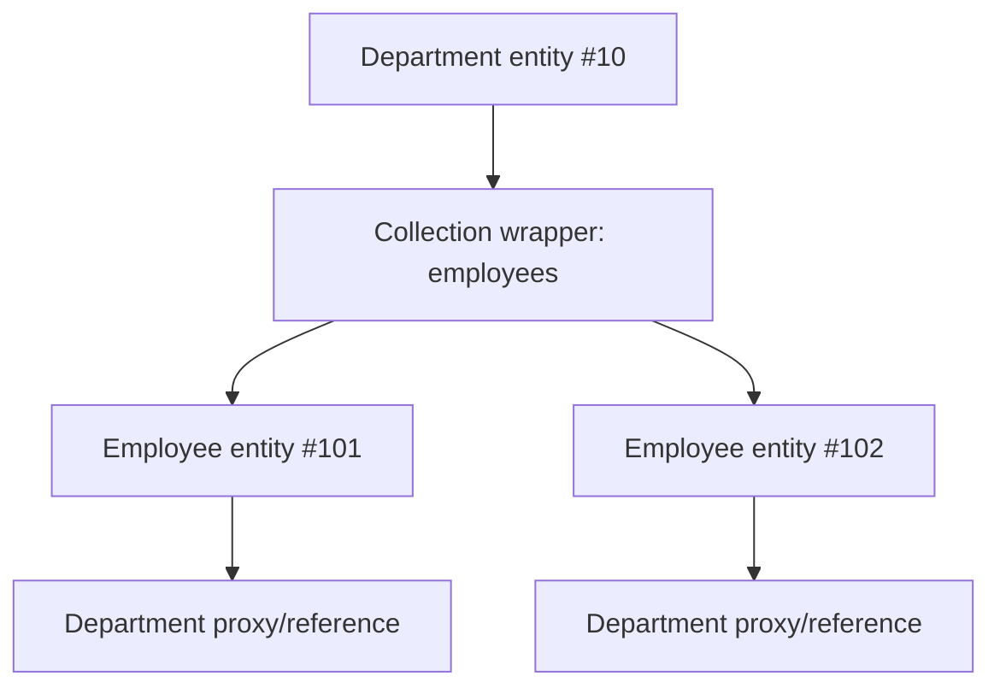

# Phân biệt proxy thực thể với wrapper của tập hợp trong Hibernate

## 1. Vì sao cần phân biệt hai loại đối tượng này?

Hibernate hỗ trợ tải dữ liệu theo nhu cầu (*lazy loading*). Khi một entity hoặc một association chưa cần được đọc ngay, Hibernate có thể đặt một đối tượng đại diện vào Java object graph. Đối tượng đại diện này giữ đủ thông tin để Hibernate tải dữ liệu khi ứng dụng thực sự truy cập.

Hai cơ chế thường gặp có hình thức bên ngoài khá giống nhau nhưng có nhiệm vụ khác nhau:

- **Entity proxy** đại diện cho *một entity cụ thể*, thường là một entity được tham chiếu qua quan hệ đơn trị như `@ManyToOne` hoặc `@OneToOne`. Proxy có thể giữ identifier mà chưa tải toàn bộ state của entity.
- **Collection wrapper** đại diện cho *một association dạng tập hợp* như `@OneToMany` hoặc `@ManyToMany`. Wrapper bao quanh collection Java, giữ thông tin owner/role và theo dõi việc khởi tạo, thêm, xóa, thay đổi phần tử.

Ví dụ một Department có nhiều Employee:

```java
Department department = em.find(Department.class, 10L);

Employee employee = ...;

// Quan hệ đơn trị: department của employee có thể là entity proxy.
Department referencedDepartment = employee.getDepartment();

// Quan hệ đa trị: employees của department có thể là collection wrapper.
List<Employee> employees = department.getEmployees();
```

Trong ví dụ này, `referencedDepartment` có thể là proxy đại diện cho **một Department**; `employees` có thể là wrapper đại diện cho **tập Employee của Department**. Cả hai đều có thể chưa được khởi tạo, nhưng chúng không phải cùng một loại đối tượng và không thực hiện cùng trách nhiệm.

Điểm quan trọng: **entity proxy không phải collection wrapper**, và collection wrapper không phải một entity proxy chứa nhiều entity. Một collection wrapper có thể chứa nhiều entity proxy; hai cơ chế có thể xuất hiện đồng thời trong cùng một object graph.

## 2. Ví dụ domain dùng trong bài

Giả sử hệ thống quản lý phòng ban và nhân viên:



Mapping hai chiều:

```java
package com.example.company;

import java.util.ArrayList;
import java.util.List;

import jakarta.persistence.CascadeType;
import jakarta.persistence.Column;
import jakarta.persistence.Entity;
import jakarta.persistence.FetchType;
import jakarta.persistence.GeneratedValue;
import jakarta.persistence.GenerationType;
import jakarta.persistence.Id;
import jakarta.persistence.OneToMany;
import jakarta.persistence.Table;

@Entity
@Table(name = "departments")
public class Department {

    @Id
    @GeneratedValue(strategy = GenerationType.IDENTITY)
    private Long id;

    @Column(nullable = false)
    private String name;

    @OneToMany(
        mappedBy = "department",
        fetch = FetchType.LAZY,
        cascade = CascadeType.PERSIST
    )
    private List<Employee> employees = new ArrayList<>();

    protected Department() {
    }

    public Department(String name) {
        this.name = name;
    }

    public Long getId() {
        return id;
    }

    public String getName() {
        return name;
    }

    public List<Employee> getEmployees() {
        return employees;
    }

    public void addEmployee(Employee employee) {
        employees.add(employee);
        employee.assignDepartment(this);
    }
}
```

Entity Employee:

```java
package com.example.company;

import jakarta.persistence.Column;
import jakarta.persistence.Entity;
import jakarta.persistence.FetchType;
import jakarta.persistence.GeneratedValue;
import jakarta.persistence.GenerationType;
import jakarta.persistence.Id;
import jakarta.persistence.JoinColumn;
import jakarta.persistence.ManyToOne;
import jakarta.persistence.Table;

@Entity
@Table(name = "employees")
public class Employee {

    @Id
    @GeneratedValue(strategy = GenerationType.IDENTITY)
    private Long id;

    @Column(name = "full_name", nullable = false)
    private String fullName;

    @ManyToOne(fetch = FetchType.LAZY, optional = false)
    @JoinColumn(name = "department_id", nullable = false)
    private Department department;

    protected Employee() {
    }

    public Employee(String fullName) {
        this.fullName = fullName;
    }

    public Long getId() {
        return id;
    }

    public String getFullName() {
        return fullName;
    }

    public Department getDepartment() {
        return department;
    }

    void assignDepartment(Department department) {
        this.department = department;
    }
}
```

Trong mapping:

- `Employee.department` là association đơn trị, tham chiếu một Department.
- `Department.employees` là association đa trị, tham chiếu danh sách Employee.
- `Employee.department` là owning side của quan hệ vì nó chứa FK `department_id`.
- `Department.employees` dùng `mappedBy = "department"` để chỉ phía sở hữu.

Đây là ví dụ minh họa. Một ứng dụng thực tế cần bổ sung validation, equality/hash code phù hợp, quy tắc cascade và helper association theo vòng đời domain.

## 3. Entity proxy là gì?

### 3.1. Proxy đại diện cho một entity

Khi một entity tham chiếu một entity khác bằng quan hệ lazy, Hibernate có thể trả về một **proxy** thay cho entity đã nạp đầy đủ. Proxy đại diện cho một entity có identifier xác định, nhưng state còn lại có thể chưa được đọc từ database.

Ví dụ:

```java
Employee employee = em.find(Employee.class, employeeId);

Department department = employee.getDepartment();
```

Nếu `department` là lazy association và chưa được khởi tạo, Hibernate có thể gán một proxy Department cho field. Ứng dụng vẫn làm việc qua kiểu `Department`:

```java
Long departmentId = department.getId();
String departmentName = department.getName();
```

Trong mapping proxy thông thường, đọc identifier thường không cần tải state đầy đủ. Khi gọi một getter cần dữ liệu như `getName()`, proxy có thể yêu cầu Hibernate tải Department thật từ database.

### 3.2. Proxy thường là subclass của entity

Trong cơ chế subclass proxy truyền thống, Hibernate tạo một lớp runtime kế thừa entity class và triển khai hành vi proxy/interception. Ví dụ khái niệm:

```text
Department
    ^
    |
Hibernate-generated proxy subclass
    |
    +-- giữ identifier
    +-- biết Session/initializer liên quan
    +-- chặn lời gọi method cần state
```

Tên class runtime có thể được sinh động và khác tên class entity. Không nên dựa vào tên class proxy hoặc so sánh `getClass()` trực tiếp để quyết định business identity.

Hibernate 6 sử dụng Byte Buddy cho cơ chế proxy mặc định trong cấu hình phổ biến. Đây là chi tiết triển khai, không phải điều application cần phụ thuộc trong business logic.

### 3.3. Proxy chưa khởi tạo vẫn có thể biết ID

Ví dụ:

```java
Department department =
        em.getReference(Department.class, 10L);

Long id = department.getId();
```

Hibernate có thể trả một reference/proxy mà không thực thi SELECT ngay tại `getReference`. Với proxy thông thường, identifier có thể được đọc mà không khởi tạo state.

Tuy nhiên, không được suy luận rằng bản ghi chắc chắn tồn tại chỉ vì đã nhận được reference. `getReference` có thể trì hoãn việc xác nhận tồn tại cho tới khi cần khởi tạo hoặc thao tác liên quan. Hành vi chính xác còn phụ thuộc provider, mapping và API.

### 3.4. Truy cập thuộc tính làm proxy khởi tạo

```java
Department department =
        em.getReference(Department.class, 10L);

System.out.println(department.getId());
// Thường không cần SELECT để lấy identifier.

System.out.println(department.getName());
// Có thể kích hoạt SELECT để nạp state Department.
```

SQL minh họa:

```sql
SELECT d.id, d.name
FROM departments d
WHERE d.id = ?;
```

Sau khi khởi tạo thành công, proxy tiếp tục đại diện cho cùng entity identity; Hibernate có thể lưu state đã tải trong persistence context.

Không phải mọi method call đều chắc chắn kích hoạt tải theo cùng cách. Các method có thể được xử lý đặc biệt gồm accessor identifier, method được override, method final hoặc method mà proxy không thể intercept theo cơ chế đang dùng. Cần hiểu mapping và kiểm tra hành vi runtime thay vì xem proxy như một object Java thông thường hoàn toàn trong suốt.

## 4. Collection wrapper là gì?

### 4.1. Wrapper bao quanh collection Java

Với quan hệ đa trị, Hibernate thường thay collection ban đầu bằng một implementation có khả năng theo dõi persistence state. Những implementation thường gặp có tên như:

- `PersistentBag` cho một số mapping `List` dạng bag.
- `PersistentList` cho list có semantics/order tương ứng.
- `PersistentSet` cho `Set`.
- `PersistentMap` cho `Map`.

Đây là các tên implementation Hibernate, không phải kiểu API mà application nên dùng trực tiếp. Ứng dụng thường khai báo interface Java như `List`, `Set` hoặc `Map`:

```java
@OneToMany(mappedBy = "department", fetch = FetchType.LAZY)
private List<Employee> employees = new ArrayList<>();
```

Khi entity được hydrate, Hibernate có thể thay collection thông thường bằng wrapper tương ứng. Wrapper giữ thông tin như collection role, owner key, trạng thái initialized và dữ liệu cần để dirty-checking collection.

### 4.2. Wrapper đại diện cho cả association

Khi Department được tải, Hibernate có thể biết Department ID và name nhưng chưa tải danh sách Employee. Thay vì chạy SELECT ngay, nó gắn một wrapper cho `employees`.

```text
Department entity
  id = 10
  name = "Engineering"
  employees = PersistentBag (uninitialized)
                  |
                  +-- owner: Department#10
                  +-- role: Department.employees
                  +-- chưa chứa collection state đã tải
```

Wrapper không đại diện cho một Employee cụ thể. Nó đại diện cho **collection Employee thuộc Department#10**.

Khi ứng dụng lặp qua collection hoặc thao tác cần dữ liệu đầy đủ, wrapper có thể khởi tạo:

```java
Department department = em.find(Department.class, 10L);

List<Employee> employees = department.getEmployees();
// Lấy wrapper; chưa nhất thiết có SELECT.

for (Employee employee : employees) {
    System.out.println(employee.getFullName());
    // Truy cập phần tử sau khi collection được khởi tạo.
}
```

SQL minh họa khi collection được khởi tạo:

```sql
SELECT e.id, e.full_name, e.department_id
FROM employees e
WHERE e.department_id = ?;
```

Sau khi khởi tạo, wrapper chứa các phần tử Java đại diện cho Employee đã được nạp. Mỗi phần tử có thể là entity đầy đủ hoặc chứa association khác dưới dạng proxy/lazy reference.

### 4.3. Wrapper không có primary key riêng

Collection wrapper không phải một hàng database độc lập và không có entity identifier riêng. Nó thường gắn với:

- **Owner:** entity chứa collection, ví dụ Department#10.
- **Role:** tên association, ví dụ `Department.employees`.
- **Key:** giá trị khóa owner dùng để truy vấn phần tử liên quan.
- **Collection state:** phần tử hiện tại, trạng thái khởi tạo và thông tin phục vụ dirty checking.

Các hàng Employee có primary key riêng. Collection wrapper chỉ quản lý association giữa Department và tập Employee.

Với `@ManyToMany`, wrapper quản lý collection entity liên quan và Hibernate còn phải tương tác với join table. Wrapper vẫn không phải join table hay một entity tự động.

## 5. Hai cơ chế có thể xuất hiện cùng lúc

Một collection wrapper sau khi khởi tạo không có nghĩa mọi association bên trong đều đã được khởi tạo.

Giả sử Department có danh sách Employee; mỗi Employee lại có một Department lazy association:

```java
Department department = em.find(Department.class, 10L);

List<Employee> employees = department.getEmployees();

for (Employee employee : employees) {
    Department ref = employee.getDepartment();
    System.out.println(ref.getId());
}
```

Sau khi tải collection:

- `department.getEmployees()` có thể là một collection wrapper đã initialized.
- Các Employee trong collection đã có state cần thiết theo SELECT.
- `employee.getDepartment()` có thể là proxy đại diện cho Department.
- Nếu association Department#10 đã nằm trong persistence context, Hibernate có thể dùng cùng managed identity thay vì SELECT lại.
- Nếu code truy cập một Department khác chưa được nạp, proxy đó có thể phát SELECT.

Sơ đồ:



Một collection có thể được initialized trong khi association của từng phần tử vẫn lazy. Tương tự, một entity proxy có thể initialized nhưng collection của entity đó vẫn là wrapper chưa initialized.

**Trạng thái khởi tạo là theo từng đối tượng/association**, không phải một cờ duy nhất cho toàn bộ graph.

## 6. So sánh trực tiếp entity proxy và collection wrapper

| Tiêu chí | Entity proxy | Collection wrapper |
|---|---|---|
| Đại diện cho | Một entity cụ thể | Một association dạng tập hợp |
| Ví dụ | `Department` được tham chiếu bởi Employee | `Department.employees` |
| Kiểu Java bên ngoài | Thường nhìn như entity class hoặc proxy subclass | Thường nhìn như `List`/`Set`/`Map` |
| Identifier | Đại diện cho ID của entity | Không có entity ID riêng; gắn với owner key/role |
| Lazy initialization | Tải state của một entity | Tải các phần tử/trạng thái collection |
| Trigger phổ biến | Gọi getter cần state trên proxy | Iterate, truy cập phần tử hoặc thao tác cần collection state |
| SQL thường gặp | SELECT theo primary key | SELECT theo foreign key/owner key hoặc join table |
| Theo dõi thay đổi | Theo dõi state của entity | Theo dõi add/remove/order/collection state |
| Có thể chứa proxy không? | Không áp dụng theo nghĩa collection | **Có**, phần tử có thể chứa proxy ở association khác |
| Có thể initialized riêng? | Có | Có |
| Hết Session khi chưa initialized | Truy cập state thường có thể gây LazyInitializationException | Truy cập collection state thường có thể gây LazyInitializationException |

Một cách ghi nhớ: **proxy trả lời “entity này là ai và state của nó là gì khi cần?”; collection wrapper trả lời “tập phần tử thuộc association này gồm những gì và thay đổi ra sao?”**

## 7. SQL quan sát được ở từng trường hợp

### 7.1. Tải Employee, chưa truy cập Department

Code:

```java
Employee employee = em.find(Employee.class, employeeId);
```

SQL minh họa:

```sql
SELECT e.id, e.full_name, e.department_id
FROM employees e
WHERE e.id = ?;
```

Nếu `department` là lazy, Hibernate có thể tạo proxy/reference từ FK `department_id` mà chưa cần SELECT Department.

### 7.2. Truy cập Department proxy

```java
String name = employee.getDepartment().getName();
```

SQL bổ sung có thể là:

```sql
SELECT d.id, d.name
FROM departments d
WHERE d.id = ?;
```

Nếu Department đã managed trong context, có thể không cần query mới. Nếu proxy đã initialized, cũng không cần tải lại.

### 7.3. Tải Department, chưa truy cập collection

```java
Department department = em.find(Department.class, departmentId);
```

SQL:

```sql
SELECT d.id, d.name
FROM departments d
WHERE d.id = ?;
```

Hibernate có thể đặt wrapper cho `employees` nhưng chưa tải các Employee.

### 7.4. Khởi tạo collection wrapper

```java
int count = department.getEmployees().size();
```

Nếu collection chưa initialized và mapping/operation cần dữ liệu đầy đủ, SQL có thể là:

```sql
SELECT e.id, e.full_name, e.department_id
FROM employees e
WHERE e.department_id = ?;
```

Có thể có cơ chế extra-lazy để thực hiện một số thao tác như count mà không nạp toàn bộ collection, nếu được cấu hình và hỗ trợ. Vì vậy, không kết luận mọi lần gọi `size()` đều bắt buộc hydrate toàn bộ collection trong mọi mapping.

### 7.5. Collection fetch join

Nếu query dùng:

```java
List<Department> departments = em.createQuery(
        """
        select distinct d
        from Department d
        left join fetch d.employees
        """,
        Department.class
    )
    .getResultList();
```

Hibernate có thể nạp Department và Employee trong cùng result set, đồng thời đánh dấu collection wrapper tương ứng đã initialized. Việc fetch join không có nghĩa wrapper biến mất; collection association vẫn được quản lý như collection của entity.

## 8. Trạng thái initialized và các API quan sát

Khi debug lazy loading, nên dùng API hỗ trợ của Hibernate/JPA thay vì suy đoán từ tên class runtime.

### 8.1. `Hibernate.isInitialized()`

Hibernate cung cấp:

```java
import org.hibernate.Hibernate;

boolean entityInitialized =
        Hibernate.isInitialized(employee.getDepartment());

boolean collectionInitialized =
        Hibernate.isInitialized(department.getEmployees());
```

API này hữu ích để kiểm tra proxy hoặc persistent collection đã được khởi tạo hay chưa. Việc gọi getter để lấy association cần được cân nhắc nếu getter có logic riêng; trong entity đơn giản, getter thường chỉ trả field.

Ví dụ log:

```java
System.out.println(
    "department initialized = "
    + Hibernate.isInitialized(employee.getDepartment())
);

System.out.println(
    "employees initialized = "
    + Hibernate.isInitialized(department.getEmployees())
);
```

Trạng thái của hai đối tượng độc lập. Một cái có thể true, cái còn lại false.

### 8.2. `PersistenceUnitUtil.isLoaded()`

Jakarta Persistence có API chuẩn để kiểm tra trạng thái load:

```java
PersistenceUnitUtil util =
        emf.getPersistenceUnitUtil();

boolean departmentLoaded =
        util.isLoaded(employee, "department");

boolean employeesLoaded =
        util.isLoaded(department, "employees");
```

`isLoaded(entity, attributeName)` kiểm tra thuộc tính cụ thể đã được load theo ngữ nghĩa persistence provider. Đây là lựa chọn portable hơn khi application muốn tránh phụ thuộc trực tiếp vào Hibernate API.

Không nhầm:

- `util.isLoaded(entity)` nói về trạng thái load theo định nghĩa API.
- `util.isLoaded(entity, "association")` nói về thuộc tính cụ thể.
- `Hibernate.isInitialized(object)` là API Hibernate để kiểm tra proxy/collection.

### 8.3. `Hibernate.initialize()`

Hibernate có thể chủ động khởi tạo proxy hoặc collection:

```java
Hibernate.initialize(employee.getDepartment());
Hibernate.initialize(department.getEmployees());
```

Lệnh này hữu ích trong một số tình huống, nhưng không phải giải pháp fetch plan tổng quát. Nếu gọi trong vòng lặp với hàng trăm entity, nó vẫn có thể tạo N+1.

`Hibernate.initialize(collection)` khởi tạo collection state; nó **không bảo đảm mọi association lazy bên trong từng phần tử đều được khởi tạo**.

Ví dụ:

```java
Hibernate.initialize(department.getEmployees());

for (Employee employee : department.getEmployees()) {
    // Employee có thể đã có state, nhưng association khác
    // như employee.getManager() vẫn có thể là proxy chưa init.
}
```

### 8.4. `Hibernate.isPropertyInitialized()`

Trong những mapping phù hợp, có thể kiểm tra thuộc tính của entity:

```java
boolean nameLoaded =
        Hibernate.isPropertyInitialized(department, "name");
```

API này hữu ích khi làm việc với enhanced entities/lazy attributes. Nó không thay thế việc thiết kế query có fetch plan rõ ràng cho use case.

## 9. Bytecode enhancement và lazy attribute interception

Entity proxy subclass không phải cơ chế lazy duy nhất của Hibernate. Hibernate còn hỗ trợ **bytecode enhancement** để bổ sung khả năng interception vào chính class entity.

### 9.1. Enhanced entity khác subclass proxy như thế nào?

Trong subclass proxy:

```text
Department
    ^
    |
Generated proxy subclass
    |
    +-- đại diện entity chưa tải
```

Trong bytecode enhancement:

```text
Enhanced Department class
    |
    +-- field access interception
    +-- attribute lazy-loading metadata
    +-- dirty tracking support (tùy enhancement)
```

Class entity được instrumented trong quá trình build hoặc theo cơ chế enhancement được cấu hình. Khi code truy cập một lazy attribute, interceptor có thể yêu cầu Hibernate nạp thuộc tính đó.

Vì vậy:

- **Entity proxy** là một đối tượng đại diện cho entity, thường dùng subclass proxy trong cơ chế truyền thống.
- **Enhanced entity** vẫn là instance của entity class đã được instrumented, có interceptor hỗ trợ lazy attributes.
- **Collection wrapper** vẫn là đối tượng quản lý association collection; enhancement không biến collection wrapper thành entity proxy.

### 9.2. Lazy basic attributes

Một thuộc tính cơ bản có thể được đánh dấu lazy:

```java
@Basic(fetch = FetchType.LAZY)
@Column(name = "large_description")
private String largeDescription;
```

Theo Jakarta Persistence, LAZY cho basic attribute là một hint; để Hibernate thực sự trì hoãn tải field này, thường cần bytecode enhancement và cấu hình phù hợp.

Nếu entity được load nhưng `largeDescription` chưa cần, Hibernate có thể chỉ tải các field khác. Khi getter được gọi, interceptor yêu cầu tải lazy group tương ứng.

### 9.3. Lazy group

Hibernate có thể nhóm các lazy attributes. Nếu một thuộc tính trong nhóm được truy cập, các thuộc tính cùng lazy group có thể được nạp cùng nhau. Có thể dùng annotation Hibernate như `@LazyGroup` để kiểm soát grouping ở các phiên bản hỗ trợ.

Ví dụ minh họa:

```java
@Basic(fetch = FetchType.LAZY)
@LazyGroup("documents")
private byte[] documentContent;

@Basic(fetch = FetchType.LAZY)
@LazyGroup("documents")
private String documentText;
```

Nếu truy cập một field trong group, provider có thể tải cả group. Chi tiết phụ thuộc enhancement, mapping và phiên bản Hibernate.

### 9.4. Enhancement hỗ trợ lazy to-one

Bytecode enhancement cũng có thể hỗ trợ lazy loading cho to-one association theo cơ chế không cần subclass proxy thông thường (no-proxy/lazy attribute interception tùy mapping và phiên bản). Điều này hữu ích khi entity class/method có giới hạn khiến subclass proxy khó sử dụng.

Tuy nhiên, enhancement không có nghĩa mọi lazy behavior tự động hoạt động chỉ vì thêm plugin. Phải cấu hình build-time/runtime enhancement đúng cách và kiểm tra bytecode thực tế. Không giả định một entity được enhanced chỉ từ việc ứng dụng chạy thành công.

## 10. Collection wrapper vẫn cần thiết khi dùng bytecode enhancement

Một hiểu nhầm là bytecode enhancement thay thế hoàn toàn collection wrapper. Thực tế, enhancement và persistent collection giải quyết hai trách nhiệm khác nhau:

- Enhancement intercept việc truy cập field/attribute trên entity và có thể hỗ trợ lazy basic/to-one loading, dirty tracking.
- Collection wrapper quản lý nội dung association đa trị, trạng thái initialized, snapshot và các thay đổi collection.

Ví dụ Department được enhanced nhưng `employees` vẫn có thể là `PersistentBag` hoặc wrapper tương ứng:

```java
Department department = em.find(Department.class, id);

// Attribute field có thể được intercept theo enhancement.
// Giá trị collection vẫn được quản lý bởi persistent wrapper.
List<Employee> employees = department.getEmployees();
```

Khi truy cập collection, wrapper xử lý lazy initialization. Khi collection thay đổi, wrapper có thể ghi nhận phần tử được thêm/xóa để Hibernate đồng bộ association khi flush.

Đừng gộp mọi thứ thành khái niệm “proxy”: enhancement interceptor, entity proxy và persistent collection wrapper là các cơ chế liên quan nhưng khác nhau.

## 11. Collection wrapper và dirty checking

Collection wrapper không chỉ trì hoãn SELECT. Nó còn giúp Hibernate theo dõi thay đổi trên association.

### 11.1. Thêm phần tử

```java
Department department = em.find(Department.class, departmentId);

Employee employee = new Employee("An");
department.addEmployee(employee);

em.persist(employee);
```

Helper cập nhật cả hai phía:

- Thêm Employee vào collection Department.
- Gán Department vào field Employee.department, là owning side FK.

Hibernate có thể phát INSERT Employee với `department_id` phù hợp. Nếu chỉ thêm vào inverse collection `mappedBy` mà không gán owning side, FK có thể không được cập nhật như mong đợi.

### 11.2. Xóa phần tử

```java
department.getEmployees().remove(employee);
employee.assignDepartment(null);
```

Kết quả SQL phụ thuộc mapping, nullable FK, cascade và `orphanRemoval`. Collection wrapper theo dõi thay đổi; Hibernate có thể phát UPDATE FK thành NULL hoặc DELETE child nếu orphan removal được cấu hình.

### 11.3. Collection snapshot

Hibernate thường giữ thông tin snapshot để so sánh collection state ở thời điểm flush. Nó có thể xác định phần tử được thêm/xóa, thứ tự thay đổi hoặc association cần cập nhật.

Điều này khác với dirty checking scalar field của entity:

- Entity state theo dõi các thuộc tính như name, quantity, status.
- Collection state theo dõi các phần tử và quan hệ trong collection.

### 11.4. Thay thế collection bằng collection mới

Không nên tùy tiện gán collection field sang một collection Java khác trong khi entity managed:

```java
department.setEmployees(new ArrayList<>());
```

Nếu Hibernate đang quản lý một persistent wrapper, việc thay tham chiếu có thể gây khó khăn cho dirty checking, orphan removal hoặc lỗi liên quan collection dereference. Thường nên thay đổi collection đang được quản lý qua các thao tác add/remove có kiểm soát, hoặc thiết kế setter để đồng bộ phần tử và giữ wrapper theo pattern phù hợp.

## 12. Extra-lazy collection: thao tác mà không tải toàn bộ phần tử

Hibernate có chiến lược extra-lazy cho một số collection mapping. Với chiến lược này, một số thao tác có thể được thực hiện bằng SQL riêng mà không cần khởi tạo toàn bộ collection.

Ví dụ về ý tưởng:

- `size()` có thể dùng COUNT.
- `contains(element)` có thể kiểm tra sự tồn tại bằng truy vấn.
- Truy cập một phần tử theo index có thể truy vấn riêng với collection có thứ tự phù hợp.

Trong Hibernate, cấu hình có thể sử dụng annotation như `@LazyCollection(LazyCollectionOption.EXTRA)` ở các phiên bản hỗ trợ; API/khuyến nghị cụ thể có thể thay đổi giữa các phiên bản. Đây là extension Hibernate, không phải chuẩn JPA.

Extra-lazy không có nghĩa collection đã initialized. Nó có thể cho phép một thao tác riêng trả kết quả trong khi wrapper vẫn chưa nạp toàn bộ collection.

Ví dụ khái niệm:

```text
PersistentCollection (uninitialized)
    |
    +-- size() -> SELECT COUNT(...)
    |              wrapper có thể vẫn uninitialized
    |
    +-- iterator() -> SELECT các phần tử
                     wrapper được initialized
```

Không áp dụng giả định extra-lazy cho mọi collection, mọi method hoặc mọi phiên bản Hibernate. Kiểm tra SQL thực tế và semantics của mapping.

## 13. Vòng đời Session ảnh hưởng cả proxy và collection wrapper

Cả entity proxy chưa khởi tạo và collection wrapper chưa khởi tạo đều cần persistence context hợp lệ để tải dữ liệu.

### 13.1. Truy cập trong Session còn mở

```java
Department department = em.find(Department.class, id);

Hibernate.initialize(department.getEmployees());

for (Employee employee : department.getEmployees()) {
    System.out.println(employee.getFullName());
}
```

Collection được khởi tạo khi EntityManager còn mở. Sau khi collection initialized, dữ liệu phần tử đã có thể được dùng sau khi context đóng, miễn là không cần lazy association chưa được khởi tạo khác.

### 13.2. Truy cập proxy sau khi Session đóng

```java
Department reference;

EntityManager em = emf.createEntityManager();

try {
    Employee employee = em.find(Employee.class, employeeId);
    reference = employee.getDepartment();
} finally {
    em.close();
}

// Nếu reference vẫn chưa initialized:
System.out.println(reference.getName());
```

Nếu proxy chưa initialized và không còn Session hợp lệ để tải, Hibernate có thể ném `LazyInitializationException`.

Nếu chỉ gọi `getId()` trong cơ chế proxy thông thường, identifier có thể vẫn đọc được. Nhưng đừng dựa vào điều này như một cách tải dữ liệu sau khi đóng Session.

### 13.3. Truy cập collection wrapper sau khi Session đóng

```java
List<Employee> employees;

EntityManager em = emf.createEntityManager();

try {
    Department department = em.find(Department.class, id);
    employees = department.getEmployees();
} finally {
    em.close();
}

// Nếu collection chưa initialized, thao tác này có thể lỗi.
System.out.println(employees.size());
```

Collection wrapper còn tồn tại như một object Java, nhưng nó không thể tự kết nối database sau khi context đã đóng. Kết quả thường là `LazyInitializationException`.

### 13.4. Initialized object vẫn dùng được sau close

Nếu proxy/collection đã được initialized khi Session còn mở, state đã nạp thường vẫn có thể đọc sau khi Session đóng:

```java
Hibernate.initialize(department.getEmployees());
em.close();

for (Employee employee : department.getEmployees()) {
    System.out.println(employee.getFullName());
}
```

Tuy nhiên, association bên trong Employee vẫn có thể là proxy chưa khởi tạo. Việc collection đã initialized không chứng minh toàn bộ object graph đã sẵn sàng.

## 14. Phân biệt lỗi lazy initialization theo loại đối tượng

| Tình huống | Đối tượng chưa khởi tạo | Thao tác gây lỗi sau khi Session đóng |
|---|---|---|
| Employee có Department lazy | Entity proxy/reference | Gọi getter cần state của Department |
| Department có Employee lazy | Collection wrapper | Iterate, lấy phần tử hoặc thao tác cần collection state |
| Employee có Manager lazy | Entity proxy/reference bên trong collection | Gọi getter state Manager sau khi collection đã tải |
| Department có Projects lazy | Collection wrapper khác | Truy cập collection Projects sau close |
| Entity enhanced có basic field lazy | Attribute interceptor trên entity | Truy cập lazy field sau close |

Không phải mọi getter sau close đều lỗi. Getter của field đã được nạp bình thường vẫn có thể dùng. Lỗi xuất hiện khi thao tác yêu cầu Hibernate tải state chưa khởi tạo mà không còn context phù hợp.

## 15. Cách nhận diện trong lúc debug

### 15.1. Không chỉ nhìn tên class runtime

Có thể in:

```java
Object departmentRef = employee.getDepartment();
Object employeesRef = department.getEmployees();

System.out.println(departmentRef.getClass().getName());
System.out.println(employeesRef.getClass().getName());
```

Bạn có thể thấy class proxy được sinh động hoặc class implementation collection của Hibernate. Tuy nhiên, **không viết business logic dựa trên tên class cụ thể**. Tên implementation là chi tiết nội bộ, có thể thay đổi giữa phiên bản hoặc mapping.

### 15.2. Dùng API trạng thái

```java
System.out.println(
    "department proxy initialized: "
    + Hibernate.isInitialized(employee.getDepartment())
);

System.out.println(
    "employees collection initialized: "
    + Hibernate.isInitialized(department.getEmployees())
);
```

Với JPA:

```java
PersistenceUnitUtil util = emf.getPersistenceUnitUtil();

System.out.println(
    util.isLoaded(employee, "department")
);

System.out.println(
    util.isLoaded(department, "employees")
);
```

### 15.3. Kiểm tra SQL

Bật SQL log trong môi trường phát triển:

```xml
<property name="hibernate.show_sql" value="true"/>
<property name="hibernate.format_sql" value="true"/>
<property name="hibernate.use_sql_comments" value="true"/>
```

Quan sát:

- SELECT theo primary key của entity khi proxy được khởi tạo.
- SELECT theo FK/owner key khi collection wrapper được khởi tạo.
- SELECT bổ sung khi phần tử collection chứa to-one proxy được truy cập.
- Không có SELECT khi entity/collection đã được đáp ứng từ persistence context hoặc cache.

SQL cụ thể phụ thuộc dialect, fetch plan, query, cache và mapping. Đừng dựa vào một trace để suy ra mọi proxy hoặc wrapper đều phát đúng một SELECT.

## 16. Proxy và collection wrapper không phải DTO

Một số ứng dụng muốn trả entity ra REST response và hy vọng Hibernate proxy/wrapper sẽ hoạt động như object dữ liệu thông thường. Điều này thường tạo ra vấn đề:

- JSON serializer gọi getter lazy, kích hoạt SELECT ngoài dự kiến.
- Serializer cố duyệt collection wrapper chưa initialized sau khi Session đóng, gây LazyInitializationException.
- Proxy subclass có thể làm serializer nhận diện class hoặc property không như mong muốn.
- Quan hệ hai chiều có thể tạo vòng lặp khi serialize.
- API vô tình công khai association mà client không nên truy cập.

Proxy và wrapper là **cơ chế quản lý persistence**, không phải mô hình response. Nên chuyển dữ liệu sang DTO trong transaction có fetch plan rõ:

```java
public record EmployeeResponse(
        Long id,
        String fullName,
        String departmentName
) {
}
```

```java
List<EmployeeResponse> result = em.createQuery(
        """
        select new com.example.company.EmployeeResponse(
            e.id,
            e.fullName,
            d.name
        )
        from Employee e
        join e.department d
        order by e.id
        """,
        EmployeeResponse.class
    )
    .getResultList();
```

DTO chứa dữ liệu cần thiết và không phụ thuộc vào Session sau khi được tạo.

## 17. Tác động tới equals(), hashCode() và toString()

### 17.1. Không truy cập lazy association trong equals/hashCode

Nếu `equals()` hoặc `hashCode()` đọc một association lazy:

```java
@Override
public int hashCode() {
    return Objects.hash(id, department, employees);
}
```

method này có thể kích hoạt proxy hoặc collection wrapper. Hệ quả:

- Một thao tác thêm entity vào `HashSet` có thể bất ngờ phát SQL.
- Equality có thể đi sâu vào object graph và gây vòng lặp.
- Hash thay đổi khi collection/association thay đổi.
- Entity detached có thể ném LazyInitializationException khi equality được gọi.

Nên dựa trên định danh hoặc business key bất biến được thiết kế rõ, không đưa toàn bộ graph association vào equality.

### 17.2. toString() có thể tạo N+1

Một `toString()` được sinh tự động hoặc viết tay mà in `department` và `employees` có thể khởi tạo proxy/wrapper. Logging một danh sách entity có thể vô tình chạy hàng trăm SELECT.

Nên log ID và scalar fields có sẵn; không tự động duyệt association lazy trong `toString()`.

### 17.3. Lombok `@Data` trên entity

`@Data` có thể sinh `equals/hashCode/toString` dựa trên nhiều field, bao gồm association. Với entity Hibernate, điều này có thể gây lazy loading, vòng lặp hai chiều và hash không ổn định.

Nếu dùng Lombok, chọn annotation tường minh như `@Getter` và tự thiết kế object methods theo identity semantics của entity. Không xem entity là POJO không có lifecycle ORM.

## 18. Những cách tải association và tác động tới wrapper/proxy

### 18.1. JOIN FETCH

```java
List<Department> departments = em.createQuery(
        """
        select distinct d
        from Department d
        left join fetch d.employees
        """,
        Department.class
    )
    .getResultList();
```

Collection wrapper vẫn quản lý `employees`, nhưng state đã được nạp trong query. Các phần tử Employee có thể tiếp tục chứa proxy cho association khác không được fetch.

### 18.2. EntityGraph

```java
EntityGraph<Department> graph =
        em.createEntityGraph(Department.class);

graph.addAttributeNodes("employees");

List<Department> departments = em.createQuery(
        "select d from Department d",
        Department.class
    )
    .setHint("jakarta.persistence.fetchgraph", graph)
    .getResultList();
```

EntityGraph mô tả association cần tải. Provider có thể dùng join hoặc các SELECT khác; wrapper/proxy là cách thể hiện object state trong persistence context, không bị loại bỏ chỉ vì graph được áp dụng.

### 18.3. Batch fetching

```java
@OneToMany(mappedBy = "department", fetch = FetchType.LAZY)
@BatchSize(size = 32)
private List<Employee> employees = new ArrayList<>();
```

Batch fetching gom nhiều collection wrapper đang chờ khởi tạo vào một số truy vấn theo nhóm. Nó không biến wrapper thành collection Java thuần; wrapper vẫn theo dõi initialization và dirty state.

### 18.4. DTO projection

Projection thường không tạo entity proxy hay collection wrapper cho phần dữ liệu chỉ được trả dưới dạng scalar/DTO. Nếu query trả entity cùng DTO hoặc entity graph phức tạp, các association vẫn có semantics riêng.

Khi mục tiêu chỉ là đọc một số field, projection giúp tránh cả việc tạo object graph lớn lẫn lazy loads không cần thiết.

## 19. Các nhầm lẫn thường gặp

| Nhầm lẫn | Thực tế |
|---|---|
| Proxy và wrapper đều là “một loại proxy” | Proxy đại diện entity; wrapper quản lý collection association |
| Collection wrapper là một entity | Nó không có entity identity riêng; gắn với owner/role/key |
| Khởi tạo collection đồng nghĩa mọi entity con đã nạp mọi association | Child entity vẫn có thể chứa proxy/lazy attributes |
| Khởi tạo entity proxy đồng nghĩa collection của entity đã nạp | Collection wrapper vẫn có thể uninitialized |
| Gọi getId() luôn phát SELECT | Với proxy thông thường, identifier thường có thể đọc mà không khởi tạo |
| Có proxy/reference nghĩa bản ghi chắc chắn tồn tại | getReference có thể trì hoãn xác nhận tồn tại |
| `size()` luôn tải toàn bộ collection | Extra-lazy có thể dùng COUNT hoặc query riêng nếu cấu hình hỗ trợ |
| Bytecode enhancement loại bỏ collection wrapper | Enhancement và persistent collection giải quyết hai trách nhiệm khác nhau |
| JOIN FETCH làm wrapper biến mất | Wrapper có thể được đánh dấu initialized từ result set |
| Đóng Session làm proxy/wrapper biến mất | Java object vẫn tồn tại; chỉ không thể lazy-load state chưa khởi tạo |
| Entity proxy luôn có class runtime bằng entity class | Subclass proxy có thể có class runtime được sinh động |
| Có thể dựa vào class name để phát hiện proxy | Nên dùng Hibernate/JPA API trạng thái |
| OSIV khiến lazy loads miễn phí | Lazy loads vẫn phát SQL và có thể gây N+1 |
| DTO và proxy là cùng một loại reference | DTO chứa dữ liệu đã chiếu; proxy phụ thuộc persistence context |

## 20. Bài thực hành: quan sát proxy và wrapper riêng biệt

### Bài A — Quan sát to-one proxy

1. Tạo một Employee tham chiếu Department.
2. Mở EntityManager mới.
3. Tải Employee bằng `find`.
4. Kiểm tra `Hibernate.isInitialized(employee.getDepartment())`.
5. Gọi `getDepartment().getId()` và quan sát SQL.
6. Gọi `getDepartment().getName()` và quan sát SQL.
7. Giải thích tại sao identifier có thể đọc trước khi proxy được khởi tạo.

### Bài B — Quan sát collection wrapper

1. Tải Department bằng `find`.
2. Lấy `department.getEmployees()`.
3. In class runtime để quan sát implementation wrapper.
4. Kiểm tra `Hibernate.isInitialized(collection)`.
5. Duyệt collection.
6. Kiểm tra initialized lần nữa và so SQL trước/sau.

### Bài C — Collection đã initialized nhưng association con còn lazy

1. Tải Department và fetch collection Employee.
2. Không fetch association `Employee.department` hoặc `Employee.manager`.
3. Kiểm tra collection đã initialized.
4. Kiểm tra từng to-one association.
5. Truy cập một getter cần state và quan sát proxy có được khởi tạo không.

### Bài D — Session đóng

1. Lấy Employee và Department proxy trong EntityManager.
2. Đóng EntityManager trước khi truy cập getter scalar chưa nạp.
3. Quan sát LazyInitializationException.
4. Thử lại sau khi initialize proxy trong Session.
5. Lặp lại với collection wrapper và phân biệt kết quả.

### Bài E — EntityGraph và JOIN FETCH

Dùng cùng một tập dữ liệu, tải association bằng EntityGraph rồi bằng JOIN FETCH. Quan sát SQL, trạng thái initialized và số statement. Giải thích vì sao hai cách mô tả fetch plan khác nhau nhưng cả hai vẫn có thể dùng collection wrapper.

### Bài F — Extra-lazy

Nếu phiên bản Hibernate/mapping hỗ trợ, thử cấu hình extra-lazy collection. Gọi `size()` rồi `iterator()`; quan sát câu COUNT và câu SELECT phần tử, kiểm tra wrapper còn initialized hay không.

### Bài G — Bytecode enhancement

Bật Hibernate bytecode enhancement trong build theo hướng dẫn của phiên bản dự án. Đánh dấu một basic attribute lazy, kiểm tra property initialization trước/sau getter. So sánh enhanced entity với subclass proxy và collection wrapper.

### Bài H — Logging và serialization

Trả một entity có lazy association qua serializer trong môi trường thử nghiệm. Quan sát getter nào gây SELECT hoặc LazyInitializationException. Chuyển sang DTO projection và so sánh.

## 21. Câu hỏi tự kiểm tra

**1. Entity proxy đại diện cho điều gì?**

Một entity cụ thể, thường có identifier đã biết nhưng state có thể chưa được nạp.

**2. Collection wrapper đại diện cho điều gì?**

Một association dạng collection của owner, gồm role/key và trạng thái phần tử/khởi tạo.

**3. Collection wrapper có thể chứa entity proxy không?**

Có. Collection có thể được initialized nhưng association lazy bên trong các phần tử vẫn là proxy.

**4. Gọi `getId()` trên entity proxy có luôn phát SELECT không?**

Không nhất thiết. Với proxy thông thường, identifier thường được đọc mà không cần khởi tạo state.

**5. `Hibernate.initialize(collection)` có khởi tạo mọi association bên trong phần tử không?**

Không. Nó khởi tạo collection state; association lazy của từng phần tử có thể vẫn chưa được nạp.

**6. Bytecode enhancement có thay thế collection wrapper không?**

Không. Enhancement intercept field/attribute trên entity; collection wrapper vẫn quản lý association đa trị.

**7. Đóng Session có xóa proxy/wrapper không?**

Không. Java object vẫn tồn tại, nhưng lazy state chưa khởi tạo không thể tự tải nếu không còn context phù hợp.

**8. Vì sao không nên kiểm tra proxy bằng tên class?**

Class runtime là chi tiết triển khai và có thể thay đổi theo Hibernate version/cơ chế proxy. Dùng API trạng thái của Hibernate/JPA.

**9. `@OneToOne(fetch = LAZY)` luôn hoạt động như proxy `@ManyToOne` không?**

Không. Optionality, inverse side, bytecode enhancement và mapping ảnh hưởng khả năng lazy loading.

**10. EntityGraph có loại bỏ proxy/wrapper không?**

Không. Nó chỉ mô tả association cần fetch; provider vẫn quản lý entity và collection theo cơ chế ORM.

## 22. Ghi nhớ

- **Entity proxy** là đại diện cho một entity cụ thể; **collection wrapper** là đối tượng quản lý một association dạng tập hợp.
- Proxy thường giữ identifier và trì hoãn tải state entity; wrapper giữ owner/role/key và trì hoãn tải collection elements.
- Một collection wrapper đã initialized vẫn có thể chứa entity mà các association khác còn là proxy.
- Entity proxy initialized không có nghĩa collection của entity cũng initialized.
- Dùng `Hibernate.isInitialized`, `PersistenceUnitUtil.isLoaded` và `Hibernate.initialize` để quan sát/điều khiển có chủ đích.
- Bytecode enhancement thêm interception vào entity và hỗ trợ lazy attributes; nó không đồng nhất với subclass proxy hay collection wrapper.
- Cả proxy và wrapper chưa khởi tạo đều cần persistence context hợp lệ để lazy-load; sau khi Session đóng, truy cập state chưa nạp có thể gây LazyInitializationException.
- Proxy/wrapper là cơ chế persistence, không phải DTO. Không để serializer, `toString`, `equals` hoặc `hashCode` vô tình duyệt graph lazy.
- Fetch join, EntityGraph, batch fetching và DTO projection điều khiển dữ liệu cần tải; chúng không xóa bỏ khái niệm proxy/wrapper khỏi mô hình ORM.

### Tài liệu tham khảo

- [Hibernate ORM 6.6 User Guide — Proxies and lazy fetching](https://docs.jboss.org/hibernate/orm/6.6/userguide/html_single/Hibernate_User_Guide.html#fetching)
- [Hibernate ORM 6.6 User Guide — Persistent collections](https://docs.jboss.org/hibernate/orm/6.6/userguide/html_single/Hibernate_User_Guide.html#collections)
- [Hibernate ORM 6.6 User Guide — Bytecode enhancement](https://docs.jboss.org/hibernate/orm/6.6/userguide/html_single/Hibernate_User_Guide.html# BytecodeEnhancement)
- [Hibernate ORM 6.6 JavaDoc — Hibernate utility API](https://docs.jboss.org/hibernate/orm/6.6/javadocs/org/hibernate/Hibernate.html)
- [Jakarta Persistence 3.1 Specification — Fetching and entity lifecycle](https://jakarta.ee/specifications/persistence/3.1/jakarta-persistence-spec-3.1)

