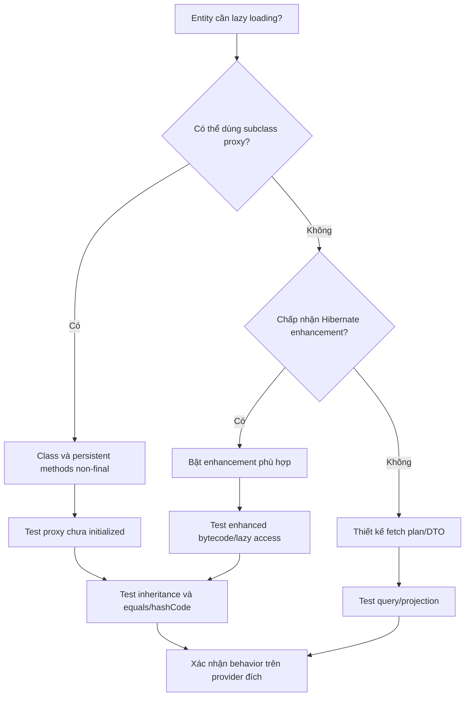

# Giới hạn liên quan đến final, kế thừa và phương thức bị ghi đè trong Hibernate

Hibernate ORM hỗ trợ lazy loading bằng **proxy** và **bytecode enhancement**. Hai cơ chế này giúp trì hoãn việc tải entity hoặc thuộc tính cho tới khi ứng dụng thực sự cần dữ liệu. Tuy nhiên, chúng phải phối hợp với quy tắc kế thừa, virtual dispatch và method overriding của Java. Modifier `final`, private/static methods và cách thiết kế entity hierarchy vì vậy có thể ảnh hưởng trực tiếp đến khả năng lazy loading.

Những biểu hiện thường gặp gồm:

- Entity được lưu bình thường nhưng association `LAZY` lại tải sớm.
- Method final đọc field trên proxy chưa khởi tạo và nhìn thấy state không đầy đủ.
- `getClass()` trả về generated proxy class thay vì entity class.
- Kiểm tra subtype hoặc ép kiểu trong inheritance hierarchy không hoạt động như mong đợi.
- `equals()`, `hashCode()` hoặc `toString()` kích hoạt lazy loading ngoài ý muốn.
- Method được override trong subclass làm thay đổi dispatch hoặc side effects khi ORM truy cập persistent state.
- Enhancement giúp một số trường hợp final, nhưng build pipeline hoặc mapping không được cấu hình đúng.

Cần phân biệt **subclass proxy**, **method interception**, **entity inheritance** và **bytecode enhancement**. Đồng thời, phải tách yêu cầu portability của Jakarta Persistence khỏi khả năng Hibernate-specific của một phiên bản cụ thể.

## 1. Vì sao Hibernate cần proxy?

Giả sử một đơn hàng tham chiếu tới khách hàng:

```java
@Entity
@Table(name = "purchase_orders")
public class PurchaseOrder {

    @Id
    private Long id;

    @ManyToOne(fetch = FetchType.LAZY)
    @JoinColumn(name = "customer_id")
    private Customer customer;

    protected PurchaseOrder() {}

    public Customer getCustomer() {
        return customer;
    }
}
```

Khi ứng dụng tải order:

```java
PurchaseOrder order = entityManager.find(
    PurchaseOrder.class,
    orderId
);
```

Hibernate có thể chưa tải toàn bộ Customer. Thay vào đó, nó gán cho field `customer` một object đại diện có identifier. Khi ứng dụng truy cập method cần state chưa tải, proxy yêu cầu Hibernate khởi tạo entity.

```java
Customer customer = order.getCustomer();

// Hibernate thường có thể lấy ID từ proxy mà chưa tải toàn bộ entity.
Long customerId = customer.getId();

// Truy cập dữ liệu thực có thể kích hoạt SELECT.
String name = customer.getName();
```

Chi tiết về getter ID phụ thuộc access strategy và provider, nhưng Hibernate thường có thể lấy identifier trực tiếp từ proxy.

Proxy giúp trì hoãn SELECT, giảm lượng dữ liệu tải và biểu diễn association bằng entity reference. Đổi lại, proxy là một Java object và phải tuân theo các giới hạn của Java inheritance.

## 2. Subclass proxy hoạt động như thế nào?

Giả sử entity:

```java
public class Customer {

    private Long id;
    private String name;

    public Long getId() {
        return id;
    }

    public String getName() {
        return name;
    }
}
```

Hibernate có thể tạo một class runtime kế thừa Customer và override các method có thể intercept. Pseudocode:

```java
// Minh họa ý tưởng, không phải mã proxy Hibernate thực tế.
class CustomerHibernateProxy extends Customer {

    private LazyInitializer initializer;

    @Override
    public Long getId() {
        return initializer.getIdentifier();
    }

    @Override
    public String getName() {
        Customer target = initializer.initialize();
        return target.getName();
    }
}
```

Khi method được gọi, interceptor có thể trả identifier mà chưa load, hoặc khởi tạo entity rồi chuyển lời gọi tới implementation. Cấu trúc proxy thật và cơ chế dispatch nội bộ phụ thuộc Hibernate version.

Nếu entity class là final, Java cấm tạo subclass. Nếu method là final, subclass không thể override method đó. Vì thế, **subclass proxy chỉ intercept được những điểm Java cho phép override/dispatch**.

## 3. Yêu cầu portability của Jakarta Persistence

Theo yêu cầu portable của Jakarta Persistence, entity class cần có constructor không tham số public/protected, không được khai báo final, và không nên có final persistent methods hoặc persistent instance variables theo quy định của specification. Entity cũng phải có cấu trúc và visibility phù hợp để provider khởi tạo, truy cập state và thực hiện persistence.

Ví dụ entity portable:

```java
@Entity
public class Customer {

    @Id
    private Long id;

    protected Customer() {
        // Constructor cho persistence provider.
    }

    public Long getId() {
        return id;
    }
}
```

Ví dụ không phù hợp với portability contract:

```java
@Entity
public final class Customer {

    @Id
    private final Long id;

    protected Customer() {
        this.id = null;
    }

    public final Long getId() {
        return id;
    }
}
```

Hibernate có thể hỗ trợ một số cấu trúc ngoài giới hạn portable trong những trường hợp cụ thể. Khi đó, ứng dụng phụ thuộc Hibernate/version và có thể không chuyển được sang JPA provider khác.

**Khả năng persist một class không đồng nghĩa class đó tuân thủ mọi yêu cầu portability của Jakarta Persistence.**

## 4. Entity final và giới hạn lazy proxy

Xét:

```java
@Entity
public final class Customer {

    @Id
    private Long id;

    private String name;

    protected Customer() {}

    public String getName() {
        return name;
    }
}
```

Nếu lazy loading cần subclass proxy của Customer, modifier final ngăn Hibernate tạo subclass. Provider có thể phải tải association theo cách khác, thường sớm hơn, hoặc không đáp ứng được một số yêu cầu proxy cụ thể. Kết quả còn phụ thuộc enhancement, mapping, query và Hibernate version.

Không nên khẳng định mọi association tới entity final luôn eager trong mọi cấu hình. Điều chắc chắn là **subclass proxy không thể kế thừa một class final**.

Final vẫn rất hữu ích cho value object không được quản lý như entity:

```java
public final class Money {

    private final BigDecimal amount;
    private final Currency currency;

    public Money(BigDecimal amount, Currency currency) {
        this.amount = Objects.requireNonNull(amount);
        this.currency = Objects.requireNonNull(currency);
    }

    public BigDecimal amount() {
        return amount;
    }

    public Currency currency() {
        return currency;
    }
}
```

Money có thể được ánh xạ bằng `@Embeddable` hoặc converter theo thiết kế phù hợp, nhưng persistent embeddable vẫn cần đáp ứng các yêu cầu mapping tương ứng. Không nên suy luận mọi class final đều tự động phù hợp làm embeddable.

## 5. Method final có thể phá interception như thế nào?

```java
@Entity
public class Customer {

    @Id
    private Long id;

    private String name;

    public final String getName() {
        return name;
    }
}
```

Nếu Hibernate dùng subclass proxy, proxy không thể override `getName()`. Lời gọi method final không đi qua override interceptor được tạo cho proxy.

Nếu proxy chưa có persistent state đầy đủ, method final đọc trực tiếp field có thể nhìn thấy state chưa được khởi tạo trên proxy object, tùy cách proxy được tạo và đường thực thi.

```text
Entity thật:
  id = 42
  name = "Nguyễn An"

Proxy chưa khởi tạo:
  identifier = 42
  persistent state chưa được load

Method có thể intercept:
  proxy → initialize → trả "Nguyễn An"

Method final:
  không thể override qua subclass proxy
  → không có interception path tương ứng
```

Không dùng final cho getter hoặc business method đọc persistent state nếu ứng dụng dựa vào subclass proxies.

### Final method kế thừa từ superclass

```java
@MappedSuperclass
public abstract class BaseEntity {

    @Id
    protected Long id;

    public final Long getId() {
        return id;
    }
}

@Entity
public class Customer extends BaseEntity {
    private String name;
}
```

Customer không tự khai báo getter final, nhưng vẫn kế thừa method final từ BaseEntity. Proxy subclass của Customer không thể override method đó. Vì vậy, phải kiểm tra toàn bộ hierarchy, không chỉ file có annotation `@Entity`.

Một method final khác có thể nguy hiểm hơn getter:

```java
public final boolean canPlaceOrder() {
    return status == Status.ACTIVE
        && creditLimit.compareTo(balance) > 0;
}
```

Nếu method này chạy trên proxy chưa khởi tạo mà không qua interception, nó có thể đọc state không đầy đủ.

## 6. Private, static và visibility của method

Subclass proxy dựa trên kế thừa và virtual dispatch:

- **Private method:** không thể được subclass override.
- **Static method:** thuộc class, không được override theo polymorphic dispatch; static hiding không phải interception.
- **Final method:** không thể override.
- **Method bị giới hạn bởi visibility/package/module:** có thể không được proxy generation xử lý như mong muốn.
- **Public/protected non-final instance method:** thường là lựa chọn phù hợp hơn cho subclass proxy.

Ví dụ:

```java
public class Customer {

    private String internalName() {
        return name;
    }

    public static String entityKind() {
        return "CUSTOMER";
    }

    public final String displayName() {
        return name;
    }

    protected String getNameForDomain() {
        return name;
    }
}
```

Private, static và final methods không phải extension point cho subclass proxy. Chúng vẫn có thể được dùng cho encapsulation hoặc utility logic, nhưng đừng kỳ vọng Hibernate intercept một lời gọi không đi qua virtual override.

## 7. Method override trong entity hierarchy

Java cho phép subclass override method của superclass:

```java
@Entity
@Inheritance(strategy = InheritanceType.SINGLE_TABLE)
@DiscriminatorColumn(name = "payment_type")
public abstract class Payment {

    @Id
    private Long id;

    public String description() {
        return "Payment";
    }
}

@Entity
@DiscriminatorValue("CARD")
public class CardPayment extends Payment {

    @Override
    public String description() {
        return "Card payment";
    }
}
```

Khi Hibernate tải entity concrete CardPayment, virtual dispatch có thể gọi implementation của subclass. Tuy nhiên, proxy được tạo cho một mapped base type có thể chưa biết concrete subtype cho tới khi cần khởi tạo dữ liệu.

Một method override có thể thay đổi hành vi nếu method đọc field khác, gọi lazy association hoặc thực hiện side effects. Tránh persistent getters/setters có logic phức tạp. Provider có thể gọi accessors trong hydrate, snapshot hoặc dirty checking tùy access strategy.

### Superclass gọi method override

```java
public abstract class Payment {

    public String summary() {
        return "Payment: " + detail();
    }

    protected abstract String detail();
}

@Entity
public class CardPayment extends Payment {

    @Override
    protected String detail() {
        return "card";
    }
}
```

`summary()` gọi `detail()` theo virtual dispatch. Nếu method được gọi qua proxy và entity chưa initialized, Hibernate cần xử lý initialization trước khi logic phụ thuộc state chạy. Final/private methods hoặc enhancement không bao phủ đường truy cập có thể làm kết quả khác kỳ vọng.

## 8. Inheritance strategy và proxy là hai vấn đề khác nhau

JPA hỗ trợ các chiến lược inheritance:

| Strategy | Cách lưu | Tác động cần chú ý |
|---|---|---|
| `SINGLE_TABLE` | Root và subtypes chung một bảng, phân biệt bằng discriminator | Query root có thể trả nhiều subtype |
| `JOINED` | Root table và bảng riêng cho subclass | Tải concrete subtype có thể cần JOIN |
| `TABLE_PER_CLASS` | Mỗi concrete class có bảng riêng | Polymorphic query có thể UNION nhiều bảng |

Proxy là object Java đại diện entity reference; inheritance strategy là cách database lưu hierarchy. Java inheritance vẫn có quy tắc final/override giống nhau, bất kể dữ liệu được lưu ở một bảng hay nhiều bảng.

## 9. Proxy của base type và kiểm tra subtype

Giả sử:

```java
@Entity
@Inheritance(strategy = InheritanceType.SINGLE_TABLE)
public abstract class Payment {
    @Id
    private Long id;
}

@Entity
public class CardPayment extends Payment {
    private String lastFour;
}

@Entity
public class BankTransferPayment extends Payment {
    private String bankReference;
}
```

Một association khai báo kiểu base:

```java
@ManyToOne(fetch = FetchType.LAZY)
private Payment payment;
```

Hibernate có thể trả proxy đại diện Payment mà chưa tải concrete subtype.

```java
Payment payment = invoice.getPayment();

boolean isPayment = payment instanceof Payment; // thường true
boolean isCard = payment instanceof CardPayment;
```

`instanceof Payment` thường true vì proxy là subtype runtime của Payment. Nhưng `instanceof CardPayment` có thể không phản ánh đúng subtype trước khi proxy được khởi tạo, tùy proxy strategy và mapping.

Một proxy được tạo cho base class không nhất thiết là instance của từng concrete subclass. Cast:

```java
CardPayment card = (CardPayment) payment;
```

có thể ném `ClassCastException` dù row thực trong database là CardPayment, nếu runtime proxy không phải subtype đó. Cách an toàn là resolve/initialize type theo API Hibernate phù hợp hoặc truy vấn concrete type rõ ràng.

## 10. `getClass()` và `instanceof` không trả lời cùng một câu hỏi

`getClass()` trả về runtime class chính xác; `instanceof` kiểm tra khả năng gán theo quan hệ class/interface.

Với subclass proxy:

```java
Customer customer = session.getReference(Customer.class, 42L);

System.out.println(customer instanceof Customer); // true
System.out.println(customer.getClass() == Customer.class); // thường false
```

Runtime class có thể là class do Hibernate sinh ra. Tên class proxy không phải API contract và có thể thay đổi.

Vì vậy, code sau dễ lỗi:

```java
if (customer.getClass() == Customer.class) {
    // Xử lý Customer.
}
```

Proxy đại diện Customer có thể không vào nhánh này dù nó đại diện cùng entity mapping.

### Lấy persistent class của proxy

Hibernate có API để làm việc với proxy:

```java
import org.hibernate.proxy.HibernateProxy;

static Class<?> proxyPersistentClass(Object entity) {
    if (entity instanceof HibernateProxy proxy) {
        return proxy.getHibernateLazyInitializer()
            .getPersistentClass();
    }
    return entity.getClass();
}
```

Đây là Hibernate-specific API cho subclass proxies. Nó trả class mapping mà proxy được tạo cho, nhưng **không đảm bảo luôn biết concrete subtype thực tế** nếu proxy được tạo cho root type và chưa initialized.

Hibernate cũng cung cấp utility `Hibernate.getClass(entity)`. Trong một số API/version, việc lấy class thực có thể initialize proxy và gây SELECT. Một số version có API lazy class resolution như `Hibernate.getClassLazy`; cần kiểm tra Javadocs đúng version và không gọi class-resolution có side effect trong hot path của `equals/hashCode`.

## 11. Field access và property access

JPA có thể dùng field access hoặc property access.

### Field access

```java
@Entity
@Access(AccessType.FIELD)
public class Customer {

    @Id
    private Long id;

    private String name;

    public final String getName() {
        return name;
    }
}
```

Hibernate/JPA đọc persistent state qua fields theo mapping. Getter final vẫn có thể không được proxy intercept, nhưng field access và proxy behavior là hai cơ chế khác nhau.

### Property access

```java
@Entity
@Access(AccessType.PROPERTY)
public class Customer {

    private Long id;
    private String name;

    @Id
    public Long getId() {
        return id;
    }

    public final String getName() {
        return name;
    }
}
```

Với property access, getters/setters là persistent accessors theo mapping. Getter final hạn chế proxy override/intercept và không phù hợp với yêu cầu portability của JPA cho persistent methods.

Không dùng final trên persistent accessor như một hàng rào bảo vệ entity. Nếu cần bảo vệ invariant, dùng encapsulation và domain methods rõ ràng.

## 12. Override getter có thể làm thay đổi behavior ORM

```java
@MappedSuperclass
public abstract class Person {

    protected String name;

    public String getName() {
        return name;
    }
}

@Entity
public class Customer extends Person {

    private String preferredName;

    @Override
    public String getName() {
        return preferredName != null
            ? preferredName
            : super.getName();
    }
}
```

Nếu mapping dùng property access, việc override accessor có thể ảnh hưởng metadata, cách provider đọc state và proxy dispatch. Nếu method override đọc field khác hoặc có side effects, Hibernate gọi getter/setter trong quá trình persistence có thể tạo hành vi khó đoán.

Không đặt network calls, truy vấn repository, lazy association traversal hoặc logic thay đổi state phức tạp trong persistent getters/setters. Accessor nên có semantics ổn định. Derived property nên dùng business method riêng hoặc mapping phù hợp như `@Formula` nếu chấp nhận Hibernate-specific behavior.

## 13. Override method có thể kích hoạt lazy loading

```java
@Entity
public class Customer {

    @Id
    private Long id;

    @OneToMany(mappedBy = "customer", fetch = FetchType.LAZY)
    private List<PurchaseOrder> orders;

    public int getOrderCount() {
        return orders.size();
    }
}
```

`getOrderCount` truy cập collection lazy. Khi gọi:

- Collection chưa initialized có thể phát SELECT.
- Session đã đóng có thể dẫn tới `LazyInitializationException`.
- Nếu method final trên subclass proxy, interception có thể bị bỏ qua và method có thể chạy trên proxy state chưa tải đầy đủ.
- Enhancement có thể thay đổi đường lazy interception, nhưng vẫn cần Session phù hợp.

Nếu API chỉ cần số lượng order, query count/projection thường tốt hơn tải collection.

## 14. equals/hashCode trong entity có proxy

Một entity có thể được so sánh trong `Set`, `Map` hoặc khi đối chiếu object từ nhiều Session. Proxy làm equality phức tạp.

### Lỗi dùng getClass()

```java
@Override
public boolean equals(Object other) {
    if (other == null || getClass() != other.getClass()) {
        return false;
    }
    Customer that = (Customer) other;
    return id != null && id.equals(that.id);
}
```

Nếu `other` là proxy subclass, `getClass()` có thể khác Customer.class. Hai object cùng persistent identity có thể bị coi là khác nhau.

### Lỗi đọc association

```java
@Override
public int hashCode() {
    return Objects.hash(id, name, orders);
}
```

`orders` có thể lazy; gọi `hashCode` có thể tải collection, gây N+1 hoặc `LazyInitializationException`. Collection mutable còn có thể làm hash code thay đổi khi relationship thay đổi.

### Một hướng triển khai có điều kiện

Với entity không có inheritance phức tạp và equality dựa trên generated ID:

```java
@Override
public boolean equals(Object other) {
    if (this == other) {
        return true;
    }
    if (other == null) {
        return false;
    }
    if (!(other instanceof Customer that)) {
        return false;
    }
    return getId() != null
        && getId().equals(that.getId());
}

@Override
public int hashCode() {
    return Customer.class.hashCode();
}
```

Đây không phải mẫu đúng cho mọi entity. Cần bảo đảm transient entities có ID null không bị coi bằng nhau; hash code ổn định trước/sau khi ID được sinh; getter ID an toàn với proxy; identity semantics phù hợp inheritance và tenant scope; không đưa lazy associations hoặc mutable fields vào hash code.

Nếu entity có hierarchy, `instanceof Customer` có thể coi các subtype khác nhau là bằng nhau khi ID trùng. Một số domain nên dùng reference/value object riêng thay vì cố giải mọi trường hợp bằng một `equals`.

## 15. Hibernate proxy và Lombok

Lombok `@Data` thường sinh getter, setter, `equals`, `hashCode` và `toString` theo cấu hình:

```java
@Data
@Entity
public class Customer {

    @Id
    private Long id;

    private String name;

    @OneToMany(mappedBy = "customer")
    private List<PurchaseOrder> orders;
}
```

Điều này có thể khiến:

- equals dùng getClass hoặc so sánh field không hợp proxy.
- hashCode truy cập collection lazy.
- toString tải toàn bộ graph.
- Vòng lặp giữa Customer và PurchaseOrder hai chiều.
- Hash code thay đổi khi ID hoặc mutable association đổi.

Không phải mọi annotation Lombok đều tự làm method final; hãy kiểm tra code được sinh và cấu hình. Không nên dùng `@Data` theo phản xạ trên entity.

Một lựa chọn rõ hơn:

```java
@Getter
@Setter
@Entity
public class Customer {
    // Tự thiết kế equals/hashCode/toString.
}
```

Có thể loại trừ association khỏi generated methods hoặc tự viết method chuyên biệt.

## 16. Interface-based proxy có giải quyết mọi vấn đề không?

Một số proxy strategy có thể dùng interface thay vì subclass entity, nếu provider/mapping hỗ trợ:

```java
public interface CustomerView {
    Long getId();
    String getName();
}

@Entity
public class Customer implements CustomerView {

    @Id
    private Long id;

    private String name;

    protected Customer() {}

    @Override
    public Long getId() {
        return id;
    }

    @Override
    public String getName() {
        return name;
    }
}
```

Tuy nhiên, association JPA thường khai báo theo entity type; cấu hình interface proxy là provider-specific; caller cast về concrete Customer có thể thất bại; final method trên concrete class có thể không được intercept nếu caller gọi trực tiếp concrete implementation; inheritance vẫn cần type resolution.

Interface có thể là một phần của proxy strategy nhưng **không phải cách sửa tổng quát cho entity final hoặc hierarchy phức tạp**. Interface ở API boundary cũng không biến lazy data thành dữ liệu đã tải. Nếu API cần độc lập persistence context, trả DTO đã materialize.

## 17. Bytecode enhancement khác subclass proxy ở đâu?

Hibernate hỗ trợ **bytecode enhancement**: class bytecode được biến đổi để thêm khả năng phục vụ ORM, chẳng hạn lazy attribute loading, inline dirty tracking, association management trong một số mapping và interception ở mức attribute access.

Khác với subclass proxy, enhancement sửa chính class entity (hoặc tạo enhanced bytecode variant). Vì vậy, một số giới hạn do cần tạo subclass có thể được giảm bớt.

| Khía cạnh | Subclass proxy | Bytecode enhancement |
|---|---|---|
| Cơ chế | Tạo class runtime kế thừa entity | Biến đổi bytecode entity |
| Can thiệp method | Override virtual methods | Instrumented code/attribute access |
| Entity class final | Không thể tạo subclass proxy | Có thể hỗ trợ một số đường lazy interception tùy version |
| Final method | Không thể override bằng proxy subclass | Có thể được instrument nếu enhancement hỗ trợ đường đó |
| Lazy entity reference | Thường proxy đại diện entity | Có thể dùng enhanced entity/interception |
| Lazy basic attributes | Không phải mục tiêu chính | Có thể hỗ trợ với enhancement |
| Dirty tracking | Thường dựa snapshot/ORM mechanisms | Có thể inline track writes |
| Cần build enhancement | Không nhất thiết | Có cấu hình build/runtime |
| Portability | Hibernate proxy behavior | Hibernate-specific enhancement |

**Enhancement không xóa bỏ mọi yêu cầu của Jakarta Persistence.** Một class final có thể được Hibernate hỗ trợ trong một số cấu hình enhancement, nhưng class đó vẫn có thể vi phạm yêu cầu portability của JPA.

## 18. Enhancement có thể giúp entity final như thế nào?

Với subclass proxy, final class chặn việc tạo subclass. Enhancement có thể đưa interception logic vào bytecode của chính entity cho một số tính năng.

```java
// Pseudocode minh họa, không phải source code enhancer sinh ra.
public final class Customer
        implements PersistentAttributeInterceptable {

    private String name;

    public String getName() {
        // Bytecode enhanced có thể kiểm tra interceptor
        // trước khi trả giá trị attribute.
        return name;
    }
}
```

Điều này giải thích vì sao enhancement có thể hỗ trợ lazy attribute loading mà không cần subclass override getter.

Nhưng cần lưu ý:

- Build pipeline phải thực sự chạy enhancement đúng entity classes.
- Không phải mọi method/direct field access đều được intercept trong mọi mode.
- Entity vẫn cần Session/transaction phù hợp khi lazy attribute chưa tải.
- Association type, inheritance và custom access patterns vẫn cần kiểm thử.
- Entity final vẫn không portable theo yêu cầu entity class của JPA.
- Cơ chế enhanced lazy loading và API configuration thay đổi theo Hibernate version.

Không bật enhancement rồi chỉ dựa vào việc ứng dụng compile thành công. Phải xác nhận bytecode được enhance và lazy behavior hoạt động.

## 19. Lazy attribute loading và inline dirty tracking

Lazy loading thường áp dụng cho association:

```java
@ManyToOne(fetch = FetchType.LAZY)
private Customer customer;
```

Nhưng entity cũng có thể có thuộc tính scalar lớn:

```java
@Basic(fetch = FetchType.LAZY)
@Lob
private String documentContent;
```

`FetchType.LAZY` cho basic attributes là hint theo JPA; provider có thể cần enhancement để thực hiện lazy loading như mong muốn.

```java
Document document = entityManager.find(Document.class, id);

// Có thể chưa tải LOB nếu enhancement/mapping hỗ trợ.
String title = document.getTitle();

// Truy cập content có thể phát SELECT bổ sung.
String content = document.getDocumentContent();
```

Enhancement còn có thể hỗ trợ inline dirty tracking, đánh dấu attribute dirty khi code gán giá trị. Nhưng nó không có nghĩa mọi mutation sâu bên trong object đều tự được nhận biết:

```java
customer.getPreferences().put("theme", "dark");
```

Nếu preferences là mutable map và code chỉ sửa object bên trong mà không gán lại field, kết quả tracking phụ thuộc mutability plan, snapshot và mapping. Enhancement không biến mọi object graph thành immutable value.

## 20. Final field và constructor trong entity

Final persistent fields không phù hợp với mô hình provider cần hydrate/update state theo portability requirements:

```java
@Entity
public class Customer {

    @Id
    private final Long id;

    private final String name;

    protected Customer() {
        this.id = null;
        this.name = null;
    }
}
```

Hibernate có thể dùng reflection/bytecode mechanisms trong một số trường hợp, nhưng không nên dựa vào đó để thiết kế entity portable.

Một thiết kế tốt giữ entity class và persistent fields không final, nhưng giới hạn mutation qua API domain:

```java
@Entity
public class Customer {

    @Id
    @GeneratedValue
    private Long id;

    @Column(nullable = false, updatable = false)
    private String customerCode;

    private String name;

    protected Customer() {}

    public Customer(String customerCode, String name) {
        this.customerCode = Objects.requireNonNull(customerCode);
        this.name = Objects.requireNonNull(name);
    }

    public Long getId() { return id; }
    public String getCustomerCode() { return customerCode; }
    public String getName() { return name; }

    public void rename(String newName) {
        this.name = Objects.requireNonNull(newName);
    }
}
```

`updatable=false` diễn đạt rằng Hibernate không đưa field vào UPDATE; nó không tự bảo đảm Java field bất biến tuyệt đối nếu code khác sửa qua reflection.

Entity portable cần no-argument constructor public/protected. Constructor không nên thực hiện I/O, truy cập repository hoặc logic phụ thuộc Session vì provider có thể gọi constructor trong quá trình hydration/proxy.

## 21. Kotlin final-by-default và all-open plugin

Trong Kotlin, class và method mặc định final:

```kotlin
@Entity
class Customer(
    @Id
    val id: Long,
    var name: String
)
```

Điều này có thể cản subclass proxy. Kotlin thường được cấu hình với plugin all-open cho annotation persistence và no-arg cho constructor.

Ví dụ cấu hình Gradle:

```kotlin
plugins {
    kotlin("plugin.jpa") version "<kotlin-version>"
    kotlin("plugin.allopen") version "<kotlin-version>"
}

allOpen {
    annotation("jakarta.persistence.Entity")
    annotation("jakarta.persistence.MappedSuperclass")
    annotation("jakarta.persistence.Embeddable")
}
```

`plugin.jpa` có thể cấu hình no-arg cho JPA annotations; việc dùng all-open riêng hay plugin tổng hợp phụ thuộc Kotlin Gradle plugin/version. Hãy kiểm tra tài liệu Kotlin hiện tại và build output.

Kotlin `data class` sinh `equals/hashCode/toString/copy` dựa trên primary constructor properties. Với entity, ID có thể chưa được sinh, association lazy có thể bị truy cập, hash code có thể đổi, và copy có thể tạo object khác nhưng giữ cùng ID/association. Entity thường nên là class được thiết kế riêng; data class phù hợp hơn với DTO/value objects.

## 22. Java records và sealed classes

Java record là implicitly final và có state component final:

```java
public record CustomerRecord(Long id, String name) {}
```

Record rất phù hợp làm DTO projection:

```java
public record CustomerSummary(Long id, String name) {}
```

Nhưng không nên xem record là entity thay thế trực tiếp cho class cần lazy proxy, dirty checking và lifecycle state.

Java sealed classes cũng giới hạn class nào được phép kế thừa:

```java
public sealed class Payment
    permits CardPayment, BankTransferPayment {
}
```

Nếu Hibernate muốn tạo subclass proxy runtime, class đó phải được phép kế thừa theo quy tắc sealed hierarchy. Proxy-generated subclass không nằm trong danh sách permits có thể không được phép tạo theo cơ chế subclass thông thường.

Sealed entity hierarchy có thể xung đột với subclass proxy generation. Khả năng hỗ trợ của enhancement/provider phụ thuộc Hibernate/JDK version và cách class được biên dịch. Không nên giả định proxy subclass luôn hoạt động.

## 23. Module system và proxy generation

Java Platform Module System (JPMS) có thể giới hạn reflective access hoặc khả năng định nghĩa generated classes trong package/module. Hibernate proxy/enhancement cần quyền truy cập phù hợp để instantiate/intercept entity.

Nếu entity nằm trong named module với package không mở cho ORM, ứng dụng có thể gặp lỗi reflective access hoặc proxy generation. Cấu hình `opens` có thể cần thiết tùy Hibernate version:

```java
module com.example.application {
    requires jakarta.persistence;
    requires org.hibernate.orm.core;

    opens com.example.domain to org.hibernate.orm.core;
}
```

Tên module thực tế phụ thuộc artifact. Không mở rộng package theo phản xạ; chỉ mở những package cần thiết theo security/module design.

## 24. Logging, serialization và fetch plan

Một logger:

```java
log.info("Customer: {}", customer);
```

có thể gọi `toString()`. Nếu implementation truy cập association lazy, log có thể kích hoạt SELECT hoặc lỗi sau khi Session đóng.

JSON serializer cũng có thể gọi getters và traverse graph:

```java
return ResponseEntity.ok(customer);
```

Nếu serialization xảy ra ngoài transaction, proxy chưa initialized có thể ném exception. Nếu Session còn mở, serialization có thể phát nhiều query ngoài ý muốn.

Nếu API cần tên khách hàng và order count, dùng projection:

```java
List<OrderSummary> summaries = entityManager.createQuery("""
    select new com.example.api.OrderSummary(
        o.id,
        c.name,
        count(l)
    )
    from PurchaseOrder o
    join o.customer c
    left join o.lines l
    where o.status = :status
    group by o.id, c.name
    """, OrderSummary.class)
    .setParameter("status", OrderStatus.OPEN)
    .getResultList();
```

Projection trả dữ liệu cần thiết mà không đưa proxy ra ngoài. Fetch join/entity graph cũng có thể phù hợp, nhưng fetch join collection có thể nhân row và gây pagination issues. Chọn fetch plan theo cardinality.

## 25. Kiểm tra proxy và enhancement trong test

Hibernate cung cấp API kiểm tra proxy initialization, ví dụ `Hibernate.isInitialized`:

```java
import org.hibernate.Hibernate;

Customer customer = session.getReference(Customer.class, 42L);

assertFalse(Hibernate.isInitialized(customer));

customer.getName();

assertTrue(Hibernate.isInitialized(customer));
```

Đây là Hibernate-specific utility. Kết quả phụ thuộc mapping, enhancement và cách getter được gọi. Enhanced entity không phải subclass proxy có thể cần API kiểm tra trạng thái attribute khác.

### Kiểm thử final method

Nếu dự án có class/method final được Hibernate-specific support, test riêng:

- Entity được persist/load không?
- Association lazy có thực sự lazy không?
- Gọi final getter trên uninitialized reference trả gì?
- Có SELECT được phát không?
- Có cảnh báo khi tạo proxy không?
- Khi Session đóng, method có ném exception hay đọc state chưa load?
- Enhancement bật/tắt có thay đổi kết quả không?

Phải test **proxy chưa initialized**, không chỉ entity đã được load đầy đủ.

### Kiểm thử inheritance

- Load base-type reference cho từng subtype.
- Kiểm tra `instanceof` trước và sau initialization.
- Thử cast concrete subtype.
- Xác định SQL cần để resolve discriminator/type.
- Kiểm tra equals/hashCode giữa proxy và entity thật.
- Kiểm tra final method trong superclass/mapped superclass.

### Kiểm thử enhancement

- Build sạch với enhancer.
- Load entity và chỉ truy cập một lazy attribute.
- Capture SQL trước/sau.
- Mutate scalar và mutable component.
- Flush/reload để xác nhận dirty tracking.
- Chạy test bằng đúng artifact/build output production dùng.

## 26. Những lỗi phổ biến và cách xử lý

| Triệu chứng | Nguyên nhân | Cách xử lý |
|---|---|---|
| Không tạo được proxy cho entity final | Subclass proxy không thể kế thừa class final | Bỏ final nếu cần proxy/JPA portability; hoặc đánh giá enhancement |
| Getter final trả null/default | Method không được proxy intercept | Bỏ final khỏi persistent accessor hoặc test enhancement |
| `getClass() == Entity.class` trả false | Runtime class là generated proxy | Dùng type-resolution API phù hợp, hiểu initialization cost |
| Cast base proxy sang subtype lỗi | Proxy chưa đại diện concrete subtype | Initialize/resolve subtype hoặc query concrete type |
| equals/hashCode phát SELECT | Method đọc lazy association hoặc class resolution | Equality dựa trên identity/key ổn định, tránh graph traversal |
| toString gây LazyInitializationException | Logger/serializer truy cập association lazy | Dùng DTO/log ID, loại association khỏi toString |
| Kotlin entity không proxy được | Class/method final mặc định | Cấu hình all-open/no-arg đúng |
| Enhancement bật nhưng lazy attribute tải sớm | Enhancer không chạy, entity không được enhance hoặc fetch plan eager | Kiểm tra build task, bytecode, SQL và version |
| Override gây side effects khi hydrate | Getter/setter có logic phức tạp | Accessor đơn giản, tách business operation |
| Bỏ sót final method ở superclass | Proxy kế thừa final method và không thể override | Rà soát toàn bộ hierarchy |

## 27. Quy trình lựa chọn proxy và enhancement



Các bước triển khai:

1. **Xác định nhu cầu lazy thực tế.** Entity có association/basic attributes nào thực sự cần tải trễ?
2. **Kiểm tra toàn hierarchy.** Entity, mapped superclass, inherited methods, final classes và overrides.
3. **Chọn cơ chế.** Subclass proxy, bytecode enhancement hoặc fetch plan/DTO.
4. **Xác nhận portability.** Nếu cần JPA provider independence, tuân thủ entity class requirements.
5. **Kiểm tra generated methods.** equals/hashCode/toString của Lombok hoặc IDE.
6. **Quan sát SQL.** Xác định khi nào proxy/attribute được khởi tạo.
7. **Kiểm thử sau Session close.** Phân biệt dữ liệu đã tải với lazy state chưa tải.
8. **Kiểm thử inheritance.** Base proxy, concrete subtype, class checks và casting.
9. **Kiểm tra build pipeline.** Enhancement phải chạy cả CI/production artifact.
10. **Ghi nhận version.** Hibernate, JDK, Kotlin plugin, build enhancer và DB dialect.

## 28. Nguyên tắc thiết kế thực dụng

Với entity cần làm việc ổn định cùng Hibernate:

- Giữ entity class không final nếu cần subclass proxy và JPA portability.
- Giữ persistent accessors/methods cần proxy interception ở dạng non-final.
- Kiểm tra final methods kế thừa từ mapped superclass.
- Không dùng private/static/final method như interception boundary.
- Tránh persistent getter/setter có side effects hoặc truy cập network.
- Tránh Lombok `@Data` trên entity nếu chưa kiểm soát equality/toString.
- Thiết kế equals/hashCode có xét proxy, inheritance và generated ID.
- Không dựa vào runtime proxy class name cho logic domain.
- Dùng DTO/projection ở API boundary thay vì trả proxy ra ngoài.
- Chỉ bật bytecode enhancement khi build pipeline và tests chứng minh đúng behavior.
- Dùng entity final/records cho mô hình phù hợp, không ép chúng vào entity proxy model.
- Chạy integration tests trên Hibernate/JDK/build configuration thật.

Không phải mọi method trong entity đều phải public hoặc mọi field đều cần getter. Điều quan trọng là **các đường truy cập persistent state mà ORM cần hydrate, intercept hoặc dirty-track phải phù hợp với cơ chế mapping/provider đang dùng**.

## 29. Tổng kết: final, inheritance và override tác động trực tiếp tới ORM interception

Với subclass proxies, Hibernate cần một class có thể được kế thừa và những instance methods có thể override để intercept lời gọi. Vì vậy:

1. **Entity final** không thể được proxy bằng subclass.
2. **Final method** không thể bị proxy subclass override; method đọc persistent state có thể bỏ qua lazy initialization.
3. **Final method kế thừa từ superclass** gây cùng giới hạn, dù entity class không khai báo final.
4. **Private/static methods** không có virtual dispatch phù hợp cho subclass interception.
5. **Override trong hierarchy** có thể làm thay đổi method dispatch và cần được kiểm tra cùng mapping/inheritance strategy.
6. **Proxy runtime class khác entity class**; `getClass()` không phải cách tổng quát để nhận diện persistent type.
7. **Base-type proxy có thể chưa biết concrete subtype**, nên cast và `instanceof` subtype cần được xử lý có chủ đích.
8. **equals/hashCode/toString** có thể kích hoạt lazy loading hoặc vi phạm equality contract nếu dựa vào proxy class/association.
9. **Bytecode enhancement** có thể hỗ trợ lazy attribute loading và inline dirty tracking mà không cần mọi interception dựa vào subclass override, nhưng là Hibernate-specific và phụ thuộc version/build.
10. **Enhancement không tự xóa yêu cầu portability của Jakarta Persistence** và không làm mọi final method an toàn.
11. **Kotlin final-by-default, Java records và sealed hierarchies** cần được xem xét riêng trong persistence model.
12. **Integration tests với proxy chưa initialized và entity hierarchy thực** là cách xác nhận behavior đáng tin cậy.

Hãy chọn entity structure theo cơ chế ORM mà ứng dụng thực sự sử dụng. Nếu dựa vào subclass proxies, giữ class/method có thể override; nếu dựa vào enhancement, quản lý build pipeline và test bytecode; nếu không cần lazy entity references ở một boundary, dùng DTO/projection. Khi phân biệt rõ những cơ chế này, các giới hạn của `final`, kế thừa và method override sẽ trở thành quyết định thiết kế có thể dự đoán, thay vì lỗi lazy loading chỉ xuất hiện ở runtime.
